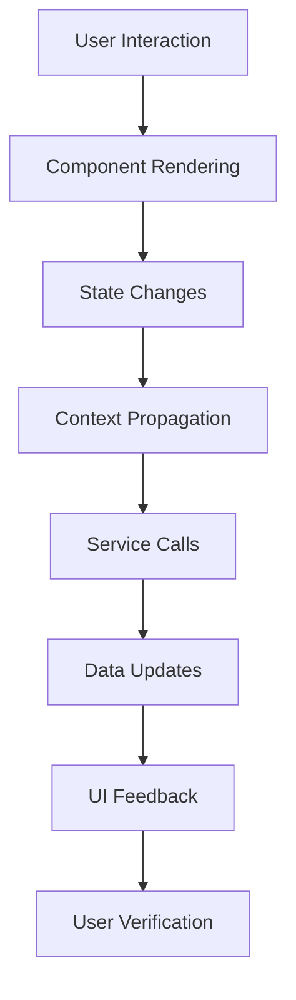
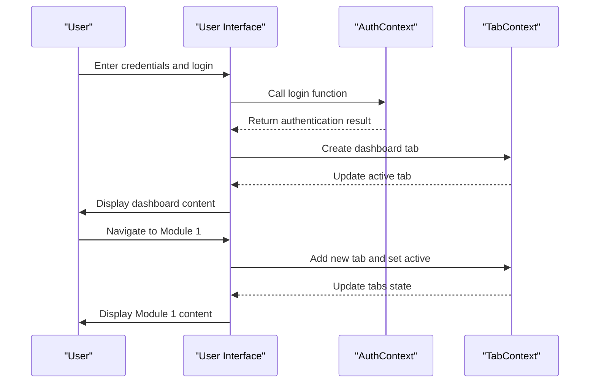
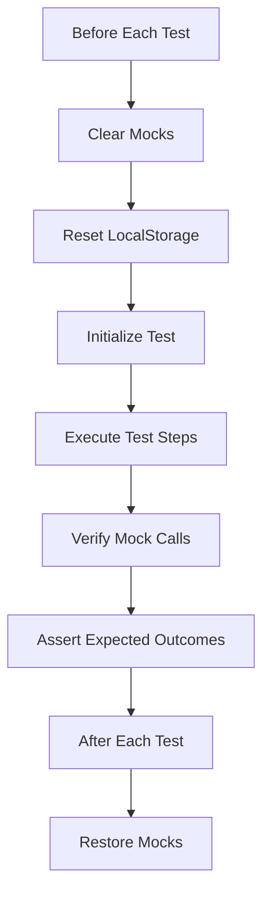
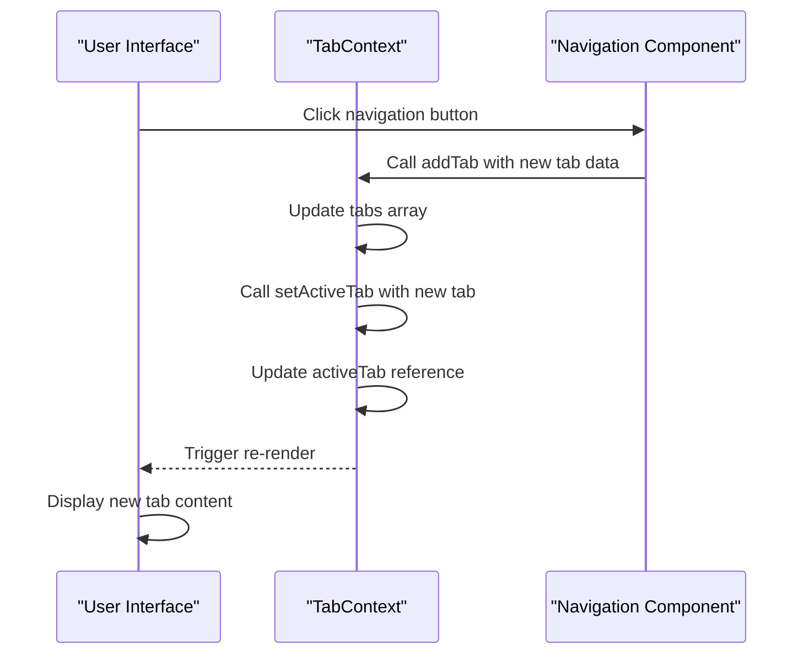

# Integration Testing

<cite>
**Referenced Files in This Document**   
- [UserFlowIntegration.test.tsx](file://src/tests/UserFlowIntegration.test.tsx)
- [education-system-config.spec.ts](file://src/tests/integration/education-system-config.spec.ts)
- [grading-engine.spec.ts](file://src/tests/integration/grading-engine.spec.ts)
- [mark-entry-ui.spec.ts](file://src/tests/integration/mark-entry-ui.spec.ts)
- [translationIntegrity.test.ts](file://src/tests/integration/translationIntegrity.test.ts)
- [vitest.config.ts](file://vitest.config.ts)
- [setup.ts](file://src/tests/setup.ts)
</cite>

## Table of Contents
1. [Integration Testing Overview](#integration-testing-overview)
2. [User Flow Integration Tests](#user-flow-integration-tests)
3. [Complex Workflow Testing](#complex-workflow-testing)
4. [Translation Integrity Verification](#translation-integrity-verification)
5. [Test Environment Setup](#test-environment-setup)
6. [Test State Management](#test-state-management)
7. [Assertion Strategies](#assertion-strategies)
8. [Cross-Component Behavior Verification](#cross-component-behavior-verification)
9. [Conclusion](#conclusion)

## Integration Testing Overview

Integration testing in schoolpilot3 focuses on verifying the interaction between multiple components, hooks, and services working together to complete user journeys. Unlike unit tests that isolate individual functions, integration tests validate the entire flow of functionality across component boundaries, ensuring that data flows correctly and state is properly maintained throughout complex workflows.

The integration testing strategy in schoolpilot3 is designed to catch issues that unit tests might miss, such as context propagation problems, event handling across components, and state management inconsistencies. These tests simulate realistic user behavior and data flows, providing confidence that the application works as expected in real-world scenarios.



**Diagram sources**
- [UserFlowIntegration.test.tsx](file://src/tests/UserFlowIntegration.test.tsx)

## User Flow Integration Tests

The UserFlowIntegration.test.tsx file contains comprehensive tests that verify complete user journeys through the application. These tests simulate realistic scenarios from login to tab creation and navigation, ensuring that all components work together seamlessly.

The tests use React Testing Library with MemoryRouter to simulate routing behavior and provide mock implementations of critical contexts like AuthContext and TabContext. This approach allows testing the integration between authentication, navigation, and tab management systems without relying on actual backend services.



**Section sources**
- [UserFlowIntegration.test.tsx](file://src/tests/UserFlowIntegration.test.tsx)

### Full User Flow from Login to Tab Creation

The primary integration test verifies the complete flow from user login to tab creation and navigation. It begins by rendering the LoginPage component with mocked authentication and tab contexts. The test then simulates user input by filling in the username and password fields using fireEvent.change, followed by submitting the form with fireEvent.click.

After submission, the test waits for the dashboard to appear using screen.findByText, confirming that the login process completed successfully. The test then verifies that the mock login function was called with the correct credentials, ensuring proper data flow from the UI to the authentication service.

```typescript
test('Full user flow from login to tab creation', async () => {
  const mockLogin = jest.fn().mockResolvedValue({ username: 'testuser' });
  const mockAddTab = jest.fn();
  const mockSetActiveTab = jest.fn();

  // Test implementation details...
});
```

**Section sources**
- [UserFlowIntegration.test.tsx](file://src/tests/UserFlowIntegration.test.tsx)

### Tab Persistence Across Refreshes

Another critical test verifies that tab state is properly persisted across page refreshes. This test stores mock tab data in localStorage before rendering the App component, simulating a scenario where a user has existing tabs from a previous session.

The test first verifies that the tabs are restored on initial render, then simulates a page refresh using the rerender function and confirms that the tabs remain present. This ensures that the application maintains user state even when the page is reloaded, providing a seamless user experience.

```typescript
test('Tab persistence across refreshes', () => {
  const mockTabs = [
    { id: 'tab1', title: 'Tab 1', content: 'Content 1', module: 'module1' },
    { id: 'tab2', title: 'Tab 2', content: 'Content 2', module: 'module2' },
  ];

  // Store tabs in localStorage
  localStorage.setItem('tabs', JSON.stringify(mockTabs));
  
  // Verify tabs are restored and persist after refresh
});
```

**Section sources**
- [UserFlowIntegration.test.tsx](file://src/tests/UserFlowIntegration.test.tsx)

## Complex Workflow Testing

Integration tests in schoolpilot3 cover complex workflows such as education system configuration, grading engine operations, and mark entry UI interactions. These tests ensure that multiple services and components work together correctly to implement business-critical functionality.

### Education System Configuration

The education-system-config.spec.ts file contains tests for the education system configuration workflow. Although the current implementation only includes placeholder test cases, the structure indicates that these tests will verify the ability to create new education systems and validate their configuration.

These tests would likely involve interacting with the EducationSystemForm component, submitting configuration data, and verifying that the EducationSystemValidationService properly validates the input against business rules. The tests would also check that the configuration is correctly stored and can be retrieved for subsequent operations.

```typescript
describe('EducationSystem Configuration', () => {
  it('should allow creating a new education system', () => {
    // Test case for creating a new education system
  });

  it('should validate the education system configuration', () => {
    // Test case for validating the configuration
  });
});
```

**Section sources**
- [education-system-config.spec.ts](file://src/tests/integration/education-system-config.spec.ts)

### Grading Engine Operations

The grading-engine.spec.ts file contains tests for the grading engine service, which applies different grading strategies to student marks. The tests cover various grading strategies including letter grades, percentage grades, and competency-based grading (CBC).

These integration tests would verify that the GradingEngineService correctly applies the selected strategy to calculate final grades, handles edge cases appropriately, and produces consistent results across different data inputs. The tests would also ensure that the grading results are properly stored and can be retrieved for reporting and analysis.

```typescript
describe('GradingEngineService', () => {
  it('should correctly apply the letter grade strategy', () => {
    // Test case for LetterGradeStrategy
  });

  it('should correctly apply the percentage grade strategy', () => {
    // Test case for PercentageGradeStrategy
  });

  it('should correctly apply the CBC grade strategy', () => {
    // Test case for CBCGradeStrategy
  });
});
```

**Section sources**
- [grading-engine.spec.ts](file://src/tests/integration/grading-engine.spec.ts)

### Mark Entry UI Interactions

The mark-entry-ui.spec.ts file contains tests for the mark entry user interface, focusing on bulk operations and real-time calculations. These tests verify that teachers can efficiently enter student marks and receive immediate feedback on grade calculations.

The bulk import test would simulate uploading a CSV file with multiple student marks, verifying that the system processes the data correctly and displays appropriate success or error messages. The real-time grade calculation test would verify that when a teacher enters a mark, the corresponding grade is immediately updated in the UI, providing instant feedback.

```typescript
describe('Mark Entry UI', () => {
  it('should allow bulk import of marks', () => {
    // Test case for bulk import
  });

  it('should perform real-time grade calculation', () => {
    // Test case for real-time grading
  });
});
```

**Section sources**
- [mark-entry-ui.spec.ts](file://src/tests/integration/mark-entry-ui.spec.ts)

## Translation Integrity Verification

The translationIntegrity.test.ts file contains tests that ensure all user interface elements have corresponding translations in all supported languages. This is critical for maintaining a consistent user experience across different language settings.

The test initializes the i18n system and retrieves the list of enabled modules from the module registry. It then iterates through each module's navigation items, checking whether a translation exists for each item's name using the i18n.exists method. Any missing translations are collected and reported as test failures.

This approach prevents untranslated keys from appearing in the UI, which could confuse users and degrade the overall user experience. By catching translation issues during testing, the team can ensure that all user-facing text is properly localized before deployment.

```typescript
describe('Translation Integrity', () => {
  it('should have a translation for every navigation item', async () => {
    await i18n.init();

    const enabledModules = getEnabledModules();
    const missingTranslations: string[] = [];

    for (const module of enabledModules) {
      if (module.navItems) {
        for (const navItem of module.navItems) {
          if (!i18n.exists(navItem.name)) {
            missingTranslations.push(navItem.name);
          }
        }
      }
    }

    expect(missingTranslations).toEqual([]);
  });
});
```

**Section sources**
- [translationIntegrity.test.ts](file://src/tests/integration/translationIntegrity.test.ts)

## Test Environment Setup

The integration testing environment in schoolpilot3 is configured using Vitest, a modern testing framework that provides a fast and reliable test runner. The vitest.config.ts file defines the test environment settings, including the use of jsdom for browser-like environment simulation and the inclusion of setup files.

The test environment is further configured through the setup.ts file, which initializes global test utilities and mocks system functions that could introduce variability in test results. This includes mocking console methods to reduce noise in test output, setting a fixed system time for consistent date-related tests, and mocking navigator.onLine for network state testing.

```typescript
export default defineConfig({
  plugins: [react()],
  test: {
    globals: true,
    environment: 'jsdom',
    setupFiles: ['./src/tests/setup.ts'],
  },
})
```

**Section sources**
- [vitest.config.ts](file://vitest.config.ts)
- [setup.ts](file://src/tests/setup.ts)

### Global Test Utilities

The setup.ts file provides several utility functions for creating mock data that can be used across different integration tests. These include createMockStudent, createMockStaff, createMockFinancialYear, and createMockInvoice, which generate consistent test data with default values that can be overridden as needed.

These utilities ensure that tests have access to realistic data without having to duplicate data creation logic. They also help maintain consistency across tests by providing a standard set of mock data that reflects the structure of real application data.

```typescript
export const createMockStudent = (overrides = {}) => ({
  id: 'test-student-1',
  admission_no: 'ADM001',
  first_name: 'John',
  last_name: 'Doe',
  gender: 'Male',
  status: 'Active',
  created_at: mockDate.toISOString(),
  updated_at: mockDate.toISOString(),
  ...overrides
});
```

**Section sources**
- [setup.ts](file://src/tests/setup.ts)

## Test State Management

Integration tests in schoolpilot3 carefully manage test state to ensure reliable and repeatable results. Each test begins with a clean state by clearing mocks and resetting localStorage in the beforeEach hook. This prevents tests from interfering with each other and ensures that each test runs in isolation.

The tests use Jest's mocking capabilities to create spies and mock functions that can track how many times they are called and with what arguments. This allows the tests to verify not only the final state but also the sequence of operations that led to that state.

For example, in the tab navigation test, mock functions are used for addTab and setActiveTab to verify that these functions are called with the expected parameters when a user navigates between modules. This ensures that the correct tab is created and activated in response to user actions.



**Section sources**
- [UserFlowIntegration.test.tsx](file://src/tests/UserFlowIntegration.test.tsx)

## Assertion Strategies

The integration tests use a variety of assertion strategies to verify expected outcomes across component boundaries. The primary assertion library is Jest, which provides a rich set of matchers for testing different types of conditions.

For UI elements, the tests use screen queries from React Testing Library to find elements by accessible text, labels, or roles. This ensures that the assertions are based on how users actually interact with the interface rather than implementation details.

For function calls, the tests use Jest's mock assertion methods like toHaveBeenCalledWith to verify that functions were called with the expected parameters. This is particularly important for verifying that data flows correctly between components and services.

The tests also use async utilities like findByText to wait for elements that appear as a result of asynchronous operations, such as API calls or state updates. This ensures that assertions are made only after the relevant operations have completed.

```typescript
// Example assertion patterns
expect(mockLogin).toHaveBeenCalledWith({
  username: 'testuser',
  password: 'password123',
});

expect(screen.getByText('dashboard')).toBeInTheDocument();

await screen.findByText(/network error/i);
```

**Section sources**
- [UserFlowIntegration.test.tsx](file://src/tests/UserFlowIntegration.test.tsx)

## Cross-Component Behavior Verification

Integration tests in schoolpilot3 are specifically designed to catch issues that unit tests might miss, particularly those related to context propagation and event handling across components.

### Context Propagation

The tests verify that context values are properly propagated from parent to child components and that updates to context values trigger the expected re-renders in consuming components. For example, when the active tab changes in the TabContext, all components that depend on this context should receive the updated value and respond appropriately.

The tab state maintenance test demonstrates this by verifying that clicking on different tabs updates the active tab state and that this change is reflected in the UI. The test uses mock functions to track calls to setActiveTab and verifies that the correct tab object is passed as an argument.

### Event Handling Across Components

The tests also verify that events are properly handled across component boundaries. For example, when a user clicks a navigation button in one component, this should trigger a chain of events that results in a new tab being created and activated through the TabContext.

The error recovery test demonstrates this by simulating a failed login attempt followed by a successful one. The test verifies that the UI displays an appropriate error message after the first attempt and then transitions to the dashboard after the second attempt. This ensures that the application can recover from errors and continue functioning correctly.



**Section sources**
- [UserFlowIntegration.test.tsx](file://src/tests/UserFlowIntegration.test.tsx)

## Conclusion

Integration testing in schoolpilot3 provides comprehensive coverage of complete user journeys and complex workflows, ensuring that all components, hooks, and services work together as expected. By simulating realistic user behavior and data flows, these tests catch issues that unit tests might miss, particularly those related to context propagation, event handling, and state management across component boundaries.

The testing strategy emphasizes realistic scenarios, from user login and navigation to complex operations like education system configuration and grading calculations. The tests also verify critical non-functional requirements like translation integrity and tab persistence across sessions.

Through careful test environment setup, state management, and assertion strategies, the integration tests provide confidence that the application functions correctly in real-world scenarios, delivering a reliable and consistent user experience.