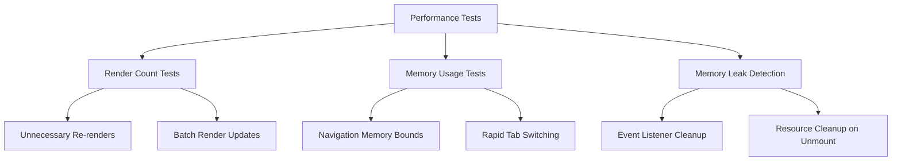
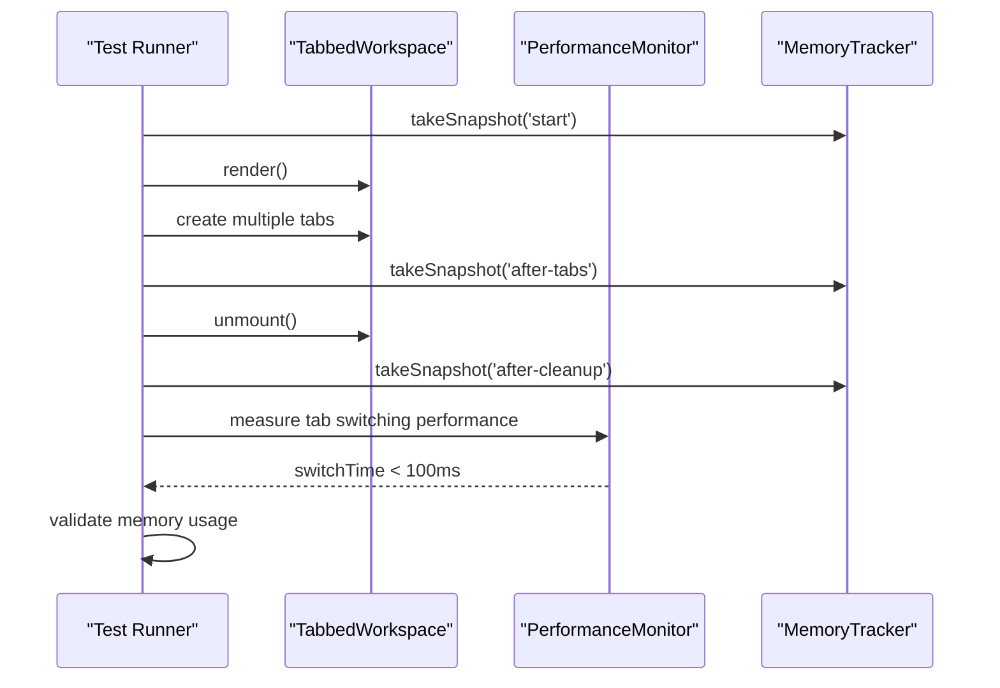
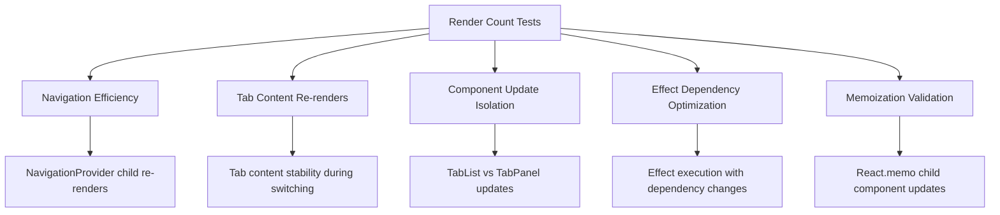
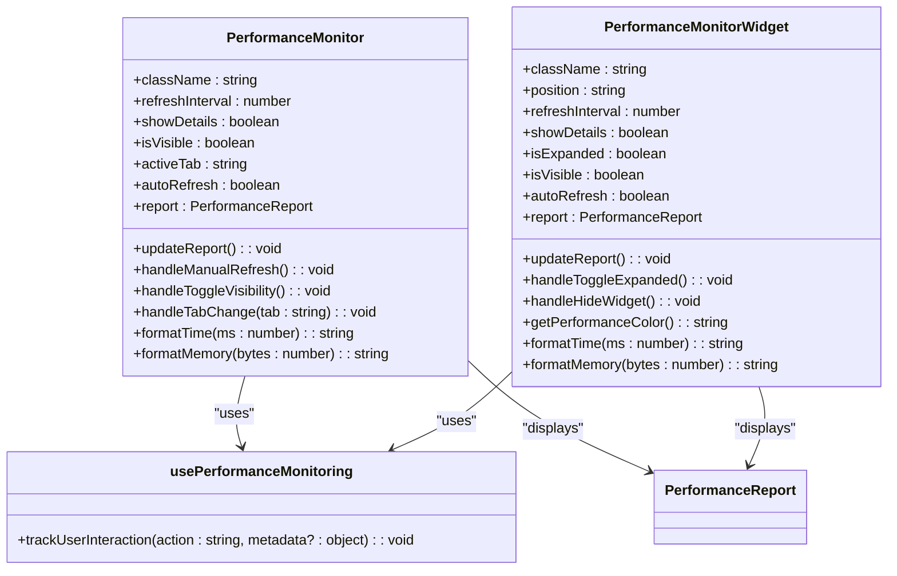
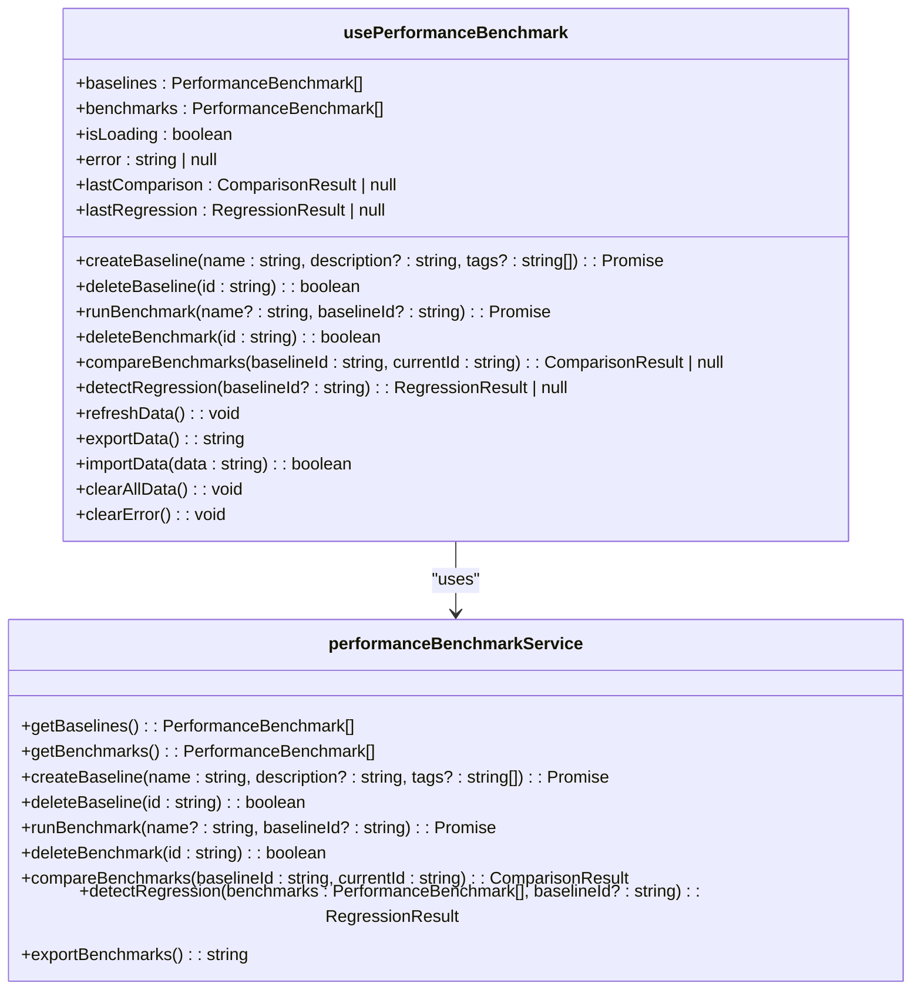

# Performance Testing

<cite>
**Referenced Files in This Document**   
- [PerformanceTests.test.tsx](file://tests/performance/PerformanceTests.test.tsx)
- [MemoryAndPerformance.test.tsx](file://src/tests/performance/MemoryAndPerformance.test.tsx)
- [RenderCount.test.tsx](file://src/tests/performance/RenderCount.test.tsx)
- [PerformanceMonitor.tsx](file://src/components/PerformanceMonitor.tsx)
- [PerformanceMonitorWidget.tsx](file://src/components/PerformanceMonitorWidget.tsx)
- [usePerformanceBenchmark.ts](file://src/hooks/usePerformanceBenchmark.ts)
- [TabbedWorkspace.tsx](file://src/components/tabbedWorkspace/TabbedWorkspace.tsx)
- [OPTIMIZATION_GUIDE.md](file://src/components/tabbedWorkspace/OPTIMIZATION_GUIDE.md)
- [RENDER_LOOP_FIX_DOCUMENTATION.md](file://src/components/tabbedWorkspace/RENDER_LOOP_FIX_DOCUMENTATION.md)
</cite>

## Table of Contents
1. [Introduction](#introduction)
2. [Core Performance Testing Framework](#core-performance-testing-framework)
3. [Memory and Performance Testing](#memory-and-performance-testing)
4. [Render Count and Re-render Optimization](#render-count-and-re-render-optimization)
5. [Real-time Performance Monitoring Components](#real-time-performance-monitoring-components)
6. [Performance Benchmarking Hook](#performance-benchmarking-hook)
7. [Case Study: Tabbed Workspace Performance Optimization](#case-study-tabbed-workspace-performance-optimization)
8. [Performance Regression Prevention](#performance-regression-prevention)
9. [Conclusion](#conclusion)

## Introduction
Performance testing in schoolpilot3 is a comprehensive system designed to measure, monitor, and optimize critical application metrics. The performance testing framework ensures that the application maintains optimal responsiveness, memory efficiency, and rendering performance across various user interactions and data loads. This documentation details the performance testing suite, real-time monitoring components, benchmarking tools, and specific optimization strategies implemented in complex components like the tabbed workspace. The system is designed to prevent performance regressions and ensure a smooth user experience, particularly in data-intensive modules.

## Core Performance Testing Framework

The PerformanceTests.test.tsx suite serves as the primary performance testing framework for schoolpilot3, evaluating overall application performance through comprehensive metrics. This test suite measures critical performance indicators including render times, memory usage, and component re-renders under various user interaction scenarios.

**Diagram sources**
- [PerformanceTests.test.tsx](file://tests/performance/PerformanceTests.test.tsx#L1-L258)

**Section sources**
- [PerformanceTests.test.tsx](file://tests/performance/PerformanceTests.test.tsx#L1-L258)

The framework uses a combination of testing utilities to capture performance metrics:
- **Render counting**: Tracks component re-renders using a Map-based counter to identify unnecessary re-renders
- **Memory usage measurement**: Utilizes a MemoryStats utility to monitor heap memory before and after operations
- **Event listener tracking**: Spies on window.addEventListener and window.removeEventListener to detect memory leaks

The test suite validates that components do not re-render unnecessarily during navigation, ensuring that only the content area re-renders when switching routes while sidebar and root components remain stable. It also verifies that multiple state updates are batched into a single re-render for efficiency.

## Memory and Performance Testing

The MemoryAndPerformance.test.tsx file specifically targets memory management and overall performance efficiency. This test suite creates a controlled environment to measure memory usage and performance metrics during typical user interactions with the tabbed workspace component.

**Diagram sources**
- [MemoryAndPerformance.test.tsx](file://src/tests/performance/MemoryAndPerformance.test.tsx#L1-L190)

**Section sources**
- [MemoryAndPerformance.test.tsx](file://src/tests/performance/MemoryAndPerformance.test.tsx#L1-L190)

Key performance metrics measured by this suite include:
- **Memory leak detection**: Takes heap snapshots before, during, and after component usage to ensure memory is properly freed on unmount
- **Tab switching performance**: Measures the time taken to switch between tabs, ensuring transitions occur within 100ms for smooth user experience
- **Event listener cleanup**: Verifies that all event listeners are properly removed when components are unmounted
- **Tab state persistence**: Ensures that tab state storage does not grow unbounded, limiting memory impact to less than 512KB for 20 tabs
- **Frame rate monitoring**: Simulates tab animations and counts dropped frames to ensure smooth animations (less than 3 dropped frames)

The tests validate that memory usage stays within acceptable bounds during navigation and rapid tab switching, with a maximum 20% increase in memory usage during intensive operations. After component cleanup, memory usage should return to near-initial levels, indicating proper resource deallocation.

## Render Count and Re-render Optimization

The RenderCount.test.tsx file focuses specifically on measuring and optimizing component re-renders, a critical aspect of React performance. This test suite uses a render tracker utility to monitor how often components re-render in response to various state changes and user interactions.

**Diagram sources**
- [RenderCount.test.tsx](file://src/tests/performance/RenderCount.test.tsx#L1-L144)

**Section sources**
- [RenderCount.test.tsx](file://src/tests/performance/RenderCount.test.tsx#L1-L144)

The test suite validates several key optimization principles:
- **Navigation efficiency**: Ensures that child components of NavigationProvider do not re-render unnecessarily during navigation
- **Tab content stability**: Verifies that tab content does not re-render when simply switching between tabs
- **Component update isolation**: Confirms that only the necessary components update during tab navigation (e.g., TabPanel updates while TabList remains stable)
- **Effect dependency optimization**: Tests that useEffect hooks only execute when their dependencies actually change
- **Memoization validation**: Confirms that React.memo components prevent unnecessary re-renders when parent state changes

These tests ensure that the application minimizes unnecessary re-renders, which directly impacts performance by reducing CPU usage and improving responsiveness, especially in complex interfaces with multiple nested components.

## Real-time Performance Monitoring Components

schoolpilot3 includes two primary components for real-time performance insights: PerformanceMonitor and PerformanceMonitorWidget. These components provide developers and administrators with immediate feedback on application performance metrics.

**Diagram sources**
- [PerformanceMonitor.tsx](file://src/components/PerformanceMonitor.tsx#L1-L311)
- [PerformanceMonitorWidget.tsx](file://src/components/PerformanceMonitorWidget.tsx#L1-L247)

**Section sources**
- [PerformanceMonitor.tsx](file://src/components/PerformanceMonitor.tsx#L1-L311)
- [PerformanceMonitorWidget.tsx](file://src/components/PerformanceMonitorWidget.tsx#L1-L247)

The **PerformanceMonitor** component provides a comprehensive performance dashboard with multiple tabs for different metrics:
- **Overview**: Displays startup time and memory usage with color-coded performance indicators
- **Modules**: Shows performance metrics for individual application modules
- **Data**: Displays data loading and processing performance
- **Interactions**: Tracks UI interaction responsiveness

The **PerformanceMonitorWidget** is a simplified, compact version designed for feature-flag controlled display:
- **Collapsed view**: Small indicator showing startup time and memory usage
- **Expanded view**: Detailed performance information with refresh controls
- **Auto-refresh toggle**: Allows users to enable periodic updates (disabled by default to prevent UI flickering)
- **Performance color coding**: Uses green (good), yellow (moderate), and red (poor) indicators based on startup time and memory usage thresholds

Both components use the usePerformanceMonitoring hook to track user interactions and provide event-driven updates, ensuring minimal performance impact while delivering real-time insights.

## Performance Benchmarking Hook

The usePerformanceBenchmark hook provides a comprehensive interface for measuring specific operations and comparing performance against established baselines. This hook serves as the primary tool for performance benchmarking and regression detection.

**Diagram sources**
- [usePerformanceBenchmark.ts](file://src/hooks/usePerformanceBenchmark.ts#L1-L309)

**Section sources**
- [usePerformanceBenchmark.ts](file://src/hooks/usePerformanceBenchmark.ts#L1-L309)

The hook provides several key operations:
- **Baseline creation**: Establishes performance baselines for comparison
- **Benchmark execution**: Runs performance tests on specific operations
- **Comparison and regression detection**: Compares current performance against baselines to identify regressions
- **Data management**: Supports exporting, importing, and clearing benchmark data

The hook maintains state for baselines, benchmarks, and comparison results, providing a complete performance benchmarking solution. It handles loading and refreshing data, error management, and integrates with the underlying performanceBenchmarkService for data persistence and analysis.

## Case Study: Tabbed Workspace Performance Optimization

The tabbed workspace component represents one of the most complex and performance-critical interfaces in schoolpilot3. This case study details the performance bottlenecks identified and the optimization strategies implemented to ensure smooth operation even with multiple tabs and complex content.

```mermaid
flowchart TD
A[Tabbed Workspace] --> B[Performance Issues]
B --> B1[Flickering Render Loop]
B --> B2[Excessive Re-renders]
B --> B3[Memory Leaks]
B --> B4[Slow Initialization]
A --> C[Optimization Strategies]
C --> C1[React.memo Components]
C --> C2[useCallback Handlers]
C --> C3[useMemo Computations]
C --> C4[Props Memoization]
C --> C5[Stable Keys]
C --> C6[Efficient State Updates]
C1 --> C1a[TabBar]
C1 --> C1b[ActionBar]
C1 --> C1c[BreadcrumbNavigation]
C2 --> C2a[handleTabCreate]
C2 --> C2b[handleTabClose]
C2 --> C2c[handleBreadcrumbClick]
C2 --> C2d[renderTabContent]
C3 --> C3a[activeTab lookup]
C3 --> C3b[sortedTabs]
C3 --> C3c[moduleStyles]
C3 --> C3d[generateBreadcrumbs]
C4 --> C4a[actionBarProps]
C4 --> C4b[tabBarProps]
C6 --> C6a[Permission Hash Comparison]
C6 --> C6b[Breadcrumb Change Detection]
A --> D[Performance Benefits]
D --> D1[Reduced Re-renders]
D --> D2[Stable References]
D --> D3[Efficient Computations]
D --> D4[Memory Efficiency]
D --> D5[Faster Reconciliation]
```

**Diagram sources**
- [TabbedWorkspace.tsx](file://src/components/tabbedWorkspace/TabbedWorkspace.tsx#L1-L539)
- [OPTIMIZATION_GUIDE.md](file://src/components/tabbedWorkspace/OPTIMIZATION_GUIDE.md#L1-L225)
- [RENDER_LOOP_FIX_DOCUMENTATION.md](file://src/components/tabbedWorkspace/RENDER_LOOP_FIX_DOCUMENTATION.md#L1-L162)

**Section sources**
- [TabbedWorkspace.tsx](file://src/components/tabbedWorkspace/TabbedWorkspace.tsx#L1-L539)
- [OPTIMIZATION_GUIDE.md](file://src/components/tabbedWorkspace/OPTIMIZATION_GUIDE.md#L1-L225)
- [RENDER_LOOP_FIX_DOCUMENTATION.md](file://src/components/tabbedWorkspace/RENDER_LOOP_FIX_DOCUMENTATION.md#L1-L162)

### Performance Issues Identified
The tabbed workspace initially suffered from several performance issues:
- **Flickering render loop**: Caused by stale closures in useEffect hooks and missing dependencies
- **Excessive re-renders**: Child components re-rendered unnecessarily due to prop changes
- **Memory leaks**: Event listeners and resources not properly cleaned up on unmount
- **Slow initialization**: Multiple state updates during initialization causing cascading re-renders

### Optimization Strategies Implemented
The optimization efforts focused on several key areas:

**Component Memoization**: All major child components (TabBar, ActionBar, BreadcrumbNavigation) were wrapped with React.memo to prevent unnecessary re-renders when their props haven't changed.

**Callback Memoization**: All event handlers and callbacks were memoized using useCallback to maintain referential equality and prevent child components from re-rendering due to new function references.

**Expensive Computation Memoization**: Computationally expensive operations were memoized using useMemo:
- Active tab lookup
- Sorted tabs (pinned first, then by order)
- Module style calculations
- Breadcrumb generation logic

**Props Memoization**: Props objects for child components were memoized to prevent new object creation on each render, which would otherwise trigger re-renders in memoized components.

**Efficient State Updates**: State updates were optimized to prevent unnecessary re-renders:
- Permission changes are compared using a hash to avoid expensive JSON.stringify comparisons
- Breadcrumb updates only occur when the actual content has changed
- Initialization logic is guarded with a ref to prevent multiple initializations

**Ref-based Callback Pattern**: To solve the stale closure issue in the onTabChange effect, a ref (onTabChangeRef) is used to maintain the latest callback reference without triggering effect re-runs.

### Performance Benefits
These optimizations resulted in significant performance improvements:
- **Reduced re-renders**: Child components only re-render when their specific props change
- **Stable references**: Callbacks maintain the same reference across renders
- **Efficient computations**: Expensive operations are only performed when dependencies change
- **Memory efficiency**: Objects are reused instead of being recreated on each render
- **Faster reconciliation**: Stable keys help React efficiently update the DOM

The optimizations ensure that the tabbed workspace maintains smooth performance even with multiple tabs and complex content, providing a responsive user experience in data-intensive modules.

## Performance Regression Prevention

The performance testing framework in schoolpilot3 is designed not only to measure current performance but also to prevent regressions in future development. This is achieved through a combination of automated tests, real-time monitoring, and benchmarking tools.

The automated test suite runs with every build, ensuring that performance metrics remain within acceptable bounds. The MemoryAndPerformance.test.tsx and RenderCount.test.tsx files specifically target memory management and render loop efficiency, catching potential regressions before they reach production.

The usePerformanceBenchmark hook enables developers to establish performance baselines and compare against them, making it easy to identify when a change has negatively impacted performance. This proactive approach allows teams to maintain performance standards across development cycles.

Real-time monitoring components like PerformanceMonitor and PerformanceMonitorWidget provide immediate feedback during development and testing, allowing developers to identify performance issues as they code. The color-coded indicators and detailed metrics make it easy to spot performance problems quickly.

Together, these tools create a comprehensive performance regression prevention system that ensures the application maintains optimal performance over time, even as new features are added and existing code is modified.

## Conclusion
The performance testing framework in schoolpilot3 provides a comprehensive system for measuring, monitoring, and optimizing application performance. Through a combination of automated tests, real-time monitoring components, and benchmarking tools, the system ensures that critical metrics like render times, memory usage, and component re-renders are continuously monitored and optimized.

The framework successfully prevents performance regressions and ensures a smooth user experience, particularly in complex components like the tabbed workspace. By implementing best practices such as component memoization, callback optimization, and efficient state management, the application maintains high performance even under demanding conditions.

The integration of real-time performance insights through the PerformanceMonitor and PerformanceMonitorWidget components empowers developers and administrators to identify and address performance issues proactively. The usePerformanceBenchmark hook provides a robust foundation for performance benchmarking and regression detection.

Overall, the performance testing strategy in schoolpilot3 demonstrates a commitment to maintaining high performance standards and delivering an optimal user experience across all modules and use cases.