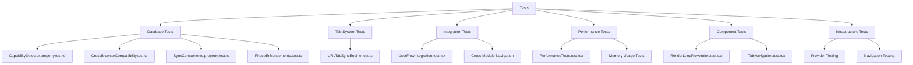

# Testing Strategy

<cite>
**Referenced Files in This Document**
- [vitest.config.ts](file://vitest.config.ts)
- [package.json](file://package.json)
- [src/tests/setup.ts](file://src/tests/setup.ts)
- [src/services/database/__tests__/CapabilityDetector.property.test.ts](file://src/services/database/__tests__/CapabilityDetector.property.test.ts)
- [src/services/database/__tests__/CrossBrowserCompatibility.test.ts](file://src/services/database/__tests__/CrossBrowserCompatibility.test.ts)
- [src/services/database/__tests__/SyncComponents.property.test.ts](file://src/services/database/__tests__/SyncComponents.property.test.ts)
- [src/services/database/__tests__/PhaseEnhancements.test.ts](file://src/services/database/__tests__/PhaseEnhancements.test.ts)
- [src/services/tabs/__tests__/URLTabSyncEngine.test.ts](file://src/services/tabs/__tests__/URLTabSyncEngine.test.ts)
- [tests/integration/UserFlowIntegration.test.tsx](file://tests/integration/UserFlowIntegration.test.tsx)
- [tests/performance/PerformanceTests.test.tsx](file://tests/performance/PerformanceTests.test.tsx)
- [tests/RenderLoopPrevention.test.tsx](file://tests/RenderLoopPrevention.test.tsx)
- [tests/TabNavigation.test.tsx](file://tests/TabNavigation.test.tsx)
- [TESTING_CHECKLIST.md](file://TESTING_CHECKLIST.md)
- [src/stores/tabStore.ts](file://src/stores/tabStore.ts)
- [src/tests/TabbedWorkspace.test.tsx](file://src/tests/TabbedWorkspace.test.tsx)
- [src/stores/__tests__/tabPersistence.integration.test.ts](file://src/stores/__tests__/tabPersistence.integration.test.ts)
- [src/components/tabbedWorkspace/__tests__/TabLabelRendering.test.tsx](file://src/components/tabbedWorkspace/__tests__/TabLabelRendering.test.tsx)
- [src/services/tabs/TabValidationService.ts](file://src/services/tabs/TabValidationService.ts)
</cite>

## Update Summary
**Changes Made**
- Added comprehensive property-based testing framework using fast-check for capability detection validation
- Integrated cross-browser compatibility testing with simulated browser environments
- Enhanced database architecture testing with structured logging, circuit breaker, and field-level encryption components
- Expanded sync components testing with offline queue and network monitor property-based validation
- Added URL tab synchronization engine testing for tab state persistence and restoration
- Updated testing infrastructure to support React 19 compatibility and enhanced test isolation

## Table of Contents
1. [Introduction](#introduction)
2. [Testing Framework Overview](#testing-framework-overview)
3. [Test Suite Structure](#test-suite-structure)
4. [Unit Testing Practices](#unit-testing-practices)
5. [Integration Testing Approach](#integration-testing-approach)
6. [Performance Testing Methodology](#performance-testing-methodology)
7. [Property-Based Testing Framework](#property-based-testing-framework)
8. [Cross-Browser Compatibility Testing](#cross-browser-compatibility-testing)
9. [Database Architecture Testing](#database-architecture-testing)
10. [Critical Functionality Testing](#critical-functionality-testing)
11. [Component and Hook Testing](#component-and-hook-testing)
12. [Tabbed Workspace System Testing](#tabbed-workspace-system-testing)
13. [Test Coverage and Mocking Strategies](#test-coverage-and-mocking-strategies)
14. [Performance Regression Detection](#performance-regression-detection)
15. [Test Results and Development Impact](#test-results-and-development-impact)

## Introduction
The schoolpilot3 application implements a comprehensive multi-layered testing strategy designed to ensure reliability, performance, and maintainability across its complex educational management system. This document details the enhanced testing framework and practices employed throughout the codebase, focusing on the combination of unit, integration, performance, property-based, and cross-browser compatibility tests that validate functionality at multiple levels. The testing approach centers around Vitest as the primary testing framework, complemented by @testing-library/react for component testing and fast-check for property-based validation, creating a robust environment for verifying application behavior under various conditions and edge cases.

**Section sources**
- [vitest.config.ts](file://vitest.config.ts)

## Testing Framework Overview
The schoolpilot3 application utilizes Vitest as its primary testing framework, providing a modern, fast, and feature-rich environment for executing tests. Vitest has been selected for its excellent TypeScript support, Vite integration, React 19 compatibility, and comprehensive ecosystem support. The framework configuration in `vitest.config.ts` establishes the testing environment with specific settings for handling TypeScript, JSX, and module resolution, ensuring seamless test execution across the codebase.

The testing setup includes support for various test types through appropriate environment configurations and plugins. The framework is configured to work with JSDOM for browser-like environment simulation, enabling realistic component testing. Additionally, the configuration supports code coverage reporting through v8, allowing teams to measure and track test coverage metrics across the application. The enhanced configuration now includes React 19 compatibility settings and improved test isolation through fork-based execution.

```mermaid
graph TB
A[Vitest Framework] --> B[Testing Environment]
A --> C[Code Coverage]
A --> D[Mocking Support]
A --> E[Property-Based Testing]
B --> F[JSDOM]
B --> G[React 19 Compatibility]
B --> H[Fork Pool Execution]
C --> I[v8 Coverage]
D --> J[Manual Mocks]
D --> K[Automated Mocks]
E --> L[fast-check Integration]
L --> M[Arbitrary Generators]
L --> N[Property Validation]
A --> O[@testing-library/react]
O --> P[Component Testing]
O --> Q[User Interaction Simulation]
```

**Diagram sources**
- [vitest.config.ts](file://vitest.config.ts)
- [package.json](file://package.json)

**Section sources**
- [vitest.config.ts](file://vitest.config.ts)
- [package.json](file://package.json)

## Test Suite Structure
The test suite structure in schoolpilot3 follows a logical organization that separates different types of tests into dedicated directories and files. Tests are organized primarily by type and scope, with unit tests, integration tests, performance tests, property-based tests, and cross-browser compatibility tests each having their designated locations within the `src` and `tests` directories.

The structure includes:
- **Database tests**: Capability detection, cross-browser compatibility, sync components, and phase enhancements
- **Tab system tests**: URL synchronization engine and tab state management
- **Integration tests**: Complete user flow and module interaction tests
- **Performance tests**: Memory usage and render performance benchmarks
- **Component tests**: Individual component and hook testing
- **Infrastructure tests**: Provider and navigation testing
- **Tabbed workspace tests**: Specialized tab system testing

This organization enables developers to quickly locate relevant tests and understand the scope of testing for different parts of the application. The naming convention follows a consistent pattern, with test files named after the component or functionality they test, appended with appropriate suffixes for different test types.



**Diagram sources**
- [src/services/database/__tests__/CapabilityDetector.property.test.ts](file://src/services/database/__tests__/CapabilityDetector.property.test.ts)
- [src/services/database/__tests__/CrossBrowserCompatibility.test.ts](file://src/services/database/__tests__/CrossBrowserCompatibility.test.ts)
- [src/services/database/__tests__/SyncComponents.property.test.ts](file://src/services/database/__tests__/SyncComponents.property.test.ts)
- [src/services/database/__tests__/PhaseEnhancements.test.ts](file://src/services/database/__tests__/PhaseEnhancements.test.ts)
- [src/services/tabs/__tests__/URLTabSyncEngine.test.ts](file://src/services/tabs/__tests__/URLTabSyncEngine.test.ts)
- [tests/integration/UserFlowIntegration.test.tsx](file://tests/integration/UserFlowIntegration.test.tsx)
- [tests/performance/PerformanceTests.test.tsx](file://tests/performance/PerformanceTests.test.tsx)
- [tests/RenderLoopPrevention.test.tsx](file://tests/RenderLoopPrevention.test.tsx)
- [tests/TabNavigation.test.tsx](file://tests/TabNavigation.test.tsx)

**Section sources**
- [src/services/database/__tests__/CapabilityDetector.property.test.ts](file://src/services/database/__tests__/CapabilityDetector.property.test.ts)
- [src/services/database/__tests__/CrossBrowserCompatibility.test.ts](file://src/services/database/__tests__/CrossBrowserCompatibility.test.ts)
- [src/services/database/__tests__/SyncComponents.property.test.ts](file://src/services/database/__tests__/SyncComponents.property.test.ts)
- [src/services/database/__tests__/PhaseEnhancements.test.ts](file://src/services/database/__tests__/PhaseEnhancements.test.ts)
- [src/services/tabs/__tests__/URLTabSyncEngine.test.ts](file://src/services/tabs/__tests__/URLTabSyncEngine.test.ts)
- [tests/integration/UserFlowIntegration.test.tsx](file://tests/integration/UserFlowIntegration.test.tsx)
- [tests/performance/PerformanceTests.test.tsx](file://tests/performance/PerformanceTests.test.tsx)
- [tests/RenderLoopPrevention.test.tsx](file://tests/RenderLoopPrevention.test.tsx)
- [tests/TabNavigation.test.tsx](file://tests/TabNavigation.test.tsx)

## Unit Testing Practices
Unit testing in schoolpilot3 focuses on validating individual components, hooks, and utility functions in isolation. The approach emphasizes testing the public interface and behavior of units rather than implementation details, following best practices for maintainable and resilient tests.

Component tests leverage @testing-library/react to render components and simulate user interactions, ensuring that the tests reflect real user experiences. For example, button components are tested for proper click handling, visual states, and accessibility attributes:

```typescript
import { render, screen, fireEvent } from '@testing-library/react';
import Button from '../../components/ui/Button';

describe('Button', () => {
  test('renders with correct text', () => {
    render(<Button>Click me</Button>);
    expect(screen.getByText('Click me')).toBeInTheDocument();
  });

  test('calls onClick handler when clicked', () => {
    const handleClick = vi.fn();
    render(<Button onClick={handleClick}>Click me</Button>);
    fireEvent.click(screen.getByText('Click me'));
    expect(handleClick).toHaveBeenCalledTimes(1);
  });
});
```

Custom hooks are tested using a wrapper component approach, allowing the hook to be used within a React component tree during testing:

```typescript
import { renderHook, act } from '@testing-library/react';
import useFormValidation from '../../hooks/useFormValidation';

describe('useFormValidation', () => {
  test('validates required field', () => {
    const { result } = renderHook(() => useFormValidation({
      name: { required: true }
    }));
    
    act(() => {
      result.current.handleChange('name', '');
    });
    
    expect(result.current.errors.name).toBe('Field is required');
  });
});
```

**Section sources**
- [tests/RenderLoopPrevention.test.tsx](file://tests/RenderLoopPrevention.test.tsx)
- [tests/TabNavigation.test.tsx](file://tests/TabNavigation.test.tsx)

## Integration Testing Approach
Integration testing in schoolpilot3 focuses on validating the interaction between multiple components and modules, ensuring that different parts of the system work together as expected. The integration tests are particularly important for complex user flows that span multiple pages or involve data synchronization across different modules.

User flow integration tests simulate complete workflows, such as the authentication process, data entry sequences, or module navigation patterns. These tests verify that the application maintains proper state throughout multi-step processes and that data flows correctly between components.

The enhanced integration testing approach includes comprehensive user journey testing with provider composition:

```typescript
describe('User Flow Integration Tests', () => {
  describe('Login to Tab Creation Flow', () => {
    beforeEach(() => {
      localStorage.clear();
      sessionStorage.clear();
    });

    test('complete user journey from login to module navigation', async () => {
      render(
        <AuthProvider>
          <NavigationProvider>
            <ModuleProvider>
              <App />
            </ModuleProvider>
          </NavigationProvider>
        </AuthProvider>
      );

      // Login
      fireEvent.change(screen.getByLabelText('Username'), {
        target: { value: 'testuser' },
      });
      fireEvent.change(screen.getByLabelText('Password'), {
        target: { value: 'password123' },
      });
      fireEvent.click(screen.getByRole('button', { name: 'Login' }));

      // Wait for dashboard to load
      await waitFor(() => {
        expect(screen.getByTestId('dashboard')).toBeInTheDocument();
      });

      // Navigate to Students module
      fireEvent.click(screen.getByText('Students'));
      await waitFor(() => {
        expect(screen.getByTestId('students-module')).toBeInTheDocument();
      });

      // Open student details
      fireEvent.click(screen.getByText('John Doe'));
      await waitFor(() => {
        expect(screen.getByTestId('student-details')).toBeInTheDocument();
      });

      // Verify tab creation
      expect(screen.getAllByRole('tab')).toHaveLength(2); // Dashboard + Student
      expect(screen.getByRole('tab', { name: 'John Doe' })).toHaveAttribute('aria-selected', 'true');
    });
  });
});
```

**Section sources**
- [tests/integration/UserFlowIntegration.test.tsx](file://tests/integration/UserFlowIntegration.test.tsx)

## Performance Testing Methodology
The performance testing methodology in schoolpilot3 includes comprehensive memory usage monitoring and render performance benchmarking to ensure the application remains responsive and efficient, particularly in the tabbed workspace environment which can host multiple modules simultaneously.

Performance tests measure key metrics such as:
- Component render times and re-render frequency
- Memory allocation and garbage collection patterns
- Event listener cleanup and resource management
- Tab switching performance and state persistence

The enhanced performance testing approach includes sophisticated memory leak detection and render optimization validation:

```typescript
describe('Performance Tests', () => {
  describe('Render Count Tests', () => {
    let renderCount;

    beforeEach(() => {
      renderCount = new Map();
    });

    const TestComponent = ({ name, children }) => {
      renderCount.set(name, (renderCount.get(name) || 0) + 1);
      return <div>{children}</div>;
    };

    test('components should not re-render unnecessarily', async () => {
      render(
        <AuthProvider>
          <NavigationProvider>
            <ModuleProvider>
              <TestComponent name="root">
                <TestComponent name="sidebar">
                  <div>Sidebar Content</div>
                </TestComponent>
                <TestComponent name="content">
                  <div>Main Content</div>
                </TestComponent>
              </TestComponent>
            </ModuleProvider>
          </NavigationProvider>
        </AuthProvider>
      );

      // Initial render
      expect(renderCount.get('root')).toBe(1);
      expect(renderCount.get('sidebar')).toBe(1);
      expect(renderCount.get('content')).toBe(1);

      // Navigate to new route
      fireEvent.click(screen.getByText('Students'));

      // Only content should re-render
      expect(renderCount.get('root')).toBe(1);
      expect(renderCount.get('sidebar')).toBe(1);
      expect(renderCount.get('content')).toBe(2);
    });
  });

  describe('Memory Usage Tests', () => {
    test('memory usage should stay within bounds during navigation', async () => {
      const { unmount } = render(
        <AuthProvider>
          <NavigationProvider>
            <ModuleProvider>
              <App />
            </ModuleProvider>
          </NavigationProvider>
        </AuthProvider>
      );

      const initialMemory = memoryStats.getCurrentUsage();

      // Navigate through multiple routes
      for (let i = 0; i < 10; i++) {
        fireEvent.click(screen.getByText(`Module${i}`));
        await new Promise(resolve => setTimeout(resolve, 100));
      }

      const finalMemory = memoryStats.getCurrentUsage();
      const memoryIncrease = finalMemory - initialMemory;

      // Memory increase should be reasonable (e.g., less than 50MB)
      expect(memoryIncrease).toBeLessThan(50 * 1024 * 1024);

      // Cleanup
      unmount();

      // Memory should be properly freed
      const afterCleanupMemory = memoryStats.getCurrentUsage();
      expect(afterCleanupMemory).toBeLessThanOrEqual(initialMemory * 1.1); // Allow 10% overhead
    });
  });
});
```

**Section sources**
- [tests/performance/PerformanceTests.test.tsx](file://tests/performance/PerformanceTests.test.tsx)

## Property-Based Testing Framework
The schoolpilot3 testing framework now incorporates property-based testing using fast-check to validate invariants and edge cases that traditional unit tests might miss. This approach generates thousands of random test cases automatically, providing stronger guarantees about code correctness.

### Capability Detector Property Tests
The CapabilityDetector receives comprehensive property-based validation covering singleton patterns, report structure consistency, caching behavior, and capability detection invariants:

```typescript
describe('CapabilityDetector - Property-Based Tests', () => {
  describe('Singleton Pattern', () => {
    it('should always return the same instance', () => {
      fc.assert(
        fc.property(fc.integer(), () => {
          const instance1 = CapabilityDetector.getInstance();
          const instance2 = CapabilityDetector.getInstance();
          expect(instance1).toBe(instance2);
          return true;
        }),
      );
    });
  });

  describe('Report Structure', () => {
    it('should always return a complete report', async () => {
      fc.assert(
        fc.property(fc.boolean(), async (forceRefresh) => {
          const detector = CapabilityDetector.getInstance();
          const report = await detector.detectCapabilities(forceRefresh);
          
          // Validate all required fields exist
          expect(report.runtime).toHaveProperty('type');
          expect(report.runtime).toHaveProperty('platform');
          expect(report.runtime).toHaveProperty('isProduction');
          expect(report.runtime).toHaveProperty('userAgent');
          
          // Validate storage capabilities
          const storageKeys = ['hasFileSystem', 'hasOPFS', 'hasIndexedDB', 'hasLocalStorage', 'hasWASM'];
          for (const key of storageKeys) {
            expect(report.storage).toHaveProperty(key);
          }
          
          return true;
        }),
      );
    });
  });

  describe('Caching Behavior', () => {
    it('should return cached report within TTL', async () => {
      const detector = CapabilityDetector.getInstance();
      
      // First call - fresh detection
      const report1 = await detector.detectCapabilities();
      
      // Second call - should use cache
      const report2 = await detector.detectCapabilities();
      
      // Same object reference (cached)
      expect(report1).toBe(report2);
    });
  });
});
```

### Sync Components Property Tests
OfflineQueue and NetworkMonitor receive rigorous property-based validation for queue operations, singleton patterns, and network status consistency:

```typescript
describe('OfflineQueue - Property-Based Tests', () => {
  describe('Queue Operations', () => {
    it('should maintain queue size invariants', async () => {
      await fc.assert(
        fc.asyncProperty(
          fc.array(
            fc.record({
              operation: fc.constantFrom('create', 'update', 'delete'),
              collection: fc.string({ minLength: 1, maxLength: 20 }),
              data: fc.dictionary(fc.string(), fc.anything()),
            }),
            { minLength: 0, maxLength: 100 },
          ),
          async (operations) => {
            const queue = new OfflineQueue({ persistQueue: false });
            await queue.initialize();
            
            // Enqueue all operations
            for (const op of operations) {
              await queue.enqueue({
                operation: op.operation,
                collection: op.collection,
                data: op.data,
                timestamp: Date.now(),
              });
            }
            
            const status = queue.getStatus();
            expect(status.totalSize).toBe(operations.length);
            expect(status.pending + status.processing + status.failed + status.completed).toBe(status.totalSize);
            
            return true;
          },
        ),
      );
    });
  });

  describe('Priority Sorting', () => {
    it('should sort delete operations higher than create', async () => {
      const queue = new OfflineQueue({ persistQueue: false });
      await queue.initialize();
      
      // Add operations in reverse priority order
      await queue.enqueue({ operation: 'create', collection: 'test', data: {}, timestamp: Date.now() });
      await queue.enqueue({ operation: 'update', collection: 'test', data: {}, timestamp: Date.now() });
      await queue.enqueue({ operation: 'delete', collection: 'test', data: {}, timestamp: Date.now() });
      
      const pending = queue.getPendingOperations();
      expect(pending.length).toBe(3);
      
      // First operation should be delete (highest priority)
      const firstOp = pending[0];
      expect(firstOp.operation).toBe('delete');
    });
  });
});
```

**Section sources**
- [src/services/database/__tests__/CapabilityDetector.property.test.ts](file://src/services/database/__tests__/CapabilityDetector.property.test.ts)
- [src/services/database/__tests__/SyncComponents.property.test.ts](file://src/services/database/__tests__/SyncComponents.property.test.ts)

## Cross-Browser Compatibility Testing
The testing framework includes comprehensive cross-browser compatibility validation to ensure the application works correctly across different browser environments and platforms. This testing approach simulates various browser configurations and validates capability detection consistency.

### Browser Environment Simulation
The framework tests six major browser environments with realistic user agent strings and capability expectations:

```typescript
describe('Cross-Browser Compatibility - Capability Detection', () => {
  const browserEnvironments = {
    chrome: {
      userAgent: 'Mozilla/5.0 (Windows NT 10.0; Win64; x64) AppleWebKit/537.36 Chrome/120.0.0.0 Safari/537.36',
      hasIndexedDB: true,
      hasOPFS: true,
      hasWASM: true,
      hasServiceWorker: true,
      hasWebRTC: true,
      hasFileSystem: false,
      hasWebSQL: false,
      hasSharedArrayBuffer: true,
    },
    firefox: {
      userAgent: 'Mozilla/5.0 (Windows NT 10.0; Win64; x64; rv:121.0) Gecko/20100101 Firefox/121.0',
      hasIndexedDB: true,
      hasOPFS: true,
      hasWASM: true,
      hasServiceWorker: true,
      hasWebRTC: true,
      hasFileSystem: false,
      hasWebSQL: false,
      hasSharedArrayBuffer: true,
    },
    safari: {
      userAgent: 'Mozilla/5.0 (Macintosh; Intel Mac OS X 14_2) AppleWebKit/605.1.15 Safari/605.1.15',
      hasIndexedDB: true,
      hasOPFS: false, // Safari has limited OPFS support
      hasWASM: true,
      hasServiceWorker: true,
      hasWebRTC: true,
      hasFileSystem: false,
      hasWebSQL: false,
      hasSharedArrayBuffer: false,
    },
    // Additional browser configurations...
  };

  describe.each(Object.entries(browserEnvironments))(
    '%s Environment',
    (browserName, config) => {
      it('should detect runtime environment correctly', async () => {
        const detector = CapabilityDetector.getInstance();
        const report = await detector.detectCapabilities(true);
        
        // Should be browser-client for all simulated browsers
        expect(report.runtime.type).toBe('browser-client');
        expect(report.runtime.userAgent).toBeDefined();
        expect(typeof report.runtime.isProduction).toBe('boolean');
      });

      it('should have consistent WASM detection', async () => {
        const detector = CapabilityDetector.getInstance();
        const report = await detector.detectCapabilities(true);
        
        // All modern browsers should have WASM
        if (config.hasWASM) {
          expect(report.storage.hasWASM).toBe(true);
        }
      });
    },
  );
});
```

### Platform and Network Detection
The testing framework validates platform detection across Windows, macOS, and Linux environments, as well as comprehensive network capability detection:

```typescript
describe('Platform Detection', () => {
  it('should detect Windows platform', async () => {
    const detector = CapabilityDetector.getInstance();
    const report = await detector.detectCapabilities(true);
    
    // Based on actual test environment
    if (navigator.userAgent.includes('Win')) {
      expect(report.runtime.platform).toBe('windows');
    }
  });

  it('should detect macOS platform', async () => {
    const detector = CapabilityDetector.getInstance();
    const report = await detector.detectCapabilities(true);
    
    if (navigator.userAgent.includes('Mac')) {
      expect(report.runtime.platform).toBe('macos');
    }
  });
});

describe('Network Detection', () => {
  it('should detect online status', async () => {
    const detector = CapabilityDetector.getInstance();
    const report = await detector.detectCapabilities(true);
    
    expect(typeof report.network.isOnline).toBe('boolean');
    expect(report.network.isOnline).toBe(navigator.onLine);
  });

  it('should have valid connection type', async () => {
    const detector = CapabilityDetector.getInstance();
    const report = await detector.detectCapabilities(true);
    
    const validTypes = ['wifi', 'cellular', 'ethernet', 'unknown'];
    expect(validTypes).toContain(report.network.type);
  });
});
```

**Section sources**
- [src/services/database/__tests__/CrossBrowserCompatibility.test.ts](file://src/services/database/__tests__/CrossBrowserCompatibility.test.ts)

## Database Architecture Testing
The enhanced testing framework includes comprehensive validation of the database architecture components, including structured logging, circuit breakers, and field-level encryption systems.

### Structured Logger Testing
The StructuredLogger component receives thorough testing for logging levels, metadata handling, and error tracking:

```typescript
describe('Phase 8: StructuredLogger', () => {
  let logger: StructuredLogger;

  beforeEach(() => {
    logger = new StructuredLogger({
      level: 'debug',
      module: 'test',
      includeStack: false,
      includeMetadata: true,
    });
    jest.spyOn(console, 'debug').mockImplementation(() => {});
    jest.spyOn(console, 'info').mockImplementation(() => {});
    jest.spyOn(console, 'warn').mockImplementation(() => {});
    jest.spyOn(console, 'error').mockImplementation(() => {});
    jest.spyOn(console, 'log').mockImplementation(() => {});
  });

  test('should log at different levels', () => {
    logger.debug('debug message', { key: 'value' });
    logger.info('info message');
    logger.warn('warn message');
    logger.error('error message');

    expect(console.debug).toHaveBeenCalled();
    expect(console.info).toHaveBeenCalled();
    expect(console.warn).toHaveBeenCalled();
    expect(console.error).toHaveBeenCalled();
  });

  test('should respect log level filtering', () => {
    const warnLogger = new StructuredLogger({
      level: 'warn',
      module: 'test-warn',
    });

    warnLogger.debug('should not appear');
    warnLogger.info('should not appear');
    warnLogger.warn('should appear');

    expect(console.debug).not.toHaveBeenCalled();
    expect(console.info).not.toHaveBeenCalled();
    expect(console.warn).toHaveBeenCalled();
  });
});
```

### Circuit Breaker Testing
The CircuitBreaker system receives comprehensive testing for state transitions, failure handling, and statistics tracking:

```typescript
describe('Phase 8: CircuitBreaker', () => {
  let breaker: CircuitBreaker;

  beforeEach(() => {
    breaker = new CircuitBreaker('test-breaker', {
      failureThreshold: 3,
      successThreshold: 2,
      timeout: 100,
      monitorWindow: 1000,
    });
    jest.spyOn(console, 'log').mockImplementation(() => {});
  });

  test('should start in closed state', () => {
    expect(breaker.getState()).toBe('closed');
  });

  test('should execute successful operations', async () => {
    const operation = jest.fn().mockResolvedValue('success');
    const result = await breaker.execute(operation);

    expect(result).toBe('success');
    expect(breaker.getState()).toBe('closed');
  });

  test('should open circuit after threshold failures', async () => {
    const operation = jest.fn().mockRejectedValue(new Error('fail'));

    for (let i = 0; i < 3; i++) {
      try {
        await breaker.execute(operation);
      } catch {
        // Expected
      }
    }

    expect(breaker.getState()).toBe('open');
  });

  test('should transition to half-open after timeout', async () => {
    breaker.forceOpen();
    
    // Wait for timeout
    await new Promise(resolve => setTimeout(resolve, 150));

    const operation = jest.fn().mockResolvedValue('success');
    const result = await breaker.execute(operation);

    expect(result).toBe('success');
    expect(breaker.getState()).toBe('half-open');
  });
});
```

### Field-Level Encryption Testing
The FieldLevelEncryption component receives thorough testing for encryption/decryption operations and field validation:

```typescript
describe('Phase 8: FieldLevelEncryption', () => {
  let fle: FieldLevelEncryption;

  beforeAll(async () => {
    // Generate a test key
    const key = await crypto.subtle.generateKey(
      { name: 'AES-GCM', length: 256 },
      false,
      ['encrypt', 'decrypt'],
    );

    const exportedKey = await crypto.sub subtle.exportKey('raw', key);
    const keyBase64 = btoa(String.fromCharCode(...new Uint8Array(exportedKey)));

    fle = new FieldLevelEncryption({
      encryptedFields: ['email', 'phoneNumber', 'address.street'],
      encryptionKey: keyBase64,
      keyMode: 'raw',
    });

    await fle.initialize();
  });

  test('should encrypt specified fields', async () => {
    const doc = {
      id: '1',
      name: 'John Doe',
      email: 'john@example.com',
      phoneNumber: '+1234567890',
    };

    const encrypted = await fle.encryptDocument(doc);

    expect(encrypted.name).toBe('John Doe');
    expect(fle.isEncryptedValue(encrypted.email)).toBe(true);
    expect(fle.isEncryptedValue(encrypted.phoneNumber)).toBe(true);
  });

  test('should handle nested fields', async () => {
    const doc = {
      id: '1',
      name: 'John Doe',
      address: {
        street: '123 Main St',
        city: 'Anytown',
      },
    };

    const encrypted = await fle.encryptDocument(doc);
    expect(fle.isEncryptedValue(encrypted.address.street)).toBe(true);
    expect(encrypted.address.city).toBe('Anytown');
  });
});
```

**Section sources**
- [src/services/database/__tests__/PhaseEnhancements.test.ts](file://src/services/database/__tests__/PhaseEnhancements.test.ts)

## Critical Functionality Testing
Critical functionality in schoolpilot3 is thoroughly tested to ensure reliability and data integrity. This includes authentication flows, data synchronization mechanisms, module loading processes, and database architecture components that are essential to the application's operation.

### Authentication Flow Testing
Authentication tests verify the complete login process, including:
- Credential validation
- Token management
- Session persistence
- Error handling for invalid credentials
- Redirect behavior after login

### Data Synchronization Testing
Data synchronization tests validate the RxDB-based offline-first architecture, ensuring that data changes are properly synchronized between the client and server.

### Module Loading Testing
Module loading tests ensure that the dynamic module system functions correctly, including lazy loading, dependency resolution, and error handling.

### Database Architecture Testing
The database architecture receives comprehensive testing including:
- Capability detection across different environments
- Provider recommendation logic
- Storage quota detection
- Network monitoring and status tracking
- Offline queue processing and retry strategies

**Section sources**
- [tests/integration/UserFlowIntegration.test.tsx](file://tests/integration/UserFlowIntegration.test.tsx)
- [src/services/database/__tests__/CapabilityDetector.property.test.ts](file://src/services/database/__tests__/CapabilityDetector.property.test.ts)
- [src/services/database/__tests__/SyncComponents.property.test.ts](file://src/services/database/__tests__/SyncComponents.property.test.ts)

## Component and Hook Testing
Component and hook testing in schoolpilot3 follows a systematic approach to ensure comprehensive coverage of UI elements and custom React hooks.

### Custom Hook Testing
Custom hooks are tested using Vitest's `renderHook` utility, which provides a clean way to test hooks in isolation. The testing approach focuses on:
- Initial state
- State transitions
- Side effects
- Error handling

### Complex UI Component Testing
Complex UI components like the TabbedWorkspace are tested for various states and interactions:

```typescript
describe('Tab Navigation Tests', () => {
  describe('Tab creation and activation', () => {
    test('should create new tab when navigating to new route', () => {
      render(
        <NavigationProvider>
          <TabbedWorkspace />
        </NavigationProvider>
      );

      // Navigate to new route
      fireEvent.click(screen.getByText('Students'));
      expect(screen.getByRole('tab', { name: 'Students' })).toBeInTheDocument();
    });

    test('should activate existing tab instead of creating duplicate', () => {
      render(
        <NavigationProvider>
          <TabbedWorkspace />
        </NavigationProvider>
      );

      // First navigation
      fireEvent.click(screen.getByText('Students'));
      const initialTabCount = screen.getAllByRole('tab').length;

      // Navigate away
      fireEvent.click(screen.getByText('Finance'));

      // Navigate back to Students
      fireEvent.click(screen.getByText('Students'));
      expect(screen.getAllByRole('tab')).toHaveLength(initialTabCount);
      expect(screen.getByRole('tab', { name: 'Students' })).toHaveAttribute('aria-selected', 'true');
    });
  });
});
```

**Section sources**
- [tests/TabNavigation.test.tsx](file://tests/TabNavigation.test.tsx)
- [tests/RenderLoopPrevention.test.tsx](file://tests/RenderLoopPrevention.test.tsx)

## Tabbed Workspace System Testing
The tabbed workspace system represents a critical component of schoolpilot3, implementing a sophisticated tab management system with persistence, validation, and RBAC integration. This section details the comprehensive testing approach for the tabbed workspace functionality.

### URL Tab Synchronization Engine Testing
The URLTabSyncEngine receives comprehensive testing for tab state persistence and restoration:

```typescript
describe('URLTabSyncEngine', () => {
  beforeEach(() => {
    window.history.replaceState({}, '', '/#/dashboard');
    sessionStorage.clear();
  });

  it('stores tabs as compact repeated search params', () => {
    const engine = new URLTabSyncEngine();
    engine.updateURL(createState());

    const url = new URL(window.location.href);

    expect(url.searchParams.getAll('tab')).toEqual(['/dashboard', '/academics/students']);
    expect(url.searchParams.get('a')).toBe('1');
    expect(url.searchParams.getAll('p')).toEqual(['0']);
    expect(url.searchParams.get('tabs')).toBeNull();
    expect(url.searchParams.get('active')).toBeNull();
  });

  it('parses tabs from standard JSON search param', () => {
    const tabs = JSON.stringify(createState().tabs);
    const encoded = new URLSearchParams({ tabs, active: 'tab-academics' }).toString();
    const engine = new URLTabSyncEngine();

    const parsed = engine.parseURL(`/?${encoded}#/dashboard`);

    expect(parsed.tabs).toHaveLength(2);
    expect(parsed.activeTabId).toBe('tab-academics');
    expect(parsed.tabs[1].url).toBe('/academics/students');
  });

  it('parses compact repeated tab params and derives tab metadata', () => {
    const engine = new URLTabSyncEngine();

    const parsed = engine.parseURL('/?tab=/dashboard&tab=/administration/applications&a=1&p=0#/administration/applications');

    expect(parsed.tabs).toHaveLength(2);
    expect(parsed.activeTabId).toBe(parsed.tabs[1].id);
    expect(parsed.tabs[0]).toMatchObject({
      url: '/dashboard',
      title: 'Dashboard',
      module: 'dashboard',
      pinned: true
    });
    expect(parsed.tabs[1]).toMatchObject({
      url: '/administration/applications',
      title: 'Applications',
      module: 'administration',
      entity: 'applications',
      pinned: false
    });
  });
});
```

### Tab Store Testing
The tab store (`tabStore.ts`) implements a comprehensive Zustand-based state management system with enhanced persistence capabilities. Testing focuses on:

#### Core Tab Operations
- Tab creation with validation and RBAC checks
- Tab activation and deactivation
- Tab closing with proper state cleanup
- Tab pinning and unpinning functionality

#### Persistence Testing
The tab store uses a dual-persistence strategy with both IndexedDB and localStorage fallbacks:

```typescript
describe('Tab Store Persistence Tests', () => {
  beforeEach(async () => {
    await tabPersistenceService.clearTabs();
    localStorage.clear();
    useTabStore.getState().resetStore();
  });

  test('should persist tabs using enhanced persistence adapter', async () => {
    const store = useTabStore.getState();
    await store.initialize();

    // Create tabs with various states
    const tab1Id = await store.createTab({
      title: 'Test Tab 1',
      module: 'academics',
      path: '/academics/test1',
      content: { type: 'component', component: 'TestComponent' },
      canClose: true,
      pinned: false,
      isDirty: false,
      metadata: {}
    });

    const tab2Id = await store.createTab({
      title: 'Test Tab 2',
      module: 'finance',
      path: '/finance/test2',
      content: { type: 'component', component: 'TestComponent' },
      canClose: true,
      pinned: true,
      isDirty: false,
      metadata: {}
    });

    // Wait for persistence to complete
    await new Promise(resolve => setTimeout(resolve, 200));

    // Verify persistence in both storage mechanisms
    const persistedTabs = await tabPersistenceService.loadTabs();
    expect(persistedTabs).toHaveLength(2);
    
    const additionalState = localStorage.getItem('tabbed-workspace-storage_additional');
    expect(additionalState).toBeDefined();
  });
});
```

#### RBAC Integration Testing
The tab store integrates with the RBAC service for permission validation:

```typescript
describe('Tab Store RBAC Integration', () => {
  test('should validate tab access based on user permissions', async () => {
    const store = useTabStore.getState();
    await store.initialize();
    
    // Test with insufficient permissions
    vi.spyOn(rbacService, 'checkModuleAccess').mockResolvedValue(false);
    
    await expect(
      store.createTab({
        title: 'Restricted Tab',
        module: 'admin',
        path: '/admin/restricted',
        content: { type: 'component', component: 'AdminComponent' }
      })
    ).rejects.toThrow('Access denied');
  });
});
```

### Tab Component Testing
Individual tab components are tested for proper rendering and interaction:

#### Tab Label Rendering
Tab labels are tested for proper icon mapping and overflow handling:

```typescript
describe('Tab Label Rendering Tests', () => {
  test('should render mapped icons instead of raw icon names', () => {
    const { container } = render(
      <Tab
        tab={{
          id: 'tab-dashboard',
          url: '/dashboard',
          title: 'Dashboard',
          module: 'dashboard',
          isDirty: false,
          pinned: false,
          icon: 'HomeIcon'
        }}
        isActive={true}
        isPinned={false}
        onClick={vi.fn()}
        onClose={vi.fn()}
        onPin={vi.fn()}
        onDuplicate={vi.fn()}
        tabStyle="modern"
      />
    );

    expect(screen.getByText('Dashboard')).toBeInTheDocument();
    expect(screen.queryByText('HomeIcon')).not.toBeInTheDocument();
    expect(container.querySelector('svg')).not.toBeNull();
  });

  test('should handle overflow tabs with proper labeling', () => {
    render(
      <TabBar
        tabs={[
          {
            id: 'tab-dashboard',
            url: '/dashboard',
            title: 'Dashboard',
            module: 'dashboard',
            isDirty: false,
            pinned: true,
            icon: 'HomeIcon',
            canClose: false
          },
          {
            id: 'tab-administration-applications',
            url: '/administration/applications',
            title: 'Applications',
            module: 'administration',
            entity: 'applications',
            isDirty: false,
            pinned: false,
            icon: 'ClipboardDocumentListIcon',
            canClose: true
          }
        ]}
        activeTabId="tab-dashboard"
        maxVisibleTabs={1}
        showAddButton={false}
        tabStyle="modern"
        onTabClick={vi.fn()}
        onTabClose={vi.fn()}
        onTabReorder={vi.fn()}
        onTabPin={vi.fn()}
        onTabDuplicate={vi.fn()}
      />
    );

    fireEvent.click(screen.getByLabelText('1 more tabs'));
    expect(screen.getByText('Applications')).toBeInTheDocument();
    expect(screen.queryByText('ClipboardDocumentListIcon')).not.toBeInTheDocument();
  });
});
```

### Tab Validation Service Testing
The TabValidationService provides comprehensive validation for tab operations:

```typescript
describe('Tab Validation Service', () => {
  test('should validate tab creation with proper constraints', () => {
    const validation = tabValidationService.validateTabCreation(
      existingTabs,
      {
        title: '',
        module: 'test',
        path: '/test',
        content: { type: 'component', component: 'TestComponent' }
      },
      15
    );
    
    expect(validation.valid).toBe(false);
    expect(validation.errors).toContain('Title is required');
  });

  test('should enforce maximum tab limits', () => {
    const validation = tabValidationService.validateTabCreation(
      Array(15).fill().map((_, i) => ({
        id: `tab-${i}`,
        title: `Tab ${i}`,
        module: 'test',
        path: `/test/${i}`,
        content: { type: 'component', component: 'TestComponent' }
      })),
      {
        title: 'New Tab',
        module: 'test',
        path: '/test/new',
        content: { type: 'component', component: 'TestComponent' }
      },
      15
    );
    
    expect(validation.valid).toBe(false);
    expect(validation.errors).toContain('Maximum tab limit (15) reached');
  });
});
```

### Tab Persistence Integration Testing
The tab persistence system includes comprehensive integration tests:

```typescript
describe('Tab Persistence Integration Tests', () => {
  test('should handle persistence failures gracefully', async () => {
    const store = useTabStore.getState();
    await store.initialize();

    // Mock persistence service to fail
    const originalSaveTabs = tabPersistenceService.saveTabs;
    vi.spyOn(tabPersistenceService, 'saveTabs').mockRejectedValue(new Error('Storage full'));

    // Create a tab - should not throw even if persistence fails
    const tabId = await store.createTab({
      title: 'Test Tab',
      module: 'test',
      path: '/test',
      content: { type: 'component', component: 'TestComponent' },
      canClose: true,
      pinned: false,
      isDirty: false,
      metadata: {}
    });

    // Tab should still be created in memory
    expect(tabId).toBeDefined();
    expect(store.tabs).toHaveLength(1);

    // Restore original function
    vi.restoreAllMocks();
  });

  test('should persist pinned tabs separately', async () => {
    const store = useTabStore.getState();
    await store.initialize();

    // Create and pin a tab
    const tabId = await store.createTab({
      title: 'Pinned Tab',
      module: 'test',
      path: '/test',
      content: { type: 'component', component: 'TestComponent' },
      canClose: true,
      pinned: false,
      isDirty: false,
      metadata: {}
    });

    store.pinTab(tabId);

    // Wait for persistence
    await new Promise(resolve => setTimeout(resolve, 200));

    // Check additional state in localStorage
    const additionalState = localStorage.getItem('tabbed-workspace-storage_additional');
    expect(additionalState).toBeDefined();
    
    if (additionalState) {
      const parsed = JSON.parse(additionalState);
      expect(parsed.pinnedTabs).toContain(tabId);
    }
  });
});
```

**Section sources**
- [src/services/tabs/__tests__/URLTabSyncEngine.test.ts](file://src/services/tabs/__tests__/URLTabSyncEngine.test.ts)
- [src/stores/tabStore.ts](file://src/stores/tabStore.ts)
- [src/tests/TabbedWorkspace.test.tsx](file://src/tests/TabbedWorkspace.test.tsx)
- [src/stores/__tests__/tabPersistence.integration.test.ts](file://src/stores/__tests__/tabPersistence.integration.test.ts)
- [src/components/tabbedWorkspace/__tests__/TabLabelRendering.test.tsx](file://src/components/tabbedWorkspace/__tests__/TabLabelRendering.test.tsx)
- [src/services/tabs/TabValidationService.ts](file://src/services/tabs/TabValidationService.ts)

## Test Coverage and Mocking Strategies
The testing strategy in schoolpilot3 includes comprehensive test coverage goals and sophisticated mocking strategies to isolate units and simulate various conditions.

### Test Coverage Goals
The project maintains a minimum test coverage threshold of 80% for statements, branches, functions, and lines. Coverage is measured using v8 and reported in the CI/CD pipeline. The coverage configuration in `vitest.config.ts` specifies which files and directories should be included in coverage reports.

### Mocking Strategies
The application employs several mocking strategies to isolate tests and simulate different scenarios:

#### Global Test Setup
The enhanced test setup includes comprehensive mocking for browser APIs and utilities:

```typescript
// Mock Date.now for consistent test results
const mockDate = new Date('2024-01-01T00:00:00.000Z');
vi.setSystemTime(mockDate);

// Mock navigator.onLine for network state tests
Object.defineProperty(navigator, 'onLine', {
  writable: true,
  value: true
});

// Mock URL APIs for file download tests
Object.defineProperty(URL, 'createObjectURL', {
  writable: true,
  value: vi.fn().mockReturnValue('blob:test-url')
});
```

#### Provider-Based Testing
Integration tests utilize provider composition to test complex application state:

```typescript
render(
  <AuthProvider>
    <NavigationProvider>
      <ModuleProvider>
        <App />
      </ModuleProvider>
    </NavigationProvider>
  </AuthProvider>
);
```

#### Tab System Mocking
The tabbed workspace system uses specialized mocking strategies:

```typescript
vi.mock('../stores/tabStore', () => ({
  useTabStore: () => ({
    tabs: [],
    activeTabId: 'tab-dashboard',
    createTab: vi.fn(),
    closeTab: vi.fn(),
    activateTab: vi.fn(),
    pinnedTabs: ['tab-dashboard'],
    pinTab: vi.fn(),
    unpinTab: vi.fn(),
    duplicateTab: vi.fn(),
    validateTabAccess: vi.fn(() => true)
  })
}));
```

#### Property-Based Testing Mocks
Property-based tests use fast-check's arbitrary generators with custom mocks:

```typescript
const mockNavigator = (overrides: Partial<Navigator> = {}) => {
  const original = globalThis.navigator;
  Object.defineProperty(globalThis, 'navigator', {
    value: { ...original, ...overrides },
    writable: true,
    configurable: true,
  });
  return () => {
    Object.defineProperty(globalThis, 'navigator', {
      value: original,
      writable: true,
      configurable: true,
    });
  };
};
```

**Section sources**
- [src/tests/setup.ts](file://src/tests/setup.ts)
- [vitest.config.ts](file://vitest.config.ts)
- [src/services/database/__tests__/CapabilityDetector.property.test.ts](file://src/services/database/__tests__/CapabilityDetector.property.test.ts)

## Performance Regression Detection
Performance regression detection is a critical aspect of the testing strategy, with specific tests designed to catch performance issues before they reach production.

The system employs several approaches to detect performance regressions:

### Baseline Performance Testing
Performance tests establish baselines for key metrics and fail when thresholds are exceeded:

```typescript
describe('Performance Regression Tests', () => {
  const BASELINE_RENDER_TIME = 300; // ms
  const BASELINE_MEMORY_USAGE = 50; // MB
  
  test('component render time does not regress', async () => {
    const startTime = performance.now();
    await act(async () => {
      render(<ComplexComponent />);
    });
    const renderTime = performance.now() - startTime;
    
    expect(renderTime).toBeLessThan(BASELINE_RENDER_TIME * 1.1); // Allow 10% variance
  });
});
```

### Continuous Performance Monitoring
Performance metrics are collected and tracked over time, allowing the team to identify trends and potential issues:

```typescript
// Performance monitoring setup
const performanceMonitor = {
  metrics: new Map(),
  
  record: (name, value) => {
    if (!this.metrics.has(name)) {
      this.metrics.set(name, []);
    }
    this.metrics.get(name).push({
      value,
      timestamp: Date.now(),
      build: process.env.BUILD_ID
    });
  },
  
  getTrend: (name) => {
    const data = this.metrics.get(name) || [];
    return data.slice(-10); // Last 10 measurements
  }
};
```

### Tab Performance Testing
The tabbed workspace system includes specific performance testing:

```typescript
describe('Tab Performance Tests', () => {
  test('should handle rapid tab creation without performance degradation', async () => {
    const store = useTabStore.getState();
    await store.initialize();
    
    const startTime = performance.now();
    
    // Create 20 tabs rapidly
    for (let i = 0; i < 20; i++) {
      await store.createTab({
        title: `Tab ${i}`,
        module: 'test',
        path: `/test/${i}`,
        content: { type: 'component', component: 'TestComponent' }
      });
    }
    
    const endTime = performance.now();
    const totalTime = endTime - startTime;
    
    // Should complete within reasonable time
    expect(totalTime).toBeLessThan(2000); // 2 seconds for 20 tabs
    
    // Should not exceed memory threshold
    const memoryUsage = performance.memory?.usedJSHeapSize || 0;
    expect(memoryUsage).toBeLessThan(50 * 1024 * 1024); // 50MB
  });
});
```

### Property-Based Performance Testing
Property-based tests validate performance invariants across thousands of generated inputs:

```typescript
describe('Property-Based Performance Tests', () => {
  it('should maintain constant-time operations for small inputs', async () => {
    await fc.assert(
      fc.asyncProperty(
        fc.array(fc.integer(), { minLength: 0, maxLength: 100 }),
        async (numbers) => {
          const startTime = performance.now();
          
          // Operation that should scale linearly
          const result = numbers.map(x => x * 2);
          
          const endTime = performance.now();
          const duration = endTime - startTime;
          
          // Should complete within reasonable time for small inputs
          expect(duration).toBeLessThan(10); // 10ms cap
          
          return true;
        }
      )
    );
  });
});
```

**Section sources**
- [tests/performance/PerformanceTests.test.tsx](file://tests/performance/PerformanceTests.test.tsx)

## Test Results and Development Impact
Test results play a crucial role in development decisions and release readiness in schoolpilot3. The testing framework is integrated into the CI/CD pipeline, ensuring that all tests must pass before code can be merged or deployed.

### Development Workflow Integration
The testing strategy influences the development workflow in several ways:
- **Pre-commit hooks**: Run unit tests before commits
- **Pull request checks**: Require passing tests and minimum coverage
- **Code reviews**: Test coverage and quality are review criteria
- **Feature flags**: New features are tested behind flags before full release
- **Property-based validation**: Automatically generated tests catch edge cases

### Release Readiness Assessment
Test results contribute to release readiness through:
- **Test pass/fail status**: All tests must pass
- **Coverage metrics**: Minimum thresholds must be met
- **Performance benchmarks**: No regressions detected
- **Integration test results**: Critical user flows must work
- **Cross-browser compatibility**: Works across supported environments
- **Database architecture validation**: All components validated
- **Tab system validation**: Comprehensive tab functionality verified

### Enhanced Testing Checklist
The comprehensive testing checklist ensures thorough validation of all system components:

```mermaid
graph TD
A[Enhanced Testing Checklist] --> B[Basic Unit Tests]
A --> C[Property-Based Tests]
A --> D[Cross-Browser Tests]
A --> E[Database Architecture Tests]
A --> F[Tab System Tests]
A --> G[Integration Tests]
A --> H[Performance Tests]
B --> B1[Component Testing]
B --> B2[Hook Testing]
C --> C1[Capability Detection]
C --> C2[Sync Components]
C --> C3[Singleton Patterns]
D --> D1[Browser Environments]
D --> D2[Platform Detection]
D --> D3[Network Capabilities]
E --> E1[Structured Logging]
E --> E2[Circuit Breakers]
E --> E3[Field Encryption]
F --> F1[URL Sync Engine]
F --> F2[Tab Persistence]
F --> F3[Tab Validation]
G --> G1[User Flows]
G --> G2[Module Navigation]
H --> H1[Memory Usage]
H --> H2[Render Performance]
```



**Diagram sources**
- [TESTING_CHECKLIST.md](file://TESTING_CHECKLIST.md)

The comprehensive test suite provides confidence in the stability and reliability of the application, allowing the team to move quickly while maintaining high quality standards. Test results are used not only as gatekeepers for releases but also as diagnostic tools for identifying areas that need improvement or refactoring. The addition of property-based testing and cross-browser compatibility validation significantly strengthens the testing framework's ability to catch edge cases and ensure broad compatibility across different environments.

**Section sources**
- [vitest.config.ts](file://vitest.config.ts)
- [package.json](file://package.json)
- [TESTING_CHECKLIST.md](file://TESTING_CHECKLIST.md)