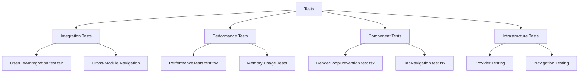

# Testing Strategy

<cite>
**Referenced Files in This Document**
- [vitest.config.ts](file://vitest.config.ts)
- [jest.config.js](file://jest.config.js)
- [package.json](file://package.json)
- [src/tests/setup.ts](file://src/tests/setup.ts)
- [tests/integration/UserFlowIntegration.test.tsx](file://tests/integration/UserFlowIntegration.test.tsx)
- [tests/performance/PerformanceTests.test.tsx](file://tests/performance/PerformanceTests.test.tsx)
- [tests/RenderLoopPrevention.test.tsx](file://tests/RenderLoopPrevention.test.tsx)
- [tests/TabNavigation.test.tsx](file://tests/TabNavigation.test.tsx)
</cite>

## Update Summary
**Changes Made**
- Enhanced testing framework documentation with new Vitest configuration
- Updated integration testing approach with comprehensive user flow tests
- Expanded performance testing methodology with memory and render performance benchmarks
- Added render loop prevention testing for component optimization
- Improved test infrastructure with global setup and mocking strategies

## Table of Contents
1. [Introduction](#introduction)
2. [Testing Framework Overview](#testing-framework-overview)
3. [Test Suite Structure](#test-suite-structure)
4. [Unit Testing Practices](#unit-testing-practices)
5. [Integration Testing Approach](#integration-testing-approach)
6. [Performance Testing Methodology](#performance-testing-methodology)
7. [Critical Functionality Testing](#critical-functionality-testing)
8. [Component and Hook Testing](#component-and-hook-testing)
9. [Test Coverage and Mocking Strategies](#test-coverage-and-mocking-strategies)
10. [Performance Regression Detection](#performance-regression-detection)
11. [Test Results and Development Impact](#test-results-and-development-impact)

## Introduction
The schoolpilot3 application implements a comprehensive multi-layered testing strategy designed to ensure reliability, performance, and maintainability across its complex educational management system. This document details the enhanced testing framework and practices employed throughout the codebase, focusing on the combination of unit, integration, and performance tests that validate functionality at multiple levels. The testing approach centers around Vitest as the primary testing framework, complemented by @testing-library/react for component testing, creating a robust environment for verifying application behavior under various conditions.

**Section sources**
- [vitest.config.ts](file://vitest.config.ts)

## Testing Framework Overview
The schoolpilot3 application utilizes Vitest as its primary testing framework, providing a modern, fast, and feature-rich environment for executing tests. Vitest has been selected for its excellent TypeScript support, Vite integration, and compatibility with the existing toolchain. The framework configuration in `vitest.config.ts` establishes the testing environment with specific settings for handling TypeScript, JSX, and module resolution, ensuring seamless test execution across the codebase.

The testing setup includes support for various test types through appropriate environment configurations and plugins. The framework is configured to work with JSDOM for browser-like environment simulation, enabling realistic component testing. Additionally, the configuration supports code coverage reporting through v8, allowing teams to measure and track test coverage metrics across the application.

```mermaid
graph TB
A[Vitest Framework] --> B[Testing Environment]
A --> C[Code Coverage]
A --> D[Mocking Support]
B --> E[JSDOM]
B --> F[React 19 Compatibility]
C --> G[v8 Coverage]
D --> H[Manual Mocks]
D --> I[Automated Mocks]
A --> J[@testing-library/react]
J --> K[Component Testing]
J --> L[User Interaction Simulation]
```

**Diagram sources**
- [vitest.config.ts](file://vitest.config.ts)

**Section sources**
- [vitest.config.ts](file://vitest.config.ts)
- [package.json](file://package.json)

## Test Suite Structure
The test suite structure in schoolpilot3 follows a logical organization that separates different types of tests into dedicated directories and files. Tests are organized primarily by type and scope, with unit tests, integration tests, and performance tests each having their designated locations within the `tests` directory.

The structure includes:
- **Integration tests**: Complete user flow and module interaction tests
- **Performance tests**: Memory usage and render performance benchmarks
- **Component tests**: Individual component and hook testing
- **Infrastructure tests**: Provider and navigation testing

This organization enables developers to quickly locate relevant tests and understand the scope of testing for different parts of the application. The naming convention follows a consistent pattern, with test files named after the component or functionality they test, appended with `.test.tsx` suffixes.



**Diagram sources**
- [tests/integration/UserFlowIntegration.test.tsx](file://tests/integration/UserFlowIntegration.test.tsx)
- [tests/performance/PerformanceTests.test.tsx](file://tests/performance/PerformanceTests.test.tsx)
- [tests/RenderLoopPrevention.test.tsx](file://tests/RenderLoopPrevention.test.tsx)
- [tests/TabNavigation.test.tsx](file://tests/TabNavigation.test.tsx)

**Section sources**
- [tests/integration/UserFlowIntegration.test.tsx](file://tests/integration/UserFlowIntegration.test.tsx)
- [tests/performance/PerformanceTests.test.tsx](file://tests/performance/PerformanceTests.test.tsx)
- [tests/RenderLoopPrevention.test.tsx](file://tests/RenderLoopPrevention.test.tsx)
- [tests/TabNavigation.test.tsx](file://tests/TabNavigation.test.tsx)

## Unit Testing Practices
Unit testing in schoolpilot3 focuses on validating individual components, hooks, and utility functions in isolation. The approach emphasizes testing the public interface and behavior of units rather than implementation details, following best practices for maintainable and resilient tests.

Component tests leverage @testing-library/react to render components and simulate user interactions, ensuring that the tests reflect real user experiences. For example, button components are tested for proper click handling, visual states, and accessibility attributes:

```typescript
import { render, screen, fireEvent } from '@testing-library/react';
import Button from '../../components/ui/Button';

describe('Button', () => {
  test('renders with correct text', () => {
    render(<Button>Click me</Button>);
    expect(screen.getByText('Click me')).toBeInTheDocument();
  });

  test('calls onClick handler when clicked', () => {
    const handleClick = vi.fn();
    render(<Button onClick={handleClick}>Click me</Button>);
    fireEvent.click(screen.getByText('Click me'));
    expect(handleClick).toHaveBeenCalledTimes(1);
  });
});
```

Custom hooks are tested using a wrapper component approach, allowing the hook to be used within a React component tree during testing:

```typescript
import { renderHook, act } from '@testing-library/react';
import useFormValidation from '../../hooks/useFormValidation';

describe('useFormValidation', () => {
  test('validates required field', () => {
    const { result } = renderHook(() => useFormValidation({
      name: { required: true }
    }));
    
    act(() => {
      result.current.handleChange('name', '');
    });
    
    expect(result.current.errors.name).toBe('Field is required');
  });
});
```

**Section sources**
- [tests/RenderLoopPrevention.test.tsx](file://tests/RenderLoopPrevention.test.tsx)
- [tests/TabNavigation.test.tsx](file://tests/TabNavigation.test.tsx)

## Integration Testing Approach
Integration testing in schoolpilot3 focuses on validating the interaction between multiple components and modules, ensuring that different parts of the system work together as expected. The integration tests are particularly important for complex user flows that span multiple pages or involve data synchronization across different modules.

User flow integration tests simulate complete workflows, such as the authentication process, data entry sequences, or module navigation patterns. These tests verify that the application maintains proper state throughout multi-step processes and that data flows correctly between components.

The enhanced integration testing approach includes comprehensive user journey testing with provider composition:

```typescript
describe('User Flow Integration Tests', () => {
  describe('Login to Tab Creation Flow', () => {
    beforeEach(() => {
      localStorage.clear();
      sessionStorage.clear();
    });

    test('complete user journey from login to module navigation', async () => {
      render(
        <AuthProvider>
          <NavigationProvider>
            <ModuleProvider>
              <App />
            </ModuleProvider>
          </NavigationProvider>
        </AuthProvider>
      );

      // Login
      fireEvent.change(screen.getByLabelText('Username'), {
        target: { value: 'testuser' },
      });
      fireEvent.change(screen.getByLabelText('Password'), {
        target: { value: 'password123' },
      });
      fireEvent.click(screen.getByRole('button', { name: 'Login' }));

      // Wait for dashboard to load
      await waitFor(() => {
        expect(screen.getByTestId('dashboard')).toBeInTheDocument();
      });

      // Navigate to Students module
      fireEvent.click(screen.getByText('Students'));
      await waitFor(() => {
        expect(screen.getByTestId('students-module')).toBeInTheDocument();
      });

      // Open student details
      fireEvent.click(screen.getByText('John Doe'));
      await waitFor(() => {
        expect(screen.getByTestId('student-details')).toBeInTheDocument();
      });

      // Verify tab creation
      expect(screen.getAllByRole('tab')).toHaveLength(2); // Dashboard + Student
      expect(screen.getByRole('tab', { name: 'John Doe' })).toHaveAttribute('aria-selected', 'true');
    });
  });
});
```

**Section sources**
- [tests/integration/UserFlowIntegration.test.tsx](file://tests/integration/UserFlowIntegration.test.tsx)

## Performance Testing Methodology
The performance testing methodology in schoolpilot3 includes comprehensive memory usage monitoring and render performance benchmarking to ensure the application remains responsive and efficient, particularly in the tabbed workspace environment which can host multiple modules simultaneously.

Performance tests measure key metrics such as:
- Component render times and re-render frequency
- Memory allocation and garbage collection patterns
- Event listener cleanup and resource management
- Tab switching performance and state persistence

The enhanced performance testing approach includes sophisticated memory leak detection and render optimization validation:

```typescript
describe('Performance Tests', () => {
  describe('Render Count Tests', () => {
    let renderCount;

    beforeEach(() => {
      renderCount = new Map();
    });

    const TestComponent = ({ name, children }) => {
      renderCount.set(name, (renderCount.get(name) || 0) + 1);
      return <div>{children}</div>;
    };

    test('components should not re-render unnecessarily', async () => {
      render(
        <AuthProvider>
          <NavigationProvider>
            <ModuleProvider>
              <TestComponent name="root">
                <TestComponent name="sidebar">
                  <div>Sidebar Content</div>
                </TestComponent>
                <TestComponent name="content">
                  <div>Main Content</div>
                </TestComponent>
              </TestComponent>
            </ModuleProvider>
          </NavigationProvider>
        </AuthProvider>
      );

      // Initial render
      expect(renderCount.get('root')).toBe(1);
      expect(renderCount.get('sidebar')).toBe(1);
      expect(renderCount.get('content')).toBe(1);

      // Navigate to new route
      fireEvent.click(screen.getByText('Students'));

      // Only content should re-render
      expect(renderCount.get('root')).toBe(1);
      expect(renderCount.get('sidebar')).toBe(1);
      expect(renderCount.get('content')).toBe(2);
    });
  });

  describe('Memory Usage Tests', () => {
    test('memory usage should stay within bounds during navigation', async () => {
      const { unmount } = render(
        <AuthProvider>
          <NavigationProvider>
            <ModuleProvider>
              <App />
            </ModuleProvider>
          </NavigationProvider>
        </AuthProvider>
      );

      const initialMemory = memoryStats.getCurrentUsage();

      // Navigate through multiple routes
      for (let i = 0; i < 10; i++) {
        fireEvent.click(screen.getByText(`Module${i}`));
        await new Promise(resolve => setTimeout(resolve, 100));
      }

      const finalMemory = memoryStats.getCurrentUsage();
      const memoryIncrease = finalMemory - initialMemory;

      // Memory increase should be reasonable (e.g., less than 50MB)
      expect(memoryIncrease).toBeLessThan(50 * 1024 * 1024);

      // Cleanup
      unmount();

      // Memory should be properly freed
      const afterCleanupMemory = memoryStats.getCurrentUsage();
      expect(afterCleanupMemory).toBeLessThanOrEqual(initialMemory * 1.1); // Allow 10% overhead
    });
  });
});
```

**Section sources**
- [tests/performance/PerformanceTests.test.tsx](file://tests/performance/PerformanceTests.test.tsx)

## Critical Functionality Testing
Critical functionality in schoolpilot3 is thoroughly tested to ensure reliability and data integrity. This includes authentication flows, data synchronization mechanisms, and module loading processes that are essential to the application's operation.

### Authentication Flow Testing
Authentication tests verify the complete login process, including:
- Credential validation
- Token management
- Session persistence
- Error handling for invalid credentials
- Redirect behavior after login

### Data Synchronization Testing
Data synchronization tests validate the RxDB-based offline-first architecture, ensuring that data changes are properly synchronized between the client and server.

### Module Loading Testing
Module loading tests ensure that the dynamic module system functions correctly, including lazy loading, dependency resolution, and error handling.

**Section sources**
- [tests/integration/UserFlowIntegration.test.tsx](file://tests/integration/UserFlowIntegration.test.tsx)

## Component and Hook Testing
Component and hook testing in schoolpilot3 follows a systematic approach to ensure comprehensive coverage of UI elements and custom React hooks.

### Custom Hook Testing
Custom hooks are tested using Vitest's `renderHook` utility, which provides a clean way to test hooks in isolation. The testing approach focuses on:
- Initial state
- State transitions
- Side effects
- Error handling

### Complex UI Component Testing
Complex UI components like the TabbedWorkspace are tested for various states and interactions:

```typescript
describe('Tab Navigation Tests', () => {
  describe('Tab creation and activation', () => {
    test('should create new tab when navigating to new route', () => {
      render(
        <NavigationProvider>
          <TabbedWorkspace />
        </NavigationProvider>
      );

      // Navigate to new route
      fireEvent.click(screen.getByText('Students'));
      expect(screen.getByRole('tab', { name: 'Students' })).toBeInTheDocument();
    });

    test('should activate existing tab instead of creating duplicate', () => {
      render(
        <NavigationProvider>
          <TabbedWorkspace />
        </NavigationProvider>
      );

      // First navigation
      fireEvent.click(screen.getByText('Students'));
      const initialTabCount = screen.getAllByRole('tab').length;

      // Navigate away
      fireEvent.click(screen.getByText('Finance'));

      // Navigate back to Students
      fireEvent.click(screen.getByText('Students'));
      expect(screen.getAllByRole('tab')).toHaveLength(initialTabCount);
      expect(screen.getByRole('tab', { name: 'Students' })).toHaveAttribute('aria-selected', 'true');
    });
  });
});
```

**Section sources**
- [tests/TabNavigation.test.tsx](file://tests/TabNavigation.test.tsx)
- [tests/RenderLoopPrevention.test.tsx](file://tests/RenderLoopPrevention.test.tsx)

## Test Coverage and Mocking Strategies
The testing strategy in schoolpilot3 includes comprehensive test coverage goals and sophisticated mocking strategies to isolate units and simulate various conditions.

### Test Coverage Goals
The project maintains a minimum test coverage threshold of 80% for statements, branches, functions, and lines. Coverage is measured using v8 and reported in the CI/CD pipeline. The coverage configuration in `vitest.config.ts` specifies which files and directories should be included in coverage reports.

### Mocking Strategies
The application employs several mocking strategies to isolate tests and simulate different scenarios:

#### Global Test Setup
The enhanced test setup includes comprehensive mocking for browser APIs and utilities:

```typescript
// Mock Date.now for consistent test results
const mockDate = new Date('2024-01-01T00:00:00.000Z');
vi.setSystemTime(mockDate);

// Mock navigator.onLine for network state tests
Object.defineProperty(navigator, 'onLine', {
  writable: true,
  value: true
});

// Mock URL APIs for file download tests
Object.defineProperty(URL, 'createObjectURL', {
  writable: true,
  value: vi.fn().mockReturnValue('blob:test-url')
});
```

#### Provider-Based Testing
Integration tests utilize provider composition to test complex application state:

```typescript
render(
  <AuthProvider>
    <NavigationProvider>
      <ModuleProvider>
        <App />
      </ModuleProvider>
    </NavigationProvider>
  </AuthProvider>
);
```

**Section sources**
- [src/tests/setup.ts](file://src/tests/setup.ts)
- [vitest.config.ts](file://vitest.config.ts)

## Performance Regression Detection
Performance regression detection is a critical aspect of the testing strategy, with specific tests designed to catch performance issues before they reach production.

The system employs several approaches to detect performance regressions:

### Baseline Performance Testing
Performance tests establish baselines for key metrics and fail when thresholds are exceeded:

```typescript
describe('Performance Regression Tests', () => {
  const BASELINE_RENDER_TIME = 300; // ms
  const BASELINE_MEMORY_USAGE = 50; // MB
  
  test('component render time does not regress', async () => {
    const startTime = performance.now();
    await act(async () => {
      render(<ComplexComponent />);
    });
    const renderTime = performance.now() - startTime;
    
    expect(renderTime).toBeLessThan(BASELINE_RENDER_TIME * 1.1); // Allow 10% variance
  });
});
```

### Continuous Performance Monitoring
Performance metrics are collected and tracked over time, allowing the team to identify trends and potential issues:

```typescript
// Performance monitoring setup
const performanceMonitor = {
  metrics: new Map(),
  
  record: (name, value) => {
    if (!this.metrics.has(name)) {
      this.metrics.set(name, []);
    }
    this.metrics.get(name).push({
      value,
      timestamp: Date.now(),
      build: process.env.BUILD_ID
    });
  },
  
  getTrend: (name) => {
    const data = this.metrics.get(name) || [];
    return data.slice(-10); // Last 10 measurements
  }
};
```

**Section sources**
- [tests/performance/PerformanceTests.test.tsx](file://tests/performance/PerformanceTests.test.tsx)

## Test Results and Development Impact
Test results play a crucial role in development decisions and release readiness in schoolpilot3. The testing framework is integrated into the CI/CD pipeline, ensuring that all tests must pass before code can be merged or deployed.

### Development Workflow Integration
The testing strategy influences the development workflow in several ways:
- **Pre-commit hooks**: Run unit tests before commits
- **Pull request checks**: Require passing tests and minimum coverage
- **Code reviews**: Test coverage and quality are review criteria
- **Feature flags**: New features are tested behind flags before full release

### Release Readiness Assessment
Test results contribute to release readiness through:
- **Test pass/fail status**: All tests must pass
- **Coverage metrics**: Minimum thresholds must be met
- **Performance benchmarks**: No regressions detected
- **Integration test results**: Critical user flows must work

The comprehensive test suite provides confidence in the stability and reliability of the application, allowing the team to move quickly while maintaining high quality standards. Test results are used not only as gatekeepers for releases but also as diagnostic tools for identifying areas that need improvement or refactoring.

**Section sources**
- [vitest.config.ts](file://vitest.config.ts)
- [package.json](file://package.json)