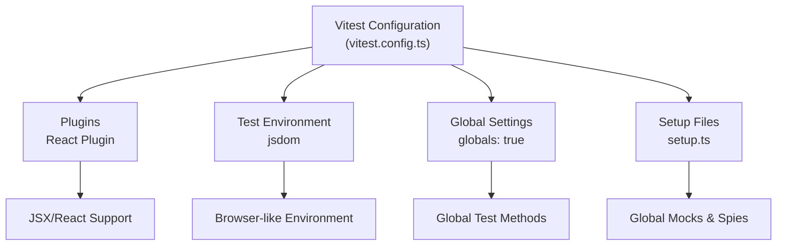
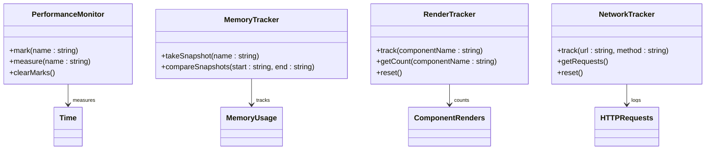
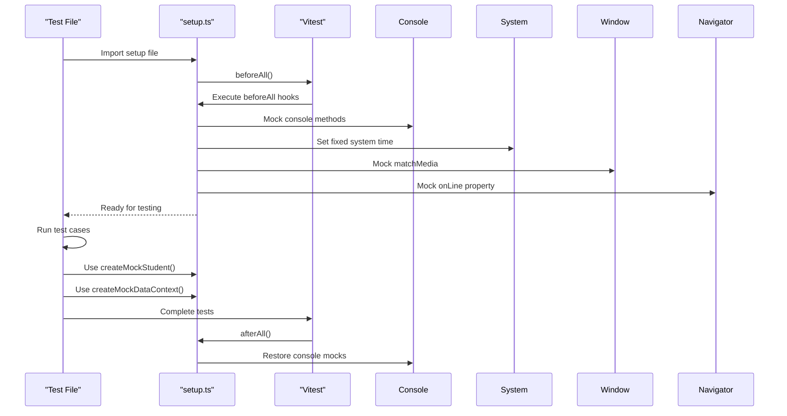
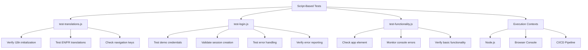

# Testing Utilities and Setup

<cite>
**Referenced Files in This Document**   
- [vitest.config.ts](file://vitest.config.ts)
- [src/tests/utils/testUtils.ts](file://src/tests/utils/testUtils.ts)
- [src/tests/setup.ts](file://src/tests/setup.ts)
- [scripts/test/test-translations.js](file://scripts/test/test-translations.js)
- [scripts/test/test-login.js](file://scripts/test/test-login.js)
- [scripts/test/test-functionality.js](file://scripts/test/test-functionality.js)
</cite>

## Table of Contents
1. [Vitest Configuration](#vitest-configuration)
2. [Custom Test Utilities](#custom-test-utilities)
3. [Global Test Setup](#global-test-setup)
4. [Script-Based Tests](#script-based-tests)
5. [Testing Integration and Best Practices](#testing-integration-and-best-practices)

## Vitest Configuration

The Vitest configuration in `vitest.config.ts` establishes the foundational test environment for the schoolpilot3 application. This configuration ensures consistent test execution across the codebase by defining essential parameters for module resolution, test environment setup, and global behavior.

The configuration uses Vite's `defineConfig` function with the React plugin to ensure proper JSX and React-specific syntax handling during testing. The test environment is configured with three key settings:

- **Globals enabled**: The `globals: true` option makes Vitest's testing methods (like `describe`, `test`, `expect`) globally available without requiring explicit imports in each test file, simplifying test writing and improving readability.

- **JS DOM environment**: The `environment: 'jsdom'` setting creates a browser-like environment for tests, enabling DOM manipulation and browser API access. This is essential for testing React components that interact with the document object model.

- **Setup files**: The `setupFiles` array specifies `./src/tests/setup.ts` as the global setup file, ensuring that all necessary mocks, spies, and global configurations are applied before any test runs.



**Diagram sources**
- [vitest.config.ts](file://vitest.config.ts#L1-L11)

**Section sources**
- [vitest.config.ts](file://vitest.config.ts#L1-L11)

## Custom Test Utilities

The `testUtils.ts` file provides a comprehensive suite of custom utilities that simplify common testing patterns and enable sophisticated testing scenarios. These utilities are designed to address specific testing challenges in the schoolpilot3 application, particularly around performance monitoring, memory management, and component behavior tracking.

The utilities are organized into several functional categories:

### Performance and Resource Monitoring
The file exports several factory functions for monitoring application performance and resource usage during tests:

- **Performance Monitor**: Tracks execution time between named marks using the Web Performance API, allowing precise measurement of function or rendering performance.

- **Memory Tracker**: Captures memory usage snapshots (heap and RSS) at different points in time, enabling detection of memory leaks by comparing usage before and after operations.

- **Render Tracker**: Monitors component render counts, which is crucial for identifying unnecessary re-renders and optimizing React component performance.



**Diagram sources**
- [src/tests/utils/testUtils.ts](file://src/tests/utils/testUtils.ts#L4-L102)

### Mock Implementations
The file includes mock implementations of browser APIs that may not be fully supported in the test environment or need to be controlled for testing purposes:

- **Mock Storage**: A complete implementation of the Web Storage API (localStorage and sessionStorage) using a Map, allowing tests to verify storage operations without affecting actual browser storage.

- **Mock MutationObserver**: A simplified implementation of the MutationObserver API for testing DOM mutation detection without actual DOM changes.

- **Animation Frame Mock**: Controls requestAnimationFrame calls, allowing tests to trigger animation frames explicitly rather than waiting for browser scheduling.

### Testing Helpers
Additional utilities enhance test reliability and simplify common testing tasks:

- **waitForCondition**: An async utility that polls a condition function until it returns true or times out, essential for testing asynchronous operations and state changes.

- **simulateEvent**: Creates and dispatches custom events on DOM elements, simplifying the testing of event handlers and user interactions.

- **generateTestData**: Factory functions for creating consistent test data objects (users, tabs) with randomized identifiers to prevent test data collisions.

**Section sources**
- [src/tests/utils/testUtils.ts](file://src/tests/utils/testUtils.ts#L4-L202)

## Global Test Setup

The `setup.ts` file configures the global test environment by establishing consistent mocks, spies, and utility functions that are available across all tests. This centralized setup ensures uniform behavior and reduces boilerplate code in individual test files.

The setup process occurs in several phases:

### Console Output Management
Before all tests run, console methods are mocked to prevent noisy output in test results:

```typescript
beforeAll(() => {
  vi.spyOn(console, 'log').mockImplementation(() => {});
  vi.spyOn(console, 'warn').mockImplementation(() => {});
  vi.spyOn(console, 'error').mockImplementation(() => {});
});
```

This prevents test logs from cluttering the test output while still allowing test-specific logging when needed. All mocks are restored after testing completes with `vi.restoreAllMocks()`.

### Time and Environment Mocking
The setup establishes consistent temporal and environmental conditions:

- **Fixed Date/Time**: `vi.setSystemTime()` sets a fixed date (January 1, 2024) to ensure consistent timestamp generation across tests, preventing flaky tests that depend on current time.

- **Network State**: The `navigator.onLine` property is made writable and set to `true` by default, allowing individual tests to modify it when testing online/offline functionality.

- **Media Queries**: `window.matchMedia` is mocked to support accessibility testing, with a default return value of `matches: false` to simulate specific viewport conditions.

### Test Data Factories
The file exports several factory functions for creating consistent test data objects with predefined defaults that can be overridden:

- **createMockStudent**: Generates student objects with consistent structure and default values
- **createMockStaff**: Creates staff member objects for HR-related testing
- **createMockFinancialYear**: Produces financial year objects for finance module testing
- **createMockInvoice**: Generates invoice objects for financial transactions testing
- **createMockDataContext**: Creates a complete application data context with related entities

These factories ensure data consistency across tests while allowing customization through the `overrides` parameter.



**Diagram sources**
- [src/tests/setup.ts](file://src/tests/setup.ts#L4-L120)

**Section sources**
- [src/tests/setup.ts](file://src/tests/setup.ts#L4-L120)

## Script-Based Tests

The `scripts/test` directory contains standalone JavaScript files that validate specific application functionality outside the Vitest framework. These scripts are designed to be run independently, either from the command line or directly in the browser console, providing targeted testing for critical application features.

### Translation Validation
The `test-translations.js` script verifies the proper loading and functionality of the application's internationalization system:

- Tests both English and French translations for key navigation items
- Uses the i18next instance to check specific translation keys like `navigation:administration.title`
- Outputs results to the console for manual verification
- Includes a 1-second delay to ensure i18n initialization completes

This script is particularly valuable for catching translation loading issues that might occur in specific environments or deployment scenarios.

### Login Functionality Testing
The `test-login.js` script provides comprehensive validation of the authentication system:

- Tests all demo user credentials (admin, teacher, finance, student)
- Verifies successful login and session creation
- Validates user role assignment and demo mode flags
- Tests error handling with invalid credentials
- Includes manual error reporting verification for the Bugsink integration

The script is designed for both automated and manual testing, exporting functions to the global `window` object when run in a browser context, making it accessible from the browser console.

### General Application Functionality
The `test-functionality.js` script performs basic health checks on the running application:

- Verifies the application is running on localhost
- Confirms the presence of the main application element
- Monitors console errors over a 3-second period
- Provides a simple pass/fail indication of basic functionality

This lightweight test serves as a quick smoke test to ensure the application is minimally functional before more comprehensive testing.



**Diagram sources**
- [scripts/test/test-translations.js](file://scripts/test/test-translations.js#L1-L24)
- [scripts/test/test-login.js](file://scripts/test/test-login.js#L1-L136)
- [scripts/test/test-functionality.js](file://scripts/test/test-functionality.js#L1-L40)

**Section sources**
- [scripts/test/test-translations.js](file://scripts/test/test-translations.js#L1-L24)
- [scripts/test/test-login.js](file://scripts/test/test-login.js#L1-L136)
- [scripts/test/test-functionality.js](file://scripts/test/test-functionality.js#L1-L40)

## Testing Integration and Best Practices

The testing utilities and setup in schoolpilot3 work together to create a robust, consistent, and efficient testing environment. This integrated approach enables developers to write reliable tests that accurately reflect application behavior while minimizing setup overhead.

### Component Testing with Proper Context
When testing components that depend on context providers (AuthContext, UserContext, etc.), the global setup ensures that mock data is readily available:

```typescript
// Example of setting up a component test
import { render, screen } from '@testing-library/react';
import { createMockStudent } from '../../tests/setup';
import StudentProfile from '../../components/StudentProfile';

test('renders student profile with mock data', () => {
  const student = createMockStudent({
    first_name: 'Jane',
    last_name: 'Smith'
  });
  
  render(<StudentProfile student={student} />);
  
  expect(screen.getByText('Jane Smith')).toBeInTheDocument();
});
```

### Mocking External Dependencies
The testing utilities provide straightforward mechanisms for mocking external services:

```typescript
// Example of mocking authentication service
import { vi } from 'vitest';
import { authService } from '../../src/services/authService';

test('handles login failure', async () => {
  // Mock the login method to reject
  vi.spyOn(authService, 'login').mockRejectedValue(
    new Error('Invalid credentials')
  );
  
  // Test component behavior when login fails
  await expect(authService.login({ 
    username: 'invalid', 
    password: 'wrong' 
  })).rejects.toThrow('Invalid credentials');
});
```

### Configuring Test Environments
Different test scenarios can be accommodated by combining the available utilities:

```typescript
// Performance test setup
import { createPerformanceMonitor } from '../../tests/utils/testUtils';

test('measures component rendering performance', () => {
  const monitor = createPerformanceMonitor();
  
  monitor.mark('render-start');
  render(<ComplexComponent />);
  monitor.mark('render-end');
  
  const duration = monitor.measure('render-end');
  expect(duration).toBeLessThan(100); // Should render in under 100ms
});
```

The testing ecosystem in schoolpilot3 demonstrates a comprehensive approach to quality assurance, combining unit testing, integration testing, and targeted script-based validation to ensure application reliability across all functionality domains.

**Section sources**
- [vitest.config.ts](file://vitest.config.ts#L1-L11)
- [src/tests/utils/testUtils.ts](file://src/tests/utils/testUtils.ts#L4-L202)
- [src/tests/setup.ts](file://src/tests/setup.ts#L4-L120)
- [scripts/test/test-translations.js](file://scripts/test/test-translations.js#L1-L24)
- [scripts/test/test-login.js](file://scripts/test/test-login.js#L1-L136)
- [scripts/test/test-functionality.js](file://scripts/test/test-functionality.js#L1-L40)