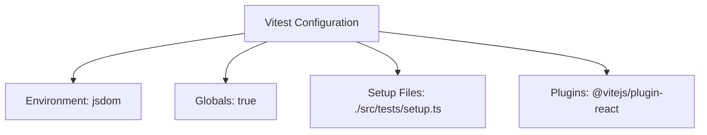
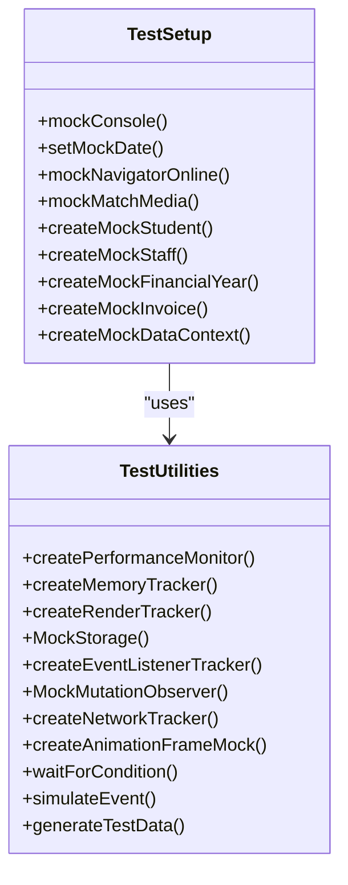
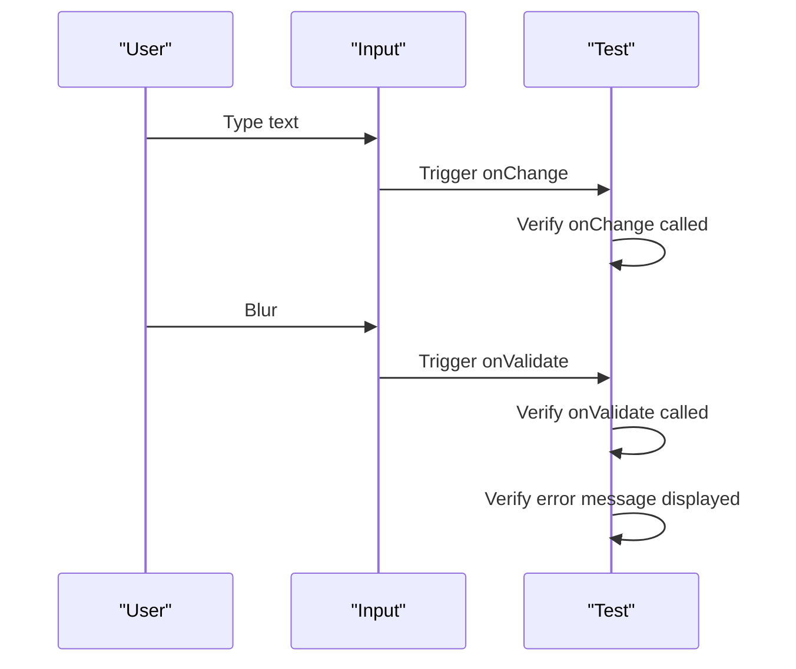
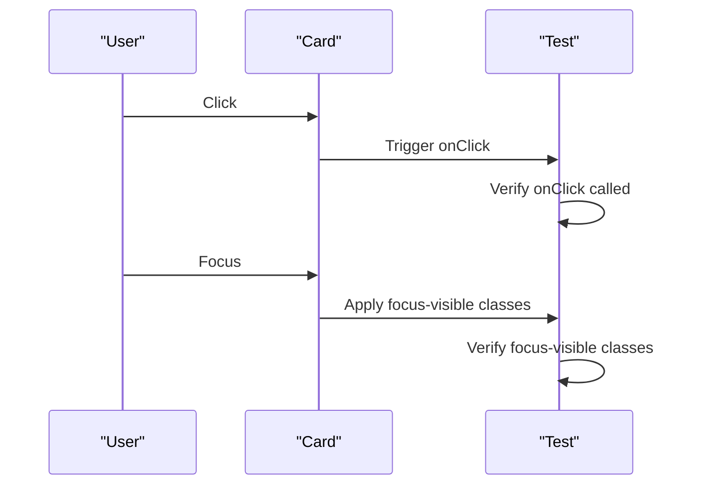
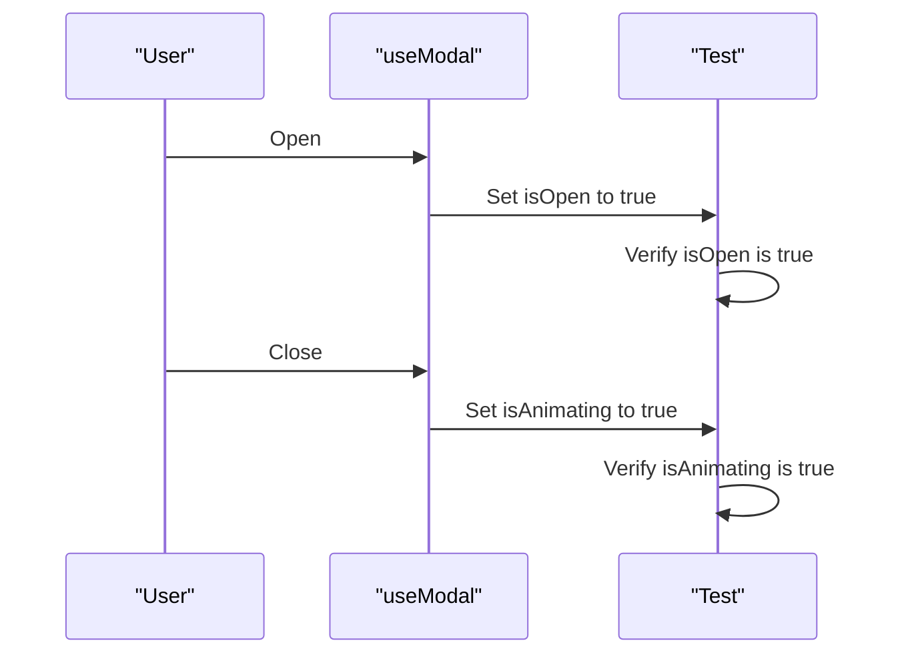
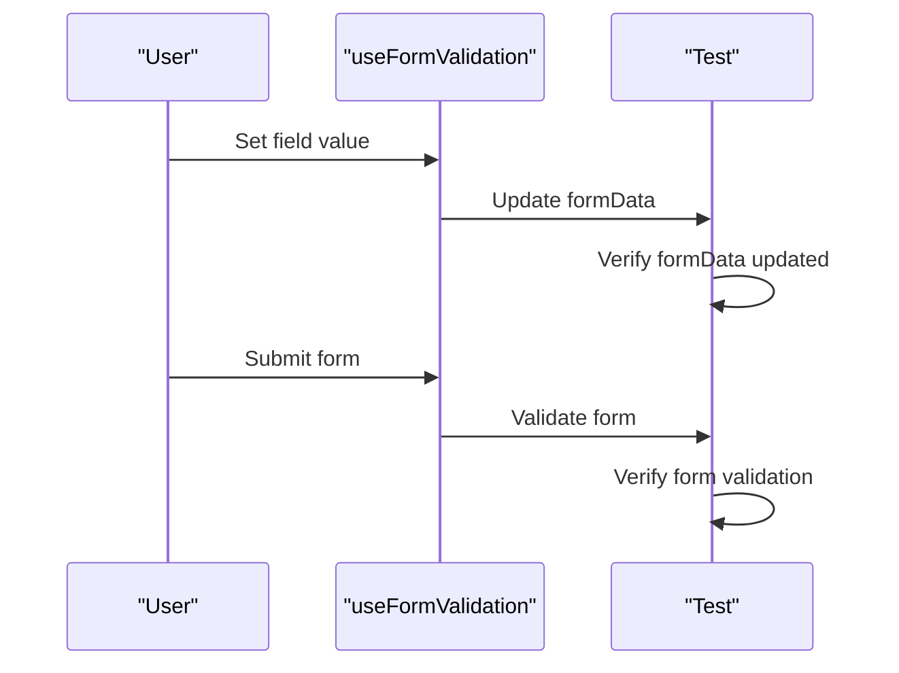

# Unit Testing

<cite>
**Referenced Files in This Document**   
- [vitest.config.ts](file://vitest.config.ts)
- [testUtils.ts](file://src/tests/utils/testUtils.ts)
- [setup.ts](file://src/tests/setup.ts)
- [Button.test.tsx](file://src/tests/Button.test.tsx)
- [Input.test.tsx](file://src/tests/Input.test.tsx)
- [Card.test.tsx](file://src/tests/Card.test.tsx)
- [useModal.test.tsx](file://src/tests/useModal.test.tsx)
- [useFormValidation.test.tsx](file://src/tests/useFormValidation.test.tsx)
- [useModal.tsx](file://src/hooks/useModal.tsx)
- [useFormValidation.tsx](file://src/hooks/useFormValidation.tsx)
</cite>

## Table of Contents
1. [Introduction](#introduction)
2. [Testing Framework and Setup](#testing-framework-and-setup)
3. [Testing UI Components](#testing-ui-components)
4. [Testing Custom Hooks](#testing-custom-hooks)
5. [Testing Utility Functions](#testing-utility-functions)
6. [Best Practices for Effective Unit Testing](#best-practices-for-effective-unit-testing)
7. [Common Challenges and Solutions](#common-challenges-and-solutions)
8. [Conclusion](#conclusion)

## Introduction
Unit testing in schoolpilot3 is a critical practice for ensuring code quality, preventing regressions, and maintaining a robust codebase. The testing strategy focuses on isolated testing of individual components, hooks, and utility functions using Vitest as the primary testing framework. This document provides a comprehensive overview of the unit testing approach, covering the tools, techniques, and best practices employed in the project.

**Section sources**
- [vitest.config.ts](file://vitest.config.ts)
- [testUtils.ts](file://src/tests/utils/testUtils.ts)

## Testing Framework and Setup

### Vitest Configuration
The project uses Vitest as the testing framework, configured to work seamlessly with the Vite build system. The configuration is defined in `vitest.config.ts`, which sets up the test environment, globals, and setup files.

**Diagram sources**
- [vitest.config.ts](file://vitest.config.ts#L0-L11)

**Section sources**
- [vitest.config.ts](file://vitest.config.ts#L0-L11)

### Test Setup and Utilities
The test setup file `setup.ts` initializes the test environment by mocking console methods, setting a consistent date, and defining global test utilities. The `testUtils.ts` file provides custom utilities for performance monitoring, memory tracking, render count tracking, and more.

**Diagram sources**
- [setup.ts](file://src/tests/setup.ts#L0-L120)
- [testUtils.ts](file://src/tests/utils/testUtils.ts#L0-L202)

**Section sources**
- [setup.ts](file://src/tests/setup.ts#L0-L120)
- [testUtils.ts](file://src/tests/utils/testUtils.ts#L0-L202)

## Testing UI Components

### Button Component
The Button component is tested for various variants, sizes, loading states, and accessibility. The tests ensure that the component renders correctly and handles user interactions as expected.

**Diagram sources**
- [Button.test.tsx](file://src/tests/Button.test.tsx#L0-L368)

**Section sources**
- [Button.test.tsx](file://src/tests/Button.test.tsx#L0-L368)

### Input Component
The Input component is tested for basic functionality, floating labels, validation states, icons, variants, sizes, and accessibility. The tests ensure that the component handles user input and displays validation messages correctly.

**Diagram sources**
- [Input.test.tsx](file://src/tests/Input.test.tsx#L0-L282)

**Section sources**
- [Input.test.tsx](file://src/tests/Input.test.tsx#L0-L282)

### Card Component
The Card component is tested for basic rendering, variants, sizes, interactive behavior, group hover effects, forward ref, and custom props. The tests ensure that the component renders correctly and handles user interactions as expected.

**Diagram sources**
- [Card.test.tsx](file://src/tests/Card.test.tsx#L0-L450)

**Section sources**
- [Card.test.tsx](file://src/tests/Card.test.tsx#L0-L450)

## Testing Custom Hooks

### useModal Hook
The useModal hook is tested for initial state, modal state management, callback functions, keyboard event handling, animation state, cleanup, and edge cases. The tests ensure that the hook manages modal state correctly and handles user interactions as expected.

**Diagram sources**
- [useModal.test.tsx](file://src/tests/useModal.test.tsx#L0-L274)

**Section sources**
- [useModal.test.tsx](file://src/tests/useModal.test.tsx#L0-L274)

### useFormValidation Hook
The useFormValidation hook is tested for initial state, field value setting, validation, form submission, and form reset. The tests ensure that the hook manages form state correctly and handles user interactions as expected.

**Diagram sources**
- [useFormValidation.test.tsx](file://src/tests/useFormValidation.test.tsx#L0-L162)

**Section sources**
- [useFormValidation.test.tsx](file://src/tests/useFormValidation.test.tsx#L0-L162)

## Testing Utility Functions

### Test Utilities
The test utilities in `testUtils.ts` are tested for performance monitoring, memory tracking, render count tracking, mock storage, event listener tracking, mock mutation observer, network tracking, animation frame mock, wait for condition, simulate event, and test data generators. The tests ensure that the utilities function correctly and provide accurate results.

```mermaid
classDiagram
class PerformanceMonitor {
+mark(name)
+measure(name)
+clearMarks()
}
class MemoryTracker {
+takeSnapshot(name)
+compareSnapshots(start, end)
}
class RenderTracker {
+track(componentName)
+getCount(componentName)
+reset()
}
class MockStorage {
+getItem(key)
+setItem(key, value)
+removeItem(key)
+clear()
+length
}
class EventListenerTracker {
+track(element, eventType, handler)
+untrack(element, eventType, handler)
+getCount()
+reset()
}
class MockMutationObserver {
+observe()
+disconnect()
+takeRecords()
}
class NetworkTracker {
+track(url, method)
+getRequests()
+reset()
}
class AnimationFrameMock {
+requestAnimationFrame(callback)
+cancelAnimationFrame(id)
+triggerAnimationFrame()
}
class WaitForCondition {
+waitForCondition(condition, timeout, interval)
}
class SimulateEvent {
+simulateEvent(element, eventType, detail)
}
class GenerateTestData {
+user()
+tab(index)
}
```

**Diagram sources**
- [testUtils.ts](file://src/tests/utils/testUtils.ts#L0-L202)

**Section sources**
- [testUtils.ts](file://src/tests/utils/testUtils.ts#L0-L202)

## Best Practices for Effective Unit Testing

### Proper Mocking
Proper mocking is essential for isolating the component or function being tested. The project uses `vi.mock` to mock dependencies and `vi.spyOn` to spy on methods.

### Test Isolation
Each test should be isolated and not depend on the state of other tests. The project uses `beforeEach` and `afterEach` to set up and tear down the test environment.

### Assertion Strategies
The project uses `expect` from Vitest to make assertions. The assertions are clear and specific, ensuring that the test results are reliable.

### Code Coverage
The project aims for high code coverage, ensuring that all critical paths are tested. The coverage is monitored using the coverage configuration in `vitest.config.ts`.

## Common Challenges and Solutions

### Handling Asynchronous Operations
Asynchronous operations can be challenging to test. The project uses `async/await` and `waitFor` to handle asynchronous operations.

### Testing Edge Cases
Edge cases should be tested to ensure that the component or function handles unexpected inputs correctly. The project includes tests for edge cases such as rapid open/close calls and missing DOM elements.

### Testing Error Conditions
Error conditions should be tested to ensure that the component or function handles errors gracefully. The project includes tests for error conditions such as invalid input and network failures.

## Conclusion
Unit testing in schoolpilot3 is a comprehensive and well-structured process that ensures code quality and prevents regressions. The use of Vitest, @testing-library/react, and custom test utilities provides a robust testing environment. By following best practices and addressing common challenges, the project maintains a high level of code quality and reliability.