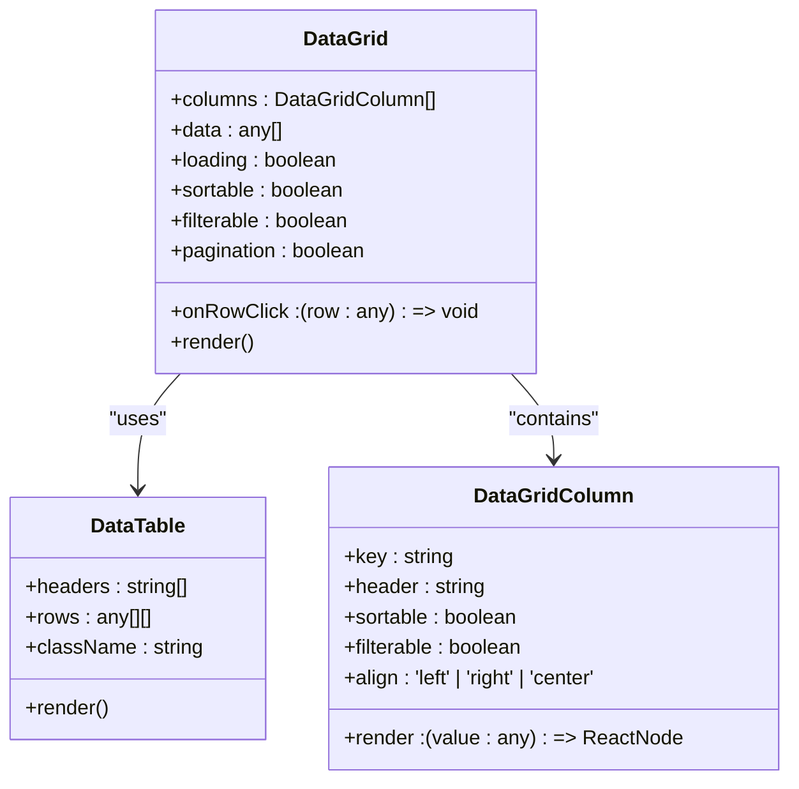
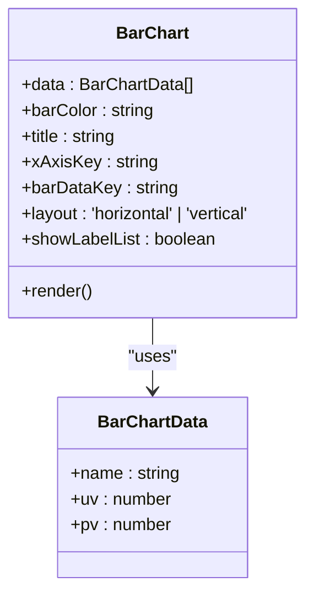
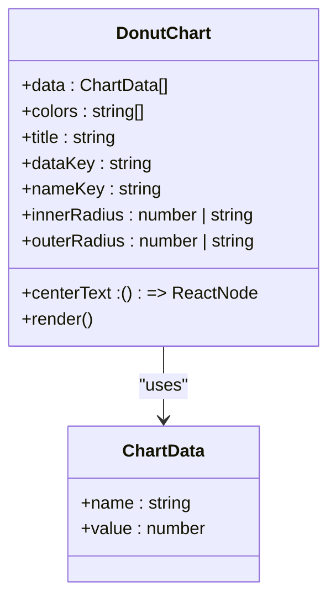
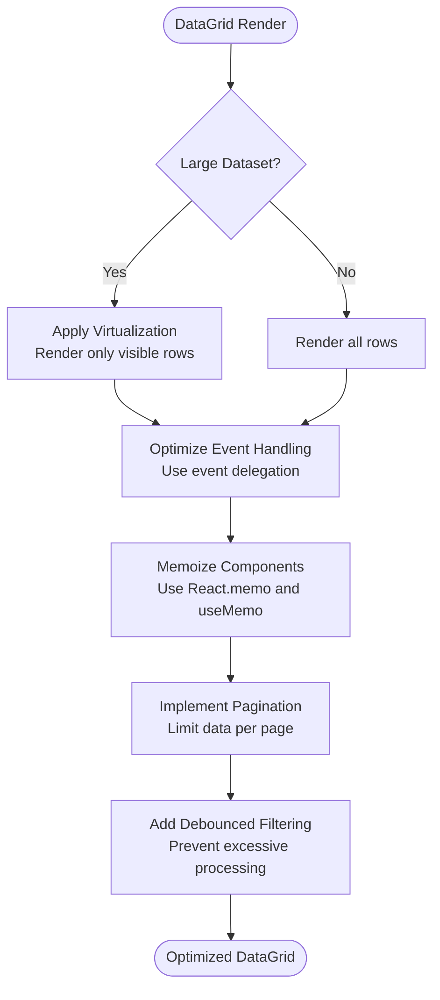

# Data Display Components

<cite>
**Referenced Files in This Document**   
- [DataGrid.tsx](file://src/components/ui/data/DataGrid.tsx)
- [DataTable.tsx](file://src/components/ui/data/DataTable.tsx)
- [KanbanBoard.tsx](file://src/components/ui/data/KanbanBoard.tsx)
- [useKanban.tsx](file://src/hooks/useKanban.tsx)
- [DataCard.tsx](file://src/components/ui/data/DataCard.tsx)
- [BarChart.tsx](file://src/components/ui/BarChart.tsx)
- [DonutChart.tsx](file://src/components/ui/DonutChart.tsx)
- [TableErrorBoundary.tsx](file://src/components/ui/data/TableErrorBoundary.tsx)
- [SkeletonLoader.tsx](file://src/components/ui/data/SkeletonLoader.tsx)
- [FinanceDashboardPage.tsx](file://src/modules/finance/pages/FinanceDashboardPage.tsx)
- [AcademicYearsPage.tsx](file://src/modules/administration/pages/AcademicYearsPage.tsx)
- [DataGridModuleSpecific.test.tsx](file://src/tests/DataGridModuleSpecific.test.tsx)
</cite>

## Table of Contents
1. [Introduction](#introduction)
2. [Core Data Display Components](#core-data-display-components)
3. [DataGrid and DataTable Implementation](#datagrid-and-datatable-implementation)
4. [KanbanBoard and useKanban Hook](#kanbanboard-and-usekanban-hook)
5. [DataCard for Metric Visualization](#datacard-for-metric-visualization)
6. [BarChart and DonutChart Components](#barchart-and-donutchart-components)
7. [Practical Usage Examples](#practical-usage-examples)
8. [Performance and Error Handling](#performance-and-error-handling)
9. [Loading States and Accessibility](#loading-states-and-accessibility)

## Introduction
The schoolpilot3 application features a comprehensive suite of data display components designed to present structured information in an intuitive and interactive manner. These components are built with modern React patterns and are optimized for performance, accessibility, and user experience. The data display ecosystem includes table-based components (DataGrid and DataTable), visualization components (BarChart and DonutChart), metric display components (DataCard), and workflow management components (KanbanBoard). Each component is designed to be reusable across different modules while supporting customization for specific use cases.

## Core Data Display Components

The data display components in schoolpilot3 are organized under the `src/components/ui/data` directory and include:

- **DataGrid**: A feature-rich table component with sorting, filtering, and pagination capabilities
- **DataTable**: A lightweight table component that serves as the foundation for DataGrid
- **KanbanBoard**: A drag-and-drop workflow interface for task and workflow management
- **DataCard**: A component for displaying key metrics and structured data
- **BarChart**: A bar chart component for comparative data visualization
- **DonutChart**: A donut chart component for proportional data representation
- **TableErrorBoundary**: An error boundary specifically designed for table rendering failures
- **SkeletonLoader**: A component that provides smooth loading states with shimmer animations

These components are used throughout the application in various modules including academics, finance, administration, and HR, providing a consistent user experience across different data types and use cases.

**Section sources**
- [DataGrid.tsx](file://src/components/ui/data/DataGrid.tsx)
- [DataTable.tsx](file://src/components/ui/data/DataTable.tsx)
- [KanbanBoard.tsx](file://src/components/ui/data/KanbanBoard.tsx)
- [DataCard.tsx](file://src/components/ui/data/DataCard.tsx)
- [BarChart.tsx](file://src/components/ui/BarChart.tsx)
- [DonutChart.tsx](file://src/components/ui/DonutChart.tsx)

## DataGrid and DataTable Implementation

### DataGrid Architecture

The DataGrid component is built on top of DataTable and provides enhanced functionality for data manipulation and presentation. It supports column configuration, sorting, filtering, pagination, and selection capabilities.



**Diagram sources**
- [DataGrid.tsx](file://src/components/ui/data/DataGrid.tsx)
- [DataTable.tsx](file://src/components/ui/data/DataTable.tsx)

**Section sources**
- [DataGrid.tsx](file://src/components/ui/data/DataGrid.tsx)
- [DataTable.tsx](file://src/components/ui/data/DataTable.tsx)

### Column Configuration and Customization

The DataGrid component uses a flexible column configuration system that allows for extensive customization:

```typescript
interface DataGridColumn<T = any> {
  key: string;
  header: string;
  sortable?: boolean;
  filterable?: boolean;
  align?: 'left' | 'right' | 'center';
  render?: (value: any, row: T) => ReactNode;
  width?: string | number;
}

// Example column configuration for student invoices
const studentInvoiceColumns: DataGridColumn<FinStudentInvoiceType>[] = [
  { 
    key: 'invoice_number', 
    header: 'Invoice #', 
    sortable: true, 
    filterable: true 
  },
  { 
    key: 'student_name', 
    header: 'Student', 
    sortable: true, 
    filterable: true 
  },
  { 
    key: 'class_name', 
    header: 'Class', 
    sortable: true, 
    filterable: true 
  },
  {
    key: 'total_amount',
    header: 'Total Amount',
    sortable: true,
    align: 'right',
    render: (value) => `$${value.toFixed(2)}`
  },
  {
    key: 'paid_amount',
    header: 'Paid Amount',
    sortable: true,
    align: 'right',
    render: (value) => `$${value.toFixed(2)}`
  },
  {
    key: 'balance',
    header: 'Balance',
    sortable: true,
    align: 'right',
    render: (value) => `$${value.toFixed(2)}`
  }
];
```

The `render` property allows for custom cell rendering, enabling the display of formatted values, conditional styling, and interactive elements within table cells.

### Sorting and Filtering Capabilities

DataGrid provides built-in support for sorting and filtering operations:

- **Sorting**: Clicking on column headers toggles between ascending, descending, and unsorted states
- **Filtering**: Filterable columns display filter controls that allow users to search and filter data
- **Multi-column sorting**: Support for sorting by multiple columns with priority ordering
- **Custom filter functions**: Ability to define custom filtering logic for complex data types

The component handles both client-side and server-side data operations, with configurable loading states and error handling.

## KanbanBoard and useKanban Hook

### KanbanBoard Implementation

The KanbanBoard component provides a drag-and-drop interface for managing workflows and tasks across multiple columns. It is designed to support various use cases including task management, student application processing, and exam result approval workflows.

```mermaid
classDiagram
class KanbanBoard {
+columns : KanbanColumn[]
+onCardMove : (cardId, fromColumn, toColumn, newIndex) => void
+onCardClick : (card) => void
+onCardSelect : (cardIds) => void
+loading : boolean
+className : string
+render()
}
class KanbanColumn {
+id : string
+title : string
+cards : KanbanCard[]
+color : string
+maxCards : number
+allowDrop : boolean
}
class KanbanCard {
+id : string
+title : string
+description : string
+tags : string[]
+assignee : { id : string, name : string, avatar? : string }
+priority : 'low' | 'medium' | 'high' | 'urgent'
+dueDate : Date
+status : string
+progress : number
}
KanbanBoard --> KanbanColumn : "contains"
KanbanColumn --> KanbanCard : "contains"
```

**Diagram sources**
- [KanbanBoard.tsx](file://src/components/ui/data/KanbanBoard.tsx)

**Section sources**
- [KanbanBoard.tsx](file://src/components/ui/data/KanbanBoard.tsx)
- [useKanban.tsx](file://src/hooks/useKanban.tsx)

### useKanban Hook Integration

The `useKanban` hook provides state management and business logic for Kanban boards, separating concerns between presentation and functionality:

```typescript
export interface UseKanbanOptions<T extends KanbanCard = KanbanCard> {
  initialColumns: KanbanColumn<T>[];
  onCardMove?: (cardId: string, fromColumn: string, toColumn: string, newIndex?: number) => void;
  onCardUpdate?: (cardId: string, updates: Partial<T>) => void;
  onColumnUpdate?: (columnId: string, updates: Partial<KanbanColumn<T>>) => void;
}

export interface KanbanActions<T extends KanbanCard = KanbanCard> {
  // Card operations
  moveCard: (cardId: string, fromColumn: string, toColumn: string, newIndex?: number) => void;
  updateCard: (cardId: string, updates: Partial<T>) => void;
  deleteCard: (cardId: string) => void;
  duplicateCard: (cardId: string) => void;
  
  // Column operations
  updateColumn: (columnId: string, updates: Partial<KanbanColumn<T>>) => void;
  addColumn: (column: Omit<KanbanColumn<T>, 'cards'>) => void;
  deleteColumn: (columnId: string) => void;
  reorderColumns: (fromIndex: number, toIndex: number) => void;
  
  // Selection operations
  selectCard: (cardId: string, isMultiSelect?: boolean) => void;
  selectAllCards: (columnId?: string) => void;
  clearSelection: () => void;
  bulkMoveCards: (cardIds: string[], toColumn: string) => void;
  bulkUpdateCards: (cardIds: string[], updates: Partial<T>) => void;
  bulkDeleteCards: (cardIds: string[]) => void;
  
  // Filter operations
  setFilter: (text: string) => void;
  clearFilter: () => void;
  
  // Utility functions
  getCard: (cardId: string) => T | undefined;
  getColumn: (columnId: string) => KanbanColumn<T> | undefined;
  getFilteredColumns: () => KanbanColumn<T>[];
  getColumnStats: (columnId: string) => { total: number; filtered: number; selected: number };
  getBoardStats: () => { totalCards: number; totalColumns: number; selectedCards: number };
}
```

The hook implements a comprehensive set of operations for managing Kanban board state, including drag-and-drop functionality, bulk operations, filtering, and utility functions for retrieving board statistics.

## DataCard for Metric Visualization

The DataCard component is designed to display key metrics and structured data in a compact, visually appealing format. It supports various data types and formatting options.

```mermaid
classDiagram
class DataCard {
+title : string
+subtitle : string
+metric : DataCardMetric
+fields : DataCardField[]
+actions : ReactNode
+variant : CardVariant
+size : CardSize
+onClick : () => void
+loading : boolean
+children : ReactNode
+render()
}
class DataCardMetric {
+label : string
+value : string | number
+change : { value : number, type : 'increase' | 'decrease' | 'neutral', period? : string }
+icon : ReactNode
+color : 'blue' | 'green' | 'red' | 'yellow' | 'purple' | 'gray'
}
class DataCardField {
+label : string
+value : ReactNode
+type : 'text' | 'number' | 'currency' | 'percentage' | 'date' | 'status'
}
DataCard --> DataCardMetric : "contains"
DataCard --> DataCardField : "contains"
```

**Diagram sources**
- [DataCard.tsx](file://src/components/ui/data/DataCard.tsx)

**Section sources**
- [DataCard.tsx](file://src/components/ui/data/DataCard.tsx)

The DataCard component can display a primary metric with change indicators, a list of key-value fields with type-specific formatting, and optional action buttons. It supports different variants and sizes to fit various layout requirements.

## BarChart and DonutChart Components

### BarChart Implementation

The BarChart component uses Recharts to create responsive bar charts for comparative data visualization:



**Diagram sources**
- [BarChart.tsx](file://src/components/ui/BarChart.tsx)

**Section sources**
- [BarChart.tsx](file://src/components/ui/BarChart.tsx)

### DonutChart Implementation

The DonutChart component creates donut charts for displaying proportional data:



**Diagram sources**
- [DonutChart.tsx](file://src/components/ui/DonutChart.tsx)

**Section sources**
- [DonutChart.tsx](file://src/components/ui/DonutChart.tsx)

Both chart components are responsive and include features like tooltips, legends, and customizable styling. The DonutChart supports a center text display for showing summary metrics.

## Practical Usage Examples

### Finance Module: Fee Collection

In the finance module, DataGrid is used to manage student invoices and track fee collection:

```typescript
// Example from FinanceDashboardPage
const FinanceDashboardPage: React.FC = () => {
  const { loading, studentInvoices } = useAppData();
  
  const incomeExpenseData = [
    { name: 'Jan', uv: 4000, pv: 2400 },
    { name: 'Feb', uv: 3000, pv: 1398 },
    { name: 'Mar', uv: 2000, pv: 9800 },
    { name: 'Apr', uv: 2780, pv: 3908 },
    { name: 'May', uv: 1890, pv: 4800 },
    { name: 'Jun', uv: 2390, pv: 3800 }
  ];

  return (
    <div className="space-y-6">
      <Card title="Student Invoices" actions={
        <Button leftIcon={<PlusIcon />}>Create Invoice</Button>
      }>
        <DataGrid 
          columns={studentInvoiceColumns} 
          data={studentInvoices || []} 
          loading={loading}
          sortable={true}
          filterable={true}
          emptyState={
            <div className="text-center py-8">
              <p className="text-gray-500">No invoices found.</p>
            </div>
          }
        />
      </Card>

      <Card title="Income vs Expenses (Last 6 Months)" className="mt-6">
        <BarChart 
          data={incomeExpenseData} 
          xAxisKey="name" 
          barDataKey="uv"
        />
      </Card>
    </div>
  );
};
```

### Academics Module: Exam Results

In the academics module, DataGrid is used to display and manage exam results:

```typescript
// Example from AcademicYearsPage
const AcademicYearsPage: React.FC = () => {
  const { loading, academicYears } = useAppData();

  const columns: DataGridColumn[] = [
    { key: 'name', header: 'Name', sortable: true, filterable: true },
    { key: 'start_date', header: 'Start Date', sortable: true },
    { key: 'end_date', header: 'End Date', sortable: true },
    { key: 'status', header: 'Status', sortable: true, filterable: true },
    {
      key: 'actions',
      header: 'Actions',
      render: (value, row) => (
        <ButtonGroup>
          <Button size="sm" variant="outline">Edit</Button>
          <Button size="sm" variant="outline">View</Button>
        </ButtonGroup>
      )
    }
  ];

  return (
    <div className="space-y-6">
      <Card title="Academic Years Management" actions={
        <Button leftIcon={<PlusIcon />}>Add Academic Year</Button>
      }>
        <DataGrid 
          columns={columns} 
          data={academicYears || []} 
          loading={loading.academicYears}
          sortable={true}
          filterable={true}
          emptyState={
            <div className="text-center py-8">
              <p className="text-gray-500">No academic years found.</p>
            </div>
          }
        />
      </Card>
    </div>
  );
};
```

## Performance and Error Handling

### Performance Considerations for Large Datasets

The DataGrid component includes several performance optimizations for handling large datasets:

- **Virtualization**: Only renders visible rows to improve rendering performance
- **Memoization**: Uses React.memo and useMemo to prevent unnecessary re-renders
- **Debounced filtering**: Applies filters with a debounce delay to prevent excessive processing
- **Pagination**: Supports pagination to limit the amount of data displayed at once
- **Efficient event handling**: Uses event delegation for row interactions



**Diagram sources**
- [DataGrid.tsx](file://src/components/ui/data/DataGrid.tsx)

**Section sources**
- [DataGrid.tsx](file://src/components/ui/data/DataGrid.tsx)
- [DataGridModuleSpecific.test.tsx](file://src/tests/DataGridModuleSpecific.test.tsx)

### Error Handling with TableErrorBoundary

The TableErrorBoundary component provides graceful error handling for data display components:

```typescript
export class TableErrorBoundary extends Component<Props, State> {
  constructor(props: Props) {
    super(props);
    this.state = {
      hasError: false,
      error: null,
      errorId: ''
    };
  }

  static getDerivedStateFromError(error: Error): State {
    return {
      hasError: true,
      error,
      errorId: `table-error-${Date.now()}`
    };
  }

  componentDidCatch(error: Error, errorInfo: ErrorInfo) {
    const { onError, tableName } = this.props;
    
    console.error(`Table rendering error in ${tableName || 'DataGrid'}:`, {
      error,
      errorInfo,
      timestamp: new Date().toISOString(),
      errorId: this.state.errorId
    });

    if (onError) {
      onError(error, errorInfo);
    }
  }

  handleRetry = () => {
    this.setState({
      hasError: false,
      error: null,
      errorId: ''
    });
  };

  render() {
    if (this.state.hasError) {
      if (this.props.fallback) {
        return this.props.fallback;
      }

      const { tableName } = this.props;
      const { error, errorId } = this.state;

      return (
        <div className="bg-red-50 border border-red-200 rounded-lg p-6 m-4">
          <div className="flex items-start space-x-3">
            <AlertTriangleIcon className="h-6 w-6 text-red-500 flex-shrink-0 mt-0.5" />
            <div className="flex-1">
              <h3 className="text-lg font-semibold text-red-800 mb-2">
                Table Loading Error
              </h3>
              <p className="text-red-700 mb-3">
                There was an error loading the {tableName || 'table'}. This might be due to:
              </p>
              <ul className="text-sm text-red-600 list-disc list-inside mb-4 space-y-1">
                <li>Invalid or corrupted data</li>
                <li>Missing required properties</li>
                <li>Network connectivity issues</li>
                <li>Temporary server problems</li>
              </ul>
              
              <div className="flex flex-wrap gap-3">
                <Button 
                  onClick={this.handleRetry}
                  variant="primary"
                  size="sm"
                >
                  Retry Loading
                </Button>
                <Button 
                  onClick={() => window.location.reload()}
                  variant="outline"
                  size="sm"
                >
                  Refresh Page
                </Button>
              </div>
            </div>
          </div>
        </div>
      );
    }

    return this.props.children;
  }
}
```

The error boundary catches rendering errors, displays a user-friendly error message with troubleshooting suggestions, and provides retry options to recover from the error state.

**Section sources**
- [TableErrorBoundary.tsx](file://src/components/ui/data/TableErrorBoundary.tsx)

## Loading States and Accessibility

### Skeleton Loading States

The SkeletonLoader component provides smooth loading states with shimmer animations to enhance user experience during data fetching:

```typescript
interface SkeletonLoaderProps {
  rows?: number;
  columns?: number;
  className?: string;
}

const SkeletonLoader: React.FC<SkeletonLoaderProps> = ({
  rows = 5,
  columns = 4,
  className = ''
}) => {
  return (
    <div className={`animate-pulse ${className}`}>
      <div className="space-y-3">
        {/* Header skeleton */}
        <div className="grid gap-4" style={{ gridTemplateColumns: `repeat(${columns}, 1fr)` }}>
          {Array.from({ length: columns }).map((_, index) => (
            <div key={`header-${index}`} className="h-4 bg-gray-200 rounded"></div>
          ))}
        </div>
        
        {/* Row skeletons */}
        {Array.from({ length: rows }).map((_, rowIndex) => (
          <div key={`row-${rowIndex}`} className="grid gap-4" style={{ gridTemplateColumns: `repeat(${columns}, 1fr)` }}>
            {Array.from({ length: columns }).map((_, colIndex) => (
              <div key={`cell-${rowIndex}-${colIndex}`} className="h-4 bg-gray-100 rounded"></div>
            ))}
          </div>
        ))}
      </div>
    </div>
  );
};
```

The component creates a grid of placeholder elements that mimic the structure of the final content, with a pulsing animation to indicate loading activity.

### Accessibility Features

The data display components include several accessibility features:

- **Keyboard navigation**: Support for keyboard navigation through tables and interactive elements
- **ARIA labels**: Proper ARIA attributes for screen readers
- **Focus indicators**: Visible focus states for keyboard users
- **Semantic HTML**: Use of appropriate HTML elements for content structure
- **Color contrast**: Sufficient color contrast for readability
- **Responsive design**: Mobile-friendly layouts and touch targets

These features ensure that the components are usable by all users, including those with disabilities or using assistive technologies.

**Section sources**
- [SkeletonLoader.tsx](file://src/components/ui/data/SkeletonLoader.tsx)
- [DataGrid.tsx](file://src/components/ui/data/DataGrid.tsx)
- [KanbanBoard.tsx](file://src/components/ui/data/KanbanBoard.tsx)