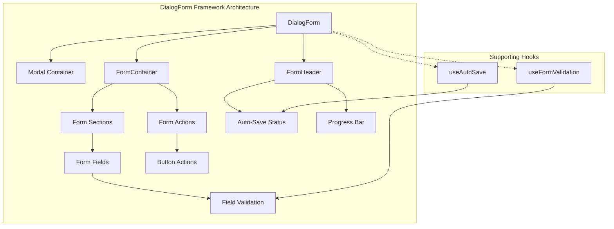
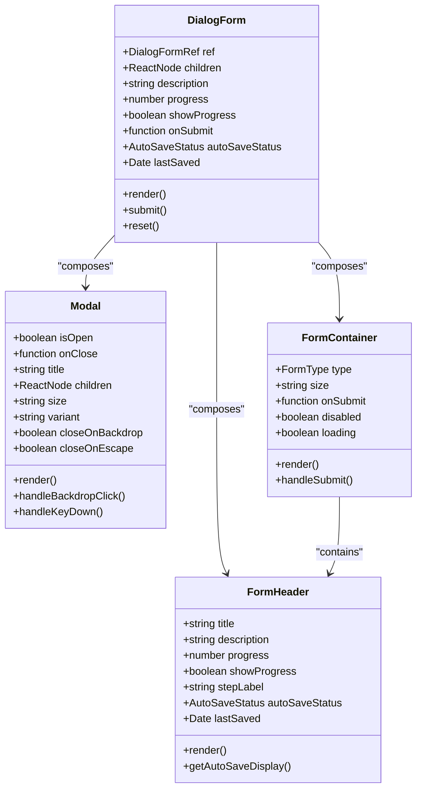
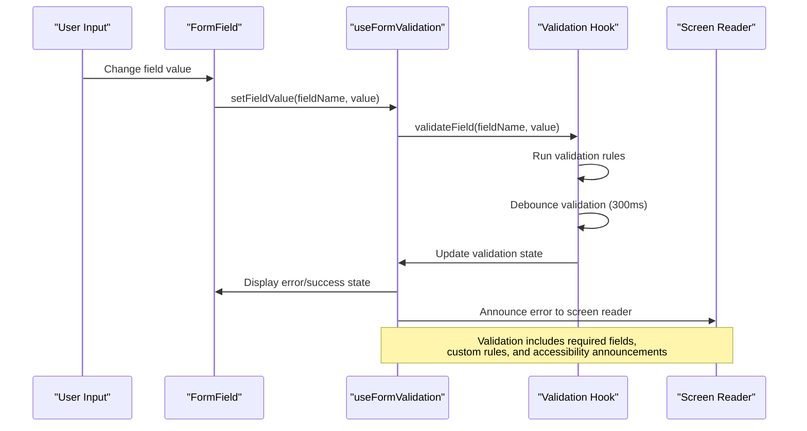
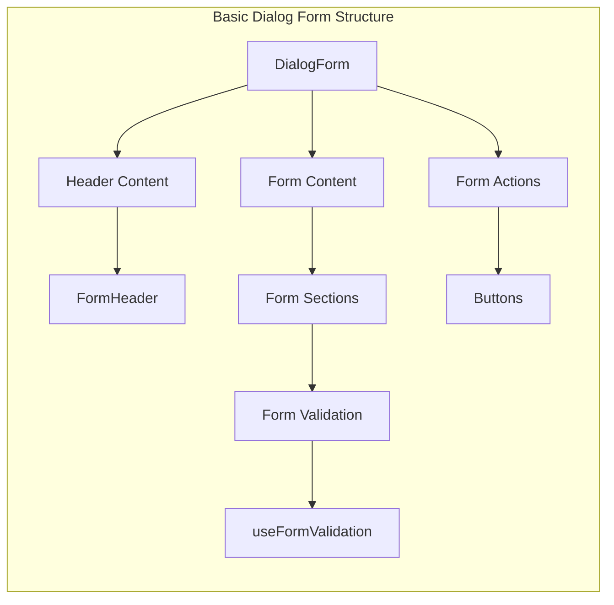

# DialogForm Framework

<cite>
**Referenced Files in This Document**
- [Dialog.tsx](file://src/components/ui/Dialog.tsx)
- [DialogForm.tsx](file://src/components/ui/forms/DialogForm.tsx)
- [Modal.tsx](file://src/components/ui/Modal.tsx)
- [FormContainer.tsx](file://src/components/ui/forms/FormContainer.tsx)
- [FormHeader.tsx](file://src/components/ui/forms/FormHeader.tsx)
- [FormActions.tsx](file://src/components/ui/forms/FormActions.tsx)
- [FormField.tsx](file://src/components/ui/forms/FormField.tsx)
- [useFormValidation.tsx](file://src/hooks/useFormValidation.tsx)
- [useAutoSave.ts](file://src/hooks/useAutoSave.ts)
</cite>

## Table of Contents
1. [Introduction](#introduction)
2. [Framework Overview](#framework-overview)
3. [Core Components](#core-components)
4. [Architecture Design](#architecture-design)
5. [Component Implementation Details](#component-implementation-details)
6. [Form Validation System](#form-validation-system)
7. [Auto-Save Functionality](#auto-save-functionality)
8. [Usage Patterns and Examples](#usage-patterns-and-examples)
9. [Integration Guidelines](#integration-guidelines)
10. [Best Practices](#best-practices)
11. [Troubleshooting Guide](#troubleshooting-guide)
12. [Conclusion](#conclusion)

## Introduction

The DialogForm Framework is a comprehensive modal form solution designed for the SchoolPilot3 educational management system. This framework provides a structured approach to building interactive forms within modal dialogs, offering consistent user experiences across various educational applications such as student registration, course enrollment, and administrative tasks.

The framework combines the power of React's component composition with accessibility-first design principles, ensuring that forms are both functional and inclusive. It leverages a modular architecture that promotes code reusability while maintaining flexibility for different form scenarios.

## Framework Overview

The DialogForm Framework consists of several interconnected components that work together to create robust, accessible modal forms. At its core, the framework utilizes a layered approach where the Modal component serves as the foundation, providing the basic overlay and positioning functionality. The DialogForm component then builds upon this foundation, adding form-specific features and structure.



**Diagram sources**
- [DialogForm.tsx:1-194](file://src/components/ui/forms/DialogForm.tsx#L1-L194)
- [Modal.tsx:1-174](file://src/components/ui/Modal.tsx#L1-L174)
- [FormContainer.tsx:1-151](file://src/components/ui/forms/FormContainer.tsx#L1-L151)
- [useFormValidation.tsx:1-529](file://src/hooks/useFormValidation.tsx#L1-L529)
- [useAutoSave.ts:1-214](file://src/hooks/useAutoSave.ts#L1-L214)

The framework follows a component composition pattern where each form type builds upon shared primitives. This design enables developers to create complex forms while maintaining consistency in user experience and accessibility standards.

## Core Components

### Modal Foundation

The Modal component serves as the foundational layer for all dialog-based interactions. It provides essential modal functionality including overlay management, keyboard navigation, focus trapping, and responsive behavior.

Key features include:
- **Overlay Management**: Automatic body overflow control and backdrop handling
- **Keyboard Navigation**: ESC key support and focus management
- **Responsive Design**: Adaptive sizing across different screen dimensions
- **Accessibility**: Proper ARIA attributes and semantic markup

### DialogForm Composition

The DialogForm component orchestrates the complete modal form experience by combining Modal, FormContainer, and FormHeader components. It provides a unified interface for managing form state, validation, and user interactions.

**Section sources**
- [DialogForm.tsx:90-194](file://src/components/ui/forms/DialogForm.tsx#L90-L194)
- [Modal.tsx:29-174](file://src/components/ui/Modal.tsx#L29-L174)

### Form Structure Components

The framework includes specialized components for organizing form content:

- **FormContainer**: Provides consistent form structure, padding, and layout
- **FormHeader**: Manages form titles, descriptions, and progress indicators
- **FormActions**: Handles button placement and action management
- **FormField**: Wraps individual form controls with validation and accessibility

**Section sources**
- [FormContainer.tsx:69-151](file://src/components/ui/forms/FormContainer.tsx#L69-L151)
- [FormHeader.tsx:62-222](file://src/components/ui/forms/FormHeader.tsx#L62-L222)
- [FormActions.tsx:56-119](file://src/components/ui/forms/FormActions.tsx#L56-L119)
- [FormField.tsx:23-182](file://src/components/ui/forms/FormField.tsx#L23-L182)

## Architecture Design

The DialogForm Framework employs a hierarchical component architecture that promotes separation of concerns and maintainability. Each layer has a specific responsibility, enabling developers to customize individual components without affecting the overall system.



**Diagram sources**
- [DialogForm.tsx:38-194](file://src/components/ui/forms/DialogForm.tsx#L38-L194)
- [Modal.tsx:9-174](file://src/components/ui/Modal.tsx#L9-L174)
- [FormContainer.tsx:9-151](file://src/components/ui/forms/FormContainer.tsx#L9-L151)
- [FormHeader.tsx:7-222](file://src/components/ui/forms/FormHeader.tsx#L7-L222)

The architecture supports extensibility through composition patterns, allowing developers to mix and match components based on specific requirements while maintaining consistent behavior and appearance.

## Component Implementation Details

### DialogForm Component

The DialogForm component serves as the primary interface for creating modal forms. It manages form state, validation integration, and user interactions through a comprehensive prop interface.

**Key Implementation Features:**

- **Ref Management**: Exposes imperative methods for programmatic form control
- **Progress Tracking**: Supports multi-step form navigation with visual indicators
- **Auto-Save Integration**: Seamlessly integrates with the auto-save system
- **Accessibility**: Implements proper ARIA attributes and keyboard navigation

**Section sources**
- [DialogForm.tsx:90-194](file://src/components/ui/forms/DialogForm.tsx#L90-L194)

### FormContainer Structure

The FormContainer component provides the foundational structure for all form types, handling layout, styling, and form submission logic.

**Implementation Highlights:**

- **Type-Specific Styling**: Different form types receive appropriate visual treatment
- **Scroll Management**: Configurable scrollable content areas
- **Loading States**: Visual feedback during asynchronous operations
- **Accessibility Compliance**: Proper form semantics and labeling

**Section sources**
- [FormContainer.tsx:69-151](file://src/components/ui/forms/FormContainer.tsx#L69-L151)

### FormHeader Functionality

The FormHeader component manages form presentation elements including titles, descriptions, progress indicators, and auto-save status displays.

**Advanced Features:**

- **Dynamic Auto-Save Display**: Real-time status updates with formatted timestamps
- **Progress Visualization**: Animated progress bars with step indicators
- **Flexible Layout**: Support for various header configurations and sizes

**Section sources**
- [FormHeader.tsx:62-222](file://src/components/ui/forms/FormHeader.tsx#L62-L222)

## Form Validation System

The DialogForm Framework integrates seamlessly with the useFormValidation hook, providing comprehensive form validation capabilities with real-time feedback and accessibility support.



**Diagram sources**
- [useFormValidation.tsx:174-264](file://src/hooks/useFormValidation.tsx#L174-L264)
- [FormField.tsx:98-109](file://src/components/ui/forms/FormField.tsx#L98-L109)

### Validation Rule System

The framework supports a flexible validation rule system with built-in validators for common use cases:

- **Required Field Validation**: Ensures mandatory fields are completed
- **Text Length Validation**: Enforces minimum and maximum character limits
- **Email Format Validation**: Validates email address formats
- **Custom Validation Rules**: Support for domain-specific validation logic
- **Asynchronous Validation**: Handles server-side validation scenarios

**Section sources**
- [useFormValidation.tsx:57-128](file://src/hooks/useFormValidation.tsx#L57-L128)

### Error Management and Accessibility

The validation system provides comprehensive error handling with accessibility features:

- **Real-time Error Display**: Immediate visual feedback for validation failures
- **Screen Reader Announcements**: Automated announcements for accessibility tools
- **Focus Management**: Intelligent focus handling for error navigation
- **Priority-Based Error Display**: Logical ordering of validation messages

**Section sources**
- [useFormValidation.tsx:288-299](file://src/hooks/useFormValidation.tsx#L288-L299)

## Auto-Save Functionality

The DialogForm Framework incorporates sophisticated auto-save capabilities through the useAutoSave hook, providing seamless data persistence with user-friendly status indicators.

```mermaid
flowchart TD
Start([User Changes Form Data]) --> Detect[Detect Data Change]
Detect --> Debounce[Apply Debounce Timer<br/>(Default: 2000ms)]
Debounce --> MinInterval[Check Minimum Interval<br/>(Default: 1000ms)]
MinInterval --> |Within Interval| Queue[Queue Save Request]
MinInterval --> |Outside Interval| Save[Execute Save Operation]
Queue --> Wait[Wait for Interval]
Wait --> Save
Save --> Success{Save Success?}
Success --> |Yes| UpdateStatus[Update Status to 'saved']
Success --> |No| ErrorStatus[Update Status to 'error']
UpdateStatus --> Timestamp[Set Last Saved Timestamp]
ErrorStatus --> HandleError[Handle Error State]
Timestamp --> End([Auto-Save Complete])
HandleError --> End
```

**Diagram sources**
- [useAutoSave.ts:95-148](file://src/hooks/useAutoSave.ts#L95-L148)

### Auto-Save Configuration

The auto-save system offers extensive customization options:

- **Debounce Control**: Configurable delay before triggering saves
- **Minimum Interval**: Prevents excessive save operations
- **Conditional Saving**: Enable/disable based on form validity
- **Status Tracking**: Comprehensive state management for user feedback

**Section sources**
- [useAutoSave.ts:76-214](file://src/hooks/useAutoSave.ts#L76-L214)

### Integration with Form Header

The auto-save status integrates seamlessly with the FormHeader component, providing real-time feedback to users about their form's save state.

**Section sources**
- [FormHeader.tsx:98-149](file://src/components/ui/forms/FormHeader.tsx#L98-L149)

## Usage Patterns and Examples

### Basic Dialog Form Implementation

Creating a standard dialog form involves combining the DialogForm component with form structure components:



**Diagram sources**
- [DialogForm.tsx:147-189](file://src/components/ui/forms/DialogForm.tsx#L147-L189)

### Multi-Step Form Implementation

For complex workflows requiring multiple steps, the DialogForm supports progress tracking and step navigation:

**Section sources**
- [DialogForm.tsx:164-177](file://src/components/ui/forms/DialogForm.tsx#L164-L177)
- [FormHeader.tsx:194-216](file://src/components/ui/forms/FormHeader.tsx#L194-L216)

### Advanced Form Scenarios

The framework supports sophisticated form patterns including conditional validation, dynamic field rendering, and complex data binding scenarios.

## Integration Guidelines

### Component Composition Best Practices

When integrating DialogForm components, follow these guidelines for optimal results:

- **Consistent Sizing**: Use the size prop to maintain visual hierarchy
- **Proper Validation**: Implement useFormValidation for comprehensive field validation
- **Accessibility First**: Ensure all form elements have proper ARIA attributes
- **Responsive Design**: Test form behavior across different screen sizes

### Performance Considerations

The framework includes several performance optimizations:

- **Lazy Loading**: Components are rendered only when the modal is open
- **Debounced Validation**: Prevents excessive validation calculations
- **Efficient State Management**: Optimized state updates for smooth user experience

**Section sources**
- [DialogForm.tsx:113-127](file://src/components/ui/forms/DialogForm.tsx#L113-L127)
- [useFormValidation.tsx:167-172](file://src/hooks/useFormValidation.tsx#L167-L172)

## Best Practices

### Form Design Principles

- **Clear Visual Hierarchy**: Use FormHeader for prominent titles and descriptions
- **Logical Field Grouping**: Organize related fields within FormSection components
- **Consistent Spacing**: Leverage the framework's built-in spacing systems
- **Accessible Labels**: Ensure all form controls have descriptive labels

### User Experience Guidelines

- **Immediate Feedback**: Provide real-time validation and auto-save status
- **Error Prevention**: Use client-side validation to catch common mistakes
- **Progress Indicators**: Show completion status for multi-step forms
- **Keyboard Navigation**: Support full keyboard accessibility

### Performance Optimization

- **Optimize Validation**: Use appropriate debounce settings for your use case
- **Minimize Re-renders**: Leverage React.memo and proper state management
- **Lazy Component Loading**: Load heavy components only when needed

## Troubleshooting Guide

### Common Issues and Solutions

**Modal Not Closing Properly**
- Verify closeOnBackdrop and closeOnEscape props are set correctly
- Check preventClose prop which disables closing mechanisms
- Ensure proper event propagation in nested components

**Validation Not Working**
- Confirm useFormValidation hook is properly initialized
- Verify field names match validation configuration keys
- Check debounce settings for appropriate timing

**Auto-Save Status Incorrect**
- Review useAutoSave configuration options
- Verify data structure changes are being detected
- Check for conflicts with manual save operations

**Accessibility Issues**
- Ensure all form controls have proper labels
- Verify ARIA attributes are correctly applied
- Test with screen readers and keyboard navigation

**Section sources**
- [DialogForm.tsx:52-89](file://src/components/ui/forms/DialogForm.tsx#L52-L89)
- [useFormValidation.tsx:167-172](file://src/hooks/useFormValidation.tsx#L167-L172)
- [useAutoSave.ts:156-192](file://src/hooks/useAutoSave.ts#L156-L192)

### Debugging Strategies

- **Component Inspection**: Use browser developer tools to inspect component props
- **Console Logging**: Add targeted logging for validation and auto-save events
- **State Monitoring**: Track form state changes during user interactions
- **Performance Profiling**: Monitor component rendering and validation performance

## Conclusion

The DialogForm Framework provides a robust, accessible, and extensible solution for creating modal forms in the SchoolPilot3 ecosystem. Its component-based architecture promotes code reusability while maintaining flexibility for diverse form requirements.

Key strengths of the framework include:

- **Comprehensive Accessibility**: Built-in ARIA support and screen reader compatibility
- **Flexible Architecture**: Modular components that can be composed in various ways
- **Advanced Validation**: Sophisticated validation system with real-time feedback
- **Seamless Integration**: Easy integration with existing application patterns
- **Performance Optimization**: Efficient rendering and state management

The framework successfully balances developer productivity with user experience quality, making it an excellent choice for educational application form development. Its extensible design allows for future enhancements while maintaining backward compatibility and consistent behavior across the application ecosystem.