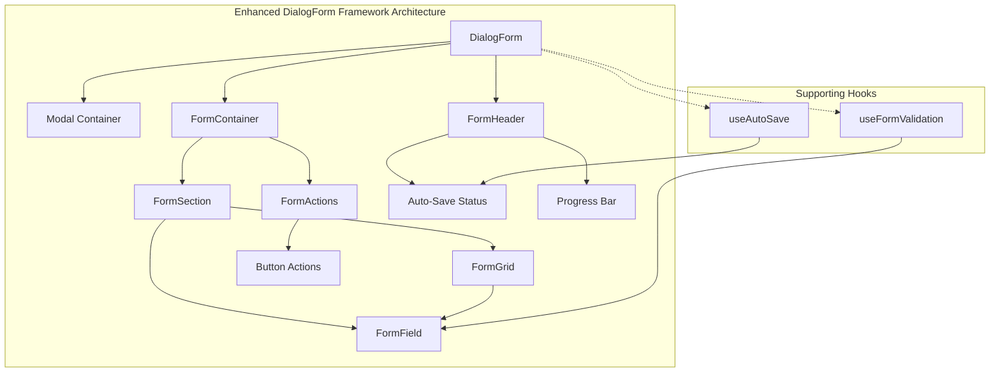
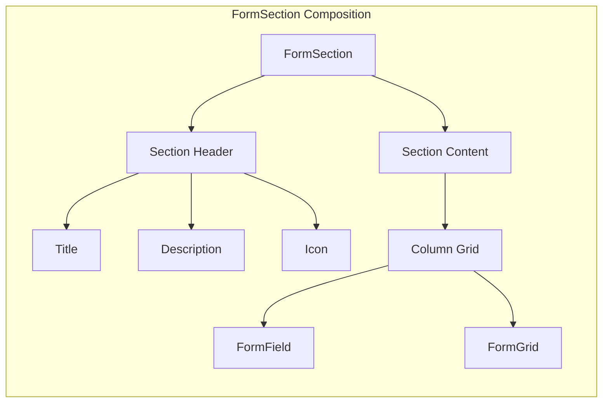
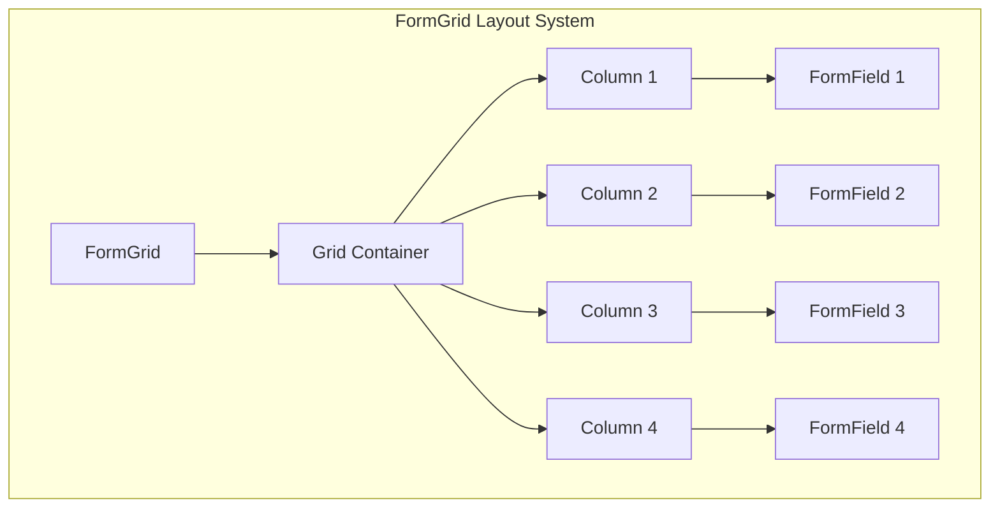
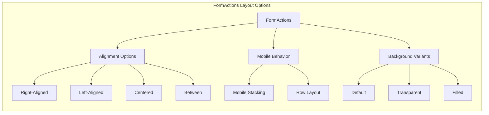
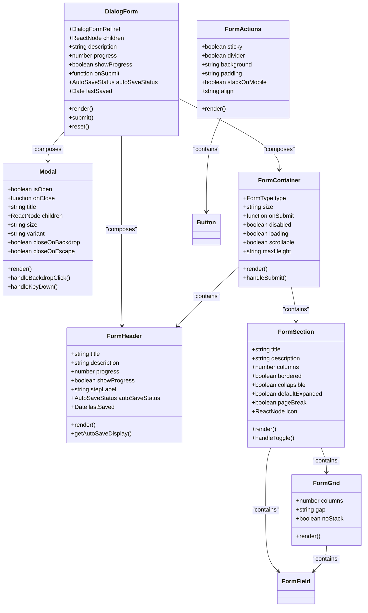
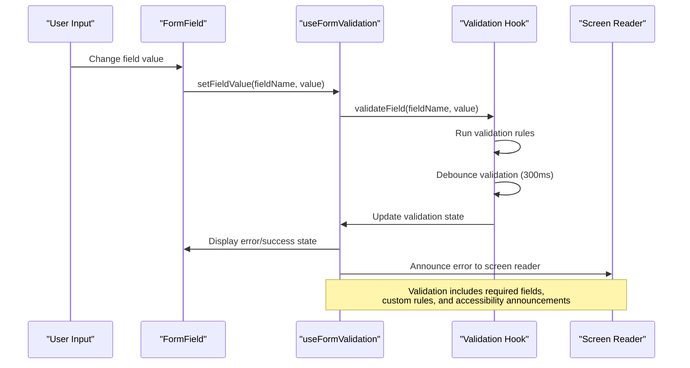
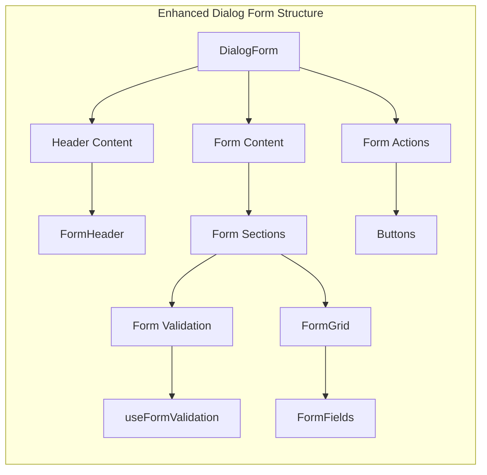

# DialogForm Framework

<cite>
**Referenced Files in This Document**
- [DialogForm.tsx](file://src/components/ui/forms/DialogForm.tsx)
- [FormContainer.tsx](file://src/components/ui/forms/FormContainer.tsx)
- [FormHeader.tsx](file://src/components/ui/forms/FormHeader.tsx)
- [FormSection.tsx](file://src/components/ui/forms/FormSection.tsx)
- [FormGrid.tsx](file://src/components/ui/forms/FormGrid.tsx)
- [FormActions.tsx](file://src/components/ui/forms/FormActions.tsx)
- [FormField.tsx](file://src/components/ui/forms/FormField.tsx)
- [Modal.tsx](file://src/components/ui/Modal.tsx)
- [useFormValidation.tsx](file://src/hooks/useFormValidation.tsx)
- [useAutoSave.ts](file://src/hooks/useAutoSave.ts)
- [FORM_MIGRATION_PLAN.md](file://docs/FORM_MIGRATION_PLAN.md)
</cite>

## Update Summary
**Changes Made**
- Added comprehensive documentation for new FormSection, FormGrid, and FormActions components
- Enhanced component composition patterns section with detailed examples
- Updated migration guidance with practical implementation steps
- Expanded architecture design with new component relationships
- Added Form Type Decision Matrix and migration execution checklist
- Included FormField component documentation for complete form structure

## Table of Contents
1. [Introduction](#introduction)
2. [Framework Overview](#framework-overview)
3. [Core Components](#core-components)
4. [Enhanced Component Composition Patterns](#enhanced-component-composition-patterns)
5. [Architecture Design](#architecture-design)
6. [Component Implementation Details](#component-implementation-details)
7. [Form Validation System](#form-validation-system)
8. [Auto-Save Functionality](#auto-save-functionality)
9. [Migration Guidance](#migration-guidance)
10. [Usage Patterns and Examples](#usage-patterns-and-examples)
11. [Integration Guidelines](#integration-guidelines)
12. [Best Practices](#best-practices)
13. [Troubleshooting Guide](#troubleshooting-guide)
14. [Conclusion](#conclusion)

## Introduction

The DialogForm Framework is a comprehensive modal form solution designed for the SchoolPilot3 educational management system. This framework provides a structured approach to building interactive forms within modal dialogs, offering consistent user experiences across various educational applications such as student registration, course enrollment, and administrative tasks.

The framework has been significantly enhanced with new component composition patterns that promote better organization, responsiveness, and maintainability. The enhanced framework now includes dedicated components for logical field grouping (FormSection), responsive grid layouts (FormGrid), and standardized action containers (FormActions), providing developers with powerful building blocks for creating complex forms.

## Framework Overview

The DialogForm Framework consists of several interconnected components that work together to create robust, accessible modal forms. The framework now follows a layered composition pattern where the Modal component serves as the foundation, providing the basic overlay and positioning functionality. The DialogForm component builds upon this foundation, adding form-specific features and structure through specialized components.



**Diagram sources**
- [DialogForm.tsx:1-194](file://src/components/ui/forms/DialogForm.tsx#L1-L194)
- [FormContainer.tsx:1-151](file://src/components/ui/forms/FormContainer.tsx#L1-L151)
- [FormSection.tsx:1-211](file://src/components/ui/forms/FormSection.tsx#L1-L211)
- [FormGrid.tsx:1-111](file://src/components/ui/forms/FormGrid.tsx#L1-L111)
- [FormActions.tsx:1-119](file://src/components/ui/forms/FormActions.tsx#L1-L119)
- [FormField.tsx:1-182](file://src/components/ui/forms/FormField.tsx#L1-L182)

The framework follows a component composition pattern where each form type builds upon shared primitives. This design enables developers to create complex forms while maintaining consistency in user experience and accessibility standards.

## Core Components

### Modal Foundation

The Modal component serves as the foundational layer for all dialog-based interactions. It provides essential modal functionality including overlay management, keyboard navigation, focus trapping, and responsive behavior.

Key features include:
- **Overlay Management**: Automatic body overflow control and backdrop handling
- **Keyboard Navigation**: ESC key support and focus management
- **Responsive Design**: Adaptive sizing across different screen dimensions
- **Accessibility**: Proper ARIA attributes and semantic markup

### DialogForm Composition

The DialogForm component orchestrates the complete modal form experience by combining Modal, FormContainer, and FormHeader components. It provides a unified interface for managing form state, validation, and user interactions.

**Section sources**
- [DialogForm.tsx:90-194](file://src/components/ui/forms/DialogForm.tsx#L90-L194)

### Enhanced Form Structure Components

The framework now includes specialized components for organizing form content with greater flexibility and control:

- **FormContainer**: Provides consistent form structure, padding, and layout with type-specific styling
- **FormHeader**: Manages form titles, descriptions, progress indicators, and auto-save status displays
- **FormSection**: Logical grouping of form fields with responsive grid layouts, collapsible sections, and print optimization
- **FormGrid**: Responsive grid system for field arrangements with customizable column layouts and spacing
- **FormActions**: Standardized action container with sticky positioning, responsive behavior, and alignment options
- **FormField**: Enhanced wrapper for individual form controls with validation states, accessibility, and layout options

**Section sources**
- [FormContainer.tsx:69-151](file://src/components/ui/forms/FormContainer.tsx#L69-L151)
- [FormHeader.tsx:62-222](file://src/components/ui/forms/FormHeader.tsx#L62-L222)
- [FormSection.tsx:74-211](file://src/components/ui/forms/FormSection.tsx#L74-L211)
- [FormGrid.tsx:75-111](file://src/components/ui/forms/FormGrid.tsx#L75-L111)
- [FormActions.tsx:56-119](file://src/components/ui/forms/FormActions.tsx#L56-L119)
- [FormField.tsx:23-182](file://src/components/ui/forms/FormField.tsx#L23-L182)

## Enhanced Component Composition Patterns

The enhanced DialogForm Framework introduces sophisticated composition patterns that enable developers to build complex, maintainable forms with consistent structure and behavior.

### FormSection Component Pattern

FormSection provides logical grouping of related form fields with comprehensive styling and layout options:



**Diagram sources**
- [FormSection.tsx:129-207](file://src/components/ui/forms/FormSection.tsx#L129-L207)

Key features include:
- **Responsive Grid Layouts**: Automatic column arrangement with 1-4 column support
- **Collapsible Sections**: Interactive expand/collapse functionality with keyboard support
- **Print Optimization**: Page break prevention and print-specific styling
- **Bordered Sections**: Visual separation with optional borders
- **Icon Support**: Custom icons for section identification

### FormGrid Component Pattern

FormGrid provides flexible responsive layouts for organizing form fields:



**Diagram sources**
- [FormGrid.tsx:100-107](file://src/components/ui/forms/FormGrid.tsx#L100-L107)

Features include:
- **Responsive Columns**: Automatic stacking on mobile devices
- **Customizable Gaps**: Multiple spacing options (none, sm, md, lg)
- **Nested Grid Support**: Complex layouts with nested grid systems
- **Mobile Behavior**: Smart stacking vs fixed column layouts

### FormActions Component Pattern

FormActions ensures consistent button positioning and responsive behavior:



**Diagram sources**
- [FormActions.tsx:68-99](file://src/components/ui/forms/FormActions.tsx#L68-L99)

Features include:
- **Multiple Alignment Options**: Right, left, center, and between alignment
- **Sticky Positioning**: Footer sticks to bottom during scrolling
- **Responsive Behavior**: Mobile stacking with configurable options
- **Background Variants**: Different visual treatments for various contexts

## Architecture Design

The DialogForm Framework employs a hierarchical component architecture that promotes separation of concerns and maintainability. The enhanced architecture now includes specialized components for different aspects of form construction.



**Diagram sources**
- [DialogForm.tsx:38-194](file://src/components/ui/forms/DialogForm.tsx#L38-L194)
- [FormContainer.tsx:9-151](file://src/components/ui/forms/FormContainer.tsx#L9-L151)
- [FormHeader.tsx:7-222](file://src/components/ui/forms/FormHeader.tsx#L7-L222)
- [FormSection.tsx:8-211](file://src/components/ui/forms/FormSection.tsx#L8-L211)
- [FormGrid.tsx:7-111](file://src/components/ui/forms/FormGrid.tsx#L7-L111)
- [FormActions.tsx:7-119](file://src/components/ui/forms/FormActions.tsx#L7-L119)

The architecture supports extensibility through composition patterns, allowing developers to mix and match components based on specific requirements while maintaining consistent behavior and appearance.

## Component Implementation Details

### DialogForm Component

The DialogForm component serves as the primary interface for creating modal forms. It manages form state, validation integration, and user interactions through a comprehensive prop interface.

**Key Implementation Features:**

- **Ref Management**: Exposes imperative methods for programmatic form control
- **Progress Tracking**: Supports multi-step form navigation with visual indicators
- **Auto-Save Integration**: Seamlessly integrates with the auto-save system
- **Accessibility**: Implements proper ARIA attributes and keyboard navigation
- **Content Padding**: Configurable padding options for different content densities

**Section sources**
- [DialogForm.tsx:90-194](file://src/components/ui/forms/DialogForm.tsx#L90-L194)

### FormContainer Structure

The FormContainer component provides the foundational structure for all form types, handling layout, styling, and form submission logic with enhanced type-specific styling.

**Implementation Highlights:**

- **Type-Specific Styling**: Different form types receive appropriate visual treatment
- **Scroll Management**: Configurable scrollable content areas with max-height constraints
- **Loading States**: Visual feedback during asynchronous operations
- **Accessibility Compliance**: Proper form semantics and labeling
- **Disabled State Handling**: Visual and functional disabled states

**Section sources**
- [FormContainer.tsx:69-151](file://src/components/ui/forms/FormContainer.tsx#L69-L151)

### FormHeader Functionality

The FormHeader component manages form presentation elements including titles, descriptions, progress indicators, and auto-save status displays.

**Advanced Features:**

- **Dynamic Auto-Save Display**: Real-time status updates with formatted timestamps
- **Progress Visualization**: Animated progress bars with step indicators
- **Flexible Layout**: Support for various header configurations and sizes
- **Badge Support**: Status indicators and contextual badges

**Section sources**
- [FormHeader.tsx:62-222](file://src/components/ui/forms/FormHeader.tsx#L62-L222)

### FormSection Advanced Features

The FormSection component provides sophisticated field grouping with responsive layouts and interactive features.

**Implementation Highlights:**

- **Responsive Grid System**: Automatic column arrangement with 1-4 column support
- **Collapsible Sections**: Interactive expand/collapse with keyboard navigation
- **Print Optimization**: Page break prevention and print-specific styling
- **Icon Integration**: Custom icons for visual section identification
- **Size Variants**: Multiple size options (sm, md, lg) for different contexts

**Section sources**
- [FormSection.tsx:74-211](file://src/components/ui/forms/FormSection.tsx#L74-L211)

### FormGrid Responsive Layouts

The FormGrid component provides flexible responsive layouts for organizing form fields with intelligent mobile behavior.

**Layout Features:**

- **Responsive Columns**: Automatic stacking on mobile devices with configurable breakpoints
- **Customizable Gaps**: Multiple spacing options for different visual densities
- **Nested Grid Support**: Complex layouts with nested grid systems
- **Mobile Behavior**: Smart stacking vs fixed column layouts based on requirements

**Section sources**
- [FormGrid.tsx:75-111](file://src/components/ui/forms/FormGrid.tsx#L75-L111)

### FormActions Flexible Positioning

The FormActions component ensures consistent button positioning with comprehensive alignment and responsive behavior options.

**Positioning Features:**

- **Multiple Alignment Options**: Right, left, center, and between alignment configurations
- **Sticky Positioning**: Footer sticks to bottom during scrolling with z-index management
- **Responsive Behavior**: Mobile stacking with configurable options
- **Background Variants**: Different visual treatments for various contexts
- **Padding Options**: Multiple padding sizes for different form densities

**Section sources**
- [FormActions.tsx:56-119](file://src/components/ui/forms/FormActions.tsx#L56-L119)

## Form Validation System

The DialogForm Framework integrates seamlessly with the useFormValidation hook, providing comprehensive form validation capabilities with real-time feedback and accessibility support.



**Diagram sources**
- [useFormValidation.tsx:174-264](file://src/hooks/useFormValidation.tsx#L174-L264)
- [FormField.tsx:98-109](file://src/components/ui/forms/FormField.tsx#L98-L109)

### Validation Rule System

The framework supports a flexible validation rule system with built-in validators for common use cases:

- **Required Field Validation**: Ensures mandatory fields are completed
- **Text Length Validation**: Enforces minimum and maximum character limits
- **Email Format Validation**: Validates email address formats
- **Custom Validation Rules**: Support for domain-specific validation logic
- **Asynchronous Validation**: Handles server-side validation scenarios

**Section sources**
- [useFormValidation.tsx:57-128](file://src/hooks/useFormValidation.tsx#L57-L128)

### Error Management and Accessibility

The validation system provides comprehensive error handling with accessibility features:

- **Real-time Error Display**: Immediate visual feedback for validation failures
- **Screen Reader Announcements**: Automated announcements for accessibility tools
- **Focus Management**: Intelligent focus handling for error navigation
- **Priority-Based Error Display**: Logical ordering of validation messages

**Section sources**
- [useFormValidation.tsx:288-299](file://src/hooks/useFormValidation.tsx#L288-L299)

## Auto-Save Functionality

The DialogForm Framework incorporates sophisticated auto-save capabilities through the useAutoSave hook, providing seamless data persistence with user-friendly status indicators.

```mermaid
flowchart TD
Start([User Changes Form Data]) --> Detect[Detect Data Change]
Detect --> Debounce[Apply Debounce Timer<br/>(Default: 2000ms)]
Debounce --> MinInterval[Check Minimum Interval<br/>(Default: 1000ms)]
MinInterval --> |Within Interval| Queue[Queue Save Request]
MinInterval --> |Outside Interval| Save[Execute Save Operation]
Queue --> Wait[Wait for Interval]
Wait --> Save
Save --> Success{Save Success?}
Success --> |Yes| UpdateStatus[Update Status to 'saved']
Success --> |No| ErrorStatus[Update Status to 'error']
UpdateStatus --> Timestamp[Set Last Saved Timestamp]
ErrorStatus --> HandleError[Handle Error State]
Timestamp --> End([Auto-Save Complete])
HandleError --> End
```

**Diagram sources**
- [useAutoSave.ts:95-148](file://src/hooks/useAutoSave.ts#L95-L148)

### Auto-Save Configuration

The auto-save system offers extensive customization options:

- **Debounce Control**: Configurable delay before triggering saves
- **Minimum Interval**: Prevents excessive save operations
- **Conditional Saving**: Enable/disable based on form validity
- **Status Tracking**: Comprehensive state management for user feedback

**Section sources**
- [useAutoSave.ts:76-214](file://src/hooks/useAutoSave.ts#L76-L214)

### Integration with Form Header

The auto-save status integrates seamlessly with the FormHeader component, providing real-time feedback to users about their form's save state.

**Section sources**
- [FormHeader.tsx:98-149](file://src/components/ui/forms/FormHeader.tsx#L98-L149)

## Migration Guidance

The enhanced DialogForm Framework includes comprehensive migration guidance for transitioning from legacy Modal-based forms to the new component composition patterns.

### Form Type Decision Matrix

The framework provides clear guidance on when to use each form type:

| Current Pattern | New Component | When to Use |
|-----------------|---------------|-------------|
| Modal with simple CRUD | DialogForm | Add/Edit/Delete modals with 1-10 fields |
| Modal with tabs | TabbedForm | Forms with logical groupings that benefit from tab navigation |
| Multi-step process | WizardForm | Sequential forms where each step has validation |
| Side panel form | SlideoutForm | Forms that shouldn't block the entire screen |
| Embedded in page | MinimalForm | Forms that are part of a larger page layout |
| Needs printing | PrintForm | Forms that generate printable documents |
| Search/Filter form | MinimalForm | Quick forms with minimal chrome |

**Section sources**
- [FORM_MIGRATION_PLAN.md:329-341](file://docs/FORM_MIGRATION_PLAN.md#L329-L341)

### Migration Execution Checklist

The migration process includes comprehensive checklists for both pre-migration analysis and post-migration testing:

**Pre-Migration Checklist:**
- [ ] Identify current form type and complexity
- [ ] Document all form fields and validation rules
- [ ] Identify special features (auto-save, file upload, etc.)
- [ ] Take screenshot of current form for comparison
- [ ] Note current button positioning

**Migration Checklist:**
- [ ] Create new form using appropriate framework component
- [ ] Wrap all fields in FormField components
- [ ] Group related fields in FormSection components
- [ ] Apply FormGrid for multi-column layouts
- [ ] Add FormActions with right-aligned buttons
- [ ] Integrate useFormValidation hook
- [ ] Add auto-save if needed (useAutoSave hook)
- [ ] Add print support if needed (PrintForm component)

**Post-Migration Testing Checklist:**
- [ ] Test form opening/closing
- [ ] Test all field inputs
- [ ] Test validation and error display
- [ ] Test submission success
- [ ] Test submission failure handling
- [ ] Test keyboard navigation (Tab, Enter, Escape)
- [ ] Test screen reader compatibility
- [ ] Test mobile responsive behavior
- [ ] Compare with pre-migration screenshot
- [ ] Test with real data if possible

**Section sources**
- [FORM_MIGRATION_PLAN.md:296-326](file://docs/FORM_MIGRATION_PLAN.md#L296-L326)

### Migration Template

The framework provides concrete migration examples showing before and after implementations:

**Before (Legacy Modal):**
```tsx
<Modal isOpen={isOpen} onClose={closeModal} title="Add Item">
  <div className="space-y-4">
    <Input label="Name" value={formData.name} onChange={...} />
    <Input label="Description" value={formData.description} onChange={...} />
  </div>
  <div className="flex justify-end gap-3 mt-4">
    <Button variant="secondary" onClick={closeModal}>Cancel</Button>
    <Button variant="primary" onClick={handleSubmit}>Save</Button>
  </div>
</Modal>
```

**After (New Framework):**
```tsx
<DialogForm
  isOpen={isOpen}
  onClose={closeModal}
  title="Add Item"
  size="md"
  onSubmit={handleSubmit}
>
  <FormSection>
    <FormField label="Name" required>
      <Input value={formData.name} onChange={...} />
    </FormField>
    <FormField label="Description">
      <Input value={formData.description} onChange={...} />
    </FormField>
  </FormSection>
  <FormActions>
    <Button variant="secondary" onClick={closeModal}>Cancel</Button>
    <Button variant="primary" type="submit">Save</Button>
  </FormActions>
</DialogForm>
```

**Section sources**
- [FORM_MIGRATION_PLAN.md:124-159](file://docs/FORM_MIGRATION_PLAN.md#L124-L159)

## Usage Patterns and Examples

### Basic Dialog Form Implementation

Creating a standard dialog form involves combining the DialogForm component with the enhanced form structure components:



**Diagram sources**
- [DialogForm.tsx:147-189](file://src/components/ui/forms/DialogForm.tsx#L147-L189)

### Multi-Step Form Implementation

For complex workflows requiring multiple steps, the DialogForm supports progress tracking and step navigation with enhanced visual indicators:

**Section sources**
- [DialogForm.tsx:164-177](file://src/components/ui/forms/DialogForm.tsx#L164-L177)
- [FormHeader.tsx:194-216](file://src/components/ui/forms/FormHeader.tsx#L194-L216)

### Advanced Form Scenarios

The framework supports sophisticated form patterns including conditional validation, dynamic field rendering, complex data binding scenarios, and responsive layouts with FormGrid components.

## Integration Guidelines

### Component Composition Best Practices

When integrating DialogForm components, follow these guidelines for optimal results:

- **Consistent Sizing**: Use the size prop to maintain visual hierarchy
- **Proper Validation**: Implement useFormValidation for comprehensive field validation
- **Accessibility First**: Ensure all form elements have proper ARIA attributes
- **Responsive Design**: Test form behavior across different screen sizes
- **Section Organization**: Use FormSection for logical field grouping
- **Grid Layouts**: Use FormGrid for responsive multi-column arrangements
- **Action Placement**: Use FormActions for consistent button positioning

### Performance Considerations

The framework includes several performance optimizations:

- **Lazy Loading**: Components are rendered only when the modal is open
- **Debounced Validation**: Prevents excessive validation calculations
- **Efficient State Management**: Optimized state updates for smooth user experience
- **Responsive Rendering**: FormGrid components adapt to different screen sizes efficiently

**Section sources**
- [DialogForm.tsx:113-127](file://src/components/ui/forms/DialogForm.tsx#L113-L127)
- [useFormValidation.tsx:167-172](file://src/hooks/useFormValidation.tsx#L167-L172)

## Best Practices

### Form Design Principles

- **Clear Visual Hierarchy**: Use FormHeader for prominent titles and descriptions
- **Logical Field Grouping**: Organize related fields within FormSection components
- **Consistent Spacing**: Leverage the framework's built-in spacing systems
- **Accessible Labels**: Ensure all form controls have descriptive labels
- **Responsive Layouts**: Use FormGrid for adaptive field arrangements
- **Standardized Actions**: Use FormActions for consistent button placement

### User Experience Guidelines

- **Immediate Feedback**: Provide real-time validation and auto-save status
- **Error Prevention**: Use client-side validation to catch common mistakes
- **Progress Indicators**: Show completion status for multi-step forms
- **Keyboard Navigation**: Support full keyboard accessibility
- **Mobile Optimization**: Ensure touch-friendly layouts and interactions

### Performance Optimization

- **Optimize Validation**: Use appropriate debounce settings for your use case
- **Minimize Re-renders**: Leverage React.memo and proper state management
- **Lazy Component Loading**: Load heavy components only when needed
- **Responsive Performance**: Use FormGrid for efficient mobile layouts

## Troubleshooting Guide

### Common Issues and Solutions

**Modal Not Closing Properly**
- Verify closeOnBackdrop and closeOnEscape props are set correctly
- Check preventClose prop which disables closing mechanisms
- Ensure proper event propagation in nested components

**Validation Not Working**
- Confirm useFormValidation hook is properly initialized
- Verify field names match validation configuration keys
- Check debounce settings for appropriate timing

**Auto-Save Status Incorrect**
- Review useAutoSave configuration options
- Verify data structure changes are being detected
- Check for conflicts with manual save operations

**Accessibility Issues**
- Ensure all form controls have proper labels
- Verify ARIA attributes are correctly applied
- Test with screen readers and keyboard navigation

**Section sources**
- [DialogForm.tsx:52-89](file://src/components/ui/forms/DialogForm.tsx#L52-L89)
- [useFormValidation.tsx:167-172](file://src/hooks/useFormValidation.tsx#L167-L172)
- [useAutoSave.ts:156-192](file://src/hooks/useAutoSave.ts#L156-L192)

### Debugging Strategies

- **Component Inspection**: Use browser developer tools to inspect component props
- **Console Logging**: Add targeted logging for validation and auto-save events
- **State Monitoring**: Track form state changes during user interactions
- **Performance Profiling**: Monitor component rendering and validation performance

## Conclusion

The enhanced DialogForm Framework provides a robust, accessible, and extensible solution for creating modal forms in the SchoolPilot3 ecosystem. The framework's component-based architecture promotes code reusability while maintaining flexibility for diverse form requirements.

Key strengths of the enhanced framework include:

- **Comprehensive Accessibility**: Built-in ARIA support and screen reader compatibility
- **Flexible Architecture**: Modular components that can be composed in various ways
- **Advanced Validation**: Sophisticated validation system with real-time feedback
- **Seamless Integration**: Easy integration with existing application patterns
- **Performance Optimization**: Efficient rendering and state management
- **Enhanced Composition**: Specialized components for logical field grouping and layouts
- **Migration Support**: Comprehensive guidance for transitioning from legacy forms
- **Responsive Design**: Intelligent layouts that adapt to different screen sizes

The framework successfully balances developer productivity with user experience quality, making it an excellent choice for educational application form development. Its extensible design allows for future enhancements while maintaining backward compatibility and consistent behavior across the application ecosystem.

The addition of FormSection, FormGrid, and FormActions components provides developers with powerful building blocks for creating complex, maintainable forms with consistent structure and behavior. The comprehensive migration guidance ensures smooth transitions from legacy Modal-based forms to the new component composition patterns.