# Form Components

<cite>
**Referenced Files in This Document**   
- [FormField.tsx](file://src/components/ui/forms/FormField.tsx)
- [TabbedForm.tsx](file://src/components/ui/forms/TabbedForm.tsx)
- [SlideoutForm.tsx](file://src/components/ui/forms/SlideoutForm.tsx)
- [useFormValidation.tsx](file://src/hooks/useFormValidation.tsx)
- [Input.tsx](file://src/components/ui/Input.tsx)
- [Textarea.tsx](file://src/components/ui/Textarea.tsx)
- [Select.tsx](file://src/components/ui/Select.tsx)
- [Checkbox.tsx](file://src/components/ui/Checkbox.tsx)
- [DatePicker.tsx](file://src/components/ui/forms/DatePicker.tsx)
- [EducationSystemConfigPage.tsx](file://src/modules/academics/pages/EducationSystemConfigPage.tsx)
- [StudentSubjectEnrollmentPage.tsx](file://src/modules/academics/pages/StudentSubjectEnrollmentPage.tsx)
</cite>

## Table of Contents
1. [Introduction](#introduction)
2. [Core Form Components](#core-form-components)
3. [Form Layout and Structure](#form-layout-and-structure)
4. [Input Components Integration](#input-components-integration)
5. [Validation System](#validation-system)
6. [Usage Examples](#usage-examples)
7. [Accessibility and User Experience](#accessibility-and-user-experience)
8. [State Management and Data Flow](#state-management-and-data-flow)

## Introduction
This document provides comprehensive documentation for the form components in the schoolpilot3 application. The form system is designed to support various data entry scenarios including multi-step processes, contextual editing, and complex validation requirements. The components are built with accessibility, responsiveness, and developer experience in mind, providing a consistent interface across the application.

**Section sources**
- [FormField.tsx](file://src/components/ui/forms/FormField.tsx#L1-L182)
- [TabbedForm.tsx](file://src/components/ui/forms/TabbedForm.tsx#L1-L486)
- [SlideoutForm.tsx](file://src/components/ui/forms/SlideoutForm.tsx#L1-L741)

## Core Form Components

### FormField Component
The FormField component serves as the base wrapper for all form elements, providing consistent layout, labeling, and error handling across the application. It standardizes spacing, labels, help text, and validation states.

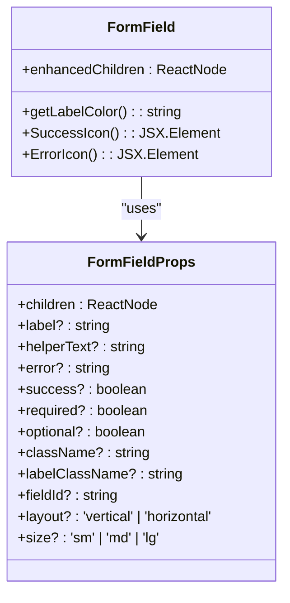

**Diagram sources**
- [FormField.tsx](file://src/components/ui/forms/FormField.tsx#L10-L182)

**Section sources**
- [FormField.tsx](file://src/components/ui/forms/FormField.tsx#L1-L182)

### TabbedForm Component
The TabbedForm component enables multi-step data entry through tab navigation with progress indicators. It supports validation state indicators, responsive mobile navigation, and form state preservation between tabs.

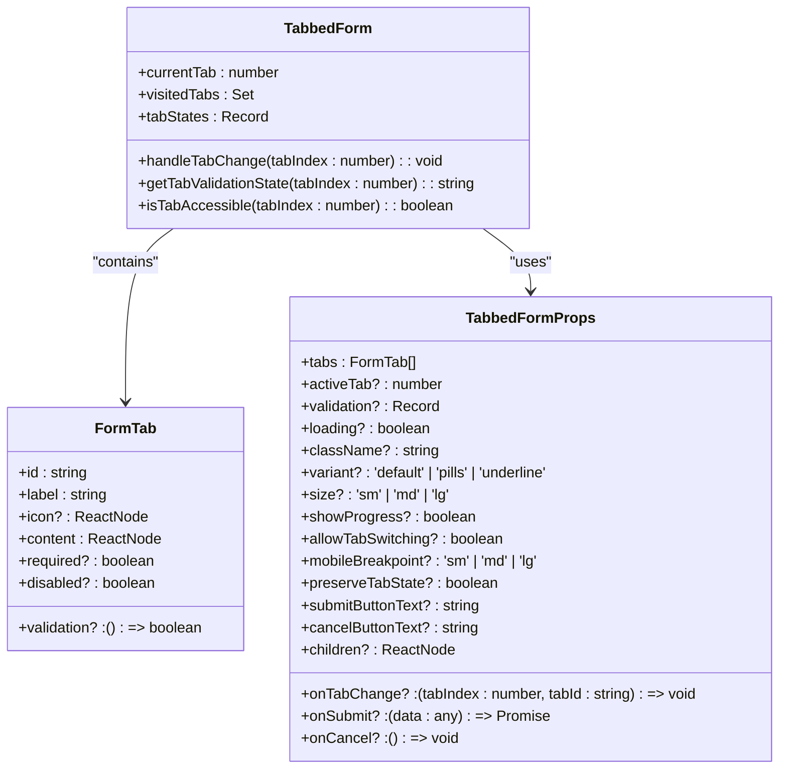

**Diagram sources**
- [TabbedForm.tsx](file://src/components/ui/forms/TabbedForm.tsx#L15-L199)

**Section sources**
- [TabbedForm.tsx](file://src/components/ui/forms/TabbedForm.tsx#L1-L486)

### SlideoutForm Component
The SlideoutForm component provides a contextual editing interface that slides in from the side of the screen. It supports various positions, auto-save functionality, resize handles, backdrop blur effects, and enhanced accessibility features.

```mermaid
classDiagram
class SlideoutFormProps {
+isOpen : boolean
+onClose : () => void
+title : string
+children : React.ReactNode
+width? : 'sm' | 'md' | 'lg' | 'xl' | 'full'
+position? : 'left' | 'right'
+overlay? : boolean
+closeOnOverlayClick? : boolean
+closeOnEscape? : boolean
+footer? : React.ReactNode
+loading? : boolean
+className? : string
+onSave? : () => void | Promise<void>
+onCancel? : () => void
+saveLabel? : string
+cancelLabel? : string
+autoSave? : boolean
+autoSaveDelay? : number
+preventClose? : boolean
+showCloseButton? : boolean
+theme? : 'light' | 'dark' | 'auto'
+swipeToClose? : boolean
+resizable? : boolean
+backdropBlur? : boolean
+springConfig? : { damping? : number; stiffness? : number; mass? : number }
+onResize? : (width : number) => void
+minWidth? : number
+maxWidth? : number
}
class SlideoutForm {
+isAnimating : boolean
+isVisible : boolean
+hasUnsavedChanges : boolean
+currentWidth : number
+isResizing : boolean
+x : MotionValue
+dragProgress : Transform
+opacity : Transform
+scale : Transform
+getWidthValue(widthSize : string) : number
+handleDragEnd(event : Event, info : PanInfo) : void
}
SlideoutForm --> SlideoutFormProps : "uses"
```

**Diagram sources**
- [SlideoutForm.tsx](file://src/components/ui/forms/SlideoutForm.tsx#L15-L199)

**Section sources**
- [SlideoutForm.tsx](file://src/components/ui/forms/SlideoutForm.tsx#L1-L741)

## Form Layout and Structure

### Layout Variants
The form components support multiple layout configurations to accommodate different design requirements:

- **Vertical Layout**: Fields are stacked vertically with labels above inputs
- **Horizontal Layout**: Labels and inputs are aligned horizontally, with labels taking fixed width
- **Tabbed Layout**: Multi-step forms with tab navigation and progress indicators
- **Slideout Layout**: Contextual editing panels that slide in from screen edges

### Size Variants
All form components support three size variants:

- **Small (sm)**: Compact sizing for dense interfaces
- **Medium (md)**: Default sizing for standard forms
- **Large (lg)**: Spacious sizing for emphasis and accessibility

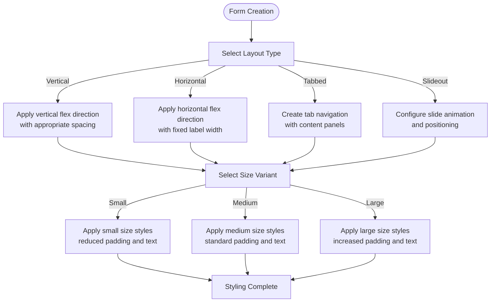

**Section sources**
- [FormField.tsx](file://src/components/ui/forms/FormField.tsx#L61-L85)
- [TabbedForm.tsx](file://src/components/ui/forms/TabbedForm.tsx#L131-L158)

## Input Components Integration

### Input Component
The Input component provides enhanced text input with floating labels, validation states, loading indicators, and icon support. It integrates seamlessly with the FormField wrapper.

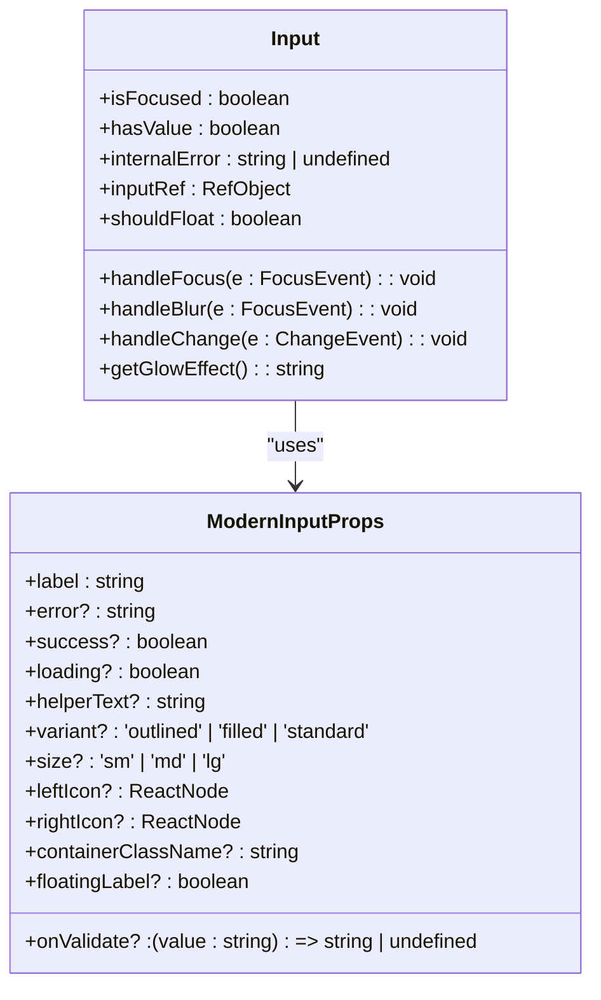

**Diagram sources**
- [Input.tsx](file://src/components/ui/Input.tsx#L15-L199)

**Section sources**
- [Input.tsx](file://src/components/ui/Input.tsx#L1-L360)

### Textarea Component
The Textarea component provides multi-line text input with label and error support. It follows the same styling conventions as other input components.

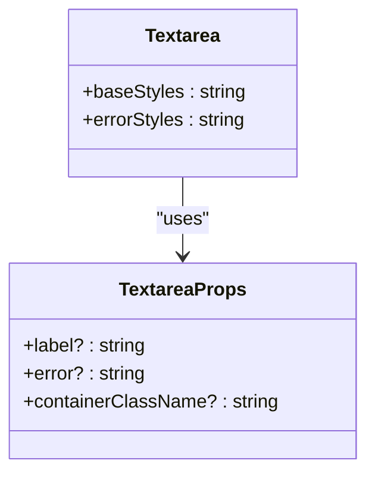

**Diagram sources**
- [Textarea.tsx](file://src/components/ui/Textarea.tsx#L5-L32)

**Section sources**
- [Textarea.tsx](file://src/components/ui/Textarea.tsx#L1-L32)

### Select Component
The Select component offers enhanced dropdown functionality with search, keyboard navigation, and accessibility features. It supports both single and multi-select modes.

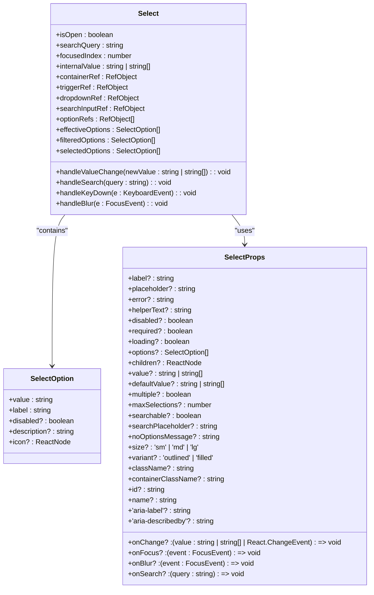

**Diagram sources**
- [Select.tsx](file://src/components/ui/Select.tsx#L75-L199)

**Section sources**
- [Select.tsx](file://src/components/ui/Select.tsx#L1-L732)

### Checkbox Component
The Checkbox component provides standard checkbox functionality with label integration and disabled state support.

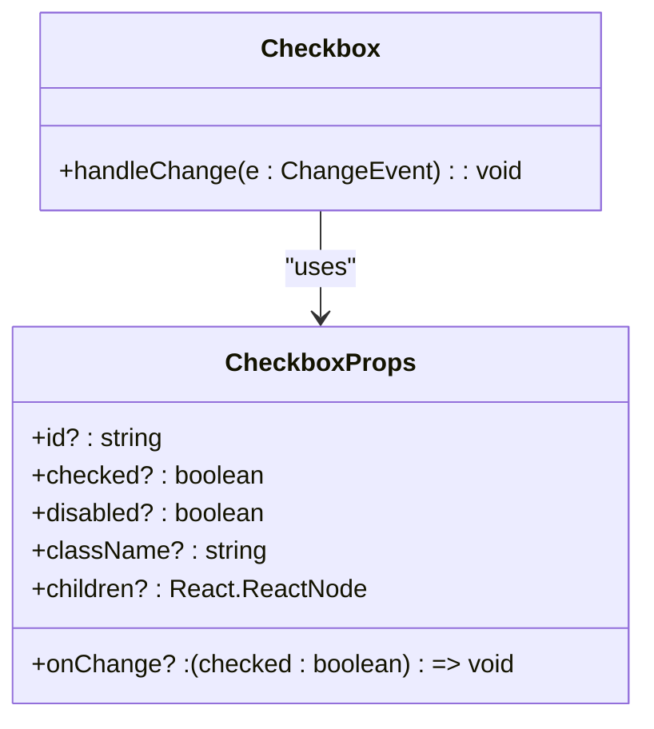

**Diagram sources**
- [Checkbox.tsx](file://src/components/ui/Checkbox.tsx#L5-L46)

**Section sources**
- [Checkbox.tsx](file://src/components/ui/Checkbox.tsx#L1-L46)

### DatePicker Component
The DatePicker component provides date selection with calendar interface, supporting both single date and date range selection with keyboard navigation.

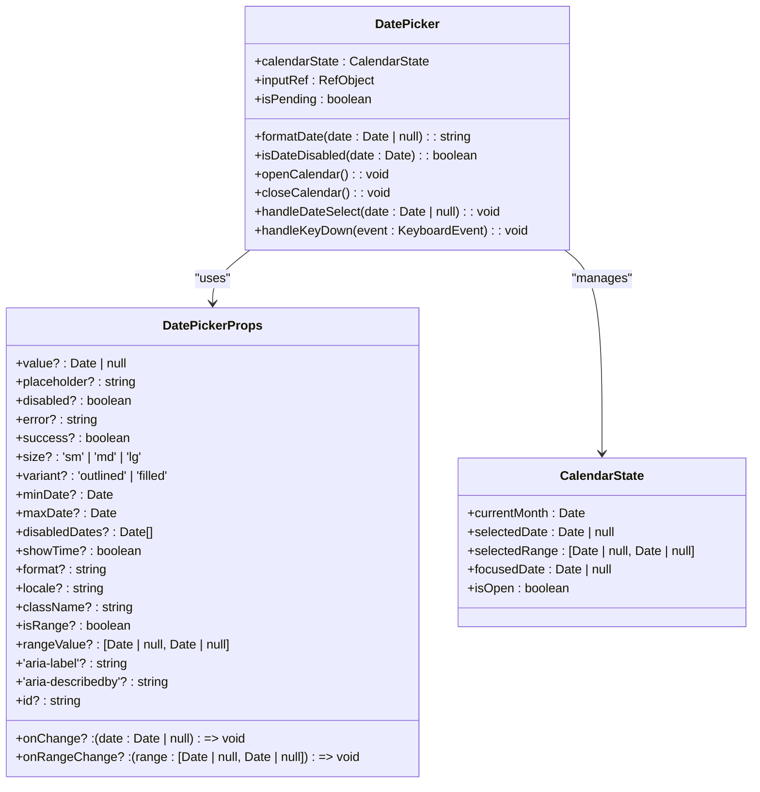

**Diagram sources**
- [DatePicker.tsx](file://src/components/ui/forms/DatePicker.tsx#L75-L199)

**Section sources**
- [DatePicker.tsx](file://src/components/ui/forms/DatePicker.tsx#L1-L509)

## Validation System

### useFormValidation Hook
The useFormValidation hook provides a centralized system for form validation with real-time validation, debouncing, and accessibility support. It manages validation rules, error states, and form submission.

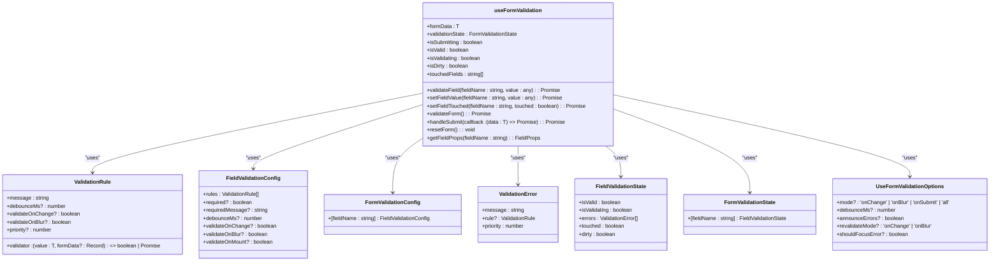

**Diagram sources**
- [useFormValidation.tsx](file://src/hooks/useFormValidation.tsx#L1-L47)

**Section sources**
- [useFormValidation.tsx](file://src/hooks/useFormValidation.tsx#L1-L529)

### Built-in Validators
The validation system includes several built-in validators for common use cases:

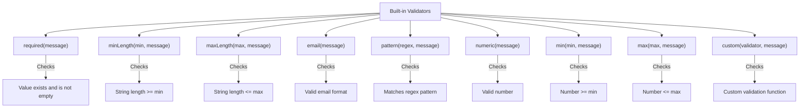

**Section sources**
- [useFormValidation.tsx](file://src/hooks/useFormValidation.tsx#L81-L165)

## Usage Examples

### Education System Configuration
The EducationSystemConfigPage demonstrates the use of form components for system configuration, utilizing the EducationSystemForm component within a page layout.

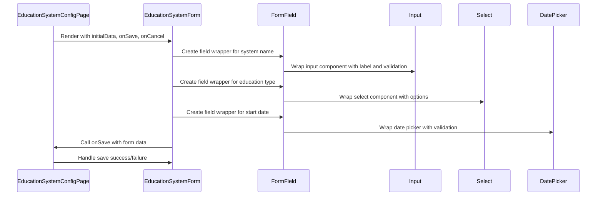

**Diagram sources**
- [EducationSystemConfigPage.tsx](file://src/modules/academics/pages/EducationSystemConfigPage.tsx#L1-L20)

**Section sources**
- [EducationSystemConfigPage.tsx](file://src/modules/academics/pages/EducationSystemConfigPage.tsx#L1-L20)

### Student Subject Enrollment
The StudentSubjectEnrollmentPage demonstrates a complex form scenario with modal dialogs, data grids, and form validation for student enrollment management.

```mermaid
flowchart TD
Page["StudentSubjectEnrollmentPage"] --> DataHook["useAppData()"]
DataHook --> Students["students"]
DataHook --> ClassSubjectAllocations["classSubjectAllocations"]
DataHook --> AcademicYears["academicYears"]
DataHook --> SchoolPeriods["schoolPeriods"]
DataHook --> Classes["classes"]
DataHook --> ClassStreams["classStreams"]
DataHook --> Subjects["subjects"]
Page --> Filters["Filter State"]
Filters --> SelectedAcademicYear["selectedAcademicYearId"]
Filters --> SelectedSchoolPeriod["selectedSchoolPeriodId"]
Filters --> SelectedClass["selectedClassId"]
Filters --> SelectedStream["selectedStreamId"]
Page --> Modal["Modal State"]
Modal --> IsModalOpen["isModalOpen"]
Modal --> EditingEnrollment["editingEnrollment"]
Modal --> FormData["formData"]
Page --> Grid["DataGrid"]
Grid --> StudentsForGrid["studentsForGrid"]
Grid --> SubjectsForGrid["subjectsForGrid"]
Page --> Form["Enrollment Form"]
Form --> Input["Input"]
Form --> Select["Select"]
Form --> DatePicker["DatePicker"]
Form --> Button["Button"]
Filters --> |Updates| Grid
Filters --> |Updates| Form
Modal --> |Triggers| Form
Form --> |Submits| Page
Page --> |Handles| FormSubmission["handleSubmit"]
```

**Diagram sources**
- [StudentSubjectEnrollmentPage.tsx](file://src/modules/academics/pages/StudentSubjectEnrollmentPage.tsx#L1-L199)

**Section sources**
- [StudentSubjectEnrollmentPage.tsx](file://src/modules/academics/pages/StudentSubjectEnrollmentPage.tsx#L1-L348)

## Accessibility and User Experience

### Accessibility Features
The form components include comprehensive accessibility features to ensure usability for all users:

- **ARIA Attributes**: Proper use of aria-describedby, aria-invalid, aria-required, and aria-label attributes
- **Keyboard Navigation**: Full keyboard support for all interactive elements
- **Screen Reader Support**: Announcements for state changes and validation messages
- **Focus Management**: Proper focus trapping and restoration
- **Color Contrast**: Sufficient contrast for text and interactive elements
- **Responsive Design**: Mobile-friendly layouts and touch targets

```mermaid
flowchart TD
Accessibility["Accessibility Features"] --> ARIA["ARIA Attributes"]
ARIA --> DescribedBy["aria-describedby"]
ARIA --> Invalid["aria-invalid"]
ARIA --> Required["aria-required"]
ARIA --> Label["aria-label"]
Accessibility --> Keyboard["Keyboard Navigation"]
Keyboard --> TabOrder["Logical tab order"]
Keyboard --> FocusVisible["Visible focus indicators"]
Keyboard --> Shortcuts["Keyboard shortcuts"]
Accessibility --> ScreenReader["Screen Reader Support"]
ScreenReader --> Announcements["State change announcements"]
ScreenReader --> Labels["Proper labeling"]
ScreenReader --> Instructions["Help text"]
Accessibility --> FocusManagement["Focus Management"]
FocusManagement --> Trapping["Focus trapping in modals"]
FocusManagement --> Restoration["Focus restoration"]
FocusManagement --> Indicators["Focus indicators"]
Accessibility --> Visual["Visual Design"]
Visual --> Contrast["Color contrast"]
Visual --> Spacing["Adequate spacing"]
Visual --> Touch["Touch target size"]
```

**Section sources**
- [FormField.tsx](file://src/components/ui/forms/FormField.tsx#L1-L182)
- [Input.tsx](file://src/components/ui/Input.tsx#L1-L360)
- [Select.tsx](file://src/components/ui/Select.tsx#L1-L732)
- [DatePicker.tsx](file://src/components/ui/forms/DatePicker.tsx#L1-L509)

### Keyboard Navigation
The form components support comprehensive keyboard navigation for improved accessibility:

- **Tab/Shift+Tab**: Navigate between form fields
- **Arrow Keys**: Navigate within select dropdowns and date pickers
- **Enter/Space**: Activate buttons and toggle checkboxes
- **Escape**: Close dropdowns, modals, and slideout forms
- **Home/End**: Navigate to first/last options in lists

**Section sources**
- [Select.tsx](file://src/components/ui/Select.tsx#L500-L550)
- [DatePicker.tsx](file://src/components/ui/forms/DatePicker.tsx#L300-L350)

## State Management and Data Flow

### Form State Management
The form components use React state and hooks to manage form state, validation, and user interactions:

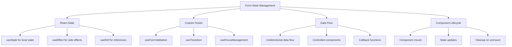

**Section sources**
- [FormField.tsx](file://src/components/ui/forms/FormField.tsx#L1-L182)
- [TabbedForm.tsx](file://src/components/ui/forms/TabbedForm.tsx#L1-L486)
- [SlideoutForm.tsx](file://src/components/ui/forms/SlideoutForm.tsx#L1-L741)
- [useFormValidation.tsx](file://src/hooks/useFormValidation.tsx#L1-L529)