# Form Components

<cite>
**Referenced Files in This Document**
- [FormField.tsx](file://src/components/ui/forms/FormField.tsx)
- [TabbedForm.tsx](file://src/components/ui/forms/TabbedForm.tsx)
- [SlideoutForm.tsx](file://src/components/ui/forms/SlideoutForm.tsx)
- [DialogForm.tsx](file://src/components/ui/forms/DialogForm.tsx)
- [WizardForm.tsx](file://src/components/ui/forms/WizardForm.tsx)
- [MinimalForm.tsx](file://src/components/ui/forms/MinimalForm.tsx)
- [PrintForm.tsx](file://src/components/ui/forms/PrintForm.tsx)
- [FormContainer.tsx](file://src/components/ui/forms/FormContainer.tsx)
- [FormHeader.tsx](file://src/components/ui/forms/FormHeader.tsx)
- [FormSection.tsx](file://src/components/ui/forms/FormSection.tsx)
- [FormGrid.tsx](file://src/components/ui/forms/FormGrid.tsx)
- [FormActions.tsx](file://src/components/ui/forms/FormActions.tsx)
- [useFormValidation.tsx](file://src/hooks/useFormValidation.tsx)
- [Input.tsx](file://src/components/ui/Input.tsx)
- [Textarea.tsx](file://src/components/ui/Textarea.tsx)
- [Select.tsx](file://src/components/ui/Select.tsx)
- [Checkbox.tsx](file://src/components/ui/Checkbox.tsx)
- [DatePicker.tsx](file://src/components/ui/forms/DatePicker.tsx)
- [Modal.tsx](file://src/components/ui/Modal.tsx)
- [EducationSystemConfigPage.tsx](file://src/modules/academics/pages/EducationSystemConfigPage.tsx)
- [StudentSubjectEnrollmentPage.tsx](file://src/modules/academics/pages/StudentSubjectEnrollmentPage.tsx)
</cite>

## Update Summary
**Changes Made**
- Added comprehensive documentation for the new DialogForm framework as the successor to Modal-based forms
- Documented new form composition components: FormContainer, FormHeader, FormSection, FormGrid, and FormActions
- Added WizardForm, MinimalForm, and PrintForm components for specialized form scenarios
- Updated migration guidance from Modal-based forms to the new DialogForm framework
- Enhanced form composition patterns and standardized form architecture documentation

## Table of Contents
1. [Introduction](#introduction)
2. [Form Framework Architecture](#form-framework-architecture)
3. [Core Form Components](#core-form-components)
4. [Form Composition System](#form-composition-system)
5. [Form Layout and Structure](#form-layout-and-structure)
6. [Input Components Integration](#input-components-integration)
7. [Validation System](#validation-system)
8. [Usage Examples](#usage-examples)
9. [Migration from Modal Forms](#migration-from-modal-forms)
10. [Accessibility and User Experience](#accessibility-and-user-experience)
11. [State Management and Data Flow](#state-management-and-data-flow)

## Introduction
This document provides comprehensive documentation for the form components in the schoolpilot3 application. The form system has evolved from Modal-based forms to a standardized DialogForm framework that provides consistent, accessible, and extensible form solutions across the application. The new architecture emphasizes composition over inheritance, providing reusable building blocks for various form scenarios including modal dialogs, wizards, minimal forms, and print-optimized layouts.

**Section sources**
- [DialogForm.tsx:1-193](file://src/components/ui/forms/DialogForm.tsx#L1-L193)
- [FormContainer.tsx:1-151](file://src/components/ui/forms/FormContainer.tsx#L1-L151)

## Form Framework Architecture
The new form framework is built around a composition-based architecture that separates concerns between presentation, structure, and behavior. The DialogForm component serves as the primary entry point, combining Modal presentation with FormContainer structure and FormHeader functionality.

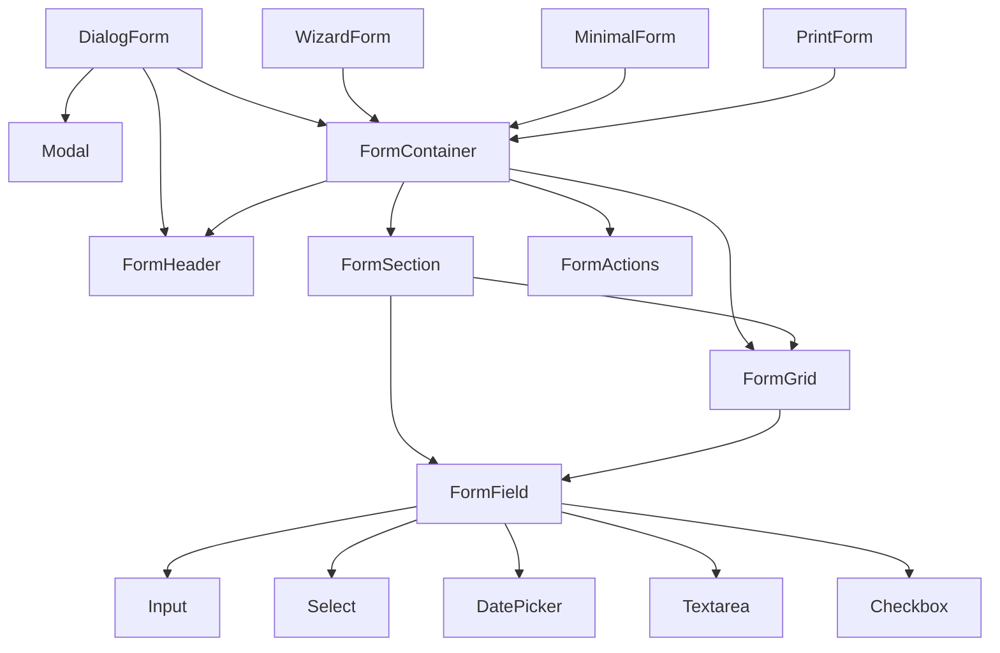

**Diagram sources**
- [DialogForm.tsx:1-193](file://src/components/ui/forms/DialogForm.tsx#L1-L193)
- [FormContainer.tsx:1-151](file://src/components/ui/forms/FormContainer.tsx#L1-L151)
- [WizardForm.tsx:1-441](file://src/components/ui/forms/WizardForm.tsx#L1-L441)
- [MinimalForm.tsx:1-184](file://src/components/ui/forms/MinimalForm.tsx#L1-L184)
- [PrintForm.tsx:1-304](file://src/components/ui/forms/PrintForm.tsx#L1-L304)

**Section sources**
- [DialogForm.tsx:1-193](file://src/components/ui/forms/DialogForm.tsx#L1-L193)
- [FormContainer.tsx:1-151](file://src/components/ui/forms/FormContainer.tsx#L1-L151)

## Core Form Components

### DialogForm Component
The DialogForm component represents the new standardized approach to modal forms, combining Modal presentation with comprehensive form structure and validation capabilities.

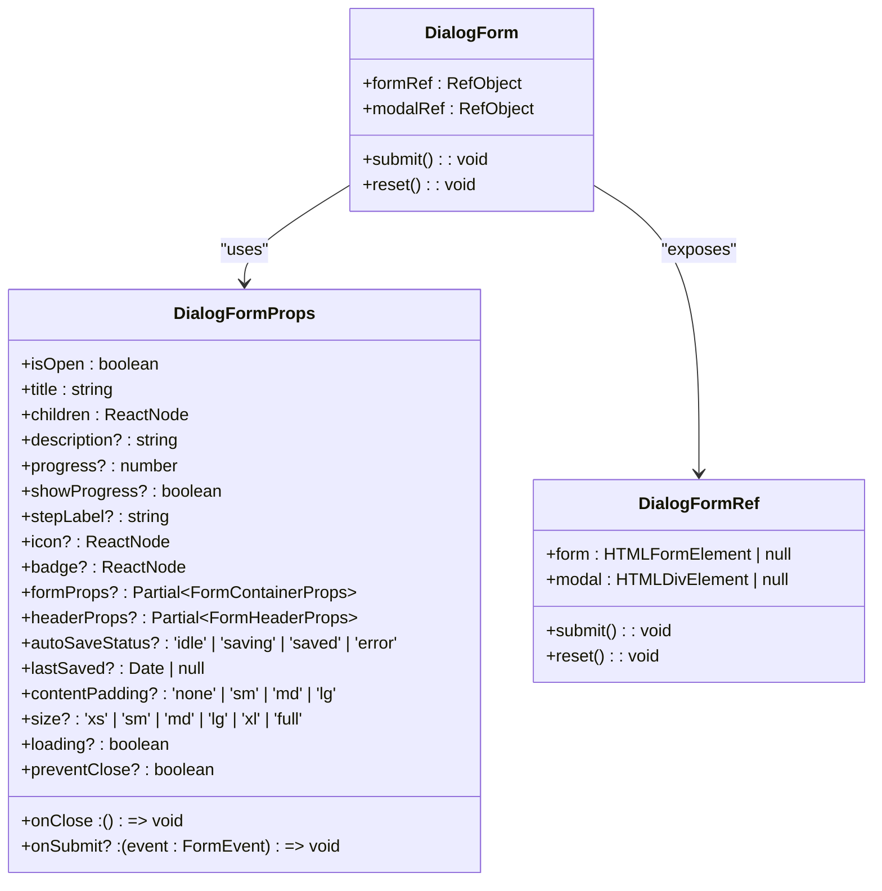

**Diagram sources**
- [DialogForm.tsx:9-47](file://src/components/ui/forms/DialogForm.tsx#L9-L47)

**Section sources**
- [DialogForm.tsx:1-193](file://src/components/ui/forms/DialogForm.tsx#L1-L193)

### WizardForm Component
The WizardForm component provides comprehensive multi-step form functionality with progress tracking, validation, and navigation controls.

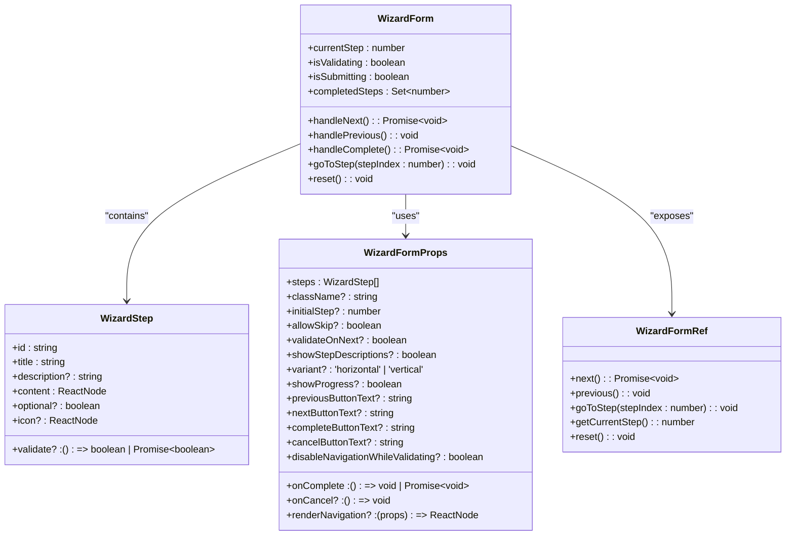

**Diagram sources**
- [WizardForm.tsx:9-81](file://src/components/ui/forms/WizardForm.tsx#L9-L81)

**Section sources**
- [WizardForm.tsx:1-441](file://src/components/ui/forms/WizardForm.tsx#L1-L441)

### MinimalForm Component
The MinimalForm component provides clean, simple form layouts ideal for login forms, search interfaces, and quick data entry scenarios.

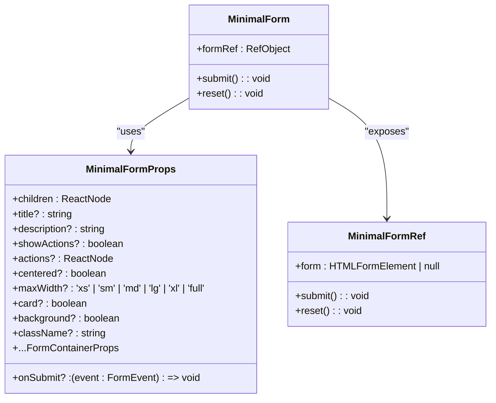

**Diagram sources**
- [MinimalForm.tsx:8-36](file://src/components/ui/forms/MinimalForm.tsx#L8-L36)

**Section sources**
- [MinimalForm.tsx:1-184](file://src/components/ui/forms/MinimalForm.tsx#L1-L184)

### PrintForm Component
The PrintForm component provides print-optimized form layouts with page breaks, headers, and print-specific styling.

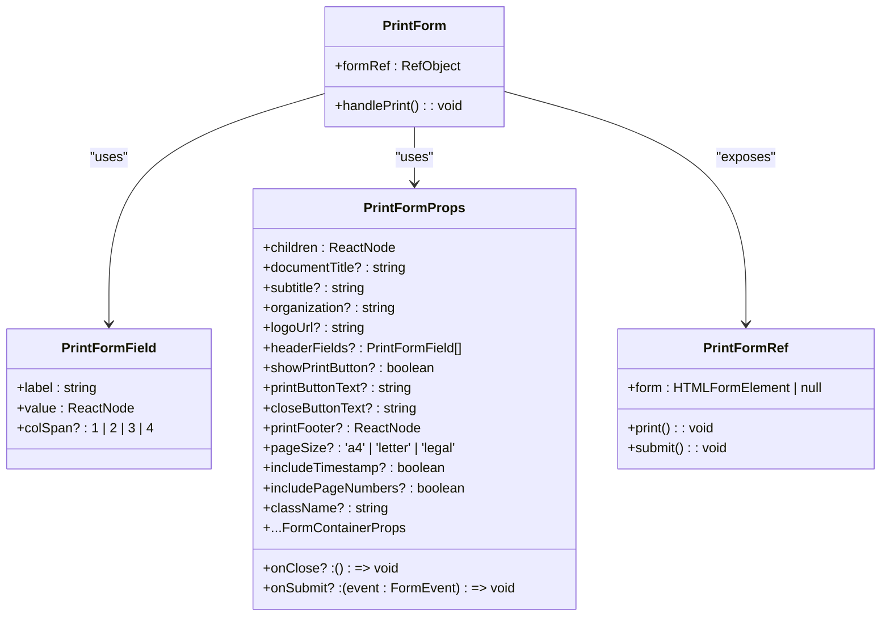

**Diagram sources**
- [PrintForm.tsx:8-55](file://src/components/ui/forms/PrintForm.tsx#L8-L55)

**Section sources**
- [PrintForm.tsx:1-304](file://src/components/ui/forms/PrintForm.tsx#L1-L304)

## Form Composition System

### FormContainer Component
The FormContainer serves as the foundational wrapper for all form types, providing consistent structure, styling, and accessibility attributes.

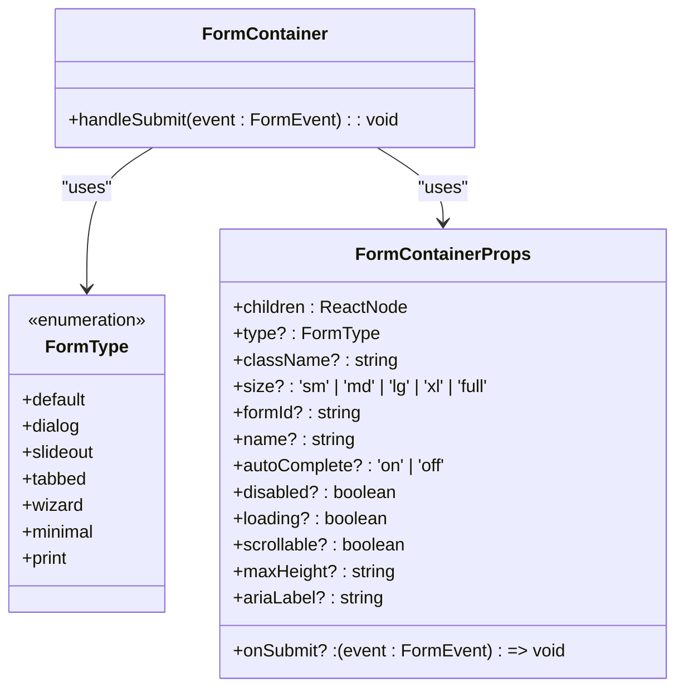

**Diagram sources**
- [FormContainer.tsx:7-36](file://src/components/ui/forms/FormContainer.tsx#L7-L36)

**Section sources**
- [FormContainer.tsx:1-151](file://src/components/ui/forms/FormContainer.tsx#L1-L151)

### FormHeader Component
The FormHeader component provides consistent header styling across all form types with support for titles, descriptions, progress indicators, and auto-save status.

**Section sources**
- [FormHeader.tsx:1-222](file://src/components/ui/forms/FormHeader.tsx#L1-L222)

### FormSection Component
The FormSection component provides logical grouping of form fields with responsive grid layouts, collapsible functionality, and print optimization.

**Section sources**
- [FormSection.tsx:1-210](file://src/components/ui/forms/FormSection.tsx#L1-L210)

### FormGrid Component
The FormGrid component provides flexible responsive grid layouts for form fields with customizable column counts and spacing.

**Section sources**
- [FormGrid.tsx:1-111](file://src/components/ui/forms/FormGrid.tsx#L1-L111)

### FormActions Component
The FormActions component provides standardized action button containers with responsive behavior and sticky positioning options.

**Section sources**
- [FormActions.tsx:1-118](file://src/components/ui/forms/FormActions.tsx#L1-L118)

## Form Layout and Structure

### Layout Variants
The form framework supports multiple layout configurations through the composition system:

- **Dialog Layout**: Modal-based forms with FormHeader, FormSection, and FormActions
- **Wizard Layout**: Multi-step forms with step indicators and navigation controls
- **Minimal Layout**: Clean, simple forms with optional card styling and centering
- **Print Layout**: Print-optimized forms with page breaks and print-specific styling
- **Tabbed Layout**: Multi-tab forms with FormContainer integration
- **Slideout Layout**: Side-panel forms with slide animation and positioning

### Size Variants
All form components support five size variants with corresponding padding and max-width constraints:

- **Extra Small (xs)**: Minimal padding, compact forms
- **Small (sm)**: Reduced padding, smaller max-width
- **Medium (md)**: Standard padding and max-width
- **Large (lg)**: Increased padding, larger max-width
- **Extra Large (xl)**: Maximum padding and width
- **Full Width (full)**: No padding with full container width

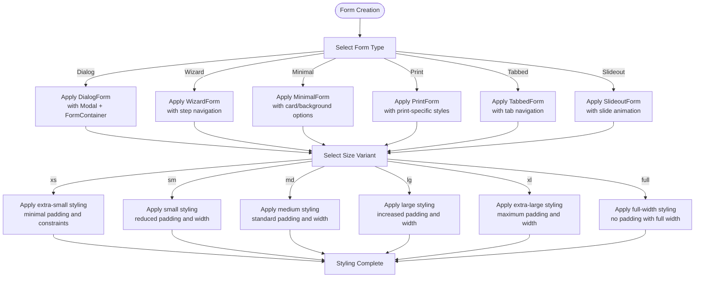

**Section sources**
- [FormContainer.tsx:86-93](file://src/components/ui/forms/FormContainer.tsx#L86-L93)
- [DialogForm.tsx:138-145](file://src/components/ui/forms/DialogForm.tsx#L138-L145)

## Input Components Integration

### Input Component
The Input component provides enhanced text input with floating labels, validation states, loading indicators, and icon support. It integrates seamlessly with the FormField wrapper and supports all form types.

**Section sources**
- [Input.tsx:1-360](file://src/components/ui/Input.tsx#L1-L360)

### Textarea Component
The Textarea component provides multi-line text input with label and error support, following the same styling conventions as other input components.

**Section sources**
- [Textarea.tsx:1-32](file://src/components/ui/Textarea.tsx#L1-L32)

### Select Component
The Select component offers enhanced dropdown functionality with search, keyboard navigation, and accessibility features. It supports both single and multi-select modes and integrates with all form types.

**Section sources**
- [Select.tsx:1-732](file://src/components/ui/Select.tsx#L1-L732)

### Checkbox Component
The Checkbox component provides standard checkbox functionality with label integration and disabled state support, working across all form layouts.

**Section sources**
- [Checkbox.tsx:1-46](file://src/components/ui/Checkbox.tsx#L1-L46)

### DatePicker Component
The DatePicker component provides date selection with calendar interface, supporting both single date and date range selection with keyboard navigation and full accessibility support.

**Section sources**
- [DatePicker.tsx:1-509](file://src/components/ui/forms/DatePicker.tsx#L1-L509)

## Validation System

### useFormValidation Hook
The useFormValidation hook provides a centralized system for form validation with real-time validation, debouncing, and accessibility support. It manages validation rules, error states, and form submission across all form types.

**Section sources**
- [useFormValidation.tsx:1-529](file://src/hooks/useFormValidation.tsx#L1-L529)

### Built-in Validators
The validation system includes several built-in validators for common use cases:

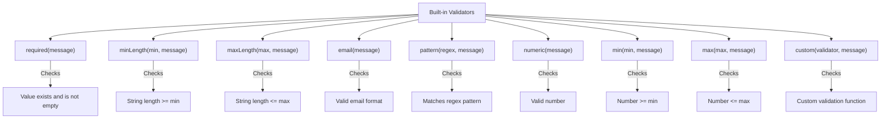

**Section sources**
- [useFormValidation.tsx:81-165](file://src/hooks/useFormValidation.tsx#L81-L165)

## Usage Examples

### DialogForm Implementation
The DialogForm component demonstrates the new standardized approach to modal forms, combining Modal presentation with comprehensive form structure.

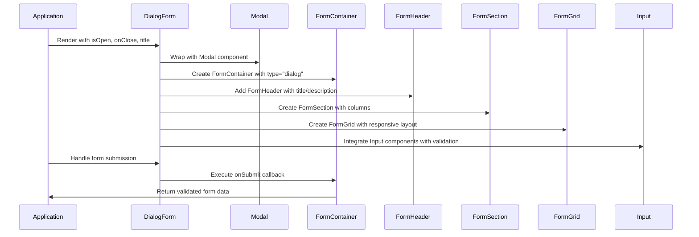

**Diagram sources**
- [DialogForm.tsx:147-187](file://src/components/ui/forms/DialogForm.tsx#L147-L187)

**Section sources**
- [DialogForm.tsx:55-88](file://src/components/ui/forms/DialogForm.tsx#L55-L88)

### WizardForm Implementation
The WizardForm component provides comprehensive multi-step form functionality with progress tracking and validation.

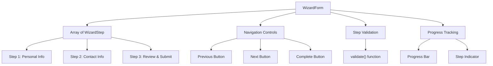

**Diagram sources**
- [WizardForm.tsx:83-115](file://src/components/ui/forms/WizardForm.tsx#L83-L115)

**Section sources**
- [WizardForm.tsx:89-114](file://src/components/ui/forms/WizardForm.tsx#L89-L114)

### Education System Configuration
The EducationSystemConfigPage demonstrates the use of form components for system configuration, utilizing the DialogForm with FormContainer, FormHeader, and FormSection components.

**Section sources**
- [EducationSystemConfigPage.tsx:1-20](file://src/modules/academics/pages/EducationSystemConfigPage.tsx#L1-L20)

### Student Subject Enrollment
The StudentSubjectEnrollmentPage demonstrates a complex form scenario with modal dialogs, data grids, and form validation for student enrollment management.

**Section sources**
- [StudentSubjectEnrollmentPage.tsx:1-348](file://src/modules/academics/pages/StudentSubjectEnrollmentPage.tsx#L1-L348)

## Migration from Modal Forms
The form system has migrated from direct Modal usage to the standardized DialogForm framework. This migration provides better consistency, accessibility, and extensibility across the application.

### Migration Benefits
- **Consistency**: All modal forms now use the same underlying structure and styling
- **Accessibility**: Improved ARIA attributes and keyboard navigation support
- **Extensibility**: Easier to extend and customize form layouts
- **Maintainability**: Single source of truth for form modal behavior
- **Composition**: Better separation of concerns between presentation and logic

### Migration Process
1. **Replace Modal imports** with DialogForm imports
2. **Update component structure** to use FormContainer, FormHeader, FormSection, and FormActions
3. **Migrate validation logic** to useFormValidation hook
4. **Update styling** to use new form-specific CSS classes
5. **Test accessibility** with screen readers and keyboard navigation

### Legacy Support
The Modal component remains available for legacy implementations but is no longer recommended for new form development. All new forms should use DialogForm or other components from the new form framework.

**Section sources**
- [DialogForm.tsx:1-193](file://src/components/ui/forms/DialogForm.tsx#L1-L193)
- [Modal.tsx:1-52](file://src/components/ui/Modal.tsx#L1-L52)

## Accessibility and User Experience

### Accessibility Features
The form components include comprehensive accessibility features to ensure usability for all users:

- **ARIA Attributes**: Proper use of aria-describedby, aria-invalid, aria-required, and aria-label attributes
- **Keyboard Navigation**: Full keyboard support for all interactive elements
- **Screen Reader Support**: Announcements for state changes and validation messages
- **Focus Management**: Proper focus trapping and restoration
- **Color Contrast**: Sufficient contrast for text and interactive elements
- **Responsive Design**: Mobile-friendly layouts and touch targets

```mermaid
flowchart TD
Accessibility["Accessibility Features"] --> ARIA["ARIA Attributes"]
ARIA --> DescribedBy["aria-describedby"]
ARIA --> Invalid["aria-invalid"]
ARIA --> Required["aria-required"]
ARIA --> Label["aria-label"]
Accessibility --> Keyboard["Keyboard Navigation"]
Keyboard --> TabOrder["Logical tab order"]
Keyboard --> FocusVisible["Visible focus indicators"]
Keyboard --> Shortcuts["Keyboard shortcuts"]
Accessibility --> ScreenReader["Screen Reader Support"]
ScreenReader --> Announcements["State change announcements"]
ScreenReader --> Labels["Proper labeling"]
ScreenReader --> Instructions["Help text"]
Accessibility --> FocusManagement["Focus Management"]
FocusManagement --> Trapping["Focus trapping in modals"]
FocusManagement --> Restoration["Focus restoration"]
FocusManagement --> Indicators["Focus indicators"]
Accessibility --> Visual["Visual Design"]
Visual --> Contrast["Color contrast"]
Visual --> Spacing["Adequate spacing"]
Visual --> Touch["Touch target size"]
```

**Section sources**
- [DialogForm.tsx:1-193](file://src/components/ui/forms/DialogForm.tsx#L1-L193)
- [FormContainer.tsx:1-151](file://src/components/ui/forms/FormContainer.tsx#L1-L151)
- [FormHeader.tsx:1-222](file://src/components/ui/forms/FormHeader.tsx#L1-L222)

### Keyboard Navigation
The form components support comprehensive keyboard navigation for improved accessibility:

- **Tab/Shift+Tab**: Navigate between form fields
- **Arrow Keys**: Navigate within select dropdowns and date pickers
- **Enter/Space**: Activate buttons and toggle checkboxes
- **Escape**: Close dropdowns, modals, and slideout forms
- **Home/End**: Navigate to first/last options in lists

**Section sources**
- [Select.tsx:500-550](file://src/components/ui/Select.tsx#L500-L550)
- [DatePicker.tsx:300-350](file://src/components/ui/forms/DatePicker.tsx#L300-L350)

## State Management and Data Flow

### Form State Management
The form components use React state and hooks to manage form state, validation, and user interactions through a standardized composition pattern:

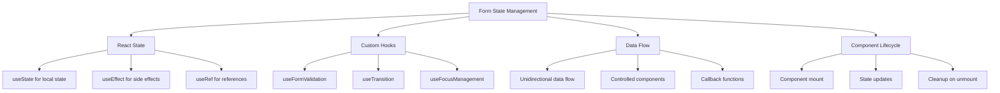

**Section sources**
- [DialogForm.tsx:1-193](file://src/components/ui/forms/DialogForm.tsx#L1-L193)
- [WizardForm.tsx:1-441](file://src/components/ui/forms/WizardForm.tsx#L1-L441)
- [MinimalForm.tsx:1-184](file://src/components/ui/forms/MinimalForm.tsx#L1-L184)
- [PrintForm.tsx:1-304](file://src/components/ui/forms/PrintForm.tsx#L1-L304)
- [useFormValidation.tsx:1-529](file://src/hooks/useFormValidation.tsx#L1-L529)