# Form Styling System

<cite>
**Referenced Files in This Document**
- [forms.css](file://src/styles/forms.css)
- [formStyles.ts](file://src/utils/formStyles.ts)
- [responsive.ts](file://src/utils/responsive.ts)
- [Input.tsx](file://src/components/ui/Input.tsx)
- [Select.tsx](file://src/components/ui/Select.tsx)
- [Textarea.tsx](file://src/components/ui/Textarea.tsx)
- [FormContainer.tsx](file://src/components/ui/forms/FormContainer.tsx)
- [FormHeader.tsx](file://src/components/ui/forms/FormHeader.tsx)
- [DialogForm.tsx](file://src/components/ui/forms/DialogForm.tsx)
- [WizardForm.tsx](file://src/components/ui/forms/WizardForm.tsx)
- [SlideoutForm.tsx](file://src/components/ui/forms/SlideoutForm.tsx)
- [MinimalForm.tsx](file://src/components/ui/forms/MinimalForm.tsx)
- [PrintForm.tsx](file://src/components/ui/forms/PrintForm.tsx)
- [FormSection.tsx](file://src/components/ui/forms/FormSection.tsx)
- [FormField.tsx](file://src/components/ui/forms/FormField.tsx)
- [FormGrid.tsx](file://src/components/ui/forms/FormGrid.tsx)
- [FormActions.tsx](file://src/components/ui/forms/FormActions.tsx)
</cite>

## Update Summary
**Changes Made**
- Added comprehensive DialogForm component documentation with modal/popup form patterns
- Enhanced responsive design patterns documentation with CSS-in-JS utilities
- Updated form styling framework with new CSS classes and patterns
- Added new form component types: WizardForm, SlideoutForm, MinimalForm, PrintForm
- Expanded styling guidelines with DialogForm-specific styling patterns
- Enhanced responsive design documentation with breakpoint utilities

## Table of Contents
1. [Introduction](#introduction)
2. [System Architecture](#system-architecture)
3. [Core Components](#core-components)
4. [Styling Framework](#styling-framework)
5. [Form Components](#form-components)
6. [DialogForm System](#dialogform-system)
7. [Advanced Form Patterns](#advanced-form-patterns)
8. [Responsive Design Patterns](#responsive-design-patterns)
9. [Print and Accessibility Features](#print-and-accessibility-features)
10. [Usage Patterns](#usage-patterns)
11. [Best Practices](#best-practices)
12. [Performance Considerations](#performance-considerations)
13. [Troubleshooting Guide](#troubleshooting-guide)
14. [Conclusion](#conclusion)

## Introduction

The Form Styling System is a comprehensive framework designed to provide consistent, accessible, and responsive form experiences across the EduGen school management platform. This system combines CSS-in-JS utilities with React components to create a unified approach to form styling that supports multiple form types, validation states, and accessibility requirements.

The system emphasizes modularity, maintainability, and scalability while ensuring compliance with WCAG 2.1 AA standards and providing excellent user experience across different devices and interaction modes. Recent enhancements include specialized components for dialogs, wizards, slideouts, and print-optimized forms, along with comprehensive responsive design patterns.

## System Architecture

The Form Styling System follows a layered architecture that separates concerns between styling utilities, component composition, and form-specific functionality.

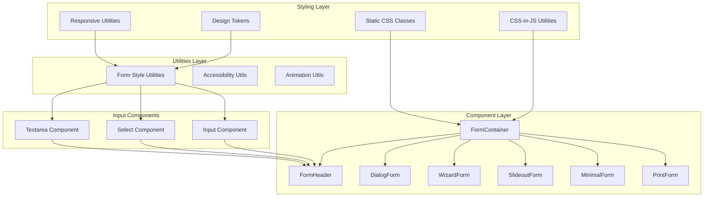

**Diagram sources**
- [formStyles.ts:1-231](file://src/utils/formStyles.ts#L1-L231)
- [FormContainer.tsx:1-151](file://src/components/ui/forms/FormContainer.tsx#L1-L151)
- [DialogForm.tsx:1-194](file://src/components/ui/forms/DialogForm.tsx#L1-L194)
- [responsive.ts:1-202](file://src/utils/responsive.ts#L1-L202)

## Core Components

### Form Container System

The Form Container serves as the foundational wrapper for all form types, providing consistent structure, sizing, and behavior across different form contexts.

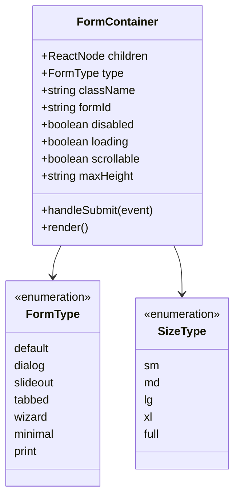

**Diagram sources**
- [FormContainer.tsx:7-36](file://src/components/ui/forms/FormContainer.tsx#L7-L36)

### Form Header Management

Form Headers provide consistent title, description, and progress display across all form types with support for auto-save status indicators and progress bars.

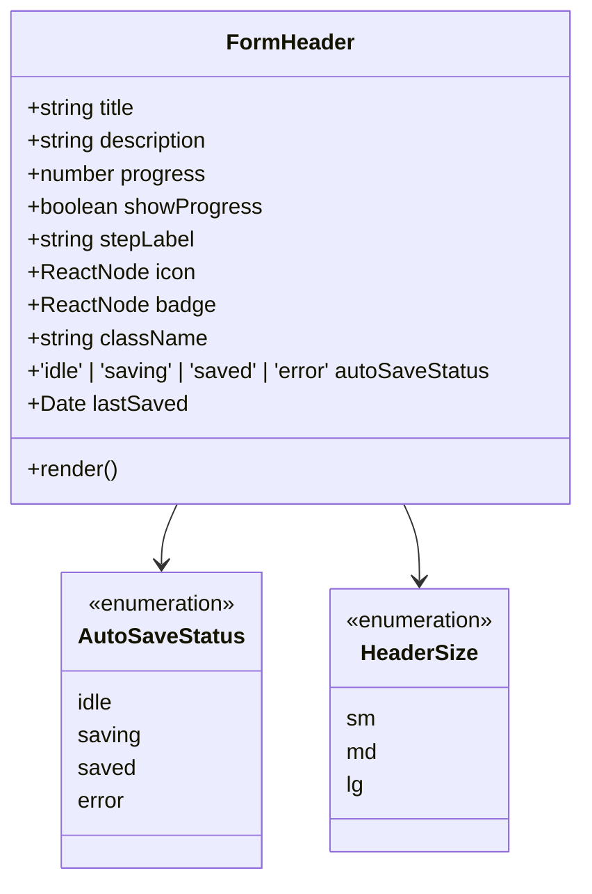

**Diagram sources**
- [FormHeader.tsx:7-30](file://src/components/ui/forms/FormHeader.tsx#L7-L30)

**Section sources**
- [FormContainer.tsx:69-151](file://src/components/ui/forms/FormContainer.tsx#L69-L151)
- [FormHeader.tsx:62-222](file://src/components/ui/forms/FormHeader.tsx#L62-L222)

## Styling Framework

### CSS-in-JS Utility System

The form styling system utilizes a sophisticated CSS-in-JS approach through the `formStyles.ts` utility module, providing consistent styling patterns across all form components.

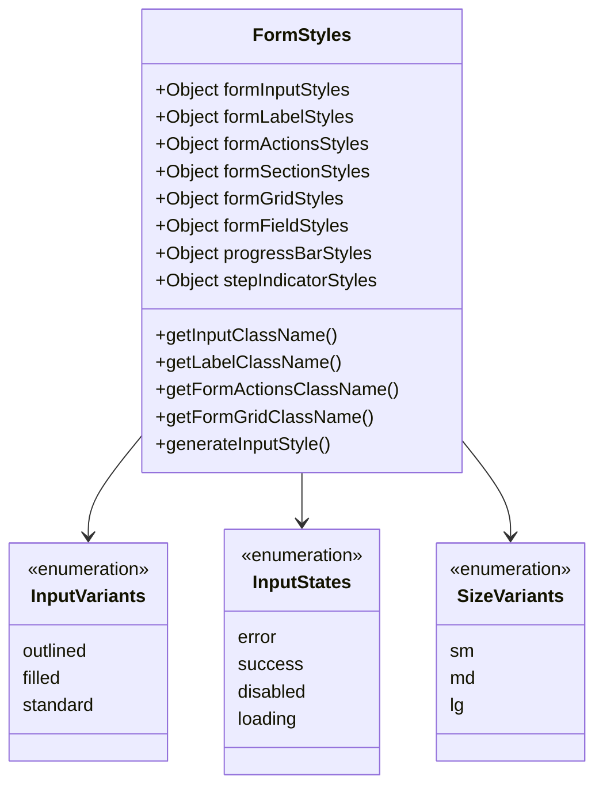

**Diagram sources**
- [formStyles.ts:6-56](file://src/utils/formStyles.ts#L6-L56)

### Static CSS Framework

The static CSS framework in `forms.css` provides comprehensive styling for print modes, responsive layouts, and cross-browser compatibility with enhanced CSS classes.


**Diagram sources**
- [forms.css:10-145](file://src/styles/forms.css#L10-L145)

**Section sources**
- [formStyles.ts:1-231](file://src/utils/formStyles.ts#L1-L231)
- [forms.css:1-428](file://src/styles/forms.css#L1-L428)

## Form Components

### Input Component Architecture

The Input component provides a modern, accessible input field with floating labels, validation states, and enhanced user experience features.

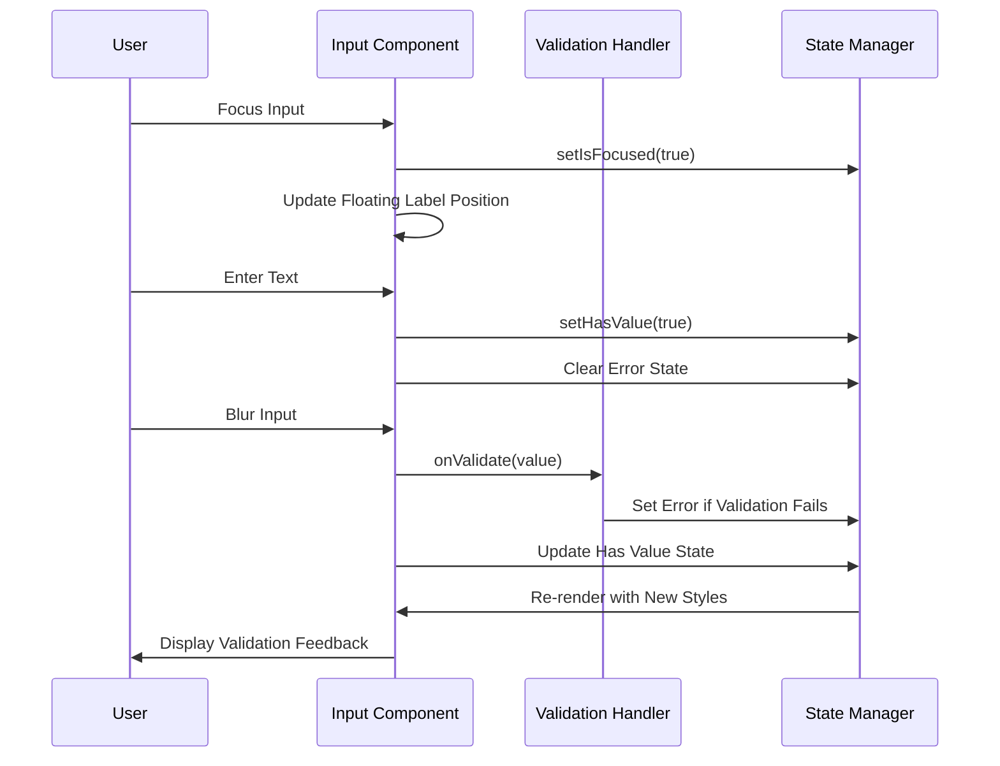

**Diagram sources**
- [Input.tsx:47-97](file://src/components/ui/Input.tsx#L47-L97)

### Select Component System

The Select component offers comprehensive functionality including search capabilities, keyboard navigation, multi-select support, and full accessibility compliance.

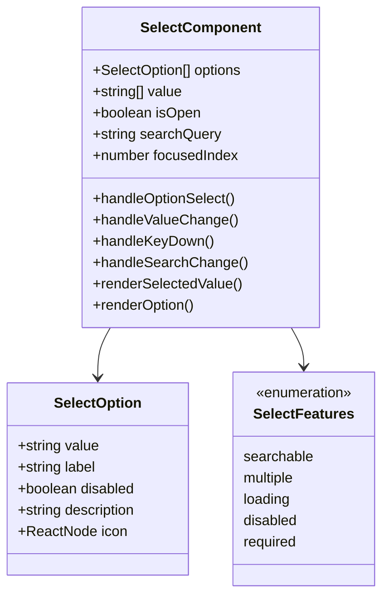

**Diagram sources**
- [Select.tsx:29-80](file://src/components/ui/Select.tsx#L29-L80)

**Section sources**
- [Input.tsx:1-360](file://src/components/ui/Input.tsx#L1-L360)
- [Select.tsx:1-755](file://src/components/ui/Select.tsx#L1-L755)

### Form Field Organization

The Form Field component provides standardized layout management, validation state handling, and accessibility integration for individual form controls.

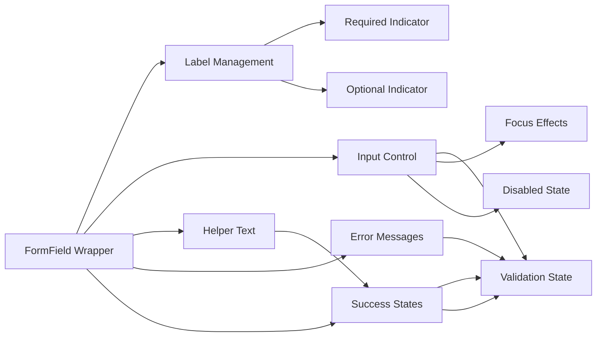

**Diagram sources**
- [FormField.tsx:23-182](file://src/components/ui/forms/FormField.tsx#L23-L182)

**Section sources**
- [FormField.tsx:1-182](file://src/components/ui/forms/FormField.tsx#L1-L182)

## DialogForm System

### DialogForm Component Architecture

The DialogForm component provides a comprehensive solution for modal/popup forms, combining Modal with FormContainer and FormHeader for consistent popup form patterns.

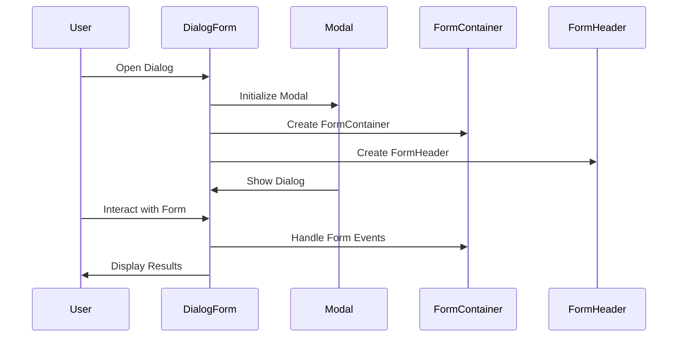

**Diagram sources**
- [DialogForm.tsx:90-194](file://src/components/ui/forms/DialogForm.tsx#L90-L194)

### DialogForm Props and Features

The DialogForm component supports various props for customization including progress indicators, auto-save status, content padding, and size variations.

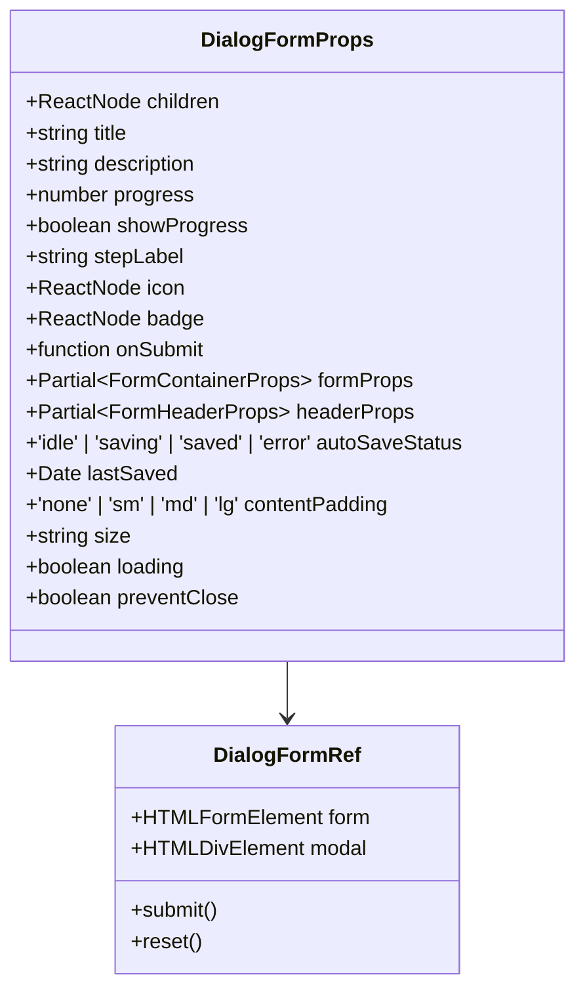

**Diagram sources**
- [DialogForm.tsx:9-47](file://src/components/ui/forms/DialogForm.tsx#L9-L47)

**Section sources**
- [DialogForm.tsx:1-194](file://src/components/ui/forms/DialogForm.tsx#L1-L194)

## Advanced Form Patterns

### WizardForm Component System

The WizardForm component provides multi-step form functionality with progress tracking, validation, and navigation controls.

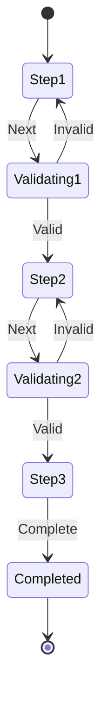

**Diagram sources**
- [WizardForm.tsx:134-225](file://src/components/ui/forms/WizardForm.tsx#L134-L225)

### SlideoutForm Component System

The SlideoutForm component offers enhanced slideout functionality with spring animations, gestures, and modern interactions including auto-save, resize handles, and backdrop blur.

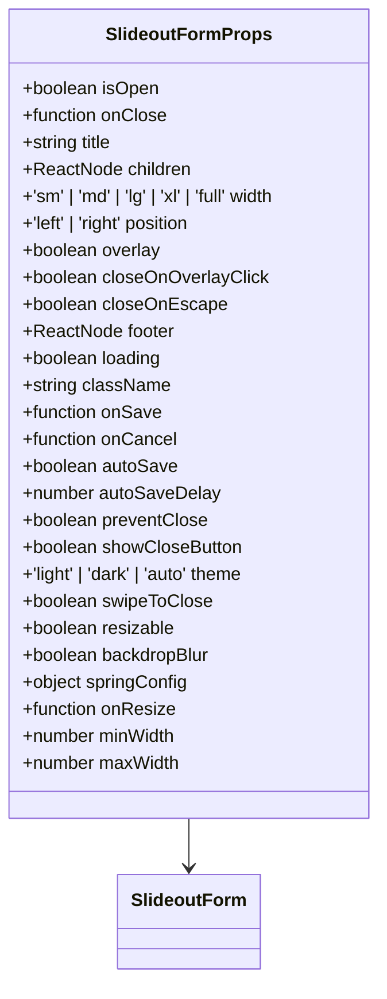

**Diagram sources**
- [SlideoutForm.tsx:10-44](file://src/components/ui/forms/SlideoutForm.tsx#L10-L44)

**Section sources**
- [WizardForm.tsx:1-441](file://src/components/ui/forms/WizardForm.tsx#L1-L441)
- [SlideoutForm.tsx:1-751](file://src/components/ui/forms/SlideoutForm.tsx#L1-L751)

### MinimalForm Component System

The MinimalForm component provides clean, simple form layout for login, search, and quick forms with minimal chrome and focus on content.

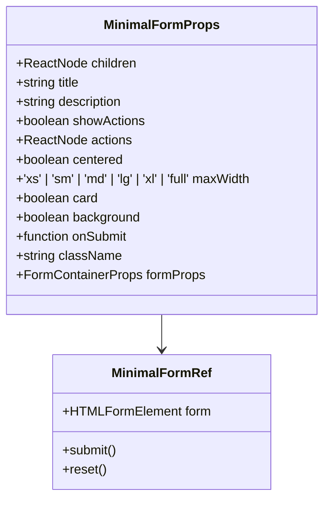

**Diagram sources**
- [MinimalForm.tsx:8-36](file://src/components/ui/forms/MinimalForm.tsx#L8-L36)

**Section sources**
- [MinimalForm.tsx:1-184](file://src/components/ui/forms/MinimalForm.tsx#L1-L184)

### PrintForm Component System

The PrintForm component provides print-optimized forms with page breaks, headers on each page, and hidden interactive elements when printing.

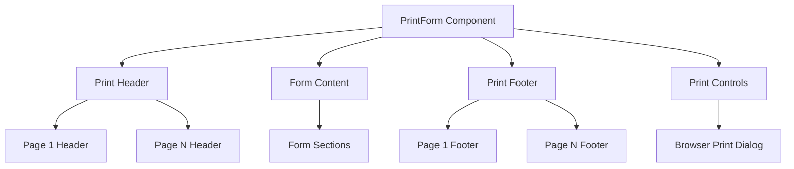

**Diagram sources**
- [PrintForm.tsx:130-298](file://src/components/ui/forms/PrintForm.tsx#L130-L298)

**Section sources**
- [PrintForm.tsx:1-304](file://src/components/ui/forms/PrintForm.tsx#L1-L304)

## Responsive Design Patterns

### Responsive Utility System

The responsive design system provides comprehensive breakpoint management, media queries, and responsive helpers for adaptive form layouts.

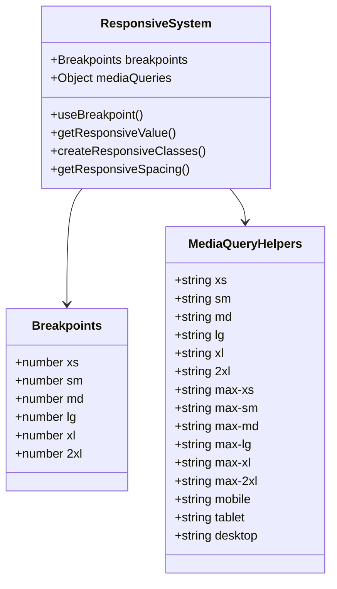

**Diagram sources**
- [responsive.ts:4-57](file://src/utils/responsive.ts#L4-L57)

### CSS-in-JS Responsive Patterns

The system implements CSS-in-JS patterns for responsive design through dynamic class generation and media query helpers.

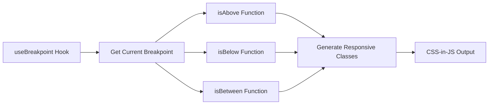

**Diagram sources**
- [responsive.ts:59-117](file://src/utils/responsive.ts#L59-L117)

**Section sources**
- [responsive.ts:1-202](file://src/utils/responsive.ts#L1-L202)

## Print and Accessibility Features

### Print Optimization System

The system provides comprehensive print optimization with dedicated stylesheets, page break controls, and accessibility considerations.

```mermaid
flowchart TD
PrintMode[Print Mode Activation] --> HideInteractive[Hide Interactive Elements]
PrintMode --> ShowPrintOnly[Show Print-Only Elements]
PrintMode --> AdjustContainers[Adjust Form Containers]
PrintMode --> OptimizeFields[Optimize Form Fields]
PrintMode --> SetupGrids[Setup Grid Layouts]
PrintMode --> AddHeaders[Footers & Headers]
HideInteractive --> RemoveButtons[Remove Buttons]
HideInteractive --> RemoveActions[Remove Form Actions]
HideInteractive --> RemoveUI[Remove UI Elements]
AdjustContainers --> RemovePadding[Remove Padding]
AdjustContainers --> RemoveShadow[Remove Shadow]
AdjustContainers --> SetMaxWidth[Set Max Width]
OptimizeFields --> CleanBorders[Clean Borders]
OptimizeFields --> TransparentBG[Transparent Background]
OptimizeFields --> RemoveFocus[Remove Focus Rings]
OptimizeFields --> ShowErrors[Show Errors as Underlines]
SetupGrids --> ResponsiveGrids[Responsive Grids]
SetupGrids --> ConsistentSpacing[Consistent Spacing]
AddHeaders --> PrintHeader[Print Header]
AddHeaders --> PrintFooter[Print Footer]
AddHeaders --> PageSetup[Page Setup]
```

**Diagram sources**
- [forms.css:10-145](file://src/styles/forms.css#L10-L145)

### Accessibility Compliance

The system ensures full WCAG 2.1 AA compliance through proper ARIA attributes, keyboard navigation, screen reader support, and semantic markup.

**Section sources**
- [forms.css:10-145](file://src/styles/forms.css#L10-L145)
- [Input.tsx:263-266](file://src/components/ui/Input.tsx#L263-L266)
- [Select.tsx:662-674](file://src/components/ui/Select.tsx#L662-L674)

## Usage Patterns

### Component Composition Patterns

The form system follows established composition patterns that promote reusability and maintainability across different form scenarios.

```mermaid
graph TB
subgraph "Form Composition"
Container[FormContainer]
Header[FormHeader]
Section[FormSection]
Grid[FormGrid]
Field[FormField]
Input[Input/Select/Textarea]
Actions[FormActions]
end
subgraph "Patterns"
Pattern1[Basic Form Pattern]
Pattern2[Multi-Column Pattern]
Pattern3[Collapsible Pattern]
Pattern4[Wizard Pattern]
Pattern5[Dialog Pattern]
Pattern6[Slideout Pattern]
Pattern7[Print Pattern]
end
Container --> Header
Container --> Section
Section --> Grid
Grid --> Field
Field --> Input
Container --> Actions
Pattern1 --> Container
Pattern2 --> Grid
Pattern3 --> Section
Pattern4 --> Container
Pattern5 --> Container
Pattern6 --> Container
Pattern7 --> Container
``

### State Management Patterns

The system implements consistent state management patterns for form validation, user interactions, and visual feedback.

**Section sources**
- [FormContainer.tsx:111-116](file://src/components/ui/forms/FormContainer.tsx#L111-L116)
- [Input.tsx:47-97](file://src/components/ui/Input.tsx#L47-L97)

## Best Practices

### Styling Guidelines

1. **Consistent Variants**: Use predefined input variants (outlined, filled, standard) for uniform appearance
2. **State Management**: Implement proper error, success, and loading state handling
3. **Accessibility First**: Always include proper ARIA attributes and keyboard navigation
4. **Responsive Design**: Utilize built-in responsive classes for different screen sizes
5. **Print Optimization**: Apply appropriate print-specific styles for document generation
6. **DialogForm Patterns**: Use DialogForm for modal/popup scenarios with proper header and progress handling
7. **Component Selection**: Choose appropriate form components based on use case (MinimalForm for simple forms, WizardForm for multi-step, SlideoutForm for complex forms)

### Performance Considerations

1. **CSS-in-JS Optimization**: Minimize style recalculations through efficient class merging
2. **Component Memoization**: Use React.memo for static form components
3. **Lazy Loading**: Implement lazy loading for complex form sections
4. **Bundle Size**: Keep form component bundles lightweight and tree-shakeable
5. **Responsive Optimization**: Use CSS-in-JS patterns to minimize media query overhead

## Performance Considerations

### Rendering Optimization

The form system implements several performance optimization strategies:

- **Efficient CSS Generation**: Dynamic class generation minimizes CSS overhead
- **Conditional Rendering**: Smart rendering of optional elements reduces DOM complexity
- **State Optimization**: Minimal state updates prevent unnecessary re-renders
- **Memory Management**: Proper cleanup of event listeners and timeouts
- **Animation Optimization**: Framer Motion animations are optimized for performance

### Bundle Optimization

- **Tree Shaking**: Modular component structure enables dead code elimination
- **Code Splitting**: Large form components can be split into separate chunks
- **Asset Optimization**: SVG icons and static assets are optimized for performance

## Troubleshooting Guide

### Common Issues and Solutions

**Input Validation Not Working**
- Verify `onValidate` callback is properly implemented
- Check that error state is being cleared on user interaction
- Ensure validation runs on blur events

**Styling Conflicts**
- Check for conflicting CSS class orders
- Verify CSS specificity rules aren't overriding form styles
- Review Tailwind CSS configuration for customizations

**Accessibility Issues**
- Confirm ARIA attributes are properly set
- Test keyboard navigation thoroughly
- Validate screen reader compatibility

**Print Mode Problems**
- Verify media queries are functioning correctly
- Check print-specific CSS overrides
- Test across different browsers and printers

**DialogForm Issues**
- Ensure proper Modal integration
- Verify FormHeader props are correctly passed
- Check size mapping between DialogForm and FormContainer

**Responsive Design Problems**
- Verify breakpoint detection is working
- Check CSS-in-JS media query generation
- Test across different device sizes

**Section sources**
- [Input.tsx:78-84](file://src/components/ui/Input.tsx#L78-L84)
- [Select.tsx:580-583](file://src/components/ui/Select.tsx#L580-L583)
- [DialogForm.tsx:137-145](file://src/components/ui/forms/DialogForm.tsx#L137-L145)

## Conclusion

The Form Styling System provides a robust, scalable foundation for form development across the EduGen platform. Its modular architecture, comprehensive accessibility features, and performance optimizations make it suitable for complex educational applications requiring consistent user experiences.

The system's emphasis on CSS-in-JS utilities combined with traditional CSS provides flexibility while maintaining consistency. The extensive print optimization and accessibility features ensure the forms work effectively across all user needs and contexts.

Recent enhancements with DialogForm, WizardForm, SlideoutForm, MinimalForm, and PrintForm components expand the system's capabilities to handle diverse form scenarios from simple login forms to complex multi-step processes with modal and slideout interactions.

The comprehensive responsive design system ensures optimal user experience across all device types and interaction modes, making the form system adaptable to future educational technology requirements.

Future enhancements could include additional form validation patterns, enhanced customization options, expanded component libraries to support more complex form scenarios, and integration with advanced form validation frameworks.