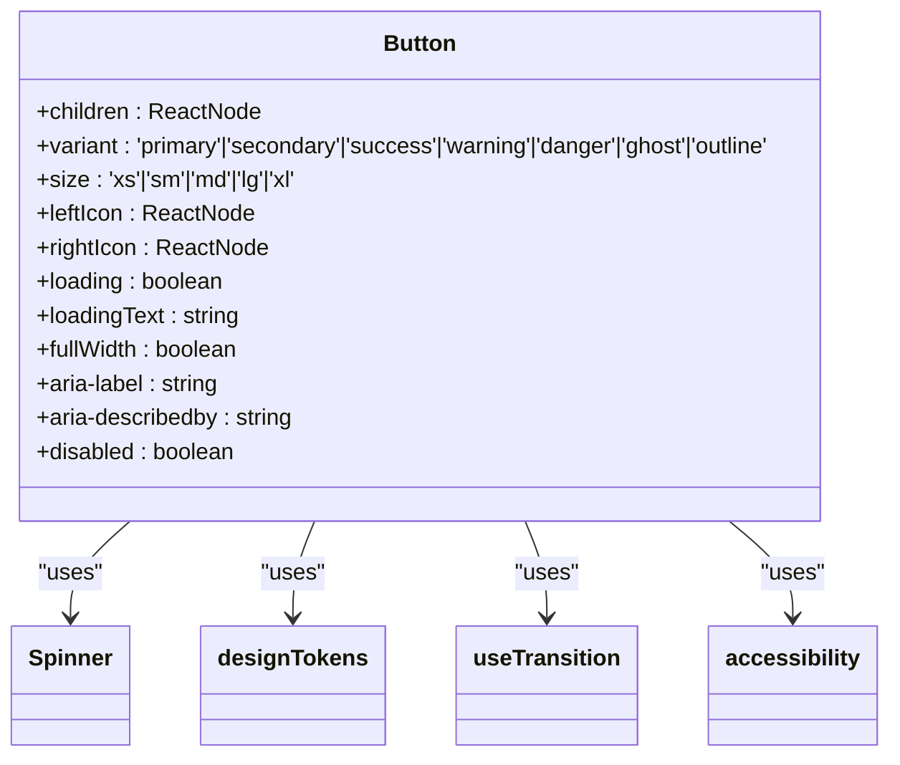
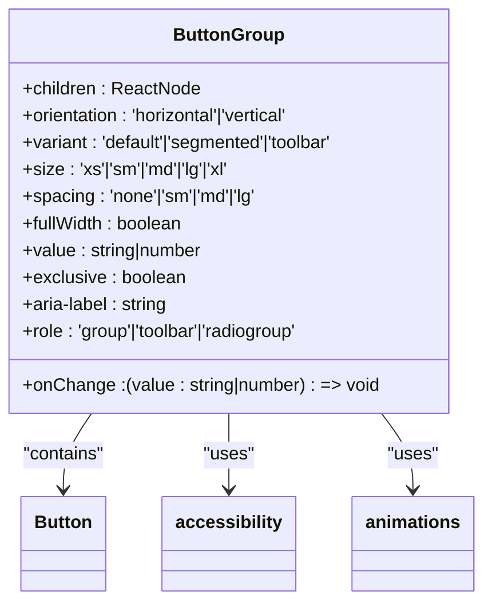
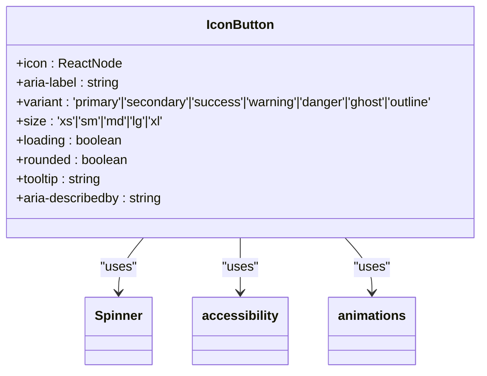
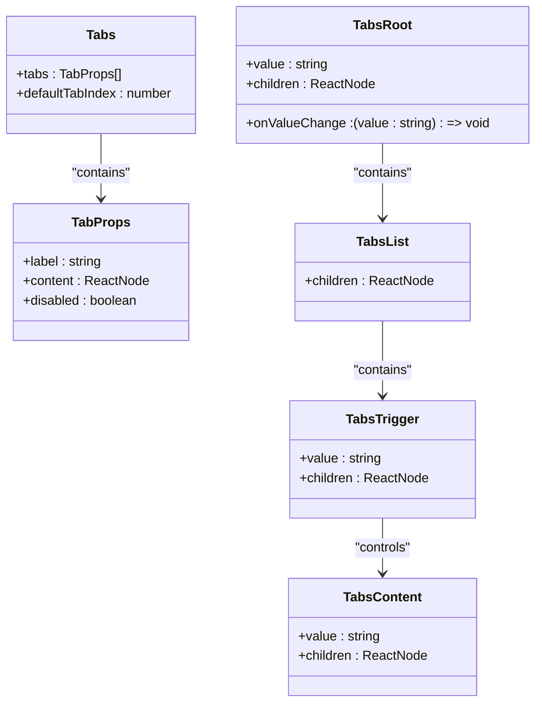
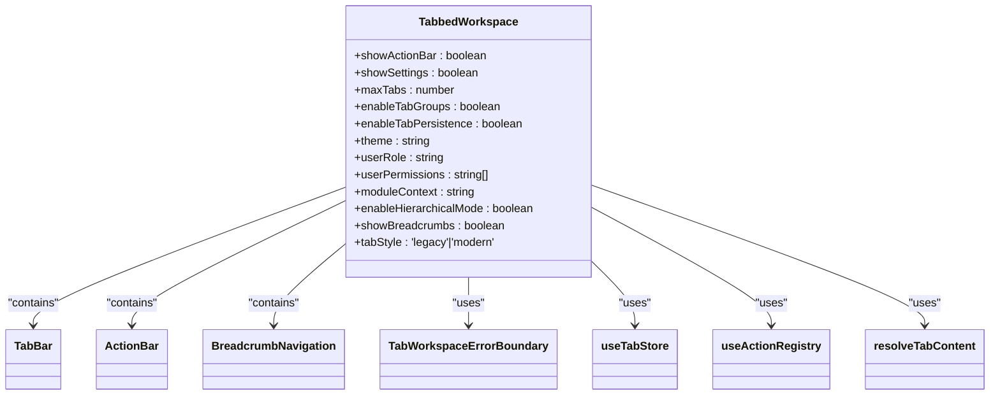
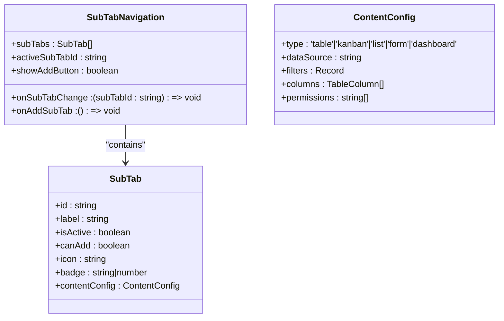
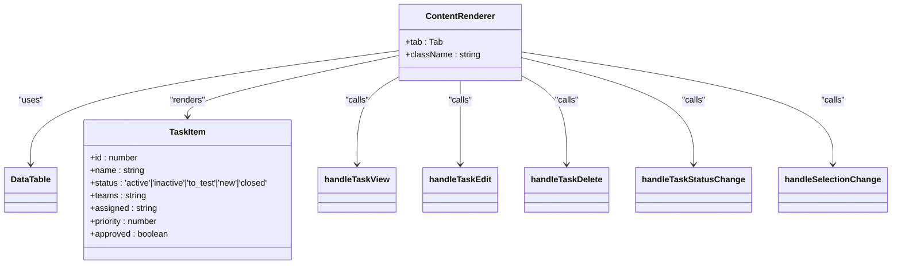
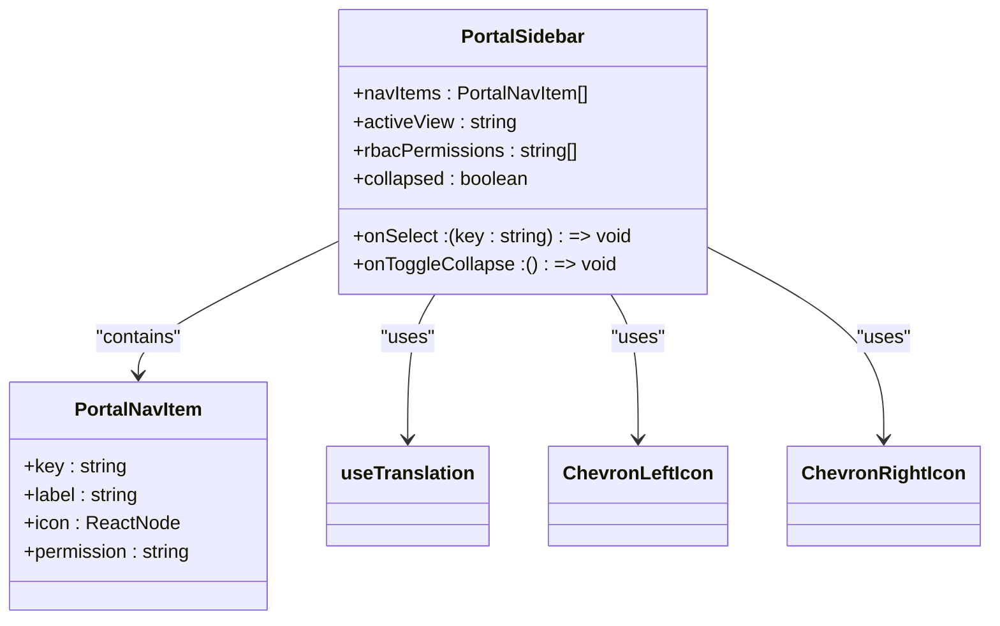
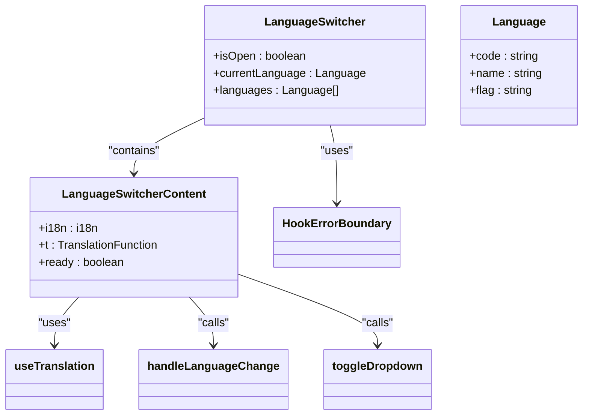

# Interactive Components

<cite>
**Referenced Files in This Document**   
- [Button.tsx](file://src/components/ui/Button.tsx)
- [ButtonGroup.tsx](file://src/components/ui/ButtonGroup.tsx)
- [IconButton.tsx](file://src/components/ui/IconButton.tsx)
- [Tabs.tsx](file://src/components/ui/Tabs.tsx)
- [ContentRenderer.tsx](file://src/components/ui/ContentRenderer.tsx)
- [PortalSidebar.tsx](file://src/components/ui/PortalSidebar.tsx)
- [LanguageSwitcher.tsx](file://src/components/ui/LanguageSwitcher.tsx)
- [icons.tsx](file://src/components/ui/icons.tsx)
- [TabbedWorkspace.tsx](file://src/components/tabbedWorkspace/TabbedWorkspace.tsx)
- [TabBar.tsx](file://src/components/tabbedWorkspace/TabBar.tsx)
- [Tab.tsx](file://src/components/tabbedWorkspace/Tab.tsx)
- [SubTabNavigation.tsx](file://src/components/tabbedWorkspace/SubTabNavigation.tsx)
- [hierarchical.ts](file://src/types/hierarchical.ts)
- [tabbedWorkspace.ts](file://src/types/tabbedWorkspace.ts)
- [index.ts](file://src/components/ui/index.ts)
</cite>

## Table of Contents
1. [Interactive Components Overview](#interactive-components-overview)
2. [Button Components](#button-components)
3. [Tabs and Tabbed Workspace](#tabs-and-tabbed-workspace)
4. [Content Renderer](#content-renderer)
5. [Portal Sidebar](#portal-sidebar)
6. [Language Switcher](#language-switcher)
7. [Icon System](#icon-system)
8. [Accessibility and Keyboard Navigation](#accessibility-and-keyboard-navigation)

## Interactive Components Overview

This document provides comprehensive documentation for the interactive components in the schoolpilot3 application. The components enable user actions, navigation, and dynamic content rendering across the educational management system. The documentation covers button components, tab-based navigation, content rendering, sidebar navigation, language switching, and the icon system implementation.

The interactive components are designed with accessibility, responsiveness, and internationalization in mind, following modern UI/UX principles and WCAG 2.1 AA compliance standards. These components are used throughout the application in various contexts including settings pages, data management interfaces, and multi-language environments.

**Section sources**
- [Button.tsx](file://src/components/ui/Button.tsx#L1-L230)
- [Tabs.tsx](file://src/components/ui/Tabs.tsx#L1-L146)
- [LanguageSwitcher.tsx](file://src/components/ui/LanguageSwitcher.tsx#L1-L119)

## Button Components

### Button

The Button component is a versatile interactive element that supports multiple variants, sizes, and states. It is designed with modern styling, animations, and accessibility features.

**Key Features:**
- **Variants**: primary, secondary, success, warning, danger, ghost, outline
- **Sizes**: xs, sm, md, lg, xl
- **Loading states** with spinner animation
- **Accessibility**: WCAG 2.1 AA compliant with proper focus indicators
- **Polymorphic rendering** allowing the component to render as different HTML elements



**Diagram sources**
- [Button.tsx](file://src/components/ui/Button.tsx#L1-L230)

**Section sources**
- [Button.tsx](file://src/components/ui/Button.tsx#L1-L230)

### ButtonGroup

The ButtonGroup component organizes multiple buttons into a cohesive unit with proper spacing and accessibility. It supports various layouts and selection states.

**Key Features:**
- **Orientation**: horizontal or vertical
- **Variants**: default, segmented, toolbar
- **Selection handling** with keyboard navigation
- **Responsive design** with configurable spacing
- **Accessibility**: ARIA roles for group, toolbar, or radiogroup



**Diagram sources**
- [ButtonGroup.tsx](file://src/components/ui/ButtonGroup.tsx#L1-L195)

**Section sources**
- [ButtonGroup.tsx](file://src/components/ui/ButtonGroup.tsx#L1-L195)

### IconButton

The IconButton component provides icon-only interactions with enhanced accessibility features. It ensures proper ARIA labeling and focus indicators for icon buttons.

**Key Features:**
- **Icon integration** with size mapping
- **Required ARIA labels** for accessibility
- **Loading states** with spinner animation
- **Rounded variants** for circular buttons
- **Tooltip support** for additional context



**Diagram sources**
- [IconButton.tsx](file://src/components/ui/IconButton.tsx#L1-L219)

**Section sources**
- [IconButton.tsx](file://src/components/ui/IconButton.tsx#L1-L219)

## Tabs and Tabbed Workspace

### Tabs

The Tabs component provides content organization through tabbed navigation. It supports both a simple API and a shadcn-ui style API for compatibility.

**Key Features:**
- **Multiple API styles** for different use cases
- **Disabled tab states** with visual feedback
- **Accessibility**: ARIA current page indicators
- **Flexible content rendering** with React nodes



**Diagram sources**
- [Tabs.tsx](file://src/components/ui/Tabs.tsx#L1-L146)

**Section sources**
- [Tabs.tsx](file://src/components/ui/Tabs.tsx#L1-L146)

### TabbedWorkspace

The TabbedWorkspace component provides a comprehensive tab management system with hierarchical navigation capabilities. It serves as the main content container for the application.

**Key Features:**
- **Hierarchical tab structure** with sub-tabs
- **Drag and drop reordering** of tabs
- **Tab persistence** and state management
- **Action registry integration** for context-specific actions
- **Breadcrumb navigation** for hierarchical contexts
- **RBAC integration** for permission-based access control



**Diagram sources**
- [TabbedWorkspace.tsx](file://src/components/tabbedWorkspace/TabbedWorkspace.tsx#L1-L539)

**Section sources**
- [TabbedWorkspace.tsx](file://src/components/tabbedWorkspace/TabbedWorkspace.tsx#L1-L539)

### TabBar and Tab Components

The TabBar and Tab components work together to provide the visual representation and interaction for tabs within the TabbedWorkspace.

**Key Features:**
- **Drag and drop functionality** for tab reordering
- **Scrollable tab interface** with overflow indicators
- **Context menus** for tab management actions
- **Pin and duplicate functionality** for tab organization
- **Hierarchical support** with sub-tab navigation

```mermaid
classDiagram
class TabBar {
+tabs : Tab[]
+activeTabId : string
+showAddButton : boolean
+showOverflowMenu : boolean
+maxVisibleTabs : number
}
class Tab {
+tab : TabType
+isActive : boolean
+isPinned : boolean
+isDragging : boolean
}
class ContextMenu {
+tab : TabType
+isVisible : boolean
+position : {x : number, y : number}
}
TabBar --> Tab : "contains"
Tab --> ContextMenu : "shows"
TabBar --> DragDropContext : "uses"
TabBar --> Droppable : "uses"
TabBar --> Draggable : "uses"
TabBar --> useTabStore : "uses"
```

**Diagram sources**
- [TabBar.tsx](file://src/components/tabbedWorkspace/TabBar.tsx#L1-L498)
- [Tab.tsx](file://src/components/tabbedWorkspace/Tab.tsx#L1-L504)

**Section sources**
- [TabBar.tsx](file://src/components/tabbedWorkspace/TabBar.tsx#L1-L498)
- [Tab.tsx](file://src/components/tabbedWorkspace/Tab.tsx#L1-L504)

### SubTabNavigation

The SubTabNavigation component provides secondary navigation within a tab, supporting hierarchical content organization.

**Key Features:**
- **Sub-tab management** with add functionality
- **Active sub-tab tracking** with visual indicators
- **Disabled state handling** for inactive sub-tabs
- **Badge support** for notifications
- **Icon integration** for visual cues



**Diagram sources**
- [SubTabNavigation.tsx](file://src/components/tabbedWorkspace/SubTabNavigation.tsx#L1-L94)

**Section sources**
- [SubTabNavigation.tsx](file://src/components/tabbedWorkspace/SubTabNavigation.tsx#L1-L94)

## Content Renderer

The ContentRenderer component handles dynamic component loading based on the active tab's configuration. It serves as the bridge between the tab navigation system and the actual content display.

**Key Features:**
- **Dynamic content loading** based on tab type
- **Task management interface** with view, edit, and delete actions
- **Status change handling** for workflow management
- **Selection change events** for bulk operations
- **Mock data integration** for demonstration purposes



**Diagram sources**
- [ContentRenderer.tsx](file://src/components/ui/ContentRenderer.tsx#L1-L308)

**Section sources**
- [ContentRenderer.tsx](file://src/components/ui/ContentRenderer.tsx#L1-L308)

## Portal Sidebar

The PortalSidebar component provides overlay navigation for different user portals (vendor, student, parent, etc.). It supports RBAC, internationalization, and responsive design.

**Key Features:**
- **Navigation configuration** with permission-based filtering
- **Internationalization support** with translation keys
- **RBAC integration** for permission-based item visibility
- **Collapsible design** with expand/collapse functionality
- **Responsive behavior** with auto-collapse on small screens



**Diagram sources**
- [PortalSidebar.tsx](file://src/components/ui/PortalSidebar.tsx#L1-L74)

**Section sources**
- [PortalSidebar.tsx](file://src/components/ui/PortalSidebar.tsx#L1-L74)

## Language Switcher

The LanguageSwitcher component enables i18n context switching for multi-language interfaces. It provides a dropdown interface for selecting the application language.

**Key Features:**
- **Multi-language support** with 9 languages
- **Flag emoji indicators** for visual language identification
- **Error boundary protection** for robust error handling
- **Loading state management** for i18n initialization
- **Keyboard accessibility** with proper focus management



**Diagram sources**
- [LanguageSwitcher.tsx](file://src/components/ui/LanguageSwitcher.tsx#L1-L119)

**Section sources**
- [LanguageSwitcher.tsx](file://src/components/ui/LanguageSwitcher.tsx#L1-L119)

## Icon System

The icon system is implemented through the icons.tsx file, providing a comprehensive collection of SVG icons for use throughout the application.

**Key Features:**
- **SVG-based icons** with consistent styling
- **Accessibility attributes** for screen readers
- **Size and color consistency** across components
- **Comprehensive coverage** of application needs
- **Alias support** for compatibility

```mermaid
classDiagram
class IconProps {
+width : string
+height : string
+className : string
}
class HomeIcon {
+path : SVGPath
}
class UsersIcon {
+path : SVGPath
}
class UserGroupIcon {
+path : SVGPath
}
class AcademicCapIcon {
+path : SVGPath
}
class BookOpenIcon {
+path : SVGPath
}
class CogIcon {
+path : SVGPath
}
class ArchiveIcon {
+path : SVGPath
}
class AlertTriangleIcon {
+path : SVGPath
}
class AlertCircleIcon {
+path : SVGPath
}
class RefreshCwIcon {
+path : SVGPath
}
class ArrowLeftIcon {
+path : SVGPath
}
class CurrencyDollarIcon {
+path : SVGPath
}
class LibraryIcon {
+path : SVGPath
}
class BeakerIcon {
+path : SVGPath
}
class ChartPieIcon {
+path : SVGPath
}
class DocumentReportIcon {
+path : SVGPath
}
class PlusIcon {
+path : SVGPath
}
class EditIcon {
+path : SVGPath
}
class DeleteIcon {
+path : SVGPath
}
class XIcon {
+path : SVGPath
}
class UploadIcon {
+path : SVGPath
}
class ArrowUpTrayIcon {
+path : SVGPath
}
class ArrowDownTrayIcon {
+path : SVGPath
}
class ChevronDownIcon {
+path : SVGPath
}
class ChevronUpIcon {
+path : SVGPath
}
class BellIcon {
+path : SVGPath
}
class UserCircleIcon {
+path : SVGPath
}
class TicketIcon {
+path : SVGPath
}
class CollectionIcon {
+path : SVGPath
}
class BuildingOffice2Icon {
+path : SVGPath
}
class IdentificationIcon {
+path : SVGPath
}
class ListBulletIcon {
+path : SVGPath
}
class BuildingLibraryIcon {
+path : SVGPath
}
IconProps <|-- HomeIcon
IconProps <|-- UsersIcon
IconProps <|-- UserGroupIcon
IconProps <|-- AcademicCapIcon
IconProps <|-- BookOpenIcon
IconProps <|-- CogIcon
IconProps <|-- ArchiveIcon
IconProps <|-- AlertTriangleIcon
IconProps <|-- AlertCircleIcon
IconProps <|-- RefreshCwIcon
IconProps <|-- ArrowLeftIcon
IconProps <|-- CurrencyDollarIcon
IconProps <|-- LibraryIcon
IconProps <|-- BeakerIcon
IconProps <|-- ChartPieIcon
IconProps <|-- DocumentReportIcon
IconProps <|-- PlusIcon
IconProps <|-- EditIcon
IconProps <|-- DeleteIcon
IconProps <|-- XIcon
IconProps <|-- UploadIcon
IconProps <|-- ArrowUpTrayIcon
IconProps <|-- ArrowDownTrayIcon
IconProps <|-- ChevronDownIcon
IconProps <|-- ChevronUpIcon
IconProps <|-- BellIcon
IconProps <|-- UserCircleIcon
IconProps <|-- TicketIcon
IconProps <|-- CollectionIcon
IconProps <|-- BuildingOffice2Icon
IconProps <|-- IdentificationIcon
IconProps <|-- ListBulletIcon
IconProps <|-- BuildingLibraryIcon
```



**Diagram sources**
- [icons.tsx](file://src/components/ui/icons.tsx#L1-L557)

**Section sources**
- [icons.tsx](file://src/components/ui/icons.tsx#L1-L557)

## Accessibility and Keyboard Navigation

The interactive components in schoolpilot3 are designed with accessibility as a core principle, ensuring compliance with WCAG 2.1 AA standards and providing robust keyboard navigation support.

### Accessibility Features

**ARIA Compliance:**
- Proper ARIA roles, states, and properties for all interactive elements
- ARIA labels for icon-only buttons and controls
- ARIA current page indicators for active tabs
- ARIA describedby for additional context

**Focus Management:**
- Visible focus indicators for keyboard navigation
- Logical tab order that follows visual layout
- Focus trapping in modal dialogs and dropdowns
- Skip links for bypassing repetitive navigation

**Keyboard Navigation:**
- Full keyboard operability for all interactive components
- Arrow key navigation for tab selection and button groups
- Enter/Space for activation of buttons and links
- Escape key for closing dropdowns and modals
- Shortcut keys for common actions (Ctrl+P for pin, Ctrl+D for duplicate)

### Usage Patterns

**Settings Pages:**
- Button groups for configuration options
- Tabs for organizing settings categories
- Language switcher for interface localization
- Modal dialogs for advanced settings

**Multi-language Interfaces:**
- Language switcher component for context switching
- Translation keys for all user-facing text
- Flag indicators for language selection
- Persistent language preference storage

**Event Handling:**
- Click events for button actions
- Change events for tab selection
- Keyboard events for navigation
- Custom events for component communication

**Theming Capabilities:**
- CSS variables for theme customization
- Theme-specific class names
- Dynamic theme switching
- High contrast mode support

The components are designed to work together seamlessly, providing a consistent user experience across the application while maintaining accessibility and usability for all users.

**Section sources**
- [Button.tsx](file://src/components/ui/Button.tsx#L1-L230)
- [ButtonGroup.tsx](file://src/components/ui/ButtonGroup.tsx#L1-L195)
- [IconButton.tsx](file://src/components/ui/IconButton.tsx#L1-L219)
- [Tabs.tsx](file://src/components/ui/Tabs.tsx#L1-L146)
- [LanguageSwitcher.tsx](file://src/components/ui/LanguageSwitcher.tsx#L1-L119)
- [PortalSidebar.tsx](file://src/components/ui/PortalSidebar.tsx#L1-L74)
- [ContentRenderer.tsx](file://src/components/ui/ContentRenderer.tsx#L1-L308)
- [TabbedWorkspace.tsx](file://src/components/tabbedWorkspace/TabbedWorkspace.tsx#L1-L539)
- [TabBar.tsx](file://src/components/tabbedWorkspace/TabBar.tsx#L1-L498)
- [Tab.tsx](file://src/components/tabbedWorkspace/Tab.tsx#L1-L504)
- [SubTabNavigation.tsx](file://src/components/tabbedWorkspace/SubTabNavigation.tsx#L1-L94)
- [icons.tsx](file://src/components/ui/icons.tsx#L1-L557)