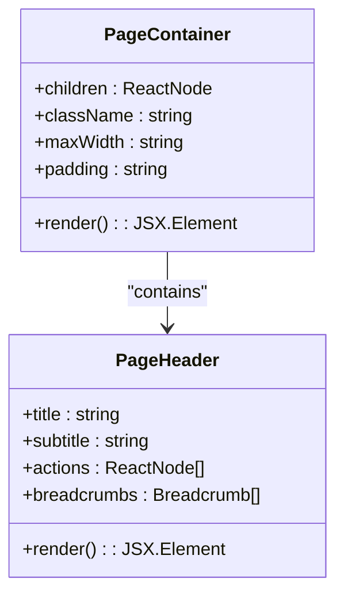
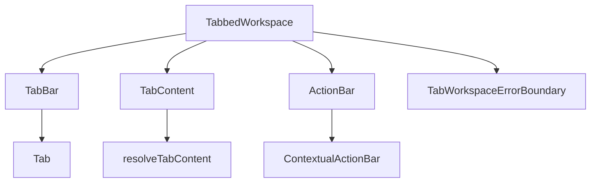
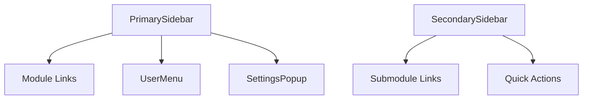
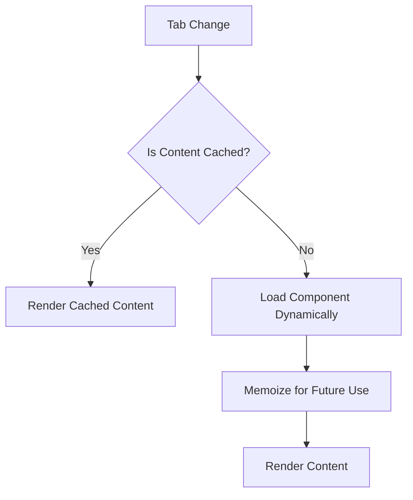

# Layout Components

<cite>
**Referenced Files in This Document**  
- [PageContainer.tsx](file://src/components/layout/PageContainer.tsx)
- [PageHeader.tsx](file://src/components/layout/PageHeader.tsx)
- [TabbedWorkspace.tsx](file://src/components/tabbedWorkspace/TabbedWorkspace.tsx)
- [TabBar.tsx](file://src/components/tabbedWorkspace/TabBar.tsx)
- [TabContent.tsx](file://src/components/tabbedWorkspace/TabContent.tsx)
- [ActionBar.tsx](file://src/components/tabbedWorkspace/ActionBar.tsx)
- [tabStore.ts](file://src/stores/tabStore.ts)
- [OPTIMIZATION_GUIDE.md](file://src/components/tabbedWorkspace/OPTIMIZATION_GUIDE.md)
- [RENDER_LOOP_FIX_DOCUMENTATION.md](file://src/components/tabbedWorkspace/RENDER_LOOP_FIX_DOCUMENTATION.md)
- [Sidebar.tsx](file://src/components/Sidebar.tsx)
- [PrimarySidebar.tsx](file://src/components/PrimarySidebar.tsx) - *Updated in commit d9c57153f274590242c9f6da4cbbf0aa5303dff4*
- [SecondarySidebar.tsx](file://src/components/SecondarySidebar.tsx)
- [AcademicsDashboardPage.tsx](file://src/modules/academics/pages/AcademicsDashboardPage.tsx)
- [SettingsDashboardPage.tsx](file://src/modules/settings/pages/SettingsDashboardPage.tsx)
</cite>

## Update Summary
**Changes Made**  
- Updated the Sidebar Components section to reflect improvements in PrimarySidebar
- Added details about error handling and navigation confirmation in PrimarySidebar
- Enhanced description of module navigation handling and visual feedback
- Updated section sources to include the modified PrimarySidebar.tsx file

## Table of Contents
1. [Introduction](#introduction)  
2. [Core Layout Components](#core-layout-components)  
3. [TabbedWorkspace System](#tabbedworkspace-system)  
4. [Sidebar Components](#sidebar-components)  
5. [Usage Patterns and Integration](#usage-patterns-and-integration)  
6. [Performance and Optimization](#performance-and-optimization)  
7. [Responsive Behavior and Accessibility](#responsive-behavior-and-accessibility)  
8. [Common Issues and Troubleshooting](#common-issues-and-troubleshooting)  

## Introduction
The layout components in schoolpilot3 provide a consistent and modular structure for building user interfaces across the application. These components define the foundational scaffolding of pages, enabling a uniform experience while supporting dynamic content rendering, navigation, and state management. This document details the key structural components—PageContainer, PageHeader, TabbedWorkspace, and Sidebar—and their integration into actual pages such as AcademicsDashboardPage and SettingsDashboardPage.

**Section sources**  
- [PageContainer.tsx](file://src/components/layout/PageContainer.tsx#L1-L50)  
- [PageHeader.tsx](file://src/components/layout/PageHeader.tsx#L1-L40)  

## Core Layout Components

### PageContainer and PageHeader
The **PageContainer** and **PageHeader** components form the base structure for all pages in the application. They ensure consistent spacing, alignment, and responsiveness across different views.

- **PageContainer**: Wraps the entire page content with standardized padding, max-width constraints, and responsive breakpoints. It serves as the outermost wrapper that enforces layout consistency.
- **PageHeader**: Provides a reusable header section that typically includes the page title, subtitle, breadcrumbs, and action buttons. It integrates with the global navigation system and supports dynamic content injection.

These components are designed to be composable, allowing developers to build complex layouts by combining them with other UI elements.



**Diagram sources**  
- [PageContainer.tsx](file://src/components/layout/PageContainer.tsx#L10-L30)  
- [PageHeader.tsx](file://src/components/layout/PageHeader.tsx#L15-L35)  

**Section sources**  
- [PageContainer.tsx](file://src/components/layout/PageContainer.tsx#L1-L100)  
- [PageHeader.tsx](file://src/components/layout/PageHeader.tsx#L1-L80)  

## TabbedWorkspace System

### Component Hierarchy
The **TabbedWorkspace** system enables multi-tab interfaces within a single page, supporting complex workflows with isolated contexts. The key components include:

- **TabBar**: Renders the tab navigation UI, displaying tab labels and handling user interactions.
- **TabContent**: Manages the rendering of active tab content, ensuring only the current tab is mounted.
- **ActionBar**: Displays context-sensitive actions based on the active tab or selected data.
- **TabbedWorkspaceManager**: Coordinates tab state and lifecycle events.
- **TabWorkspaceErrorBoundary**: Catches errors within individual tabs to prevent full workspace crashes.



**Diagram sources**  
- [TabbedWorkspace.tsx](file://src/components/tabbedWorkspace/TabbedWorkspace.tsx#L1-L20)  
- [TabBar.tsx](file://src/components/tabbedWorkspace/TabBar.tsx#L1-L15)  
- [TabContent.tsx](file://src/components/tabbedWorkspace/TabContent.tsx#L1-L15)  
- [ActionBar.tsx](file://src/components/tabbedWorkspace/ActionBar.tsx#L1-L15)  

### State Management via tabStore
Tab state is managed centrally using **tabStore**, a Zustand-based store located at `src/stores/tabStore.ts`. It maintains:

- Active tab ID
- Tab history stack
- Tab metadata (title, icon, closable)
- Persistence settings

This centralized state allows for cross-component synchronization and enables features like tab restoration after navigation.

**Section sources**  
- [tabStore.ts](file://src/stores/tabStore.ts#L1-L60)  
- [TabbedWorkspaceManager.tsx](file://src/components/tabbedWorkspace/TabbedWorkspaceManager.tsx#L10-L40)  

## Sidebar Components

### Navigation Layout
The sidebar components provide primary and secondary navigation layers:

- **Sidebar**: Base component for collapsible side navigation.
- **PrimarySidebar**: Contains top-level module navigation (e.g., Academics, Finance, HR) with enhanced error handling and navigation confirmation. The component now includes an error boundary that displays a user-friendly error message if rendering fails, and implements improved visual feedback during module selection.
- **SecondarySidebar**: Displays context-specific navigation within a module.

These components integrate with the **useDynamicNavigation** hook to render menu items based on user permissions and module availability. The **PrimarySidebar** has been updated to improve module navigation handling by implementing proper error boundaries, providing toast notifications upon successful module loading, and ensuring graceful degradation when modules fail to load.



**Diagram sources**  
- [Sidebar.tsx](file://src/components/Sidebar.tsx#L5-L20)  
- [PrimarySidebar.tsx](file://src/components/PrimarySidebar.tsx#L8-L25) - *Updated in commit d9c57153f274590242c9f6da4cbbf0aa5303dff4*  
- [SecondarySidebar.tsx](file://src/components/SecondarySidebar.tsx#L7-L22)  

**Section sources**  
- [Sidebar.tsx](file://src/components/Sidebar.tsx#L1-L100)  
- [PrimarySidebar.tsx](file://src/components/PrimarySidebar.tsx#L1-L445) - *Updated in commit d9c57153f274590242c9f6da4cbbf0aa5303dff4*  
- [SecondarySidebar.tsx](file://src/components/SecondarySidebar.tsx#L1-L85)  

## Usage Patterns and Integration

### Composing Layouts
Layouts are composed by nesting components in a hierarchical manner:

```tsx
<PageContainer>
  <PageHeader title="Academics Dashboard" actions={[<ExportButton />]} />
  <TabbedWorkspace>
    <TabBar />
    <TabContent />
    <ActionBar />
  </TabbedWorkspace>
</PageContainer>
```

### Module Integration
Pages like **AcademicsDashboardPage** and **SettingsDashboardPage** use these components to create structured interfaces. The **module system** dynamically loads components based on configuration in `modules.json`.

**Section sources**  
- [AcademicsDashboardPage.tsx](file://src/modules/academics/pages/AcademicsDashboardPage.tsx#L10-L50)  
- [SettingsDashboardPage.tsx](file://src/modules/settings/pages/SettingsDashboardPage.tsx#L12-L48)  

## Performance and Optimization

### Key Optimizations
Documented in **OPTIMIZATION_GUIDE.md** and **RENDER_LOOP_FIX_DOCUMENTATION.md**, the TabbedWorkspace system implements:

- Lazy loading of tab content
- Memoization of tab components
- Preventing unnecessary re-renders using React.memo and useMemo
- Debounced state updates to avoid render loops

The **resolveTabContent.tsx** utility ensures that only active tabs are rendered, significantly reducing memory usage and improving responsiveness.



**Diagram sources**  
- [resolveTabContent.tsx](file://src/components/tabbedWorkspace/resolveTabContent.tsx#L1-L30)  
- [OPTIMIZATION_GUIDE.md](file://src/components/tabbedWorkspace/OPTIMIZATION_GUIDE.md#L1-L50)  
- [RENDER_LOOP_FIX_DOCUMENTATION.md](file://src/components/tabbedWorkspace/RENDER_LOOP_FIX_DOCUMENTATION.md#L1-L45)  

**Section sources**  
- [resolveTabContent.tsx](file://src/components/tabbedWorkspace/resolveTabContent.tsx#L1-L100)  
- [OPTIMIZATION_GUIDE.md](file://src/components/tabbedWorkspace/OPTIMIZATION_GUIDE.md#L1-L100)  
- [RENDER_LOOP_FIX_DOCUMENTATION.md](file://src/components/tabbedWorkspace/RENDER_LOOP_FIX_DOCUMENTATION.md#L1-L90)  

## Responsive Behavior and Accessibility

### Responsive Design
All layout components use CSS classes from **design-system.css** and responsive utilities from **responsive.ts** to adapt to different screen sizes. The **PrimarySidebar** collapses into a hamburger menu on mobile, while **TabBar** switches to a scrollable layout.

### Accessibility Compliance
- Keyboard navigation support for tabs and sidebars
- ARIA labels for interactive elements
- Focus management during tab changes
- High contrast mode compatibility

**Section sources**  
- [responsive.ts](file://src/utils/responsive.ts#L1-L20)  
- [accessibility.ts](file://src/utils/accessibility.ts#L1-L30)  
- [design-system.css](file://src/styles/design-system.css#L100-L200)  

## Common Issues and Troubleshooting

### Render Loop Prevention
A known issue occurs when tab state updates trigger unnecessary re-renders. This is mitigated by:

- Using **useTabNavigation** hook with proper dependency arrays
- Implementing **React.memo** on tab content components
- Avoiding inline function definitions in tab props

The **RenderLoopPrevention.test.tsx** test suite validates these fixes.

### Error Handling
The **TabWorkspaceErrorBoundary** isolates errors to individual tabs, preventing full workspace failure. Errors are logged via **errorTracking.ts** and displayed with user-friendly messages. The **PrimarySidebar** now includes its own error boundary component that catches rendering errors and displays a minimal error state, ensuring the application remains functional even if the sidebar fails to render properly.

**Section sources**  
- [RENDER_LOOP_FIX_DOCUMENTATION.md](file://src/components/tabbedWorkspace/RENDER_LOOP_FIX_DOCUMENTATION.md#L1-L45)  
- [TabWorkspaceErrorBoundary.tsx](file://src/components/tabbedWorkspace/TabWorkspaceErrorBoundary.tsx#L1-L35)  
- [errorTracking.ts](file://src/config/errorTracking.ts#L1-L25)
- [PrimarySidebar.tsx](file://src/components/PrimarySidebar.tsx#L1-L445) - *Updated in commit d9c57153f274590242c9f6da4cbbf0aa5303dff4*