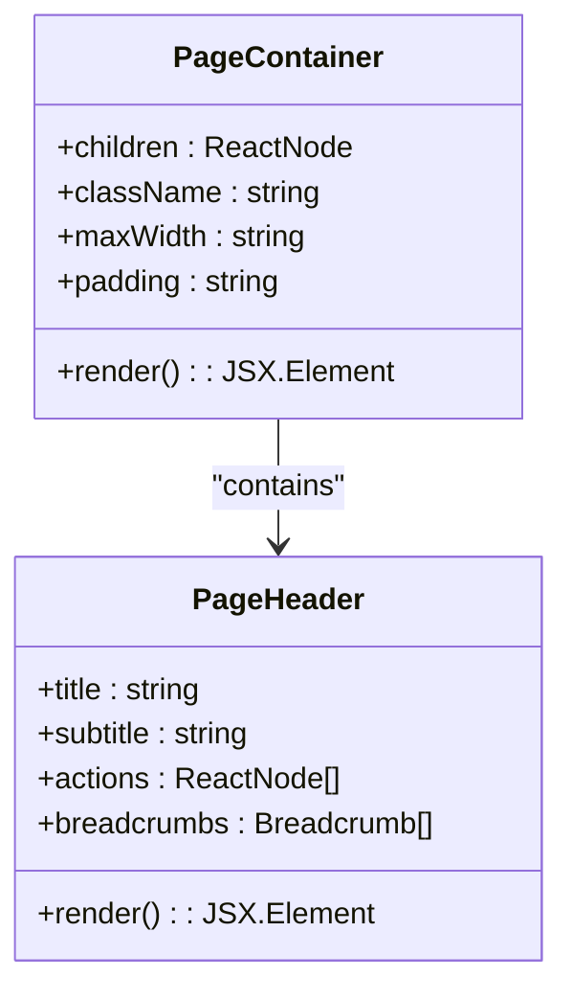
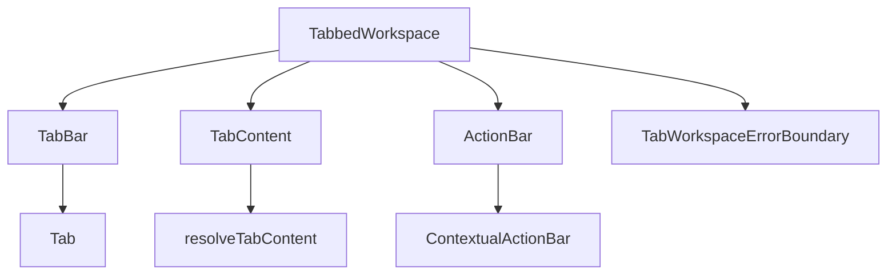
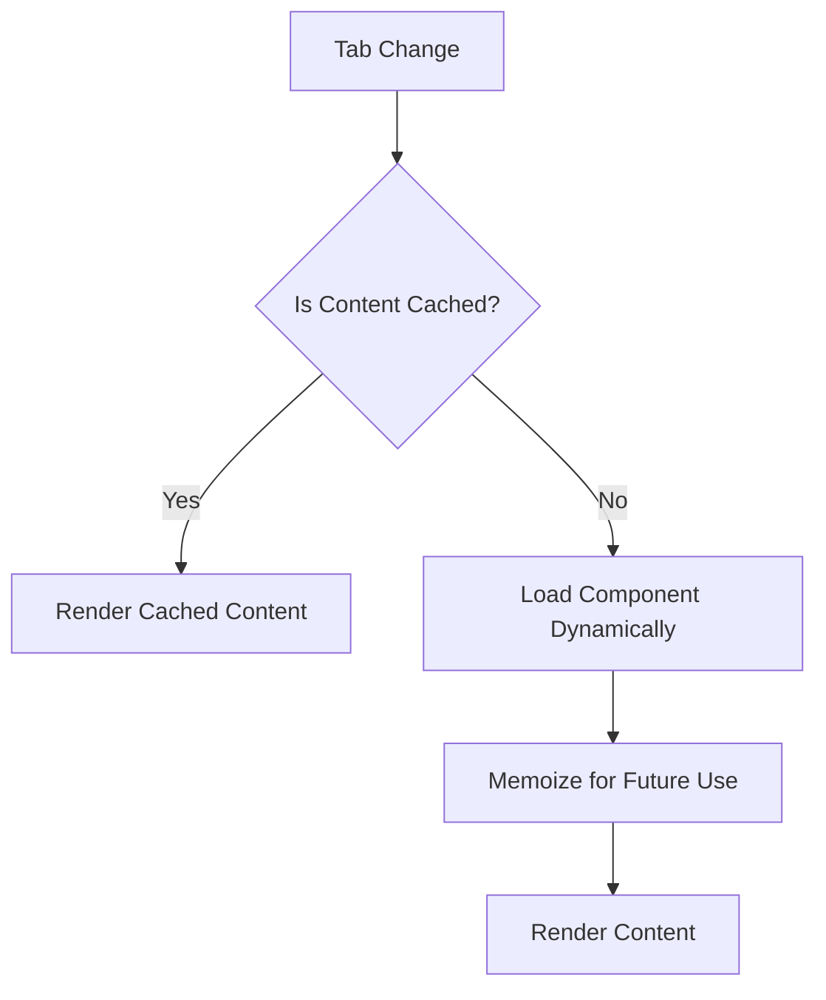

# Layout Components

<cite>
**Referenced Files in This Document**
- [PageContainer.tsx](file://src/components/layout/PageContainer.tsx)
- [PageHeader.tsx](file://src/components/layout/PageHeader.tsx)
- [TabbedWorkspace.tsx](file://src/components/tabbedWorkspace/TabbedWorkspace.tsx)
- [TabBar.tsx](file://src/components/tabbedWorkspace/TabBar.tsx)
- [TabContent.tsx](file://src/components/tabbedWorkspace/TabContent.tsx)
- [ActionBar.tsx](file://src/components/tabbedWorkspace/ActionBar.tsx)
- [tabStore.ts](file://src/stores/tabStore.ts)
- [OPTIMIZATION_GUIDE.md](file://src/components/tabbedWorkspace/OPTIMIZATION_GUIDE.md)
- [RENDER_LOOP_FIX_DOCUMENTATION.md](file://src/components/tabbedWorkspace/RENDER_LOOP_FIX_DOCUMENTATION.md)
- [Sidebar.tsx](file://src/components/Sidebar.tsx)
- [PrimarySidebar.tsx](file://src/components/PrimarySidebar.tsx)
- [SecondarySidebar.tsx](file://src/components/SecondarySidebar.tsx)
- [Layout.tsx](file://src/components/Layout.tsx)
- [LayoutNew.tsx](file://src/components/LayoutNew.tsx)
- [design-system.css](file://src/styles/design-system.css)
- [responsive.ts](file://src/utils/responsive.ts)
- [accessibility.ts](file://src/utils/accessibility.ts)
- [AcademicsDashboardPage.tsx](file://src/modules/academics/pages/AcademicsDashboardPage.tsx)
- [SettingsDashboardPage.tsx](file://src/modules/settings/pages/SettingsDashboardPage.tsx)
</cite>

## Update Summary
**Changes Made**
- Updated Sidebar Components section to reflect comprehensive fixed-position sidebar system implementation
- Added detailed documentation for PrimarySidebar and SecondarySidebar fixed positioning with full height coverage
- Enhanced Layout components documentation to explain dynamic margin calculations for fixed sidebar system
- Updated section sources to include the modified PrimarySidebar.tsx, SecondarySidebar.tsx, Layout.tsx, and LayoutNew.tsx files
- Added comprehensive coverage of custom scrollbar styling and improved logo integration

## Table of Contents
1. [Introduction](#introduction)
2. [Core Layout Components](#core-layout-components)
3. [Fixed-Position Sidebar System](#fixed-position-sidebar-system)
4. [TabbedWorkspace System](#tabbedworkspace-system)
5. [Usage Patterns and Integration](#usage-patterns-and-integration)
6. [Performance and Optimization](#performance-and-optimization)
7. [Responsive Behavior and Accessibility](#responsive-behavior-and-accessibility)
8. [Common Issues and Troubleshooting](#common-issues-and-troubleshooting)

## Introduction
The layout components in schoolpilot3 provide a comprehensive and modular structure for building user interfaces across the application. The system has evolved to implement a sophisticated fixed-position sidebar architecture that ensures consistent navigation while maximizing content area utilization. These components define the foundational scaffolding of pages, enabling a uniform experience with dynamic content rendering, navigation, and state management. This document details the key structural components—PageContainer, PageHeader, the fixed-position Sidebar system, and TabbedWorkspace—and their integration into actual pages such as AcademicsDashboardPage and SettingsDashboardPage.

**Section sources**
- [PageContainer.tsx:1-50](file://src/components/layout/PageContainer.tsx#L1-L50)
- [PageHeader.tsx:1-40](file://src/components/layout/PageHeader.tsx#L1-L40)

## Core Layout Components

### PageContainer and PageHeader
The **PageContainer** and **PageHeader** components form the base structure for all pages in the application. They ensure consistent spacing, alignment, and responsiveness across different views.

- **PageContainer**: Wraps the entire page content with standardized padding, max-width constraints, and responsive breakpoints. It serves as the outermost wrapper that enforces layout consistency.
- **PageHeader**: Provides a reusable header section that typically includes the page title, subtitle, breadcrumbs, and action buttons. It integrates with the global navigation system and supports dynamic content injection.

These components are designed to be composable, allowing developers to build complex layouts by combining them with other UI elements.



**Diagram sources**
- [PageContainer.tsx:10-30](file://src/components/layout/PageContainer.tsx#L10-L30)
- [PageHeader.tsx:15-35](file://src/components/layout/PageHeader.tsx#L15-L35)

**Section sources**
- [PageContainer.tsx:1-100](file://src/components/layout/PageContainer.tsx#L1-L100)
- [PageHeader.tsx:1-80](file://src/components/layout/PageHeader.tsx#L1-L80)

## Fixed-Position Sidebar System

### Comprehensive Sidebar Architecture
The sidebar system has been completely redesigned with fixed positioning throughout the viewport, providing enhanced visual design and improved user experience. The system now features full-height coverage, custom scrollbar styling, and seamless integration with the main content area.

#### PrimarySidebar - Main Navigation Hub
The **PrimarySidebar** serves as the primary navigation hub with fixed positioning from the viewport edges:

- **Fixed Positioning**: Uses `position: fixed` with `top-0 left-0` positioning for full viewport coverage
- **Full Height Coverage**: Implements `h-screen` for complete vertical coverage
- **Enhanced Visual Design**: Features gradient backgrounds, backdrop blur effects, and sophisticated border styling
- **Custom Scrollbar**: Includes custom scrollbar styling with thin width and transparent tracks
- **Improved Logo Integration**: Enhanced positioning and styling for better visual hierarchy
- **Responsive Width**: Adapts from `w-16` (2.5rem) to `w-20` (3.25rem) on larger screens
- **Glassmorphism Effects**: Implements backdrop blur with `backdrop-blur-xl` and `backdrop-blur-sm` variants
- **Dynamic Styling**: Adjusts based on mouse proximity with `sidebar-active` and `sidebar-inactive` classes

#### SecondarySidebar - Contextual Navigation
The **SecondarySidebar** provides contextual navigation within modules with intelligent positioning:

- **Mobile Optimization**: Fixed positioning for mobile devices with `top-0 left-16 sm:left-20`
- **Desktop Enhancement**: Fixed positioning with automatic width adjustment (`w-14` to `w-52`)
- **Smart Minimization**: Automatic minimization on medium screens (768-1200px) for optimal space utilization
- **Touch-Friendly Design**: Enhanced touch targets and mobile-specific optimizations
- **Custom Scrollbar**: Improved scrollbar styling with increased width on mobile devices

```mermaid
graph TB
A[Viewport] --> B[PrimarySidebar - Fixed]
A --> C[SecondarySidebar - Fixed]
A --> D[Main Content Area]
B --> E[Full Height Coverage]
B --> F[Custom Scrollbar]
B --> G[Logo Integration]
C --> H[Mobile Optimization]
C --> I[Smart Minimization]
C --> J[Touch Targets]
D --> K[Dynamic Margin Calculation]
K --> L[marginLeft: calc(5rem + 13rem)]
K --> M[Responsive Adjustments]
```

**Diagram sources**
- [PrimarySidebar.tsx:377-390](file://src/components/PrimarySidebar.tsx#L377-L390)
- [SecondarySidebar.tsx:488-493](file://src/components/SecondarySidebar.tsx#L488-L493)
- [Layout.tsx:203-206](file://src/components/Layout.tsx#L203-L206)

### Dynamic Margin Calculations
The layout system implements sophisticated dynamic margin calculations to accommodate the fixed sidebar system:

- **Main Content Area**: Uses `marginLeft` with calculated values based on sidebar widths
- **Responsive Adjustments**: Automatically adjusts margins when secondary sidebar is opened or closed
- **CSS-in-JS Implementation**: Dynamic style calculation using `style={{ marginLeft: isSubmenuOpen ? 'calc(5rem + 13rem)' : '5rem' }}`
- **Performance Optimization**: Uses `will-change: transform` for smooth transitions

### Custom Scrollbar Styling
Both sidebar components implement custom scrollbar styling for enhanced visual consistency:

- **Thin Scrollbars**: `scrollbar-width: thin` and `width: 4px` for PrimarySidebar
- **Mobile-Optimized Scrollbars**: Increased width (`8px`) for SecondarySidebar on mobile devices
- **Transparent Tracks**: Custom track styling with transparent backgrounds
- **Rounded Thumbs**: `border-radius: 2px` for modern appearance
- **Hover Effects**: Enhanced hover states with `rgba(255, 255, 255, 0.3)` color

**Section sources**
- [PrimarySidebar.tsx:424-442](file://src/components/PrimarySidebar.tsx#L424-L442)
- [SecondarySidebar.tsx:767-787](file://src/components/SecondarySidebar.tsx#L767-L787)
- [Layout.tsx:203-206](file://src/components/Layout.tsx#L203-L206)

## TabbedWorkspace System

### Component Hierarchy
The **TabbedWorkspace** system enables multi-tab interfaces within a single page, supporting complex workflows with isolated contexts. The key components include:

- **TabBar**: Renders the tab navigation UI, displaying tab labels and handling user interactions.
- **TabContent**: Manages the rendering of active tab content, ensuring only the current tab is mounted.
- **ActionBar**: Displays context-sensitive actions based on the active tab or selected data.
- **TabbedWorkspaceManager**: Coordinates tab state and lifecycle events.
- **TabWorkspaceErrorBoundary**: Catches errors within individual tabs to prevent full workspace crashes.



**Diagram sources**
- [TabbedWorkspace.tsx:1-20](file://src/components/tabbedWorkspace/TabbedWorkspace.tsx#L1-L20)
- [TabBar.tsx:1-15](file://src/components/tabbedWorkspace/TabBar.tsx#L1-L15)
- [TabContent.tsx:1-15](file://src/components/tabbedWorkspace/TabContent.tsx#L1-L15)
- [ActionBar.tsx:1-15](file://src/components/tabbedWorkspace/ActionBar.tsx#L1-L15)

### State Management via tabStore
Tab state is managed centrally using **tabStore**, a Zustand-based store located at `src/stores/tabStore.ts`. It maintains:

- Active tab ID
- Tab history stack
- Tab metadata (title, icon, closable)
- Persistence settings

This centralized state allows for cross-component synchronization and enables features like tab restoration after navigation.

**Section sources**
- [tabStore.ts:1-60](file://src/stores/tabStore.ts#L1-L60)
- [TabbedWorkspaceManager.tsx:10-40](file://src/components/tabbedWorkspace/TabbedWorkspaceManager.tsx#L10-L40)

## Usage Patterns and Integration

### Composing Layouts with Fixed Sidebars
Layouts are composed by nesting components with the fixed sidebar system:

```tsx
<PageContainer>
  <PageHeader title="Academics Dashboard" actions={[<ExportButton />]} />
  <TabbedWorkspace>
    <TabBar />
    <TabContent />
    <ActionBar />
  </TabbedWorkspace>
</PageContainer>
```

### Module Integration
Pages like **AcademicsDashboardPage** and **SettingsDashboardPage** use these components to create structured interfaces. The **module system** dynamically loads components based on configuration in `modules.json`.

**Section sources**
- [AcademicsDashboardPage.tsx:10-50](file://src/modules/academics/pages/AcademicsDashboardPage.tsx#L10-L50)
- [SettingsDashboardPage.tsx:12-48](file://src/modules/settings/pages/SettingsDashboardPage.tsx#L12-L48)

## Performance and Optimization

### Key Optimizations
Documented in **OPTIMIZATION_GUIDE.md** and **RENDER_LOOP_FIX_DOCUMENTATION.md**, the TabbedWorkspace system implements:

- Lazy loading of tab content
- Memoization of tab components
- Preventing unnecessary re-renders using React.memo and useMemo
- Debounced state updates to avoid render loops

The **resolveTabContent.tsx** utility ensures that only active tabs are rendered, significantly reducing memory usage and improving responsiveness.



**Diagram sources**
- [resolveTabContent.tsx:1-30](file://src/components/tabbedWorkspace/resolveTabContent.tsx#L1-L30)
- [OPTIMIZATION_GUIDE.md:1-50](file://src/components/tabbedWorkspace/OPTIMIZATION_GUIDE.md#L1-L50)
- [RENDER_LOOP_FIX_DOCUMENTATION.md:1-45](file://src/components/tabbedWorkspace/RENDER_LOOP_FIX_DOCUMENTATION.md#L1-L45)

**Section sources**
- [resolveTabContent.tsx:1-100](file://src/components/tabbedWorkspace/resolveTabContent.tsx#L1-L100)
- [OPTIMIZATION_GUIDE.md:1-100](file://src/components/tabbedWorkspace/OPTIMIZATION_GUIDE.md#L1-L100)
- [RENDER_LOOP_FIX_DOCUMENTATION.md:1-90](file://src/components/tabbedWorkspace/RENDER_LOOP_FIX_DOCUMENTATION.md#L1-L90)

## Responsive Behavior and Accessibility

### Responsive Design
All layout components use CSS classes from **design-system.css** and responsive utilities from **responsive.ts** to adapt to different screen sizes. The **PrimarySidebar** collapses into a hamburger menu on mobile, while **TabBar** switches to a scrollable layout.

### Accessibility Compliance
- Keyboard navigation support for tabs and sidebars
- ARIA labels for interactive elements
- Focus management during tab changes
- High contrast mode compatibility
- Reduced motion support detection
- Screen reader announcements for important UI changes

**Section sources**
- [responsive.ts:1-20](file://src/utils/responsive.ts#L1-L20)
- [accessibility.ts:1-30](file://src/utils/accessibility.ts#L1-L30)
- [design-system.css:100-200](file://src/styles/design-system.css#L100-L200)

## Common Issues and Troubleshooting

### Render Loop Prevention
A known issue occurs when tab state updates trigger unnecessary re-renders. This is mitigated by:

- Using **useTabNavigation** hook with proper dependency arrays
- Implementing **React.memo** on tab content components
- Avoiding inline function definitions in tab props

The **RenderLoopPrevention.test.tsx** test suite validates these fixes.

### Error Handling
The **TabWorkspaceErrorBoundary** isolates errors to individual tabs, preventing full workspace failure. Errors are logged via **errorTracking.ts** and displayed with user-friendly messages. The **PrimarySidebar** now includes its own error boundary component that catches rendering errors and displays a minimal error state, ensuring the application remains functional even if the sidebar fails to render properly.

### Fixed Positioning Considerations
When working with the fixed sidebar system, developers should be aware of:

- **Z-index Management**: Fixed elements require proper stacking context management
- **Scroll Positioning**: Fixed elements don't participate in normal document flow
- **Mobile Gestures**: Touch interactions may conflict with fixed positioning
- **Responsive Breakpoints**: Different behaviors across mobile, tablet, and desktop

**Section sources**
- [RENDER_LOOP_FIX_DOCUMENTATION.md:1-45](file://src/components/tabbedWorkspace/RENDER_LOOP_FIX_DOCUMENTATION.md#L1-L45)
- [TabWorkspaceErrorBoundary.tsx:1-35](file://src/components/tabbedWorkspace/TabWorkspaceErrorBoundary.tsx#L1-L35)
- [errorTracking.ts:1-25](file://src/config/errorTracking.ts#L1-L25)
- [PrimarySidebar.tsx:8-36](file://src/components/PrimarySidebar.tsx#L8-L36)