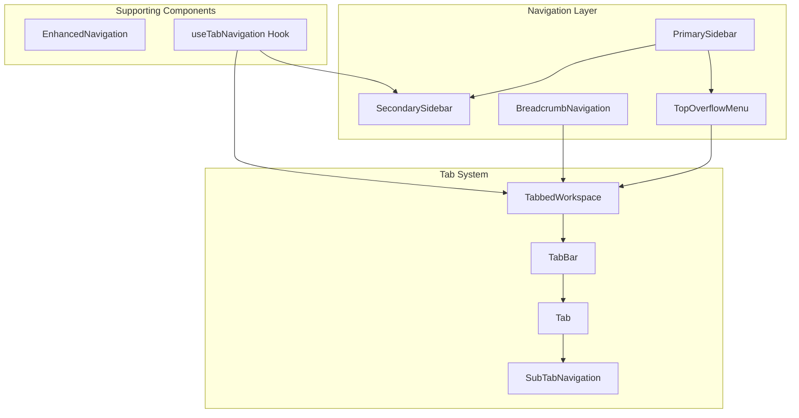
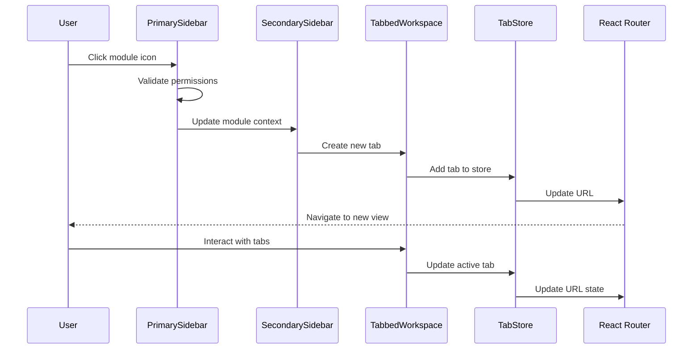
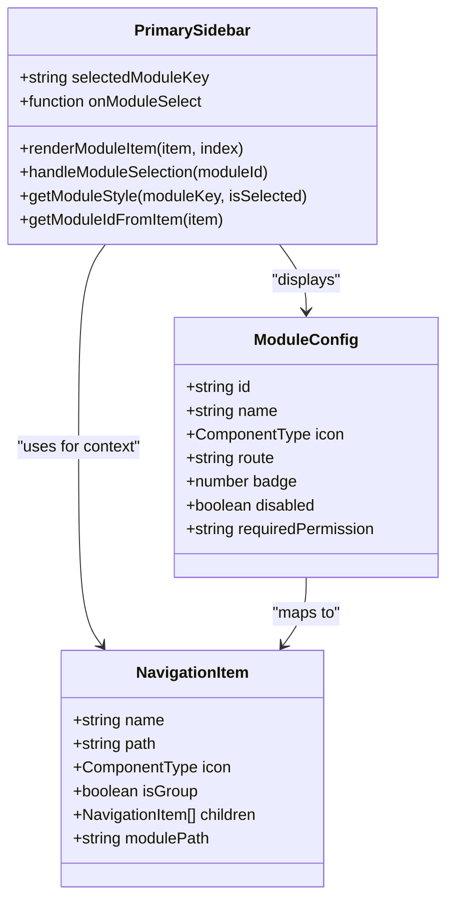
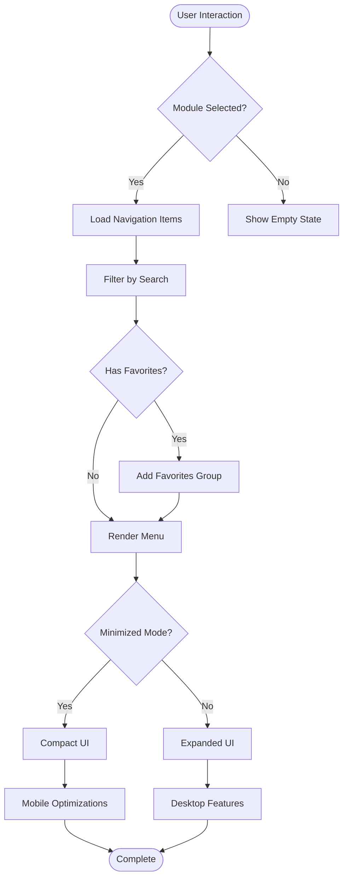
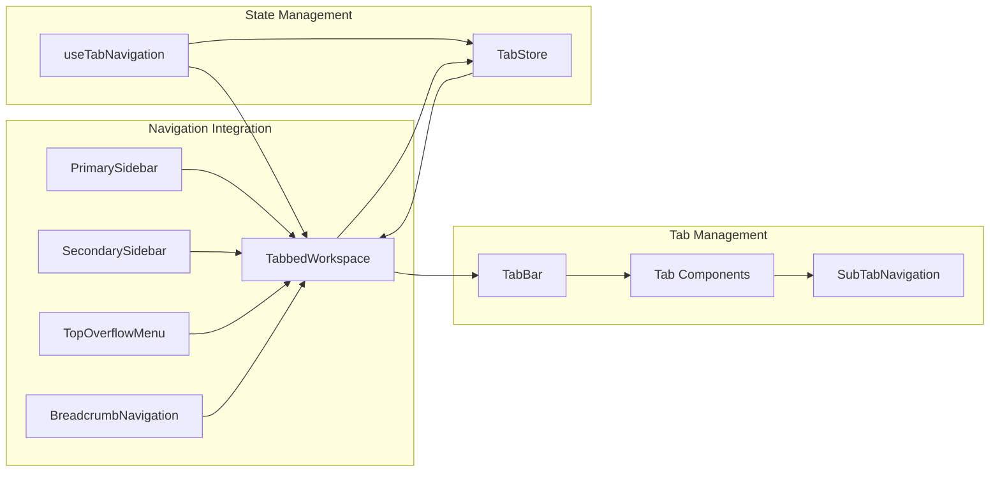
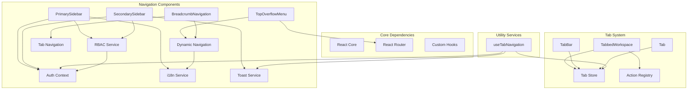

# Navigation Components Guide

<cite>
**Referenced Files in This Document**
- [NAVIGATION_COMPONENTS_GUIDE.md](file://docs/guides/NAVIGATION_COMPONENTS_GUIDE.md)
- [PrimarySidebar.tsx](file://src/components/PrimarySidebar.tsx)
- [SecondarySidebar.tsx](file://src/components/SecondarySidebar.tsx)
- [TopOverflowMenu.tsx](file://src/components/TopOverflowMenu.tsx)
- [BreadcrumbNavigation.tsx](file://src/components/BreadcrumbNavigation.tsx)
- [SubTabNavigation.tsx](file://src/components/SubTabNavigation.tsx)
- [EnhancedNavigation.tsx](file://src/components/EnhancedNavigation.tsx)
- [TabbedWorkspace.tsx](file://src/components/tabbedWorkspace/TabbedWorkspace.tsx)
- [TabBar.tsx](file://src/components/tabbedWorkspace/TabBar.tsx)
- [Tab.tsx](file://src/components/tabbedWorkspace/Tab.tsx)
- [useTabNavigation.ts](file://src/hooks/useTabNavigation.ts)
</cite>

## Table of Contents
1. [Introduction](#introduction)
2. [Project Structure](#project-structure)
3. [Core Components](#core-components)
4. [Architecture Overview](#architecture-overview)
5. [Detailed Component Analysis](#detailed-component-analysis)
6. [Dependency Analysis](#dependency-analysis)
7. [Performance Considerations](#performance-considerations)
8. [Troubleshooting Guide](#troubleshooting-guide)
9. [Conclusion](#conclusion)

## Introduction

The navigation system in SchoolPilot3 provides a comprehensive framework for user navigation across the educational management platform. This guide covers the complete navigation ecosystem including primary and secondary sidebars, breadcrumb navigation, overflow menus, and the integrated tabbed workspace system.

The navigation components work together to provide intuitive access to different modules (Academics, Finance, HR, etc.) while maintaining context awareness and supporting modern web application patterns like tabbed interfaces and hierarchical navigation.

## Project Structure

The navigation system is organized into several key components that work together to provide seamless user experience:

**Diagram sources**
- [PrimarySidebar.tsx:1-461](file://src/components/PrimarySidebar.tsx#L1-461)
- [SecondarySidebar.tsx:1-865](file://src/components/SecondarySidebar.tsx#L1-865)
- [TopOverflowMenu.tsx:1-260](file://src/components/TopOverflowMenu.tsx#L1-260)
- [BreadcrumbNavigation.tsx:1-297](file://src/components/BreadcrumbNavigation.tsx#L1-297)
- [TabbedWorkspace.tsx:1-549](file://src/components/tabbedWorkspace/TabbedWorkspace.tsx#L1-549)

**Section sources**
- [NAVIGATION_COMPONENTS_GUIDE.md:18-45](file://docs/guides/NAVIGATION_COMPONENTS_GUIDE.md#L18-L45)

## Core Components

### PrimarySidebar
The main navigation sidebar that provides access to all major application modules with visual module identification and active state management.

**Key Features:**
- Fixed positioning with glass-morphism design
- Module-specific color schemes and styling
- Responsive behavior with collapsible sections
- Integration with RBAC for permission-based access
- Enhanced mobile touch support

**Section sources**
- [PrimarySidebar.tsx:1-461](file://src/components/PrimarySidebar.tsx#L1-461)

### SecondarySidebar
Contextual navigation sidebar that adapts based on the currently selected module, providing detailed navigation within specific functional areas.

**Key Features:**
- Dynamic content loading based on active module
- Hierarchical menu structure with expandable sections
- Search functionality for quick navigation
- Favorites integration for frequently accessed items
- Mobile-optimized responsive design

**Section sources**
- [SecondarySidebar.tsx:1-865](file://src/components/SecondarySidebar.tsx#L1-865)

### TopOverflowMenu
Flexible overflow menu positioned at the top of the interface, providing access to global actions and navigation shortcuts.

**Key Features:**
- Modular design with customizable menu items
- Submenu support for grouped actions
- Keyboard navigation support
- Integration with module selection
- Responsive positioning and styling

**Section sources**
- [TopOverflowMenu.tsx:1-260](file://src/components/TopOverflowMenu.tsx#L1-260)

### BreadcrumbNavigation
Hierarchical breadcrumb navigation that shows user location within the application structure and enables quick navigation to parent levels.

**Key Features:**
- Automatic path generation from current route
- Translation support for internationalization
- Error handling and retry mechanisms
- Customizable separators and truncation
- Integration with tabbed workspace

**Section sources**
- [BreadcrumbNavigation.tsx:1-297](file://src/components/BreadcrumbNavigation.tsx#L1-297)

### Tabbed Workspace System
Integrated tab management system that allows users to work with multiple views simultaneously within the application.

**Key Features:**
- Drag-and-drop tab reordering
- Tab pinning for frequently used views
- Context menu support for tab operations
- Hierarchical tab support with sub-tabs
- Advanced tab grouping and organization

**Section sources**
- [TabbedWorkspace.tsx:1-549](file://src/components/tabbedWorkspace/TabbedWorkspace.tsx#L1-549)
- [TabBar.tsx:1-521](file://src/components/tabbedWorkspace/TabBar.tsx#L1-521)
- [Tab.tsx:1-612](file://src/components/tabbedWorkspace/Tab.tsx#L1-612)

## Architecture Overview

The navigation system follows a layered architecture pattern with clear separation of concerns:

**Diagram sources**
- [PrimarySidebar.tsx:210-214](file://src/components/PrimarySidebar.tsx#L210-214)
- [SecondarySidebar.tsx:246-260](file://src/components/SecondarySidebar.tsx#L246-260)
- [TabbedWorkspace.tsx:290-313](file://src/components/tabbedWorkspace/TabbedWorkspace.tsx#L290-313)
- [useTabNavigation.ts:339-386](file://src/hooks/useTabNavigation.ts#L339-386)

The architecture supports both traditional navigation patterns and modern tabbed workspace functionality, allowing users to seamlessly switch between different views while maintaining application context.

**Section sources**
- [useTabNavigation.ts:107-627](file://src/hooks/useTabNavigation.ts#L107-627)

## Detailed Component Analysis

### PrimarySidebar Component Analysis

The PrimarySidebar implements a sophisticated navigation pattern with enhanced visual feedback and responsive design:

**Diagram sources**
- [PrimarySidebar.tsx:67-85](file://src/components/PrimarySidebar.tsx#L67-85)
- [PrimarySidebar.tsx:153-156](file://src/components/PrimarySidebar.tsx#L153-156)

**Key Implementation Details:**
- **Module Styling System**: Each module has unique color schemes with gradient backgrounds and border accents
- **Responsive Design**: Adaptive width and positioning based on screen size and mouse proximity
- **Accessibility Features**: Proper ARIA labels, keyboard navigation, and focus management
- **Performance Optimizations**: Memoization of expensive computations and optimized rendering

**Section sources**
- [PrimarySidebar.tsx:40-116](file://src/components/PrimarySidebar.tsx#L40-116)
- [PrimarySidebar.tsx:239-376](file://src/components/PrimarySidebar.tsx#L239-376)

### SecondarySidebar Component Analysis

The SecondarySidebar provides contextual navigation within specific modules:

**Diagram sources**
- [SecondarySidebar.tsx:332-358](file://src/components/SecondarySidebar.tsx#L332-358)
- [SecondarySidebar.tsx:369-388](file://src/components/SecondarySidebar.tsx#L369-388)

**Key Features:**
- **Dynamic Content Loading**: Navigation items loaded based on active module context
- **Search Integration**: Real-time filtering of navigation items
- **Favorites Management**: Special group for frequently accessed items
- **Mobile Responsiveness**: Adaptive layouts for different screen sizes
- **Keyboard Navigation**: Full keyboard accessibility support

**Section sources**
- [SecondarySidebar.tsx:179-358](file://src/components/SecondarySidebar.tsx#L179-358)
- [SecondarySidebar.tsx:488-540](file://src/components/SecondarySidebar.tsx#L488-540)

### Tabbed Workspace Integration

The tabbed workspace system integrates seamlessly with the navigation components:

**Diagram sources**
- [TabbedWorkspace.tsx:40-40](file://src/components/tabbedWorkspace/TabbedWorkspace.tsx#L40-40)
- [TabBar.tsx:40-86](file://src/components/tabbedWorkspace/TabBar.tsx#L40-86)
- [Tab.tsx:269-287](file://src/components/tabbedWorkspace/Tab.tsx#L269-287)

**Section sources**
- [TabbedWorkspace.tsx:16-62](file://src/components/tabbedWorkspace/TabbedWorkspace.tsx#L16-62)
- [TabBar.tsx:40-86](file://src/components/tabbedWorkspace/TabBar.tsx#L40-86)
- [Tab.tsx:269-287](file://src/components/tabbedWorkspace/Tab.tsx#L269-287)

### Enhanced Navigation Component

The EnhancedNavigation component provides system status information and global application context:

**Section sources**
- [EnhancedNavigation.tsx:1-104](file://src/components/EnhancedNavigation.tsx#L1-104)

## Dependency Analysis

The navigation system has well-defined dependencies that support maintainability and extensibility:

**Diagram sources**
- [PrimarySidebar.tsx:160-164](file://src/components/PrimarySidebar.tsx#L160-164)
- [SecondarySidebar.tsx:186-191](file://src/components/SecondarySidebar.tsx#L186-191)
- [useTabNavigation.ts:107-135](file://src/hooks/useTabNavigation.ts#L107-135)

**Section sources**
- [PrimarySidebar.tsx:160-164](file://src/components/PrimarySidebar.tsx#L160-164)
- [SecondarySidebar.tsx:186-191](file://src/components/SecondarySidebar.tsx#L186-191)
- [useTabNavigation.ts:107-135](file://src/hooks/useTabNavigation.ts#L107-135)

## Performance Considerations

The navigation system implements several performance optimization strategies:

### Rendering Optimizations
- **Memoization**: Extensive use of React.memo and useMemo for expensive computations
- **Lazy Loading**: Conditional rendering of complex components
- **Virtual Scrolling**: Efficient rendering of large navigation lists
- **Debounced Operations**: Search and filter operations are debounced

### State Management
- **Centralized Stores**: Tab state managed in centralized stores
- **Selective Updates**: Only affected components re-render on state changes
- **Immutable Updates**: State updates preserve referential integrity

### Memory Management
- **Cleanup Functions**: Proper cleanup of event listeners and subscriptions
- **Resource Pooling**: Reuse of navigation item components
- **Conditional Loading**: Deferred loading of non-critical navigation features

## Troubleshooting Guide

### Common Navigation Issues

**Module Access Problems**
- Verify RBAC permissions for the specific module
- Check module configuration in navigation items
- Ensure proper authentication context

**Tab Navigation Failures**
- Validate tab creation parameters
- Check tab store state consistency
- Review tab limit configurations

**Breadcrumb Navigation Issues**
- Verify route path structure
- Check translation key resolution
- Ensure navigation item hierarchy is correct

**Performance Issues**
- Monitor component re-render frequency
- Check for unnecessary prop drilling
- Review memory leak potential in event handlers

**Section sources**
- [SecondarySidebar.tsx:281-306](file://src/components/SecondarySidebar.tsx#L281-306)
- [useTabNavigation.ts:257-335](file://src/hooks/useTabNavigation.ts#L257-335)

## Conclusion

The SchoolPilot3 navigation system provides a robust, scalable foundation for educational management applications. The modular architecture supports both traditional navigation patterns and modern tabbed workspace functionality, while the responsive design ensures usability across all device types.

Key strengths of the system include:
- **Comprehensive Integration**: Seamless coordination between all navigation components
- **Performance Optimization**: Careful attention to rendering performance and memory usage
- **Accessibility Compliance**: Full keyboard navigation and screen reader support
- **Extensibility**: Well-defined interfaces for adding new navigation features
- **Internationalization**: Built-in support for multi-language applications

The system successfully balances functionality with performance, providing users with efficient navigation while maintaining excellent responsiveness and user experience across all supported platforms.