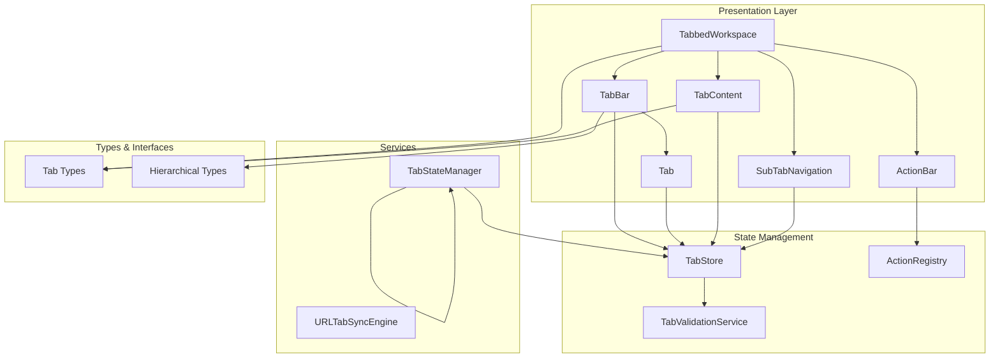
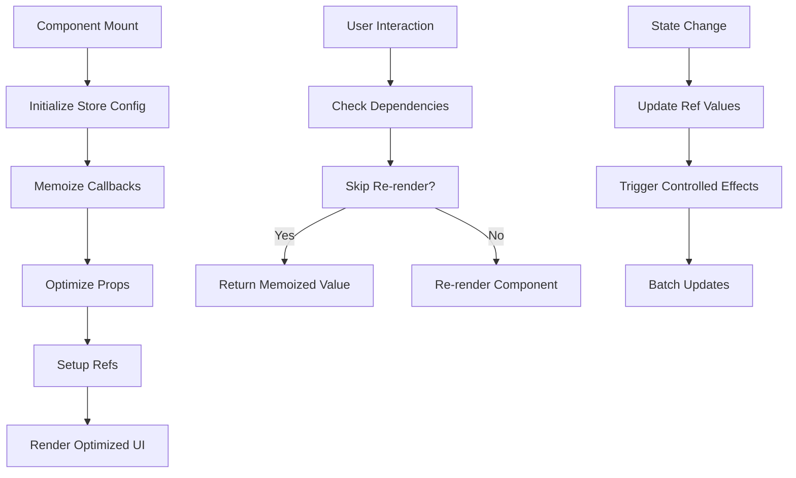
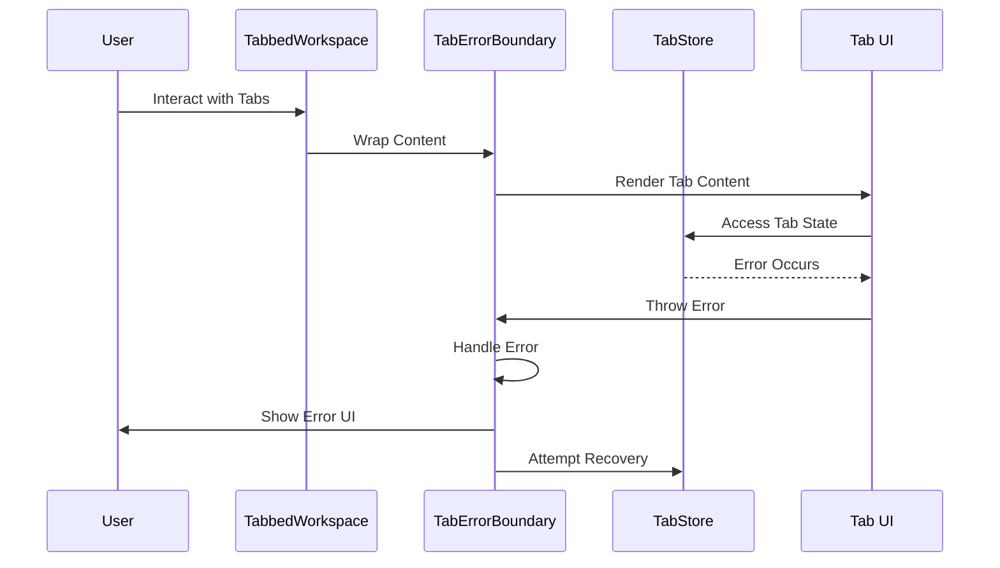
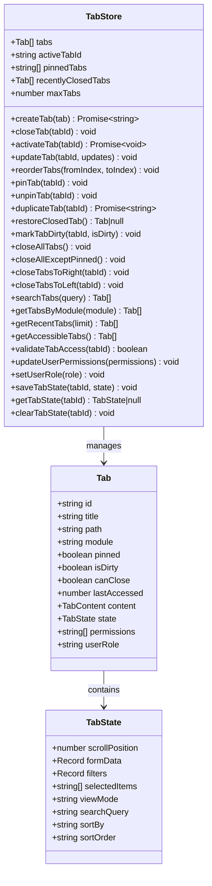
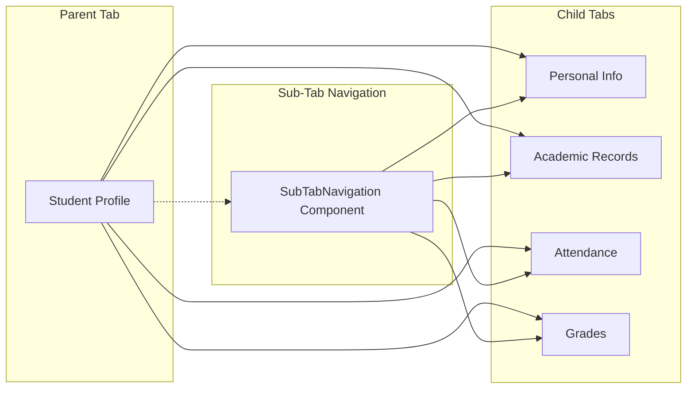
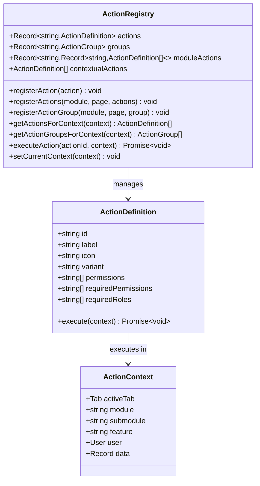
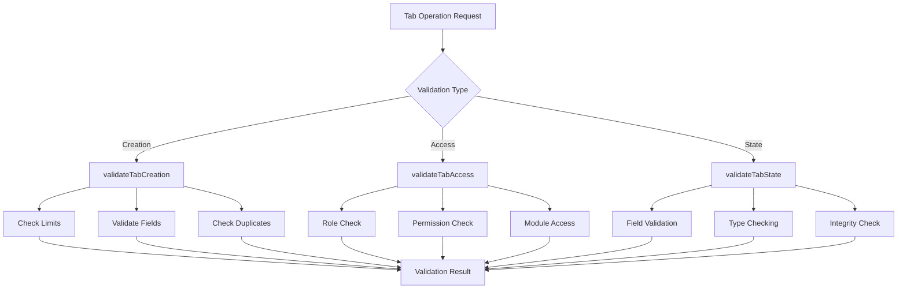

# Tabbed Workspace Components Guide

<cite>
**Referenced Files in This Document**
- [index.ts](file://src/components/tabbedWorkspace/index.ts)
- [TabbedWorkspace.tsx](file://src/components/tabbedWorkspace/TabbedWorkspace.tsx)
- [Tab.tsx](file://src/components/tabbedWorkspace/Tab.tsx)
- [TabBar.tsx](file://src/components/tabbedWorkspace/TabBar.tsx)
- [TabContent.tsx](file://src/components/tabbedWorkspace/TabContent.tsx)
- [ActionBar.tsx](file://src/components/tabbedWorkspace/ActionBar.tsx)
- [SubTabNavigation.tsx](file://src/components/tabbedWorkspace/SubTabNavigation.tsx)
- [TabbedWorkspaceManager.tsx](file://src/components/tabbedWorkspace/TabbedWorkspaceManager.tsx)
- [tabStore.ts](file://src/stores/tabStore.ts)
- [actionRegistry.ts](file://src/services/actionRegistry.ts)
- [TabValidationService.ts](file://src/services/tabs/TabValidationService.ts)
- [TabStateManager.ts](file://src/services/TabStateManager.ts)
- [tabbedWorkspace.ts](file://src/types/tabbedWorkspace.ts)
- [hierarchical.ts](file://src/types/hierarchical.ts)
- [OPTIMIZATION_GUIDE.md](file://src/components/tabbedWorkspace/OPTIMIZATION_GUIDE.md)
- [RENDER_LOOP_FIX_DOCUMENTATION.md](file://src/components/tabbedWorkspace/RENDER_LOOP_FIX_DOCUMENTATION.md)
- [TABBED_WORKSPACE_COMPONENT_GUIDE.md](file://docs/tabs/TABBED_WORKSPACE_COMPONENT_GUIDE.md)
- [SYSTEM_OVERVIEW.md](file://docs/tabs/SYSTEM_OVERVIEW.md)
</cite>

## Table of Contents
1. [Introduction](#introduction)
2. [System Architecture](#system-architecture)
3. [Core Components](#core-components)
4. [Component Implementation Details](#component-implementation-details)
5. [State Management](#state-management)
6. [Performance Optimizations](#performance-optimizations)
7. [Hierarchical Navigation](#hierarchical-navigation)
8. [Action System](#action-system)
9. [Validation and Security](#validation-and-security)
10. [Integration Patterns](#integration-patterns)
11. [Best Practices](#best-practices)
12. [Troubleshooting Guide](#troubleshooting-guide)

## Introduction

The Tabbed Workspace Components system provides a comprehensive multi-tab interface for the SchoolPilot3 educational management platform. This system enables users to manage multiple open entities across different modules while maintaining context and providing a browser-like experience within the application.

The system is built around several key principles:
- **URL-Driven Architecture**: Tab state is primarily derived from browser URLs for shareability and persistence
- **Cross-Module Navigation**: Users can switch between modules without losing their tab workspace
- **Durable State Management**: Automatic fallback mechanisms for handling URL length limitations
- **Hierarchical Navigation**: Support for parent-child tab relationships with sub-tab navigation

## System Architecture

The Tabbed Workspace follows a layered architecture with clear separation of concerns:

**Diagram sources**
- [TabbedWorkspace.tsx:16-549](file://src/components/tabbedWorkspace/TabbedWorkspace.tsx#L16-L549)
- [tabStore.ts:139-800](file://src/stores/tabStore.ts#L139-L800)
- [actionRegistry.ts:115-502](file://src/services/actionRegistry.ts#L115-L502)

**Section sources**
- [SYSTEM_OVERVIEW.md:1-53](file://docs/tabs/SYSTEM_OVERVIEW.md#L1-L53)
- [TabbedWorkspace.tsx:16-549](file://src/components/tabbedWorkspace/TabbedWorkspace.tsx#L16-L549)

## Core Components

### TabbedWorkspace Container

The main container component orchestrates the entire tabbed workspace system. It manages initialization, error handling, and coordinates between all child components.

**Key Features:**
- **Initialization Management**: Handles async initialization with proper error boundaries
- **State Synchronization**: Keeps tab state synchronized with URL and local storage
- **Error Boundary Integration**: Wraps the entire workspace in an error boundary
- **Performance Optimization**: Implements extensive memoization and optimization techniques

**Section sources**
- [TabbedWorkspace.tsx:16-549](file://src/components/tabbedWorkspace/TabbedWorkspace.tsx#L16-L549)
- [index.ts:1-44](file://src/components/tabbedWorkspace/index.ts#L1-L44)

### TabBar Component

The TabBar renders the horizontal navigation bar with drag-and-drop support for tab reordering and overflow handling.

**Core Functionality:**
- **Drag-and-Drop Interface**: Uses react-beautiful-dnd for intuitive tab reordering
- **Overflow Management**: Automatically handles excess tabs with dropdown menus
- **Context Menu Support**: Right-click context menus for tab actions
- **Visual State Management**: Handles active states, hover effects, and pin indicators

**Section sources**
- [TabBar.tsx:40-521](file://src/components/tabbedWorkspace/TabBar.tsx#L40-L521)

### Individual Tab Component

Each tab displays metadata and provides interactive controls for tab management.

**Interactive Features:**
- **Click Activation**: Switches to the tab when clicked
- **Close Controls**: Hover-triggered close buttons for non-pinned tabs
- **Pin Functionality**: Lock tabs to the left side
- **Status Indicators**: Visual indicators for loading, errors, and unsaved changes
- **Keyboard Navigation**: Full keyboard support for accessibility

**Section sources**
- [Tab.tsx:269-612](file://src/components/tabbedWorkspace/Tab.tsx#L269-L612)

### TabContent Renderer

Handles the dynamic content rendering for active tabs with lazy loading capabilities.

**Content Types Supported:**
- **Component-based**: Dynamic component rendering
- **URL Embedding**: iframe-based external content
- **HTML Content**: Safe HTML rendering
- **Text Content**: Plain text display
- **Empty State**: Default empty tab handling

**Section sources**
- [TabContent.tsx:21-255](file://src/components/tabbedWorkspace/TabContent.tsx#L21-L255)

## Component Implementation Details

### Performance Optimization Strategies

The system implements comprehensive performance optimizations to ensure smooth operation with many tabs:

**Diagram sources**
- [OPTIMIZATION_GUIDE.md:1-225](file://src/components/tabbedWorkspace/OPTIMIZATION_GUIDE.md#L1-L225)

**Key Optimization Techniques:**
- **React.memo Implementation**: All major components wrapped with memoization
- **useCallback Hooks**: Stable callback references prevent unnecessary re-renders
- **useMemo Optimization**: Expensive computations cached with dependency arrays
- **Ref-based State**: Stale closures avoided with useRef for callbacks
- **Conditional Rendering**: Development-only logging and expensive operations

**Section sources**
- [OPTIMIZATION_GUIDE.md:1-225](file://src/components/tabbedWorkspace/OPTIMIZATION_GUIDE.md#L1-L225)
- [RENDER_LOOP_FIX_DOCUMENTATION.md:1-162](file://src/components/tabbedWorkspace/RENDER_LOOP_FIX_DOCUMENTATION.md#L1-L162)

### Error Handling Architecture

The system implements robust error handling through multiple layers:

**Diagram sources**
- [TabbedWorkspace.tsx:514-545](file://src/components/tabbedWorkspace/TabbedWorkspace.tsx#L514-L545)

**Section sources**
- [TabbedWorkspace.tsx:514-545](file://src/components/tabbedWorkspace/TabbedWorkspace.tsx#L514-L545)

## State Management

### TabStore Implementation

The TabStore uses Zustand for state management with comprehensive persistence and validation:

**Diagram sources**
- [tabStore.ts:18-107](file://src/stores/tabStore.ts#L18-L107)
- [tabbedWorkspace.ts:19-58](file://src/types/tabbedWorkspace.ts#L19-L58)

**Section sources**
- [tabStore.ts:139-800](file://src/stores/tabStore.ts#L139-L800)
- [tabbedWorkspace.ts:19-107](file://src/types/tabbedWorkspace.ts#L19-L107)

### TabStateManager

Enhanced state management with platform awareness and intelligent cleanup:

**Platform Adaptation Features:**
- **Mobile Optimization**: Reduced tab limits and navigation-focused behavior
- **Desktop Enhancement**: Higher tab limits and full-featured interface
- **Web Balance**: Moderate configuration for browser environments
- **Intelligent Cleanup**: Automated removal of inactive tabs based on platform

**Section sources**
- [TabStateManager.ts:33-375](file://src/services/TabStateManager.ts#L33-L375)

## Performance Optimizations

### Render Loop Prevention

The system addresses and prevents common React render loop issues:

**Root Cause Solutions:**
- **Stale Callback Pattern**: Uses refs to maintain latest callback references
- **Efficient Comparisons**: Implements hash-based permission comparisons
- **Initialization Guards**: Prevents multiple initialization attempts
- **Conditional Logging**: Development-only verbose logging

**Performance Impact:**
- **Single Render Per Change**: Eliminates cascading re-renders
- **Smooth Transitions**: Prevents flickering during tab switching
- **Memory Efficiency**: Reduces memory leaks from excessive re-renders
- **Responsive Interactions**: Maintains smooth user experience under load

**Section sources**
- [RENDER_LOOP_FIX_DOCUMENTATION.md:1-162](file://src/components/tabbedWorkspace/RENDER_LOOP_FIX_DOCUMENTATION.md#L1-L162)

### Optimization Implementation

The optimization guide provides detailed implementation patterns:

**Memoization Patterns:**
- **Component Level**: React.memo with custom comparison functions
- **Callback Level**: useCallback for event handlers
- **Computed Value Level**: useMemo for expensive calculations
- **Prop Level**: Object memoization for child component props

**Best Practices Documented:**
- Stable keys for mapped elements
- Efficient state update patterns
- Conditional rendering strategies
- Performance monitoring approaches

**Section sources**
- [OPTIMIZATION_GUIDE.md:1-225](file://src/components/tabbedWorkspace/OPTIMIZATION_GUIDE.md#L1-L225)

## Hierarchical Navigation

### Sub-Tab System

The hierarchical navigation system supports complex parent-child relationships:

**Diagram sources**
- [SubTabNavigation.tsx:8-94](file://src/components/tabbedWorkspace/SubTabNavigation.tsx#L8-L94)
- [hierarchical.ts:46-77](file://src/types/hierarchical.ts#L46-L77)

**Hierarchical Features:**
- **Nested Structure**: Parent-child tab relationships
- **Contextual Navigation**: Sub-tabs within parent tab context
- **Independent State**: Each sub-tab maintains its own state
- **Shared Context**: Parent tab provides shared metadata and permissions

**Section sources**
- [SubTabNavigation.tsx:8-94](file://src/components/tabbedWorkspace/SubTabNavigation.tsx#L8-L94)
- [hierarchical.ts:28-77](file://src/types/hierarchical.ts#L28-L77)

### Breadcrumb Navigation

Integrated breadcrumb system for hierarchical navigation:

**Breadcrumb Features:**
- **Automatic Generation**: Derived from tab path structure
- **Interactive Navigation**: Clickable breadcrumb items
- **Visual Hierarchy**: Clear indication of current location
- **Permission-Based**: Respects user access controls

**Section sources**
- [hierarchical.ts:8-26](file://src/types/hierarchical.ts#L8-L26)
- [TabbedWorkspace.tsx:241-275](file://src/components/tabbedWorkspace/TabbedWorkspace.tsx#L241-L275)

## Action System

### Action Registry

Centralized action management with RBAC integration:

**Diagram sources**
- [actionRegistry.ts:75-112](file://src/services/actionRegistry.ts#L75-L112)
- [actionRegistry.ts:46-72](file://src/services/actionRegistry.ts#L46-L72)

**Action System Capabilities:**
- **Context-Aware**: Actions adapt based on current tab and user context
- **Permission-Based**: Automatic filtering based on user roles and permissions
- **Group Organization**: Logical grouping of related actions
- **Search and Filter**: Dynamic action discovery and filtering
- **Execution Tracking**: Loading states and error handling

**Section sources**
- [actionRegistry.ts:115-502](file://src/services/actionRegistry.ts#L115-L502)
- [ActionBar.tsx:216-527](file://src/components/tabbedWorkspace/ActionBar.tsx#L216-L527)

## Validation and Security

### Tab Validation Service

Comprehensive validation system ensuring data integrity and security:

**Diagram sources**
- [TabValidationService.ts:177-301](file://src/services/tabs/TabValidationService.ts#L177-L301)

**Security Features:**
- **Role-Based Access Control**: Module-level and permission-based access
- **Data Integrity**: Comprehensive validation of tab data structures
- **Permission Validation**: Real-time permission checking for tab operations
- **State Sanitization**: Automatic cleanup and normalization of tab data
- **Error Prevention**: Proactive validation to prevent corrupted state

**Section sources**
- [TabValidationService.ts:83-570](file://src/services/tabs/TabValidationService.ts#L83-L570)
- [tabStore.ts:53-76](file://src/stores/tabStore.ts#L53-L76)

## Integration Patterns

### TabbedWorkspaceManager

Automated tab management for route-based navigation:

**Integration Features:**
- **Route Detection**: Automatic tab creation based on URL changes
- **Module Dashboard Management**: Intelligent handling of module dashboards
- **Platform Adaptation**: Different behavior based on device type
- **Tab Cleanup**: Automatic management of tab limits and cleanup

**Section sources**
- [TabbedWorkspaceManager.ts:16-126](file://src/components/tabbedWorkspace/TabbedWorkspaceManager.ts#L16-L126)

### URL Synchronization

Seamless integration with browser URL system:

**URL Integration Features:**
- **Automatic State Persistence**: Tab state maintained in URL parameters
- **Browser History Integration**: Proper pushState/replaceState handling
- **Fallback Mechanisms**: SessionStorage backup for URL length limits
- **Shareable Workspaces**: URLs that preserve user's tab configuration

**Section sources**
- [SYSTEM_OVERVIEW.md:15-25](file://docs/tabs/SYSTEM_OVERVIEW.md#L15-L25)

## Best Practices

### Component Development Guidelines

**Performance Best Practices:**
- Always wrap components in React.memo when appropriate
- Use useCallback for event handlers passed as props
- Implement useMemo for expensive computations
- Provide stable keys for all mapped elements
- Use refs for values that don't trigger re-renders

**State Management Best Practices:**
- Keep tab state minimal and focused
- Use the TabStore for all tab-related state
- Implement proper error boundaries
- Handle asynchronous operations carefully
- Validate all user inputs and external data

**Accessibility Best Practices:**
- Include proper ARIA labels and roles
- Support keyboard navigation
- Provide focus indicators
- Ensure sufficient color contrast
- Support screen reader compatibility

**Section sources**
- [OPTIMIZATION_GUIDE.md:197-225](file://src/components/tabbedWorkspace/OPTIMIZATION_GUIDE.md#L197-L225)
- [TABBED_WORKSPACE_COMPONENT_GUIDE.md:468-494](file://docs/tabs/TABBED_WORKSPACE_COMPONENT_GUIDE.md#L468-L494)

## Troubleshooting Guide

### Common Issues and Solutions

**Render Loop Issues:**
- **Symptoms**: Flickering, rapid re-renders, performance degradation
- **Causes**: Stale callback closures, missing dependencies, excessive state updates
- **Solutions**: Use ref-based callback patterns, implement proper memoization, optimize effect dependencies

**Tab State Corruption:**
- **Symptoms**: Missing tabs, incorrect tab order, persistent errors
- **Causes**: Corrupted localStorage data, invalid tab configurations
- **Solutions**: Use TabValidationService for data cleanup, implement corruption detection, provide manual cleanup options

**Performance Degradation:**
- **Symptoms**: Slow tab switching, delayed UI updates, memory leaks
- **Causes**: Missing optimizations, excessive re-renders, inefficient state updates
- **Solutions**: Implement React.memo patterns, use useCallback hooks, optimize expensive computations

**Section sources**
- [RENDER_LOOP_FIX_DOCUMENTATION.md:93-162](file://src/components/tabbedWorkspace/RENDER_LOOP_FIX_DOCUMENTATION.md#L93-L162)
- [OPTIMIZATION_GUIDE.md:177-225](file://src/components/tabbedWorkspace/OPTIMIZATION_GUIDE.md#L177-L225)

### Debugging Tools and Techniques

**Development Tools:**
- **React DevTools Profiler**: Measure render times and identify bottlenecks
- **Console Debugging**: Conditional logging for development builds
- **Performance Monitoring**: Track render frequencies and memory usage
- **State Inspection**: Direct inspection of tab store state

**Testing Approaches:**
- **Unit Tests**: Individual component testing with isolated state
- **Integration Tests**: Multi-component interaction testing
- **Performance Tests**: Large dataset testing and benchmarking
- **User Flow Tests**: Real-world usage scenario testing

**Section sources**
- [RENDER_LOOP_FIX_DOCUMENTATION.md:95-113](file://src/components/tabbedWorkspace/RENDER_LOOP_FIX_DOCUMENTATION.md#L95-L113)