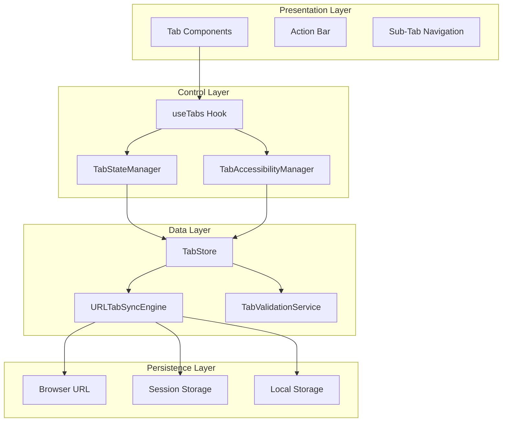
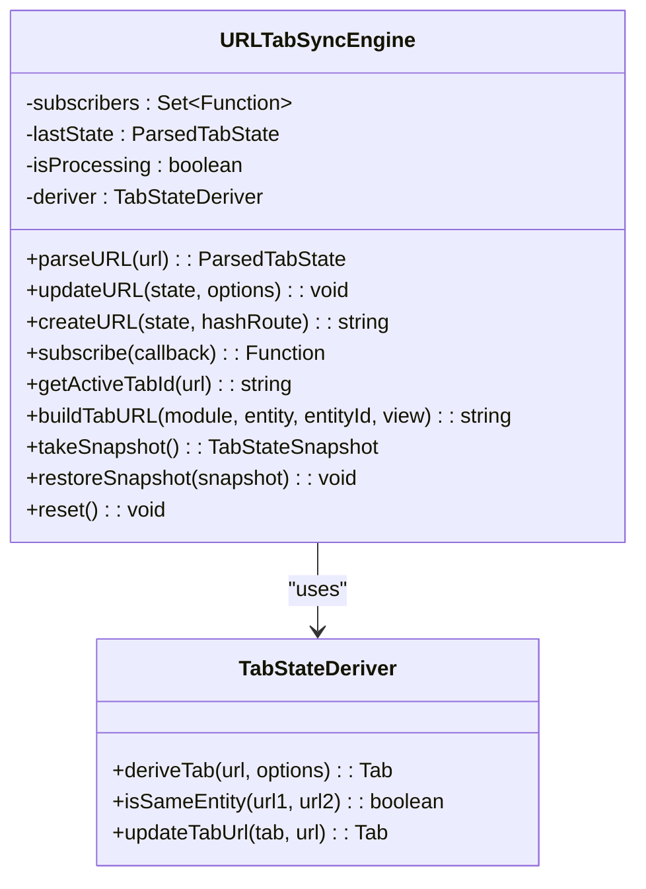
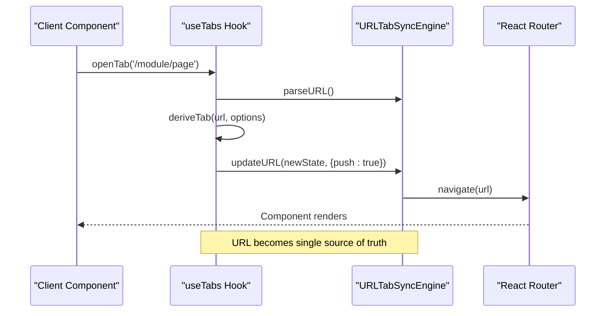
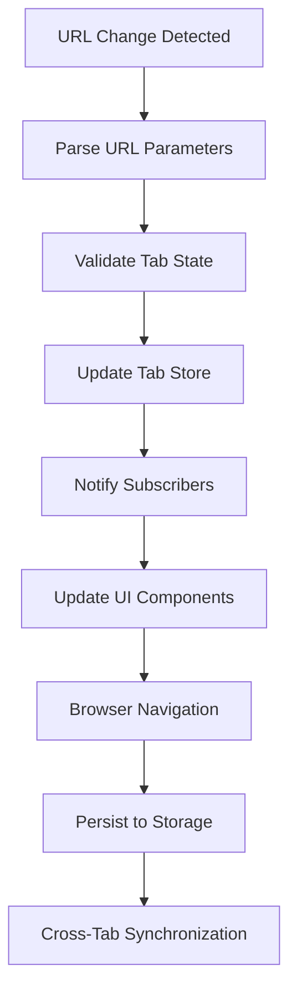
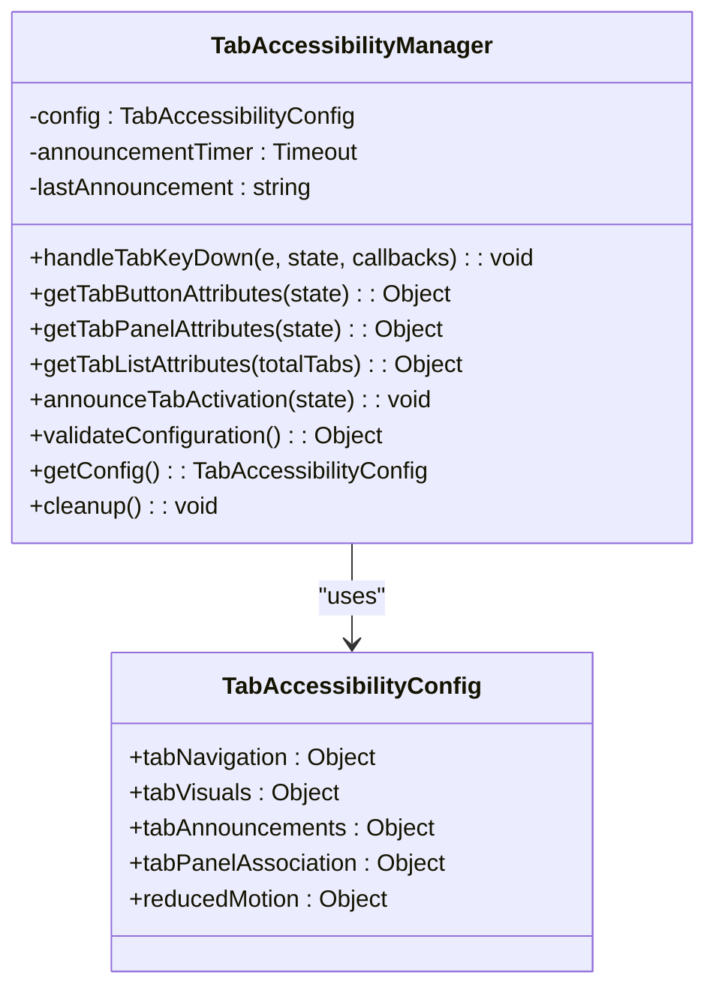
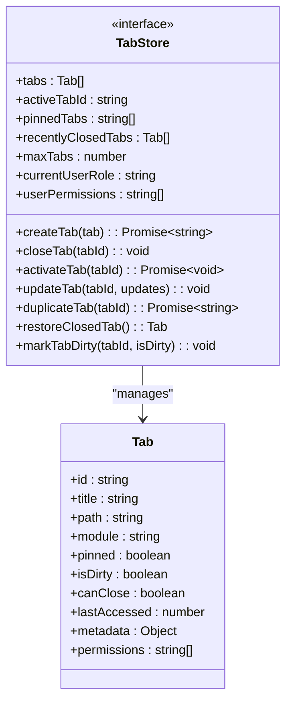
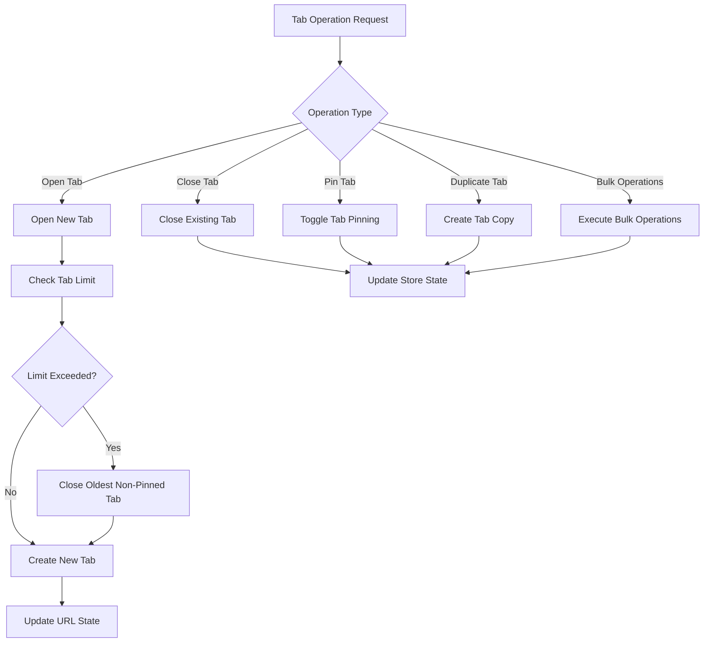
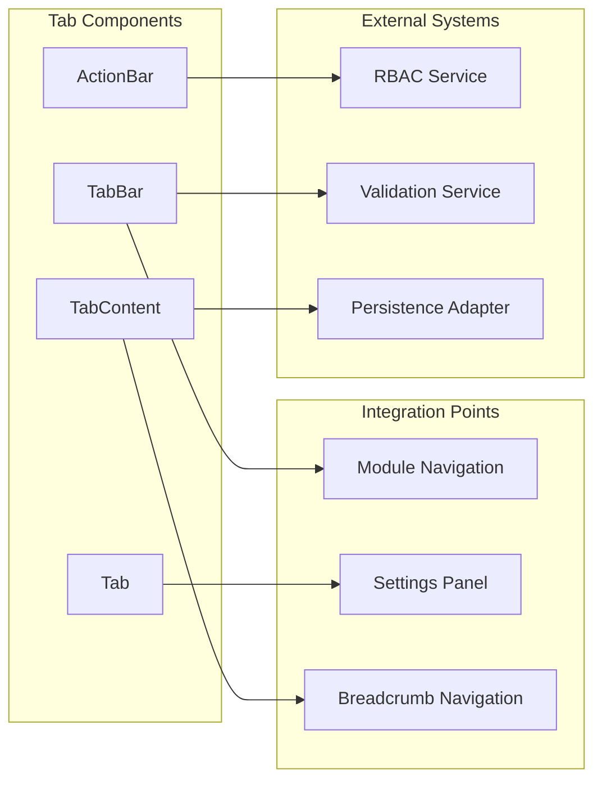

# Tabs System Documentation

<cite>
**Referenced Files in This Document**
- [useTabs.ts](file://src/hooks/tabs/useTabs.ts)
- [TabStateManager.ts](file://src/services/TabStateManager.ts)
- [TabAccessibilityManager.ts](file://src/services/TabAccessibilityManager.ts)
- [URLTabSyncEngine.ts](file://src/services/tabs/URLTabSyncEngine.ts)
- [tabStore.ts](file://src/stores/tabStore.ts)
- [tabbedWorkspace.ts](file://src/types/tabbedWorkspace.ts)
- [index.ts](file://src/components/tabbedWorkspace/index.ts)
</cite>

## Table of Contents
1. [Introduction](#introduction)
2. [System Architecture](#system-architecture)
3. [Core Components](#core-components)
4. [URL-Based Tab Management](#url-based-tab-management)
5. [Accessibility Implementation](#accessibility-implementation)
6. [State Management](#state-management)
7. [Tab Operations](#tab-operations)
8. [Performance Considerations](#performance-considerations)
9. [Integration Patterns](#integration-patterns)
10. [Troubleshooting Guide](#troubleshooting-guide)
11. [Conclusion](#conclusion)

## Introduction

The Tabs System in SchoolPilot3 represents a sophisticated tabbed workspace architecture designed to provide seamless multi-tab navigation experiences across educational modules. This system implements URL-driven tab management, ensuring tab state persistence, cross-tab synchronization, and comprehensive accessibility support.

The system is built around three core pillars: URL synchronization for state management, comprehensive accessibility compliance, and robust state persistence with RBAC integration. It supports advanced features like tab pinning, bulk operations, hierarchical navigation, and real-time collaboration capabilities.

## System Architecture

The Tabs System follows a layered architecture pattern with clear separation of concerns:

**Diagram sources**
- [useTabs.ts:172-486](file://src/hooks/tabs/useTabs.ts#L172-L486)
- [TabStateManager.ts:33-375](file://src/services/TabStateManager.ts#L33-L375)
- [TabAccessibilityManager.ts:62-552](file://src/services/TabAccessibilityManager.ts#L62-L552)
- [URLTabSyncEngine.ts:21-522](file://src/services/tabs/URLTabSyncEngine.ts#L21-L522)

## Core Components

### URLTabSyncEngine

The URLTabSyncEngine serves as the central coordinator for URL-based tab state management. It implements a sophisticated URL parameter system that can encode up to 20 tabs in a compact format while maintaining backward compatibility with legacy tab parameters.

**Diagram sources**
- [URLTabSyncEngine.ts:21-522](file://src/services/tabs/URLTabSyncEngine.ts#L21-L522)

**Section sources**
- [URLTabSyncEngine.ts:62-106](file://src/services/tabs/URLTabSyncEngine.ts#L62-L106)
- [URLTabSyncEngine.ts:111-148](file://src/services/tabs/URLTabSyncEngine.ts#L111-L148)

### useTabs Hook

The useTabs hook provides the primary interface for tab management operations. It implements URL-driven state synchronization and offers comprehensive tab manipulation capabilities.

**Diagram sources**
- [useTabs.ts:220-265](file://src/hooks/tabs/useTabs.ts#L220-L265)
- [useTabs.ts:208-218](file://src/hooks/tabs/useTabs.ts#L208-L218)

**Section sources**
- [useTabs.ts:172-486](file://src/hooks/tabs/useTabs.ts#L172-L486)

### TabStateManager

The TabStateManager handles complex tab state logic, module dashboard detection, and platform-aware tab management. It provides intelligent tab cleanup and adaptive behavior based on device type.

**Section sources**
- [TabStateManager.ts:33-375](file://src/services/TabStateManager.ts#L33-L375)

## URL-Based Tab Management

### Compact State Encoding

The system implements an efficient URL encoding mechanism that can represent up to 20 tabs in a single URL parameter:

| Parameter | Purpose | Format |
|-----------|---------|--------|
| `tab` | Tab URLs (multiple) | Array of URLs |
| `a` | Active tab index | Single integer |
| `p` | Pinned tab indices | Multiple integers |
| `d` | Dirty tab indices | Multiple integers |
| `tabs` | Legacy support | JSON string |

### State Synchronization Flow

**Diagram sources**
- [URLTabSyncEngine.ts:239-255](file://src/services/tabs/URLTabSyncEngine.ts#L239-L255)
- [URLTabSyncEngine.ts:111-148](file://src/services/tabs/URLTabSyncEngine.ts#L111-L148)

**Section sources**
- [URLTabSyncEngine.ts:414-482](file://src/services/tabs/URLTabSyncEngine.ts#L414-L482)
- [URLTabSyncEngine.ts:349-382](file://src/services/tabs/URLTabSyncEngine.ts#L349-L382)

## Accessibility Implementation

### WCAG 2.1 AA Compliance

The TabAccessibilityManager ensures full accessibility compliance with comprehensive keyboard navigation, screen reader support, and visual accessibility features.

**Diagram sources**
- [TabAccessibilityManager.ts:62-552](file://src/services/TabAccessibilityManager.ts#L62-L552)

### Keyboard Navigation Support

The system supports comprehensive keyboard navigation patterns:

| Key Combination | Action | Description |
|----------------|--------|-------------|
| Arrow Keys | Navigation | Move between tabs horizontally |
| Enter/Space | Activation | Activate selected tab |
| Delete/Backspace | Closure | Close tab if permitted |
| Home/End | Positioning | Jump to first/last tab |
| Escape | Focus | Move focus to tab content |
| Tab | Guidance | Announce navigation instructions |

**Section sources**
- [TabAccessibilityManager.ts:116-191](file://src/services/TabAccessibilityManager.ts#L116-L191)
- [TabAccessibilityManager.ts:257-276](file://src/services/TabAccessibilityManager.ts#L257-L276)

## State Management

### TabStore Architecture

The TabStore implements a comprehensive state management solution using Zustand with persistence capabilities and RBAC integration.

**Diagram sources**
- [tabStore.ts:18-107](file://src/stores/tabStore.ts#L18-L107)
- [tabbedWorkspace.ts:20-37](file://src/types/tabbedWorkspace.ts#L20-L37)

### Persistence Strategy

The system implements a multi-layered persistence strategy:

1. **URL Persistence**: Real-time state synchronization via URL parameters
2. **Session Storage**: Temporary state retention during browser sessions
3. **Local Storage**: Long-term state persistence across browser restarts

**Section sources**
- [tabStore.ts:139-244](file://src/stores/tabStore.ts#L139-L244)
- [URLTabSyncEngine.ts:308-336](file://src/services/tabs/URLTabSyncEngine.ts#L308-L336)

## Tab Operations

### Advanced Tab Manipulation

The system provides comprehensive tab manipulation capabilities:

**Diagram sources**
- [useTabs.ts:220-265](file://src/hooks/tabs/useTabs.ts#L220-L265)
- [useTabs.ts:298-327](file://src/hooks/tabs/useTabs.ts#L298-L327)

### Tab Lifecycle Management

The system manages tab lifecycle through several key phases:

1. **Creation**: Tab derivation from URL with metadata extraction
2. **Activation**: State synchronization and UI updates
3. **Modification**: Real-time updates to tab properties
4. **Destruction**: Proper cleanup and state persistence
5. **Restoration**: Support for recently closed tab recovery

**Section sources**
- [useTabs.ts:439-453](file://src/hooks/tabs/useTabs.ts#L439-L453)
- [tabStore.ts:435-467](file://src/stores/tabStore.ts#L435-L467)

## Performance Considerations

### Optimization Strategies

The Tabs System implements several performance optimization strategies:

- **Lazy Loading**: Tab content loaded only when activated
- **Memory Management**: Automatic cleanup of inactive tabs
- **URL Optimization**: Compact parameter encoding for long URLs
- **Event Throttling**: Debounced URL change handling
- **State Validation**: Efficient state validation and cleanup

### Performance Monitoring

The system includes comprehensive performance monitoring through the `performanceEventManager` integration, tracking tab-related diagnostic events and performance metrics.

**Section sources**
- [URLTabSyncEngine.ts:125-135](file://src/services/tabs/URLTabSyncEngine.ts#L125-L135)
- [URLTabSyncEngine.ts:484-497](file://src/services/tabs/URLTabSyncEngine.ts#L484-L497)

## Integration Patterns

### Component Integration

The tabs system integrates seamlessly with the broader SchoolPilot3 architecture:

**Diagram sources**
- [index.ts:1-44](file://src/components/tabbedWorkspace/index.ts#L1-L44)

### Module-Specific Integration

Each module can integrate tabs through standardized interfaces, supporting both simple navigation and complex multi-entity workflows.

**Section sources**
- [index.ts:25-41](file://src/components/tabbedWorkspace/index.ts#L25-L41)

## Troubleshooting Guide

### Common Issues and Solutions

| Issue | Symptoms | Solution |
|-------|----------|----------|
| Tab State Not Persisting | Tabs reset after refresh | Check localStorage availability and quota |
| URL Parameter Overflow | URL too long, truncated | System automatically falls back to storage-based URLs |
| Tab Navigation Issues | Keyboard navigation not working | Verify accessibility manager configuration |
| Performance Degradation | Slow tab switching | Monitor tab count and implement cleanup |
| Cross-Tab Synchronization | State not updating across tabs | Check storage event listeners |

### Debugging Tools

The system provides comprehensive debugging capabilities through console logging and state snapshots, enabling developers to diagnose tab-related issues effectively.

**Section sources**
- [URLTabSyncEngine.ts:308-336](file://src/services/tabs/URLTabSyncEngine.ts#L308-L336)
- [TabStateManager.ts:217-261](file://src/services/TabStateManager.ts#L217-L261)

## Conclusion

The Tabs System in SchoolPilot3 represents a comprehensive solution for multi-tab navigation in educational applications. Its URL-driven architecture ensures state persistence and sharing, while the extensive accessibility implementation provides inclusive user experiences. The system's modular design enables easy integration with various modules and platforms, making it a robust foundation for complex educational workflows.

The combination of advanced state management, performance optimization, and comprehensive accessibility support positions this system as a leading implementation for modern web applications requiring sophisticated tab management capabilities.