# Tabs System Documentation

<cite>
**Referenced Files in This Document**
- [useTabs.ts](file://src/hooks/tabs/useTabs.ts)
- [TabStateManager.ts](file://src/services/TabStateManager.ts)
- [TabAccessibilityManager.ts](file://src/services/TabAccessibilityManager.ts)
- [URLTabSyncEngine.ts](file://src/services/tabs/URLTabSyncEngine.ts)
- [tabStore.ts](file://src/stores/tabStore.ts)
- [tabPersistenceAdapter.ts](file://src/stores/adapters/tabPersistenceAdapter.ts)
- [tabbedWorkspace.ts](file://src/types/tabbedWorkspace.ts)
- [index.ts](file://src/components/tabbedWorkspace/index.ts)
- [TabValidationService.ts](file://src/services/tabs/TabValidationService.ts)
- [RouteToTabMapper.ts](file://src/services/tabs/RouteToTabMapper.ts)
- [TAB_INTEGRATION_IMPLEMENTATION_SUMMARY.md](file://docs/TAB_INTEGRATION_IMPLEMENTATION_SUMMARY.md)
- [TAB_OPERATIONS_REVIEW_2026-04-02.md](file://docs/TAB_OPERATIONS_REVIEW_2026-04-02.md)
- [TABDED_MODE_USER_GUIDE.md](file://docs/tabs/TABDED_MODE_USER_GUIDE.md)
- [TABBED_MODE_FEATURE_FLAG_IMPLEMENTATION.md](file://docs/tabs/TABBED_MODE_FEATURE_FLAG_IMPLEMENTATION.md)
</cite>

## Update Summary
**Changes Made**
- Added comprehensive documentation for TabPersistenceService integration with enhanced persistence capabilities
- Updated TabValidationService integration details with improved validation logic
- Added RouteToTabMapper service documentation for centralized route handling
- Enhanced state management documentation with new persistence adapter
- Added feature flag system documentation for controlled tabbed mode deployment
- Updated troubleshooting guide with new persistence-related issues

## Table of Contents
1. [Introduction](#introduction)
2. [System Architecture](#system-architecture)
3. [Core Components](#core-components)
4. [Enhanced Validation System](#enhanced-validation-system)
5. [Advanced Persistence Implementation](#advanced-persistence-implementation)
6. [Centralized Route Mapping](#centralized-route-mapping)
7. [Feature Flag Management](#feature-flag-management)
8. [URL-Based Tab Management](#url-based-tab-management)
9. [Accessibility Implementation](#accessibility-implementation)
10. [State Management](#state-management)
11. [Tab Operations](#tab-operations)
12. [Performance Considerations](#performance-considerations)
13. [Integration Patterns](#integration-patterns)
14. [Troubleshooting Guide](#troubleshooting-guide)
15. [Conclusion](#conclusion)

## Introduction

The Tabs System in SchoolPilot3 represents a sophisticated tabbed workspace architecture designed to provide seamless multi-tab navigation experiences across educational modules. This system implements URL-driven tab management, ensuring tab state persistence, cross-tab synchronization, and comprehensive accessibility support.

**Updated** The system now includes enhanced validation through TabValidationService, advanced persistence with TabPersistenceService, centralized route mapping via RouteToTabMapper, and granular feature flag control for gradual deployment.

The system is built around four core pillars: URL synchronization for state management, comprehensive accessibility compliance, robust state persistence with RBAC integration, and service-oriented architecture for maintainability and scalability.

## System Architecture

The Tabs System follows a layered architecture pattern with clear separation of concerns and service-oriented design:

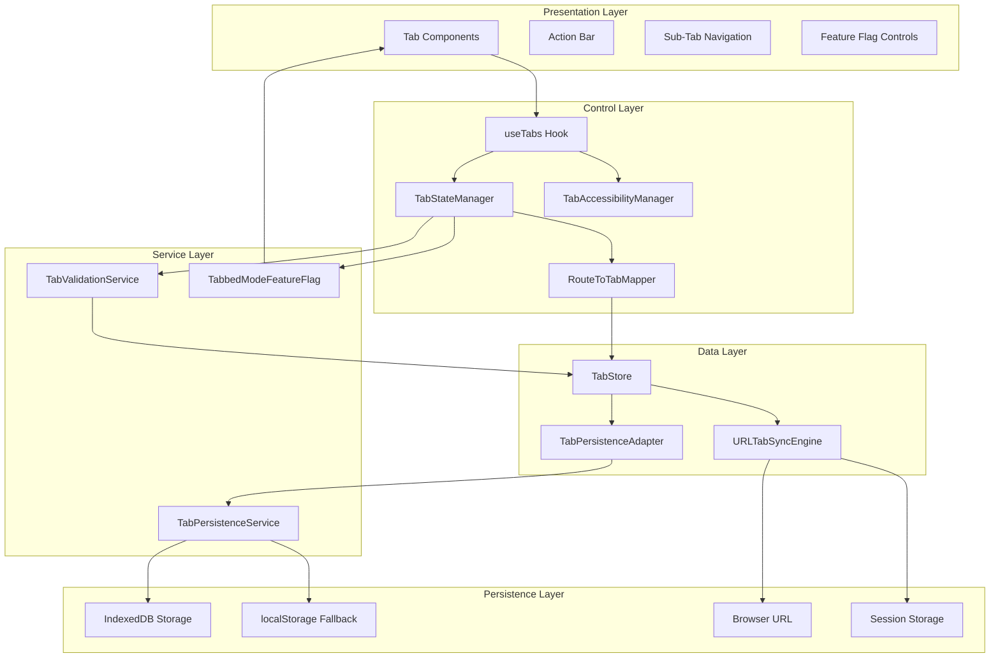

**Diagram sources**
- [useTabs.ts:172-486](file://src/hooks/tabs/useTabs.ts#L172-L486)
- [TabStateManager.ts:33-375](file://src/services/TabStateManager.ts#L33-L375)
- [TabAccessibilityManager.ts:62-552](file://src/services/TabAccessibilityManager.ts#L62-L552)
- [URLTabSyncEngine.ts:21-522](file://src/services/tabs/URLTabSyncEngine.ts#L21-L522)
- [tabPersistenceAdapter.ts:1-153](file://src/stores/adapters/tabPersistenceAdapter.ts#L1-L153)
- [RouteToTabMapper.ts:60-609](file://src/services/tabs/RouteToTabMapper.ts#L60-L609)

## Core Components

### URLTabSyncEngine

The URLTabSyncEngine serves as the central coordinator for URL-based tab state management. It implements a sophisticated URL parameter system that can encode up to 20 tabs in a compact format while maintaining backward compatibility with legacy tab parameters.

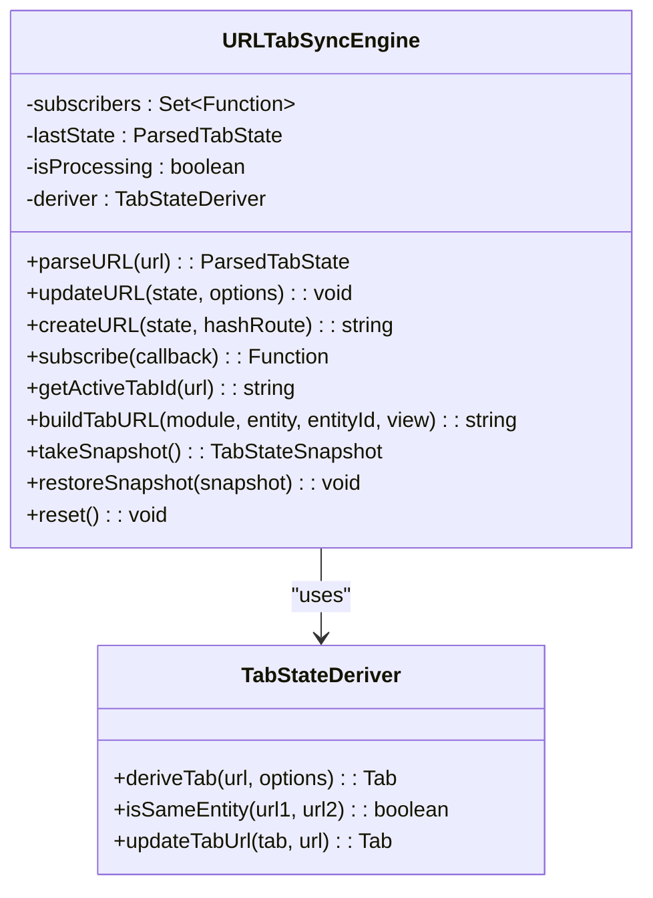

**Diagram sources**
- [URLTabSyncEngine.ts:21-522](file://src/services/tabs/URLTabSyncEngine.ts#L21-L522)

**Section sources**
- [URLTabSyncEngine.ts:62-106](file://src/services/tabs/URLTabSyncEngine.ts#L62-L106)
- [URLTabSyncEngine.ts:111-148](file://src/services/tabs/URLTabSyncEngine.ts#L111-L148)

### useTabs Hook

The useTabs hook provides the primary interface for tab management operations. It implements URL-driven state synchronization and offers comprehensive tab manipulation capabilities.

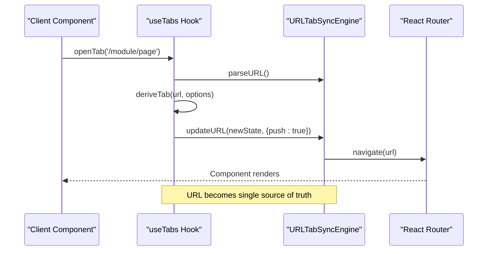

**Diagram sources**
- [useTabs.ts:220-265](file://src/hooks/tabs/useTabs.ts#L220-L265)
- [useTabs.ts:208-218](file://src/hooks/tabs/useTabs.ts#L208-L218)

**Section sources**
- [useTabs.ts:172-486](file://src/hooks/tabs/useTabs.ts#L172-L486)

### TabStateManager

The TabStateManager handles complex tab state logic, module dashboard detection, and platform-aware tab management. It provides intelligent tab cleanup and adaptive behavior based on device type.

**Section sources**
- [TabStateManager.ts:33-375](file://src/services/TabStateManager.ts#L33-L375)

## Enhanced Validation System

### TabValidationService Integration

The TabValidationService provides centralized validation logic that enhances tab creation and state management with comprehensive error checking and validation rules.

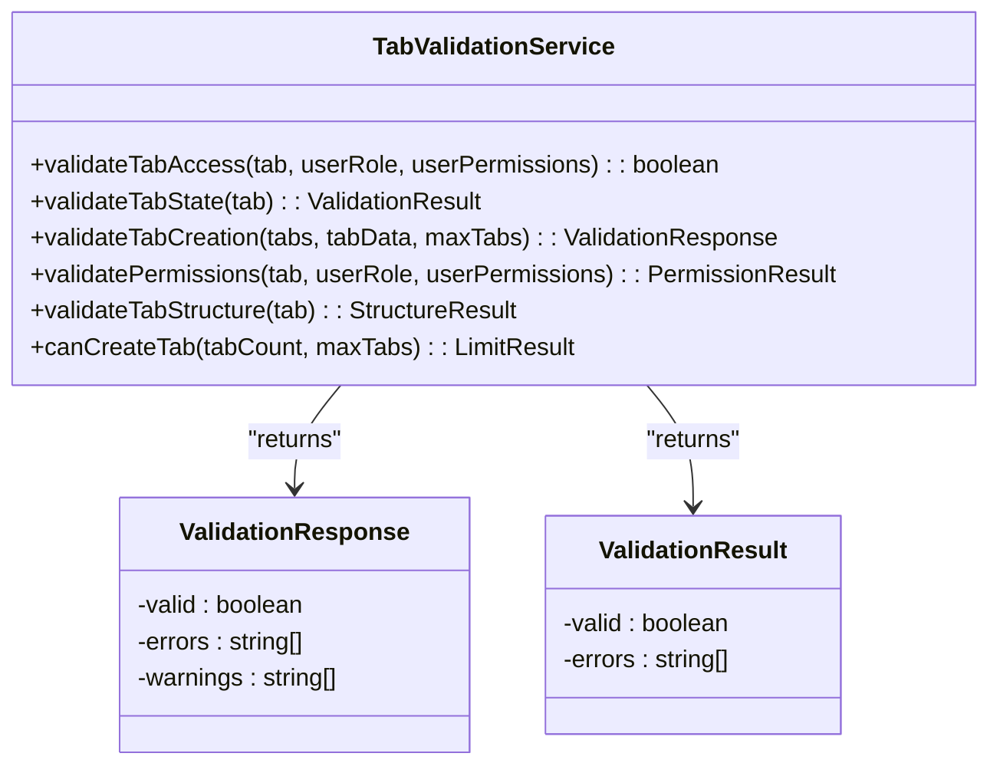

**Diagram sources**
- [TabValidationService.ts](file://src/services/tabs/TabValidationService.ts)

### Enhanced Tab Creation Validation

The tabStore now delegates comprehensive validation to the TabValidationService, providing better error handling and validation results:

**Before**:
```typescript
if (updatedState.tabs.length >= updatedState.maxTabs) {
  throw new Error(`Maximum tab limit (${updatedState.maxTabs}) reached`);
}
```

**After**:
```typescript
const validation = tabValidationService.validateTabCreation(
  updatedState.tabs,
  tabData,
  updatedState.maxTabs
);

if (!validation.valid) {
  throw new Error(validation.errors.join(', '));
}

if (validation.warnings.length > 0) {
  console.warn('[TabStore] Tab creation warnings:', validation.warnings);
}
```

**Section sources**
- [tabStore.ts:53-76](file://src/stores/tabStore.ts#L53-L76)
- [TAB_INTEGRATION_IMPLEMENTATION_SUMMARY.md:25-47](file://docs/TAB_INTEGRATION_IMPLEMENTATION_SUMMARY.md#L25-L47)

## Advanced Persistence Implementation

### TabPersistenceAdapter Architecture

The TabPersistenceAdapter bridges Zustand's persist middleware with the TabPersistenceService, enabling advanced persistence features with IndexedDB fallback and schema versioning.

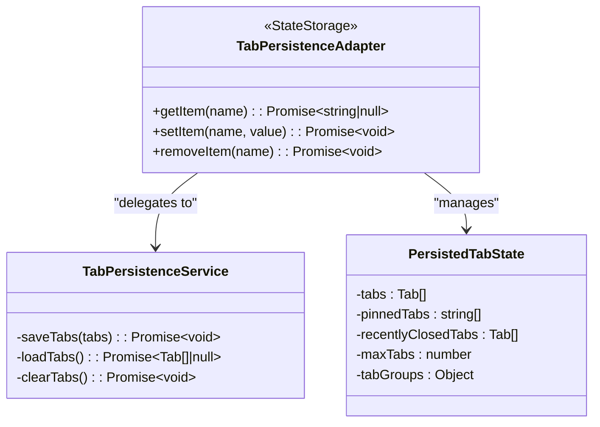

**Diagram sources**
- [tabPersistenceAdapter.ts:49-153](file://src/stores/adapters/tabPersistenceAdapter.ts#L49-L153)

### Multi-Layered Persistence Strategy

The system implements a sophisticated multi-layered persistence approach:

1. **Primary Storage**: IndexedDB for large datasets and better performance
2. **Fallback Storage**: localStorage for compatibility and data migration
3. **Additional State**: Separate localStorage storage for non-tab state (pinnedTabs, recentlyClosedTabs)
4. **Schema Versioning**: Support for future data migrations and versioning

**Features Enabled**:
- ✅ IndexedDB support for larger datasets (up to 50+ tabs efficiently)
- ✅ Automatic fallback to localStorage if IndexedDB fails
- ✅ Schema versioning for future migrations
- ✅ Better error handling and recovery mechanisms
- ✅ Metadata tracking (lastSaved, tabCount, etc.)

**Section sources**
- [tabPersistenceAdapter.ts:27-34](file://src/stores/adapters/tabPersistenceAdapter.ts#L27-L34)
- [tabStore.ts:854-855](file://src/stores/tabStore.ts#L854-L855)
- [TAB_INTEGRATION_IMPLEMENTATION_SUMMARY.md:93-99](file://docs/TAB_INTEGRATION_IMPLEMENTATION_SUMMARY.md#L93-L99)

## Centralized Route Mapping

### RouteToTabMapper Service

The RouteToTabMapper service extracts route handling logic from TabStateManager and TabbedWorkspaceManager, providing centralized route-to-tab mapping capabilities.

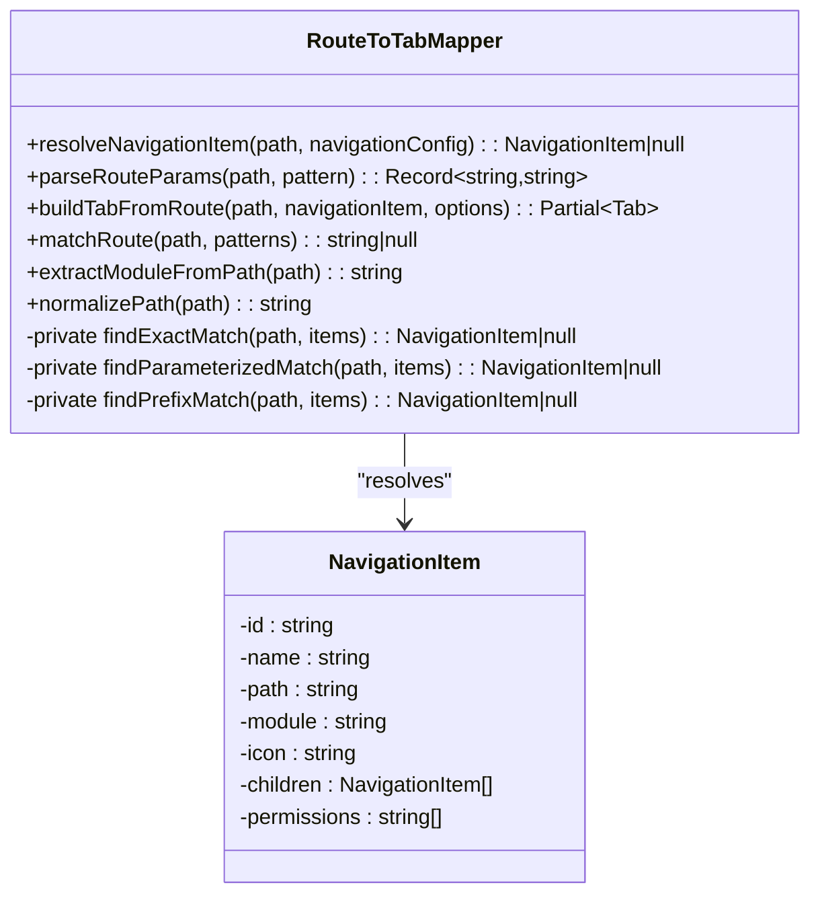

**Diagram sources**
- [RouteToTabMapper.ts:60-609](file://src/services/tabs/RouteToTabMapper.ts#L60-L609)

### Route Processing Capabilities

The service handles complex routing scenarios:

1. **Exact Path Matching**: Direct path-to-navigation-item matching
2. **Parameterized Routes**: Dynamic parameter extraction (e.g., `/students/:id`)
3. **Wildcard Matching**: Support for wildcard patterns and prefix matching
4. **Module Extraction**: Automatic module identification from paths
5. **Title Generation**: Intelligent tab title creation from navigation items

**Section sources**
- [RouteToTabMapper.ts:82-109](file://src/services/tabs/RouteToTabMapper.ts#L82-L109)
- [RouteToTabMapper.ts:244-264](file://src/services/tabs/RouteToTabMapper.ts#L244-L264)

## Feature Flag Management

### Tabbed Mode Feature Flag System

The feature flag system provides granular control over tabbed mode deployment with per-module enablement and gradual rollout capabilities.

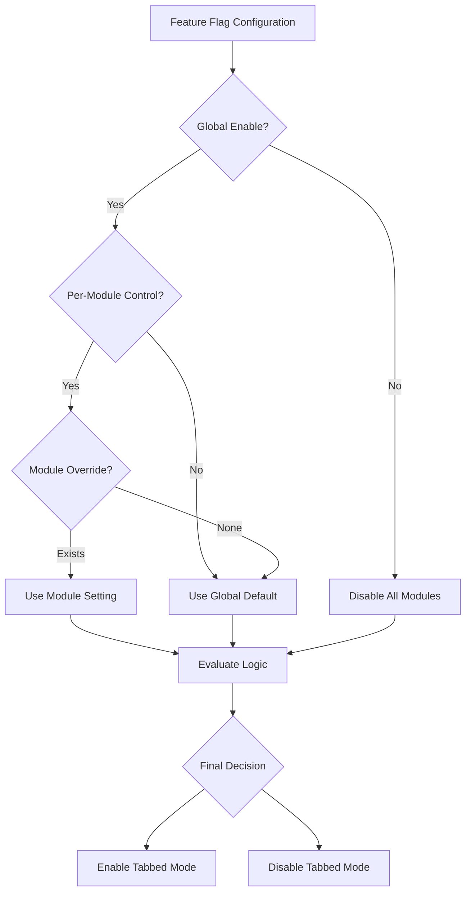

**Diagram sources**
- [TABBED_MODE_FEATURE_FLAG_IMPLEMENTATION.md:36-42](file://docs/tabs/TABBED_MODE_FEATURE_FLAG_IMPLEMENTATION.md#L36-L42)

### Configuration Hierarchy

The feature flag system follows a clear hierarchy:

1. **Global Enable/Disable** - Master switch for entire system
2. **Per-Module Control** - Enable/disable individual module control
3. **Module Overrides** - Specific module settings
4. **Runtime Updates** - Dynamic configuration changes

**Section sources**
- [TABDED_MODE_USER_GUIDE.md:16-24](file://docs/tabs/TABDED_MODE_USER_GUIDE.md#L16-L24)
- [TABBED_MODE_FEATURE_FLAG_IMPLEMENTATION.md:59-65](file://docs/tabs/TABBED_MODE_FEATURE_FLAG_IMPLEMENTATION.md#L59-L65)

## URL-Based Tab Management

### Compact State Encoding

The system implements an efficient URL encoding mechanism that can represent up to 20 tabs in a single URL parameter:

| Parameter | Purpose | Format |
|-----------|---------|--------|
| `tab` | Tab URLs (multiple) | Array of URLs |
| `a` | Active tab index | Single integer |
| `p` | Pinned tab indices | Multiple integers |
| `d` | Dirty tab indices | Multiple integers |
| `tabs` | Legacy support | JSON string |

### State Synchronization Flow

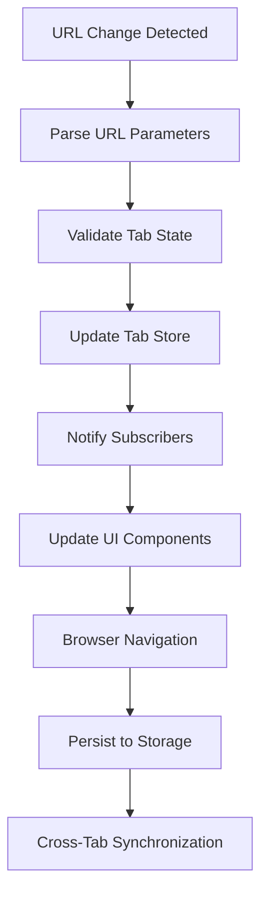

**Diagram sources**
- [URLTabSyncEngine.ts:239-255](file://src/services/tabs/URLTabSyncEngine.ts#L239-L255)
- [URLTabSyncEngine.ts:111-148](file://src/services/tabs/URLTabSyncEngine.ts#L111-L148)

**Section sources**
- [URLTabSyncEngine.ts:414-482](file://src/services/tabs/URLTabSyncEngine.ts#L414-L482)
- [URLTabSyncEngine.ts:349-382](file://src/services/tabs/URLTabSyncEngine.ts#L349-L382)

## Accessibility Implementation

### WCAG 2.1 AA Compliance

The TabAccessibilityManager ensures full accessibility compliance with comprehensive keyboard navigation, screen reader support, and visual accessibility features.

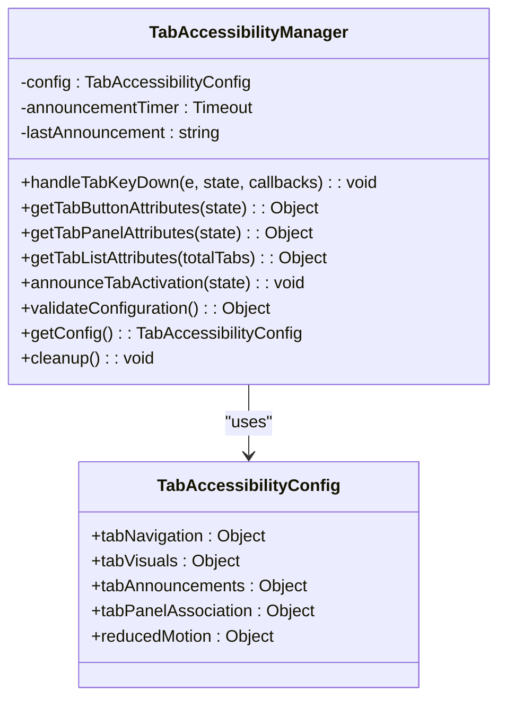

**Diagram sources**
- [TabAccessibilityManager.ts:62-552](file://src/services/TabAccessibilityManager.ts#L62-L552)

### Keyboard Navigation Support

The system supports comprehensive keyboard navigation patterns:

| Key Combination | Action | Description |
|----------------|--------|-------------|
| Arrow Keys | Navigation | Move between tabs horizontally |
| Enter/Space | Activation | Activate selected tab |
| Delete/Backspace | Closure | Close tab if permitted |
| Home/End | Positioning | Jump to first/last tab |
| Escape | Focus | Move focus to tab content |
| Tab | Guidance | Announce navigation instructions |

**Section sources**
- [TabAccessibilityManager.ts:116-191](file://src/services/TabAccessibilityManager.ts#L116-L191)
- [TabAccessibilityManager.ts:257-276](file://src/services/TabAccessibilityManager.ts#L257-L276)

## State Management

### TabStore Architecture

The TabStore implements a comprehensive state management solution using Zustand with persistence capabilities and RBAC integration.

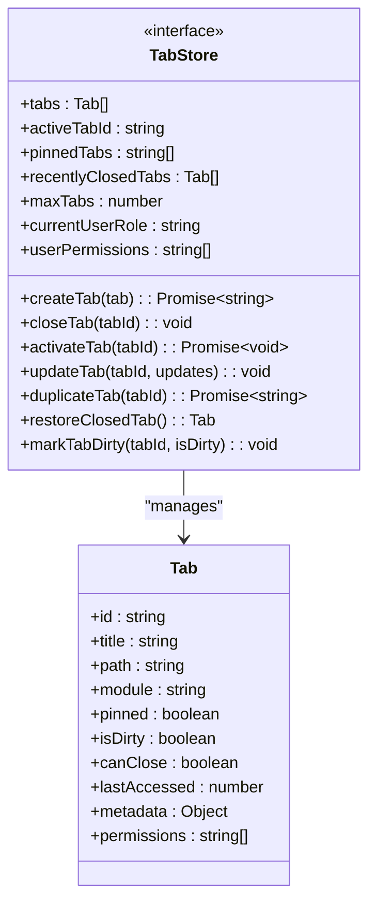

**Diagram sources**
- [tabStore.ts:18-107](file://src/stores/tabStore.ts#L18-L107)
- [tabbedWorkspace.ts:20-37](file://src/types/tabbedWorkspace.ts#L20-L37)

### Enhanced Persistence Strategy

The system implements a multi-layered persistence strategy with advanced features:

1. **URL Persistence**: Real-time state synchronization via URL parameters
2. **IndexedDB Storage**: Primary storage for large datasets with automatic fallback
3. **localStorage Fallback**: Compatibility and data migration support
4. **Schema Versioning**: Support for future data migrations
5. **Metadata Tracking**: Enhanced state tracking and recovery

**Section sources**
- [tabStore.ts:139-244](file://src/stores/tabStore.ts#L139-L244)
- [tabPersistenceAdapter.ts:60-83](file://src/stores/adapters/tabPersistenceAdapter.ts#L60-L83)
- [URLTabSyncEngine.ts:308-336](file://src/services/tabs/URLTabSyncEngine.ts#L308-L336)

## Tab Operations

### Advanced Tab Manipulation

The system provides comprehensive tab manipulation capabilities with enhanced validation and persistence:

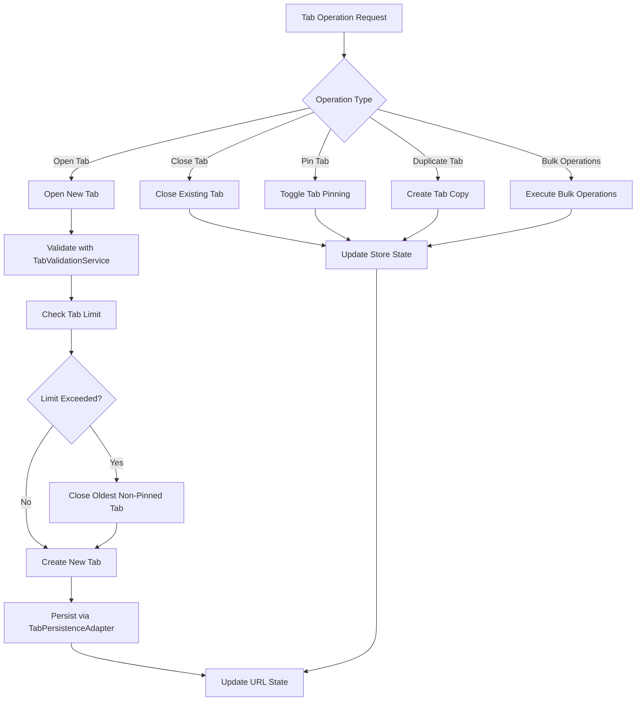

**Diagram sources**
- [useTabs.ts:220-265](file://src/hooks/tabs/useTabs.ts#L220-L265)
- [useTabs.ts:298-327](file://src/hooks/tabs/useTabs.ts#L298-L327)
- [tabPersistenceAdapter.ts:101-128](file://src/stores/adapters/tabPersistenceAdapter.ts#L101-L128)

### Tab Lifecycle Management

The system manages tab lifecycle through several key phases with enhanced validation:

1. **Creation**: Tab derivation from URL with metadata extraction and validation
2. **Activation**: State synchronization and UI updates with permission checks
3. **Modification**: Real-time updates to tab properties with validation
4. **Destruction**: Proper cleanup and state persistence with error handling
5. **Restoration**: Support for recently closed tab recovery with validation

**Section sources**
- [useTabs.ts:439-453](file://src/hooks/tabs/useTabs.ts#L439-L453)
- [tabStore.ts:435-467](file://src/stores/tabStore.ts#L435-L467)

## Performance Considerations

### Optimization Strategies

The Tabs System implements several performance optimization strategies:

- **Lazy Loading**: Tab content loaded only when activated
- **Memory Management**: Automatic cleanup of inactive tabs
- **URL Optimization**: Compact parameter encoding for long URLs
- **Event Throttling**: Debounced URL change handling
- **State Validation**: Efficient state validation and cleanup
- **IndexedDB Performance**: Optimized IndexedDB operations for large datasets
- **Graceful Degradation**: Automatic fallback to localStorage when IndexedDB fails

### Performance Monitoring

The system includes comprehensive performance monitoring through the `performanceEventManager` integration, tracking tab-related diagnostic events and performance metrics.

**Section sources**
- [URLTabSyncEngine.ts:125-135](file://src/services/tabs/URLTabSyncEngine.ts#L125-L135)
- [URLTabSyncEngine.ts:484-497](file://src/services/tabs/URLTabSyncEngine.ts#L484-L497)
- [TAB_INTEGRATION_IMPLEMENTATION_SUMMARY.md:223-241](file://docs/TAB_INTEGRATION_IMPLEMENTATION_SUMMARY.md#L223-L241)

## Integration Patterns

### Component Integration

The tabs system integrates seamlessly with the broader SchoolPilot3 architecture:

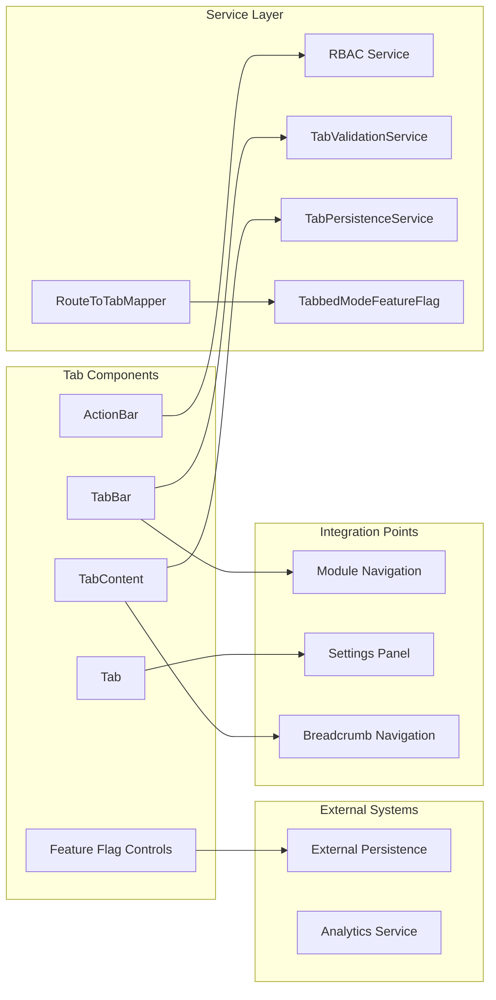

**Diagram sources**
- [index.ts:1-44](file://src/components/tabbedWorkspace/index.ts#L1-L44)

### Module-Specific Integration

Each module can integrate tabs through standardized interfaces, supporting both simple navigation and complex multi-entity workflows with feature flag control.

**Section sources**
- [index.ts:25-41](file://src/components/tabbedWorkspace/index.ts#L25-L41)

## Troubleshooting Guide

### Common Issues and Solutions

| Issue | Symptoms | Solution |
|-------|----------|----------|
| Tab State Not Persisting | Tabs reset after refresh | Check IndexedDB availability and quota |
| URL Parameter Overflow | URL too long, truncated | System automatically falls back to storage-based URLs |
| Tab Navigation Issues | Keyboard navigation not working | Verify accessibility manager configuration |
| Performance Degradation | Slow tab switching | Monitor tab count and implement cleanup |
| Cross-Tab Synchronization | State not updating across tabs | Check storage event listeners |
| IndexedDB Storage Issues | Data not saving to IndexedDB | Check browser support and quota |
| Feature Flag Misconfiguration | Module shows wrong navigation | Verify feature flag settings |
| Route Mapping Errors | Tabs not creating from routes | Check RouteToTabMapper configuration |

### Debugging Tools

The system provides comprehensive debugging capabilities through console logging, state snapshots, and service-specific debugging tools, enabling developers to diagnose tab-related issues effectively.

**Section sources**
- [URLTabSyncEngine.ts:308-336](file://src/services/tabs/URLTabSyncEngine.ts#L308-L336)
- [TabStateManager.ts:217-261](file://src/services/TabStateManager.ts#L217-L261)
- [tabPersistenceAdapter.ts:89-92](file://src/stores/adapters/tabPersistenceAdapter.ts#L89-L92)

## Conclusion

The Tabs System in SchoolPilot3 represents a comprehensive solution for multi-tab navigation in educational applications. Its URL-driven architecture ensures state persistence and sharing, while the extensive accessibility implementation provides inclusive user experiences. The system's modular design enables easy integration with various modules and platforms, making it a robust foundation for complex educational workflows.

**Updated** The recent integration of TabValidationService, TabPersistenceService, and RouteToTabMapper has significantly enhanced the system's maintainability, scalability, and reliability. The addition of feature flag management provides controlled deployment capabilities, enabling gradual migration to tabbed mode across modules.

The combination of advanced state management, performance optimization, comprehensive accessibility support, and service-oriented architecture positions this system as a leading implementation for modern web applications requiring sophisticated tab management capabilities with enterprise-grade features and maintainability.