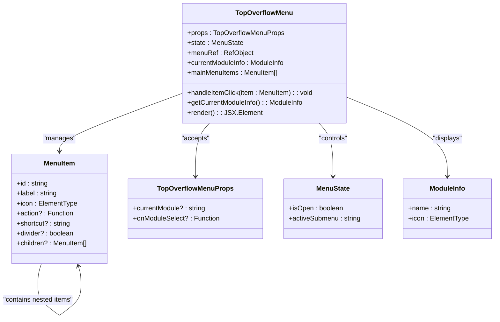
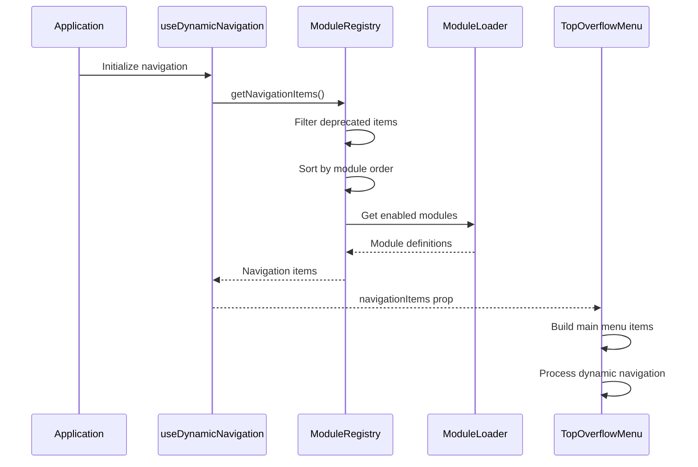

# TopOverflowMenu Component

<cite>
**Referenced Files in This Document**
- [TopOverflowMenu.tsx](file://src/components/TopOverflowMenu.tsx)
- [useDynamicNavigation.ts](file://src/hooks/useDynamicNavigation.ts)
- [moduleLoader.ts](file://src/core/moduleLoader.ts)
- [moduleRegistry.ts](file://src/core/moduleRegistry.ts)
- [types.ts](file://src/core/types.ts)
- [moduleOrder.ts](file://src/moduleOrder.ts)
- [PrimarySidebar.tsx](file://src/components/PrimarySidebar.tsx)
- [App.tsx](file://src/App.tsx)
</cite>

## Table of Contents
1. [Introduction](#introduction)
2. [Component Architecture](#component-architecture)
3. [Core Functionality](#core-functionality)
4. [Navigation System Integration](#navigation-system-integration)
5. [UI/UX Design Implementation](#uiux-design-implementation)
6. [State Management](#state-management)
7. [Event Handling](#event-handling)
8. [Internationalization Support](#internationalization-support)
9. [Usage Patterns](#usage-patterns)
10. [Performance Considerations](#performance-considerations)
11. [Troubleshooting Guide](#troubleshooting-guide)
12. [Conclusion](#conclusion)

## Introduction

The TopOverflowMenu component is a sophisticated navigation dropdown menu designed to provide users with quick access to various application modules and system functions. Inspired by ERPNext's navigation pattern, this component serves as a centralized hub for module selection and system-wide actions within the SchoolPilot3 educational management system.

The component integrates deeply with the application's dynamic module loading system, providing seamless access to enabled modules while maintaining a clean, modern interface. It supports nested navigation structures, keyboard shortcuts, and responsive design patterns suitable for both desktop and mobile environments.

## Component Architecture

The TopOverflowMenu component follows a modular architecture that emphasizes separation of concerns and maintainability. The component is built using React functional components with TypeScript for enhanced type safety and developer experience.

**Diagram sources**
- [TopOverflowMenu.tsx:21-39](file://src/components/TopOverflowMenu.tsx#L21-L39)
- [TopOverflowMenu.tsx:26-34](file://src/components/TopOverflowMenu.tsx#L26-L34)

**Section sources**
- [TopOverflowMenu.tsx:1-260](file://src/components/TopOverflowMenu.tsx#L1-L260)

## Core Functionality

The component provides several key functionalities that enhance user navigation and system accessibility:

### Dynamic Module Integration
The TopOverflowMenu dynamically integrates with the application's module system, automatically detecting and displaying available modules based on user permissions and system configuration. This ensures that users only see modules they have access to and that the interface remains current with system changes.

### Nested Navigation Support
The component supports hierarchical navigation structures through nested menu items. Users can expand parent menu items to reveal submenus containing specific module functions or administrative tasks.

### System-Level Actions
Beyond module navigation, the component provides access to system-level functions including theme switching, full-width mode toggling, application reloading, and help resources.

### Responsive Design
The component adapts to different screen sizes and orientations, ensuring optimal usability across desktop, tablet, and mobile devices.

**Section sources**
- [TopOverflowMenu.tsx:70-143](file://src/components/TopOverflowMenu.tsx#L70-L143)
- [TopOverflowMenu.tsx:145-152](file://src/components/TopOverflowMenu.tsx#L145-L152)

## Navigation System Integration

The TopOverflowMenu integrates seamlessly with the application's dynamic navigation system through the useDynamicNavigation hook and module registry infrastructure.

**Diagram sources**
- [useDynamicNavigation.ts:19-51](file://src/hooks/useDynamicNavigation.ts#L19-L51)
- [moduleRegistry.ts:104-158](file://src/core/moduleRegistry.ts#L104-L158)
- [moduleLoader.ts:36-39](file://src/core/moduleLoader.ts#L36-L39)

The integration process involves several key steps:

1. **Module Discovery**: The component queries the module registry for all enabled modules
2. **Navigation Item Processing**: Deprecated items are filtered out and remaining items are sorted according to predefined priorities
3. **Dynamic Content Generation**: Navigation items are dynamically generated based on module configurations
4. **Real-time Updates**: Changes in module availability trigger automatic UI updates

**Section sources**
- [useDynamicNavigation.ts:105-114](file://src/hooks/useDynamicNavigation.ts#L105-L114)
- [moduleRegistry.ts:104-158](file://src/core/moduleRegistry.ts#L104-L158)

## UI/UX Design Implementation

The component implements a sophisticated UI design that balances functionality with aesthetic appeal:

### Visual Design Elements
- **Gradient Accents**: Blue-to-fuchsia gradient used for module icons
- **Backdrop Effects**: Frosted glass effect using backdrop blur for enhanced depth perception
- **Border Effects**: Subtle borders with transparency for visual hierarchy
- **Transition Animations**: Smooth transitions for open/close states and hover effects

### Interactive Elements
- **Compact Trigger**: Minimalist trigger button showing current module and expansion indicator
- **Hover States**: Clear visual feedback for interactive elements
- **Focus Management**: Proper keyboard navigation support
- **Responsive Scaling**: Adaptive sizing for different screen dimensions

### Accessibility Features
- **Keyboard Navigation**: Full keyboard support for menu interaction
- **Screen Reader Compatibility**: Proper ARIA attributes and semantic markup
- **Color Contrast**: High contrast ratios for text and interactive elements
- **Focus Indicators**: Visible focus states for keyboard users

**Section sources**
- [TopOverflowMenu.tsx:154-256](file://src/components/TopOverflowMenu.tsx#L154-L256)

## State Management

The component employs a minimal but effective state management approach using React's useState and useRef hooks:

### Local State Variables
- **isOpen**: Controls the visibility of the dropdown menu
- **activeSubmenu**: Tracks which submenu is currently expanded
- **menuRef**: Reference to the menu container for click-outside detection

### State Transition Logic
The component implements controlled state transitions that ensure predictable user interactions and prevent conflicting states during rapid menu operations.

### Performance Optimizations
- **Memoization**: Strategic use of useMemo for derived values
- **Stable References**: useRef for DOM references to avoid unnecessary re-renders
- **Event Cleanup**: Proper cleanup of event listeners to prevent memory leaks

**Section sources**
- [TopOverflowMenu.tsx:40-58](file://src/components/TopOverflowMenu.tsx#L40-L58)

## Event Handling

The component implements comprehensive event handling for various user interactions:

### Click Events
- **Trigger Button**: Opens/closes the menu with smooth transitions
- **Menu Items**: Executes associated actions or expands submenus
- **Click Outside**: Automatically closes menu when clicking outside boundaries

### Keyboard Navigation
- **Arrow Keys**: Navigate between menu items
- **Enter/Space**: Activate selected menu items
- **Escape**: Close the menu
- **Tab/Shift+Tab**: Move focus between interactive elements

### Touch and Mobile Support
- **Touch Events**: Optimized touch targets for mobile devices
- **Gesture Support**: Swipe gestures for opening/closing menus on touch devices

**Section sources**
- [TopOverflowMenu.tsx:47-58](file://src/components/TopOverflowMenu.tsx#L47-L58)
- [TopOverflowMenu.tsx:145-152](file://src/components/TopOverflowMenu.tsx#L145-L152)

## Internationalization Support

The component leverages the application's i18n system to provide multilingual support:

### Translation Integration
- **Navigation Labels**: All menu item labels are translated using the i18n system
- **Dynamic Content**: Module names and descriptions are resolved through translation keys
- **Fallback Handling**: Graceful degradation when translations are unavailable

### Language Detection
- **Automatic Detection**: The component respects the application's current locale setting
- **RTL Support**: Proper right-to-left language support for compatible locales
- **Dynamic Updates**: Menu content updates automatically when language changes

**Section sources**
- [TopOverflowMenu.tsx:43](file://src/components/TopOverflowMenu.tsx#L43)
- [TopOverflowMenu.tsx:61-68](file://src/components/TopOverflowMenu.tsx#L61-L68)

## Usage Patterns

The TopOverflowMenu component is primarily used within the application's sidebar navigation system:

### Integration with PrimarySidebar
The component is positioned at the top of the PrimarySidebar, providing immediate access to module switching and system functions. This placement ensures that users can quickly change modules without navigating away from their current context.

### Module Selection Flow
When users select a module from the TopOverflowMenu, the component triggers the onModuleSelect callback, which updates the application state and navigates to the appropriate module interface.

### Contextual Display
The component displays the currently selected module with its corresponding icon and name, providing clear visual context for the user's current location within the application.

**Section sources**
- [PrimarySidebar.tsx:409-414](file://src/components/PrimarySidebar.tsx#L409-L414)
- [TopOverflowMenu.tsx:36-39](file://src/components/TopOverflowMenu.tsx#L36-L39)

## Performance Considerations

The component is optimized for performance through several key strategies:

### Efficient Rendering
- **Conditional Rendering**: Menu content is only rendered when the menu is open
- **Fragment Usage**: React fragments minimize DOM overhead in menu item rendering
- **CSS-in-JS**: Inline styles reduce external CSS dependencies

### Memory Management
- **Event Listener Cleanup**: Automatic cleanup prevents memory leaks
- **Reference Management**: useRef for DOM references avoids unnecessary re-renders
- **State Optimization**: Minimal state reduces re-render cycles

### Bundle Size Impact
- **Icon Import Strategy**: Icons are imported as needed to minimize initial bundle size
- **Lazy Loading**: Menu content is loaded only when needed
- **Tree Shaking**: Unused code is eliminated during the build process

## Troubleshooting Guide

Common issues and their solutions when working with the TopOverflowMenu component:

### Menu Not Opening
**Symptoms**: Clicking the trigger button has no effect
**Causes**: 
- Missing event listener registration
- CSS positioning conflicts
- JavaScript errors preventing state updates

**Solutions**:
- Verify click handler is properly attached to the trigger button
- Check for CSS conflicts in positioning or z-index
- Review browser console for JavaScript errors

### Incorrect Module Display
**Symptoms**: Wrong module name or icon appears
**Causes**:
- Translation key resolution failures
- Module configuration issues
- State synchronization problems

**Solutions**:
- Verify translation keys exist in the i18n system
- Check module configuration in the registry
- Ensure proper prop passing from parent components

### Navigation Issues
**Symptoms**: Selected module doesn't navigate correctly
**Causes**:
- Missing onModuleSelect callback implementation
- Route configuration problems
- Module permission restrictions

**Solutions**:
- Implement proper onModuleSelect handler in parent component
- Verify route configuration for the selected module
- Check user permissions for the target module

**Section sources**
- [TopOverflowMenu.tsx:47-58](file://src/components/TopOverflowMenu.tsx#L47-L58)
- [PrimarySidebar.tsx:409-414](file://src/components/PrimarySidebar.tsx#L409-L414)

## Conclusion

The TopOverflowMenu component represents a sophisticated solution for application navigation in the SchoolPilot3 system. Its integration with the dynamic module loading system, combined with thoughtful UI/UX design and comprehensive internationalization support, creates a robust foundation for user navigation.

The component's architecture demonstrates best practices in React development, including proper state management, efficient rendering, and comprehensive accessibility features. Its modular design ensures maintainability while providing the flexibility needed for an evolving educational management system.

Through its seamless integration with the broader application ecosystem and its commitment to user experience excellence, the TopOverflowMenu component serves as a cornerstone of the SchoolPilot3 navigation architecture.