# UI Component Library

<cite>
**Referenced Files in This Document**
- [LayoutNew.tsx](file://src/components/LayoutNew.tsx)
- [useTabs.ts](file://src/hooks/tabs/useTabs.ts)
- [URLTabSyncEngine.ts](file://src/services/tabs/URLTabSyncEngine.ts)
- [TabbedWorkspace.tsx](file://src/components/tabbedWorkspace/TabbedWorkspace.tsx)
- [TabBar.tsx](file://src/components/tabbedWorkspace/TabBar.tsx)
- [TabbedForm.tsx](file://src/components/ui/forms/TabbedForm.tsx)
- [SlideoutForm.tsx](file://src/components/ui/forms/SlideoutForm.tsx)
- [DataGrid.tsx](file://src/components/ui/data/DataGrid.tsx)
- [KanbanBoard.tsx](file://src/components/ui/data/KanbanBoard.tsx)
- [Toast.tsx](file://src/components/ui/feedback/Toast.tsx)
- [Modal.tsx](file://src/components/ui/Modal.tsx)
- [PageContainer.tsx](file://src/components/layout/PageContainer.tsx)
- [accessibility.ts](file://src/utils/accessibility.ts)
- [animations.ts](file://src/utils/animations.ts)
- [performanceAnalysis.ts](file://src/utils/performanceAnalysis.ts)
- [TabAccessibilityManager.ts](file://src/services/TabAccessibilityManager.ts)
- [ExamSchedulingUI.tsx](file://src/modules/academics/components/ExamSchedulingUI.tsx)
- [SettingsPopup.tsx](file://src/components/SettingsPopup.tsx)
- [tabbedModeFeatureFlag.ts](file://src/services/tabbedModeFeatureFlag.ts)
- [TabbedModeSettingsPanel.tsx](file://src/modules/settings/components/TabbedModeSettingsPanel.tsx)
- [TabbedFormDemo.tsx](file://src/components/TabbedFormDemo.tsx)
- [RenderLoopPrevention.test.tsx](file://src/tests/RenderLoopPrevention.test.tsx)
- [TabNavigation.test.tsx](file://src/tests/TabNavigation.test.tsx)
- [TabAccessibility.test.ts](file://src/tests/TabAccessibility.test.ts)
- [animations.test.tsx](file://src/tests/animations.test.tsx)
- [MemoryAndPerformance.test.tsx](file://src/tests/performance/MemoryAndPerformance.test.tsx)
</cite>

## Update Summary
**Changes Made**
- Added comprehensive documentation for the new LayoutNew component with URL-driven tab system
- Enhanced TabbedWorkspace documentation with improved tab management and accessibility features
- Updated form components documentation with enhanced slideout form capabilities
- Added new section on URL-driven tab architecture and state synchronization
- Enhanced accessibility documentation with comprehensive tab accessibility features
- Added performance optimization documentation for data-intensive components
- Updated testing documentation with new render loop prevention and animation tests

## Table of Contents
1. [Introduction](#introduction)
2. [Design System Principles](#design-system-principles)
3. [Component Categories](#component-categories)
4. [Layout Components](#layout-components)
5. [Data Display Components](#data-display-components)
6. [Form Components](#form-components)
7. [Feedback Components](#feedback-components)
8. [Complex Interface Composition](#complex-interface-composition)
9. [Accessibility Considerations](#accessibility-considerations)
10. [Performance Best Practices](#performance-best-practices)
11. [URL-Driven Tab Architecture](#url-driven-tab-architecture)
12. [Testing and Quality Assurance](#testing-and-quality-assurance)
13. [Tabbed Mode Configuration](#tabbed-mode-configuration)

## Introduction
The UI Component Library in schoolpilot3 represents a comprehensive design system that enables consistent, accessible, and responsive user interfaces across the educational platform. This library follows modern React patterns with TypeScript, providing reusable components that adhere to strict design principles while offering extensive customization options. The component architecture supports both simple use cases and complex, data-intensive applications required in educational administration systems.

**Updated** Enhanced with new LayoutNew component featuring URL-driven tab architecture and improved accessibility features

The library has evolved to include advanced tab management systems, enhanced form components with modern interactions, and comprehensive accessibility support for screen readers and assistive technologies.

**Section sources**
- [LayoutNew.tsx](file://src/components/LayoutNew.tsx)
- [useTabs.ts](file://src/hooks/tabs/useTabs.ts)
- [URLTabSyncEngine.ts](file://src/services/tabs/URLTabSyncEngine.ts)

## Design System Principles
The component library embodies three core design principles: consistency, accessibility, and responsiveness. These principles ensure that all user interfaces maintain a uniform appearance and behavior while being usable by diverse audiences across different devices.

### Consistency
Components follow a unified design language with standardized spacing, typography, and color schemes defined in design tokens. This consistency extends to interaction patterns, where similar components behave predictably across the application. For example, all form components use the same validation states and error handling patterns.

### Accessibility
Accessibility is implemented through semantic HTML, ARIA attributes, keyboard navigation support, and screen reader announcements. Components include focus management, proper labeling, and high-contrast themes. The library provides comprehensive accessibility utilities including `announceToScreenReader`, `useFocusManagement`, and specialized tab accessibility managers.

### Responsiveness
Components are designed with mobile-first principles, adapting their layout and interaction patterns based on screen size. The library uses CSS media queries and responsive utility classes to ensure optimal user experience across devices. For instance, the TabbedForm component switches from horizontal tabs on desktop to a swipeable navigation pattern on mobile devices.

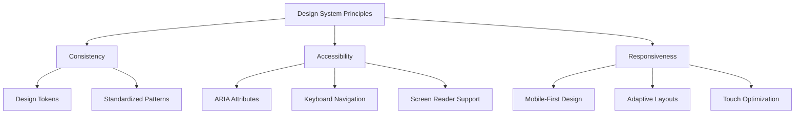

**Diagram sources**
- [accessibility.ts](file://src/utils/accessibility.ts)
- [animations.ts](file://src/utils/animations.ts)

## Component Categories
The component library is organized into four primary categories based on functionality: layout, data display, forms, and feedback. This categorization helps developers quickly locate appropriate components for specific use cases.

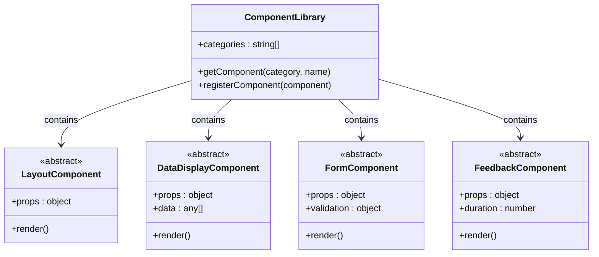

**Diagram sources**
- [LayoutNew.tsx](file://src/components/LayoutNew.tsx)
- [TabbedForm.tsx](file://src/components/ui/forms/TabbedForm.tsx)
- [DataGrid.tsx](file://src/components/ui/data/DataGrid.tsx)

## Layout Components
Layout components provide the structural foundation for application interfaces, managing screen real estate and organizing content in a coherent manner.

### LayoutNew (New Component)
The LayoutNew component represents a major architectural enhancement featuring a URL-driven tab system that replaces the traditional Layout.tsx. This component provides seamless tab management with persistence across browser sessions and enhanced accessibility features.

#### URL-Driven Architecture
The LayoutNew component implements a sophisticated URL synchronization system where the URL becomes the single source of truth for tab state. This enables:

- **Persistent Tab Sessions**: Tabs remain accessible across browser reloads and navigation
- **Deep Linking Support**: Direct URLs can open specific tab configurations
- **Cross-Tab Synchronization**: Changes in one tab are reflected across browser windows
- **Shareable Tab States**: Users can share URLs that recreate exact tab configurations

#### Enhanced Tab Management
The component integrates with the `useTabs` hook to provide advanced tab operations:

- **Automatic Tab Creation**: New tabs are created automatically when navigating to URLs
- **Tab State Persistence**: Tab titles, states, and metadata are preserved across sessions
- **Module Session Management**: Intelligent module switching with pinned tab preservation
- **Tab Limit Management**: Automatic cleanup of inactive tabs beyond the 20-tab limit

#### Accessibility Improvements
LayoutNew includes comprehensive accessibility features:

- **Screen Reader Announcements**: Automatic announcements for tab creation, activation, and navigation
- **Keyboard Navigation**: Full keyboard support for tab management and navigation
- **Focus Management**: Proper focus trapping and restoration for modal interactions
- **Reduced Motion Support**: Respects user preferences for motion reduction

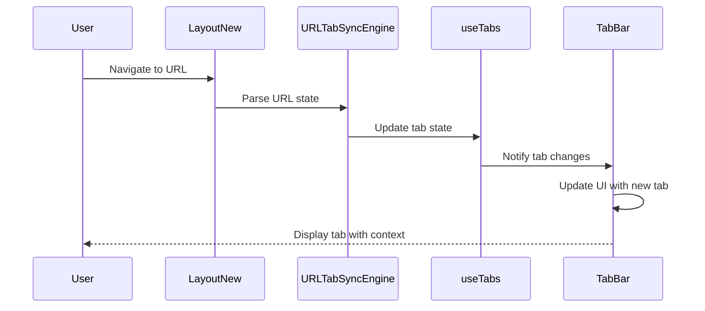

**Diagram sources**
- [LayoutNew.tsx](file://src/components/LayoutNew.tsx)
- [URLTabSyncEngine.ts](file://src/services/tabs/URLTabSyncEngine.ts)
- [useTabs.ts](file://src/hooks/tabs/useTabs.ts)

**Section sources**
- [LayoutNew.tsx](file://src/components/LayoutNew.tsx)
- [URLTabSyncEngine.ts](file://src/services/tabs/URLTabSyncEngine.ts)
- [useTabs.ts](file://src/hooks/tabs/useTabs.ts)

### PageContainer
The PageContainer component serves as the primary layout wrapper for application pages, providing consistent padding, max-width constraints, and responsive behavior. It ensures that content is properly contained and aligned across different screen sizes.

**Section sources**
- [PageContainer.tsx](file://src/components/layout/PageContainer.tsx)

## Data Display Components
Data display components are designed to present information in clear, organized formats that support efficient data consumption and interaction.

### DataGrid
The DataGrid component provides a feature-rich table interface for displaying and interacting with tabular data. It supports sorting, filtering, pagination, and selection, making it suitable for data-intensive applications.

#### Props Interface
```typescript
interface DataGridProps {
  data: any[];
  columns: Column[];
  loading?: boolean;
  selectable?: boolean;
  pagination?: PaginationConfig;
  onRowClick?: (row: any) => void;
  emptyState?: ReactNode;
  loadingState?: ReactNode;
}
```

#### Customization Options
The DataGrid offers extensive customization through its props system:

- **Column Configuration**: Columns can be customized with width, alignment, sorting, filtering, and sticky positioning
- **Styling**: Theme support with light/dark mode and customizable class names
- **Behavior**: Configurable selection, sorting, and interaction patterns

#### Usage Patterns
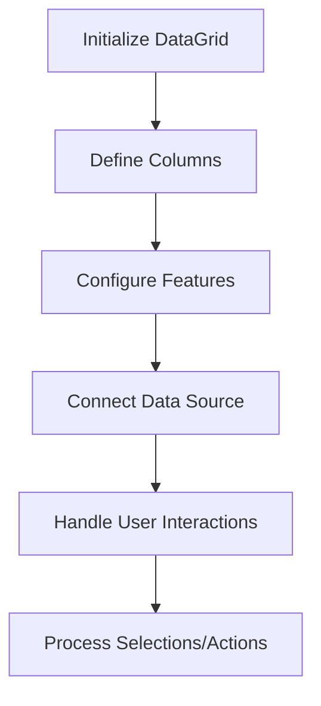

**Section sources**
- [DataGrid.tsx](file://src/components/ui/data/DataGrid.tsx)

### KanbanBoard
The KanbanBoard component implements a visual workflow management interface, allowing users to organize items across multiple columns representing different stages or categories.

#### Implementation Details
The KanbanBoard uses drag-and-drop functionality to enable intuitive reorganization of items. It integrates with the application's state management system to persist changes and supports real-time updates through WebSocket connections.

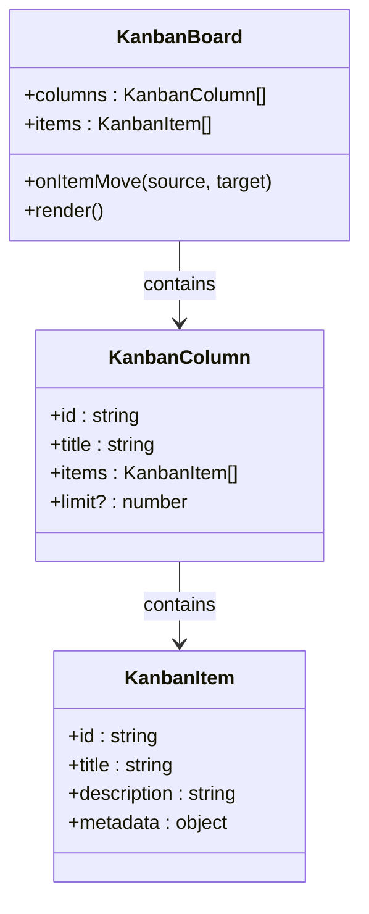

**Diagram sources**
- [KanbanBoard.tsx](file://src/components/ui/data/KanbanBoard.tsx)

## Form Components
Form components provide structured interfaces for data entry and manipulation, with support for complex workflows and validation requirements.

### TabbedForm
The TabbedForm component enables multi-step form workflows through a tabbed interface, guiding users through complex data entry processes.

#### Props Interface
```typescript
interface TabbedFormProps {
  tabs: FormTab[];
  activeTab?: number;
  onTabChange?: (tabIndex: number, tabId: string) => void;
  validation?: Record<string, boolean>;
  onSubmit?: (data: any) => Promise<void>;
  loading?: boolean;
  className?: string;
  variant?: 'default' | 'pills' | 'underline';
  size?: 'sm' | 'md' | 'lg';
  showProgress?: boolean;
  allowTabSwitching?: boolean;
  mobileBreakpoint?: 'sm' | 'md' | 'lg';
  preserveTabState?: boolean;
  submitButtonText?: string;
  cancelButtonText?: string;
  onCancel?: () => void;
  children?: ReactNode;
}
```

#### Key Features
- **Progress Tracking**: Visual progress bar shows completion status across all tabs
- **Validation State Indicators**: Tabs display success/error states based on validation
- **Responsive Navigation**: Adapts from horizontal tabs on desktop to swipe navigation on mobile
- **State Preservation**: Option to preserve form state when switching between tabs
- **Accessibility**: Full keyboard navigation support and screen reader announcements

**Section sources**
- [TabbedForm.tsx](file://src/components/ui/forms/TabbedForm.tsx)
- [TabbedFormDemo.tsx](file://src/components/TabbedFormDemo.tsx)

### SlideoutForm (Enhanced)
The SlideoutForm component provides a non-modal form interface that slides in from the side of the screen, allowing users to complete tasks without leaving their current context.

#### Enhanced Features
The SlideoutForm has been significantly enhanced with modern interaction patterns:

- **Spring Animations**: Natural-feeling animations with configurable physics parameters
- **Gesture Support**: Swipe-to-dismiss functionality on touch devices
- **Resize Handles**: Users can resize the form panel for better workspace management
- **Auto-Save**: Optional auto-save functionality with visual status indicators
- **Focus Management**: Automatic focus trapping and restoration
- **Keyboard Shortcuts**: Support for Ctrl+S (save), Ctrl+Enter (save and close), and F6 navigation
- **Theme Support**: Light, dark, and automatic theme detection
- **Backdrop Blur**: Optional backdrop blur for enhanced visual separation

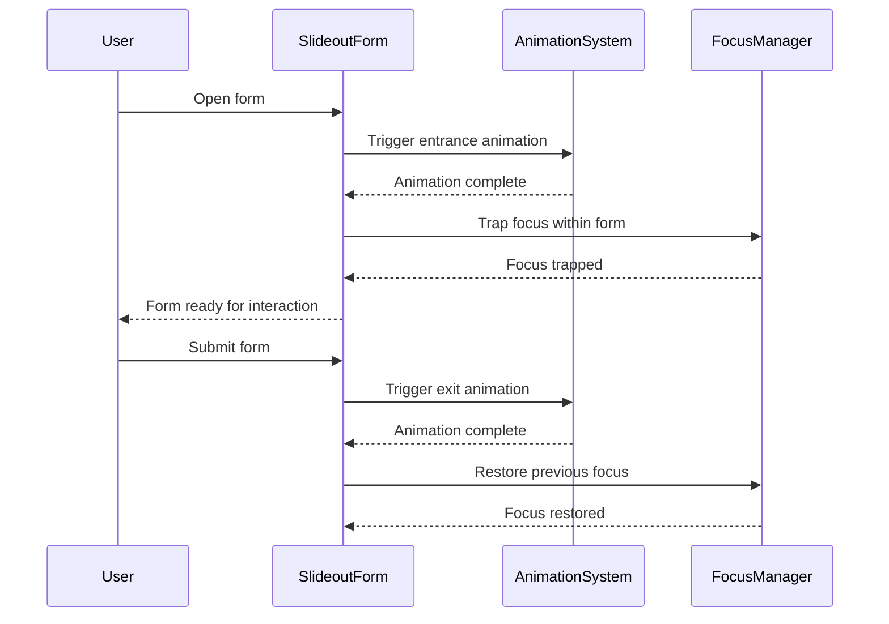

**Diagram sources**
- [SlideoutForm.tsx](file://src/components/ui/forms/SlideoutForm.tsx)
- [animations.ts](file://src/utils/animations.ts)

**Section sources**
- [SlideoutForm.tsx](file://src/components/ui/forms/SlideoutForm.tsx)

## Feedback Components
Feedback components provide timely information to users about system status, actions, and errors.

### Toast
The Toast component displays temporary notifications that automatically dismiss after a configurable duration. It supports multiple variants for different types of messages.

#### Props Interface
```typescript
interface ToastProps {
  id: string;
  title?: string;
  message: string;
  variant?: 'success' | 'error' | 'warning' | 'info' | 'progress';
  duration?: number;
  progress?: number;
  showProgress?: boolean;
  onDismiss?: (id: string) => void;
  action?: {
    label: string;
    onClick: () => void;
  };
  className?: string;
  pauseOnHover?: boolean;
  swipeToDismiss?: boolean;
  soundEnabled?: boolean;
  position?: 'top-right' | 'top-left' | 'bottom-right' | 'bottom-left' | 'top-center' | 'bottom-center';
  theme?: 'light' | 'dark' | 'auto';
  stackIndex?: number;
  totalStacked?: number;
}
```

#### Key Features
- **Multiple Variants**: Distinct visual styles for success, error, warning, info, and progress notifications
- **Interactive Elements**: Support for action buttons within notifications
- **Gesture Support**: Swipe-to-dismiss on touch devices
- **Audio Feedback**: Optional sound notifications for important alerts
- **Stacking**: Multiple toasts can be displayed simultaneously with proper positioning
- **Pause on Hover**: Notifications pause their countdown when hovered

**Section sources**
- [Toast.tsx](file://src/components/ui/feedback/Toast.tsx)

### Modal
The Modal component provides a traditional dialog interface for critical actions or information that requires user attention. It includes features like:

- **Backdrop Dimming**: Visual focus on the modal content
- **Escape Key Dismissal**: Close with ESC key
- **Click Outside Dismissal**: Optional closing when clicking the backdrop
- **Focus Trapping**: Keyboard navigation contained within the modal
- **Responsive Design**: Adapts to different screen sizes

**Section sources**
- [Modal.tsx](file://src/components/ui/Modal.tsx)

## Complex Interface Composition
The component library enables the creation of sophisticated user interfaces by composing multiple components together. A prime example is the exam scheduling UI.

### Exam Scheduling UI
The exam scheduling interface combines several components to create a comprehensive scheduling solution:

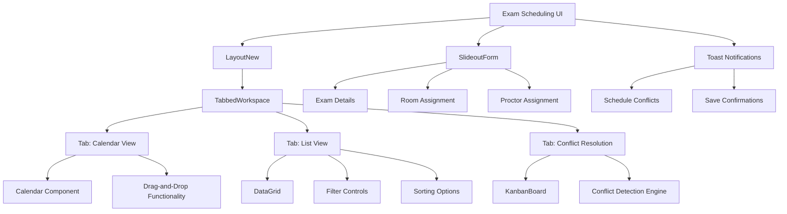

**Diagram sources**
- [ExamSchedulingUI.tsx](file://src/modules/academics/components/ExamSchedulingUI.tsx)
- [LayoutNew.tsx](file://src/components/LayoutNew.tsx)

#### Implementation Example
The exam scheduling UI uses the LayoutNew component as its primary container, leveraging the URL-driven tab system for persistent state management. The interface includes:

- **Tabbed Workspace**: Different views for calendar, list, and conflict resolution modes
- **DataGrid Integration**: Detailed exam listing with filtering and sorting capabilities
- **SlideoutForm**: Non-modal editing interface for exam modifications
- **KanbanBoard**: Visual conflict resolution with drag-and-drop functionality
- **Toast Notifications**: Contextual feedback for user actions and system events

**Section sources**
- [ExamSchedulingUI.tsx](file://src/modules/academics/components/ExamSchedulingUI.tsx)

## Accessibility Considerations
The component library prioritizes accessibility through comprehensive implementation of best practices.

### Comprehensive Accessibility Features
The library provides extensive accessibility support through multiple layers:

#### Screen Reader Support
Components use appropriate ARIA roles, states, and properties to ensure screen readers can accurately convey information. Dynamic content changes trigger announcements using the `announceToScreenReader` utility, providing context about state changes.

#### Keyboard Navigation
All components support full keyboard navigation, with logical tab orders and visible focus indicators. Interactive elements are accessible via keyboard shortcuts, and complex components like TabbedForm include F6 navigation between sections.

#### Focus Management
Modal components and slideout forms implement focus trapping to ensure keyboard navigation remains within the active component. When components are dismissed, focus is restored to the previously active element.

#### Reduced Motion Support
The animation system respects user preferences for reduced motion through the `useReducedMotion` hook, automatically disabling animations when users prefer minimal motion.

#### High Contrast Support
Components adapt to high contrast themes through the `useHighContrast` hook, ensuring readability for users with visual impairments.

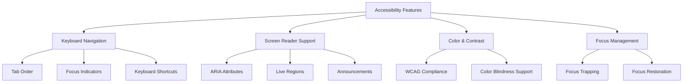

**Diagram sources**
- [accessibility.ts](file://src/utils/accessibility.ts)
- [TabAccessibilityManager.ts](file://src/services/TabAccessibilityManager.ts)

**Section sources**
- [accessibility.ts](file://src/utils/accessibility.ts)
- [TabAccessibilityManager.ts](file://src/services/TabAccessibilityManager.ts)
- [TabAccessibility.test.ts](file://src/tests/TabAccessibility.test.ts)

## Performance Best Practices
When using data-intensive components, several performance best practices should be followed to ensure optimal user experience.

### DataGrid Optimization
For DataGrid components with large datasets:

- **Virtualization**: Implement virtual scrolling to render only visible rows
- **Memoization**: Use React.memo for row and cell components
- **Debounced Filtering**: Apply filters with a debounce to prevent excessive re-renders
- **Pagination**: Use server-side pagination for very large datasets

### State Management Optimization
- **URL-Driven State**: Leverage the URL synchronization system to avoid unnecessary state updates
- **Tab Limit Management**: Automatic cleanup of inactive tabs to prevent memory leaks
- **Selective Re-renders**: Use memoization and useCallback to prevent unnecessary updates
- **Lazy Loading**: Load data and components only when needed

### Animation Performance
- **Reduced Motion Respect**: Automatically disable animations for users with motion sensitivity
- **60fps Monitoring**: Use performance monitoring hooks to detect and address performance issues
- **Hardware Acceleration**: Leverage CSS transforms and opacity for smooth animations
- **Animation Cleanup**: Properly clean up animation listeners and observers

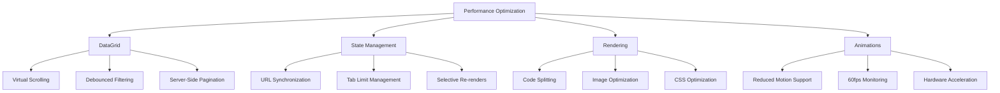

**Diagram sources**
- [performanceAnalysis.ts](file://src/utils/performanceAnalysis.ts)
- [useTabs.ts](file://src/hooks/tabs/useTabs.ts)
- [animations.ts](file://src/utils/animations.ts)

**Section sources**
- [performanceAnalysis.ts](file://src/utils/performanceAnalysis.ts)
- [useTabs.ts](file://src/hooks/tabs/useTabs.ts)
- [animations.ts](file://src/utils/animations.ts)
- [MemoryAndPerformance.test.tsx](file://src/tests/performance/MemoryAndPerformance.test.tsx)

## URL-Driven Tab Architecture
The LayoutNew component introduces a revolutionary URL-driven tab architecture that treats the URL as the single source of truth for tab state management.

### Core Architecture
The URL-driven system consists of three main components working in harmony:

#### URLTabSyncEngine
The `URLTabSyncEngine` serves as the central coordinator for tab state synchronization. It parses URLs to derive tab state, manages URL parameter encoding, and handles browser history integration.

Key features include:
- **Compact State Encoding**: Efficient URL parameter encoding for up to 20 tabs
- **Cross-Tab Synchronization**: Real-time synchronization across browser windows
- **Fallback Mechanisms**: Graceful degradation to session storage when URLs exceed limits
- **History Integration**: Proper browser back/forward button support

#### useTabs Hook
The `useTabs` hook provides a comprehensive API for tab management with intelligent state derivation:

- **Automatic Tab Creation**: New tabs are created automatically when navigating to URLs
- **Tab State Persistence**: Titles, states, and metadata are preserved across sessions
- **Module Session Management**: Intelligent module switching with pinned tab preservation
- **Tab Limit Management**: Automatic cleanup of inactive tabs beyond the 20-tab limit

#### Tab State Derivation
The system includes sophisticated tab state derivation that converts URLs into meaningful tab representations:

- **Entity Resolution**: Converts raw URLs into human-readable tab titles
- **Module Detection**: Automatically identifies module contexts from URLs
- **Entity Identification**: Extracts specific entities and their IDs from URLs
- **View Context**: Preserves view modes and filter states

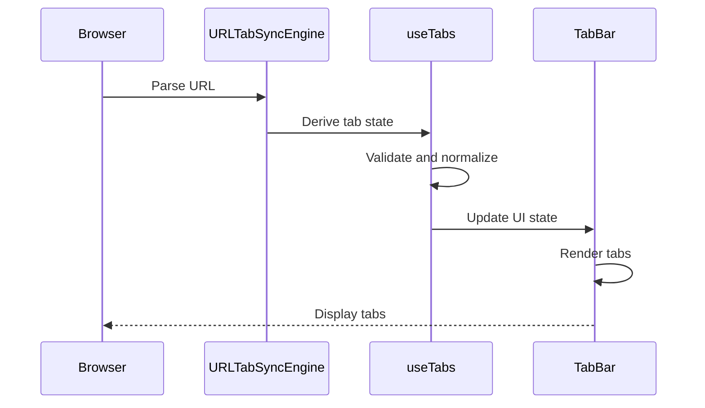

**Diagram sources**
- [URLTabSyncEngine.ts](file://src/services/tabs/URLTabSyncEngine.ts)
- [useTabs.ts](file://src/hooks/tabs/useTabs.ts)
- [TabBar.tsx](file://src/components/tabbedWorkspace/TabBar.tsx)

### Advanced Features
The URL-driven architecture includes several advanced features:

#### Cross-Tab Synchronization
Tabs created in one browser window are immediately available in other windows, providing seamless multi-window workflows.

#### Deep Linking Support
Users can share URLs that recreate exact tab configurations, enabling collaborative workflows and bookmark-friendly navigation.

#### Persistent Sessions
Tab sessions persist across browser reloads and application restarts, maintaining user context and productivity.

**Section sources**
- [URLTabSyncEngine.ts](file://src/services/tabs/URLTabSyncEngine.ts)
- [useTabs.ts](file://src/hooks/tabs/useTabs.ts)
- [LayoutNew.tsx](file://src/components/LayoutNew.tsx)

## Testing and Quality Assurance
The component library includes comprehensive testing infrastructure to ensure reliability and performance across all components.

### Render Loop Prevention Testing
The testing suite includes specialized tests for preventing render loops and memory leaks:

- **Infinite Loop Detection**: Tests that detect and prevent infinite render cycles
- **Memory Leak Prevention**: Verification that components properly clean up resources
- **Effect Cleanup**: Ensures proper cleanup of side effects and event listeners
- **Performance Monitoring**: Automated performance benchmarking for critical components

### Animation System Testing
Comprehensive testing of the animation system ensures smooth performance and accessibility compliance:

- **Animation Preset Validation**: Verification that all animation presets are properly defined
- **Reduced Motion Support**: Testing that animations respect user preferences
- **Performance Metrics**: Monitoring of animation performance and frame rates
- **Device Compatibility**: Testing across different devices and performance levels

### Tab Navigation Testing
Extensive testing ensures reliable tab management and navigation:

- **Tab State Management**: Verification of tab creation, activation, and closure
- **URL Synchronization**: Testing of URL-driven tab state management
- **Accessibility Compliance**: Validation of keyboard navigation and screen reader support
- **Performance Benchmarks**: Performance testing for large numbers of tabs

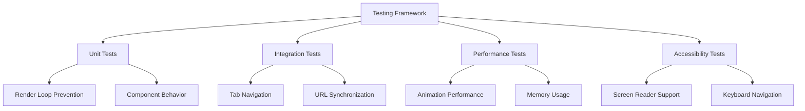

**Diagram sources**
- [RenderLoopPrevention.test.tsx](file://src/tests/RenderLoopPrevention.test.tsx)
- [animations.test.tsx](file://src/tests/animations.test.tsx)
- [TabNavigation.test.tsx](file://src/tests/TabNavigation.test.tsx)

**Section sources**
- [RenderLoopPrevention.test.tsx](file://src/tests/RenderLoopPrevention.test.tsx)
- [animations.test.tsx](file://src/tests/animations.test.tsx)
- [TabNavigation.test.tsx](file://src/tests/TabNavigation.test.tsx)
- [TabAccessibility.test.ts](file://src/tests/TabAccessibility.test.ts)

## Tabbed Mode Configuration
The SettingsPopup component has been enhanced to support context-aware navigation with tabbed mode functionality. This feature allows users to navigate through settings while maintaining their current context.

### SettingsPopup Implementation
The SettingsPopup component now integrates with the tabbed mode feature flag system to determine navigation behavior:

- When tabbed mode is enabled, it uses enhanced navigation to open settings in tabs
- When tabbed mode is disabled, it falls back to standard navigation
- The component includes comprehensive error handling and logging for debugging

#### Feature Flag Integration
The tabbed mode functionality is controlled by a feature flag system that allows granular control:

- **Global Enable/Disable**: Controls whether tabbed mode is available system-wide
- **Per-Module Control**: Allows enabling/disabling tabbed mode for specific modules
- **Module Overrides**: Provides the ability to override settings for individual modules

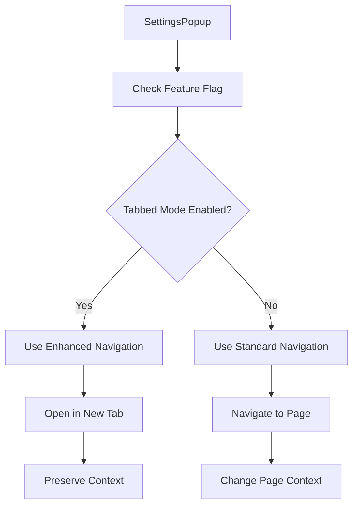

**Section sources**
- [SettingsPopup.tsx](file://src/components/SettingsPopup.tsx)
- [tabbedModeFeatureFlag.ts](file://src/services/tabbedModeFeatureFlag.ts)
- [TabbedModeSettingsPanel.tsx](file://src/modules/settings/components/TabbedModeSettingsPanel.tsx)

#### Configuration Interface
The system provides a dedicated interface for administrators to configure tabbed mode settings:

- Global toggle for enabling/disabling tabbed mode
- Per-module control switch
- Module-specific overrides with individual toggles
- Reset to defaults functionality
- Real-time feedback on configuration changes

This configuration system allows for gradual rollout of tabbed mode functionality and provides flexibility for different user preferences and organizational requirements.

**Section sources**
- [TabbedModeSettingsPanel.tsx](file://src/modules/settings/components/TabbedModeSettingsPanel.tsx)
- [tabbedModeFeatureFlag.ts](file://src/services/tabbedModeFeatureFlag.ts)