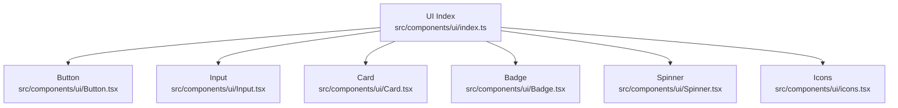
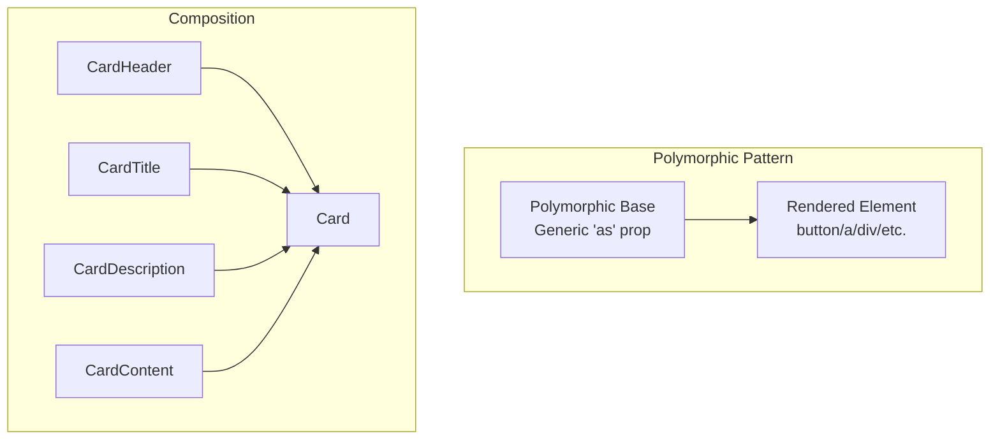
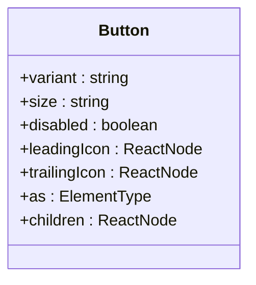
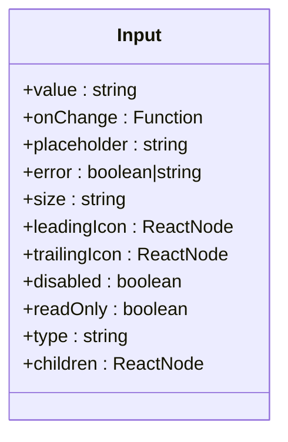
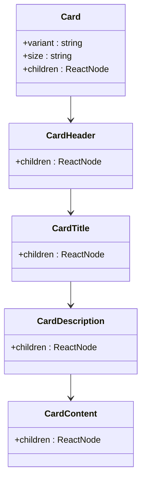
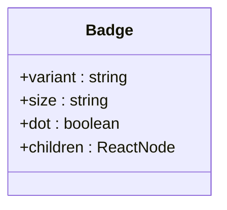
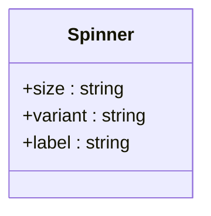
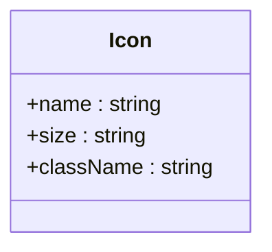
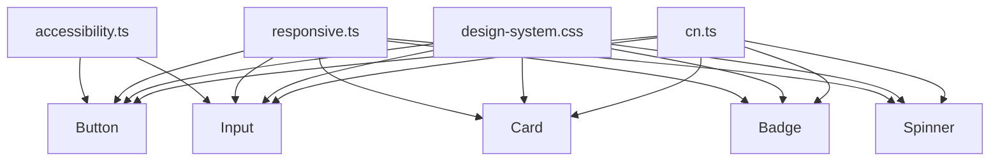
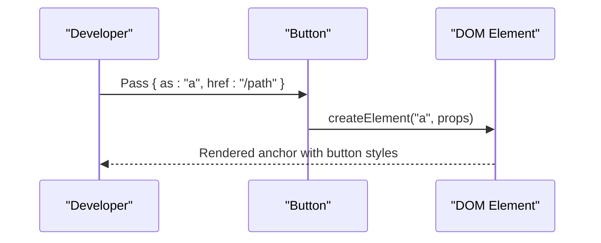

# Basic UI Components

<cite>
**Referenced Files in This Document**
- [Button.tsx](file://src/components/ui/Button.tsx)
- [Input.tsx](file://src/components/ui/Input.tsx)
- [Card.tsx](file://src/components/ui/Card.tsx)
- [Badge.tsx](file://src/components/ui/Badge.tsx)
- [Spinner.tsx](file://src/components/ui/Spinner.tsx)
- [icons.tsx](file://src/components/ui/icons.tsx)
- [index.ts](file://src/components/ui/index.ts)
- [ButtonDemo.tsx](file://src/components/__demos__/ButtonDemo.tsx)
- [InputDemo.tsx](file://src/components/__demos__/InputDemo.tsx)
- [CardDemo.tsx](file://src/components/__demos__/CardDemo.tsx)
- [accessibility.ts](file://src/utils/accessibility.ts)
- [responsive.ts](file://src/utils/responsive.ts)
- [design-system.css](file://src/styles/design-system.css)
- [cn.ts](file://src/utils/cn.ts)
</cite>

## Table of Contents
1. [Introduction](#introduction)
2. [Project Structure](#project-structure)
3. [Core Components](#core-components)
4. [Architecture Overview](#architecture-overview)
5. [Detailed Component Analysis](#detailed-component-analysis)
6. [Dependency Analysis](#dependency-analysis)
7. [Performance Considerations](#performance-considerations)
8. [Troubleshooting Guide](#troubleshooting-guide)
9. [Conclusion](#conclusion)
10. [Appendices](#appendices)

## Introduction
This document describes SchoolPilot3’s foundational UI components: Button, Input, Card, Badge, Spinner, and Icon. It explains component props, variants, states, styling options, and the polymorphic element pattern that lets components render different HTML tags. It also covers accessibility, keyboard navigation, screen reader support, composition patterns, Tailwind-based customization, and responsive/mobile-first design.

## Project Structure
SchoolPilot3 exposes UI components via a central index that re-exports each component and its TypeScript types. The six components documented here are exported from the ui package and are commonly used across pages and demos.

**Diagram sources**
- [index.ts:1-104](file://src/components/ui/index.ts#L1-L104)

**Section sources**
- [index.ts:1-104](file://src/components/ui/index.ts#L1-L104)

## Core Components
This section summarizes the six basic components and their primary roles:
- Button: Interactive actions with variants, sizes, and polymorphic rendering.
- Input: Text field with validation states, focus management, and optional adornments.
- Card: Content containers with header/title/body sections and configurable variants/sizes.
- Badge: Small status indicators with color and shape variants.
- Spinner: Loading indicator with size and color variants.
- Icon: SVG-based iconography with consistent sizing and theming.

Each component supports:
- Props and variants: Defined in component files and re-exported via the index.
- Polymorphic rendering: Allows rendering as different HTML elements (e.g., button, a, div).
- Accessibility: Keyboard navigation, ARIA attributes, and screen reader-friendly markup.
- Styling: Tailwind-based customization through className composition and design tokens.
- Responsive behavior: Mobile-first classes and responsive utilities.

**Section sources**
- [Button.tsx](file://src/components/ui/Button.tsx)
- [Input.tsx](file://src/components/ui/Input.tsx)
- [Card.tsx](file://src/components/ui/Card.tsx)
- [Badge.tsx](file://src/components/ui/Badge.tsx)
- [Spinner.tsx](file://src/components/ui/Spinner.tsx)
- [icons.tsx](file://src/components/ui/icons.tsx)

## Architecture Overview
The UI components follow a consistent pattern:
- Props typing: Strongly typed props with optional polymorphic props.
- Polymorphic pattern: Uses a generic prop to choose the rendered element tag.
- Composition: Child components (e.g., CardHeader, CardTitle) enable structured layouts.
- Styling: Centralized design tokens and Tailwind utilities for consistent appearance.
- Accessibility: Focus management, keyboard handlers, and ARIA attributes.

[No sources needed since this diagram shows conceptual workflow, not actual code structure]

## Detailed Component Analysis

### Button
- Purpose: Trigger actions with visual feedback and keyboard support.
- Key props:
  - variant: visual emphasis (e.g., primary, secondary, outline, ghost, danger).
  - size: physical scale (e.g., sm, md, lg).
  - disabled: prevents interaction.
  - leadingIcon/trailingIcon: optional icons for context.
  - as: polymorphic element selector (button, a, div).
- States:
  - hover, focus-visible, active, disabled.
- Accessibility:
  - Ensures focus ring, keyboard activation (Enter/Space), and aria-disabled when disabled.
- Styling:
  - Compose Tailwind classes via a utility that merges defaults with overrides.
- Examples:
  - Primary action with leading icon.
  - Secondary with trailing icon.
  - Disabled state.
  - Anchor link styled as button.

**Diagram sources**
- [Button.tsx](file://src/components/ui/Button.tsx)

**Section sources**
- [Button.tsx](file://src/components/ui/Button.tsx)
- [ButtonDemo.tsx](file://src/components/__demos__/ButtonDemo.tsx)
- [accessibility.ts](file://src/utils/accessibility.ts)

### Input
- Purpose: Single-line text entry with validation and focus states.
- Key props:
  - value, onChange, placeholder.
  - error: boolean or message string for invalid state.
  - size: compact vs regular.
  - leadingIcon/trailingIcon: adornment icons.
  - disabled, readOnly.
  - type: text, email, password, number, etc.
- States:
  - focus, hover, error, disabled.
- Accessibility:
  - Proper labeling, ARIA-invalid when error, focus management.
- Styling:
  - Consistent border, padding, and focus ring; compose via className merging.
- Examples:
  - Standard input with placeholder.
  - Input with leading icon.
  - Error state with message.
  - Disabled and readonly variants.

**Diagram sources**
- [Input.tsx](file://src/components/ui/Input.tsx)

**Section sources**
- [Input.tsx](file://src/components/ui/Input.tsx)
- [InputDemo.tsx](file://src/components/__demos__/InputDemo.tsx)
- [accessibility.ts](file://src/utils/accessibility.ts)

### Card
- Purpose: Group related content with semantic sections.
- Key props:
  - variant: e.g., elevated, outlined, subtle.
  - size: e.g., sm, md, lg.
  - children: structured via CardHeader, CardTitle, CardDescription, CardContent.
- Composition:
  - CardHeader -> CardTitle -> CardDescription -> CardContent.
- States:
  - Hover/active effects per variant.
- Accessibility:
  - Semantic headings and readable hierarchy.
- Styling:
  - Spacing, borders, shadows, and radius tokens; Tailwind-based.
- Examples:
  - Elevated card with title and description.
  - Compact card with small size.
  - Outlined variant for low emphasis.

**Diagram sources**
- [Card.tsx](file://src/components/ui/Card.tsx)

**Section sources**
- [Card.tsx](file://src/components/ui/Card.tsx)
- [CardDemo.tsx](file://src/components/__demos__/CardDemo.tsx)
- [accessibility.ts](file://src/utils/accessibility.ts)

### Badge
- Purpose: Short status or count indicators.
- Key props:
  - variant: e.g., solid, soft, subtle, outline.
  - size: e.g., sm, md.
  - dot: boolean for compact dots.
  - children: label text or number.
- States:
  - Color-coded by variant; dot mode omits text.
- Accessibility:
  - Optional aria-label for dot-only badges.
- Styling:
  - Rounded pill/square shapes; color tokens; Tailwind utilities.
- Examples:
  - Solid badge with text.
  - Soft dot badge for notifications.
  - Outline variant for neutral info.

**Diagram sources**
- [Badge.tsx](file://src/components/ui/Badge.tsx)

**Section sources**
- [Badge.tsx](file://src/components/ui/Badge.tsx)
- [accessibility.ts](file://src/utils/accessibility.ts)

### Spinner
- Purpose: Visual loading feedback.
- Key props:
  - size: e.g., sm, md, lg.
  - variant: e.g., subtle, brand.
  - label: assistive text for screen readers.
- States:
  - Always animated; can be hidden via aria-hidden when not needed.
- Accessibility:
  - Screen reader label for context; aria-live regions if used as overlay.
- Styling:
  - Consistent animation and color tokens; scalable via size.
- Examples:
  - Small spinner with label.
  - Large spinner for page-level loading.
  - Subtle variant for less intrusive loading.

**Diagram sources**
- [Spinner.tsx](file://src/components/ui/Spinner.tsx)

**Section sources**
- [Spinner.tsx](file://src/components/ui/Spinner.tsx)
- [accessibility.ts](file://src/utils/accessibility.ts)

### Icon
- Purpose: Reusable SVG icons with consistent sizing and theming.
- Key props:
  - name: icon identifier mapped to SVG.
  - size: e.g., xs, sm, md, lg.
  - className: additional Tailwind classes.
- Styling:
  - Inherits theme colors; sized via tokens.
- Examples:
  - Leading icon inside Input.
  - Trailing icon inside Button.
  - Standalone icon for decorative use.

**Diagram sources**
- [icons.tsx](file://src/components/ui/icons.tsx)

**Section sources**
- [icons.tsx](file://src/components/ui/icons.tsx)

## Dependency Analysis
The UI components share common utilities and design systems:
- Polymorphic pattern: Implemented consistently across Button and IconButton.
- Accessibility helpers: Focus management and keyboard handling utilities.
- Responsive utilities: Mobile-first breakpoints and responsive modifiers.
- Design tokens: Centralized CSS for consistent spacing, colors, and typography.
- Tailwind composition: Utility for merging classNames safely.

**Diagram sources**
- [accessibility.ts](file://src/utils/accessibility.ts)
- [responsive.ts](file://src/utils/responsive.ts)
- [design-system.css](file://src/styles/design-system.css)
- [cn.ts](file://src/utils/cn.ts)

**Section sources**
- [accessibility.ts](file://src/utils/accessibility.ts)
- [responsive.ts](file://src/utils/responsive.ts)
- [design-system.css](file://src/styles/design-system.css)
- [cn.ts](file://src/utils/cn.ts)

## Performance Considerations
- Prefer lightweight SVG icons and avoid unnecessary re-renders by memoizing props.
- Use the className composition utility to minimize redundant Tailwind classes.
- Keep Spinner overlays scoped to avoid blocking the entire viewport.
- Defer heavy computations in Input handlers; leverage controlled components.

[No sources needed since this section provides general guidance]

## Troubleshooting Guide
- Button not responding to keyboard:
  - Ensure the component renders a focusable element and handles Enter/Space.
- Input loses focus after state updates:
  - Verify controlled value updates do not reset selection or cursor position unintentionally.
- Card layout breaks on small screens:
  - Apply responsive padding/margin utilities and avoid fixed widths.
- Badge unreadable contrast:
  - Choose higher-contrast variants or adjust theme tokens.
- Spinner not announced by screen readers:
  - Provide an accessible label and place it near interactive content.

**Section sources**
- [accessibility.ts](file://src/utils/accessibility.ts)
- [responsive.ts](file://src/utils/responsive.ts)

## Conclusion
SchoolPilot3’s basic UI components are designed for consistency, accessibility, and flexibility. Their polymorphic nature, strong typing, and Tailwind-based styling enable rapid development while maintaining a cohesive design system. Use the provided patterns and utilities to compose robust, responsive, and accessible interfaces.

[No sources needed since this section summarizes without analyzing specific files]

## Appendices

### Polymorphic Component Pattern
- Definition: A component accepts a prop that determines the underlying HTML element.
- Benefits: Semantic markup, accessibility parity, and flexible DOM structure.
- Example usage: Render a Button as an anchor tag for navigation while preserving button styling and behavior.

**Diagram sources**
- [Button.tsx](file://src/components/ui/Button.tsx)

**Section sources**
- [Button.tsx](file://src/components/ui/Button.tsx)

### Accessibility and Keyboard Navigation
- Focus management: Visible focus rings, focus trapping when appropriate.
- Keyboard support: Enter/Space activate actions; Escape closes dialogs/modals.
- ARIA: aria-disabled, aria-invalid, aria-live, and labels for screen readers.

**Section sources**
- [accessibility.ts](file://src/utils/accessibility.ts)

### Styling and Customization with Tailwind
- Composition: Merge default classes with user-provided className safely.
- Tokens: Use design-system tokens for spacing, colors, and typography.
- Variants: Control size, variant, and state via dedicated props.

**Section sources**
- [design-system.css](file://src/styles/design-system.css)
- [cn.ts](file://src/utils/cn.ts)

### Responsive Design and Mobile-First Approach
- Breakpoints: Use responsive modifiers to adapt layout on smaller screens.
- Typography: Scale text appropriately for mobile readability.
- Touch targets: Ensure buttons and inputs meet minimum touch sizes.

**Section sources**
- [responsive.ts](file://src/utils/responsive.ts)