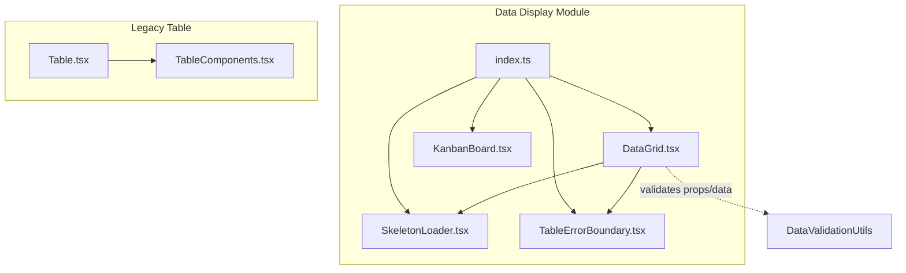
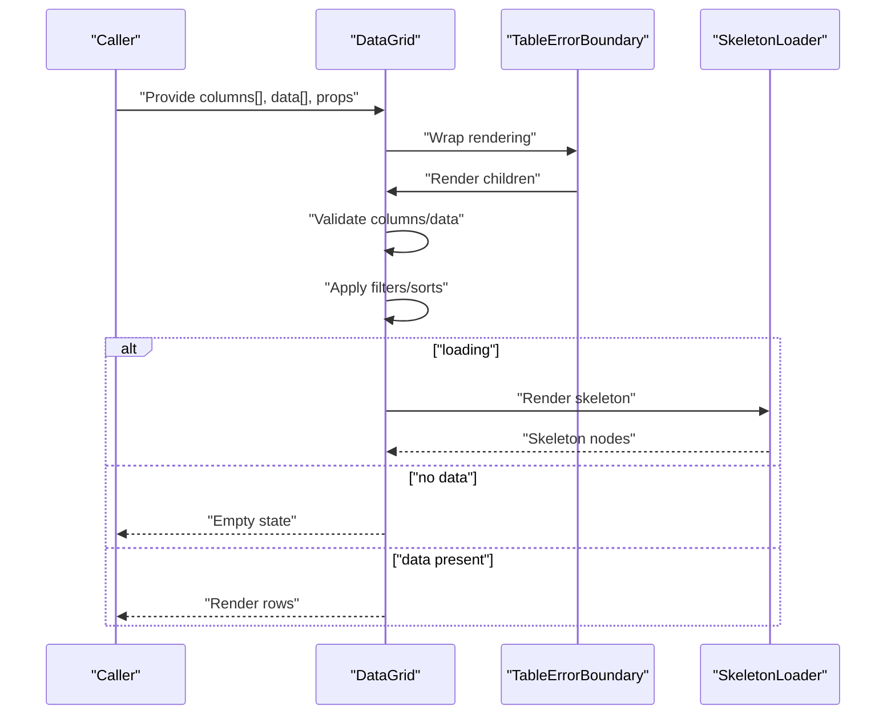
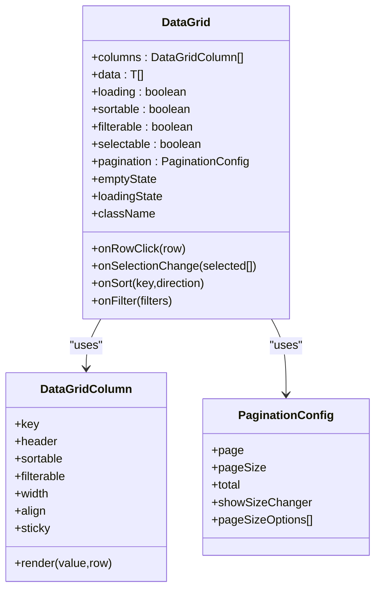
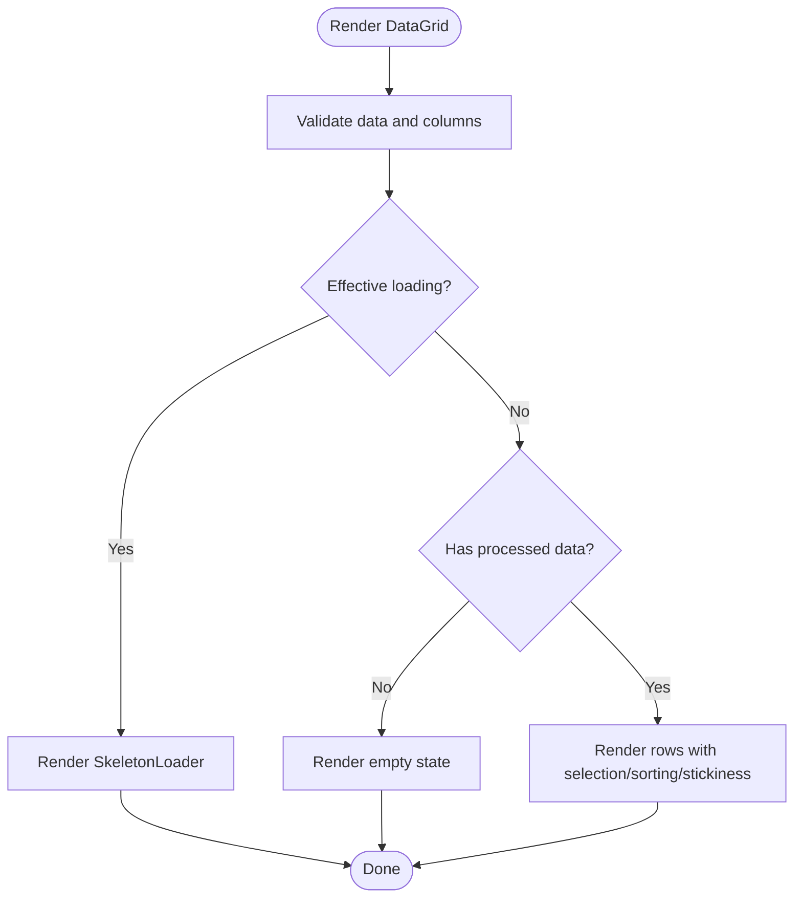
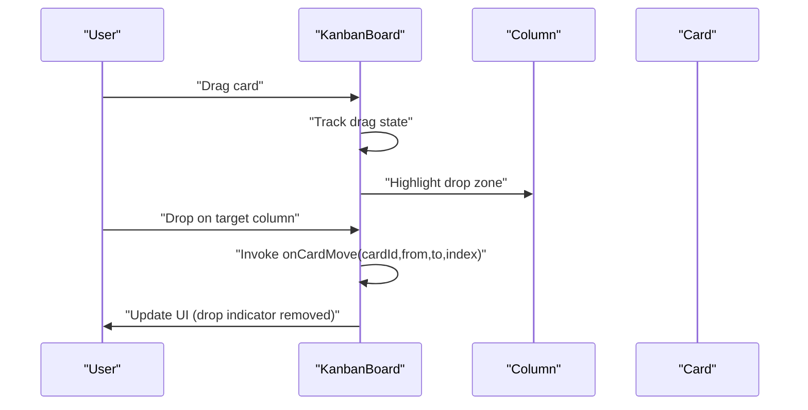
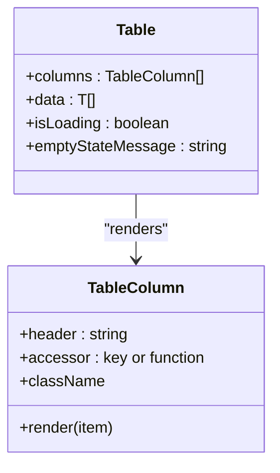
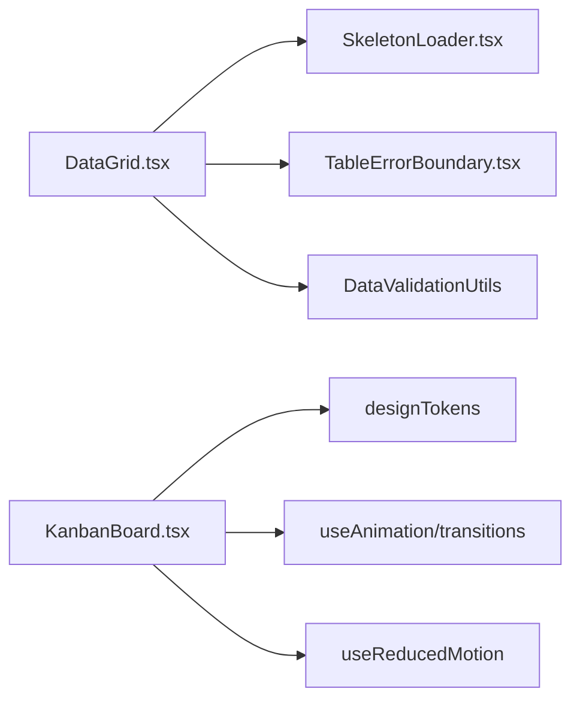

# Data Display Components

<cite>
**Referenced Files in This Document**
- [DataGrid.tsx](file://src/components/ui/data/DataGrid.tsx)
- [KanbanBoard.tsx](file://src/components/ui/data/KanbanBoard.tsx)
- [Table.tsx](file://src/components/ui/Table.tsx)
- [TableComponents.tsx](file://src/components/ui/TableComponents.tsx)
- [SkeletonLoader.tsx](file://src/components/ui/data/SkeletonLoader.tsx)
- [TableErrorBoundary.tsx](file://src/components/ui/data/TableErrorBoundary.tsx)
- [index.ts](file://src/components/ui/data/index.ts)
- [table-to-datagrid-implementation-guide.md](file://docs/guides/table-to-datagrid-implementation-guide.md)
- [administration-datagrid-modernization-recap-2025-01-27.md](file://docs/workflows/administration-datagrid-modernization-recap-2025-01-27.md)
- [DataGrid.test.tsx](file://src/tests/DataGrid.test.tsx)
- [DataGridEdgeCases.test.tsx](file://src/tests/DataGridEdgeCases.test.tsx)
- [KanbanBoard.test.tsx](file://src/tests/KanbanBoard.test.tsx)
- [KanbanBoard.basic.test.tsx](file://src/tests/KanbanBoard.basic.test.tsx)
</cite>

## Table of Contents
1. [Introduction](#introduction)
2. [Project Structure](#project-structure)
3. [Core Components](#core-components)
4. [Architecture Overview](#architecture-overview)
5. [Detailed Component Analysis](#detailed-component-analysis)
6. [Dependency Analysis](#dependency-analysis)
7. [Performance Considerations](#performance-considerations)
8. [Troubleshooting Guide](#troubleshooting-guide)
9. [Conclusion](#conclusion)
10. [Appendices](#appendices)

## Introduction
This document provides comprehensive documentation for SchoolPilot3’s data display components, focusing on:
- DataGrid: A modern, feature-rich table component supporting sorting, filtering, selection, pagination, sticky columns, and robust error handling.
- KanbanBoard: A visual task management board with drag-and-drop, multi-select, progress indicators, and responsive design.
- Table and TableComponents: Lightweight, shadcn-inspired building blocks for simple tabular displays.

It explains data binding patterns, virtualization readiness, performance optimization, customization options (column configuration, row selection, action buttons), complex data scenarios, custom cell renderers, interactive manipulation, and accessibility features.

## Project Structure
The data display components are organized under a cohesive module with centralized exports and supporting utilities.

**Diagram sources**
- [index.ts:1-19](file://src/components/ui/data/index.ts#L1-L19)
- [DataGrid.tsx:1-509](file://src/components/ui/data/DataGrid.tsx#L1-L509)
- [KanbanBoard.tsx:1-488](file://src/components/ui/data/KanbanBoard.tsx#L1-L488)
- [SkeletonLoader.tsx:1-40](file://src/components/ui/data/SkeletonLoader.tsx#L1-L40)
- [TableErrorBoundary.tsx:1-138](file://src/components/ui/data/TableErrorBoundary.tsx#L1-L138)
- [Table.tsx:1-97](file://src/components/ui/Table.tsx#L1-L97)
- [TableComponents.tsx:1-83](file://src/components/ui/TableComponents.tsx#L1-L83)

**Section sources**
- [index.ts:1-19](file://src/components/ui/data/index.ts#L1-L19)

## Core Components
- DataGrid: Advanced table with sorting, filtering, selection, pagination, sticky columns, and resilient rendering via an error boundary and skeleton loader.
- KanbanBoard: Interactive kanban board with drag-and-drop, multi-select, progress bars, priority badges, tags, assignees, and due dates.
- Table and TableComponents: Lightweight, reusable table parts for straightforward use cases.

**Section sources**
- [DataGrid.tsx:1-509](file://src/components/ui/data/DataGrid.tsx#L1-L509)
- [KanbanBoard.tsx:1-488](file://src/components/ui/data/KanbanBoard.tsx#L1-L488)
- [Table.tsx:1-97](file://src/components/ui/Table.tsx#L1-L97)
- [TableComponents.tsx:1-83](file://src/components/ui/TableComponents.tsx#L1-L83)

## Architecture Overview
The DataGrid and KanbanBoard share a consistent design philosophy: clear separation of concerns, strong typing, optional external control, and resilience against invalid data. They integrate with shared utilities for validation and loading states.

**Diagram sources**
- [DataGrid.tsx:94-116](file://src/components/ui/data/DataGrid.tsx#L94-L116)
- [DataGrid.tsx:175-203](file://src/components/ui/data/DataGrid.tsx#L175-L203)
- [DataGrid.tsx:395-409](file://src/components/ui/data/DataGrid.tsx#L395-L409)
- [SkeletonLoader.tsx:12-38](file://src/components/ui/data/SkeletonLoader.tsx#L12-L38)
- [TableErrorBoundary.tsx:31-54](file://src/components/ui/data/TableErrorBoundary.tsx#L31-L54)

## Detailed Component Analysis

### DataGrid
DataGrid is a feature-complete table component with:
- Sorting: Click headers to toggle ascending/descending; integrates with external sort handlers.
- Filtering: Optional filter bar per column; supports external filter handlers.
- Selection: Single/multi-row selection with “select all” and indeterminate state.
- Pagination: Configurable pagination controls with total, page size, and options.
- Sticky Columns: Left/right sticky headers and cells for horizontal scrolling.
- Empty States and Loading: Rich empty state rendering and skeleton loading.
- Resilience: Built-in error boundary and data/column validation.

Key implementation patterns:
- Column configuration with keys, headers, renderers, widths, alignment, and stickiness.
- Memoized processing pipeline for sorting and filtering.
- Defensive data validation and safe renderers.
- Optional external control via onSort/onFilter/onSelectionChange/onRowClick.

**Diagram sources**
- [DataGrid.tsx:18-58](file://src/components/ui/data/DataGrid.tsx#L18-L58)

**Diagram sources**
- [DataGrid.tsx:94-116](file://src/components/ui/data/DataGrid.tsx#L94-L116)
- [DataGrid.tsx:395-449](file://src/components/ui/data/DataGrid.tsx#L395-L449)
- [SkeletonLoader.tsx:12-38](file://src/components/ui/data/SkeletonLoader.tsx#L12-L38)

Customization highlights:
- Column configuration: keys, headers, widths, alignment, sticky positioning, and custom renderers.
- Row selection: single/multi-select with callbacks and visual feedback.
- Action buttons: place interactive elements inside custom renderers for action columns.
- Empty state: flexible object-based configuration with icon/title/description/action.
- Loading state: override default skeleton with custom loading UI.

Accessibility and resilience:
- Error boundary wraps rendering to recover from rendering errors.
- Skeleton loader improves perceived performance during loads.
- Keyboard-friendly interactions supported by external handlers.

**Section sources**
- [DataGrid.tsx:18-58](file://src/components/ui/data/DataGrid.tsx#L18-L58)
- [DataGrid.tsx:70-86](file://src/components/ui/data/DataGrid.tsx#L70-L86)
- [DataGrid.tsx:118-146](file://src/components/ui/data/DataGrid.tsx#L118-L146)
- [DataGrid.tsx:148-173](file://src/components/ui/data/DataGrid.tsx#L148-L173)
- [DataGrid.tsx:175-203](file://src/components/ui/data/DataGrid.tsx#L175-L203)
- [DataGrid.tsx:205-231](file://src/components/ui/data/DataGrid.tsx#L205-L231)
- [DataGrid.tsx:259-303](file://src/components/ui/data/DataGrid.tsx#L259-L303)
- [DataGrid.tsx:305-507](file://src/components/ui/data/DataGrid.tsx#L305-L507)
- [TableErrorBoundary.tsx:21-54](file://src/components/ui/data/TableErrorBoundary.tsx#L21-L54)
- [SkeletonLoader.tsx:12-38](file://src/components/ui/data/SkeletonLoader.tsx#L12-L38)

### KanbanBoard
KanbanBoard enables visual task management with:
- Drag-and-drop between columns with visual drop indicators.
- Multi-select cards with keyboard modifiers.
- Priority badges, progress bars, tags, assignees, and due dates.
- Responsive layout with horizontal scrolling.
- Loading skeleton for initial states.

**Diagram sources**
- [KanbanBoard.tsx:131-202](file://src/components/ui/data/KanbanBoard.tsx#L131-L202)
- [KanbanBoard.tsx:400-462](file://src/components/ui/data/KanbanBoard.tsx#L400-L462)

Customization highlights:
- Columns: titles, counts, colors, max card limits, and drop permissions.
- Cards: titles, descriptions, tags, priorities, progress, assignees, due dates.
- Interactions: onCardMove, onCardClick, onCardSelect, onColumnUpdate, allowMultiSelect, showProgress, filterText.

Accessibility and UX:
- Reduced motion support via a hook.
- Visual feedback during drag operations.
- Keyboard-friendly multi-select behavior.

**Section sources**
- [KanbanBoard.tsx:36-48](file://src/components/ui/data/KanbanBoard.tsx#L36-L48)
- [KanbanBoard.tsx:75-87](file://src/components/ui/data/KanbanBoard.tsx#L75-L87)
- [KanbanBoard.tsx:111-128](file://src/components/ui/data/KanbanBoard.tsx#L111-L128)
- [KanbanBoard.tsx:130-202](file://src/components/ui/data/KanbanBoard.tsx#L130-L202)
- [KanbanBoard.tsx:227-396](file://src/components/ui/data/KanbanBoard.tsx#L227-L396)
- [KanbanBoard.tsx:399-462](file://src/components/ui/data/KanbanBoard.tsx#L399-L462)

### Table and TableComponents
Table provides a lightweight, styled table with:
- Column definitions supporting accessor functions and render overrides.
- Boolean/number/string normalization and empty-state handling.
- Shadcn-style components for head/body/row/cell/root wrappers.

**Diagram sources**
- [Table.tsx:4-16](file://src/components/ui/Table.tsx#L4-L16)
- [TableComponents.tsx:6-82](file://src/components/ui/TableComponents.tsx#L6-L82)

**Section sources**
- [Table.tsx:18-97](file://src/components/ui/Table.tsx#L18-L97)
- [TableComponents.tsx:6-82](file://src/components/ui/TableComponents.tsx#L6-L82)

## Dependency Analysis
- DataGrid depends on:
  - SkeletonLoader for loading states.
  - TableErrorBoundary for rendering resilience.
  - DataValidationUtils for safe data/column processing.
- KanbanBoard depends on:
  - Design tokens and animation utilities for visuals.
  - Accessibility hooks for reduced motion.
- Centralized exports via index.ts ensure consistent imports across the application.

**Diagram sources**
- [DataGrid.tsx:4-16](file://src/components/ui/data/DataGrid.tsx#L4-L16)
- [KanbanBoard.tsx:4-7](file://src/components/ui/data/KanbanBoard.tsx#L4-L7)
- [index.ts:1-19](file://src/components/ui/data/index.ts#L1-L19)

**Section sources**
- [index.ts:1-19](file://src/components/ui/data/index.ts#L1-L19)

## Performance Considerations
- Virtualization readiness: DataGrid’s structure supports future virtualization of large datasets.
- Efficient rendering: Memoized callbacks and computed derived data minimize re-renders.
- Large dataset support: Verified performance with thousands of rows.
- Memory management: Proper cleanup and state management patterns reduce leaks.
- Skeleton loading: Improves perceived performance during data fetches.
- Accessibility hooks: Respect reduced motion preferences to avoid unnecessary animations.

[No sources needed since this section provides general guidance]

## Troubleshooting Guide
Common issues and resolutions:
- Import path errors: Ensure imports go through the module’s index.ts barrel exports to avoid direct file imports.
- Rendering crashes: TableErrorBoundary provides a fallback UI and retry mechanisms.
- Invalid data: DataGrid validates columns and data; check console warnings for validation errors.
- Slow rendering: Prefer external sorting/filtering to offload work to the caller; leverage memoization.

**Section sources**
- [administration-datagrid-modernization-recap-2025-01-27.md:66-76](file://docs/workflows/administration-datagrid-modernization-recap-2025-01-27.md#L66-L76)
- [TableErrorBoundary.tsx:31-54](file://src/components/ui/data/TableErrorBoundary.tsx#L31-L54)
- [DataGrid.tsx:94-116](file://src/components/ui/data/DataGrid.tsx#L94-L116)

## Conclusion
SchoolPilot3’s data display components offer a modern, extensible foundation for presenting structured and visual data. DataGrid brings advanced capabilities with resilient rendering, while KanbanBoard delivers an intuitive task management experience. Table and TableComponents remain ideal for simpler scenarios. Together, they support robust customization, performance optimization, and accessibility.

[No sources needed since this section summarizes without analyzing specific files]

## Appendices

### Migration from Table to DataGrid
Follow the documented migration steps to convert existing Table usage to DataGrid, including updating imports, converting column definitions, enabling enhanced features, and testing.

**Section sources**
- [table-to-datagrid-implementation-guide.md:65-148](file://docs/guides/table-to-datagrid-implementation-guide.md#L65-L148)

### Testing Coverage
- DataGrid tests cover normal operation, edge cases, rapid state changes, and error-handling scenarios.
- KanbanBoard tests validate loading states, card details, multi-select, and drag-and-drop behavior.

**Section sources**
- [DataGrid.test.tsx](file://src/tests/DataGrid.test.tsx)
- [DataGridEdgeCases.test.tsx:69-90](file://src/tests/DataGridEdgeCases.test.tsx#L69-L90)
- [DataGridEdgeCases.test.tsx:372-391](file://src/tests/DataGridEdgeCases.test.tsx#L372-L391)
- [DataGridEdgeCases.test.tsx:394-438](file://src/tests/DataGridEdgeCases.test.tsx#L394-L438)
- [KanbanBoard.test.tsx:129-162](file://src/tests/KanbanBoard.test.tsx#L129-L162)
- [KanbanBoard.basic.test.tsx:89-129](file://src/tests/KanbanBoard.basic.test.tsx#L89-L129)