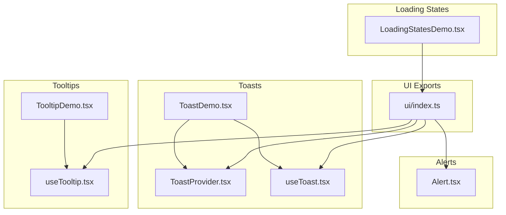
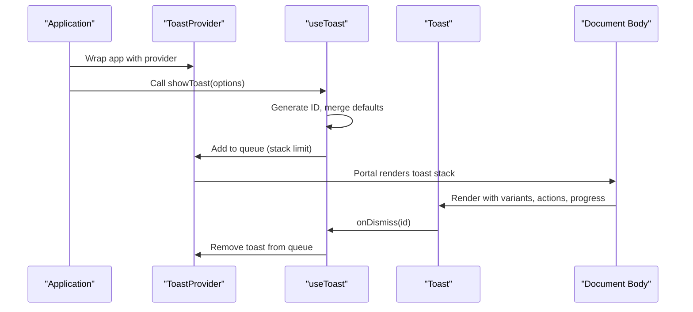
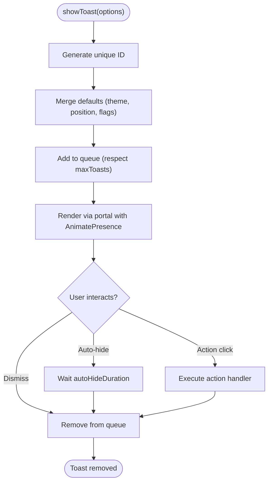
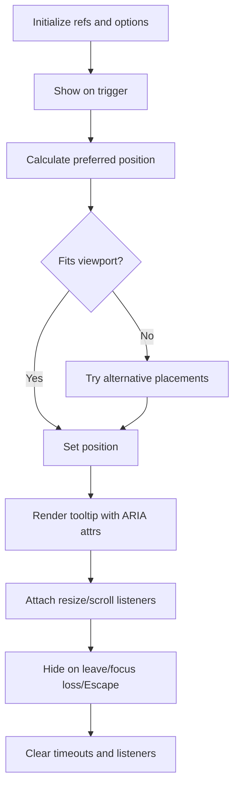
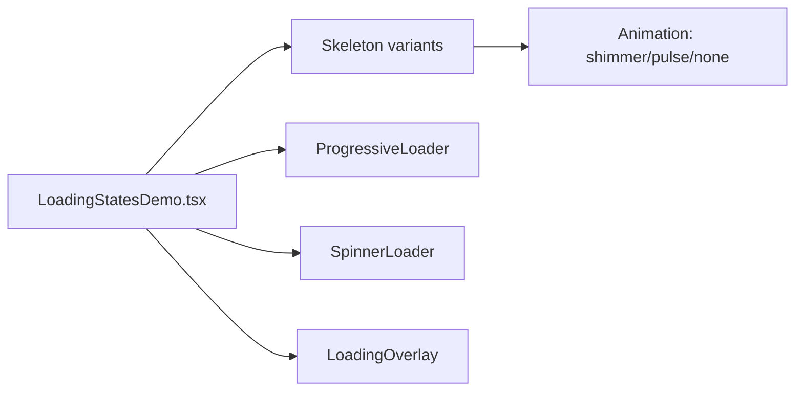
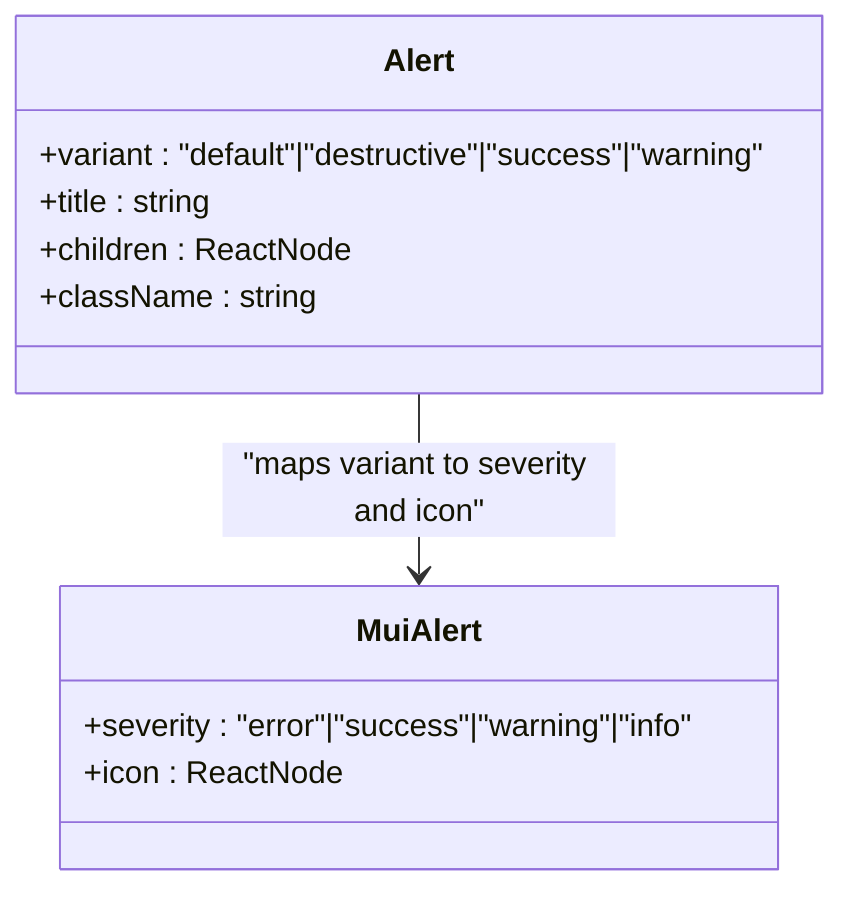
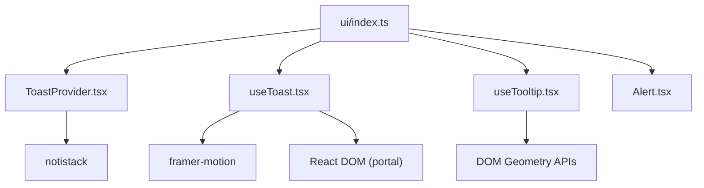

# Feedback & Interaction Components

<cite>
**Referenced Files in This Document**
- [Alert.tsx](file://src/components/ui/Alert.tsx)
- [ToastProvider.tsx](file://src/components/ToastProvider.tsx)
- [useToast.tsx](file://src/hooks/useToast.tsx)
- [useTooltip.tsx](file://src/hooks/useTooltip.tsx)
- [ToastDemo.tsx](file://src/components/__demos__/ToastDemo.tsx)
- [TooltipDemo.tsx](file://src/components/__demos__/TooltipDemo.tsx)
- [LoadingStatesDemo.tsx](file://src/components/__demos__/LoadingStatesDemo.tsx)
- [ui/index.ts](file://src/components/ui/index.ts)
</cite>

## Table of Contents
1. [Introduction](#introduction)
2. [Project Structure](#project-structure)
3. [Core Components](#core-components)
4. [Architecture Overview](#architecture-overview)
5. [Detailed Component Analysis](#detailed-component-analysis)
6. [Dependency Analysis](#dependency-analysis)
7. [Performance Considerations](#performance-considerations)
8. [Troubleshooting Guide](#troubleshooting-guide)
9. [Conclusion](#conclusion)

## Introduction
This document covers SchoolPilot3’s feedback and interaction components with a focus on:
- Toast notifications: centralized provider, variants, progress tracking, and user interaction patterns
- Tooltip system: positioning, triggers, accessibility, and micro-interactions
- Loading states: skeletons, spinners, overlays, and progressive loaders
- Alert components: severity mapping and semantic structure

It explains notification management, positioning strategies, timing controls, animation systems, and accessibility compliance for screen readers and keyboard navigation.

## Project Structure
The feedback and interaction system is organized around:
- UI index exports for consolidated imports
- Toast provider and hooks for notification orchestration
- Tooltip hook for smart positioning and accessibility
- Loading states demos showcasing skeleton and loader variants
- Alert component for status messaging

**Diagram sources**
- [ui/index.ts:34-61](file://src/components/ui/index.ts#L34-L61)
- [ToastProvider.tsx:11-29](file://src/components/ToastProvider.tsx#L11-L29)
- [useToast.tsx:55-155](file://src/hooks/useToast.tsx#L55-L155)
- [useTooltip.tsx:33-270](file://src/hooks/useTooltip.tsx#L33-L270)
- [Alert.tsx:46-74](file://src/components/ui/Alert.tsx#L46-L74)
- [ToastDemo.tsx:198-206](file://src/components/__demos__/ToastDemo.tsx#L198-L206)
- [TooltipDemo.tsx:15-246](file://src/components/__demos__/TooltipDemo.tsx#L15-L246)
- [LoadingStatesDemo.tsx:20-310](file://src/components/__demos__/LoadingStatesDemo.tsx#L20-L310)

**Section sources**
- [ui/index.ts:34-61](file://src/components/ui/index.ts#L34-L61)

## Core Components
- ToastProvider: Centralized toast container with notistack for queue management, positioning, and auto-hide behavior
- useToast: Custom hook for toast lifecycle, stacking, themes, and convenience helpers
- useTooltip: Smart positioning, collision detection, triggers, and accessibility attributes
- Alert: Severity-aware alert with icon mapping and optional title
- Loading states: Skeletons, spinners, overlays, and progressive loaders for perceived performance

**Section sources**
- [ToastProvider.tsx:11-29](file://src/components/ToastProvider.tsx#L11-L29)
- [useToast.tsx:27-155](file://src/hooks/useToast.tsx#L27-L155)
- [useTooltip.tsx:33-270](file://src/hooks/useTooltip.tsx#L33-L270)
- [Alert.tsx:46-74](file://src/components/ui/Alert.tsx#L46-L74)
- [LoadingStatesDemo.tsx:20-310](file://src/components/__demos__/LoadingStatesDemo.tsx#L20-L310)

## Architecture Overview
The feedback system integrates providers, hooks, and UI components to deliver consistent user feedback across the application.

**Diagram sources**
- [ToastProvider.tsx:11-29](file://src/components/ToastProvider.tsx#L11-L29)
- [useToast.tsx:70-90](file://src/hooks/useToast.tsx#L70-L90)
- [useToast.tsx:135-155](file://src/hooks/useToast.tsx#L135-L155)

## Detailed Component Analysis

### Toast Notifications
- Centralized provider: notistack-based with anchor origin, auto-hide, and duplicate prevention
- Custom provider: local state-driven provider with animated stacking, positioning, and theme support
- Variants: success, error, warning, info, progress
- Advanced features: action buttons, custom duration, progress bars, swipe-to-dismiss, pause-on-hover
- Stacking: controlled via maxToasts; recent items appear first; portal rendering ensures consistent overlay behavior
- Accessibility: ARIA live regions and keyboard-friendly dismissal

**Diagram sources**
- [useToast.tsx:70-104](file://src/hooks/useToast.tsx#L70-L104)
- [useToast.tsx:135-155](file://src/hooks/useToast.tsx#L135-L155)

**Section sources**
- [ToastProvider.tsx:11-29](file://src/components/ToastProvider.tsx#L11-L29)
- [useToast.tsx:27-155](file://src/hooks/useToast.tsx#L27-L155)
- [ToastDemo.tsx:8-206](file://src/components/__demos__/ToastDemo.tsx#L8-L206)

### Tooltip System
- Smart positioning: calculates top/bottom/left/right with viewport collision detection and auto-placement fallback
- Triggers: hover, click, focus, manual with keyboard support (Escape to hide)
- Accessibility: ARIA attributes, role=tooltip, aria-describedby on trigger, focus management
- Interactive mode: delays hide when cursor enters tooltip element
- Event handling: resize and scroll listeners to keep tooltip near trigger

**Diagram sources**
- [useTooltip.tsx:50-126](file://src/hooks/useTooltip.tsx#L50-L126)
- [useTooltip.tsx:172-197](file://src/hooks/useTooltip.tsx#L172-L197)
- [useTooltip.tsx:211-257](file://src/hooks/useTooltip.tsx#L211-L257)

**Section sources**
- [useTooltip.tsx:33-270](file://src/hooks/useTooltip.tsx#L33-L270)
- [TooltipDemo.tsx:15-246](file://src/components/__demos__/TooltipDemo.tsx#L15-L246)

### Loading States
- Skeleton variants: text, avatar, card, table, form, list, rectangular, circular
- Progressive loader: percentage display with labeled progress
- Spinners: dots and bars variants with size options
- Loading overlay: full-screen overlay with message and automatic dismissal
- Controls: animation type toggles, progress adjustment, overlay activation

**Diagram sources**
- [LoadingStatesDemo.tsx:20-310](file://src/components/__demos__/LoadingStatesDemo.tsx#L20-L310)

**Section sources**
- [LoadingStatesDemo.tsx:20-310](file://src/components/__demos__/LoadingStatesDemo.tsx#L20-L310)

### Alert Component
- Severity mapping: destructive → error, success → success, warning → warning, default → info
- Icon mapping: variant-specific icons
- Optional title and semantic structure via MUI Alert and AlertTitle
- Compliant with shadcn/ui styling patterns

**Diagram sources**
- [Alert.tsx:20-44](file://src/components/ui/Alert.tsx#L20-L44)
- [Alert.tsx:46-74](file://src/components/ui/Alert.tsx#L46-L74)

**Section sources**
- [Alert.tsx:46-74](file://src/components/ui/Alert.tsx#L46-L74)

## Dependency Analysis
- ToastProvider (notistack) depends on external library for queue management and positioning
- Custom ToastProvider depends on:
  - React portals for overlay rendering
  - Framer Motion for enter/exit animations and layout transitions
  - Local context for state sharing across components
- useTooltip depends on DOM geometry APIs and event listeners
- UI index consolidates exports for feedback components

**Diagram sources**
- [ToastProvider.tsx:5](file://src/components/ToastProvider.tsx#L5)
- [useToast.tsx:6-7](file://src/hooks/useToast.tsx#L6-L7)
- [ui/index.ts:34-61](file://src/components/ui/index.ts#L34-L61)

**Section sources**
- [ToastProvider.tsx:5](file://src/components/ToastProvider.tsx#L5)
- [useToast.tsx:6-7](file://src/hooks/useToast.tsx#L6-L7)
- [ui/index.ts:34-61](file://src/components/ui/index.ts#L34-L61)

## Performance Considerations
- Toast provider limits stack size to reduce DOM churn and layout thrashing
- Portal rendering minimizes reflows by appending to body
- Framer Motion popLayout ensures smooth stacking without expensive measurements
- Tooltip uses requestAnimationFrame for position recalculation after render
- Resize/scroll listeners are attached conditionally and cleaned up on unmount
- Loading skeletons defer heavy content rendering until data arrives

[No sources needed since this section provides general guidance]

## Troubleshooting Guide
- To stop duplicate toasts, enable duplicate prevention in the provider configuration
- If toasts overflow, adjust maxToasts or change position to top-center or bottom-center
- For tooltip clipping, rely on auto placement or increase offset; ensure interactive mode for clickable tooltips
- For accessibility issues, verify ARIA attributes and keyboard events are present on triggers and tooltips
- For long-running operations, use progress toast helpers to update progress and finalize with success or error variants

**Section sources**
- [ToastProvider.tsx:14-20](file://src/components/ToastProvider.tsx#L14-L20)
- [useToast.tsx:57-62](file://src/hooks/useToast.tsx#L57-L62)
- [useTooltip.tsx:172-197](file://src/hooks/useTooltip.tsx#L172-L197)

## Conclusion
SchoolPilot3’s feedback and interaction components provide a cohesive, accessible, and performant user experience:
- Toasts offer flexible, animated, and accessible notifications with robust lifecycle management
- Tooltips combine smart positioning, collision detection, and strong accessibility support
- Loading states improve perceived performance with a rich set of skeleton and loader components
- Alerts clearly communicate status with severity mapping and semantic structure

These components are designed for easy integration via centralized exports and can be extended to meet evolving UX needs.