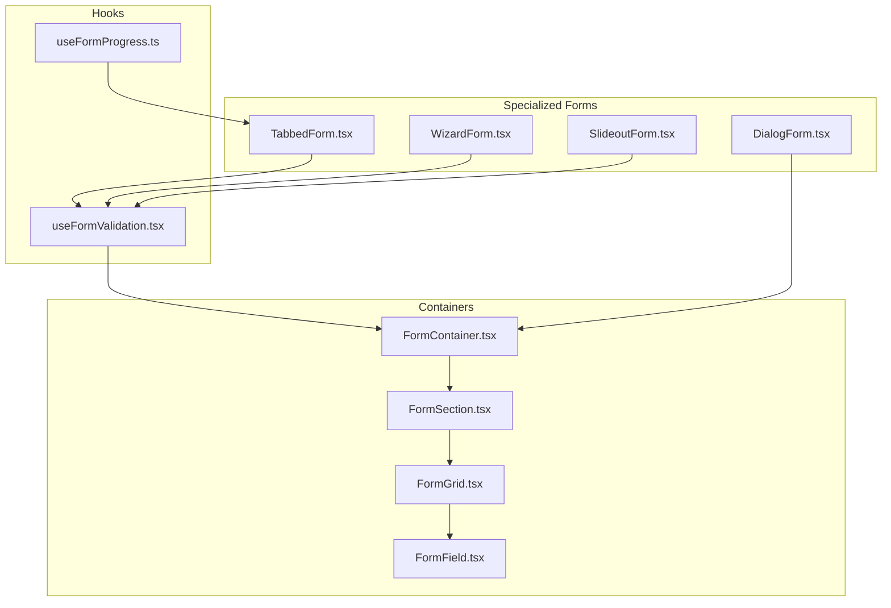
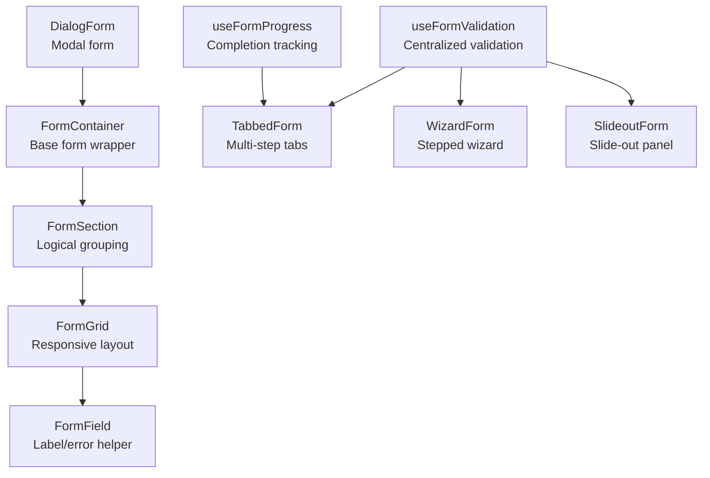
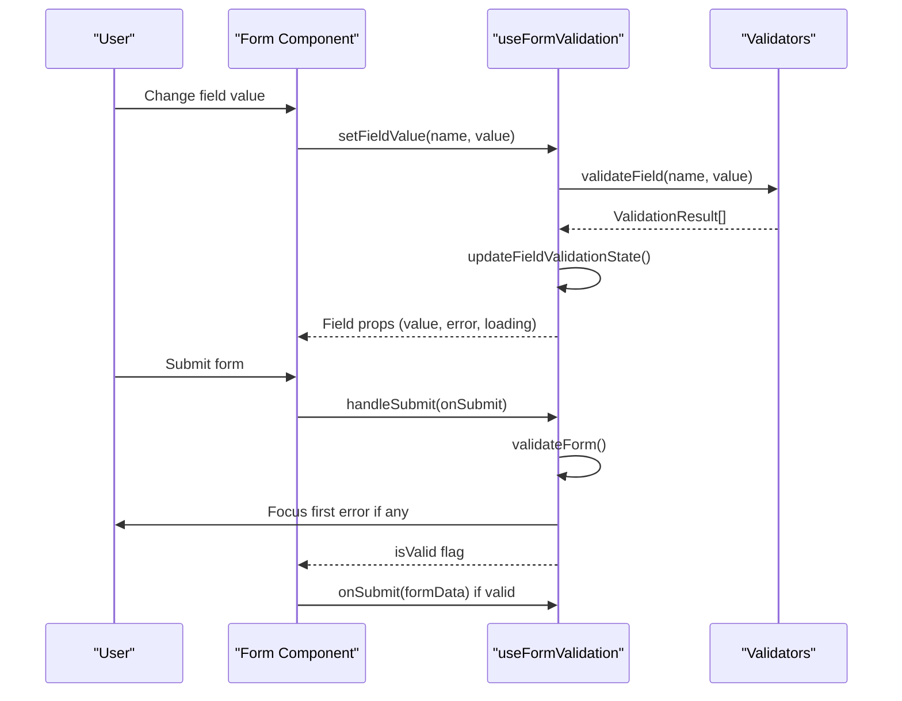
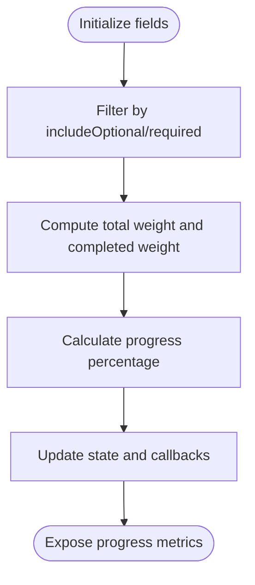
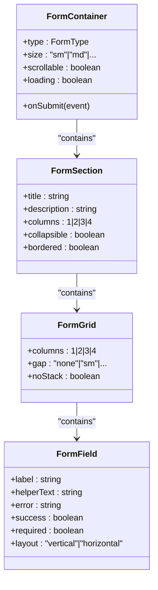
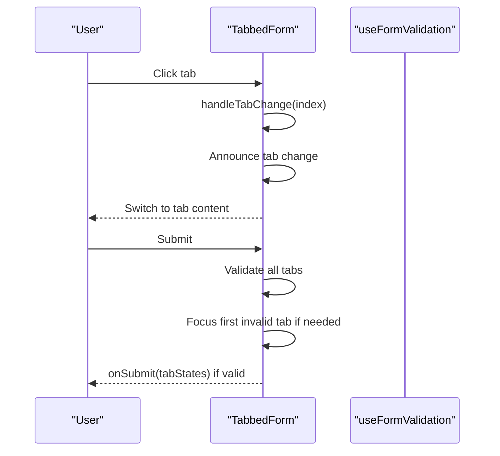
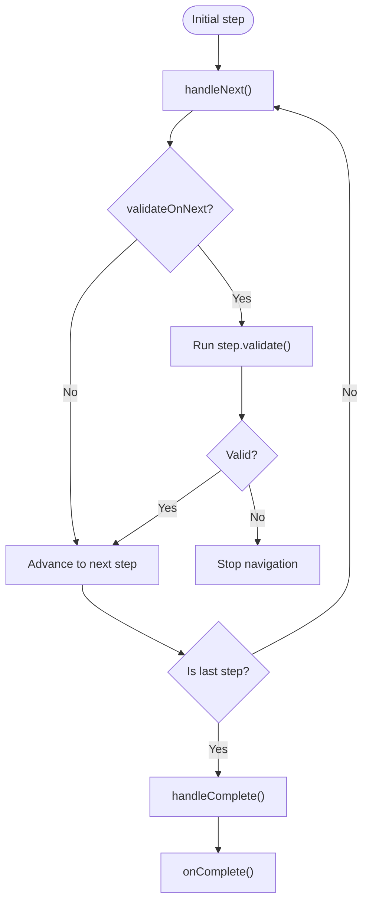
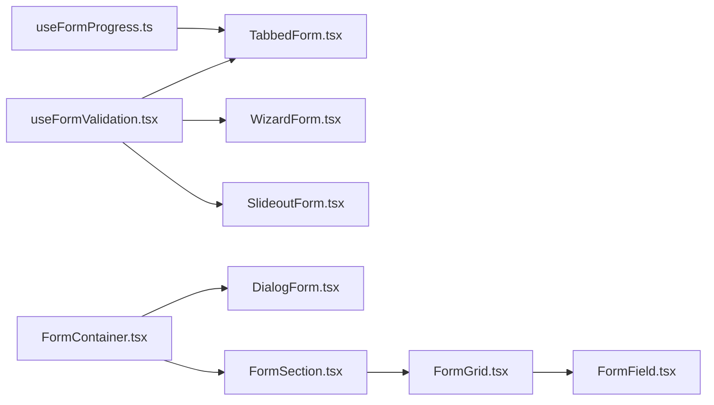

# Form Components

<cite>
**Referenced Files in This Document**
- [useFormValidation.tsx](file://src/hooks/useFormValidation.tsx)
- [useFormProgress.ts](file://src/hooks/useFormProgress.ts)
- [TabbedForm.tsx](file://src/components/ui/forms/TabbedForm.tsx)
- [SlideoutForm.tsx](file://src/components/ui/forms/SlideoutForm.tsx)
- [WizardForm.tsx](file://src/components/ui/forms/WizardForm.tsx)
- [DialogForm.tsx](file://src/components/ui/forms/DialogForm.tsx)
- [FormContainer.tsx](file://src/components/ui/forms/FormContainer.tsx)
- [FormField.tsx](file://src/components/ui/forms/FormField.tsx)
- [FormGrid.tsx](file://src/components/ui/forms/FormGrid.tsx)
- [FormSection.tsx](file://src/components/ui/forms/FormSection.tsx)
- [FormValidationDemo.tsx](file://src/components/__demos__/FormValidationDemo.tsx)
- [TabbedFormDemo.tsx](file://src/components/__demos__/TabbedFormDemo.tsx)
</cite>

## Table of Contents
1. [Introduction](#introduction)
2. [Project Structure](#project-structure)
3. [Core Components](#core-components)
4. [Architecture Overview](#architecture-overview)
5. [Detailed Component Analysis](#detailed-component-analysis)
6. [Dependency Analysis](#dependency-analysis)
7. [Performance Considerations](#performance-considerations)
8. [Troubleshooting Guide](#troubleshooting-guide)
9. [Conclusion](#conclusion)
10. [Appendices](#appendices)

## Introduction
This document describes SchoolPilot3's form component ecosystem, focusing on form containers, field components, validation systems, and progress tracking. It covers specialized forms including TabbedForm, SlideoutForm, WizardForm, and DialogForm. The validation framework supports custom validators, real-time validation feedback, and accessibility. State management, data binding patterns, and submission workflows are documented alongside examples of complex layouts, conditional rendering, and dynamic generation. Accessibility compliance, keyboard navigation, and assistive technology support are emphasized throughout.

## Project Structure
The form system is organized around reusable building blocks:
- Hooks for validation and progress tracking
- Container and layout components for consistent structure
- Specialized form containers for dialogs, slideouts, wizards, and tabbed workflows
- Field wrappers and grids for layout and accessibility

**Diagram sources**
- [useFormValidation.tsx:1-529](file://src/hooks/useFormValidation.tsx#L1-L529)
- [useFormProgress.ts:1-185](file://src/hooks/useFormProgress.ts#L1-L185)
- [FormContainer.tsx:1-151](file://src/components/ui/forms/FormContainer.tsx#L1-L151)
- [FormSection.tsx:1-211](file://src/components/ui/forms/FormSection.tsx#L1-L211)
- [FormGrid.tsx:1-111](file://src/components/ui/forms/FormGrid.tsx#L1-L111)
- [FormField.tsx:1-182](file://src/components/ui/forms/FormField.tsx#L1-L182)
- [TabbedForm.tsx:1-482](file://src/components/ui/forms/TabbedForm.tsx#L1-L482)
- [WizardForm.tsx:1-441](file://src/components/ui/forms/WizardForm.tsx#L1-L441)
- [DialogForm.tsx:1-194](file://src/components/ui/forms/DialogForm.tsx#L1-L194)
- [SlideoutForm.tsx:1-751](file://src/components/ui/forms/SlideoutForm.tsx#L1-L751)

**Section sources**
- [useFormValidation.tsx:1-529](file://src/hooks/useFormValidation.tsx#L1-L529)
- [useFormProgress.ts:1-185](file://src/hooks/useFormProgress.ts#L1-L185)
- [FormContainer.tsx:1-151](file://src/components/ui/forms/FormContainer.tsx#L1-L151)
- [FormSection.tsx:1-211](file://src/components/ui/forms/FormSection.tsx#L1-L211)
- [FormGrid.tsx:1-111](file://src/components/ui/forms/FormGrid.tsx#L1-L111)
- [FormField.tsx:1-182](file://src/components/ui/forms/FormField.tsx#L1-L182)
- [TabbedForm.tsx:1-482](file://src/components/ui/forms/TabbedForm.tsx#L1-L482)
- [WizardForm.tsx:1-441](file://src/components/ui/forms/WizardForm.tsx#L1-L441)
- [DialogForm.tsx:1-194](file://src/components/ui/forms/DialogForm.tsx#L1-L194)
- [SlideoutForm.tsx:1-751](file://src/components/ui/forms/SlideoutForm.tsx#L1-L751)

## Core Components
- useFormValidation: Centralized validation engine supporting real-time validation, debouncing, required checks, and screen-reader announcements.
- useFormProgress: Tracks form completion progress across fields with weights, optional inclusion, and validity requirements.
- FormContainer: Base form wrapper providing consistent structure, sizes, scrollable areas, and accessibility attributes.
- FormSection/FormGrid/FormField: Layout primitives enabling responsive grids, labeled fields, helper/error states, and ARIA integration.
- TabbedForm: Multi-step navigation with validation indicators, progress bars, responsive tabs, and accessibility.
- WizardForm: Stepped wizard with progress indicators, validation hooks, and customizable navigation.
- DialogForm: Modal form composition combining Modal and FormContainer with optional progress and auto-save status.
- SlideoutForm: Slide-out panel with gestures, resizing, auto-save, focus management, and keyboard shortcuts.

**Section sources**
- [useFormValidation.tsx:130-527](file://src/hooks/useFormValidation.tsx#L130-L527)
- [useFormProgress.ts:75-182](file://src/hooks/useFormProgress.ts#L75-L182)
- [FormContainer.tsx:69-146](file://src/components/ui/forms/FormContainer.tsx#L69-L146)
- [FormSection.tsx:74-208](file://src/components/ui/forms/FormSection.tsx#L74-L208)
- [FormGrid.tsx:75-110](file://src/components/ui/forms/FormGrid.tsx#L75-L110)
- [FormField.tsx:23-182](file://src/components/ui/forms/FormField.tsx#L23-L182)
- [TabbedForm.tsx:39-482](file://src/components/ui/forms/TabbedForm.tsx#L39-L482)
- [WizardForm.tsx:116-441](file://src/components/ui/forms/WizardForm.tsx#L116-L441)
- [DialogForm.tsx:90-194](file://src/components/ui/forms/DialogForm.tsx#L90-L194)
- [SlideoutForm.tsx:78-751](file://src/components/ui/forms/SlideoutForm.tsx#L78-L751)

## Architecture Overview
The form ecosystem follows a layered architecture:
- Hooks layer: Validation and progress orchestration
- Composition layer: Containers and layout primitives
- Specialized form layer: Dialogs, slideouts, wizards, and tabbed forms
- Accessibility layer: Screen reader announcements, ARIA attributes, and keyboard navigation

**Diagram sources**
- [useFormValidation.tsx:130-527](file://src/hooks/useFormValidation.tsx#L130-L527)
- [useFormProgress.ts:75-182](file://src/hooks/useFormProgress.ts#L75-L182)
- [FormContainer.tsx:69-146](file://src/components/ui/forms/FormContainer.tsx#L69-L146)
- [FormSection.tsx:74-208](file://src/components/ui/forms/FormSection.tsx#L74-L208)
- [FormGrid.tsx:75-110](file://src/components/ui/forms/FormGrid.tsx#L75-L110)
- [FormField.tsx:23-182](file://src/components/ui/forms/FormField.tsx#L23-L182)
- [TabbedForm.tsx:39-482](file://src/components/ui/forms/TabbedForm.tsx#L39-L482)
- [WizardForm.tsx:116-441](file://src/components/ui/forms/WizardForm.tsx#L116-L441)
- [DialogForm.tsx:90-194](file://src/components/ui/forms/DialogForm.tsx#L90-L194)
- [SlideoutForm.tsx:78-751](file://src/components/ui/forms/SlideoutForm.tsx#L78-L751)

## Detailed Component Analysis

### Validation System: useFormValidation
The validation hook centralizes:
- Rule definition with validators (required, minLength, maxLength, email, pattern, numeric, min, max, custom)
- Real-time validation with debouncing and priority ordering
- Field touch/dirty state management
- Screen-reader announcements for errors
- Submission workflow with pre-validation and error focus

**Diagram sources**
- [useFormValidation.tsx:174-264](file://src/hooks/useFormValidation.tsx#L174-L264)
- [useFormValidation.tsx:362-383](file://src/hooks/useFormValidation.tsx#L362-L383)
- [useFormValidation.tsx:386-417](file://src/hooks/useFormValidation.tsx#L386-L417)

**Section sources**
- [useFormValidation.tsx:58-128](file://src/hooks/useFormValidation.tsx#L58-L128)
- [useFormValidation.tsx:174-264](file://src/hooks/useFormValidation.tsx#L174-L264)
- [useFormValidation.tsx:302-338](file://src/hooks/useFormValidation.tsx#L302-L338)
- [useFormValidation.tsx:362-383](file://src/hooks/useFormValidation.tsx#L362-L383)
- [useFormValidation.tsx:386-417](file://src/hooks/useFormValidation.tsx#L386-L417)

### Progress Tracking: useFormProgress
Tracks completion across fields with:
- Weights per field
- Optional vs required filtering
- Validity requirement toggles
- Completion callbacks and progress change callbacks

**Diagram sources**
- [useFormProgress.ts:84-122](file://src/hooks/useFormProgress.ts#L84-L122)

**Section sources**
- [useFormProgress.ts:75-182](file://src/hooks/useFormProgress.ts#L75-L182)

### Form Containers and Layout Primitives
- FormContainer: Base form wrapper with sizes, scrollable areas, loading overlays, and accessibility attributes.
- FormSection: Logical grouping with collapsible behavior, borders, icons, and responsive column grids.
- FormGrid: Responsive grid with column counts and gap sizes.
- FormField: Wraps inputs with labels, helper text, success/error states, and ARIA attributes.

**Diagram sources**
- [FormContainer.tsx:69-146](file://src/components/ui/forms/FormContainer.tsx#L69-L146)
- [FormSection.tsx:74-208](file://src/components/ui/forms/FormSection.tsx#L74-L208)
- [FormGrid.tsx:75-110](file://src/components/ui/forms/FormGrid.tsx#L75-L110)
- [FormField.tsx:23-182](file://src/components/ui/forms/FormField.tsx#L23-L182)

**Section sources**
- [FormContainer.tsx:69-146](file://src/components/ui/forms/FormContainer.tsx#L69-L146)
- [FormSection.tsx:74-208](file://src/components/ui/forms/FormSection.tsx#L74-L208)
- [FormGrid.tsx:75-110](file://src/components/ui/forms/FormGrid.tsx#L75-L110)
- [FormField.tsx:23-182](file://src/components/ui/forms/FormField.tsx#L23-L182)

### TabbedForm: Multi-step Navigation
TabbedForm orchestrates multi-step forms with:
- Tab definitions and validation callbacks
- Progress calculation and visual indicators
- Responsive desktop/mobile navigation
- Accessibility: ARIA roles, screen-reader announcements, focus management

**Diagram sources**
- [TabbedForm.tsx:79-117](file://src/components/ui/forms/TabbedForm.tsx#L79-L117)
- [TabbedForm.tsx:249-285](file://src/components/ui/forms/TabbedForm.tsx#L249-L285)

**Section sources**
- [TabbedForm.tsx:39-482](file://src/components/ui/forms/TabbedForm.tsx#L39-L482)

### WizardForm: Stepped Wizard
WizardForm provides:
- Steps with titles, descriptions, and optional validation
- Horizontal/vertical layouts with progress indicators
- Navigation controls with validation gating
- Programmatic control via ref methods

**Diagram sources**
- [WizardForm.tsx:153-208](file://src/components/ui/forms/WizardForm.tsx#L153-L208)

**Section sources**
- [WizardForm.tsx:116-441](file://src/components/ui/forms/WizardForm.tsx#L116-L441)

### DialogForm: Modal Forms
DialogForm composes Modal and FormContainer:
- Optional progress indicators and auto-save status
- Form header with title, description, and badges
- Controlled sizing mapped from modal sizes to form widths

**Section sources**
- [DialogForm.tsx:90-194](file://src/components/ui/forms/DialogForm.tsx#L90-L194)

### SlideoutForm: Slide-out Panels
SlideoutForm offers:
- Spring animations and gesture support (drag to close)
- Resizable panels with minimum/maximum constraints
- Auto-save with status indicators
- Keyboard shortcuts (Escape, Ctrl+S, Ctrl+Enter, F6)
- Focus management and screen-reader announcements

**Section sources**
- [SlideoutForm.tsx:78-751](file://src/components/ui/forms/SlideoutForm.tsx#L78-L751)

### Examples and Patterns
- FormValidationDemo demonstrates real-time validation with multiple field types and custom validators.
- TabbedFormDemo showcases multi-step registration with tab-level validation and progress indicators.

**Section sources**
- [FormValidationDemo.tsx:9-127](file://src/components/__demos__/FormValidationDemo.tsx#L9-L127)
- [TabbedFormDemo.tsx:35-548](file://src/components/__demos__/TabbedFormDemo.tsx#L35-L548)

## Dependency Analysis
The form system exhibits low coupling and high cohesion:
- useFormValidation is consumed by specialized forms and demos
- useFormProgress is primarily used by TabbedForm
- FormContainer acts as a base for all form compositions
- Field components depend on accessibility utilities for ARIA attributes

**Diagram sources**
- [useFormValidation.tsx:130-527](file://src/hooks/useFormValidation.tsx#L130-L527)
- [useFormProgress.ts:75-182](file://src/hooks/useFormProgress.ts#L75-L182)
- [FormContainer.tsx:69-146](file://src/components/ui/forms/FormContainer.tsx#L69-L146)
- [FormSection.tsx:74-208](file://src/components/ui/forms/FormSection.tsx#L74-L208)
- [FormGrid.tsx:75-110](file://src/components/ui/forms/FormGrid.tsx#L75-L110)
- [FormField.tsx:23-182](file://src/components/ui/forms/FormField.tsx#L23-L182)
- [TabbedForm.tsx:39-482](file://src/components/ui/forms/TabbedForm.tsx#L39-L482)
- [WizardForm.tsx:116-441](file://src/components/ui/forms/WizardForm.tsx#L116-L441)
- [DialogForm.tsx:90-194](file://src/components/ui/forms/DialogForm.tsx#L90-L194)
- [SlideoutForm.tsx:78-751](file://src/components/ui/forms/SlideoutForm.tsx#L78-L751)

**Section sources**
- [useFormValidation.tsx:130-527](file://src/hooks/useFormValidation.tsx#L130-L527)
- [useFormProgress.ts:75-182](file://src/hooks/useFormProgress.ts#L75-L182)
- [FormContainer.tsx:69-146](file://src/components/ui/forms/FormContainer.tsx#L69-L146)
- [FormSection.tsx:74-208](file://src/components/ui/forms/FormSection.tsx#L74-L208)
- [FormGrid.tsx:75-110](file://src/components/ui/forms/FormGrid.tsx#L75-L110)
- [FormField.tsx:23-182](file://src/components/ui/forms/FormField.tsx#L23-L182)
- [TabbedForm.tsx:39-482](file://src/components/ui/forms/TabbedForm.tsx#L39-L482)
- [WizardForm.tsx:116-441](file://src/components/ui/forms/WizardForm.tsx#L116-L441)
- [DialogForm.tsx:90-194](file://src/components/ui/forms/DialogForm.tsx#L90-L194)
- [SlideoutForm.tsx:78-751](file://src/components/ui/forms/SlideoutForm.tsx#L78-L751)

## Performance Considerations
- Debounced validation reduces validation churn during typing.
- Memoized computations for progress and validation states minimize re-renders.
- Conditional rendering of tab content and slideout panels improves initial load performance.
- Scrollable forms limit DOM tree depth for long forms.
- Animation libraries are used selectively to avoid layout thrashing.

[No sources needed since this section provides general guidance]

## Troubleshooting Guide
Common issues and resolutions:
- Validation not triggering: Ensure field values are set via provided field props and validation mode matches expectations.
- Errors not announced: Verify announceErrors option is enabled and screen-reader is active.
- Tab switching blocked: Check allowTabSwitching and tab validation states.
- Slideout focus issues: Confirm focus trap is initialized and keyboard shortcuts are not intercepted by parent windows.
- Progress not updating: Verify field weights and includeOptional/requireValid flags align with intended calculation.

**Section sources**
- [useFormValidation.tsx:288-299](file://src/hooks/useFormValidation.tsx#L288-L299)
- [TabbedForm.tsx:143-149](file://src/components/ui/forms/TabbedForm.tsx#L143-L149)
- [SlideoutForm.tsx:345-414](file://src/components/ui/forms/SlideoutForm.tsx#L345-L414)

## Conclusion
SchoolPilot3’s form ecosystem provides a robust, accessible, and extensible foundation for building complex forms. The hooks layer enables centralized validation and progress tracking, while layout primitives and specialized form containers deliver consistent UX across dialogs, slideouts, wizards, and tabbed workflows. Accessibility is baked in through ARIA attributes, screen-reader announcements, and keyboard navigation, ensuring inclusive experiences.

[No sources needed since this section summarizes without analyzing specific files]

## Appendices

### Accessibility Compliance Checklist
- ARIA roles and labels for forms, tabs, and modals
- Screen-reader announcements for validation and navigation
- Keyboard navigation: Tab order, Enter/Space activation, Escape handling
- Focus management: Auto-focus on first error, focus traps in dialogs/slideouts
- Sufficient color contrast and readable typography
- Assistive technologies tested with screen readers

[No sources needed since this section provides general guidance]