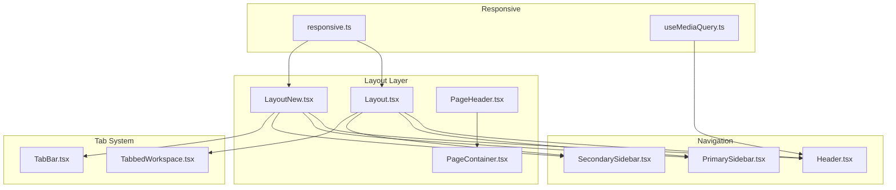
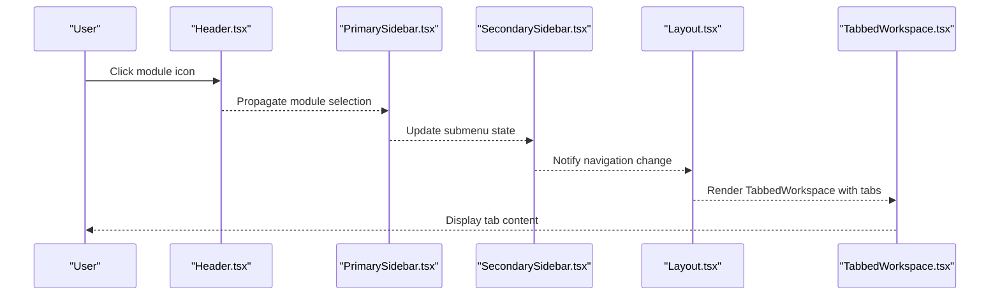
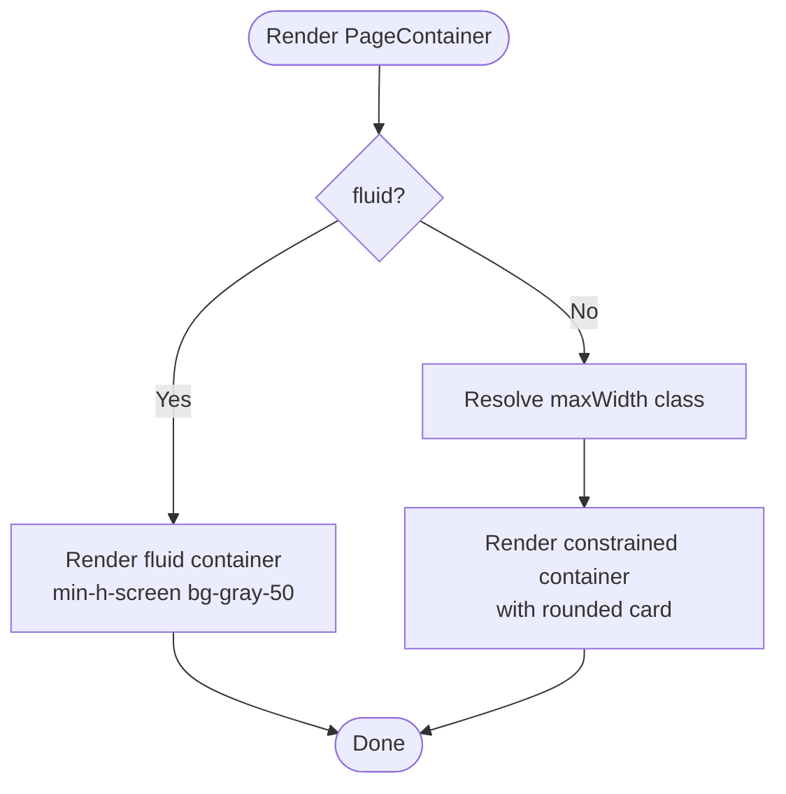
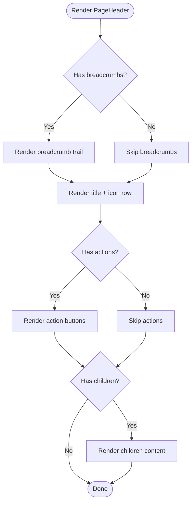
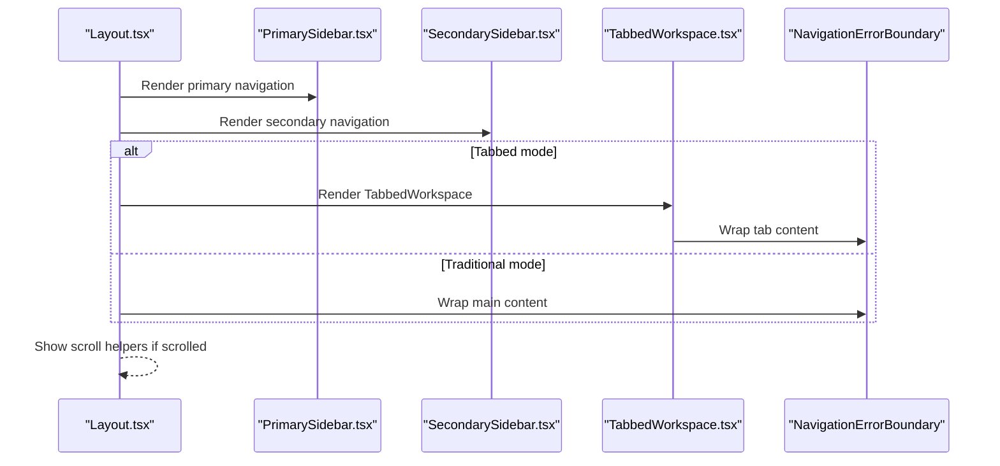
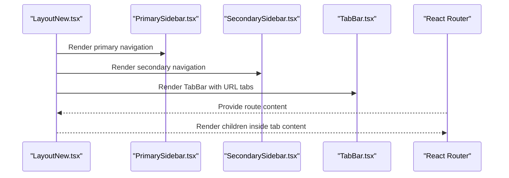
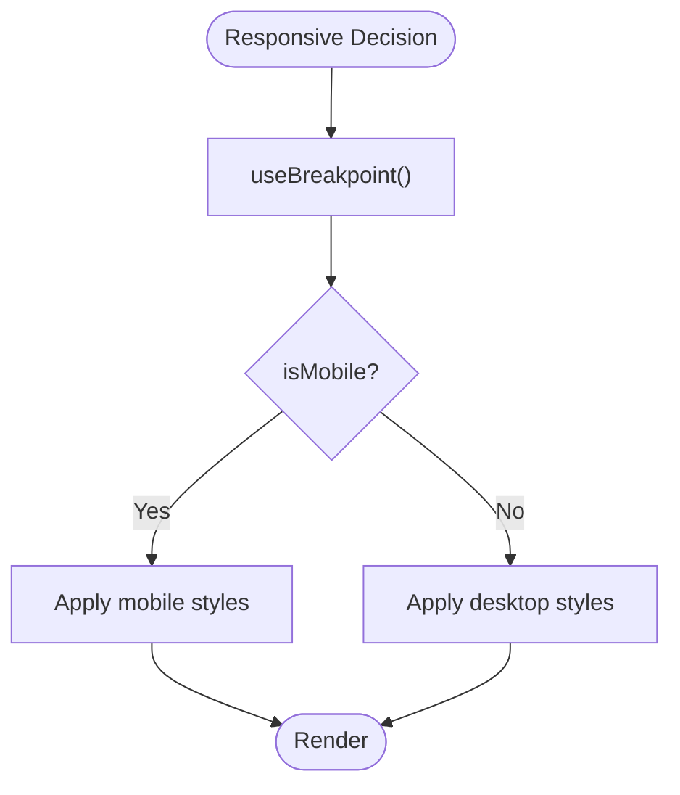
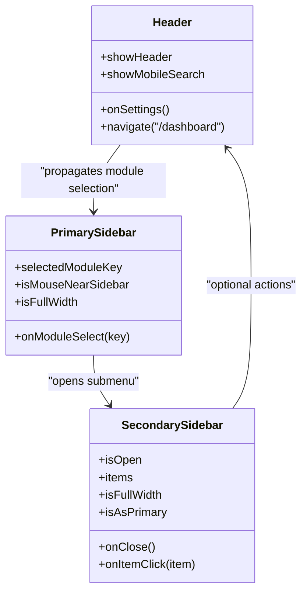
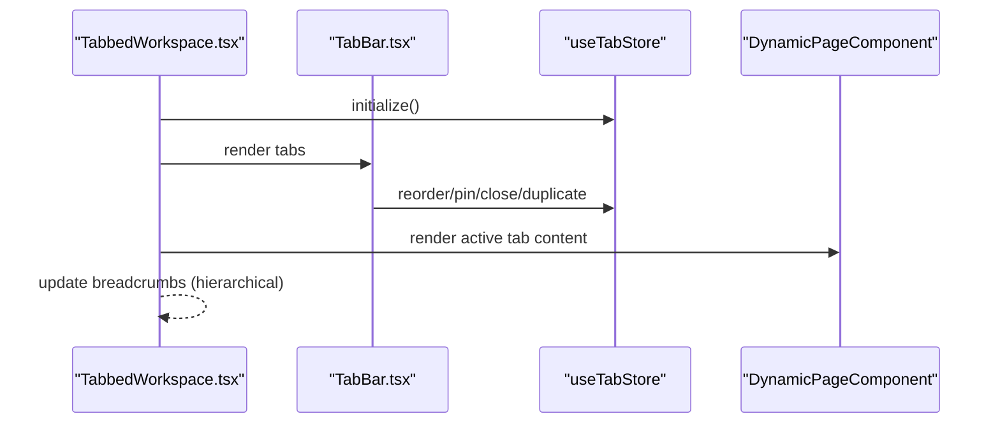
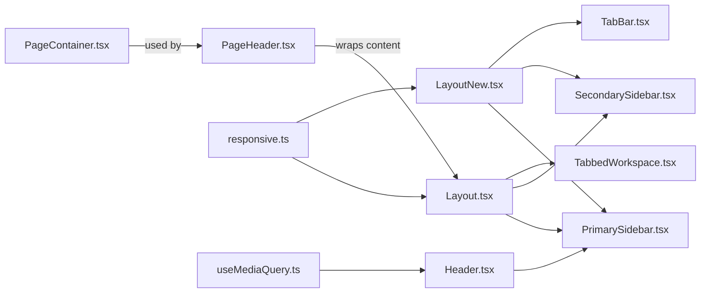

# Layout Components

<cite>
**Referenced Files in This Document**
- [PageContainer.tsx](file://src/components/layout/PageContainer.tsx)
- [PageHeader.tsx](file://src/components/layout/PageHeader.tsx)
- [index.ts](file://src/components/layout/index.ts)
- [Layout.tsx](file://src/components/Layout.tsx)
- [LayoutNew.tsx](file://src/components/LayoutNew.tsx)
- [responsive.ts](file://src/utils/responsive.ts)
- [useMediaQuery.ts](file://src/hooks/useMediaQuery.ts)
- [Header.tsx](file://src/components/Header.tsx)
- [PrimarySidebar.tsx](file://src/components/PrimarySidebar.tsx)
- [SecondarySidebar.tsx](file://src/components/SecondarySidebar.tsx)
- [TabbedWorkspace.tsx](file://src/components/tabbedWorkspace/TabbedWorkspace.tsx)
- [TabBar.tsx](file://src/components/tabbedWorkspace/TabBar.tsx)
</cite>

## Table of Contents
1. [Introduction](#introduction)
2. [Project Structure](#project-structure)
3. [Core Components](#core-components)
4. [Architecture Overview](#architecture-overview)
5. [Detailed Component Analysis](#detailed-component-analysis)
6. [Dependency Analysis](#dependency-analysis)
7. [Performance Considerations](#performance-considerations)
8. [Troubleshooting Guide](#troubleshooting-guide)
9. [Conclusion](#conclusion)

## Introduction
This document explains SchoolPilot3’s layout component system with a focus on PageContainer, PageHeader, and the main Layout components. It covers responsive design patterns, grid and container management, header navigation, sidebar integration, and content area management. It also documents layout variants for different page types, responsive breakpoints, complex layout scenarios, nested layouts, adaptive design patterns, and performance optimization strategies including hydration patterns for server-side rendering.

## Project Structure
The layout system centers around three primary layout components:
- PageContainer: wraps page content with responsive constraints and padding.
- PageHeader: standardizes page-level headers with breadcrumbs, actions, and optional children.
- Layout: orchestrates navigation, tab management, and overall app structure.

Additional supporting pieces:
- Header: top app bar with responsive actions and user controls.
- PrimarySidebar and SecondarySidebar: module navigation and submodule navigation.
- TabbedWorkspace and TabBar: tabbed workspace with hierarchical breadcrumbs and actions.
- Responsive utilities: breakpoints, media queries, and responsive helpers.

**Diagram sources**
- [Layout.tsx:1-317](file://src/components/Layout.tsx#L1-L317)
- [LayoutNew.tsx:1-396](file://src/components/LayoutNew.tsx#L1-L396)
- [PageHeader.tsx:1-88](file://src/components/layout/PageHeader.tsx#L1-L88)
- [PageContainer.tsx:1-44](file://src/components/layout/PageContainer.tsx#L1-L44)
- [Header.tsx:1-151](file://src/components/Header.tsx#L1-L151)
- [PrimarySidebar.tsx:1-486](file://src/components/PrimarySidebar.tsx#L1-L486)
- [SecondarySidebar.tsx:1-505](file://src/components/SecondarySidebar.tsx#L1-L505)
- [TabbedWorkspace.tsx:1-549](file://src/components/tabbedWorkspace/TabbedWorkspace.tsx#L1-L549)
- [TabBar.tsx:1-521](file://src/components/tabbedWorkspace/TabBar.tsx#L1-L521)
- [responsive.ts:1-202](file://src/utils/responsive.ts#L1-L202)
- [useMediaQuery.ts:1-51](file://src/hooks/useMediaQuery.ts#L1-L51)

**Section sources**
- [Layout.tsx:1-317](file://src/components/Layout.tsx#L1-L317)
- [LayoutNew.tsx:1-396](file://src/components/LayoutNew.tsx#L1-L396)
- [PageHeader.tsx:1-88](file://src/components/layout/PageHeader.tsx#L1-L88)
- [PageContainer.tsx:1-44](file://src/components/layout/PageContainer.tsx#L1-L44)
- [Header.tsx:1-151](file://src/components/Header.tsx#L1-L151)
- [PrimarySidebar.tsx:1-486](file://src/components/PrimarySidebar.tsx#L1-L486)
- [SecondarySidebar.tsx:1-505](file://src/components/SecondarySidebar.tsx#L1-L505)
- [TabbedWorkspace.tsx:1-549](file://src/components/tabbedWorkspace/TabbedWorkspace.tsx#L1-L549)
- [TabBar.tsx:1-521](file://src/components/tabbedWorkspace/TabBar.tsx#L1-L521)
- [responsive.ts:1-202](file://src/utils/responsive.ts#L1-L202)
- [useMediaQuery.ts:1-51](file://src/hooks/useMediaQuery.ts#L1-L51)

## Core Components
- PageContainer: Provides responsive padding, max-width constraints, and optional fluid layout. Supports configurable max widths and fluid mode for full-viewport layouts.
- PageHeader: Standardizes page headers with title, description, icon, breadcrumbs, and action slots. Supports optional children for additional header content.
- Layout: Main orchestrator with navigation, tab management, scroll helpers, and error boundaries. Supports traditional layout and tabbed workspace modes.
- LayoutNew: URL-driven tab system variant with explicit URL-to-tab mapping, module-aware navigation, and enhanced tab bar integration.

**Section sources**
- [PageContainer.tsx:7-44](file://src/components/layout/PageContainer.tsx#L7-L44)
- [PageHeader.tsx:7-88](file://src/components/layout/PageHeader.tsx#L7-L88)
- [Layout.tsx:26-317](file://src/components/Layout.tsx#L26-L317)
- [LayoutNew.tsx:55-396](file://src/components/LayoutNew.tsx#L55-L396)

## Architecture Overview
The layout system integrates navigation, content areas, and tab management. Two main layout variants coexist:
- Legacy Layout: Uses a tab store and a TabbedWorkspace component for full-page tabs with integrated breadcrumbs.
- LayoutNew: Uses a URL-driven tab system, mapping URLs to tabs and delegating content rendering to the router.

Responsive behavior is handled via shared utilities and hooks for breakpoints and media queries. The header adapts actions based on viewport size, and sidebars integrate with full-width and secondary-as-primary modes.

**Diagram sources**
- [Header.tsx:14-151](file://src/components/Header.tsx#L14-L151)
- [PrimarySidebar.tsx:149-486](file://src/components/PrimarySidebar.tsx#L149-L486)
- [SecondarySidebar.tsx:70-505](file://src/components/SecondarySidebar.tsx#L70-L505)
- [Layout.tsx:26-317](file://src/components/Layout.tsx#L26-L317)
- [TabbedWorkspace.tsx:16-549](file://src/components/tabbedWorkspace/TabbedWorkspace.tsx#L16-L549)

## Detailed Component Analysis

### PageContainer
Responsibilities:
- Apply responsive padding and margins.
- Constrain content width with optional max-width classes.
- Support fluid mode for full-viewport layouts.
- Wrap content in a white card with rounded corners and subtle shadow.

Key behaviors:
- maxWidth accepts predefined sizes or false for no constraint.
- fluid mode removes max-width constraints and applies full-height background.

**Diagram sources**
- [PageContainer.tsx:14-44](file://src/components/layout/PageContainer.tsx#L14-L44)

**Section sources**
- [PageContainer.tsx:7-44](file://src/components/layout/PageContainer.tsx#L7-L44)

### PageHeader
Responsibilities:
- Render standardized page headers with title, optional description, and icon.
- Provide breadcrumb navigation with active state handling.
- Expose action slot for contextual buttons or menus.
- Allow optional children for extra header content.

**Diagram sources**
- [PageHeader.tsx:21-88](file://src/components/layout/PageHeader.tsx#L21-L88)

**Section sources**
- [PageHeader.tsx:7-88](file://src/components/layout/PageHeader.tsx#L7-L88)

### Layout (Legacy)
Responsibilities:
- Manage navigation, RBAC, and dynamic module loading.
- Coordinate PrimarySidebar, SecondarySidebar, and TabbedWorkspace.
- Provide floating scroll helpers and settings modal.
- Integrate NavigationErrorBoundary for robust navigation.

Key patterns:
- Tabbed vs traditional layout determined by module context and feature flags.
- Scroll helpers appear after scrolling threshold.
- Tab content rendering delegated to NavigationErrorBoundary with fallback routes.

**Diagram sources**
- [Layout.tsx:26-317](file://src/components/Layout.tsx#L26-L317)
- [PrimarySidebar.tsx:149-486](file://src/components/PrimarySidebar.tsx#L149-L486)
- [SecondarySidebar.tsx:70-505](file://src/components/SecondarySidebar.tsx#L70-L505)
- [TabbedWorkspace.tsx:16-549](file://src/components/tabbedWorkspace/TabbedWorkspace.tsx#L16-L549)

**Section sources**
- [Layout.tsx:26-317](file://src/components/Layout.tsx#L26-L317)

### LayoutNew (URL-Driven Tabs)
Responsibilities:
- Map URLs to tabs and manage tab lifecycle.
- Provide module-aware navigation with permission checks.
- Render tab bar and content area with URL-driven state.

Key patterns:
- Normalize module IDs from navigation keys and URLs.
- Transition to module sessions while preserving pinned tabs.
- Render tab content via router-provided children.

**Diagram sources**
- [LayoutNew.tsx:55-396](file://src/components/LayoutNew.tsx#L55-L396)
- [PrimarySidebar.tsx:149-486](file://src/components/PrimarySidebar.tsx#L149-L486)
- [SecondarySidebar.tsx:70-505](file://src/components/SecondarySidebar.tsx#L70-L505)
- [TabBar.tsx:40-521](file://src/components/tabbedWorkspace/TabBar.tsx#L40-L521)

**Section sources**
- [LayoutNew.tsx:55-396](file://src/components/LayoutNew.tsx#L55-L396)

### Responsive Patterns and Utilities
- Breakpoints: xs, sm, md, lg, xl, 2xl with Tailwind-compatible thresholds.
- Media queries: min/max width, device ranges, orientation, and high-DPI.
- Hook: useBreakpoint for runtime breakpoint detection.
- Hook: useMediaQuery for CSS media query subscriptions.
- Utilities: responsive spacing, grid column helpers, and responsive class builders.

**Diagram sources**
- [responsive.ts:4-117](file://src/utils/responsive.ts#L4-L117)
- [useMediaQuery.ts:18-51](file://src/hooks/useMediaQuery.ts#L18-L51)

**Section sources**
- [responsive.ts:4-202](file://src/utils/responsive.ts#L4-L202)
- [useMediaQuery.ts:1-51](file://src/hooks/useMediaQuery.ts#L1-L51)

### Header Navigation and Sidebars
- Header: Fixed top bar with logo, compact search, network/status indicators, notifications, language switcher, settings, and user menu. Adapts actions based on viewport size and scroll direction.
- PrimarySidebar: Vertical module selector with hover tooltips, selection indicators, and module-specific styling. Integrates with full-width mode and overflow menu.
- SecondarySidebar: Module submenu with search, favorites reordering, and keyboard navigation. Supports minimized/full-width modes and mobile backdrop.

**Diagram sources**
- [Header.tsx:14-151](file://src/components/Header.tsx#L14-L151)
- [PrimarySidebar.tsx:149-486](file://src/components/PrimarySidebar.tsx#L149-L486)
- [SecondarySidebar.tsx:70-505](file://src/components/SecondarySidebar.tsx#L70-L505)

**Section sources**
- [Header.tsx:14-151](file://src/components/Header.tsx#L14-L151)
- [PrimarySidebar.tsx:149-486](file://src/components/PrimarySidebar.tsx#L149-L486)
- [SecondarySidebar.tsx:70-505](file://src/components/SecondarySidebar.tsx#L70-L505)

### Tabbed Workspace and Tab Bar
- TabbedWorkspace: Manages tab lifecycle, permissions, breadcrumbs, and error boundaries. Supports hierarchical breadcrumbs and action bar integration.
- TabBar: Renders visible tabs with overflow handling, drag-and-drop reordering, and contextual actions. Supports modern and legacy styles.

**Diagram sources**
- [TabbedWorkspace.tsx:16-549](file://src/components/tabbedWorkspace/TabbedWorkspace.tsx#L16-L549)
- [TabBar.tsx:40-521](file://src/components/tabbedWorkspace/TabBar.tsx#L40-L521)

**Section sources**
- [TabbedWorkspace.tsx:16-549](file://src/components/tabbedWorkspace/TabbedWorkspace.tsx#L16-L549)
- [TabBar.tsx:40-521](file://src/components/tabbedWorkspace/TabBar.tsx#L40-L521)

## Dependency Analysis
- PageContainer depends on Tailwind-like responsive classes and is self-contained.
- PageHeader depends on optional breadcrumb arrays and action components.
- Layout depends on navigation hooks, RBAC, tab store, and error boundaries.
- LayoutNew depends on URL parsing, module access checks, and tab store.
- Header depends on unified config and responsive hooks.
- PrimarySidebar depends on dynamic navigation, RBAC, and full-width context.
- SecondarySidebar depends on secondary sidebar hooks and icon resolution.
- TabbedWorkspace depends on tab store, action registry, and error boundaries.
- TabBar depends on drag-and-drop and tab store.

**Diagram sources**
- [PageContainer.tsx:14-44](file://src/components/layout/PageContainer.tsx#L14-L44)
- [PageHeader.tsx:21-88](file://src/components/layout/PageHeader.tsx#L21-L88)
- [Layout.tsx:26-317](file://src/components/Layout.tsx#L26-L317)
- [LayoutNew.tsx:55-396](file://src/components/LayoutNew.tsx#L55-L396)
- [Header.tsx:14-151](file://src/components/Header.tsx#L14-L151)
- [PrimarySidebar.tsx:149-486](file://src/components/PrimarySidebar.tsx#L149-L486)
- [SecondarySidebar.tsx:70-505](file://src/components/SecondarySidebar.tsx#L70-L505)
- [TabbedWorkspace.tsx:16-549](file://src/components/tabbedWorkspace/TabbedWorkspace.tsx#L16-L549)
- [TabBar.tsx:40-521](file://src/components/tabbedWorkspace/TabBar.tsx#L40-L521)
- [responsive.ts:4-202](file://src/utils/responsive.ts#L4-L202)
- [useMediaQuery.ts:18-51](file://src/hooks/useMediaQuery.ts#L18-L51)

**Section sources**
- [PageContainer.tsx:7-44](file://src/components/layout/PageContainer.tsx#L7-L44)
- [PageHeader.tsx:7-88](file://src/components/layout/PageHeader.tsx#L7-L88)
- [Layout.tsx:26-317](file://src/components/Layout.tsx#L26-L317)
- [LayoutNew.tsx:55-396](file://src/components/LayoutNew.tsx#L55-L396)
- [Header.tsx:14-151](file://src/components/Header.tsx#L14-L151)
- [PrimarySidebar.tsx:149-486](file://src/components/PrimarySidebar.tsx#L149-L486)
- [SecondarySidebar.tsx:70-505](file://src/components/SecondarySidebar.tsx#L70-L505)
- [TabbedWorkspace.tsx:16-549](file://src/components/tabbedWorkspace/TabbedWorkspace.tsx#L16-L549)
- [TabBar.tsx:40-521](file://src/components/tabbedWorkspace/TabBar.tsx#L40-L521)
- [responsive.ts:4-202](file://src/utils/responsive.ts#L4-L202)
- [useMediaQuery.ts:18-51](file://src/hooks/useMediaQuery.ts#L18-L51)

## Performance Considerations
- Memoization and refs: TabbedWorkspace uses memoized handlers and refs to avoid unnecessary re-renders and expensive computations.
- Parallel initialization: LayoutNew initializes tabs and navigation concurrently to reduce startup latency.
- Scroll helpers: Debounced scroll listeners in Layout minimize reflow costs.
- Responsive hooks: useBreakpoint and useMediaQuery compute once per resize and expose booleans for conditional rendering.
- CSS-in-JS helpers: responsive utilities avoid inline styles and leverage class-based responsive patterns.

[No sources needed since this section provides general guidance]

## Troubleshooting Guide
Common issues and remedies:
- Tab access denied: TabbedWorkspace validates permissions and renders an access-denied message; ensure user permissions are correctly set.
- Navigation errors: Both Layout and LayoutNew wrap content with NavigationErrorBoundary and provide fallback routes; check onError callbacks for details.
- Sidebar not responding: Verify module selection handlers and full-width context; confirm mouse events and resize listeners are attached.
- Responsive misalignment: Confirm useBreakpoint/useMediaQuery usage and Tailwind breakpoints; ensure mediaQueries are applied consistently.

**Section sources**
- [TabbedWorkspace.tsx:370-381](file://src/components/tabbedWorkspace/TabbedWorkspace.tsx#L370-L381)
- [Layout.tsx:50-73](file://src/components/Layout.tsx#L50-L73)
- [LayoutNew.tsx:120-144](file://src/components/LayoutNew.tsx#L120-L144)
- [PrimarySidebar.tsx:214-233](file://src/components/PrimarySidebar.tsx#L214-L233)
- [responsive.ts:60-117](file://src/utils/responsive.ts#L60-L117)

## Conclusion
SchoolPilot3’s layout system combines a flexible PageContainer and PageHeader with robust navigation and tab management. The dual Layout variants enable both traditional and URL-driven tab experiences, while responsive utilities and hooks ensure adaptive behavior across devices. The system emphasizes performance through memoization, parallel initialization, and efficient error handling, and supports complex nested layouts with breadcrumbs and hierarchical tabs.