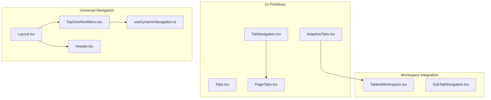
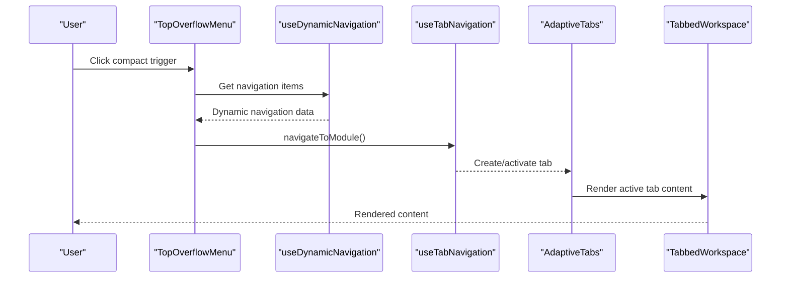
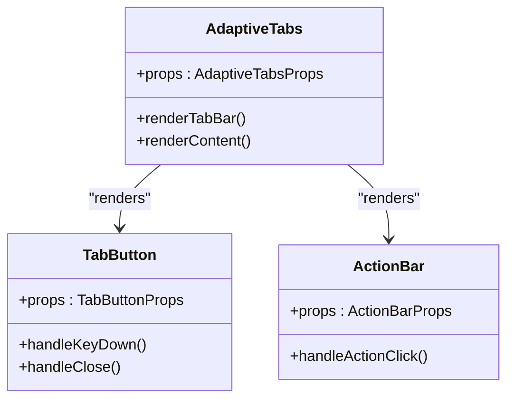
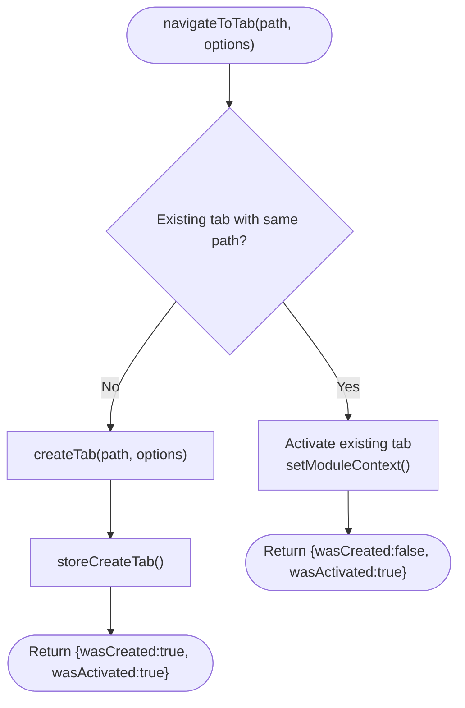
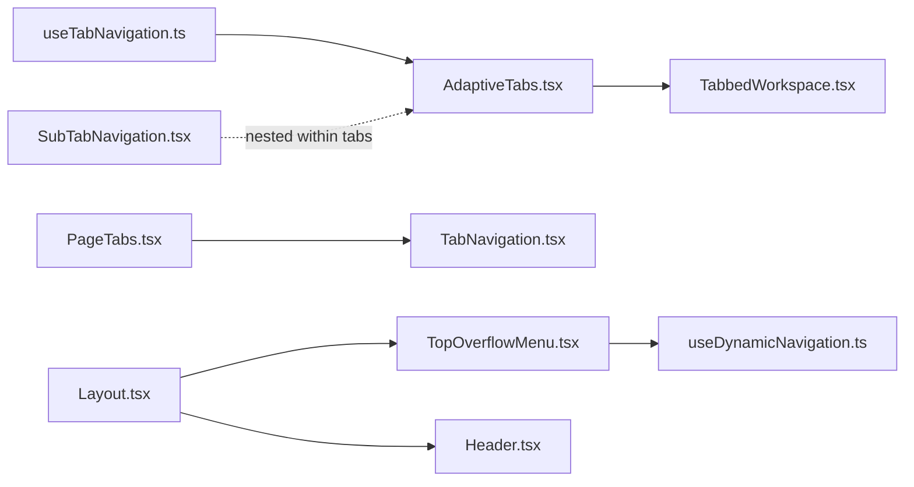

# Navigation Components

<cite>
**Referenced Files in This Document**
- [TopOverflowMenu.tsx](file://src/components/TopOverflowMenu.tsx)
- [useDynamicNavigation.ts](file://src/hooks/useDynamicNavigation.ts)
- [Layout.tsx](file://src/components/Layout.tsx)
- [Header.tsx](file://src/components/Header.tsx)
- [TabNavigation.tsx](file://src/components/ui/TabNavigation.tsx)
- [PageTabs.tsx](file://src/components/ui/PageTabs.tsx)
- [AdaptiveTabs.tsx](file://src/components/ui/AdaptiveTabs.tsx)
- [SubTabNavigation.tsx](file://src/components/tabbledWorkspace/SubTabNavigation.tsx)
- [useTabNavigation.ts](file://src/hooks/useTabNavigation.ts)
- [TabbedWorkspace.tsx](file://src/components/tabbledWorkspace/TabbedWorkspace.tsx)
- [Tabs.tsx](file://src/components/ui/Tabs.tsx)
</cite>

## Update Summary
**Changes Made**
- Updated TopOverflowMenu component documentation to reflect redesigned streamlined compact design
- Added new integration patterns showing TopOverflowMenu as primary navigation trigger
- Updated navigation architecture to show universal desktop navigation model
- Enhanced dark theme integration documentation
- Added floating navigation helpers and scroll-to-top functionality

## Table of Contents
1. [Introduction](#introduction)
2. [Project Structure](#project-structure)
3. [Core Components](#core-components)
4. [Architecture Overview](#architecture-overview)
5. [Detailed Component Analysis](#detailed-component-analysis)
6. [Dependency Analysis](#dependency-analysis)
7. [Performance Considerations](#performance-considerations)
8. [Troubleshooting Guide](#troubleshooting-guide)
9. [Conclusion](#conclusion)

## Introduction
This document describes SchoolPilot3's navigation component system with a focus on tab management, state persistence, and navigation patterns. The system has evolved to include a redesigned TopOverflowMenu component that provides streamlined navigation with improved dark theme integration and universal desktop navigation capabilities. It covers:
- Documented components: Tabs, TabNavigation, PageTabs, SubTabNavigation, AdaptiveTabs, and TopOverflowMenu
- Tabbed workspace integration, dynamic tab creation, and tab ordering
- Accessibility features, keyboard shortcuts, and focus management
- Examples of complex navigation scenarios, nested tab structures, and responsive tab behavior
- Performance optimization, lazy loading, and memory management for large numbers of tabs
- Universal desktop navigation model with floating navigation helpers

## Project Structure
SchoolPilot3 organizes navigation components under three primary areas:
- UI primitives for general-purpose tabs and navigation: Tabs, TabNavigation, PageTabs, AdaptiveTabs
- Workspace-specific tabbed navigation: TabbedWorkspace and SubTabNavigation
- Universal navigation system: TopOverflowMenu with dynamic navigation integration

**Diagram sources**
- [Tabs.tsx:1-146](file://src/components/ui/Tabs.tsx#L1-L146)
- [TabNavigation.tsx:1-183](file://src/components/ui/TabNavigation.tsx#L1-L183)
- [PageTabs.tsx:1-173](file://src/components/ui/PageTabs.tsx#L1-L173)
- [AdaptiveTabs.tsx:1-580](file://src/components/ui/AdaptiveTabs.tsx#L1-L580)
- [TabbedWorkspace.tsx:345-399](file://src/components/tabbledWorkspace/TabbedWorkspace.tsx#L345-L399)
- [SubTabNavigation.tsx:1-94](file://src/components/tabbledWorkspace/SubTabNavigation.tsx#L1-L94)
- [TopOverflowMenu.tsx:1-264](file://src/components/TopOverflowMenu.tsx#L1-L264)
- [useDynamicNavigation.ts:1-169](file://src/hooks/useDynamicNavigation.ts#L1-L169)
- [Layout.tsx:200-329](file://src/components/Layout.tsx#L200-L329)
- [Header.tsx:1-145](file://src/components/Header.tsx#L1-L145)

**Section sources**
- [TopOverflowMenu.tsx:1-264](file://src/components/TopOverflowMenu.tsx#L1-L264)
- [useDynamicNavigation.ts:1-169](file://src/hooks/useDynamicNavigation.ts#L1-L169)
- [Layout.tsx:200-329](file://src/components/Layout.tsx#L200-L329)
- [Header.tsx:1-145](file://src/components/Header.tsx#L1-L145)

## Core Components
- Tabs: Lightweight, stateful tab container for simple UI scenarios.
- TabNavigation: Route-aware horizontal tab bar with variants, sizes, badges, and icons.
- PageTabs: Page-level tabs with integrated filter bar and content switching.
- AdaptiveTabs: Cross-platform, responsive tab system with drag-and-drop reordering, action bars, and platform-aware behavior.
- SubTabNavigation: Secondary navigation within a tab, with optional add button and active state management.
- TopOverflowMenu: Redesigned universal navigation component with streamlined compact design, dark theme integration, and dynamic module navigation.
- useTabNavigation: Hook orchestrating tab lifecycle, navigation, grouping, and history for the tabbed workspace.
- useDynamicNavigation: Hook providing real-time navigation updates and module management for TopOverflowMenu integration.

Key capabilities:
- Controlled vs uncontrolled modes
- Accessibility via ARIA roles and keyboard handling
- Responsive behavior and platform detection
- Action overflow menus and customizable layouts
- Universal desktop navigation with floating positioning
- Dark theme support with backdrop blur effects
- Dynamic module discovery and real-time updates

**Section sources**
- [Tabs.tsx:1-146](file://src/components/ui/Tabs.tsx#L1-L146)
- [TabNavigation.tsx:87-182](file://src/components/ui/TabNavigation.tsx#L87-L182)
- [PageTabs.tsx:65-172](file://src/components/ui/PageTabs.tsx#L65-L172)
- [AdaptiveTabs.tsx:50-580](file://src/components/ui/AdaptiveTabs.tsx#L50-L580)
- [SubTabNavigation.tsx:8-93](file://src/components/tabbledWorkspace/SubTabNavigation.tsx#L8-L93)
- [TopOverflowMenu.tsx:37-147](file://src/components/TopOverflowMenu.tsx#L37-L147)
- [useTabNavigation.ts:113-394](file://src/hooks/useTabNavigation.ts#L113-L394)
- [useDynamicNavigation.ts:19-169](file://src/hooks/useDynamicNavigation.ts#L19-L169)

## Architecture Overview
The navigation system integrates UI primitives with a workspace manager, universal navigation, and dynamic module management:
- AdaptiveTabs drives the workspace tab bar and content area
- useTabNavigation centralizes tab creation, activation, closing, moving, pinning, grouping, and navigation history
- TabbedWorkspace renders active tab content and enforces access checks
- SubTabNavigation supports nested secondary navigation inside tabs
- TopOverflowMenu provides universal desktop navigation with streamlined compact design
- useDynamicNavigation supplies real-time module discovery and navigation updates
- Layout coordinates the floating navigation system with scroll helpers

**Diagram sources**
- [TopOverflowMenu.tsx:45](file://src/components/TopOverflowMenu.tsx#L45)
- [useDynamicNavigation.ts:29-51](file://src/hooks/useDynamicNavigation.ts#L29-L51)
- [useTabNavigation.ts:388-392](file://src/hooks/useTabNavigation.ts#L388-L392)
- [AdaptiveTabs.tsx:361-580](file://src/components/ui/AdaptiveTabs.tsx#L361-L580)
- [TabbedWorkspace.tsx:345-399](file://src/components/tabbledWorkspace/TabbedWorkspace.tsx#L345-L399)

## Detailed Component Analysis

### TopOverflowMenu
**Updated** Redesigned with streamlined compact design and improved dark theme integration

Purpose:
- Universal desktop navigation component with compact trigger design
- Dynamic module navigation with real-time updates
- Dark theme support with backdrop blur effects
- Floating positioning system with z-index coordination

Highlights:
- Compact trigger design: logo + down arrow in single row
- Dark theme integration: slate-900/95 backdrop with backdrop-blur-xl
- Dynamic navigation items from useDynamicNavigation hook
- Real-time module status updates and navigation filtering
- Floating positioning with fixed z-index (z-60) above primary sidebar (z-50)
- Scrollbar customization with custom CSS for dark theme compatibility

Navigation capabilities:
- Desktop access: direct navigation to dashboard
- Workspaces: grouped module navigation with submenu support
- Website access: external site navigation
- System controls: reload, full-width toggle, theme toggle
- Help system: contextual help and keyboard shortcuts

**Section sources**
- [TopOverflowMenu.tsx:37-147](file://src/components/TopOverflowMenu.tsx#L37-L147)
- [TopOverflowMenu.tsx:158-260](file://src/components/TopOverflowMenu.tsx#L158-L260)

### useDynamicNavigation Hook
**Updated** Enhanced with improved error handling and real-time updates

Purpose:
- Dynamic navigation management with real-time updates and module management
- Provides navigation items and module status for TopOverflowMenu integration

Key responsibilities:
- Load navigation items from module system with error handling
- Enable/disable modules with real-time updates
- Search navigation items with memoized results
- Provide main modules and sub-navigation data
- Maintain loading states and error boundaries

Enhanced features:
- Improved error handling with fallback empty arrays
- Memoized navigation items to prevent unnecessary recalculations
- Stable auto-load implementation to prevent re-renders
- Real-time module status checking and dependency validation

**Section sources**
- [useDynamicNavigation.ts:19-169](file://src/hooks/useDynamicNavigation.ts#L19-L169)

### Layout Integration
**Updated** New floating navigation system with TopOverflowMenu

Purpose:
- Coordinates TopOverflowMenu with TabbedWorkspace and traditional layout modes
- Manages floating navigation helpers and scroll-to-top functionality
- Handles universal desktop navigation model

Highlights:
- Floating TopOverflowMenu positioned at top-left (z-60) above PrimarySidebar (z-50)
- Conditional layout switching between tabbed workspace and traditional modes
- Scroll-to-top and navigation helpers with floating positioning
- Dynamic module selection and navigation handling
- Integration with Header component for responsive design

**Section sources**
- [Layout.tsx:200-329](file://src/components/Layout.tsx#L200-L329)

### Header Component
**Updated** Enhanced with floating navigation helpers

Purpose:
- Main application header with responsive design and floating navigation helpers
- Coordinates with TopOverflowMenu for universal navigation experience

Highlights:
- Floating positioning system with z-index coordination
- Scroll-to-top and navigation helpers with smooth scrolling
- Responsive design with mobile-first approach
- Integration with navigation error boundaries

**Section sources**
- [Header.tsx:1-145](file://src/components/Header.tsx#L1-L145)

### TabNavigation
Purpose:
- Horizontal tab bar with route-aware active state, icons, badges, and multiple variants/sizes.

Highlights:
- Active detection via explicit activeTabId or pathname matching
- Support for both router links and button-based tabs
- Accessibility attributes: role="tablist" and role="tab" with aria-selected
- Responsive horizontal scrolling and touch-friendly sizing

Usage patterns:
- As a standalone navigation bar
- Embedded within PageTabs for page-level tab switching

**Section sources**
- [TabNavigation.tsx:87-182](file://src/components/ui/TabNavigation.tsx#L87-L182)

### PageTabs
Purpose:
- Page-level tabs with integrated filter bar and content area.

Highlights:
- Controlled/uncontrolled active tab support
- Tab-specific and global filters with search/clear actions
- Renders content based on active tab ID
- Uses TabNavigation internally for consistent styling

Typical usage:
- Class lists and reports pages with per-tab filters

**Section sources**
- [PageTabs.tsx:65-172](file://src/components/ui/PageTabs.tsx#L65-L172)

### AdaptiveTabs
Purpose:
- Cross-platform, responsive tab system supporting:
  - Variants: workspace, page, form
  - Action bars with overflow menus
  - Drag-and-drop reordering (desktop)
  - Platform-aware sizing and behavior
  - Max tabs, closeable tabs, loading states, badges

Highlights:
- Context-driven tab management
- Keyboard accessibility for tab selection
- Scrollable tab bar and overflow handling
- Action bar with configurable visibility and max visible actions

**Diagram sources**
- [AdaptiveTabs.tsx:118-357](file://src/components/ui/AdaptiveTabs.tsx#L118-L357)

**Section sources**
- [AdaptiveTabs.tsx:50-580](file://src/components/ui/AdaptiveTabs.tsx#L50-L580)

### SubTabNavigation
Purpose:
- Secondary navigation within a tab, often used for subsections or views.

Highlights:
- Optional add button for creating new sub-tabs
- Active state management and disabled states
- Consistent styling with workspace context

**Section sources**
- [SubTabNavigation.tsx:8-93](file://src/components/tabbledWorkspace/SubTabNavigation.tsx#L8-L93)

### useTabNavigation Hook
Purpose:
- Centralized tab lifecycle and navigation orchestration for the workspace.

Key responsibilities:
- Create, activate, close, move, pin, and update tabs
- Manage tab groups and cross-group movement
- Maintain navigation history and enable back/forward navigation
- Resolve tab content types (component, URL, HTML/text)
- Module-aware navigation and context updates

Behavioral patterns:
- Deduplicates tabs by path unless forced
- Navigates to module/submodule routes
- Integrates with TabbedWorkspace for content rendering

**Diagram sources**
- [useTabNavigation.ts:364-386](file://src/hooks/useTabNavigation.ts#L364-L386)

**Section sources**
- [useTabNavigation.ts:113-394](file://src/hooks/useTabNavigation.ts#L113-L394)

### TabbedWorkspace Integration
Purpose:
- Hosts AdaptiveTabs and renders active tab content with access checks and fallbacks.

Highlights:
- Empty state and "tab not found" messaging
- Access validation before rendering
- Custom content rendering hook and default route-based rendering

**Section sources**
- [TabbedWorkspace.tsx:345-399](file://src/components/tabbledWorkspace/TabbedWorkspace.tsx#L345-L399)

### Related UI Tabs (Legacy/Primitive)
Purpose:
- Simple, stateful Tabs component for basic scenarios.

Notes:
- Not used in the modern tabbed workspace; useful for simple pages or demos.

**Section sources**
- [Tabs.tsx:1-146](file://src/components/ui/Tabs.tsx#L1-L146)

## Dependency Analysis
Component relationships:
- AdaptiveTabs depends on useTabNavigation for stateful tab operations
- TabbedWorkspace composes AdaptiveTabs and renders active tab content
- PageTabs composes TabNavigation for page-level tabs
- SubTabNavigation complements AdaptiveTabs by enabling nested secondary navigation
- TopOverflowMenu integrates with useDynamicNavigation for dynamic module navigation
- Layout coordinates TopOverflowMenu with TabbedWorkspace and traditional layouts
- Header provides floating navigation helpers and scroll-to-top functionality

**Diagram sources**
- [useTabNavigation.ts:113-394](file://src/hooks/useTabNavigation.ts#L113-L394)
- [AdaptiveTabs.tsx:361-580](file://src/components/ui/AdaptiveTabs.tsx#L361-L580)
- [TabbedWorkspace.tsx:345-399](file://src/components/tabbledWorkspace/TabbedWorkspace.tsx#L345-L399)
- [PageTabs.tsx:65-172](file://src/components/ui/PageTabs.tsx#L65-L172)
- [TabNavigation.tsx:87-182](file://src/components/ui/TabNavigation.tsx#L87-L182)
- [SubTabNavigation.tsx:8-93](file://src/components/tabbledWorkspace/SubTabNavigation.tsx#L8-L93)
- [TopOverflowMenu.tsx:45](file://src/components/TopOverflowMenu.tsx#L45)
- [useDynamicNavigation.ts:29-51](file://src/hooks/useDynamicNavigation.ts#L29-L51)
- [Layout.tsx:200-329](file://src/components/Layout.tsx#L200-L329)
- [Header.tsx:1-145](file://src/components/Header.tsx#L1-L145)

**Section sources**
- [useTabNavigation.ts:113-394](file://src/hooks/useTabNavigation.ts#L113-L394)
- [AdaptiveTabs.tsx:361-580](file://src/components/ui/AdaptiveTabs.tsx#L361-L580)
- [TabbedWorkspace.tsx:345-399](file://src/components/tabbledWorkspace/TabbedWorkspace.tsx#L345-L399)
- [PageTabs.tsx:65-172](file://src/components/ui/PageTabs.tsx#L65-L172)
- [TabNavigation.tsx:87-182](file://src/components/ui/TabNavigation.tsx#L87-L182)
- [SubTabNavigation.tsx:8-93](file://src/components/tabbledWorkspace/SubTabNavigation.tsx#L8-L93)
- [TopOverflowMenu.tsx:45](file://src/components/TopOverflowMenu.tsx#L45)
- [useDynamicNavigation.ts:29-51](file://src/hooks/useDynamicNavigation.ts#L29-L51)
- [Layout.tsx:200-329](file://src/components/Layout.tsx#L200-L329)
- [Header.tsx:1-145](file://src/components/Header.tsx#L1-L145)

## Performance Considerations
Guidelines for large-scale tab environments:
- Limit concurrent active tabs using maxTabs configuration in AdaptiveTabs
- Prefer lazy loading for tab content:
  - Render tab content only when active
  - Defer heavy computations until tab becomes active
- Virtualize or paginate content for tabs with large datasets
- Avoid unnecessary re-renders:
  - Memoize tab content and props
  - Use controlled activeTab to prevent redundant state updates
- Minimize DOM nodes per tab:
  - Hide badges and icons when not needed
  - Collapse action bars when unused
- Use drag-and-drop only on desktop platforms to reduce overhead on mobile
- Persist only essential tab metadata to avoid bloated state
- Optimize TopOverflowMenu rendering:
  - Use memoized navigation items from useDynamicNavigation
  - Implement virtualized scrolling for large navigation lists
  - Leverage CSS backdrop-filter efficiently with proper z-index stacking

## Troubleshooting Guide
Common issues and resolutions:
- Tab not found or empty workspace:
  - Verify activeTabId matches an existing tab
  - Confirm TabbedWorkspace fallback messages are not masking underlying errors
- Access denied to tab content:
  - Ensure validateTabAccess permits the active tab
  - Check permissions in tab metadata
- Excessive tabs causing performance problems:
  - Enforce maxTabs and close inactive tabs
  - Lazy-load content and dispose off-screen tabs
- Keyboard navigation not working:
  - Confirm TabButton handles Enter/Space keys
  - Ensure active tab receives focus via tabIndex
- Drag-and-drop not functional:
  - Verify draggable flag and platform detection
  - Ensure onTabReorder callback is provided
- TopOverflowMenu not displaying correctly:
  - Check z-index stacking (should be z-60 above z-50)
  - Verify floating positioning with fixed top-left coordinates
  - Ensure proper integration with useDynamicNavigation hook
- Dark theme integration issues:
  - Verify backdrop-blur-xl classes are applied
  - Check custom scrollbar CSS for dark theme compatibility
  - Ensure proper color scheme transitions on theme toggle

**Section sources**
- [TabbedWorkspace.tsx:345-399](file://src/components/tabbledWorkspace/TabbedWorkspace.tsx#L345-L399)
- [AdaptiveTabs.tsx:133-138](file://src/components/ui/AdaptiveTabs.tsx#L133-L138)
- [AdaptiveTabs.tsx:424-434](file://src/components/ui/AdaptiveTabs.tsx#L424-L434)
- [TopOverflowMenu.tsx:158-260](file://src/components/TopOverflowMenu.tsx#L158-L260)

## Conclusion
SchoolPilot3's navigation component system provides a robust, accessible, and responsive foundation for tabbed workspaces with enhanced universal navigation capabilities:
- AdaptiveTabs offers a unified, cross-platform experience with action bars, drag-and-drop, and platform-aware behavior
- useTabNavigation centralizes tab lifecycle and navigation history
- TabbedWorkspace integrates tabs with content rendering and access control
- TabNavigation and PageTabs complement page-level navigation needs
- SubTabNavigation enables nested secondary navigation within tabs
- TopOverflowMenu provides streamlined universal navigation with dark theme integration
- useDynamicNavigation supplies real-time module discovery and navigation updates
- Layout coordinates floating navigation system with scroll helpers and responsive design

The redesigned TopOverflowMenu component represents a significant improvement in navigation UX, offering a compact trigger design that integrates seamlessly with the tabbed workspace system while providing universal desktop navigation capabilities. By combining these components with performance-conscious patterns—lazy loading, virtualization, state pruning, and efficient dark theme support—teams can scale tabbed navigation to complex, data-rich applications while maintaining usability and accessibility across all device types and themes.