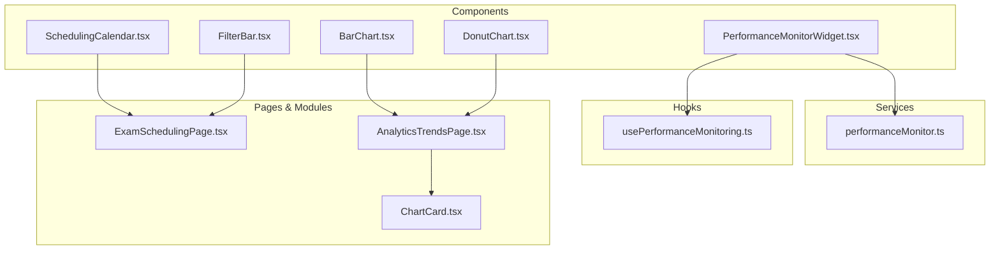
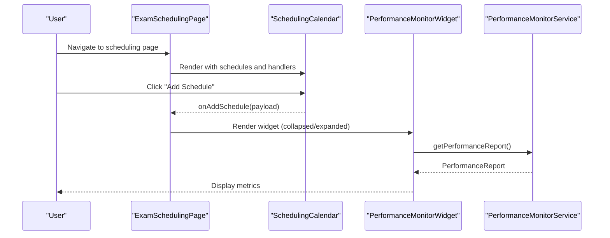
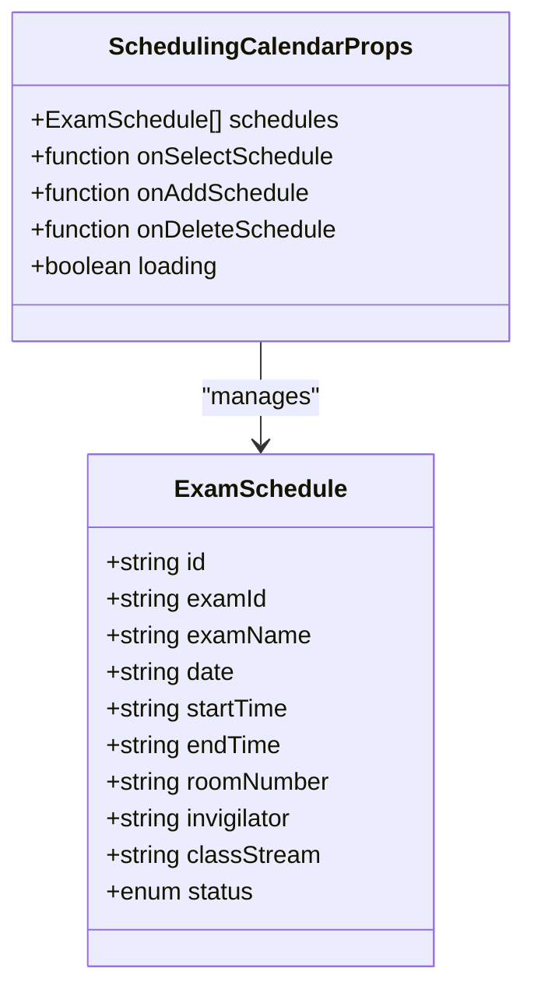
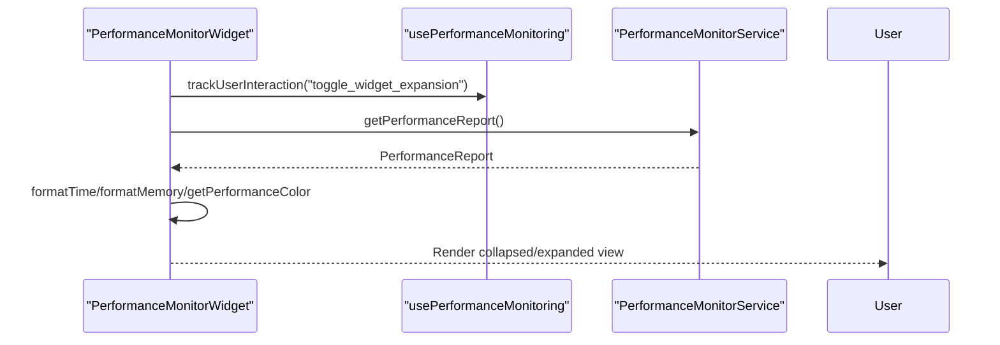
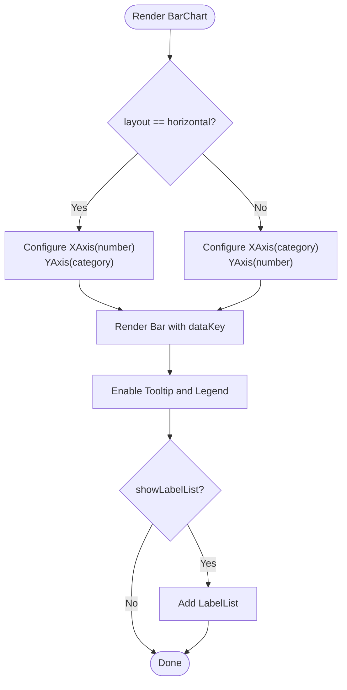
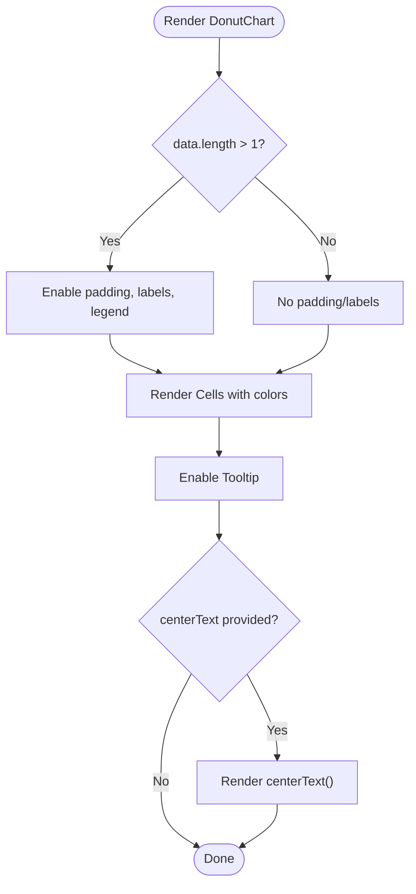
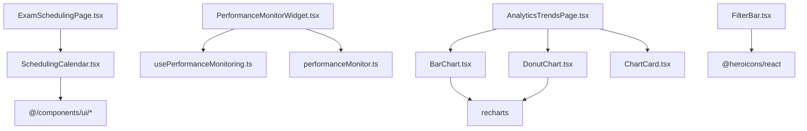

# Specialized Components

<cite>
**Referenced Files in This Document**
- [SchedulingCalendar.tsx](file://src/components/SchedulingCalendar.tsx)
- [PerformanceMonitorWidget.tsx](file://src/components/PerformanceMonitorWidget.tsx)
- [BarChart.tsx](file://src/components/ui/BarChart.tsx)
- [DonutChart.tsx](file://src/components/ui/DonutChart.tsx)
- [FilterBar.tsx](file://src/components/ui/FilterBar.tsx)
- [performanceMonitor.ts](file://src/services/performance/performanceMonitor.ts)
- [usePerformanceMonitoring.ts](file://src/hooks/usePerformanceMonitoring.ts)
- [ExamSchedulingPage.tsx](file://src/modules/academics/pages/ExamSchedulingPage.tsx)
- [AnalyticsTrendsPage.tsx](file://src/modules/reports/pages/AnalyticsTrendsPage.tsx)
- [ChartCard.tsx](file://src/modules/dashboard/components/ChartCard.tsx)
</cite>

## Table of Contents
1. [Introduction](#introduction)
2. [Project Structure](#project-structure)
3. [Core Components](#core-components)
4. [Architecture Overview](#architecture-overview)
5. [Detailed Component Analysis](#detailed-component-analysis)
6. [Dependency Analysis](#dependency-analysis)
7. [Performance Considerations](#performance-considerations)
8. [Troubleshooting Guide](#troubleshooting-guide)
9. [Conclusion](#conclusion)

## Introduction
This document provides comprehensive technical documentation for SchoolPilot3's specialized components focused on academic scheduling, system performance monitoring, and data visualization. It covers:
- SchedulingCalendar for academic exam scheduling with calendar and list views
- PerformanceMonitorWidget for runtime performance monitoring with collapsible UI
- BarChart and DonutChart for educational analytics visualization
- FilterBar for consistent filtering across modules
- Advanced search patterns and specialized UI patterns
- Component-specific data models, configuration options, and integration patterns
- Examples of complex visualizations, calendar interactions, and performance dashboards
- Customization, theming, and accessibility guidance

## Project Structure
The specialized components are organized under the components and services layers, with dedicated UI chart components and performance monitoring utilities.

**Diagram sources**
- [SchedulingCalendar.tsx:1-234](file://src/components/SchedulingCalendar.tsx#L1-L234)
- [PerformanceMonitorWidget.tsx:1-247](file://src/components/PerformanceMonitorWidget.tsx#L1-L247)
- [BarChart.tsx:1-59](file://src/components/ui/BarChart.tsx#L1-L59)
- [DonutChart.tsx:1-63](file://src/components/ui/DonutChart.tsx#L1-L63)
- [FilterBar.tsx:1-127](file://src/components/ui/FilterBar.tsx#L1-L127)
- [performanceMonitor.ts:1-316](file://src/services/performance/performanceMonitor.ts#L1-L316)
- [usePerformanceMonitoring.ts:1-294](file://src/hooks/usePerformanceMonitoring.ts#L1-L294)
- [ExamSchedulingPage.tsx:1-31](file://src/modules/academics/pages/ExamSchedulingPage.tsx#L1-L31)
- [AnalyticsTrendsPage.tsx:1-473](file://src/modules/reports/pages/AnalyticsTrendsPage.tsx#L1-L473)
- [ChartCard.tsx:1-84](file://src/modules/dashboard/components/ChartCard.tsx#L1-L84)

**Section sources**
- [SchedulingCalendar.tsx:1-234](file://src/components/SchedulingCalendar.tsx#L1-L234)
- [PerformanceMonitorWidget.tsx:1-247](file://src/components/PerformanceMonitorWidget.tsx#L1-L247)
- [BarChart.tsx:1-59](file://src/components/ui/BarChart.tsx#L1-L59)
- [DonutChart.tsx:1-63](file://src/components/ui/DonutChart.tsx#L1-L63)
- [FilterBar.tsx:1-127](file://src/components/ui/FilterBar.tsx#L1-L127)
- [performanceMonitor.ts:1-316](file://src/services/performance/performanceMonitor.ts#L1-L316)
- [usePerformanceMonitoring.ts:1-294](file://src/hooks/usePerformanceMonitoring.ts#L1-L294)
- [ExamSchedulingPage.tsx:1-31](file://src/modules/academics/pages/ExamSchedulingPage.tsx#L1-L31)
- [AnalyticsTrendsPage.tsx:1-473](file://src/modules/reports/pages/AnalyticsTrendsPage.tsx#L1-L473)
- [ChartCard.tsx:1-84](file://src/modules/dashboard/components/ChartCard.tsx#L1-L84)

## Core Components
This section outlines the primary specialized components and their roles.

- SchedulingCalendar: Academic scheduling UI with add/edit/delete, selection, and status indicators.
- PerformanceMonitorWidget: Collapsible performance widget with startup time and memory metrics.
- BarChart and DonutChart: Recharts-based visualizations for horizontal bar and donut charts.
- FilterBar: Consistent filter interface with dropdowns, clear/search actions, and optional icon.
- Performance Monitoring Service and Hooks: Centralized metrics collection and component integration.

**Section sources**
- [SchedulingCalendar.tsx:7-26](file://src/components/SchedulingCalendar.tsx#L7-L26)
- [PerformanceMonitorWidget.tsx:8-20](file://src/components/PerformanceMonitorWidget.tsx#L8-L20)
- [BarChart.tsx:5-14](file://src/components/ui/BarChart.tsx#L5-L14)
- [DonutChart.tsx:5-14](file://src/components/ui/DonutChart.tsx#L5-L14)
- [FilterBar.tsx:8-32](file://src/components/ui/FilterBar.tsx#L8-L32)
- [performanceMonitor.ts:4-47](file://src/services/performance/performanceMonitor.ts#L4-L47)
- [usePerformanceMonitoring.ts:7-29](file://src/hooks/usePerformanceMonitoring.ts#L7-L29)

## Architecture Overview
The specialized components integrate with the broader application via:
- Props-driven scheduling calendar with event handlers for add/select/delete
- Performance widget consuming a singleton performance monitor service
- Chart components rendering educational analytics data
- FilterBar enabling consistent filtering across pages
- Pages orchestrating data flow and UI composition

**Diagram sources**
- [ExamSchedulingPage.tsx:15-31](file://src/modules/academics/pages/ExamSchedulingPage.tsx#L15-L31)
- [SchedulingCalendar.tsx:28-52](file://src/components/SchedulingCalendar.tsx#L28-L52)
- [PerformanceMonitorWidget.tsx:39-64](file://src/components/PerformanceMonitorWidget.tsx#L39-L64)
- [performanceMonitor.ts:169-205](file://src/services/performance/performanceMonitor.ts#L169-L205)

## Detailed Component Analysis

### SchedulingCalendar
Purpose: Academic exam scheduling with calendar/list presentation and inline editing controls.

Key data model:
- ExamSchedule: identifier, exam metadata, date/time, room, invigilator, class stream, and status.

Props and behavior:
- Accepts schedules array and callbacks for select/add/delete
- Supports loading state and status-based visual indicators
- Provides localized date/time formatting utilities

UI patterns:
- Add form with grid layout and status dropdown
- List items with clickable selection and delete action
- Selected schedule details panel with formatted display

**Diagram sources**
- [SchedulingCalendar.tsx:7-26](file://src/components/SchedulingCalendar.tsx#L7-L26)

**Section sources**
- [SchedulingCalendar.tsx:7-234](file://src/components/SchedulingCalendar.tsx#L7-L234)

### PerformanceMonitorWidget
Purpose: Lightweight performance monitoring widget with collapsed/expanded views, auto-refresh, and visibility controls.

Configuration options:
- className, position (corner placement), refreshInterval, showDetails
- Auto-refresh toggle with visibility guard
- Color-coded performance status based on thresholds

Integration pattern:
- Consumes performanceMonitor singleton for metrics
- Uses usePerformanceMonitoring for interaction tracking
- Updates on mount and optional periodic intervals

**Diagram sources**
- [PerformanceMonitorWidget.tsx:26-64](file://src/components/PerformanceMonitorWidget.tsx#L26-L64)
- [usePerformanceMonitoring.ts:82-95](file://src/hooks/usePerformanceMonitoring.ts#L82-L95)
- [performanceMonitor.ts:169-205](file://src/services/performance/performanceMonitor.ts#L169-L205)

**Section sources**
- [PerformanceMonitorWidget.tsx:8-247](file://src/components/PerformanceMonitorWidget.tsx#L8-L247)
- [usePerformanceMonitoring.ts:1-294](file://src/hooks/usePerformanceMonitoring.ts#L1-L294)
- [performanceMonitor.ts:1-316](file://src/services/performance/performanceMonitor.ts#L1-L316)

### BarChart
Purpose: Horizontal and vertical bar chart for displaying quantitative educational data.

Configuration options:
- data: array of BarChartData entries
- barColor, title, xAxisKey, barDataKey, layout, showLabelList

Behavior:
- Responsive container sizing
- Dynamic Y-axis width estimation for horizontal layout
- Conditional label lists and legends

**Diagram sources**
- [BarChart.tsx:16-57](file://src/components/ui/BarChart.tsx#L16-L57)

**Section sources**
- [BarChart.tsx:1-59](file://src/components/ui/BarChart.tsx#L1-L59)

### DonutChart
Purpose: Donut/pie chart for proportional distribution visualization.

Configuration options:
- data: array of ChartData entries
- colors, title, dataKey, nameKey, innerRadius, outerRadius, centerText

Behavior:
- Responsive container with legend for multi-segment data
- Center text slot for summary metrics
- Dynamic padding and labels based on segment count

**Diagram sources**
- [DonutChart.tsx:18-61](file://src/components/ui/DonutChart.tsx#L18-L61)

**Section sources**
- [DonutChart.tsx:1-63](file://src/components/ui/DonutChart.tsx#L1-L63)

### FilterBar
Purpose: Consistent filtering interface across modules with dropdowns, clear/search actions, and optional icon.

Configuration options:
- filters: array of FilterField with id, label, options, value, onChange
- onClear, onSearch, searchLabel, className, compact, showIcon

Behavior:
- Renders filter fields with consistent styling
- Shows clear button when active filters exist
- Emits search action when provided

**Section sources**
- [FilterBar.tsx:8-32](file://src/components/ui/FilterBar.tsx#L8-L32)

### Advanced Search Patterns
While FilterBar provides structured filtering, advanced search patterns appear in module pages:
- Toggleable advanced search panels with multiple inputs
- Synthetic trend generation for analytics dashboards
- DataGrid integration for tabular presentation

Examples:
- Library BooksPage demonstrates advanced filters and search toggles
- AnalyticsTrendsPage generates synthetic trend data and renders insights

**Section sources**
- [ExamSchedulingPage.tsx:1-31](file://src/modules/academics/pages/ExamSchedulingPage.tsx#L1-L31)
- [AnalyticsTrendsPage.tsx:47-84](file://src/modules/reports/pages/AnalyticsTrendsPage.tsx#L47-L84)
- [AnalyticsTrendsPage.tsx:192-288](file://src/modules/reports/pages/AnalyticsTrendsPage.tsx#L192-L288)

### ChartCard Pattern
ChartCard wraps chart content with standardized headers, actions, and loading states, enabling consistent dashboard layouts.

**Section sources**
- [ChartCard.tsx:5-31](file://src/modules/dashboard/components/ChartCard.tsx#L5-L31)

## Dependency Analysis
Component relationships and external dependencies:

**Diagram sources**
- [SchedulingCalendar.tsx:1-6](file://src/components/SchedulingCalendar.tsx#L1-L6)
- [PerformanceMonitorWidget.tsx:4-6](file://src/components/PerformanceMonitorWidget.tsx#L4-L6)
- [BarChart.tsx:1-3](file://src/components/ui/BarChart.tsx#L1-L3)
- [DonutChart.tsx:1-3](file://src/components/ui/DonutChart.tsx#L1-L3)
- [FilterBar.tsx:4-6](file://src/components/ui/FilterBar.tsx#L4-L6)
- [ExamSchedulingPage.tsx:7-8](file://src/modules/academics/pages/ExamSchedulingPage.tsx#L7-L8)
- [AnalyticsTrendsPage.tsx:3-16](file://src/modules/reports/pages/AnalyticsTrendsPage.tsx#L3-L16)
- [ChartCard.tsx:1-4](file://src/modules/dashboard/components/ChartCard.tsx#L1-L4)

**Section sources**
- [SchedulingCalendar.tsx:1-6](file://src/components/SchedulingCalendar.tsx#L1-L6)
- [PerformanceMonitorWidget.tsx:4-6](file://src/components/PerformanceMonitorWidget.tsx#L4-L6)
- [BarChart.tsx:1-3](file://src/components/ui/BarChart.tsx#L1-L3)
- [DonutChart.tsx:1-3](file://src/components/ui/DonutChart.tsx#L1-L3)
- [FilterBar.tsx:4-6](file://src/components/ui/FilterBar.tsx#L4-L6)
- [ExamSchedulingPage.tsx:7-8](file://src/modules/academics/pages/ExamSchedulingPage.tsx#L7-L8)
- [AnalyticsTrendsPage.tsx:3-16](file://src/modules/reports/pages/AnalyticsTrendsPage.tsx#L3-L16)
- [ChartCard.tsx:1-4](file://src/modules/dashboard/components/ChartCard.tsx#L1-L4)

## Performance Considerations
- SchedulingCalendar: Minimize re-renders by passing memoized handlers and filtered datasets. Use virtualization for large lists.
- PerformanceMonitorWidget: Disable auto-refresh by default; enable only when needed to avoid UI flickering. Throttle updates based on document visibility.
- BarChart/DonutChart: Prefer responsive containers and limit label counts for dense data. Defer heavy computations to worker threads if needed.
- FilterBar: Debounce search operations and avoid unnecessary re-renders by controlling filter field updates.

[No sources needed since this section provides general guidance]

## Troubleshooting Guide
Common issues and resolutions:
- Performance widget not visible: Verify isVisible state and positioning class. Check autoRefresh conditions and document visibility.
- Scheduling calendar actions not firing: Ensure callback props are passed and not overwritten by parent state resets.
- Chart rendering anomalies: Confirm data shape matches expected keys (e.g., name, value). Validate responsive container dimensions.
- FilterBar actions missing: Ensure onClear/onSearch callbacks are provided and active filters exist to trigger clear button.

**Section sources**
- [PerformanceMonitorWidget.tsx:104-106](file://src/components/PerformanceMonitorWidget.tsx#L104-L106)
- [SchedulingCalendar.tsx:38-52](file://src/components/SchedulingCalendar.tsx#L38-L52)
- [BarChart.tsx:25-35](file://src/components/ui/BarChart.tsx#L25-L35)
- [FilterBar.tsx:92-105](file://src/components/ui/FilterBar.tsx#L92-L105)

## Conclusion
SchoolPilot3's specialized components provide robust foundations for academic scheduling, system monitoring, and data visualization:
- SchedulingCalendar offers a practical interface for managing academic schedules with clear status and actions.
- PerformanceMonitorWidget delivers actionable performance insights with flexible positioning and auto-refresh controls.
- BarChart and DonutChart enable rich, responsive visualizations tailored for educational analytics.
- FilterBar ensures consistent filtering experiences across modules.
- Integration patterns leverage hooks and services for centralized monitoring and component lifecycle tracking.

These components are designed for extensibility, maintainable configuration, and accessible UI patterns suitable for specialized educational environments.