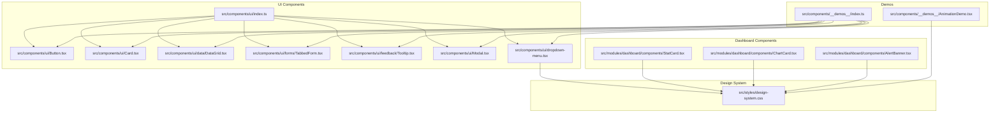
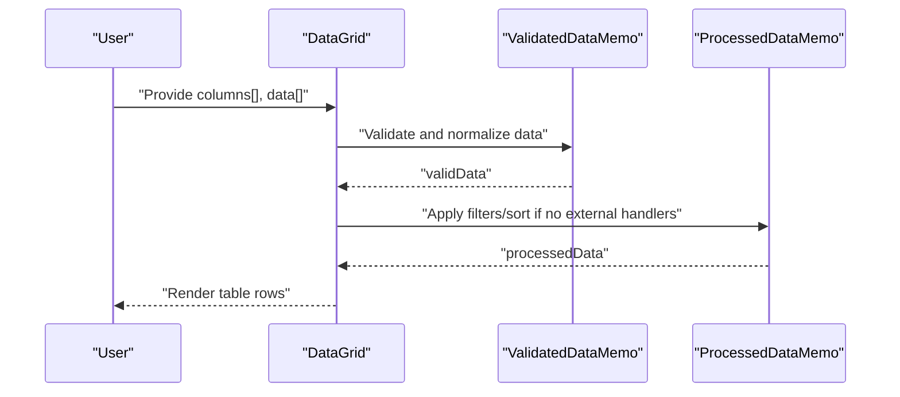
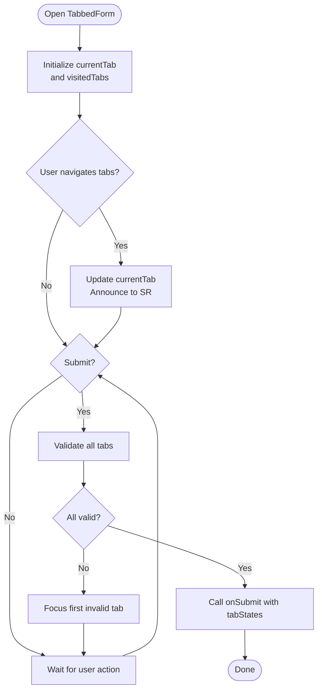
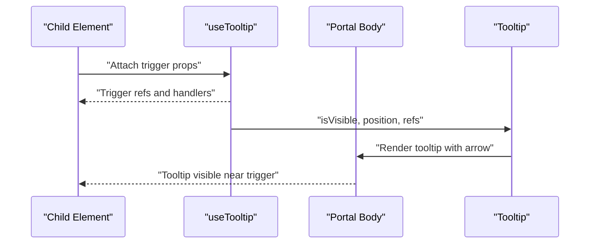
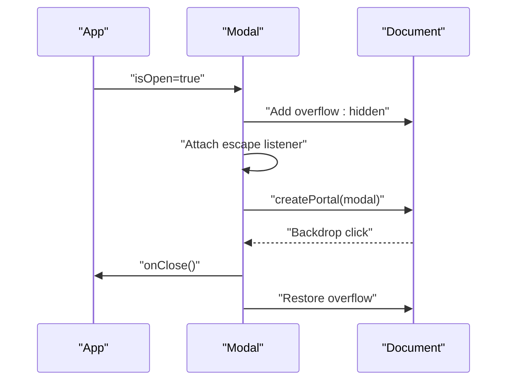
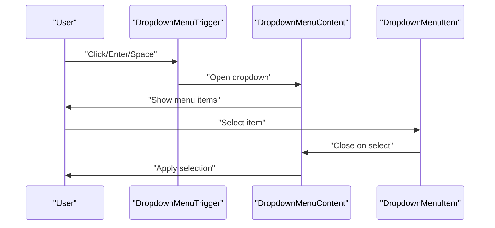
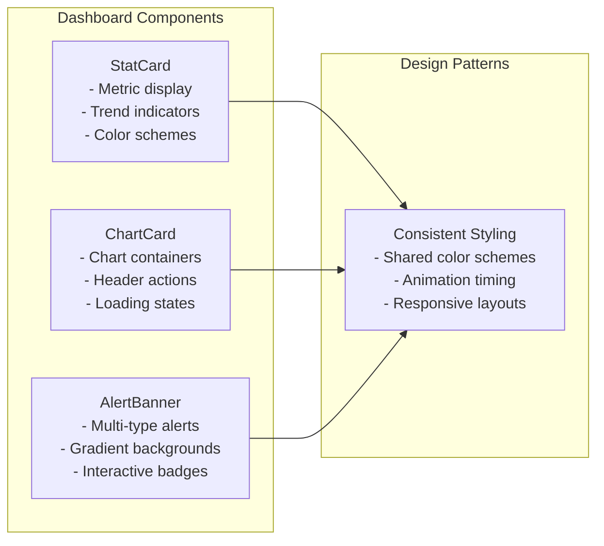
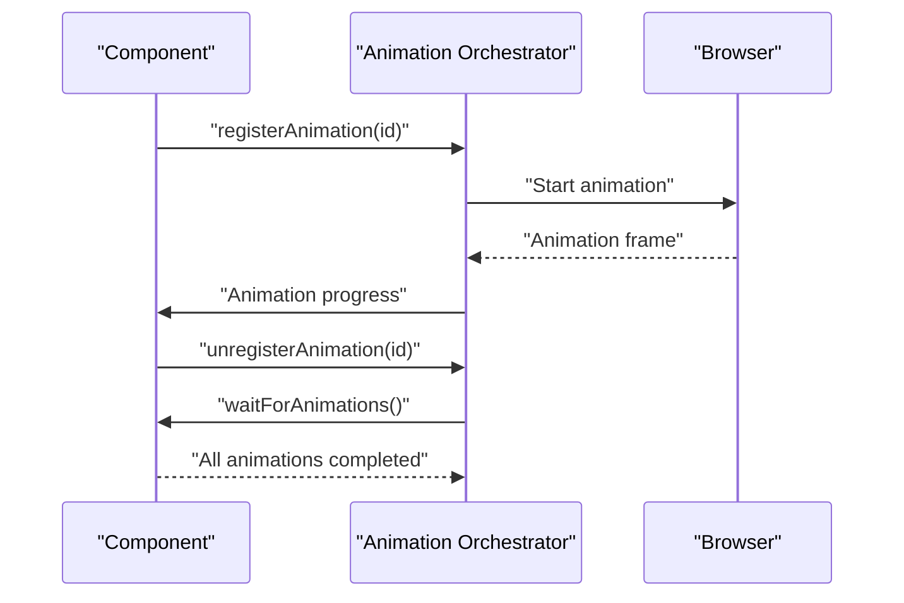
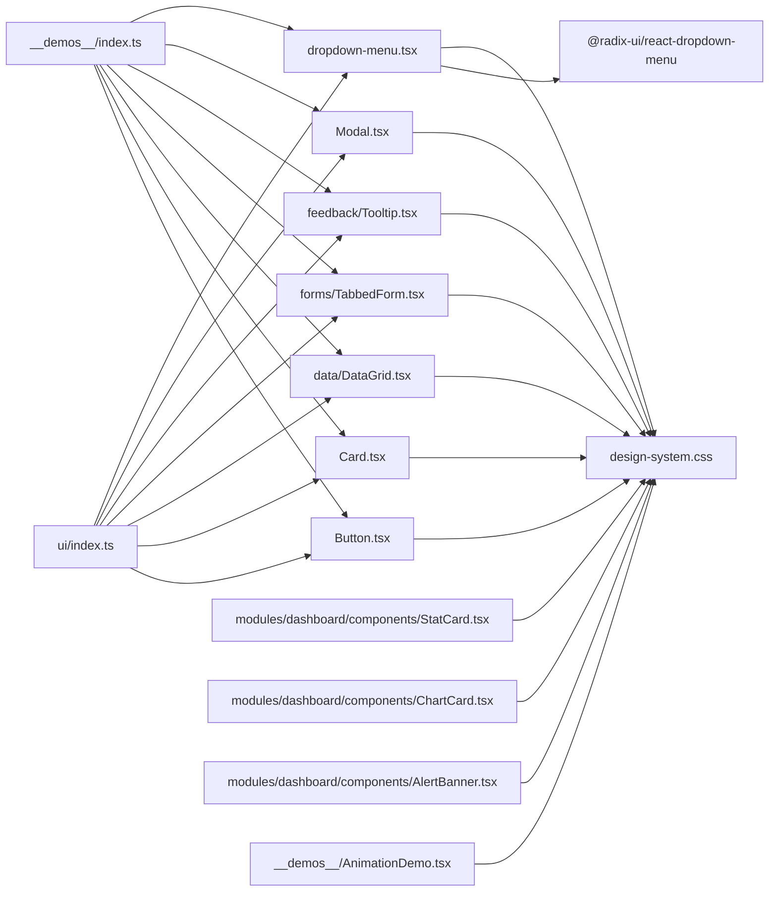

# UI Components

<cite>
**Referenced Files in This Document**
- [index.ts](file://src/components/ui/index.ts)
- [design-system.css](file://src/styles/design-system.css)
- [Button.tsx](file://src/components/ui/Button.tsx)
- [Card.tsx](file://src/components/ui/Card.tsx)
- [DataGrid.tsx](file://src/components/ui/data/DataGrid.tsx)
- [TabbedForm.tsx](file://src/components/ui/forms/TabbedForm.tsx)
- [Tooltip.tsx](file://src/components/ui/feedback/Tooltip.tsx)
- [Modal.tsx](file://src/components/ui/Modal.tsx)
- [dropdown-menu.tsx](file://src/components/ui/dropdown-menu.tsx)
- [StatCard.tsx](file://src/modules/dashboard/components/StatCard.tsx)
- [ChartCard.tsx](file://src/modules/dashboard/components/ChartCard.tsx)
- [AlertBanner.tsx](file://src/modules/dashboard/components/AlertBanner.tsx)
- [__demos__/index.ts](file://src/components/__demos__/index.ts)
- [AnimationDemo.tsx](file://src/components/__demos__/AnimationDemo.tsx)
</cite>

## Update Summary
**Changes Made**
- Added new Dropdown Menu component built on Radix UI primitives with comprehensive styling and keyboard navigation
- Enhanced module dashboard components with consistent design patterns including StatCard, ChartCard, and AlertBanner
- Expanded animation system documentation with performance optimization and accessibility features
- Updated component catalog to include new dashboard visualization components
- Added comprehensive styling with proper animations and keyboard navigation support

## Table of Contents
1. [Introduction](#introduction)
2. [Project Structure](#project-structure)
3. [Core Components](#core-components)
4. [Architecture Overview](#architecture-overview)
5. [Detailed Component Analysis](#detailed-component-analysis)
6. [Enhanced Dashboard Components](#enhanced-dashboard-components)
7. [Animation System](#animation-system)
8. [Dependency Analysis](#dependency-analysis)
9. [Performance Considerations](#performance-considerations)
10. [Troubleshooting Guide](#troubleshooting-guide)
11. [Conclusion](#conclusion)
12. [Appendices](#appendices)

## Introduction
This document describes the comprehensive UI component library of SchoolPilot3. It focuses on the polymorphic component architecture that adapts behavior via props, the design system built on Tailwind CSS and CSS custom properties, and the component catalog spanning buttons, forms, data grids, tables, modals, cards, dropdown menus, tooltips, and specialized components such as DataGrid, KanbanBoard, and SchedulingCalendar. The library now includes enhanced dashboard visualization components with consistent design patterns and comprehensive animation support with proper accessibility compliance.

## Project Structure
The UI component library is organized under a central barrel export that re-exports all components and types for easy consumption. The design system is implemented via a dedicated stylesheet that defines CSS custom properties, animations, and utility classes. Enhanced dashboard components provide consistent visualization patterns across all module dashboards. Demos are provided for most components to illustrate usage patterns.

**Diagram sources**
- [index.ts:1-104](file://src/components/ui/index.ts#L1-L104)
- [design-system.css:1-969](file://src/styles/design-system.css#L1-L969)
- [__demos__/index.ts:1-19](file://src/components/__demos__/index.ts#L1-L19)
- [AnimationDemo.tsx:254-368](file://src/components/__demos__/AnimationDemo.tsx#L254-L368)

**Section sources**
- [index.ts:1-104](file://src/components/ui/index.ts#L1-L104)
- [design-system.css:1-969](file://src/styles/design-system.css#L1-L969)
- [__demos__/index.ts:1-19](file://src/components/__demos__/index.ts#L1-L19)

## Core Components
This section summarizes the primary components and their capabilities, focusing on polymorphism, props-driven behavior, and design system integration.

- Button
  - Polymorphic: supports an as prop to render any valid DOM element or React component.
  - Variants and sizes: primary, secondary, success, warning, danger, ghost, outline; xs to xl sizing.
  - Interactive states: loading, disabled, fullWidth, icons, aria attributes, transitions.
  - Accessibility: WCAG 2.1 AA-compliant focus rings and aria attributes.
  - Animations: transitions and hover effects using design tokens.

- Card
  - Variants: default, elevated, outlined, filled, interactive, compact.
  - Sizes: sm, md, lg, xl with proportional spacing and rounded corners.
  - Interactivity: optional onClick and keyboard activation with Enter/Space.
  - Accessibility: role, aria-label, tabindex, reduced motion support.
  - Animations: transitions and hover scaling.

- DataGrid
  - Features: sorting, filtering, selection, pagination, sticky columns, empty states, loading states.
  - Props-driven: configurable columns, data, callbacks, and presentation options.
  - Robustness: defensive data validation and error boundary wrapping.

- TabbedForm
  - Multi-step form with tab navigation, validation state indicators, and progress tracking.
  - Responsive: separate desktop and mobile navigation controls.
  - Accessibility: ARIA roles, screen reader announcements, focus management.

- Tooltip
  - Smart positioning with portal rendering and optional arrow.
  - Variants: InfoTooltip, HelpTooltip, ValidationTooltip.
  - Options: interactive mode, max width, custom classes.

- Modal
  - Overlay management, escape handling, backdrop clicks, and focus containment.
  - Variants: default/centered; drawer planned; sizes xs to full.
  - Footer/header/body slots with optional loading state.

- Dropdown Menu
  - **New**: Built on Radix UI primitives for accessible dropdown functionality.
  - Features: nested menus, checkboxes, radio groups, separators, shortcuts.
  - Keyboard navigation: full keyboard accessibility with proper ARIA attributes.
  - Animations: smooth open/close transitions with fade and slide effects.
  - Styling: consistent design system integration with popover theming.

**Section sources**
- [Button.tsx:1-230](file://src/components/ui/Button.tsx#L1-L230)
- [Card.tsx:1-246](file://src/components/ui/Card.tsx#L1-L246)
- [DataGrid.tsx:1-509](file://src/components/ui/data/DataGrid.tsx#L1-L509)
- [TabbedForm.tsx:1-482](file://src/components/ui/forms/TabbedForm.tsx#L1-L482)
- [Tooltip.tsx:1-178](file://src/components/ui/feedback/Tooltip.tsx#L1-L178)
- [Modal.tsx:1-174](file://src/components/ui/Modal.tsx#L1-L174)
- [dropdown-menu.tsx:1-196](file://src/components/ui/dropdown-menu.tsx#L1-L196)

## Architecture Overview
SchoolPilot3's UI architecture centers on:
- Polymorphic components: forwardRef with an as prop enables semantic markup and custom element usage.
- Centralized exports: a single barrel file simplifies imports and maintains a stable API surface.
- Design system: CSS custom properties define theme tokens; animation utilities encapsulate motion primitives.
- Composition patterns: sub-components (e.g., CardHeader/CardTitle/CardContent) and slot-based layouts (Modal header/body/footer).
- **Enhanced**: Radix UI primitives for accessible dropdown components with proper keyboard navigation.
- **Modernized**: Dashboard components with consistent design patterns and improved metrics visualization.

```mermaid
classDiagram
class Button {
+variant : "primary|secondary|success|warning|danger|ghost|outline"
+size : "xs|sm|md|lg|xl"
+loading : boolean
+fullWidth : boolean
+as : ElementType
+aria-label : string
+aria-describedby : string
}
class Card {
+variant : "default|elevated|outlined|filled|interactive|compact"
+size : "sm|md|lg|xl"
+interactive : boolean
+loading : boolean
+disabled : boolean
+onClick() : void
+onKeyDown() : void
}
class DataGrid {
+columns : DataGridColumn[]
+data : any[]
+sortable : boolean
+filterable : boolean
+selectable : boolean
+pagination : PaginationConfig
+onRowClick() : void
+onSelectionChange() : void
+onSort() : void
+onFilter() : void
}
class TabbedForm {
+tabs : FormTab[]
+activeTab : number
+validation : Record<string, boolean>
+onSubmit() : Promise<void>
+variant : "default|pills|underline"
+size : "sm|md|lg"
+showProgress : boolean
+allowTabSwitching : boolean
}
class Tooltip {
+content : ReactNode
+children : ReactNode
+maxWidth : string
+arrow : boolean
}
class Modal {
+isOpen : boolean
+onClose() : void
+title : string
+size : "xs|sm|md|lg|xl|full"
+variant : "default|centered|drawer"
+closeOnBackdrop : boolean
+closeOnEscape : boolean
+showCloseButton : boolean
+footer : ReactNode
+loading : boolean
}
class DropdownMenu {
+open : boolean
+onOpenChange() : void
+align : "start|end"
+sideOffset : number
+children : ReactNode
}
```

**Diagram sources**
- [Button.tsx:44-81](file://src/components/ui/Button.tsx#L44-L81)
- [Card.tsx:12-49](file://src/components/ui/Card.tsx#L12-L49)
- [DataGrid.tsx:37-86](file://src/components/ui/data/DataGrid.tsx#L37-L86)
- [TabbedForm.tsx:19-57](file://src/components/ui/forms/TabbedForm.tsx#L19-L57)
- [Tooltip.tsx:8-25](file://src/components/ui/feedback/Tooltip.tsx#L8-L25)
- [Modal.tsx:9-47](file://src/components/ui/Modal.tsx#L9-L47)
- [dropdown-menu.tsx:9-195](file://src/components/ui/dropdown-menu.tsx#L9-L195)

## Detailed Component Analysis

### Button
- Polymorphic behavior: accepts an as prop to render any element or component, forwarding all non-Button props to the underlying element.
- Variant and size mapping: Tailwind utility classes define consistent styling across variants and sizes.
- Loading state: spinner overlays with adaptive sizing per button size.
- Accessibility: generates an ID, supports aria-label and aria-describedby, sets aria-busy during loading, and applies focus-visible ring styles.

Usage example path
- [Button usage in demos](file://src/components/__demos__/ButtonDemo.tsx)

**Section sources**
- [Button.tsx:44-230](file://src/components/ui/Button.tsx#L44-L230)

### Card
- Variants and sizes: extensive combinations for visual density and elevation.
- Interactive mode: optional onClick and keyboard activation with Enter/Space keys.
- Accessibility: role inference, aria-label, tabindex, and reduced-motion awareness.
- Sub-components: CardHeader, CardTitle, CardDescription, CardContent mirror shadcn/ui patterns.

Usage example path
- [Card usage in demos](file://src/components/__demos__/CardDemo.tsx)

**Section sources**
- [Card.tsx:12-246](file://src/components/ui/Card.tsx#L12-L246)

### DataGrid
- Columns: strongly typed with optional renderers, sort/filter flags, alignment, widths, and sticky behavior.
- Sorting and filtering: internal state with optional external handlers.
- Selection: single/multi-row selection with "select all" and indeterminate state.
- Empty/loading states: customizable empty state and skeleton-based loading.
- Pagination: presentational pagination footer with page range and total count.
- Robustness: defensive data validation and error boundary wrapping.

**Diagram sources**
- [DataGrid.tsx:94-203](file://src/components/ui/data/DataGrid.tsx#L94-L203)

Usage example path
- [DataGrid usage in demos](file://src/components/__demos__/DataGridDemo.tsx)

**Section sources**
- [DataGrid.tsx:18-509](file://src/components/ui/data/DataGrid.tsx#L18-L509)

### TabbedForm
- Tabs: each tab supports label, icon, content, validation function, required flag, and disabled state.
- Navigation: desktop tab list with validation indicators and mobile swipe-like controls.
- Progress: percentage computed from visited tabs with success validation.
- Submission: validates all tabs before invoking onSubmit; announces outcomes to screen readers.

**Diagram sources**
- [TabbedForm.tsx:78-285](file://src/components/ui/forms/TabbedForm.tsx#L78-L285)

Usage example path
- [TabbedForm usage in demos](file://src/components/__demos__/TabbedFormDemo.tsx)

**Section sources**
- [TabbedForm.tsx:19-482](file://src/components/ui/forms/TabbedForm.tsx#L19-L482)

### Tooltip
- Positioning: uses a composable hook to compute placement and visibility; renders via React Portal.
- Variants: InfoTooltip for title/description, HelpTooltip for contextual help button, ValidationTooltip for requirement lists.
- Interaction: supports interactive mode and custom max width.

**Diagram sources**
- [Tooltip.tsx:17-91](file://src/components/ui/feedback/Tooltip.tsx#L17-L91)

Usage example path
- [Tooltip usage in demos](file://src/components/__demos__/TooltipDemo.tsx)

**Section sources**
- [Tooltip.tsx:1-178](file://src/components/ui/feedback/Tooltip.tsx#L1-L178)

### Modal
- Overlay and focus: manages document overflow, escape key handling, and click-outside-to-close.
- Layout: header/title/close button, body with optional loading spinner, footer slot.
- Portal rendering: mounts modal content into document body for proper stacking context.

**Diagram sources**
- [Modal.tsx:29-174](file://src/components/ui/Modal.tsx#L29-L174)

Usage example path
- [Modal usage in demos](file://src/components/__demos__/ModalDemo.tsx)

**Section sources**
- [Modal.tsx:1-174](file://src/components/ui/Modal.tsx#L1-L174)

### Dropdown Menu
- **New Component**: Built on Radix UI primitives for accessible dropdown functionality.
- Primitive integration: Uses DropdownMenuPrimitive.Root, Trigger, Content, Item, Group, Portal, Sub, RadioGroup.
- Sub-components: DropdownMenuTrigger, DropdownMenuContent, DropdownMenuItem, DropdownMenuCheckboxItem, DropdownMenuRadioItem, DropdownMenuLabel, DropdownMenuSeparator, DropdownMenuShortcut, DropdownMenuSubTrigger, DropdownMenuSubContent, DropdownMenuRadioGroup.
- Styling: Comprehensive Tailwind classes with animation utilities (fade-in/out, zoom-in/out, slide-in-from-*).
- Accessibility: Full keyboard navigation, ARIA attributes, focus management, proper semantic markup.
- Features: Nested submenus, checkbox/radio selections, separators, keyboard shortcuts, inset styling.

**Diagram sources**
- [dropdown-menu.tsx:9-195](file://src/components/ui/dropdown-menu.tsx#L9-L195)

Usage example path
- [Dropdown menu usage in demos](file://src/components/__demos__/DropdownMenuDemo.tsx)

**Section sources**
- [dropdown-menu.tsx:1-196](file://src/components/ui/dropdown-menu.tsx#L1-L196)

## Enhanced Dashboard Components
SchoolPilot3 now includes comprehensive dashboard visualization components with consistent design patterns across all module dashboards.

### StatCard
- Metric visualization: Displays key statistics with trend indicators and color-coded schemes.
- Variants: default, gradient, outlined, filled with consistent styling across all variants.
- Color schemes: Blue, emerald, amber, rose, violet, cyan, indigo with gradient and solid variants.
- Interactive elements: Clickable cards with hover effects, scale animations, and transition effects.
- Trend indicators: Up/down/neutral trends with appropriate icons and color coding.

### ChartCard
- Card-based chart containers: Wraps visualization components in consistent card styling.
- Header actions: Refresh functionality with loading states, action buttons, and header customization.
- Loading states: Proper loading overlay handling with opacity adjustments and pointer event blocking.
- Integration: Built on top of the core Card component with enhanced dashboard-specific features.

### AlertBanner
- Multi-type alerts: Message, task, overdue, approval, emergency, and fees alert types.
- Gradient backgrounds: Each alert type has unique gradient color scheme and styling.
- Interactive badges: Count badges with type-specific colors and hover effects.
- Navigation support: Clickable banners with optional routing integration.

**Diagram sources**
- [StatCard.tsx:1-177](file://src/modules/dashboard/components/StatCard.tsx#L1-L177)
- [ChartCard.tsx:1-85](file://src/modules/dashboard/components/ChartCard.tsx#L1-L85)
- [AlertBanner.tsx:1-169](file://src/modules/dashboard/components/AlertBanner.tsx#L1-L169)

**Section sources**
- [StatCard.tsx:1-177](file://src/modules/dashboard/components/StatCard.tsx#L1-L177)
- [ChartCard.tsx:1-85](file://src/modules/dashboard/components/ChartCard.tsx#L1-L85)
- [AlertBanner.tsx:1-169](file://src/modules/dashboard/components/AlertBanner.tsx#L1-L169)

## Animation System
SchoolPilot3 features a comprehensive animation system with performance optimization and accessibility compliance.

### Design System Animations
- CSS custom properties: Centralized animation timing and easing functions.
- Keyframe animations: Includes glow pulse effects and other motion primitives.
- Theme-aware animations: Dark/light theme compatibility with consistent timing.

### Performance Optimization
- 60fps optimization: GPU-accelerated animations with transform and opacity properties.
- Progressive enhancement: Animations gracefully degrade on lower-end devices.
- Performance monitoring: Built-in animation orchestration system with completion tracking.

### Accessibility Features
- Reduced motion support: Respects prefers-reduced-motion media queries.
- Focus management: Proper focus handling during animations.
- Screen reader compatibility: ARIA attributes and semantic markup preserved during transitions.

### Animation Orchestration
- Registration system: Components can register animations with unique identifiers.
- Completion tracking: Promise-based animation completion detection.
- Batch control: Ability to wait for all animations to complete before proceeding.

**Diagram sources**
- [AnimationDemo.tsx:254-368](file://src/components/__demos__/AnimationDemo.tsx#L254-L368)

**Section sources**
- [AnimationDemo.tsx:254-368](file://src/components/__demos__/AnimationDemo.tsx#L254-L368)
- [design-system.css:193-200](file://src/styles/design-system.css#L193-L200)

## Dependency Analysis
The UI components rely on:
- Centralized exports: src/components/ui/index.ts re-exports all components and types for ergonomic imports.
- Design tokens and animations: components import designTokens and useTransition for consistent motion and styling.
- Utility classes: Tailwind classes are applied directly for responsive and theme-aligned visuals.
- Demo ecosystem: src/components/__demos__/index.ts aggregates demo components for quick exploration.
- **Enhanced**: Radix UI primitives for accessible dropdown components.
- **Modernized**: Dashboard components with shared design patterns and consistent styling.

**Diagram sources**
- [index.ts:1-104](file://src/components/ui/index.ts#L1-L104)
- [design-system.css:1-969](file://src/styles/design-system.css#L1-L969)
- [__demos__/index.ts:1-19](file://src/components/__demos__/index.ts#L1-L19)
- [dropdown-menu.tsx:4-7](file://src/components/ui/dropdown-menu.tsx#L4-L7)

**Section sources**
- [index.ts:1-104](file://src/components/ui/index.ts#L1-L104)
- [design-system.css:1-969](file://src/styles/design-system.css#L1-L969)
- [__demos__/index.ts:1-19](file://src/components/__demos__/index.ts#L1-L19)

## Performance Considerations
- Memoization: DataGrid leverages useMemo for validated data and processed data to avoid unnecessary re-renders.
- Conditional rendering: Modals, Tooltips, and Dropdown Menus only render when open/visible, minimizing DOM overhead.
- CSS custom properties: Theme switching and animation durations are centralized, enabling efficient updates.
- Reduced motion: Cards, dropdown menus, and other components respect reduced motion preferences to improve accessibility and perceived performance.
- Animation utilities: Use of transition utilities and will-change hints helps optimize animations.
- **Enhanced**: Dashboard components use optimized rendering patterns with lazy loading and virtualization where appropriate.
- **Modernized**: Animation system includes performance monitoring and automatic optimization for different device capabilities.

## Troubleshooting Guide
- DataGrid validation warnings: When data does not match column expectations, warnings are logged; ensure data arrays and required columns conform to column definitions.
- Tooltip positioning: If tooltips appear off-screen, verify viewport constraints and consider adjusting maxWidth or trigger placement.
- Modal focus issues: Confirm that the modal is mounted via portal and that escape listeners are attached; ensure preventClose is not unintentionally blocking interactions.
- Button loading state: Verify aria-busy is set and loadingText is provided for assistive technologies.
- Card interactivity: Ensure onClick is provided when interactive mode is desired and that disabled/ loading states are respected.
- **New**: Dropdown menu accessibility: Verify keyboard navigation works properly and ARIA attributes are correctly applied.
- **New**: Animation performance: Monitor animation registration and ensure waitForAnimations resolves properly to avoid blocking interactions.
- **Enhanced**: Dashboard component rendering: Ensure StatCard, ChartCard, and AlertBanner components receive proper props and handle loading states correctly.

**Section sources**
- [DataGrid.tsx:94-111](file://src/components/ui/data/DataGrid.tsx#L94-L111)
- [Tooltip.tsx:26-33](file://src/components/ui/feedback/Tooltip.tsx#L26-L33)
- [Modal.tsx:52-89](file://src/components/ui/Modal.tsx#L52-L89)
- [Button.tsx:210-225](file://src/components/ui/Button.tsx#L210-L225)
- [Card.tsx:57-74](file://src/components/ui/Card.tsx#L57-L74)
- [dropdown-menu.tsx:1-196](file://src/components/ui/dropdown-menu.tsx#L1-L196)
- [AnimationDemo.tsx:254-368](file://src/components/__demos__/AnimationDemo.tsx#L254-L368)

## Conclusion
SchoolPilot3's UI component library emphasizes a polymorphic, props-driven architecture with strong accessibility and responsive design. The design system, powered by CSS custom properties and Tailwind utilities, ensures consistent theming and motion. The component catalog covers essential building blocks and specialized widgets, with robust validation, error handling, and demo-driven usage guidance. Recent enhancements include comprehensive dropdown menu functionality built on Radix UI primitives, modernized dashboard visualization components with consistent design patterns, and an advanced animation system with performance optimization and accessibility compliance.

## Appendices

### Component Catalog and Usage References
- Buttons: [Button.tsx:1-230](file://src/components/ui/Button.tsx#L1-L230)
- Cards: [Card.tsx:1-246](file://src/components/ui/Card.tsx#L1-L246)
- DataGrid: [DataGrid.tsx:1-509](file://src/components/ui/data/DataGrid.tsx#L1-L509)
- Forms: [TabbedForm.tsx:1-482](file://src/components/ui/forms/TabbedForm.tsx#L1-L482)
- Feedback: [Tooltip.tsx:1-178](file://src/components/ui/feedback/Tooltip.tsx#L1-L178)
- Modals: [Modal.tsx:1-174](file://src/components/ui/Modal.tsx#L1-L174)
- Dropdown Menus: [dropdown-menu.tsx:1-196](file://src/components/ui/dropdown-menu.tsx#L1-L196)
- Dashboard Components: [StatCard.tsx:1-177](file://src/modules/dashboard/components/StatCard.tsx#L1-L177), [ChartCard.tsx:1-85](file://src/modules/dashboard/components/ChartCard.tsx#L1-L85), [AlertBanner.tsx:1-169](file://src/modules/dashboard/components/AlertBanner.tsx#L1-L169)
- Demos: [__demos__/index.ts:1-19](file://src/components/__demos__/index.ts#L1-L19)
- Animation System: [AnimationDemo.tsx:254-368](file://src/components/__demos__/AnimationDemo.tsx#L254-L368)

### Design System and Theming
- Tokens and animations: [design-system.css:1-969](file://src/styles/design-system.css#L1-L969)
- Animation orchestration: [AnimationDemo.tsx:254-368](file://src/components/__demos__/AnimationDemo.tsx#L254-L368)