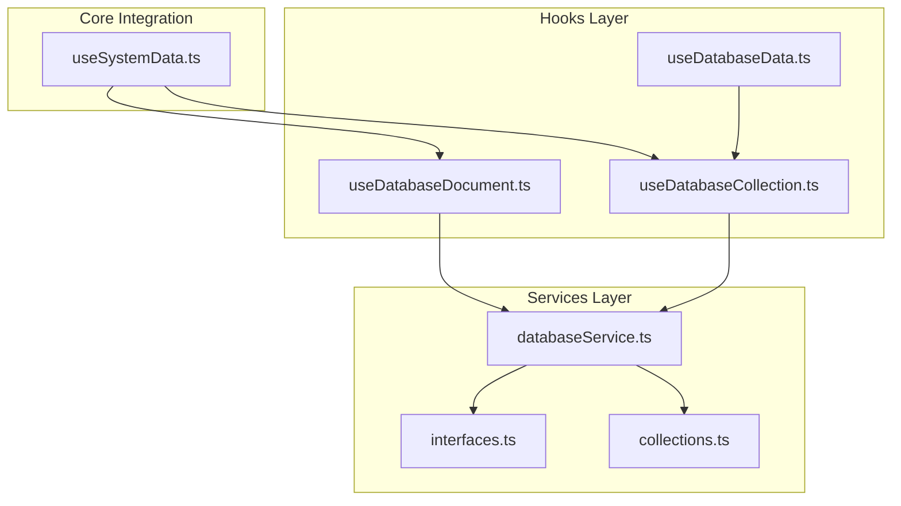
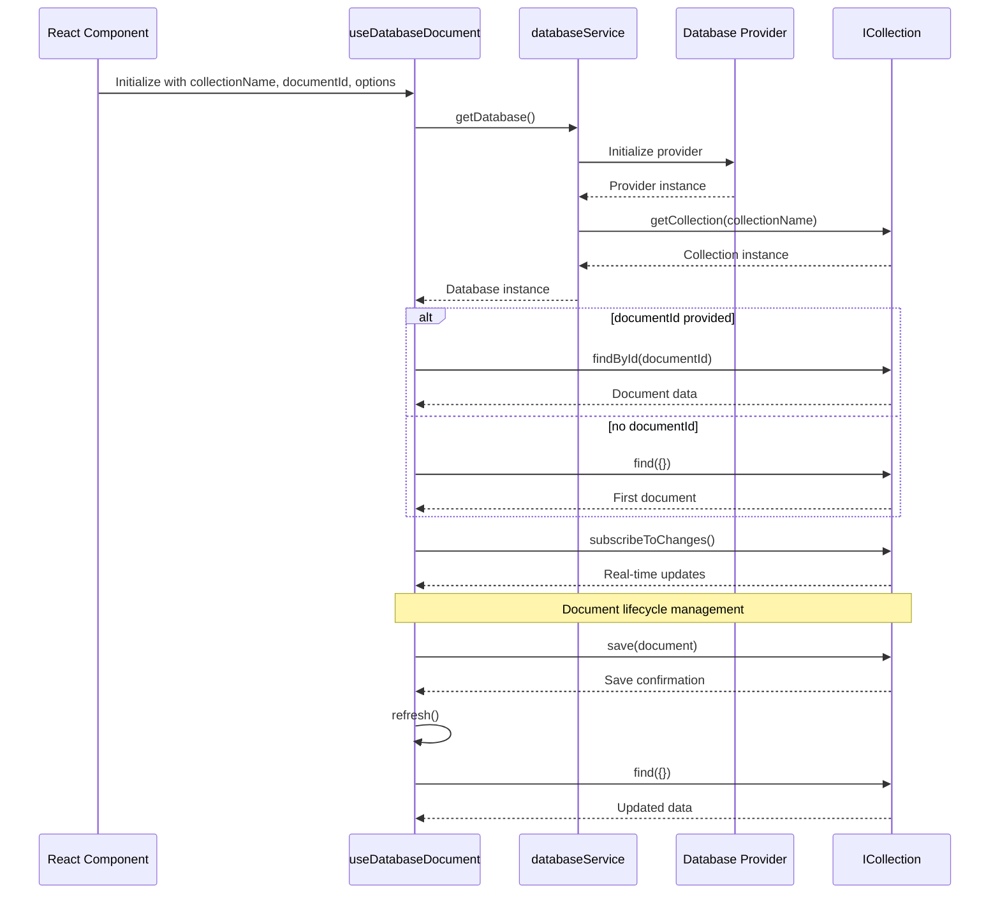
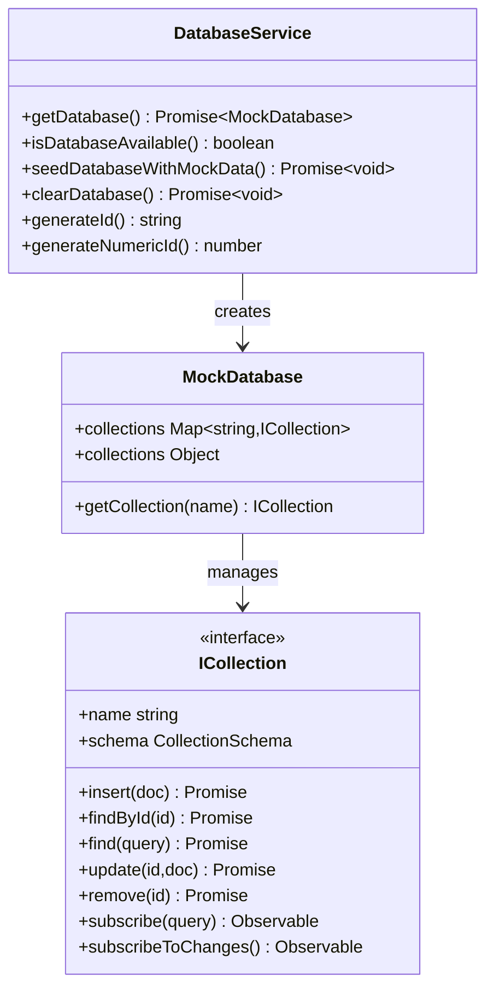
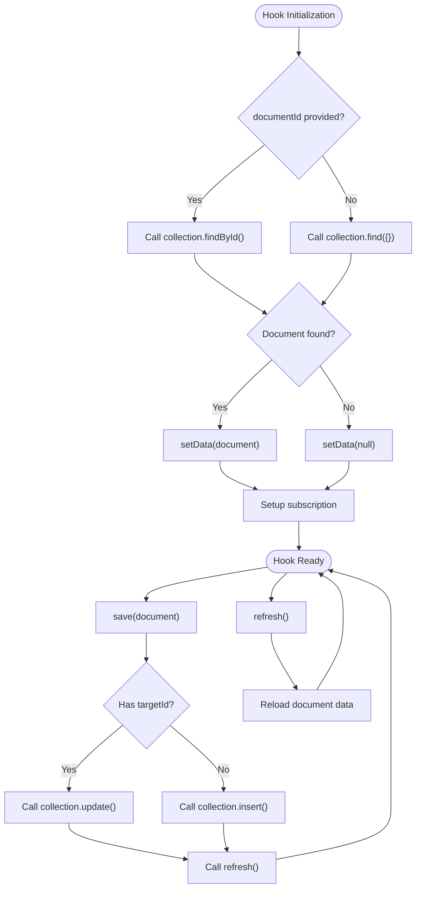
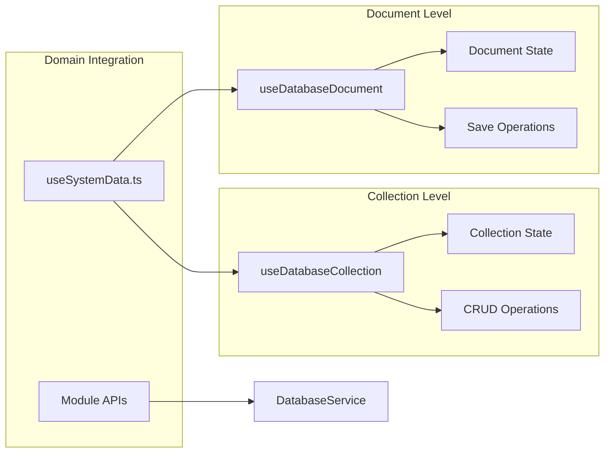
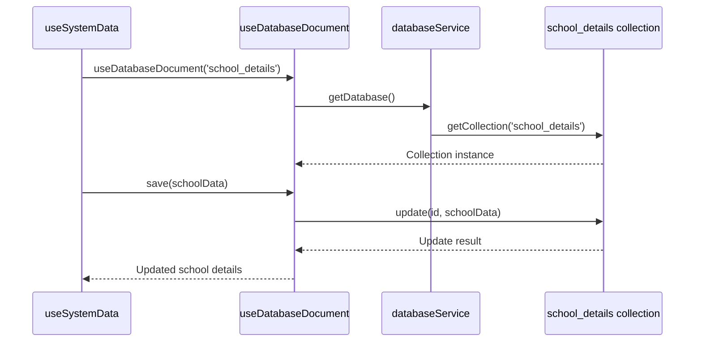
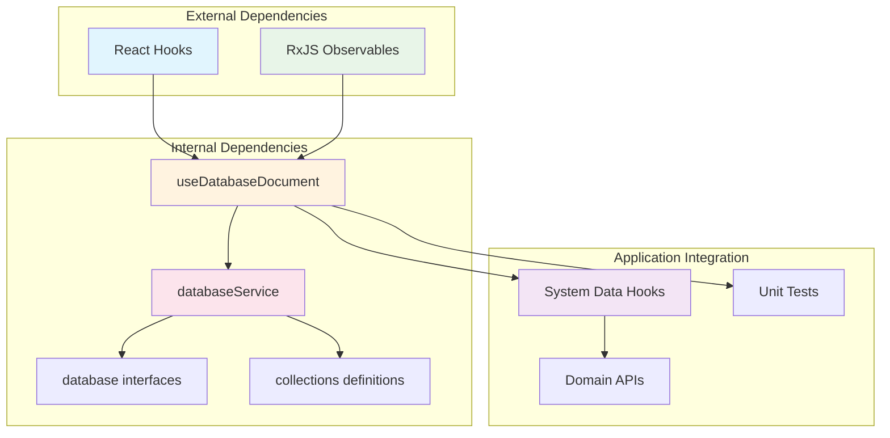

# Use Database Document Hook

<cite>
**Referenced Files in This Document**
- [useDatabaseDocument.ts](file://src/hooks/useDatabaseDocument.ts)
- [useDatabaseCollection.ts](file://src/hooks/useDatabaseCollection.ts)
- [databaseService.ts](file://src/services/database/databaseService.ts)
- [interfaces.ts](file://src/services/database/interfaces.ts)
- [collections.ts](file://src/services/database/collections.ts)
- [useSystemData.ts](file://src/core/data/useSystemData.ts)
- [useDatabaseData.ts](file://src/hooks/useDatabaseData.ts)
</cite>

## Update Summary
**Changes Made**
- Added comprehensive documentation for the new useDatabaseDocument hook alongside useDatabaseCollection
- Updated architecture overview to reflect both document-level and collection-level operations
- Enhanced dependency analysis to show integration patterns between hooks
- Added practical usage examples from the system data domain
- Updated troubleshooting guide with document-specific considerations

## Table of Contents
1. [Introduction](#introduction)
2. [Project Structure](#project-structure)
3. [Core Components](#core-components)
4. [Architecture Overview](#architecture-overview)
5. [Detailed Component Analysis](#detailed-component-analysis)
6. [Dependency Analysis](#dependency-analysis)
7. [Performance Considerations](#performance-considerations)
8. [Troubleshooting Guide](#troubleshooting-guide)
9. [Conclusion](#conclusion)

## Introduction

The Use Database Document Hook (`useDatabaseDocument`) is a reusable React hook designed to manage single document database operations in the SchoolPilot3 educational management system. This hook provides a comprehensive solution for loading, subscribing to, and mutating individual database documents while maintaining real-time synchronization with the underlying database provider.

The hook serves as the foundation for single-document collections such as `school_details`, `app_settings`, and other singleton-like entities that require dedicated document management capabilities. It integrates seamlessly with the system's provider-agnostic database architecture, supporting multiple database backends including SQLite, PouchDB, and WebAssembly implementations.

**Updated** Added alongside useDatabaseCollection to provide complementary document-level operations for the database abstraction layer.

## Project Structure

The database document hook system is organized within the hooks and services architecture of the SchoolPilot3 application:

**Diagram sources**
- [useDatabaseDocument.ts:1-189](file://src/hooks/useDatabaseDocument.ts#L1-L189)
- [useDatabaseCollection.ts:1-228](file://src/hooks/useDatabaseCollection.ts#L1-L228)
- [databaseService.ts:1-379](file://src/services/database/databaseService.ts#L1-L379)

**Section sources**
- [useDatabaseDocument.ts:1-189](file://src/hooks/useDatabaseDocument.ts#L1-L189)
- [useDatabaseCollection.ts:1-228](file://src/hooks/useDatabaseCollection.ts#L1-L228)
- [databaseService.ts:1-379](file://src/services/database/databaseService.ts#L1-L379)

## Core Components

The useDatabaseDocument hook consists of several key components that work together to provide comprehensive database document management:

### Hook Signature and Options

The hook accepts three main parameters:
- `collectionName`: The database collection to operate on
- `documentId`: Optional specific document identifier
- `options`: Configuration options for loading behavior including `loadOnMount` and `subscribeToChanges`

### Return Interface

The hook returns a comprehensive result object containing:
- `data`: The current document state or null if not found
- `loading`: Loading state indicator
- `error`: Error object if present
- `refresh`: Function to manually refresh document data
- `save`: Function to persist document changes with automatic ID generation
- `collection`: Direct access to the underlying collection instance

### Database Service Integration

The hook integrates with the centralized database service that manages provider selection, initialization, and collection access across different database backends.

**Section sources**
- [useDatabaseDocument.ts:8-20](file://src/hooks/useDatabaseDocument.ts#L8-L20)
- [useDatabaseDocument.ts:22-188](file://src/hooks/useDatabaseDocument.ts#L22-L188)

## Architecture Overview

The database document hook operates within a sophisticated multi-layered architecture that ensures flexibility, performance, and maintainability:

**Diagram sources**
- [useDatabaseDocument.ts:36-86](file://src/hooks/useDatabaseDocument.ts#L36-L86)
- [databaseService.ts:142-147](file://src/services/database/databaseService.ts#L142-L147)

The architecture supports multiple database providers through a provider-agnostic interface, ensuring that the same hook logic works consistently across different storage backends including SQLite, PouchDB, and WebAssembly implementations.

**Section sources**
- [databaseService.ts:95-139](file://src/services/database/databaseService.ts#L95-L139)
- [interfaces.ts:142-175](file://src/services/database/interfaces.ts#L142-L175)

## Detailed Component Analysis

### Database Service Foundation

The database service acts as the central coordinator for all database operations, managing provider initialization and collection access:

**Diagram sources**
- [databaseService.ts:42-93](file://src/services/database/databaseService.ts#L42-L93)
- [interfaces.ts:142-175](file://src/services/database/interfaces.ts#L142-L175)

### Hook Implementation Pattern

The useDatabaseDocument hook implements a sophisticated pattern for managing document state and lifecycle:

**Diagram sources**
- [useDatabaseDocument.ts:36-86](file://src/hooks/useDatabaseDocument.ts#L36-L86)
- [useDatabaseDocument.ts:146-178](file://src/hooks/useDatabaseDocument.ts#L146-L178)

### Collection Management Integration

The hook integrates with the broader collection management system through the useDatabaseCollection hook:

**Diagram sources**
- [useDatabaseCollection.ts:24-227](file://src/hooks/useDatabaseCollection.ts#L24-L227)
- [useSystemData.ts:18-219](file://src/core/data/useSystemData.ts#L18-L219)

**Section sources**
- [useDatabaseDocument.ts:1-189](file://src/hooks/useDatabaseDocument.ts#L1-L189)
- [useDatabaseCollection.ts:1-228](file://src/hooks/useDatabaseCollection.ts#L1-L228)
- [useSystemData.ts:1-219](file://src/core/data/useSystemData.ts#L1-L219)

### Practical Usage Examples

The hook is extensively used in the system data domain for managing critical singleton documents:

#### School Details Management
The system uses the document hook for managing school-wide configuration data:

**Diagram sources**
- [useSystemData.ts:18-101](file://src/core/data/useSystemData.ts#L18-L101)

**Section sources**
- [useSystemData.ts:1-219](file://src/core/data/useSystemData.ts#L1-L219)

## Dependency Analysis

The database document hook system exhibits well-structured dependencies that promote maintainability and testability:

**Diagram sources**
- [useDatabaseDocument.ts:4-6](file://src/hooks/useDatabaseDocument.ts#L4-L6)
- [databaseService.ts:4-16](file://src/services/database/databaseService.ts#L4-L16)

### Coupling and Cohesion Analysis

The hook demonstrates excellent separation of concerns with low coupling to external systems and high cohesion within its core responsibilities. The provider-agnostic design ensures that the hook remains independent of specific database implementations.

### Circular Dependency Prevention

The architecture prevents circular dependencies through clear layering:
- Hooks depend on Services, not vice versa
- Services depend on Interfaces, not on specific implementations
- Modules depend on Hooks, not on Services directly

**Section sources**
- [useDatabaseCollection.ts:1-228](file://src/hooks/useDatabaseCollection.ts#L1-L228)

## Performance Considerations

The database document hook system incorporates several performance optimization strategies:

### Lazy Initialization
Database initialization occurs only when explicitly requested, preventing unnecessary overhead during application startup.

### Efficient State Management
The hook uses React's efficient state management patterns with proper cleanup to prevent memory leaks and ensure optimal performance.

### Subscription Management
Real-time subscriptions are properly managed with automatic cleanup to prevent resource leaks and ensure smooth operation.

### Caching Strategies
The underlying database service implements intelligent caching mechanisms to minimize repeated database queries and improve response times.

**Updated** Enhanced subscription management specifically for document-level reactive updates.

## Troubleshooting Guide

Common issues and their solutions when working with the database document hook:

### Collection Not Found Errors
When encountering collection not found errors, verify that:
- The collection name matches the registered collection definitions
- The database service has been properly initialized
- The collection is included in the provider's collection registry

### Document Loading Issues
If documents fail to load:
- Check that the document exists in the collection
- Verify that the collection supports the required operations (findById/find)
- Ensure proper error handling for null documents

### Subscription Issues
If real-time updates are not working:
- Check that the collection implements subscription methods
- Verify that the subscription cleanup is properly handled
- Ensure that the component unmounts correctly to prevent memory leaks

### Save Operation Failures
For save operation issues:
- Verify that the collection supports insert/update operations
- Check that document IDs are properly generated or provided
- Ensure proper error handling and retry logic

**Section sources**
- [useDatabaseDocument.ts:46-54](file://src/hooks/useDatabaseDocument.ts#L46-L54)
- [useDatabaseDocument.ts:114-116](file://src/hooks/useDatabaseDocument.ts#L114-L116)
- [useDatabaseDocument.ts:172-175](file://src/hooks/useDatabaseDocument.ts#L172-L175)

## Conclusion

The Use Database Document Hook represents a sophisticated solution for managing single document database operations within the SchoolPilot3 educational management system. Its provider-agnostic architecture, comprehensive error handling, and efficient real-time synchronization capabilities make it an essential component of the application's data management infrastructure.

The hook's design promotes maintainability through clear separation of concerns, supports multiple database backends through abstraction layers, and provides developers with a consistent interface for document-based data operations. Its integration with the broader module ecosystem ensures seamless data flow across different functional areas of the educational management system.

Through careful consideration of performance, reliability, and extensibility, the database document hook system provides a solid foundation for building scalable and maintainable educational applications. The addition of this hook alongside useDatabaseCollection creates a comprehensive database abstraction layer that supports both document-level and collection-level operations effectively.