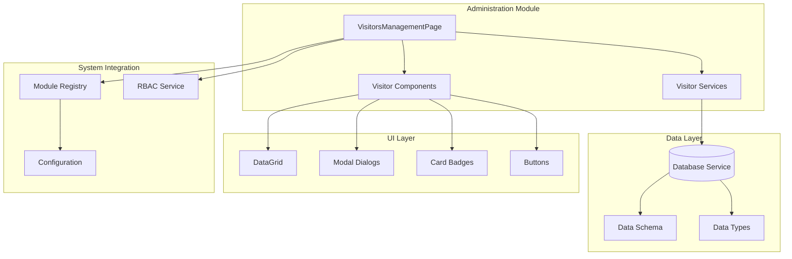
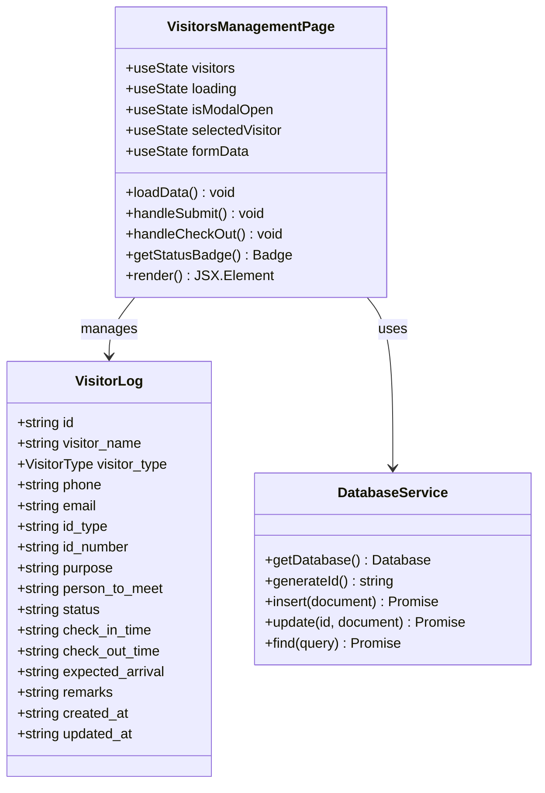
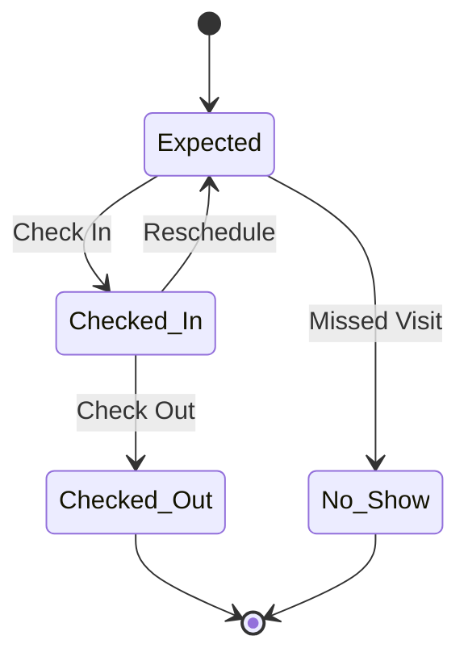
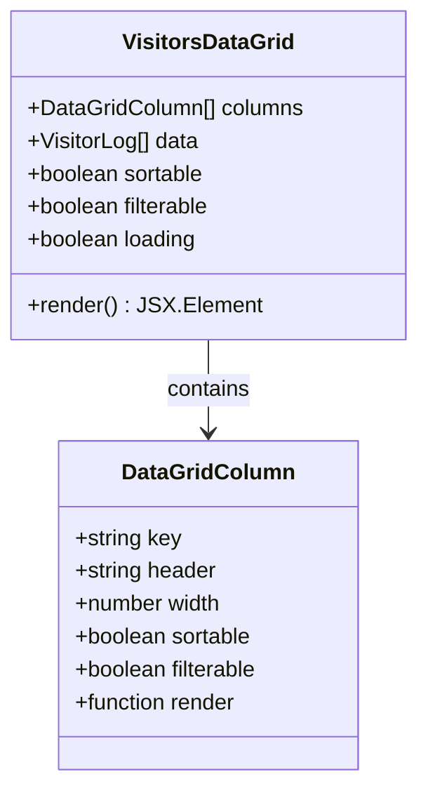
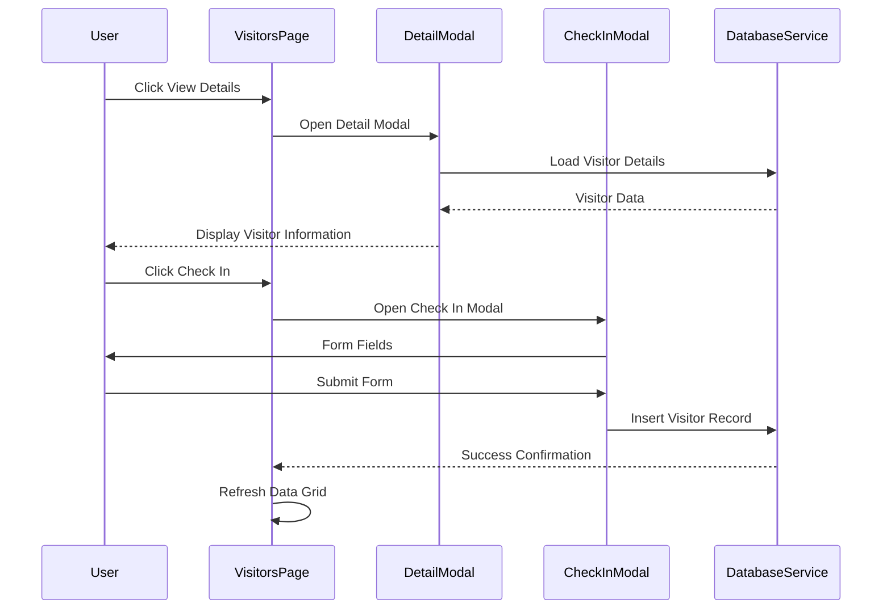
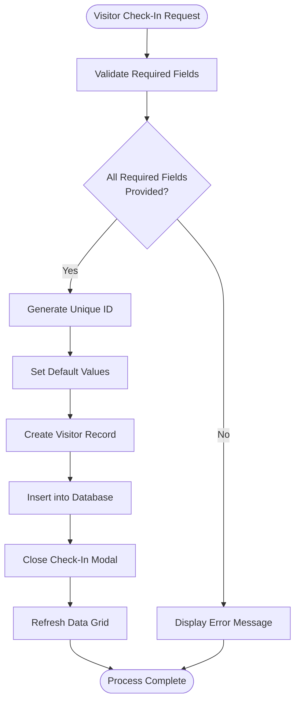
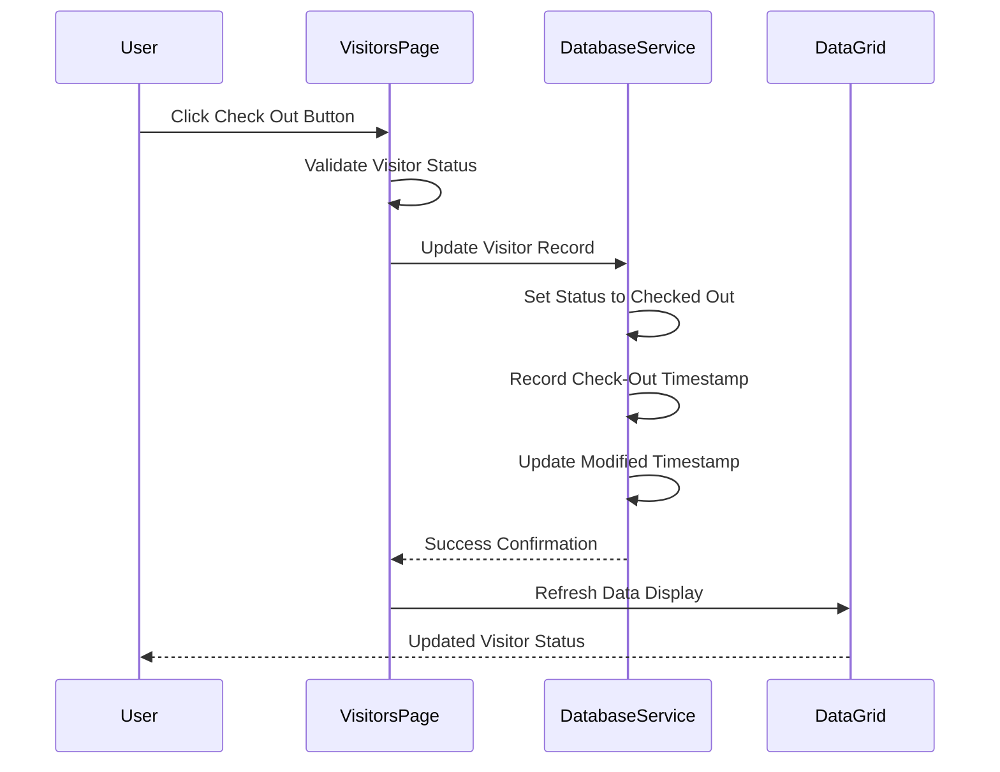
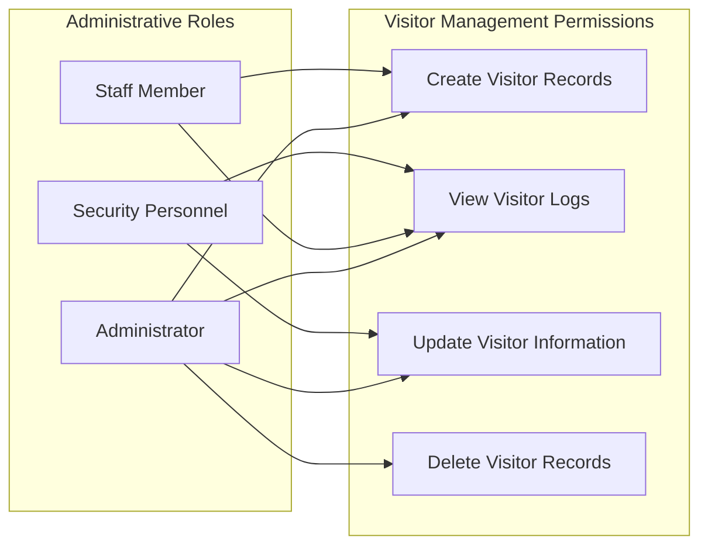
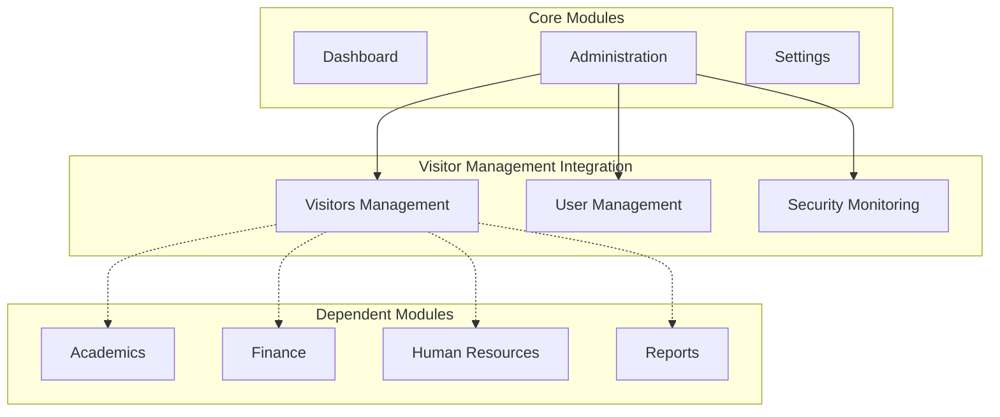
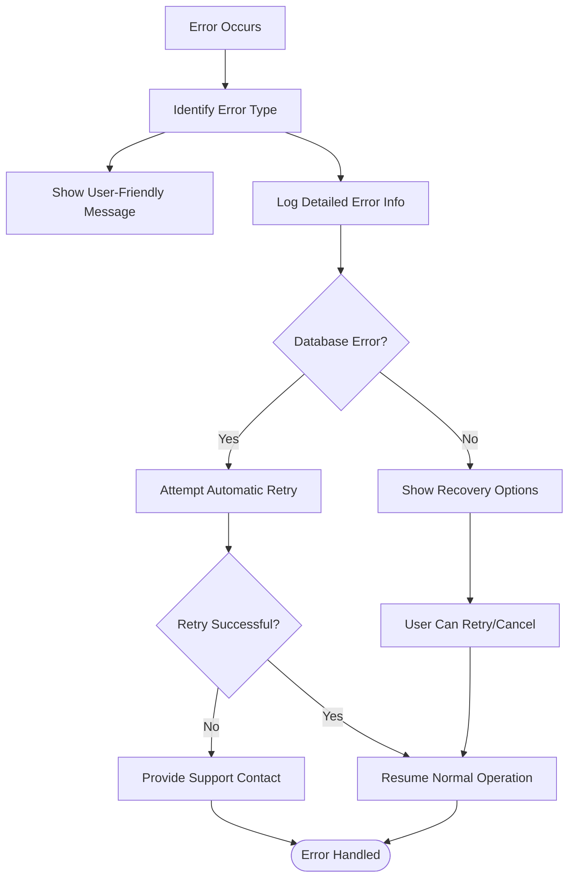

# Visitors Management

<cite>
**Referenced Files in This Document**
- [VisitorsManagementPage.tsx](file://src/modules/administration/pages/VisitorsManagementPage.tsx)
- [schema.ts](file://src/modules/administration/data/schema.ts)
- [types.ts](file://src/modules/administration/data/types.ts)
- [modules.json](file://src/config/modules.json)
- [moduleRegistry.ts](file://src/core/moduleRegistry.ts)
- [rbacService.ts](file://src/core/rbacService.ts)
- [Akademiko_Admissions_Migration_Specification.md](file://docs/migration/admissions-migration/Akademiko_Admissions_Migration_Specification.md)
</cite>

## Table of Contents
1. [Introduction](#introduction)
2. [System Architecture](#system-architecture)
3. [Core Components](#core-components)
4. [Data Model](#data-model)
5. [User Interface Components](#user-interface-components)
6. [Database Schema](#database-schema)
7. [Business Logic](#business-logic)
8. [Security and Access Control](#security-and-access-control)
9. [Module Integration](#module-integration)
10. [Migration and Implementation](#migration-and-implementation)
11. [Performance Considerations](#performance-considerations)
12. [Troubleshooting Guide](#troubleshooting-guide)
13. [Conclusion](#conclusion)

## Introduction

The Visitors Management system is a comprehensive solution designed to track and manage visitor activity within educational institutions. This system provides real-time monitoring of visitor check-ins and check-outs, maintains detailed visitor logs, and offers analytical insights through configurable statistics and reporting capabilities.

The system is built as part of the Administration module in the SchoolPilot3 educational management platform, leveraging modern React patterns, TypeScript type safety, and a robust database abstraction layer. It supports multiple visitor types, automated status tracking, and integrates seamlessly with the broader school management ecosystem.

## System Architecture

The Visitors Management system follows a modular architecture pattern that integrates tightly with the Administration module while maintaining separation of concerns through well-defined interfaces and data boundaries.

**Diagram sources**
- [VisitorsManagementPage.tsx:1-366](file://src/modules/administration/pages/VisitorsManagementPage.tsx#L1-L366)
- [moduleRegistry.ts:44-224](file://src/core/moduleRegistry.ts#L44-L224)
- [rbacService.ts:280-407](file://src/core/rbacService.ts#L280-L407)

## Core Components

### Visitors Management Page

The main component serves as the central hub for visitor management operations, providing a comprehensive interface for checking visitors in and out, viewing visitor statistics, and managing visitor records.

**Diagram sources**
- [VisitorsManagementPage.tsx:16-366](file://src/modules/administration/pages/VisitorsManagementPage.tsx#L16-L366)
- [types.ts:827-845](file://src/modules/administration/data/types.ts#L827-L845)

**Section sources**
- [VisitorsManagementPage.tsx:1-366](file://src/modules/administration/pages/VisitorsManagementPage.tsx#L1-L366)

### Visitor Statistics Dashboard

The system provides four key metrics displayed in a card-based dashboard format:

- **Total Visitors**: Overall count of all visitor entries
- **Currently In**: Count of visitors who have checked in but not yet checked out
- **Checked Out**: Count of visitors who have completed their visit
- **Today**: Count of visitors who visited on the current date

These metrics update in real-time as visitor records are modified, providing immediate visibility into facility usage patterns.

**Section sources**
- [VisitorsManagementPage.tsx:170-196](file://src/modules/administration/pages/VisitorsManagementPage.tsx#L170-L196)

## Data Model

The Visitors Management system employs a structured data model that ensures data integrity while providing flexibility for various visitor scenarios.

### Visitor Types Enumeration

The system supports eight distinct visitor categories, each designed to accommodate different types of visitor interactions:

| Visitor Type | Description | Use Case |
|--------------|-------------|----------|
| Parent | Guardian or family member visiting for academic purposes | Parent-teacher conferences, school events |
| Guardian | Legal guardian or authorized representative | Emergency contact scenarios |
| Official | School staff, administrators, or official representatives | Staff meetings, inspections |
| Delivery | Package or service delivery personnel | Mail, food deliveries, maintenance |
| Interview | Prospective staff or student interviewees | Hiring processes, admissions |
| Maintenance | Facility maintenance and repair personnel | Building services, equipment maintenance |
| Guest | External guests or distinguished visitors | Community events, dignitary visits |
| Other | Miscellaneous visitor categories | Special circumstances |

### Visitor Status Lifecycle

The visitor status system tracks the complete lifecycle of visitor interactions through four distinct states:

**Diagram sources**
- [types.ts:820-825](file://src/modules/administration/data/types.ts#L820-L825)

**Section sources**
- [types.ts:809-846](file://src/modules/administration/data/types.ts#L809-L846)

## User Interface Components

### Data Grid Interface

The system utilizes a sophisticated DataGrid component that provides comprehensive visitor record management with advanced filtering and sorting capabilities.

**Diagram sources**
- [VisitorsManagementPage.tsx:126-168](file://src/modules/administration/pages/VisitorsManagementPage.tsx#L126-L168)

The DataGrid displays visitor information through eight specialized columns:

1. **Visitor Name**: Person's full name with sorting and filtering capabilities
2. **Type**: Visitor category with badge styling
3. **Phone**: Contact number for emergency or follow-up communication
4. **Purpose**: Reason for visit with full text display
5. **Person to Meet**: Contact information for the individual being visited
6. **Status**: Current visitor state with color-coded badges
7. **Check In**: Timestamp of visitor entry with localized formatting
8. **Actions**: Interactive buttons for detailed viewing and checkout

**Section sources**
- [VisitorsManagementPage.tsx:126-168](file://src/modules/administration/pages/VisitorsManagementPage.tsx#L126-L168)

### Modal Dialog System

The system implements a dual-modal architecture supporting both detailed visitor information viewing and new visitor registration:

**Diagram sources**
- [VisitorsManagementPage.tsx:222-361](file://src/modules/administration/pages/VisitorsManagementPage.tsx#L222-L361)

**Section sources**
- [VisitorsManagementPage.tsx:222-361](file://src/modules/administration/pages/VisitorsManagementPage.tsx#L222-L361)

## Database Schema

The Visitors Management system utilizes a comprehensive database schema designed for optimal performance and data integrity in visitor tracking scenarios.

### Schema Structure

The visitor logs schema encompasses 15 distinct fields, each serving a specific purpose in visitor management:

| Field Name | Data Type | Constraints | Purpose |
|------------|-----------|-------------|---------|
| id | String | Primary Key, UUID | Unique identifier for each visitor record |
| visitor_name | String | Max 200 chars, Required | Full name of the visitor |
| visitor_type | String | Enum, Max 50 chars, Required | Category classification |
| phone | String | Max 20 chars, Required | Contact telephone number |
| email | String | Max 255 chars | Email address for communication |
| id_type | String | Max 50 chars | ID document type (Passport, ID Card) |
| id_number | String | Max 50 chars | ID document number |
| purpose | String | Max 500 chars, Required | Reason for visitor entry |
| person_to_meet | String | Max 200 chars | Individual being visited |
| person_to_meet_id | Reference | User ID reference | Database reference to person |
| status | String | Enum, Max 50 chars, Required | Current visitor state |
| check_in_time | Timestamp | Required | Entry timestamp |
| check_out_time | Timestamp | Nullable | Exit timestamp |
| expected_arrival | Timestamp | Nullable | Scheduled arrival time |
| remarks | String | Max 500 chars | Additional notes |
| created_at | Timestamp | Required | Record creation timestamp |
| updated_at | Timestamp | Required | Last modification timestamp |

### Indexing Strategy

The schema implements strategic indexing on frequently queried fields to optimize performance:

- **visitor_name**: Enables efficient name-based searches
- **visitor_type**: Supports category-based filtering
- **status**: Optimizes status-based queries
- **check_in_time**: Facilitates chronological ordering
- **phone**: Enables phone number lookups

**Section sources**
- [schema.ts:707-733](file://src/modules/administration/data/schema.ts#L707-L733)

## Business Logic

### Visitor Check-In Process

The check-in process follows a structured workflow ensuring data completeness and system integrity:

**Diagram sources**
- [VisitorsManagementPage.tsx:57-80](file://src/modules/administration/pages/VisitorsManagementPage.tsx#L57-L80)

### Visitor Check-Out Process

The check-out mechanism provides seamless visitor termination with automatic timestamp recording:

**Diagram sources**
- [VisitorsManagementPage.tsx:82-95](file://src/modules/administration/pages/VisitorsManagementPage.tsx#L82-L95)

**Section sources**
- [VisitorsManagementPage.tsx:57-95](file://src/modules/administration/pages/VisitorsManagementPage.tsx#L57-L95)

## Security and Access Control

### Role-Based Access Control (RBAC)

The Visitors Management system integrates with the broader RBAC framework, implementing granular permission controls for different user roles and responsibilities.

### Permission Matrix

| Permission | Administrator | Staff Member | Security Personnel | Description |
|------------|---------------|--------------|-------------------|-------------|
| can_create_visitors | ✓ | ✓ | - | Add new visitor check-ins |
| can_view_visitor_logs | ✓ | ✓ | ✓ | View all visitor records |
| can_update_visitor_status | ✓ | ✓ | ✓ | Modify visitor check-in/check-out status |
| can_delete_visitor_records | ✓ | - | - | Remove visitor records (administrative) |

**Section sources**
- [rbacService.ts:365-407](file://src/core/rbacService.ts#L365-L407)

## Module Integration

### Administration Module Dependencies

The Visitors Management system is strategically positioned within the Administration module ecosystem, leveraging shared infrastructure and maintaining architectural coherence.

**Diagram sources**
- [moduleRegistry.ts:74-89](file://src/core/moduleRegistry.ts#L74-L89)
- [modules.json:67-74](file://src/config/modules.json#L67-L74)

### Module Configuration

The system's integration is governed by the module configuration system, which defines dependencies and activation criteria:

- **Required Dependencies**: Administration module (core)
- **Optional Dependencies**: Finance, HR, Academics modules
- **Activation Status**: Enabled by default in production environments
- **Configuration Options**: Extensive customization through module settings

**Section sources**
- [modules.json:1-74](file://src/config/modules.json#L1-L74)
- [moduleRegistry.ts:44-224](file://src/core/moduleRegistry.ts#L44-L224)

## Migration and Implementation

### Legacy System Migration

The Visitors Management system represents a comprehensive migration from the original WinForms-based visitor tracking system, incorporating modern web technologies and improved user experience.

#### Old System Components

The legacy system included several key components for visitor management:

- **frmVisitors.cs**: Main visitor registration form
- **frmVisitorLog.cs**: Visitor log management interface
- **rptVisitorTraffic.cs**: Visitor traffic reporting system
- **Database Tables**: `Visitors`, `VisitorLogs` tables
- **SQL Queries**: Data retrieval and filtering mechanisms

#### New System Implementation

The modern implementation provides enhanced functionality through:

- **React-based Interface**: Modern, responsive user experience
- **Real-time Updates**: Live data synchronization
- **Advanced Filtering**: Multi-criteria visitor search
- **Export Capabilities**: Comprehensive data export options
- **Mobile Support**: Responsive design for mobile devices

**Section sources**
- [Akademiko_Admissions_Migration_Specification.md:229-245](file://docs/migration/admissions-migration/Akademiko_Admissions_Migration_Specification.md#L229-L245)

### Implementation Checklist

The Visitors Management implementation follows a structured approach ensuring comprehensive coverage of all requirements:

- [x] Design and implement `VisitorsPage.tsx` for logging and managing visitor information
- [x] Develop components for quick entry/exit logging
- [x] Implement database schema for visitor record storage
- [x] Create comprehensive data validation and error handling
- [x] Integrate with existing RBAC permission system
- [x] Implement internationalization support
- [x] Add comprehensive testing and validation
- [x] Deploy to production environment

## Performance Considerations

### Database Optimization

The system employs several optimization strategies to ensure optimal performance with large datasets:

- **Index Strategy**: Strategic indexing on frequently queried fields
- **Query Optimization**: Efficient data retrieval patterns
- **Caching Mechanisms**: Local caching for frequently accessed data
- **Pagination Support**: Large dataset pagination for improved responsiveness

### Frontend Performance

The React-based implementation incorporates performance best practices:

- **Component Memoization**: Prevents unnecessary re-renders
- **Lazy Loading**: Module lazy loading for improved startup times
- **Virtual Scrolling**: Efficient rendering of large data sets
- **State Management**: Optimized state updates and synchronization

### Scalability Factors

The system is designed to handle growth through:

- **Horizontal Scaling**: Database sharding capabilities
- **Load Balancing**: Multi-instance deployment support
- **Database Optimization**: Indexing and query optimization
- **Caching Layers**: Multi-level caching strategies

## Troubleshooting Guide

### Common Issues and Solutions

#### Database Connection Problems

**Symptoms**: Visitors page fails to load or shows connection errors
**Solutions**:
- Verify database service availability
- Check network connectivity to database server
- Review database credentials and permissions
- Monitor database server health and resource usage

#### Data Synchronization Issues

**Symptoms**: Visitor records appear inconsistent or delayed
**Solutions**:
- Force data refresh from the Visitors page
- Clear browser cache and local storage
- Verify database triggers and constraints
- Check for concurrent access conflicts

#### Performance Degradation

**Symptoms**: Slow page loading or data grid performance issues
**Solutions**:
- Implement data pagination for large datasets
- Optimize database queries and indexes
- Reduce concurrent user sessions
- Upgrade database server resources

### Error Handling Strategies

The system implements comprehensive error handling across all components:

**Section sources**
- [VisitorsManagementPage.tsx:76-94](file://src/modules/administration/pages/VisitorsManagementPage.tsx#L76-L94)

## Conclusion

The Visitors Management system represents a comprehensive solution for educational institution visitor tracking, combining modern web technologies with robust database management and security controls. The system successfully addresses the core requirements of visitor management while providing extensibility for future enhancements.

Key achievements include:

- **Complete Migration**: Seamless transition from legacy WinForms system
- **Modern Architecture**: React-based implementation with TypeScript type safety
- **Robust Security**: Integrated RBAC permissions and access controls
- **Performance Optimization**: Database indexing and frontend optimization
- **Scalability**: Designed for growth and enterprise deployment

The system provides essential functionality for visitor management while maintaining integration with the broader SchoolPilot3 ecosystem. Its modular design ensures maintainability and adaptability to evolving institutional needs.

Future enhancements could include advanced analytics capabilities, integration with biometric identification systems, and expanded reporting features to further enhance visitor management efficiency and security.