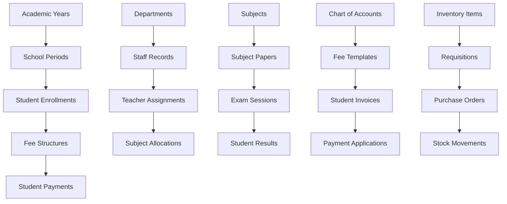

# Comprehensive Mock Data Expansion Requirements for School Management System

## 1. Product Overview

This document outlines the comprehensive requirements for expanding mock data across all modules of the Greenwood High International School Management System. The primary goal is to ensure that every dropdown, combobox, and data grid in the system is populated with realistic, diverse data that represents real-world scenarios.

The expansion will cover 14 core modules including Administration, Academics, Finance, HR, Inventory, Library, Nutrition, and Reports, ensuring no interface element remains empty due to lack of data. This comprehensive data set will enable proper testing, demonstration, and validation of all system functionalities.

## 2. Core Features

### 2.1 User Roles

| Role | Registration Method | Core Permissions |
|------|---------------------|------------------|
| Administrator | Direct system assignment | Full system access across all modules |
| Principal | Administrative assignment | High-level oversight and approval permissions |
| Teacher | HR department registration | Academic module access, class management |
| Accountant | Finance department assignment | Finance module access, fee management |
| Librarian | Administrative assignment | Library module access, book management |
| HR Manager | Administrative assignment | HR module access, staff management |
| Inventory Manager | Administrative assignment | Inventory module access, stock management |
| Parent | Student enrollment process | Limited access to student information |
| Student | Enrollment process | Self-service access to personal data |

### 2.2 Feature Module

Our comprehensive mock data expansion covers the following main areas:

1. **Administration Module**: Student records, staff management, academic structures, communication systems
2. **Academic Module**: Subjects, grading schemes, exam results, timetables, teacher assignments
3. **Finance Module**: Fee structures, payments, invoices, chart of accounts, financial reporting
4. **HR Module**: Payroll, salary settings, employee records, performance management
5. **Inventory Module**: Stock items, requisitions, purchase orders, asset management
6. **Library Module**: Book catalogs, loans, fines, borrowing history
7. **Nutrition Module**: Meal plans, menus, student assignments, merchant management
8. **Transport Module**: Routes, assignments, fee correlations
9. **Reports Module**: Comprehensive reporting across all modules

### 2.3 Page Details

| Page Name | Module Name | Feature Description |
|-----------|-------------|---------------------|
| **Students Management** | Administration | Expand student records to 500+ students across all classes and streams, covering different categories (boarders, day scholars, scholarship recipients) |
| **Staff Management** | Administration | Increase staff records to 100+ covering all departments, designations, and employment types (permanent, contract, PTA) |
| **Partners Management** | Administration | Create 50+ partner records including suppliers, NGOs, government agencies, and educational institutions |
| **Dormitories Management** | Administration | Establish 20+ dormitory records with capacity, gender specifications, and occupancy data |
| **Clubs & Societies** | Administration | Define 30+ clubs covering academic, sports, cultural, and service categories |
| **Customers Management** | Administration | Create 100+ customer records for various school services and products |
| **Communication Templates** | Administration | Develop 50+ templates for different communication scenarios (fees, academics, events, emergencies) |
| **Message Campaigns** | Administration | Generate campaign records with various statuses (sent, pending, scheduled, failed) |
| **Academic Years Structure** | Administration | Define multiple academic year structures (3-term, semester, trimester systems) |
| **School Periods** | Administration | Create comprehensive period definitions spanning multiple academic years |
| **Subjects Management** | Academics | Expand to 25+ subjects covering all educational levels and specializations |
| **Subject Papers** | Academics | Generate 100+ subject papers with proper theory/practical distributions |
| **Grading Schemes** | Academics | Create multiple grading schemes including CBC, IGCSE, and custom systems |
| **Results Entry** | Academics | Populate exam results for all students across different assessment periods |
| **Timetable Management** | Academics | Pre-populate timetable entries for all classes and subjects |
| **Teacher Assignments** | Academics | Assign teachers to subjects across all classes with proper load distribution |
| **Student Enrollments** | Academics | Enroll all students in appropriate subjects based on their class and stream |
| **Chart of Accounts** | Finance | Expand to 200+ accounts covering all financial aspects of school operations |
| **Fee Templates** | Finance | Create comprehensive fee structures for all student categories and academic periods |
| **Voteheads Management** | Finance | Implement votehead system linking fee items to expense and GL accounts |
| **Fee Structures** | Finance | Multiple fee structures with various statuses (active, draft, archived) |
| **Payments Management** | Finance | Generate payment records spanning multiple years and sessions |
| **Fee Adjustments** | Finance | Create positive and negative adjustments for various scenarios |
| **Opening Balances** | Finance | Establish opening balances for students across different periods |
| **Supplier Management** | Finance | Expand supplier records with various statuses and procurement lifecycle stages |
| **Supplier Invoices** | Finance | Generate invoices with different payment statuses and amounts |
| **Expenses Management** | Finance | Create expense records across all categories and departments |
| **Transport Routes** | Finance | Define multiple routes with student assignments and fee correlations |
| **Payroll Periods** | HR | Create payroll periods covering multiple months and years |
| **Payroll Items** | HR | Define comprehensive payroll items (allowances, deductions, benefits) |
| **Salary Settings** | HR | Configure salary settings for PTA teachers and support staff |
| **Payslip Data** | HR | Generate sample payslips for multiple years and months |
| **Store Items** | Inventory | Expand inventory to 1000+ items covering general supplies and fixed assets |
| **Requisitions** | Inventory | Create multiple requisition scenarios with different approval stages |
| **Purchase Orders** | Inventory | Generate purchase orders in various states (pending, approved, received) |
| **Stock Issuance** | Inventory | Record stock issuance for returnable and non-returnable items |
| **Stock Levels** | Inventory | Maintain current stock levels for all inventory items |
| **Book Categories** | Library | Define comprehensive book categorization system |
| **Book Types** | Library | Create book type classifications (textbooks, reference, fiction, etc.) |
| **Book Loans** | Library | Generate loan records with various statuses (active, returned, overdue) |
| **Book Listings** | Library | Maintain records of damaged books, borrowing history, and return statistics |
| **Library Fines** | Library | Create fine records with posting to student fees and staff deductions |
| **Nutrition Menus** | Nutrition | Develop diverse menu scenarios for different meal periods |
| **Meal Plans** | Nutrition | Create meal plans for different student categories and dietary requirements |
| **Student Meal Assignments** | Nutrition | Assign students to appropriate meal plans across academic terms |
| **Merchants Management** | Nutrition | Define merchant records for food suppliers and service providers |
| **Student Wallets** | Finance | Generate wallet transaction records for cashless payment systems |

## 3. Core Process

### 3.1 Data Population Flow

The mock data expansion follows a systematic approach:

1. **Foundation Data Setup**: Establish core entities (academic years, departments, designations)
2. **User and Staff Creation**: Generate comprehensive staff and user records
3. **Student Population**: Create diverse student records across all classes and categories
4. **Academic Structure**: Define subjects, papers, grading schemes, and assignments
5. **Financial Framework**: Establish chart of accounts, fee structures, and payment systems
6. **Operational Data**: Populate inventory, library, nutrition, and transport data
7. **Transactional Records**: Generate historical transactions, payments, and activities
8. **Reporting Data**: Ensure all reports have sufficient data for meaningful output

### 3.2 Data Relationships Flow

## 4. User Interface Design

### 4.1 Design Style

- **Primary Colors**: Blue (#2563eb) for headers and primary actions, Green (#16a34a) for success states
- **Secondary Colors**: Gray (#6b7280) for secondary text, Red (#dc2626) for warnings and errors
- **Button Style**: Rounded corners with subtle shadows, consistent sizing across modules
- **Font**: Inter font family with 14px base size for body text, 16px for headings
- **Layout Style**: Card-based design with consistent spacing, top navigation with module tabs
- **Icons**: Heroicons for consistency, with contextual colors matching the module theme

### 4.2 Page Design Overview

| Page Name | Module Name | UI Elements |
|-----------|-------------|-------------|
| **Data Management Dashboard** | All Modules | Overview cards showing data population status, progress indicators, quick action buttons with blue primary theme |
| **Student Records Grid** | Administration | DataGrid with filtering, sorting, pagination; student photos, status badges, action menus |
| **Financial Reports** | Finance | Charts and graphs with green/red color coding for positive/negative values, export buttons |
| **Academic Results** | Academics | Grade visualization with color-coded performance indicators, drill-down capabilities |
| **Inventory Dashboard** | Inventory | Stock level indicators with warning colors for low stock, barcode integration |

### 4.3 Responsiveness

The system is desktop-first with mobile-adaptive design. Touch interaction optimization is implemented for tablet usage, with responsive breakpoints at 768px and 1024px. Data grids collapse to card views on mobile devices, and navigation adapts to hamburger menu style for smaller screens.

## 5. Data Volume Specifications

### 5.1 Target Data Volumes

- **Students**: 500+ records across all classes and streams
- **Staff**: 100+ records covering all departments and designations
- **Subjects**: 25+ subjects with 100+ subject papers
- **Academic Periods**: 5+ academic years with 15+ school periods
- **Financial Accounts**: 200+ chart of accounts entries
- **Fee Structures**: 50+ fee templates across different categories
- **Inventory Items**: 1000+ items including general supplies and fixed assets
- **Library Books**: 2000+ book records with comprehensive categorization
- **Suppliers**: 100+ supplier records with various statuses
- **Transport Routes**: 20+ routes with student assignments

### 5.2 Data Quality Requirements

- All records must have realistic, contextually appropriate data
- Relationships between entities must be properly maintained
- Historical data should span at least 3 academic years
- Financial data must balance and follow accounting principles
- Student progression through academic levels must be logical
- Staff assignments must align with qualifications and departments

## 6. Implementation Priorities

### 6.1 Phase 1: Foundation Data (Week 1)
- Academic year structures and school periods
- Departments, designations, and staff records
- Student records and basic categorization
- Core subjects and basic grading schemes

### 6.2 Phase 2: Academic Data (Week 2)
- Subject papers and exam sessions
- Teacher subject assignments
- Student subject enrollments
- Timetable entries and academic results

### 6.3 Phase 3: Financial Data (Week 3)
- Expanded chart of accounts
- Fee templates and structures
- Payment records and adjustments
- Supplier and invoice management

### 6.4 Phase 4: Operational Data (Week 4)
- Inventory and procurement data
- Library books and loan records
- Nutrition menus and meal plans
- Transport routes and assignments

### 6.5 Phase 5: Integration and Testing (Week 5)
- Data relationship validation
- Report generation testing
- User interface verification
- Performance optimization

## 7. Success Criteria

- Zero empty dropdowns or comboboxes across the entire system
- All reports generate meaningful data with proper formatting
- Data relationships maintain referential integrity
- System performance remains optimal with expanded data sets
- User workflows can be completed end-to-end with realistic scenarios
- All modules demonstrate full functionality with populated data

## 8. Maintenance and Updates

- Monthly review of data relevance and accuracy
- Quarterly addition of new scenarios and edge cases
- Annual refresh of academic year data
- Continuous monitoring of system performance with large data sets
- Regular backup and recovery testing with full data sets