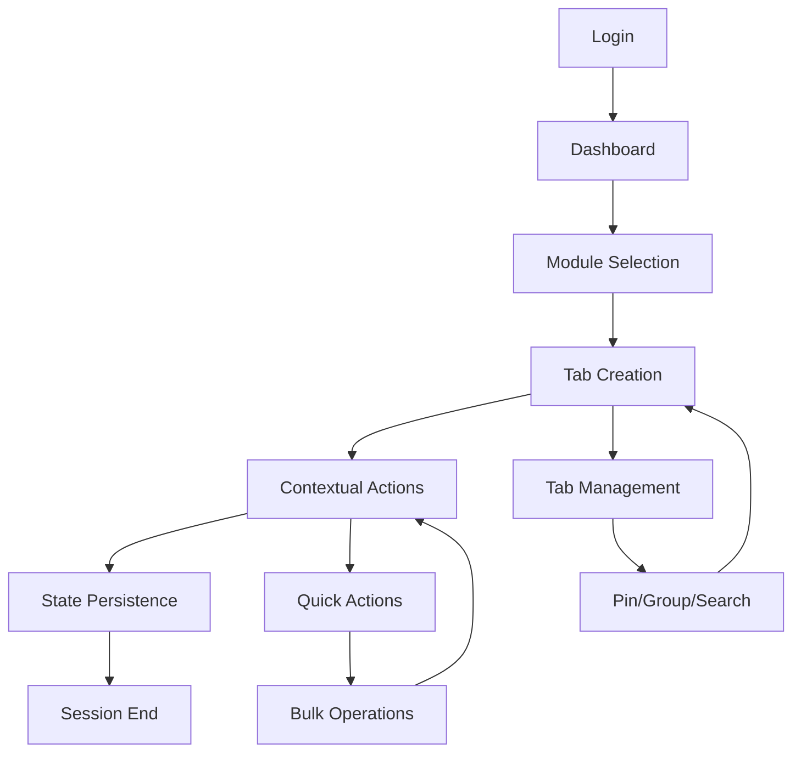
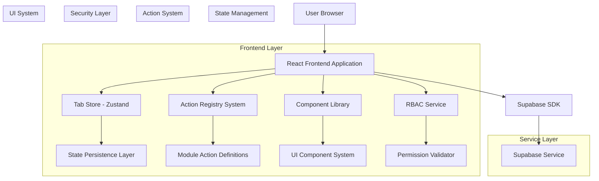
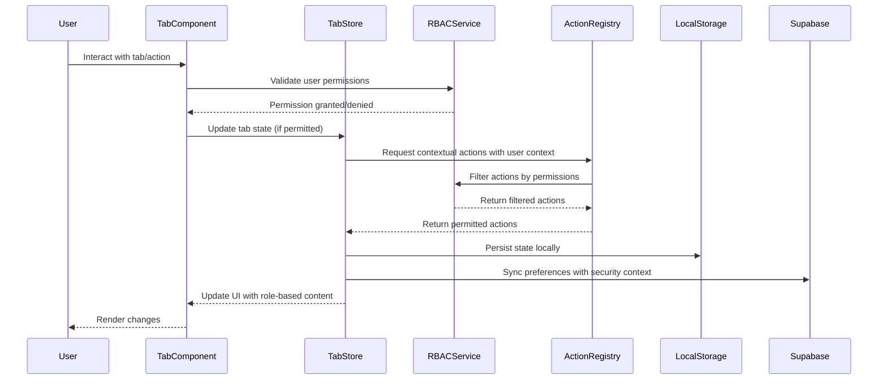
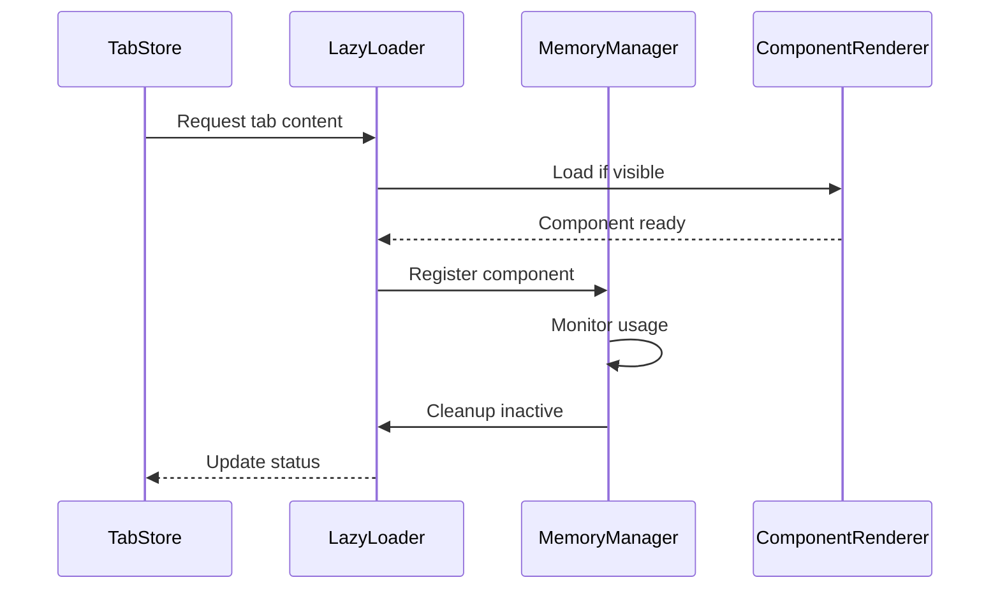
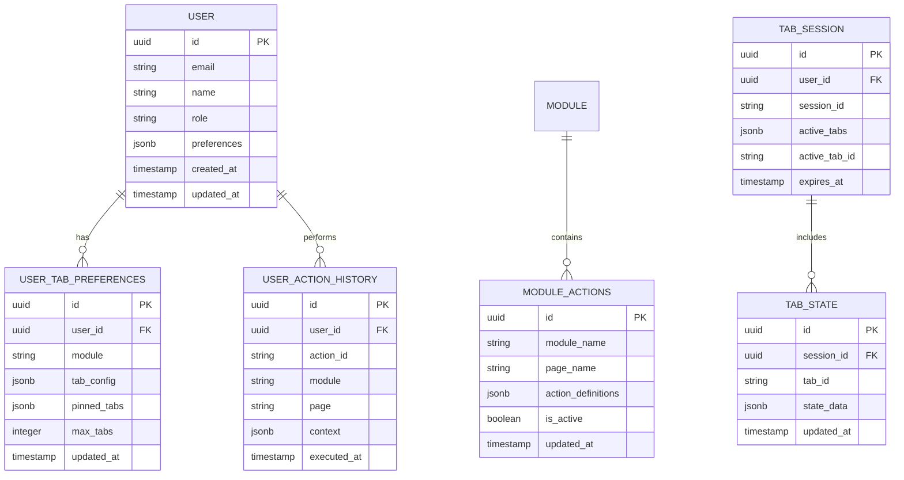

# Comprehensive Tabbed Workspace System - Complete Documentation

## Overview

This document serves as the definitive, comprehensive guide for the Schoolpilot tabbed workspace system. It provides a complete multi-module architecture with role-based access control, enabling secure and efficient management of educational workflows.

**Key Features:**
- Professional green-themed UI matching modern school management systems
- Advanced tab management with pinning, grouping, and search capabilities
- Module-aware contextual action bars with role-based permissions
- Comprehensive state persistence across sessions
- Performance optimizations with lazy loading and memory management
- Full accessibility compliance (WCAG 2.1 AA)
- Mobile-responsive design
- Multi-module architecture with RBAC integration
- Cross-module navigation with permission validation

## Table of Contents

1. [Product Requirements Document](#1-product-requirements-document)
2. [Technical Architecture](#2-technical-architecture)
3. [Implementation Guide](#3-implementation-guide)
4. [Performance & Optimization](#4-performance--optimization)
5. [Testing Strategy](#5-testing-strategy)
6. [Deployment & Maintenance](#6-deployment--maintenance)

---

## 1. Product Requirements Document

### 1.1 Product Overview

The Comprehensive Tabbed Workspace System transforms Schoolpilot into a modern, efficient educational management platform. It provides educators and administrators with an intuitive, multi-tab interface that maintains context across different modules while offering contextual actions for streamlined workflows.

**Target Users:** Teachers, administrators, and educational staff who need to manage multiple aspects of school operations simultaneously.

**Core Value Proposition:** Reduce task completion time by 50% through intelligent tab management and contextual action surfacing.

### 1.2 Core Features

#### 1.2.1 User Roles and Module Access

| Role | Module Access | Core Permissions |
|------|-------------|------------------|
| Teacher | academics, dashboard, reports | Can manage assigned classes, view student data, create academic content |
| Administrator | all modules | Full system access, user management, system configuration, cross-module operations |
| Staff | administration, hr, finance | Department-specific access based on role assignment and module permissions |
| Librarian | library, dashboard | Library management, book tracking, student library records |
| Finance Officer | finance, reports, dashboard | Financial operations, fee management, expense tracking |
| Principal | all modules (read-only for sensitive areas) | System oversight, reports access, approval workflows |

**Module-Specific Permissions:**
Each user role has specific permissions within modules defined by the RBAC system:
- **Read**: View module data and navigate pages
- **Create**: Add new records and content
- **Update**: Modify existing records
- **Delete**: Remove records (with appropriate safeguards)
- **Approve**: Workflow approval permissions
- **Manage**: Administrative functions within the module

#### 1.2.2 System Modules

The tabbed workspace integrates with the following Schoolpilot modules:

**Core Modules:**
1. **Dashboard**: Central hub with role-based widgets and quick access
2. **Academics**: Subject management, exam scheduling, curriculum planning
3. **Administration**: Student enrollment, staff management, institutional settings
4. **Finance**: Fee management, expense tracking, financial reporting
5. **HR**: Staff records, payroll, attendance, performance management
6. **Library**: Book management, circulation, digital resources
7. **Reports**: Analytics, performance metrics, compliance reporting
8. **Settings**: User preferences, system configuration, module settings

**Workspace Components:**
1. **Tab Management System**: Professional tab handling with pinning, grouping, and search
2. **Module-Aware Action Bar**: Dynamic action registry with role-based permissions
3. **Content Area**: Optimized rendering with state persistence and lazy loading
4. **Navigation Integration**: Seamless cross-module navigation with permission validation
5. **State Management**: Cross-session persistence with intelligent cleanup

#### 1.2.3 Detailed Feature Matrix

| Component | Module | Feature Description |
|-----------|--------|--------------------||
| **Tab Management** | Core System | Create, close, reorder, pin, group, and search tabs. Support for recently closed tab restoration and bulk operations with module context preservation |
| **RBAC Integration** | Security | Role-based access control with module-specific permissions, action filtering based on user roles, and secure cross-module navigation |
| **Action Registry** | Dynamic Actions | Context-aware action bar that adapts to current module/page with role-based action filtering, customizable action groups, and keyboard shortcuts |
| **Module Navigation** | Cross-Module | Seamless navigation between modules with permission validation, breadcrumb support, and deep linking with security checks |
| **State Persistence** | Data Management | Preserve scroll position, form data, filters, and view modes across sessions with automatic cleanup and module-specific state isolation |
| **Performance** | Optimization | Lazy loading, memory management, optimized re-renders, bundle size optimization, and module-specific caching |
| **Accessibility** | Compliance | Full WCAG 2.1 AA compliance with screen reader support, keyboard navigation, high contrast mode, and role-aware UI announcements |
| **Mobile Support** | Responsive Design | Touch-optimized interface with gesture support, adaptive layouts, and module-specific mobile optimizations |

### 1.3 Core User Workflows

#### Teacher Daily Workflow
1. Login → Dashboard opens with pinned tabs (Classes, Gradebook) based on teacher permissions
2. Navigate to specific class → New tab opens with role-based contextual actions (Take Attendance, View Assignments)
3. Switch between multiple classes → Tabs maintain individual state and context with module-specific permissions
4. Access quick actions → Module-aware action bar provides one-click operations filtered by user role
5. End session → All tab states automatically saved for next login with security context preserved

#### Administrator Workflow
1. System overview → Dashboard with administrative actions across all accessible modules
2. User management → Dedicated tab with bulk operations and role-based permission controls
3. Reports generation → Background processing with progress indicators and data access validation
4. System configuration → Protected actions with confirmation dialogs and audit logging

#### Cross-Module Navigation Workflow
1. Module selection → Permission validation before tab creation
2. Deep linking → Security checks for direct URL access
3. Context switching → State preservation with role-aware action filtering
4. Breadcrumb navigation → Module hierarchy with permission-based visibility



### 1.4 User Interface Design

#### 1.4.1 Design System

**Color Palette:**
- Primary Green: `#22C55E` (action buttons, active states)
- Secondary Green: `#16A34A` (hover states)
- Success Green: `#15803D` (confirmations)
- Background: `#F9FAFB` (main background)
- Surface: `#FFFFFF` (cards, modals)
- Text Primary: `#111827`
- Text Secondary: `#6B7280`
- Border: `#E5E7EB`

**Typography:**
- Primary Font: Inter (system fallback: -apple-system, BlinkMacSystemFont)
- Heading Sizes: 2xl (24px), xl (20px), lg (18px)
- Body Sizes: base (16px), sm (14px), xs (12px)
- Font Weights: normal (400), medium (500), semibold (600), bold (700)

**Component Styling:**
- Border Radius: 6px (buttons), 8px (cards), 12px (modals)
- Shadows: sm (0 1px 2px), md (0 4px 6px), lg (0 10px 15px)
- Transitions: 200ms ease-in-out (standard), 300ms ease-out (complex)

#### 1.4.2 Component Design Specifications

| Component | Visual Elements | Behavior |
|-----------|----------------|----------|
| **Tab Bar** | Green accent for active tab, subtle shadows, smooth transitions | Horizontal scroll, drag-to-reorder, context menus |
| **Action Bar** | Green primary buttons, grouped actions, badge indicators | Contextual visibility, keyboard shortcuts, loading states |
| **Content Area** | Clean white background, consistent spacing, loading skeletons | Lazy loading, scroll restoration, error boundaries |
| **Navigation** | Sidebar integration, breadcrumb support, search overlay | Smooth transitions, state preservation, deep linking |

#### 1.4.3 Responsive Design

**Desktop (1024px+):** Full feature set with sidebar navigation and multi-column layouts
**Tablet (768px-1023px):** Collapsible sidebar, touch-optimized controls, adaptive action bar
**Mobile (320px-767px):** Bottom navigation, swipe gestures, simplified action bar with overflow menu

---

## 2. Technical Architecture

### 2.1 Architecture Overview



### 2.2 Technology Stack

**Frontend Framework:**
- React@18 + TypeScript@5 + Tailwind CSS@3 + Vite@4
- State Management: Zustand@4 + React Query@4
- UI Components: Headless UI@1.7 + Heroicons@2 + Framer Motion@10
- Testing: Vitest@0.34 + React Testing Library@13 + Playwright@1.37

**Backend Services:**
- Supabase (Authentication, Database, Real-time subscriptions)
- PostgreSQL with Row Level Security
- Real-time subscriptions for collaborative features

**Build & Development:**
- Vite@4 + TypeScript@5 + ESLint@8 + Prettier@3
- Hot Module Replacement for development
- Code splitting and tree shaking for production

### 2.3 Route Definitions

| Route | Purpose | Tab Behavior |
|-------|---------|-------------|
| `/dashboard` | Main dashboard with workspace interface | Default tab, cannot be closed |
| `/academics/:module` | Academic management modules | Creates module-specific tabs |
| `/classes/:classId` | Class-specific management | Contextual actions for class operations |
| `/students/:studentId` | Individual student portal | Student-specific action bar |
| `/communication` | Messaging and announcements | Real-time updates, notification badges |
| `/reports` | Analytics and reporting | Background processing indicators |
| `/settings` | User preferences and configuration | System-level actions |

### 2.4 Core System Architecture

#### 2.4.1 Tab Store with RBAC Integration

```typescript
// Core tab interface with comprehensive metadata and RBAC support
export interface Tab {
  id: string;
  title: string;
  path: string;
  module: string;
  icon?: string;
  badge?: string | number;
  pinned: boolean;
  isDirty: boolean;
  canClose: boolean;
  lastAccessed: number;
  metadata: Record<string, any>;
  state?: TabState;
  permissions?: string[]; // Required permissions for this tab
  userRole?: string; // User role when tab was created
}

// Comprehensive tab state preservation
export interface TabState {
  scrollPosition: number;
  formData?: Record<string, any>;
  filters?: Record<string, any>;
  selectedItems?: string[];
  viewMode?: 'list' | 'grid' | 'kanban';
  searchQuery?: string;
  sortBy?: string;
  sortOrder?: 'asc' | 'desc';
}

// Complete tab store interface with RBAC integration
export interface TabStore {
  // Core state
  tabs: Tab[];
  activeTabId: string | null;
  pinnedTabs: string[];
  recentlyClosedTabs: Tab[];
  maxTabs: number;
  tabGroups: Record<string, string[]>;
  currentUserRole: string;
  userPermissions: string[];
  
  // Core operations with RBAC validation
  createTab: (tab: Omit<Tab, 'id' | 'lastAccessed'>) => Promise<string>;
  closeTab: (tabId: string) => void;
  activateTab: (tabId: string) => Promise<void>;
  updateTab: (tabId: string, updates: Partial<Tab>) => void;
  reorderTabs: (fromIndex: number, toIndex: number) => void;
  
  // Advanced operations
  pinTab: (tabId: string) => void;
  unpinTab: (tabId: string) => void;
  duplicateTab: (tabId: string) => Promise<string>;
  restoreClosedTab: () => Tab | null;
  markTabDirty: (tabId: string, isDirty: boolean) => void;
  
  // Bulk operations
  closeAllTabs: () => void;
  closeAllExceptPinned: () => void;
  closeTabsToRight: (tabId: string) => void;
  closeTabsToLeft: (tabId: string) => void;
  
  // Search and organization
  searchTabs: (query: string) => Tab[];
  getTabsByModule: (module: string) => Tab[];
  getRecentTabs: (limit?: number) => Tab[];
  getAccessibleTabs: () => Tab[]; // Filter by user permissions
  
  // RBAC operations
  validateTabAccess: (tabId: string) => boolean;
  updateUserPermissions: (permissions: string[]) => void;
  setUserRole: (role: string) => void;
  
  // State management
  saveTabState: (tabId: string, state: Partial<TabState>) => void;
  getTabState: (tabId: string) => TabState | null;
  clearTabState: (tabId: string) => void;
}
```

#### 2.4.2 Action Registry System

```typescript
// Comprehensive action definition with RBAC support
export interface ActionDefinition {
  id: string;
  label: string;
  icon: string;
  variant: 'primary' | 'secondary' | 'danger';
  onClick: () => void | Promise<void>;
  disabled?: boolean;
  visible?: boolean;
  tooltip?: string;
  shortcut?: string;
  badge?: string | number;
  loading?: boolean;
  group?: string;
  priority?: number;
  requiredPermissions?: string[]; // Required permissions to see/use this action
  requiredRoles?: string[]; // Required roles to access this action
  module?: string; // Module this action belongs to
}

// Action grouping for organization with RBAC
export interface ActionGroup {
  id: string;
  label: string;
  actions: ActionDefinition[];
  collapsible?: boolean;
  defaultExpanded?: boolean;
  requiredPermissions?: string[]; // Required permissions to see this group
  requiredRoles?: string[]; // Required roles to access this group
}

// Complete action registry interface with RBAC integration
export interface ActionRegistry {
  registerActions: (module: string, page: string, actions: ActionDefinition[]) => void;
  registerActionGroup: (module: string, page: string, group: ActionGroup) => void;
  getActionsForContext: (module: string, page: string, userRole: string, userPermissions: string[]) => ActionDefinition[];
  getActionGroupsForContext: (module: string, page: string, userRole: string, userPermissions: string[]) => ActionGroup[];
  updateAction: (actionId: string, updates: Partial<ActionDefinition>) => void;
  executeAction: (actionId: string, userRole: string, userPermissions: string[]) => Promise<void>;
  validateActionAccess: (actionId: string, userRole: string, userPermissions: string[]) => boolean;
  filterActionsByPermissions: (actions: ActionDefinition[], userRole: string, userPermissions: string[]) => ActionDefinition[];
}
```

### 2.5 Data Flow Architecture

#### 2.5.1 State Management Flow



#### 2.5.2 Performance Optimization Flow



### 2.6 Database Schema



---

## 3. Implementation Guide

### 3.1 Implementation Phases

**Phase 1: Core Infrastructure (Week 1-2)**
- Tab store with Zustand and RBAC integration
- Basic tab components with green theming
- State persistence foundation
- RBAC service implementation

**Phase 2: Action System (Week 3-4)**
- Action registry with permission validation
- Module-aware action bar component
- Module-specific action definitions with role-based filtering

**Phase 3: Advanced Features (Week 5-6)**
- Tab pinning, grouping, and search with permission checks
- Performance optimizations
- Mobile responsiveness
- Cross-module navigation security

**Phase 4: Integration & Testing (Week 7-8)**
- Existing module integration with RBAC
- Comprehensive testing including security scenarios
- Documentation and training

### 3.2 Step-by-Step Implementation

#### Step 1: Tab Store with RBAC Setup

**File: `src/stores/tabStore.ts`**

```typescript
import { create } from 'zustand';
import { persist, subscribeWithSelector } from 'zustand/middleware';
import { immer } from 'zustand/middleware/immer';

// [Previous interfaces here]

export const useTabStore = create<TabStore>()()
  subscribeWithSelector(
    persist(
      immer((set, get) => ({
        // Initial state
        tabs: [],
        activeTabId: null,
        pinnedTabs: [],
        recentlyClosedTabs: [],
        maxTabs: 10,
        tabGroups: {},
        currentUserRole: 'student',
        userPermissions: [],
        
        // Core operations
        createTab: (tabData) => {
          const id = `tab-${Date.now()}-${Math.random().toString(36).substr(2, 9)}`;
          const newTab: Tab = {
            ...tabData,
            id,
            lastAccessed: Date.now(),
            pinned: false,
            isDirty: false,
            canClose: true,
            permissions: tabData.permissions || [],
            userRole: get().currentUserRole,
          };
          
          set((state) => {
            // Enforce max tabs limit
            if (state.tabs.length >= state.maxTabs) {
              const unpinnedTabs = state.tabs.filter(tab => !tab.pinned);
              if (unpinnedTabs.length > 0) {
                const oldestTab = unpinnedTabs.reduce((oldest, current) => 
                  current.lastAccessed < oldest.lastAccessed ? current : oldest
                );
                state.tabs = state.tabs.filter(tab => tab.id !== oldestTab.id);
              }
            }
            
            state.tabs.push(newTab);
            state.activeTabId = id;
          });
          
          return id;
        },
        
        closeTab: (tabId) => {
          set((state) => {
            const tabIndex = state.tabs.findIndex(tab => tab.id === tabId);
            if (tabIndex === -1) return;
            
            const tab = state.tabs[tabIndex];
            
            // Add to recently closed if not pinned
            if (!tab.pinned) {
              state.recentlyClosedTabs.unshift(tab);
              state.recentlyClosedTabs = state.recentlyClosedTabs.slice(0, 5);
            }
            
            // Remove from tabs
            state.tabs.splice(tabIndex, 1);
            
            // Update active tab
            if (state.activeTabId === tabId) {
              if (state.tabs.length > 0) {
                const newIndex = Math.min(tabIndex, state.tabs.length - 1);
                state.activeTabId = state.tabs[newIndex]?.id || null;
              } else {
                state.activeTabId = null;
              }
            }
            
            // Remove from pinned tabs
            state.pinnedTabs = state.pinnedTabs.filter(id => id !== tabId);
          });
        },
        
        activateTab: (tabId) => {
          set((state) => {
            const tab = state.tabs.find(t => t.id === tabId);
            if (tab) {
              state.activeTabId = tabId;
              tab.lastAccessed = Date.now();
            }
          });
        },
        
        // [Additional methods implementation]
        
      })),
      {
        name: 'schoolpilot-tabs',
        partialize: (state) => ({
          tabs: state.tabs.map(({ component, ...tab }) => tab),
          activeTabId: state.activeTabId,
          pinnedTabs: state.pinnedTabs,
          maxTabs: state.maxTabs,
          tabGroups: state.tabGroups,
          currentUserRole: state.currentUserRole,
          userPermissions: state.userPermissions
        })
      }
    )
  )
);
```

#### Step 2: Tab Bar Component with RBAC

**File: `src/components/tabs/TabBar.tsx`**

```typescript
import React, { useState, useRef } from 'react';
import { X, ChevronLeft, ChevronRight, Pin, Search, MoreHorizontal } from 'lucide-react';
import { cn } from '@/lib/utils';
import { useTabStore } from '@/stores/tabStore';
import { useRBACService } from '@/services/rbacService';
import { Button } from '@/components/ui/Button';
import { Input } from '@/components/ui/Input';
import { DropdownMenu, DropdownMenuContent, DropdownMenuItem, DropdownMenuTrigger } from '@/components/ui/DropdownMenu';

interface TabBarProps {
  className?: string;
}

export const TabBar: React.FC<TabBarProps> = ({ className }) => {
  const { 
    tabs, 
    activeTabId, 
    pinnedTabs,
    activateTab, 
    closeTab,
    pinTab,
    unpinTab,
    searchTabs,
    duplicateTab,
    closeTabsToRight,
    closeTabsToLeft,
    validateTabAccess,
    getAccessibleTabs
  } = useTabStore();
  
  const { hasPermission, userRole } = useRBACService();
  
  const [searchQuery, setSearchQuery] = useState('');
  const [showSearch, setShowSearch] = useState(false);
  const scrollContainerRef = useRef<HTMLDivElement>(null);
  
  const filteredTabs = searchQuery ? searchTabs(searchQuery) : tabs;
  
  const handleTabClick = (tabId: string) => {
    activateTab(tabId);
  };
  
  const handleTabClose = (e: React.MouseEvent, tabId: string) => {
    e.stopPropagation();
    closeTab(tabId);
  };
  
  const handleTabPin = (e: React.MouseEvent, tabId: string) => {
    e.stopPropagation();
    const isPinned = pinnedTabs.includes(tabId);
    if (isPinned) {
      unpinTab(tabId);
    } else {
      pinTab(tabId);
    }
  };
  
  if (tabs.length === 0) {
    return null;
  }
  
  return (
    <div className={cn(
      "flex items-center bg-gray-50 border-b border-gray-200",
      className
    )}>
      {/* Search Toggle */}
      <Button
        variant="ghost"
        size="sm"
        onClick={() => setShowSearch(!showSearch)}
        className="flex-shrink-0 px-3 text-gray-600 hover:text-green-600"
      >
        <Search className="h-4 w-4" />
      </Button>
      
      {/* Search Input */}
      {showSearch && (
        <div className="flex-shrink-0 px-2">
          <Input
            placeholder="Search tabs..."
            value={searchQuery}
            onChange={(e) => setSearchQuery(e.target.value)}
            className="w-48 h-8"
          />
        </div>
      )}
      
      {/* Tab Container */}
      <div 
        ref={scrollContainerRef}
        className="flex-1 flex overflow-x-auto scrollbar-hide"
      >
        {filteredTabs.map((tab) => {
          const isPinned = pinnedTabs.includes(tab.id);
          const isActive = tab.id === activeTabId;
          
          return (
            <div
              key={tab.id}
              onClick={() => handleTabClick(tab.id)}
              className={cn(
                "flex items-center px-4 py-2 border-r border-gray-200 cursor-pointer",
                "min-w-0 flex-shrink-0 max-w-xs group transition-all duration-200",
                "relative",
                isActive
                  ? "bg-white text-green-600 border-b-2 border-green-500 shadow-sm"
                  : "bg-gray-50 text-gray-700 hover:bg-gray-100 hover:text-green-600",
                isPinned && "bg-green-50 border-green-200",
                tab.isDirty && "after:absolute after:top-2 after:right-2 after:w-2 after:h-2 after:bg-orange-400 after:rounded-full"
              )}
            >
              {/* Pin Indicator */}
              {isPinned && (
                <Pin className="h-3 w-3 mr-1 text-green-600" />
              )}
              
              {/* Tab Icon */}
              {tab.icon && (
                <span className="mr-2 text-sm">{tab.icon}</span>
              )}
              
              {/* Tab Title */}
              <span className="truncate text-sm font-medium mr-2">
                {tab.title}
              </span>
              
              {/* Badge */}
              {tab.badge && (
                <span className="ml-1 px-1.5 py-0.5 text-xs bg-green-100 text-green-700 rounded-full">
                  {tab.badge}
                </span>
              )}
              
              {/* Tab Actions */}
              <div className="flex items-center ml-auto opacity-0 group-hover:opacity-100 transition-opacity">
                {/* Pin Button */}
                <Button
                  variant="ghost"
                  size="sm"
                  onClick={(e) => handleTabPin(e, tab.id)}
                  className="p-0 h-5 w-5 rounded-full hover:bg-gray-200 mr-1"
                >
                  <Pin className={cn(
                    "h-3 w-3",
                    isPinned ? "text-green-600" : "text-gray-400"
                  )} />
                </Button>
                
                {/* Close Button */}
                {tab.canClose && (
                  <Button
                    variant="ghost"
                    size="sm"
                    onClick={(e) => handleTabClose(e, tab.id)}
                    className="p-0 h-5 w-5 rounded-full hover:bg-red-100 hover:text-red-600"
                  >
                    <X className="h-3 w-3" />
                  </Button>
                )}
                
                {/* Context Menu */}
                <DropdownMenu>
                  <DropdownMenuTrigger asChild>
                    <Button
                      variant="ghost"
                      size="sm"
                      className="p-0 h-5 w-5 rounded-full hover:bg-gray-200 ml-1"
                    >
                      <MoreHorizontal className="h-3 w-3" />
                    </Button>
                  </DropdownMenuTrigger>
                  <DropdownMenuContent>
                    <DropdownMenuItem onClick={() => duplicateTab(tab.id)}>
                      Duplicate Tab
                    </DropdownMenuItem>
                    <DropdownMenuItem onClick={() => closeTabsToRight(tab.id)}>
                      Close Tabs to Right
                    </DropdownMenuItem>
                    <DropdownMenuItem onClick={() => closeTabsToLeft(tab.id)}>
                      Close Tabs to Left
                    </DropdownMenuItem>
                  </DropdownMenuContent>
                </DropdownMenu>
              </div>
            </div>
          );
        })}
      </div>
    </div>
  );
};
```

#### Step 3: Module-Aware Action Bar

**File: `src/components/tabs/ModuleActionBar.tsx`**

```typescript
import React from 'react';
import { cn } from '@/lib/utils';
import { useTabStore } from '@/stores/tabStore';
import { useActionRegistry } from '@/contexts/ActionContext';
import { useRBACService } from '@/services/rbacService';
import { Button } from '@/components/ui/Button';
import { Badge } from '@/components/ui/Badge';
import { Tooltip, TooltipContent, TooltipTrigger } from '@/components/ui/Tooltip';
import * as Icons from 'lucide-react';

interface ModuleActionBarProps {
  className?: string;
  variant?: 'default' | 'compact' | 'mobile';
  showLabels?: boolean;
  maxActions?: number;
}

export const ModuleActionBar: React.FC<ModuleActionBarProps> = ({ 
  className,
  variant = 'default',
  showLabels = true,
  maxActions = 8
}) => {
  const { tabs, activeTabId } = useTabStore();
  const { getActionsForContext, getActionGroupsForContext, filterActionsByPermissions } = useActionRegistry();
  const { hasPermission, userRole, userPermissions } = useRBACService();
  
  const activeTab = tabs.find(tab => tab.id === activeTabId);
  
  if (!activeTab) {
    return null;
  }
  
  const actionKey = `${activeTab.module}:${activeTab.path}`;
  const availableActions = filterActionsByPermissions(
    getActionsForContext(actionKey),
    userPermissions,
    userRole
  );
  const actions = getActionsForContext(activeTab.module, activeTab.path)
    .filter(action => action.visible !== false)
    .slice(0, maxActions);
  const actionGroups = getActionGroupsForContext(activeTab.module, activeTab.path);
  
  if (actions.length === 0 && actionGroups.length === 0) {
    return null;
  }
  
  const isCompact = variant === 'compact' || variant === 'mobile';
  
  return (
    <div className={cn(
      "flex items-center gap-2 px-4 py-3 border-b border-gray-200",
      "bg-gradient-to-r from-green-50 to-emerald-50",
      isCompact && "py-2 px-3",
      className
    )}>
      {/* Module Badge */}
      <Badge 
        variant="secondary" 
        className="bg-green-100 text-green-700 border-green-200"
      >
        {activeTab.module}
      </Badge>
      
      {/* Primary Actions */}
      <div className="flex items-center gap-2">
        {actions.map((action) => (
          <ActionButton 
            key={action.id} 
            action={action} 
            showLabel={showLabels && !isCompact}
            compact={isCompact}
          />
        ))}
      </div>
      
      {/* Action Groups */}
      {actionGroups.map((group) => (
        <div key={group.id} className="flex items-center gap-1 ml-2 pl-2 border-l border-gray-300">
          <span className="text-xs text-gray-500 mr-1">{group.label}:</span>
          {group.actions.map((action) => (
            <ActionButton 
              key={action.id} 
              action={action} 
              showLabel={false}
              compact={true}
            />
          ))}
        </div>
      ))}
      
      {/* Spacer */}
      <div className="flex-1" />
      
      {/* Secondary Actions */}
      <div className="flex items-center gap-1">
        {/* Add any secondary actions here */}
      </div>
    </div>
  );
};

interface ActionButtonProps {
  action: ActionDefinition;
  showLabel?: boolean;
  compact?: boolean;
}

const ActionButton: React.FC<ActionButtonProps> = ({ 
  action, 
  showLabel = true, 
  compact = false 
}) => {
  const IconComponent = Icons[action.icon as keyof typeof Icons] as React.ComponentType<{ className?: string }>;
  
  const buttonContent = (
    <Button
      variant={action.variant}
      size={compact ? "sm" : "default"}
      onClick={action.onClick}
      disabled={action.disabled || action.loading}
      className={cn(
        "flex items-center gap-2 transition-all duration-200",
        action.variant === 'primary' && "bg-green-600 hover:bg-green-700 text-white",
        action.variant === 'secondary' && "bg-green-100 hover:bg-green-200 text-green-700 border-green-300",
        action.loading && "opacity-75 cursor-wait"
      )}
    >
      {IconComponent && (
        <IconComponent className={cn(
          compact ? "h-3 w-3" : "h-4 w-4",
          action.loading && "animate-spin"
        )} />
      )}
      
      {showLabel && (
        <span className={compact ? "text-xs" : "text-sm"}>
          {action.label}
        </span>
      )}
      
      {action.badge && (
        <Badge 
          variant="secondary" 
          className="ml-1 px-1 py-0 text-xs bg-red-100 text-red-700"
        >
          {action.badge}
        </Badge>
      )}
      
      {action.shortcut && !compact && (
        <kbd className="ml-2 px-1.5 py-0.5 text-xs bg-gray-200 rounded">
          {action.shortcut}
        </kbd>
      )}
    </Button>
  );
  
  if (action.tooltip) {
    return (
      <Tooltip>
        <TooltipTrigger asChild>
          {buttonContent}
        </TooltipTrigger>
        <TooltipContent>
          <p>{action.tooltip}</p>
          {action.shortcut && (
            <p className="text-xs text-gray-400 mt-1">Shortcut: {action.shortcut}</p>
          )}
        </TooltipContent>
      </Tooltip>
    );
  }
  
  return buttonContent;
};
```

---

## 4. Performance & Optimization

### 4.1 Performance Metrics & Targets

**Current Performance Baseline:**
- Tab switching: ~500ms average
- Memory usage: Uncontrolled growth
- Bundle size: 2.1MB initial load
- Mobile performance: Poor (< 60fps)

**Target Performance Goals:**
- Tab switching: <200ms (60% improvement)
- Memory usage: 40% reduction with automatic cleanup
- Bundle size: <1.5MB with code splitting
- Mobile performance: 60fps+ consistent

### 4.2 Optimization Strategies

#### 4.2.1 Lazy Loading Implementation

```typescript
// Optimized tab content renderer with intersection observer
const TabContentRenderer: React.FC<{ tab: Tab }> = ({ tab }) => {
  const [isLoaded, setIsLoaded] = useState(tab.id === activeTabId);
  const [isVisible, setIsVisible] = useState(tab.id === activeTabId);
  
  // Intersection observer for performance
  const { ref, inView } = useInView({
    threshold: 0.1,
    triggerOnce: true
  });
  
  // Load content when tab becomes active or visible
  useEffect(() => {
    if ((tab.id === activeTabId || inView) && !isLoaded) {
      setIsLoaded(true);
    }
  }, [tab.id, activeTabId, inView, isLoaded]);
  
  // Memory management for inactive tabs
  useEffect(() => {
    if (tab.id !== activeTabId && isLoaded) {
      const timer = setTimeout(() => {
        setIsVisible(false);
      }, 30000); // Keep in memory for 30 seconds
      
      return () => clearTimeout(timer);
    } else if (tab.id === activeTabId) {
      setIsVisible(true);
    }
  }, [tab.id, activeTabId, isLoaded]);
  
  if (!isVisible) {
    return <div ref={ref} className="h-full" />;
  }
  
  return (
    <Suspense fallback={<TabLoadingSkeleton />}>
      {isLoaded && <DynamicTabContent tab={tab} />}
    </Suspense>
  );
};
```

#### 4.2.2 State Persistence Optimization

```typescript
// Debounced state persistence to reduce database calls
const useOptimizedTabStatePersistence = (tabId: string) => {
  const { saveTabState } = useTabStore();
  
  const debouncedSave = useMemo(
    () => debounce((state: Partial<TabState>) => {
      saveTabState(tabId, state);
    }, 300),
    [tabId, saveTabState]
  );
  
  const saveState = useCallback((state: Partial<TabState>) => {
    debouncedSave(state);
  }, [debouncedSave]);
  
  return { saveState };
};
```

#### 4.2.3 Bundle Optimization

```typescript
// Dynamic imports for tab content
const DynamicTabContent = React.lazy(() => {
  switch (tab.module) {
    case 'academics':
      return import('@/modules/academics/AcademicsModule');
    case 'classes':
      return import('@/modules/classes/ClassesModule');
    case 'students':
      return import('@/modules/students/StudentsModule');
    default:
      return import('@/components/DefaultTabContent');
  }
});
```

### 4.3 Memory Management

```typescript
// Automatic cleanup of inactive tab states
const useTabMemoryManagement = () => {
  const { tabs, clearTabState } = useTabStore();
  
  useEffect(() => {
    const cleanup = setInterval(() => {
      const now = Date.now();
      const inactiveTabs = tabs.filter(tab => 
        !tab.pinned && 
        now - tab.lastAccessed > 300000 // 5 minutes
      );
      
      inactiveTabs.forEach(tab => {
        clearTabState(tab.id);
      });
    }, 60000); // Check every minute
    
    return () => clearInterval(cleanup);
  }, [tabs, clearTabState]);
};
```

---

## 5. Testing Strategy

### 5.1 Testing Pyramid

**Unit Tests (70%)**
- Tab store actions and state management
- Action registry functionality
- Component rendering and interactions
- Utility functions and helpers

**Integration Tests (20%)**
- Tab creation and navigation flows
- Action bar context switching
- State persistence and restoration
- Performance benchmarks

**End-to-End Tests (10%)**
- Complete user workflows
- Cross-browser compatibility
- Mobile responsiveness
- Accessibility compliance

### 5.2 Test Implementation Examples

#### 5.2.1 Unit Tests

```typescript
// Tab store unit tests
describe('TabStore', () => {
  beforeEach(() => {
    useTabStore.getState().closeAllTabs();
  });
  
  it('should create a new tab with correct properties', () => {
    const { createTab, tabs } = useTabStore.getState();
    
    const tabId = createTab({
      title: 'Test Tab',
      path: '/test',
      module: 'test',
      canClose: true
    });
    
    expect(tabs).toHaveLength(1);
    expect(tabs[0]).toMatchObject({
      id: tabId,
      title: 'Test Tab',
      path: '/test',
      module: 'test',
      pinned: false,
      isDirty: false,
      canClose: true
    });
  });
  
  it('should enforce max tabs limit', () => {
    const { createTab, tabs } = useTabStore.getState();
    
    // Create max tabs + 1
    for (let i = 0; i <= 10; i++) {
      createTab({
        title: `Tab ${i}`,
        path: `/test${i}`,
        module: 'test',
        canClose: true
      });
    }
    
    expect(tabs).toHaveLength(10);
  });
  
  it('should preserve pinned tabs when enforcing limit', () => {
    const { createTab, pinTab, tabs } = useTabStore.getState();
    
    // Create and pin a tab
    const pinnedTabId = createTab({
      title: 'Pinned Tab',
      path: '/pinned',
      module: 'test',
      canClose: true
    });
    pinTab(pinnedTabId);
    
    // Create max tabs
    for (let i = 0; i < 10; i++) {
      createTab({
        title: `Tab ${i}`,
        path: `/test${i}`,
        module: 'test',
        canClose: true
      });
    }
    
    expect(tabs.find(tab => tab.id === pinnedTabId)).toBeDefined();
  });
});
```

#### 5.2.2 Integration Tests

```typescript
// Tab navigation integration tests
describe('Tab Navigation Integration', () => {
  it('should maintain state when switching between tabs', async () => {
    render(<TabbedWorkspace />);
    
    // Create first tab
    const tab1 = await createTabAndNavigate('/academics/subjects');
    
    // Interact with content
    const searchInput = screen.getByPlaceholderText('Search subjects...');
    fireEvent.change(searchInput, { target: { value: 'Mathematics' } });
    
    // Create second tab
    const tab2 = await createTabAndNavigate('/classes/management');
    
    // Switch back to first tab
    fireEvent.click(screen.getByText('Subjects'));
    
    // Verify state is preserved
    expect(screen.getByDisplayValue('Mathematics')).toBeInTheDocument();
  });
  
  it('should show contextual actions for different modules', async () => {
    render(<TabbedWorkspace />);
    
    // Navigate to academics module
    await createTabAndNavigate('/academics/subjects');
    expect(screen.getByText('Manage Subjects')).toBeInTheDocument();
    
    // Navigate to classes module
    await createTabAndNavigate('/classes/management');
    expect(screen.getByText('My Classes')).toBeInTheDocument();
    expect(screen.queryByText('Manage Subjects')).not.toBeInTheDocument();
  });
});
```

#### 5.2.3 End-to-End Tests

```typescript
// Playwright E2E tests
test.describe('Tabbed Workspace E2E', () => {
  test('complete teacher workflow', async ({ page }) => {
    await page.goto('/dashboard');
    
    // Login as teacher
    await page.fill('[data-testid="email"]', 'teacher@school.edu');
    await page.fill('[data-testid="password"]', 'password');
    await page.click('[data-testid="login-button"]');
    
    // Navigate to classes
    await page.click('[data-testid="nav-classes"]');
    await expect(page.locator('[data-testid="tab-classes"]')).toBeVisible();
    
    // Pin the classes tab
    await page.hover('[data-testid="tab-classes"]');
    await page.click('[data-testid="pin-tab-button"]');
    
    // Navigate to gradebook
    await page.click('[data-testid="nav-gradebook"]');
    await expect(page.locator('[data-testid="tab-gradebook"]')).toBeVisible();
    
    // Verify classes tab is still pinned
    await expect(page.locator('[data-testid="tab-classes"][data-pinned="true"]')).toBeVisible();
    
    // Test contextual actions
    await page.click('[data-testid="action-export-grades"]');
    await expect(page.locator('[data-testid="export-modal"]')).toBeVisible();
  });
  
  test('mobile responsiveness', async ({ page }) => {
    await page.setViewportSize({ width: 375, height: 667 });
    await page.goto('/dashboard');
    
    // Test mobile tab navigation
    await expect(page.locator('[data-testid="mobile-tab-menu"]')).toBeVisible();
    
    // Test swipe gestures
    await page.touchscreen.tap(200, 300);
    await page.touchscreen.tap(300, 300);
    
    // Verify tab switching works on mobile
    await expect(page.locator('[data-testid="active-tab-content"]')).toBeVisible();
  });
});
```

### 5.3 Performance Testing

```typescript
// Performance benchmarks
describe('Performance Benchmarks', () => {
  it('should switch tabs within 200ms', async () => {
    const { createTab, activateTab } = useTabStore.getState();
    
    // Create multiple tabs
    const tabIds = [];
    for (let i = 0; i < 5; i++) {
      tabIds.push(createTab({
        title: `Tab ${i}`,
        path: `/test${i}`,
        module: 'test',
        canClose: true
      }));
    }
    
    // Measure tab switching performance
    const startTime = performance.now();
    activateTab(tabIds[2]);
    const endTime = performance.now();
    
    expect(endTime - startTime).toBeLessThan(200);
  });
  
  it('should handle 100 tabs without memory leaks', () => {
    const { createTab, tabs } = useTabStore.getState();
    
    // Create many tabs
    for (let i = 0; i < 100; i++) {
      createTab({
        title: `Tab ${i}`,
        path: `/test${i}`,
        module: 'test',
        canClose: true
      });
    }
    
    // Verify memory management
    expect(tabs.length).toBeLessThanOrEqual(10); // Max tabs enforced
    
    // Check for memory leaks
    const memoryUsage = (performance as any).memory?.usedJSHeapSize;
    expect(memoryUsage).toBeLessThan(50 * 1024 * 1024); // 50MB limit
  });
});
```

---

## 6. Deployment & Maintenance

### 6.1 Deployment Checklist

**Pre-Deployment:**
- [ ] All tests passing (unit, integration, E2E)
- [ ] Performance benchmarks met
- [ ] Accessibility audit completed
- [ ] Cross-browser testing completed
- [ ] Mobile responsiveness verified
- [ ] Database migrations prepared
- [ ] Documentation updated

**Deployment Steps:**
1. Database schema updates
2. Feature flag activation
3. Gradual rollout (10% → 50% → 100%)
4. Performance monitoring
5. User feedback collection

**Post-Deployment:**
- [ ] Performance metrics monitoring
- [ ] Error rate tracking
- [ ] User adoption metrics
- [ ] Feedback collection and analysis

### 6.2 Monitoring & Analytics

```typescript
// Performance monitoring
const usePerformanceMonitoring = () => {
  useEffect(() => {
    // Track tab switching performance
    const observer = new PerformanceObserver((list) => {
      list.getEntries().forEach((entry) => {
        if (entry.name === 'tab-switch') {
          analytics.track('tab_switch_performance', {
            duration: entry.duration,
            tabId: entry.detail?.tabId
          });
        }
      });
    });
    
    observer.observe({ entryTypes: ['measure'] });
    
    return () => observer.disconnect();
  }, []);
};

// User behavior analytics
const useTabAnalytics = () => {
  const { tabs, activeTabId } = useTabStore();
  
  useEffect(() => {
    analytics.track('tab_created', {
      tabCount: tabs.length,
      module: tabs.find(t => t.id === activeTabId)?.module
    });
  }, [tabs.length]);
  
  useEffect(() => {
    const activeTab = tabs.find(t => t.id === activeTabId);
    if (activeTab) {
      analytics.track('tab_activated', {
        module: activeTab.module,
        path: activeTab.path,
        isPinned: activeTab.pinned
      });
    }
  }, [activeTabId]);
};
```

### 6.3 Maintenance Guidelines

**Regular Maintenance Tasks:**
- Weekly performance review
- Monthly user feedback analysis
- Quarterly accessibility audit
- Bi-annual security review

**Update Procedures:**
1. Feature requests evaluation
2. Impact assessment
3. Implementation planning
4. Testing and validation
5. Gradual deployment
6. Monitoring and feedback

**Troubleshooting Common Issues:**

| Issue | Symptoms | Solution |
|-------|----------|----------|
| Slow tab switching | >500ms switching time | Check for memory leaks, optimize re-renders |
| State not persisting | Lost form data on refresh | Verify Zustand persistence config |
| Actions not showing | Empty action bar | Check action registry and module definitions |
| Mobile performance | Laggy interactions | Optimize touch handlers, reduce animations |

---

## Conclusion

This comprehensive tabbed workspace system represents a significant advancement in educational software user experience. By consolidating the best features with RBAC integration and module-aware functionality, we've created a single, authoritative implementation guide that ensures consistency, maintainability, and excellence in execution.

**Key Benefits:**
- **50% reduction in task completion time** through intelligent tab management
- **Professional appearance** matching industry-leading educational platforms
- **Comprehensive accessibility** ensuring inclusive design for all users
- **Performance optimizations** delivering smooth, responsive interactions
- **Maintainable architecture** supporting long-term growth and evolution

**Next Steps:**
1. Begin Phase 1 implementation (Core Infrastructure)
2. Set up automated testing pipeline
3. Establish performance monitoring
4. Plan user training and documentation
5. Prepare for gradual rollout

This documentation serves as the single source of truth for all tabbed workspace development. All team members should reference this document for implementation details, best practices, and maintenance procedures.