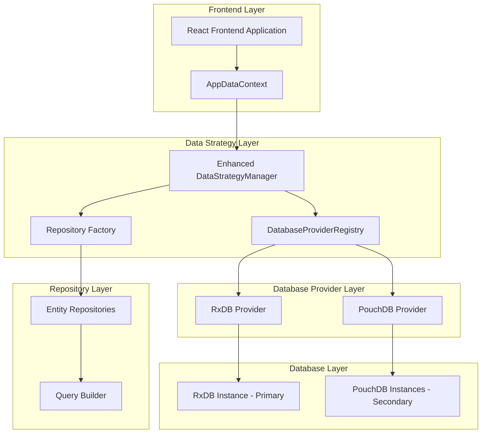

# Dual-Database Technical Architecture Document

## 1. Architecture Design



## 2. Technology Description

- **Frontend**: React@18 + TypeScript@5 + Vite
- **Primary Database**: RxDB@15 with Dexie storage
- **Secondary Database**: PouchDB@8 with IndexedDB adapter
- **State Management**: React Context + Custom hooks
- **Data Layer**: Enhanced repository pattern with provider abstraction
- **Build Tool**: Vite with TypeScript support
- **Testing**: Jest + React Testing Library

## 3. Route Definitions

| Route | Purpose |
|-------|----------|
| /dashboard | Main dashboard with real-time data from both databases |
| /academics/* | Academic module routes using secondary database |
| /administration/* | Administration routes using primary database |
| /settings | System settings using primary database |
| /reports | Reporting interface aggregating data from both databases |

## 4. API Definitions

### 4.1 Core Database Provider Interface

```typescript
interface IDatabaseProvider {
  readonly name: string;
  readonly isInitialized: boolean;
  
  initialize(): Promise<void>;
  isAvailable(): Promise<boolean>;
  getRepository<T>(entityName: string): IRepository<T>;
  transaction<R>(callback: (tx: ITransaction) => Promise<R>): Promise<R>;
  close(): Promise<void>;
  destroy(): Promise<void>;
}
```

### 4.2 Repository Interface

```typescript
interface IRepository<T> {
  // Basic CRUD operations
  findById(id: string): Promise<T | null>;
  findAll(criteria?: QueryCriteria): Promise<T[]>;
  findOne(criteria: QueryCriteria): Promise<T | null>;
  create(entity: Omit<T, 'id'>): Promise<T>;
  update(id: string, updates: Partial<T>): Promise<T>;
  upsert(entity: T): Promise<T>;
  delete(id: string): Promise<boolean>;
  deleteMany(criteria: QueryCriteria): Promise<number>;
  
  // Advanced operations
  count(criteria?: QueryCriteria): Promise<number>;
  exists(id: string): Promise<boolean>;
  paginate(criteria: QueryCriteria, page: number, limit: number): Promise<PaginatedResult<T>>;
  
  // Reactive operations
  watch(criteria?: QueryCriteria): Observable<T[]>;
  watchById(id: string): Observable<T | null>;
  
  // Batch operations
  createMany(entities: Omit<T, 'id'>[]): Promise<T[]>;
  updateMany(updates: Array<{id: string, data: Partial<T>}>): Promise<T[]>;
}
```

### 4.3 Query Builder Interface

```typescript
interface IQueryBuilder<T> {
  where(field: keyof T, operator: QueryOperator, value: any): IQueryBuilder<T>;
  whereIn(field: keyof T, values: any[]): IQueryBuilder<T>;
  whereNotIn(field: keyof T, values: any[]): IQueryBuilder<T>;
  whereBetween(field: keyof T, min: any, max: any): IQueryBuilder<T>;
  whereNull(field: keyof T): IQueryBuilder<T>;
  whereNotNull(field: keyof T): IQueryBuilder<T>;
  
  orderBy(field: keyof T, direction?: 'asc' | 'desc'): IQueryBuilder<T>;
  orderByDesc(field: keyof T): IQueryBuilder<T>;
  
  limit(count