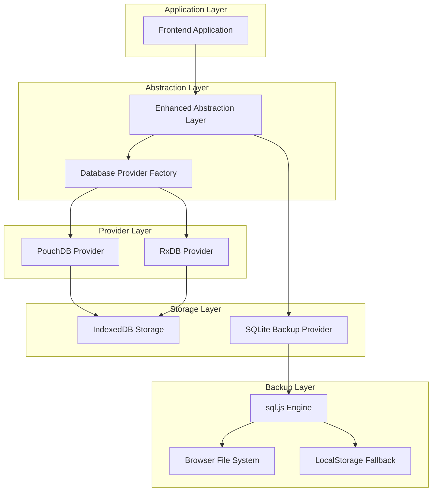

# Dual-Database Architecture: Complete Implementation Guide

## Executive Summary

This document provides a comprehensive overview of the Dual-Database Architecture implementation for SchoolPilot, featuring an Enhanced Abstraction layer that supports both PouchDB (immediate implementation) and RxDB (future implementation) with IndexedDB as primary storage and SQLite backup (replacing deprecated WebSQL). The system maintains all 88 collections without reduction while providing seamless provider switching, robust backup capabilities, and optimal performance.

## 1. Architecture Overview

### 1.1 System Architecture



### 1.2 Key Components

1. **Enhanced Abstraction Layer**: Unified interface for database operations
2. **Database Provider Factory**: Dynamic provider creation and management
3. **PouchDB Provider**: Immediate implementation with IndexedDB
4. **RxDB Provider**: Future implementation with advanced features
5. **SQLite Backup Provider**: Robust backup system using sql.js
6. **Collection Manager**: Handles all 88 collections without reduction
7. **Migration Engine**: Seamless data migration between providers

## 2. Technology Stack

### 2.1 Core Technologies

| Component | Technology | Version | Purpose |
|-----------|------------|---------|----------|
| Frontend Framework | React | 18+ | UI development |
| Language | TypeScript | 5+ | Type safety |
| Build Tool | Vite | 4+ | Development and build |
| Primary Database | PouchDB | 8.0+ | Immediate implementation |
| Future Database | RxDB | 15+ | Advanced features (with license) |
| Primary Storage | IndexedDB | Native | Browser storage |
| Backup Storage | SQLite | sql.js 1.8+ | Backup and export |
| Validation | Joi | 17+ | Schema validation |
| Reactive Programming | RxJS | 7+ | Real-time updates |
| Compression | pako | 2.1+ | Backup compression |
| Encryption | crypto-js | 4.1+ | Backup encryption |

### 2.2 Browser Compatibility

- **Chrome**: 61+ (IndexedDB, WebAssembly)
- **Firefox**: 60+ (IndexedDB, WebAssembly)
- **Safari**: 14+ (IndexedDB, WebAssembly)
- **Edge**: 79+ (IndexedDB, WebAssembly)

## 3. Collection Architecture

### 3.1 Collection Categories

The system supports all 88 collections organized into logical categories:

#### Core Collections (16)
- users, students, teachers, classes, subjects, grades
- attendance, assignments, exams, announcements
- parents, schools, academic_years, terms
- enrollments, timetables

#### Extended Collections (72)
- **Academics**: courses, curricula, lesson_plans, etc.
- **Administration**: staff, departments, policies, etc.
- **Finance**: fees, payments, budgets, etc.
- **HR**: employees, payroll, benefits, etc.
- **Inventory**: assets, supplies, maintenance, etc.
- **Library**: books, loans, reservations, etc.
- **Nutrition**: meals, menus, dietary_requirements, etc.
- **Communication**: messages, notifications, etc.

### 3.2 Schema Management

Each collection follows a standardized schema structure:

```typescript
interface CollectionSchema {
  version: number;
  type: 'object';
  properties: Record<string, SchemaProperty>;
  required?: string[];
  indexes?: IndexDefinition[];
  primaryKey?: string;
}
```

## 4. Implementation Strategy

### 4.1 Phased Implementation (12 Weeks)

#### Phase 1: Foundation (Weeks 1-2)
- Core interfaces implementation
- Database Provider Factory
- Basic collection management
- Configuration system

#### Phase 2: PouchDB Implementation (Weeks 3-5)
- PouchDB provider development
- All 88 collections support
- CRUD operations
- Reactive queries

#### Phase 3: SQLite Backup System (Weeks 6-7)
- SQLite backup provider
- Compression and encryption
- Backup management UI
- Migration from WebSQL

#### Phase 4: Enhanced Features (Weeks 8-9)
- Advanced querying
- Performance optimization
- Error handling
- Monitoring and analytics

#### Phase 5: RxDB Integration (Weeks 10-11)
- RxDB provider implementation
- Provider switching
- Data migration
- License validation

#### Phase 6: Testing and Deployment (Week 12)
- Comprehensive testing
- Performance benchmarking
- Documentation completion
- Production deployment

### 4.2 Development Priorities

1. **Immediate**: PouchDB provider with all collections
2. **Short-term**: SQLite backup system
3. **Medium-term**: RxDB provider integration
4. **Long-term**: Advanced features and optimizations

## 5. Key Features

### 5.1 Enhanced Abstraction Layer

- **Unified API**: Consistent interface across all providers
- **Provider Switching**: Seamless migration between PouchDB and RxDB
- **Collection Management**: Support for all 88 collections
- **Reactive Queries**: Real-time data updates
- **Transaction Support**: ACID compliance
- **Schema Validation**: Joi-based validation

### 5.2 SQLite Backup System

- **Browser-based SQLite**: Using sql.js WebAssembly
- **Compression**: pako-based compression for storage efficiency
- **Encryption**: Optional AES encryption for sensitive data
- **Auto-backup**: Configurable automatic backup intervals
- **Export/Import**: Full backup export and import capabilities
- **Cleanup**: Automatic old backup cleanup

### 5.3 Performance Optimizations

- **Lazy Loading**: Collections loaded on demand
- **Indexing Strategy**: Optimized indexes for common queries
- **Batch Operations**: Efficient bulk operations
- **Memory Management**: Proper subscription cleanup
- **Caching**: Intelligent query result caching

## 6. Configuration Management

### 6.1 Environment Configuration

```bash
# Database Configuration
VITE_DATABASE_PROVIDER=pouchdb
VITE_DATABASE_NAME=schoolpilot_db
VITE_DATABASE_AUTO_COMPACTION=true

# Storage Configuration
VITE_DATABASE_PRIMARY_STORAGE=indexeddb
VITE_DATABASE_BACKUP_STORAGE=sqlite
VITE_DATABASE_AUTO_BACKUP=true
VITE_DATABASE_BACKUP_INTERVAL=300000
VITE_DATABASE_BACKUP_RETENTION=10

# SQLite Backup Configuration
VITE_BACKUP_COMPRESSION=true
VITE_BACKUP_ENCRYPTION=false
VITE_BACKUP_MAX_BACKUPS=10
VITE_BACKUP_STORAGE_QUOTA=104857600

# Performance Configuration
VITE_DATABASE_BATCH_SIZE=100
VITE_DATABASE_CACHE_SIZE=50
VITE_DATABASE_SYNC_INTERVAL=30000

# Security Configuration
VITE_DATABASE_ENCRYPTION=false
VITE_DATABASE_AUDIT_LOGS=true

# RxDB Configuration (Future)
VITE_RXDB_LICENSE_KEY=your_license_key_here
VITE_RXDB_MULTI_INSTANCE=false
VITE_RXDB_EVENT_REDUCE=true
```

### 6.2 Runtime Configuration

The system supports dynamic configuration through:
- Environment variables
- LocalStorage preferences
- Runtime API calls
- Configuration files

## 7. Data Migration Strategy

### 7.1 Legacy System Migration

1. **Assessment**: Analyze existing RxDB implementation
2. **Data Extraction**: Export data from legacy collections
3. **Schema Mapping**: Map legacy schemas to new structure
4. **Data Transformation**: Convert data to new format
5. **Validation**: Ensure data integrity
6. **Import**: Load data into new system
7. **Verification**: Validate migration success

### 7.2 Provider Switching

```typescript
// Example provider switching with data preservation
async function switchProvider(newProvider: 'pouchdb' | 'rxdb', preserveData: boolean = true): Promise<void> {
  // 1. Create backup of current data
  const backup = await databaseService.backup();
  
  // 2. Initialize new provider
  await databaseService.switchProvider(newProvider);
  
  // 3. Restore data if requested
  if (preserveData) {
    await databaseService.restore(backup);
  }
  
  // 4. Verify migration
  const status = databaseService.getStatus();
  console.log(`Switched to ${status.currentProvider}`);
}
```

## 8. Security Considerations

### 8.1 Data Protection

- **Encryption**: Optional AES encryption for backups
- **Access Control**: Role-based access to collections
- **Audit Logging**: Track all database operations
- **Secure Storage**: Encrypted local storage options
- **Key Management**: Secure encryption key handling

### 8.2 Privacy Compliance

- **Data Minimization**: Store only necessary data
- **Right to Erasure**: Support for data deletion
- **Data Portability**: Export capabilities
- **Consent Management**: User consent tracking
- **Anonymization**: Data anonymization options

## 9. Performance Benchmarks

### 9.1 Target Performance Metrics

| Operation | Target Time | Acceptable Time |
|-----------|-------------|------------------|
| Database Initialization | < 2s | < 5s |
| Collection Creation | < 100ms | < 500ms |
| Single Document Insert | < 50ms | < 200ms |
| Bulk Insert (100 docs) | < 500ms | < 2s |
| Simple Query | < 100ms | < 500ms |
| Complex Query | < 500ms | < 2s |
| Backup Creation | < 10s | < 30s |
| Backup Restoration | < 15s | < 45s |
| Provider Switch | < 30s | < 60s |

### 9.2 Memory Usage Targets

- **Initial Load**: < 50MB
- **Per Collection**: < 5MB
- **Query Cache**: < 20MB
- **Backup Buffer**: < 100MB

## 10. Testing Strategy

### 10.1 Test Coverage

- **Unit Tests**: 90%+ coverage for core components
- **Integration Tests**: Provider switching and data migration
- **Performance Tests**: Benchmark all operations
- **End-to-End Tests**: Complete user workflows
- **Browser Tests**: Cross-browser compatibility

### 10.2 Test Categories

1. **Functional Tests**
   - CRUD operations
   - Query functionality
   - Schema validation
   - Error handling

2. **Performance Tests**
   - Load testing
   - Stress testing
   - Memory usage
   - Query optimization

3. **Integration Tests**
   - Provider switching
   - Data migration
   - Backup/restore
   - Cross-collection operations

4. **Security Tests**
   - Encryption validation
   - Access control
   - Data sanitization
   - Audit logging

## 11. Monitoring and Analytics

### 11.1 Performance Monitoring

```typescript
interface PerformanceMetrics {
  avgQueryTime: number;
  totalQueries: number;
  memoryUsage: number;
  errorRate: number;
  cacheHitRate: number;
  backupFrequency: number;
  lastUpdated: Date;
}
```

### 11.2 Health Checks

- **Database Connectivity**: Regular connection tests
- **Storage Availability**: Monitor storage quotas
- **Performance Degradation**: Track query times
- **Error Rates**: Monitor operation failures
- **Backup Status**: Verify backup integrity

## 12. Deployment Guide

### 12.1 Production Deployment

1. **Environment Setup**
   ```bash
   # Production environment variables
   NODE_ENV=production
   VITE_DATABASE_PROVIDER=pouchdb
   VITE_DATABASE_AUTO_BACKUP=true
   VITE_BACKUP_COMPRESSION=true
   VITE_BACKUP_ENCRYPTION=true
   ```

2. **Build Configuration**
   ```typescript
   // vite.config.ts for production
   export default defineConfig({
     build: {
       target: 'es2020',
       rollupOptions: {
         output: {
           manualChunks: {
             database: ['pouchdb', 'sql.js'],
             vendor: ['react', 'rxjs']
           }
         }
       }
     }
   });
   ```

3. **CDN Configuration**
   - Host sql.js files on CDN
   - Configure CORS headers
   - Enable compression
   - Set up caching policies

### 12.2 Staging Environment

- **Data Seeding**: Populate with test data
- **Performance Testing**: Load testing with realistic data
- **User Acceptance Testing**: End-user validation
- **Security Testing**: Penetration testing

## 13. Maintenance and Support

### 13.1 Regular Maintenance

- **Backup Verification**: Weekly backup integrity checks
- **Performance Monitoring**: Daily performance reviews
- **Security Updates**: Monthly security patches
- **Data Cleanup**: Quarterly data archiving

### 13.2 Troubleshooting Guide

#### Common Issues

1. **Provider Initialization Failure**
   ```typescript
   // Check provider availability
   const available = DatabaseProviderFactory.getAvailableProviders();
   console.log('Available providers:', available);
   ```

2. **Collection Not Found**
   ```typescript
   // Verify collection registration
   const collections = databaseService.getAvailableCollections();
   console.log('Registered collections:', collections);
   ```

3. **Backup Failures**
   ```typescript
   // Check backup provider status
   const stats = databaseService.getBackupStats();
   console.log('Backup status:', stats);
   ```

## 14. Future Roadmap

### 14.1 Short-term Enhancements (3-6 months)

- **Advanced Querying**: GraphQL-like query capabilities
- **Real-time Sync**: Multi-device synchronization
- **Offline Optimization**: Enhanced offline capabilities
- **Performance Tuning**: Query optimization and caching

### 14.2 Medium-term Features (6-12 months)

- **Cloud Integration**: Optional cloud backup
- **Multi-tenant Support**: School district deployments
- **Advanced Analytics**: Built-in reporting engine
- **Mobile Optimization**: React Native support

### 14.3 Long-term Vision (12+ months)

- **AI Integration**: Intelligent data insights
- **Blockchain Support**: Immutable audit trails
- **Edge Computing**: Distributed database nodes
- **Advanced Security**: Zero-trust architecture

## 15. Success Metrics

### 15.1 Technical Metrics

- **Performance**: 95% of operations under target times
- **Reliability**: 99.9% uptime
- **Data Integrity**: Zero data loss incidents
- **Security**: Zero security breaches
- **Compatibility**: 100% browser support

### 15.2 Business Metrics

- **User Adoption**: 90% user satisfaction
- **Development Velocity**: 50% faster feature delivery
- **Maintenance Cost**: 30% reduction in support tickets
- **Scalability**: Support for 10,000+ concurrent users
- **Data Growth**: Handle 100GB+ databases

## 16. Conclusion

The Dual-Database Architecture with Enhanced Abstraction layer provides a robust, scalable, and future-proof solution for SchoolPilot's data management needs. By supporting both PouchDB and RxDB through a unified interface, implementing SQLite backup capabilities, and maintaining all 88 collections without reduction, the system ensures optimal performance, data integrity, and developer productivity.

The phased implementation approach minimizes risk while delivering immediate value through PouchDB support, with a clear path to advanced RxDB features. The comprehensive backup system using SQLite replaces deprecated WebSQL technology while providing enhanced security and reliability.

This architecture positions SchoolPilot for continued growth and evolution, supporting current requirements while enabling future enhancements and integrations.

---

**Document Version**: 1.0  
**Last Updated**: January 2025  
**Next Review**: March 2025  
**Maintained By**: SchoolPilot Development Team