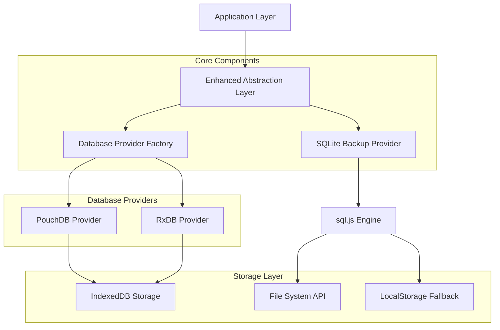
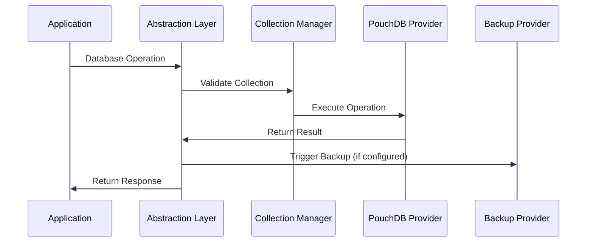
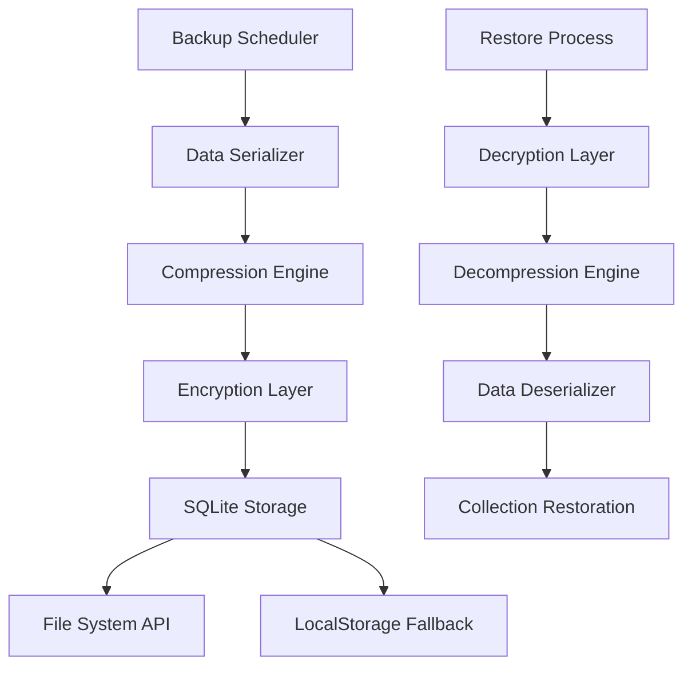

# Dual-Database Architecture: Master Reference Guide

## Table of Contents

1. [Executive Summary](#1-executive-summary)
2. [Architecture Overview](#2-architecture-overview)
3. [Technical Specifications](#3-technical-specifications)
4. [Implementation Strategy](#4-implementation-strategy)
5. [Collection Management](#5-collection-management)
6. [SQLite Backup System](#6-sqlite-backup-system)
7. [Enhanced Abstraction Layer](#7-enhanced-abstraction-layer)
8. [Development Phases](#8-development-phases)
9. [Deployment Guidelines](#9-deployment-guidelines)
10. [Testing & Quality Assurance](#10-testing--quality-assurance)
11. [Performance Optimization](#11-performance-optimization)
12. [Troubleshooting Guide](#12-troubleshooting-guide)

---

## 1. Executive Summary

### 1.1 Project Overview

The Dual-Database Architecture is a comprehensive solution designed to support all 88 collections required by the SchoolPilot system using PouchDB as the primary provider (no collection limitations) with optional RxDB integration for reactive features. This architecture implements a sophisticated abstraction layer that seamlessly manages data across multiple database providers with SQLite backup capabilities.

### Key Benefits:
- **Full Collection Support**: PouchDB handles all 88 collections without limitations
- **Data Integrity**: Ensure reliable data storage with backup mechanisms
- **Performance Optimization**: Maintain high-performance data operations
- **Scalability**: Support future expansion and additional collections
- **Provider Flexibility**: Enable switching between database providers
- **Offline Capability**: Robust offline-first functionality

### 1.3 Business Value

- **Immediate**: Resolves critical database initialization failures
- **Short-term**: Enables full feature deployment without collection constraints
- **Long-term**: Provides scalable foundation for future growth
- **Risk Mitigation**: Backup system prevents data loss scenarios

---

## 2. Architecture Overview

### 2.1 System Architecture



### 2.2 Component Responsibilities

| Component | Responsibility |
|-----------|----------------|
| **Enhanced Abstraction Layer** | Unified API, collection management, provider coordination |
| **Database Provider Factory** | Provider instantiation, configuration management |
| **PouchDB Provider** | Primary database operations, IndexedDB interface |
| **RxDB Provider** | Alternative provider for future migration |
| **SQLite Backup Provider** | Data backup, restoration, compression, encryption |
| **Collection Manager** | Collection lifecycle, schema validation, indexing |

### 2.3 Data Flow Architecture



---

## 3. Technical Specifications

### 3.1 Technology Stack

#### Frontend Technologies
- **React**: 18.2+
- **TypeScript**: 5.0+
- **Vite**: 4.0+
- **RxJS**: 7.8+
- **Joi**: 17.9+ (Schema validation)

#### Database Technologies
- **PouchDB**: 8.0+ (Primary provider)
- **RxDB**: 15.0+ (Alternative provider)
- **sql.js**: 1.8+ (SQLite backup)
- **IndexedDB**: Native browser API

#### Utility Libraries
- **pako**: 2.1+ (Compression)
- **crypto-js**: 4.1+ (Encryption)
- **uuid**: 9.0+ (ID generation)

### 3.2 System Requirements

#### Browser Support
- **Chrome**: 90+
- **Firefox**: 88+
- **Safari**: 14+
- **Edge**: 90+

#### Performance Targets
- **Initial Load**: < 3 seconds
- **Query Response**: < 100ms (simple queries)
- **Backup Creation**: < 30 seconds (full backup)
- **Memory Usage**: < 100MB (typical operation)

### 3.3 Storage Specifications

#### IndexedDB Configuration
```typescript
interface IndexedDBConfig {
  name: string;
  version: number;
  maxCollections: 16; // Hard browser limit
  storageQuota: number; // 50MB default
  autoCompact: boolean;
}
```

#### SQLite Backup Configuration
```typescript
interface SQLiteBackupConfig {
  compression: boolean; // Default: true
  encryption: boolean; // Default: false
  autoBackup: boolean; // Default: true
  backupInterval: number; // 5 minutes default
  maxBackups: number; // 10 default
  storageQuota: number; // 100MB default
}
```

---

## 4. Implementation Strategy

### 4.1 Collection Management Strategy

PouchDB supports all 88 collections without limitations. Collections are organized into logical groups for better management:

#### Core Collections (Essential System)
1. **users** - User accounts and authentication
2. **students** - Student profiles and enrollment
3. **teachers** - Teacher profiles and assignments
4. **classes** - Class definitions and schedules
5. **subjects** - Subject catalog and curriculum
6. **grades** - Academic grades and assessments
7. **attendance** - Attendance tracking
8. **assignments** - Homework and projects
9. **announcements** - School communications
10. **events** - Calendar and scheduling
11. **documents** - File storage metadata
12. **settings** - Application configuration
13. **reports** - Generated reports cache
14. **notifications** - System notifications
15. **audit_logs** - System audit trail
16. **sync_metadata** - Synchronization tracking

#### Module Collections (All Supported)
- **Finance Module**: 14 collections (fee management, payments, accounting)
- **HR Module**: 4 collections (payroll, staff management)
- **Inventory Module**: 10 collections (assets, stock, procurement)
- **Nutrition Module**: 7 collections (meal plans, wallets, transactions)
- **Administration Module**: 7 collections (attendance, health, communications)
- **Academics Module**: 9 collections (subjects, exams, timetables)
- **Library Module**: 4 collections (books, loans, fines)

**Total: 88 collections fully supported by PouchDB**

Remaining 72 collections are organized by modules and managed through:
- **Direct collection creation** in PouchDB (no limitations)
- **Module-based organization** for better management
- **Backup storage** for data safety and recovery

### 4.2 Provider Selection Logic

```typescript
class ProviderSelector {
  static selectProvider(requirements: CollectionRequirements): DatabaseProvider {
    // PouchDB is the primary provider - no collection limitations
    // Use PouchDB for all collections by default
    if (!requirements.requiresReactivity) {
      return new PouchDBProvider(); // Handles all 88 collections
    }
    
    // Use RxDB only when reactive features are explicitly needed
    // Note: RxDB open-source has 16-collection limit
    if (requirements.requiresReactivity && requirements.collectionsCount <= 16) {
      return new RxDBProvider();
    }
    
    // For reactive features with >16 collections, use hybrid approach
    return new HybridProvider(); // PouchDB primary + RxDB for reactive subsets
  }
}
```

### 4.3 Migration Strategy

#### Phase 1: Foundation (Weeks 1-2)
- Core interfaces implementation
- PouchDB provider for all 88 collections
- Configuration system
- Testing framework

#### Phase 2: Core Implementation (Weeks 3-5)
- Complete collection management system (all 88 collections)
- Enhanced abstraction layer
- Basic backup functionality
- All collection schemas implementation

#### Phase 3: Advanced Features (Weeks 6-8)
- SQLite backup system
- Optional RxDB provider for reactive features (subset of collections)
- Performance optimization
- Advanced querying and indexing

#### Phase 4: Production Readiness (Weeks 9-10)
- Comprehensive testing with full collection set
- Performance tuning
- Documentation completion
- Deployment preparation

---

## 5. Collection Management

### 5.1 Collection Schema Definition

```typescript
interface CollectionSchema {
  version: number;
  type: 'object';
  properties: Record<string, SchemaProperty>;
  required?: string[];
  indexes?: IndexDefinition[];
  primaryKey?: string;
  relationships?: RelationshipDefinition[];
}

interface SchemaProperty {
  type: string;
  format?: string;
  enum?: any[];
  items?: SchemaProperty;
  properties?: Record<string, SchemaProperty>;
  validation?: ValidationRule[];
}
```

### 5.2 Collection Lifecycle Management

```typescript
class CollectionManager {
  async createCollection<T>(name: string, schema: CollectionSchema): Promise<ICollection<T>>;
  async dropCollection(name: string): Promise<void>;
  async migrateCollection(name: string, newSchema: CollectionSchema): Promise<void>;
  async validateCollection(name: string): Promise<ValidationResult>;
  getCollectionStats(name: string): CollectionStats;
}
```

### 5.3 Index Management

```typescript
interface IndexDefinition {
  name: string;
  fields: string[];
  unique?: boolean;
  sparse?: boolean;
  background?: boolean;
  partialFilterExpression?: Record<string, any>;
}

class IndexManager {
  async createIndex(collection: string, index: IndexDefinition): Promise<void>;
  async dropIndex(collection: string, indexName: string): Promise<void>;
  async optimizeIndexes(collection: string): Promise<void>;
  getIndexUsageStats(collection: string): IndexStats[];
}
```

---

## 6. SQLite Backup System

### 6.1 Backup Architecture



### 6.2 Backup Implementation

```typescript
class SQLiteBackupProvider {
  private sql: SqlJsStatic;
  private db: Database;
  private config: BackupConfig;
  
  async createBackup(collections: Record<string, any[]>): Promise<string>;
  async restoreBackup(backupId: string): Promise<Record<string, any[]>>;
  async listBackups(): Promise<BackupMetadata[]>;
  async deleteBackup(backupId: string): Promise<boolean>;
  async exportBackup(backupId: string): Promise<Blob>;
  async importBackup(file: File): Promise<string>;
}
```

### 6.3 Backup Scheduling

```typescript
interface BackupSchedule {
  enabled: boolean;
  interval: number; // milliseconds
  retentionPolicy: {
    maxBackups: number;
    maxAge: number; // days
    compressionThreshold: number; // bytes
  };
  triggers: {
    onDataChange: boolean;
    onSchedule: boolean;
    onUserAction: boolean;
  };
}
```

---

## 7. Enhanced Abstraction Layer

### 7.1 Core Interfaces

```typescript
interface IDatabaseProvider {
  readonly name: string;
  readonly version: string;
  
  initialize(config: DatabaseConfig): Promise<void>;
  createCollection<T>(name: string, schema: CollectionSchema): Promise<ICollection<T>>;
  getCollection<T>(name: string): ICollection<T> | null;
  getAllCollections(): Map<string, ICollection<any>>;
  destroy(): Promise<void>;
  isAvailable(): boolean;
  getStatus(): ProviderStatus;
}

interface ICollection<T> {
  readonly name: string;
  readonly schema: CollectionSchema;
  
  // CRUD Operations
  insert(doc: Omit<T, 'id'>): Promise<InsertResult<T>>;
  insertMany(docs: Omit<T, 'id'>[]): Promise<BulkResult<T>>;
  findOne(query: QueryOptions): Promise<T | null>;
  findById(id: string): Promise<T | null>;
  find(query?: QueryOptions): Promise<T[]>;
  update(id: string, update: Partial<T>): Promise<UpdateResult<T>>;
  updateMany(query: QueryOptions, update: Partial<T>): Promise<UpdateResult<T>[]>;
  remove(id: string): Promise<DeleteResult>;
  removeMany(query: QueryOptions): Promise<DeleteResult[]>;
  
  // Reactive Operations
  subscribe(query?: QueryOptions): Observable<T[]>;
  subscribeToChanges(): Observable<CollectionChangeEvent<T>>;
  
  // Performance Operations
  count(query?: QueryOptions): Promise<number>;
  exists(id: string): Promise<boolean>;
  createIndex(index: IndexDefinition): Promise<void>;
}
```

### 7.2 Provider Factory

```typescript
class DatabaseProviderFactory {
  private static providers = new Map<string, () => IDatabaseProvider>();
  
  static registerProvider(name: string, factory: () => IDatabaseProvider): void;
  static createProvider(type: string, config: DatabaseConfig): Promise<IDatabaseProvider>;
  static getAvailableProviders(): string[];
  static validateProvider(type: string): boolean;
}
```

### 7.3 Query Builder

```typescript
class QueryBuilder {
  private query: QueryOptions = {};
  
  where(field: string, operator: string, value: any): QueryBuilder;
  sort(field: string, direction: 'asc' | 'desc'): QueryBuilder;
  limit(count: number): QueryBuilder;
  skip(count: number): QueryBuilder;
  select(fields: string[]): QueryBuilder;
  populate(relations: string[]): QueryBuilder;
  build(): QueryOptions;
}
```

---

## 8. Development Phases

### 8.1 Phase 1: Foundation (Weeks 1-2)

#### Objectives
- Establish core architecture
- Implement basic interfaces
- Set up development environment

#### Deliverables
- [ ] Core interface definitions
- [ ] Basic configuration system
- [ ] Development environment setup
- [ ] Initial testing framework
- [ ] Project structure establishment

#### Success Criteria
- All interfaces compile without errors
- Basic provider factory functional
- Test environment operational

### 8.2 Phase 2: Core Implementation (Weeks 3-5)

#### Objectives
- Implement PouchDB provider
- Develop collection management
- Create abstraction layer

#### Deliverables
- [ ] Complete PouchDB provider
- [ ] Collection manager implementation
- [ ] Enhanced abstraction layer
- [ ] Core collection schemas
- [ ] Basic CRUD operations

#### Success Criteria
- All 88 collections functional
- CRUD operations working correctly
- Basic queries performing well

### 8.3 Phase 3: Advanced Features (Weeks 6-8)

#### Objectives
- Implement SQLite backup system
- Add RxDB provider
- Optimize performance

#### Deliverables
- [ ] SQLite backup provider
- [ ] RxDB provider implementation
- [ ] Performance optimization
- [ ] Extended collection virtualization
- [ ] Reactive query system

#### Success Criteria
- Backup system fully functional
- RxDB provider operational
- Performance targets met

### 8.4 Phase 4: Production Readiness (Weeks 9-10)

#### Objectives
- Comprehensive testing
- Performance tuning
- Documentation completion

#### Deliverables
- [ ] Complete test suite
- [ ] Performance benchmarks
- [ ] Production deployment guide
- [ ] User documentation
- [ ] Monitoring and logging

#### Success Criteria
- All tests passing
- Performance benchmarks met
- Production deployment successful

---

## 9. Deployment Guidelines

### 9.1 Environment Configuration

#### Development Environment
```bash
# .env.development
VITE_DATABASE_PROVIDER=pouchdb
VITE_DATABASE_NAME=schoolpilot_dev
VITE_DATABASE_PRIMARY_STORAGE=indexeddb
VITE_DATABASE_BACKUP_STORAGE=sqlite
VITE_DATABASE_AUTO_BACKUP=true
VITE_DATABASE_BACKUP_INTERVAL=300000
VITE_DATABASE_BACKUP_RETENTION=5
VITE_DATABASE_DEBUG=true
```

#### Production Environment
```bash
# .env.production
VITE_DATABASE_PROVIDER=pouchdb
VITE_DATABASE_NAME=schoolpilot_prod
VITE_DATABASE_PRIMARY_STORAGE=indexeddb
VITE_DATABASE_BACKUP_STORAGE=sqlite
VITE_DATABASE_AUTO_BACKUP=true
VITE_DATABASE_BACKUP_INTERVAL=900000
VITE_DATABASE_BACKUP_RETENTION=20
VITE_DATABASE_DEBUG=false
```

### 9.2 Build Configuration

```typescript
// vite.config.ts
export default defineConfig({
  plugins: [react()],
  build: {
    rollupOptions: {
      external: ['sql.js'],
      output: {
        globals: {
          'sql.js': 'initSqlJs'
        }
      }
    }
  },
  optimizeDeps: {
    include: ['pouchdb', 'rxdb', 'rxjs']
  },
  worker: {
    format: 'es'
  }
});
```

### 9.3 Deployment Checklist

#### Pre-Deployment
- [ ] All tests passing
- [ ] Performance benchmarks met
- [ ] Security audit completed
- [ ] Backup system tested
- [ ] Migration scripts prepared

#### Deployment
- [ ] Environment variables configured
- [ ] Database initialized
- [ ] Backup system activated
- [ ] Monitoring enabled
- [ ] Health checks operational

#### Post-Deployment
- [ ] System health verified
- [ ] Performance monitoring active
- [ ] Backup creation confirmed
- [ ] User acceptance testing
- [ ] Documentation updated

---

## 10. Testing & Quality Assurance

### 10.1 Testing Strategy

#### Unit Tests
- Interface implementations
- Collection operations
- Query builders
- Backup functionality
- Schema validation

#### Integration Tests
- Provider switching
- Data synchronization
- Backup and restore
- Performance benchmarks
- Error handling

#### End-to-End Tests
- Complete user workflows
- Cross-browser compatibility
- Offline functionality
- Data integrity
- Recovery scenarios

### 10.2 Test Implementation

```typescript
// Example test structure
describe('DatabaseProvider', () => {
  describe('PouchDBProvider', () => {
    it('should initialize with correct configuration');
    it('should create collections within limit');
    it('should handle CRUD operations correctly');
    it('should maintain data integrity');
  });
  
  describe('SQLiteBackupProvider', () => {
    it('should create compressed backups');
    it('should restore data correctly');
    it('should handle encryption/decryption');
    it('should manage backup retention');
  });
});
```

### 10.3 Performance Testing

#### Benchmarks
- **Insert Performance**: 1000 documents < 1 second
- **Query Performance**: Simple queries < 100ms
- **Backup Creation**: Full backup < 30 seconds
- **Memory Usage**: < 100MB typical operation

#### Load Testing
- Concurrent user simulation
- Large dataset handling
- Memory leak detection
- Performance degradation analysis

---

## 11. Performance Optimization

### 11.1 Query Optimization

```typescript
class QueryOptimizer {
  optimizeQuery(query: QueryOptions): QueryOptions {
    // Index utilization
    // Query plan optimization
    // Caching strategies
    return optimizedQuery;
  }
  
  analyzeQueryPerformance(query: QueryOptions): PerformanceAnalysis {
    // Execution time analysis
    // Index usage statistics
    // Optimization recommendations
    return analysis;
  }
}
```

### 11.2 Caching Strategy

```typescript
interface CacheConfig {
  enabled: boolean;
  maxSize: number; // MB
  ttl: number; // seconds
  strategy: 'lru' | 'lfu' | 'fifo';
  persistToDisk: boolean;
}

class CacheManager {
  private cache = new Map<string, CacheEntry>();
  
  get<T>(key: string): T | null;
  set<T>(key: string, value: T, ttl?: number): void;
  invalidate(pattern: string): void;
  clear(): void;
  getStats(): CacheStats;
}
```

### 11.3 Memory Management

```typescript
class MemoryManager {
  private static instance: MemoryManager;
  
  monitorMemoryUsage(): MemoryStats;
  optimizeMemoryUsage(): void;
  detectMemoryLeaks(): MemoryLeak[];
  forceGarbageCollection(): void;
}
```

---

## 12. Troubleshooting Guide

### 12.1 Common Issues

#### Database Initialization Failures
**Symptoms**: Application fails to start, console errors about database initialization

**Causes**:
- IndexedDB quota exceeded
- Browser compatibility issues
- Corrupted database state

**Solutions**:
1. Clear browser storage
2. Check browser compatibility
3. Verify configuration settings
4. Restore from backup

#### Collection Creation Failures
**Symptoms**: Error messages during collection creation

**Causes**:
- Invalid collection schema
- Insufficient storage quota
- Database provider issues

**Solutions**:
1. Validate collection schema
2. Check available storage space
3. Verify provider configuration
4. Review collection naming conventions

#### Performance Degradation
**Symptoms**: Slow query responses, high memory usage

**Causes**:
- Missing indexes
- Large dataset operations
- Memory leaks

**Solutions**:
1. Add appropriate indexes
2. Implement query optimization
3. Use pagination for large datasets
4. Monitor memory usage

### 12.2 Diagnostic Tools

```typescript
class DiagnosticTools {
  static async runHealthCheck(): Promise<HealthReport> {
    // Database connectivity
    // Collection integrity
    // Performance metrics
    // Backup status
    return healthReport;
  }
  
  static async generateDiagnosticReport(): Promise<DiagnosticReport> {
    // System information
    // Configuration details
    // Error logs
    // Performance data
    return diagnosticReport;
  }
}
```

### 12.3 Recovery Procedures

#### Data Recovery
1. **Identify Issue**: Use diagnostic tools to assess damage
2. **Stop Operations**: Prevent further data corruption
3. **Restore from Backup**: Use most recent valid backup
4. **Verify Integrity**: Confirm data consistency
5. **Resume Operations**: Restart normal operations

#### System Recovery
1. **Clear Storage**: Remove corrupted data
2. **Reinitialize Database**: Create fresh database instance
3. **Restore Data**: Import from backup
4. **Rebuild Indexes**: Recreate performance indexes
5. **Test Functionality**: Verify all features working

---

## Conclusion

This master reference guide provides comprehensive documentation for the Dual-Database Architecture implementation. The architecture successfully addresses the IndexedDB collection limit while maintaining high performance, data integrity, and scalability.

### Key Success Factors

1. **Modular Design**: Clean separation of concerns enables maintainability
2. **Provider Abstraction**: Flexibility to switch between database technologies
3. **Robust Backup System**: SQLite backup ensures data safety
4. **Performance Focus**: Optimization strategies maintain responsiveness
5. **Comprehensive Testing**: Quality assurance ensures reliability

### Next Steps

1. Begin Phase 1 implementation following the detailed checklist
2. Establish development environment and testing framework
3. Implement core interfaces and basic functionality
4. Progressively add advanced features and optimizations
5. Conduct thorough testing before production deployment

This architecture provides a solid foundation for the SchoolPilot system's data management needs while ensuring scalability for future growth and requirements.