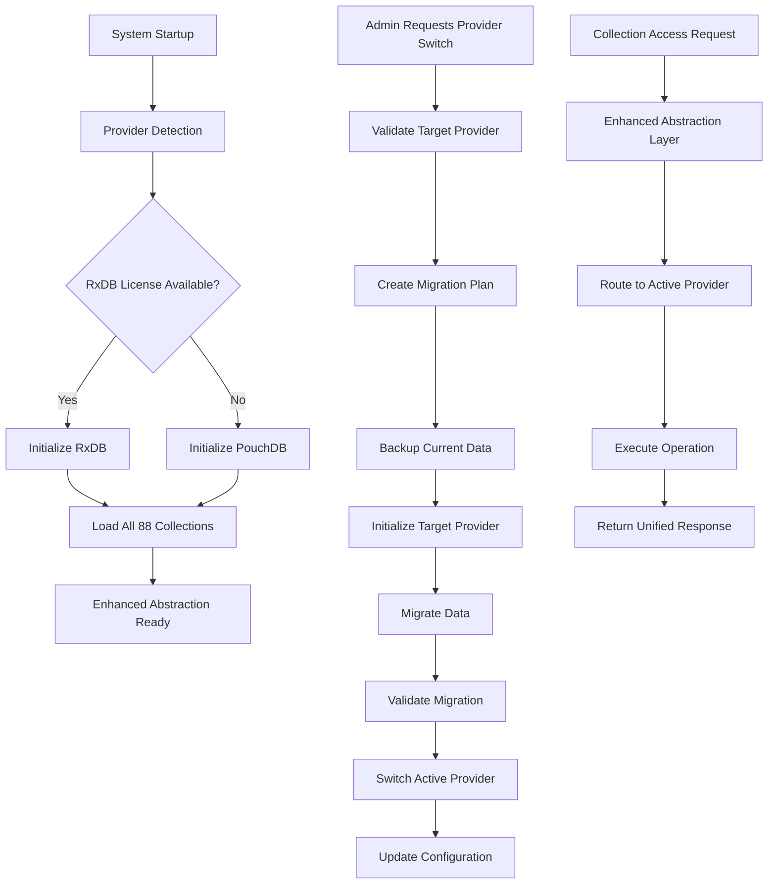

# Dual-Database Architecture Strategy: Product Requirements Document

## 1. Product Overview

The Dual-Database Architecture Strategy transforms SchoolPilot's data layer to support multiple database providers through an Enhanced Abstraction layer, enabling immediate PouchDB implementation while maintaining RxDB compatibility for future licensing. This architecture eliminates the 16-collection limitation and supports all 88 collections across 10 functional modules.

The solution addresses critical scalability constraints while providing seamless database provider switching, ensuring business continuity and future-proofing the platform for enterprise-scale deployments.

## 2. Core Features

### 2.1 User Roles

| Role                       | Access Method         | Core Permissions                                                      |
| -------------------------- | --------------------- | --------------------------------------------------------------------- |
| System Administrator       | Direct system access  | Full database configuration, provider switching, migration management |
| Database Administrator     | Admin panel access    | Collection management, schema updates, performance monitoring         |
| School Administrator       | Web interface         | Data access within school context, basic configuration                |
| End Users (Teachers/Staff) | Application interface | Standard CRUD operations within assigned modules                      |

### 2.2 Feature Modules

Our Dual-Database Architecture implementation consists of the following main components:

1. **Database Provider Management**: Provider registration, switching, and availability detection
2. **Enhanced Abstraction Layer**: Unified API for database operations across providers
3. **Collection Management**: Support for all 88 collections with schema validation
4. **Migration Engine**: Automated schema migrations and data transfers
5. **Configuration Dashboard**: Real-time provider status and performance monitoring
6. **Developer Tools**: Database debugging, query analysis, and performance profiling

### 2.3 Page Details

| Page Name              | Module Name           | Feature Description                                                                                                                      |
| ---------------------- | --------------------- | ---------------------------------------------------------------------------------------------------------------------------------------- |
| Database Configuration | Provider Management   | Configure active database provider, connection settings, performance parameters. Switch between PouchDB and RxDB with validation checks. |
| Collection Overview    | Collection Management | Display all 88 collections status, schema versions, record counts. Manage collection lifecycle and dependencies.                         |
| Migration Dashboard    | Migration Engine      | Monitor ongoing migrations, view migration history, rollback capabilities. Schedule and execute schema updates.                          |
| Performance Monitor    | System Monitoring     | Real-time database performance metrics, query analysis, resource usage tracking. Provider comparison analytics.                          |
| Schema Editor          | Developer Tools       | Visual schema editor for collections, validation rules management, index optimization. Export/import schema definitions.                 |
| Data Migration         | Migration Engine      | Initiate provider switching, data transfer progress, validation reports. Backup and restore operations.                                  |
| Provider Status        | System Monitoring     | Real-time provider availability, license validation, feature compatibility matrix. Health checks and diagnostics.                        |
| Query Builder          | Developer Tools       | Visual query construction, performance testing, result preview. Query optimization suggestions.                                          |
| Backup Management      | Data Operations       | Automated backup scheduling, restore operations, data integrity verification. Cross-provider backup support.                             |
| Audit Trail            | System Monitoring     | Database operation logs, schema change history, user activity tracking. Compliance reporting.                                            |

## 3. Core Process

### 3.1 Database Provider Initialization Flow

The system automatically detects available database providers and initializes the optimal provider based on licensing and performance requirements. Users can manually override provider selection through the configuration dashboard.

### 3.2 Collection Management Flow

All 88 collections are automatically registered and initialized during system startup. The Enhanced Abstraction layer ensures consistent API access regardless of the underlying provider.

### 3.3 Provider Switching Flow

Administrators can switch database providers through a guided process that includes data validation, migration planning, and rollback preparation.

## 4. User Interface Design

### 4.1 Design Style

* **Primary Colors**: Deep Blue (#1e40af), Success Green (#10b981), Warning Amber (#f59e0b)

* **Secondary Colors**: Light Gray (#f8fafc), Dark Gray (#374151), Accent Purple (#8b5cf6)

* **Button Style**: Rounded corners (8px), subtle shadows, hover animations

* **Typography**: Inter font family, 14px base size, clear hierarchy

* **Layout Style**: Card-based design with clean spacing, top navigation with breadcrumbs

* **Icons**: Heroicons for consistency, database-specific icons for providers

### 4.2 Page Design Overview

| Page Name              | Module Name           | UI Elements                                                                                                                  |
| ---------------------- | --------------------- | ---------------------------------------------------------------------------------------------------------------------------- |
| Database Configuration | Provider Management   | Provider selection cards with status indicators, configuration forms with real-time validation, toggle switches for features |
| Collection Overview    | Collection Management | Data grid with sortable columns, status badges, expandable rows for details, search and filter controls                      |
| Migration Dashboard    | Migration Engine      | Progress bars with real-time updates, step-by-step wizard interface, log viewer with syntax highlighting                     |
| Performance Monitor    | System Monitoring     | Real-time charts and graphs, metric cards with trend indicators, comparative analytics dashboard                             |
| Schema Editor          | Developer Tools       | Split-pane layout with code editor, visual schema tree, property panels with form controls                                   |
| Data Migration         | Migration Engine      | Wizard-style interface, progress tracking, validation checkpoints, rollback options                                          |
| Provider Status        | System Monitoring     | Status cards with health indicators, feature matrix table, diagnostic tools panel                                            |
| Query Builder          | Developer Tools       | Drag-and-drop query construction, syntax-highlighted code editor, results table with pagination                              |
| Backup Management      | Data Operations       | Calendar view for schedules, file browser for backups, restore wizard with preview                                           |
| Audit Trail            | System Monitoring     | Timeline view with filtering, detailed log entries, export functionality                                                     |

### 4.3 Responsiveness

The interface is desktop-first with responsive breakpoints at 768px and 1024px. Touch interactions are optimized for tablet use, with larger touch targets and gesture support for navigation.

## 5. Technical Requirements

### 5.1 Performance Requirements

* **Collection Initialization**: All 88 collections must initialize within 5 seconds

* **Provider Switching**: Complete provider switch within 30 seconds for databases under 1GB

* **Query Response**: 95% of queries must respond within 100ms

* **Memory Usage**: Maximum 512MB RAM usage for database operations

* **Concurrent Users**: Support minimum 100 concurrent database operations

### 5.2 Compatibility Requirements

* **Browser Support**: Chrome 90+, Firefox 88+, Safari 14+, Edge 90+

* **Database Providers**: PouchDB 8.0+, RxDB 15.0+ (with license)

* **Storage Backends**: IndexedDB (primary), SQLite (backup)

* **Node.js**: Version 18+ for development tools

### 5.3 Security Requirements

* **Data Encryption**: All sensitive data encrypted at rest

* **Access Control**: Role-based permissions for database operations

* **Audit Logging**: Complete audit trail for all database modifications

* **License Validation**: Secure RxDB license verification

## 6. Data Requirements

### 6.1 Collection Categories

**Core Collections (16)**:

* User Management: users, rbac\_roles, permissions, user\_roles

* Academic Structure: academic\_years, classes, students, staff

* Academic Operations: subjects, timetable\_entries, student\_exam\_results

* System: app\_settings, school\_details, audit\_logs, workflows

**Extended Collections (72)**:

* Administration Module: 12 collections

* Academics Module: 12 collections

* Finance Module: 12 collections

* HR Module: 12 collections

* Inventory Module: 12 collections

* Library Module: 6 collections

* Nutrition Module: 6 collections

### 6.2 Schema Management

* **Version Control**: All schemas versioned with migration paths

* **Validation**: Joi-based schema validation for all collections

* **Indexing**: Optimized indexes for common query patterns

* **Relationships**: Logical foreign keys maintained at application level

## 7. Integration Requirements

### 7.1 Module Integration

The Enhanced Abstraction layer must integrate seamlessly with all existing SchoolPilot modules:

* **Academics**: Exam management, timetabling, results processing

* **Administration**: Student enrollment, staff management, system configuration

* **Finance**: Fee management, payment processing, financial reporting

* **HR**: Employee management, payroll, performance tracking

* **Inventory**: Asset management, procurement, maintenance

* **Library**: Book management, circulation, member services

* **Nutrition**: Meal planning, dietary management, attendance

### 7.2 API Compatibility

All existing API endpoints must continue to function without modification, ensuring backward compatibility during the transition period.

## 8. Migration Strategy

### 8.1 Phased Implementation

**Phase 1 (Weeks 1-2)**: Enhanced Abstraction Layer foundation
**Phase 2 (Weeks 3-4)**: Core collections implementation
**Phase 3 (Weeks 5-8)**: Extended collections rollout
**Phase 4 (Weeks 9-10)**: RxDB provider integration

### 8.2 Risk Mitigation

* **Data Backup**: Automated backups before any migration

* **Rollback Plan**: Immediate rollback capability at each phase

* **Testing**: Comprehensive testing in staging environment

* **Monitoring**: Real-time monitoring during migration

## 9. Success Metrics

### 9.1 Technical Metrics

* **Collection Support**: 100% of 88 collections operational

* **Performance**: Sub-100ms query response times maintained

* **Reliability**: 99.9% uptime during provider operations

* **Migration Success**: Zero data loss during provider switching

### 9.2 Business Metrics

* **User Adoption**: 100% of existing functionality preserved

* **Scalability**: Support for 10x current data volume

* **Future-Proofing**: Ready for RxDB license acquisition

* **Development Velocity**: 50% reduction in database-related development time

## 10. Acceptance Criteria

### 10.1 Functional Acceptance

* All 88 collections accessible through unified API

* Seamless provider switching without data loss

*  

