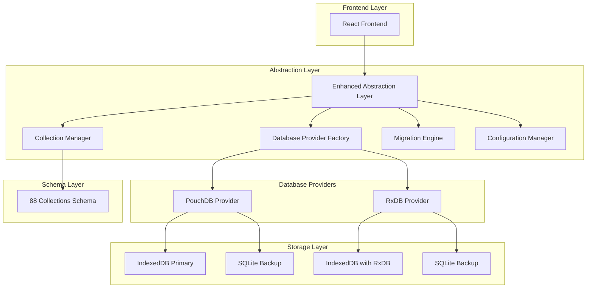

# Dual-Database Architecture Strategy: Technical Documentation

## 1. Architecture Design

### Dual-Database Architecture with Enhanced Abstraction Layer



## 2. Technology Description

### Core Technologies
- **Frontend**: React@18 + TypeScript + Vite
- **Primary Database**: IndexedDB (via PouchDB/RxDB)
- **Backup Storage**: SQLite (replacing deprecated WebSQL)
- **Abstraction Layer**: Custom TypeScript interfaces
- **Schema Validation**: Joi validation library
- **State Management**: RxJS observables
- **Migration Engine**: Custom migration system

### Database Providers
- **PouchDB Provider**: Immediate implementation, supports all 88 collections
- **RxDB Provider**: Future implementation with commercial license
- **SQLite Backup**: Cross-platform backup solution using sql.js

## 3. Enhanced Abstraction Layer Interfaces

### 3.1 Core Database Provider Interface

```typescript
interface IDatabaseProvider {
  name: string;
  version: string;
  isInitialized: boolean;
  
  // Lifecycle methods
  initialize(config: DatabaseConfig): Promise<void>;
  destroy(): Promise<void>;
  
  // Collection management
  createCollection<T>(name: string, schema: CollectionSchema): Promise<ICollection<T>>;
  getCollection<T>(name: string): ICollection<T> | null;
  getAllCollections(): Map<string, ICollection<any>>;
  
  // Backup and restore
  backup(): Promise<BackupData>;
  restore(data: BackupData): Promise<void>;
  
  // Health and monitoring
  healthCheck(): Promise<boolean>;
  getStats(): Promise<DatabaseStats>;
}
```

### 3.2 Collection Interface

```typescript
interface ICollection<T> {
  name: string;
  schema: CollectionSchema;
  
  // CRUD operations
  insert(doc: Partial<T>): Promise<T>;
  insertMany(docs: Partial<T>[]): Promise<T[]>;
  findOne(query: QueryOptions): Promise<T | null>;
  find(query: QueryOptions): Promise<T[]>;
  update(id: string, update: Partial<T>): Promise<T>;
  updateMany(query: QueryOptions, update: Partial<T>): Promise<T[]>;
  delete(id: string): Promise<boolean>;
  deleteMany(query: QueryOptions): Promise<number>;
  
  // Reactive queries
  find$(query: QueryOptions): Observable<T[]>;
  findOne$(query: QueryOptions): Observable<T | null>;
  
  // Indexing and performance
  createIndex(fields: string[]): Promise<void>;
  getStats(): Promise<CollectionStats>;
}
```

### 3.3 Database Configuration

```typescript
interface DatabaseConfig {
  provider: 'pouchdb' | 'rxdb';
  name: string;
  version: number;
  
  // Storage configuration
  storage: {
    primary: 'indexeddb';
    backup: 'sqlite';
    backupInterval: number; // milliseconds
    autoBackup: boolean;
  };
  
  // Performance settings
  performance: {
    batchSize: number;
    cacheSize: number;
    syncInterval: number;
  };
  
  // Security settings
  security: {
    encryption: boolean;
    auditLogs: boolean;
  };
  
  // RxDB specific (when available)
  rxdb?: {
    licenseKey: string;
    multiInstance: boolean;
    eventReduce: boolean;
  };
}
```

## 4. All 88 Collections Support

### 4.1 Core Collections (16)

**Essential System Collections:**
1. `appSettings` - Application configuration
2. `schoolDetails` - School information
3. `user` - User accounts
4. `role` - User roles
5. `academicYearStructure` - Academic year structure
6. `academicPeriodDefinition` - Period definitions
7. `academicYear` - Academic years
8. `workflow` - Workflow definitions
9. `workflowState` - Workflow states
10. `educationSystemConfiguration` - Education system config
11. `auditLog` - Audit trail
12. `parentGuardian` - Parent/guardian information
13. `student` - Student records
14. `studentGuardianRelationship` - Student-guardian links
15. `staff` - Staff records
16. `department` - Department structure

### 4.2 Extended Collections (72)

**Academic Module Collections (15):**
- `class`, `classStream`, `subject`, `curriculum`, `lesson`, `assignment`, `submission`, `grade`, `gradeScale`, `reportCard`, `attendance`, `timetable`, `exam`, `examResult`, `academicCalendar`

**Administration Module Collections (12):**
- `designation`, `studentCategory`, `dormitory`, `permission`, `rbacRole`, `userRole`, `notification`, `announcement`, `document`, `template`, `policy`, `procedure`

**Finance Module Collections (15):**
- `feeStructure`, `feeCategory`, `studentInvoice`, `studentInvoiceItem`, `payment`, `paymentMethod`, `discount`, `scholarship`, `financialAid`, `budget`, `expense`, `revenue`, `account`, `transaction`, `receipt`

**HR Module Collections (10):**
- `employee`, `employeeContract`, `payroll`, `leave`, `leaveType`, `attendance`, `performance`, `training`, `recruitment`, `disciplinary`

**Inventory Module Collections (8):**
- `item`, `category`, `supplier`, `purchase`, `stock`, `stockMovement`, `stockAdjustment`, `inventory`

**Library Module Collections (6):**
- `book`, `author`, `publisher`, `borrowing`, `reservation`, `fine`

**Nutrition Module Collections (6):**
- `meal`, `menu`, `ingredient`, `nutrition`, `dietaryRestriction`, `mealPlan`

## 5. Database Provider Factory

### 5.1 Provider Factory Implementation

```typescript
class DatabaseProviderFactory {
  private static providers: Map<string, () => IDatabaseProvider> = new Map();
  
  static registerProvider(name: string, factory: () => IDatabaseProvider): void {
    this.providers.set(name, factory);
  }
  
  static createProvider(config: DatabaseConfig): IDatabaseProvider {
    const factory = this.providers.get(config.provider);
    if (!factory) {
      throw new Error(`Database provider '${config.provider}' not found`);
    }
    return factory();
  }
  
  static getAvailableProviders(): string[] {
    return Array.from(this.providers.keys());
  }
}

// Register providers
DatabaseProviderFactory.registerProvider('pouchdb', () => new PouchDBProvider());
DatabaseProviderFactory.registerProvider('rxdb', () => new RxDBProvider());
```

### 5.2 PouchDB Provider Implementation

```typescript
class PouchDBProvider implements IDatabaseProvider {
  name = 'pouchdb';
  version = '1.0.0';
  isInitialized = false;
  
  private db: PouchDB.Database | null = null;
  private collections: Map<string, PouchDBCollection<any>> = new Map();
  private config: DatabaseConfig | null = null;
  private sqliteBackup: SQLiteBackup | null = null;
  
  async initialize(config: DatabaseConfig): Promise<void> {
    this.config = config;
    
    // Initialize PouchDB with IndexedDB adapter
    this.db = new PouchDB(config.name, {
      adapter: 'indexeddb',
      auto_compaction: true
    });
    
    // Initialize SQLite backup
    this.sqliteBackup = new SQLiteBackup(config);
    await this.sqliteBackup.initialize();
    
    // Create all 88 collections
    await this.createAllCollections();
    
    // Setup automatic backup
    if (config.storage.autoBackup) {
      this.setupAutoBackup();
    }
    
    this.isInitialized = true;
  }
  
  private async createAllCollections(): Promise<void> {
    const schemas = getAllCollectionSchemas();
    
    for (const [name, schema] of schemas) {
      await this.createCollection(name, schema);
    }
  }
  
  async createCollection<T>(name: string, schema: CollectionSchema): Promise<ICollection<T>> {
    if (!this.db) throw new Error('Database not initialized');
    
    const collection = new PouchDBCollection<T>(this.db, name, schema);
    await collection.initialize();
    
    this.collections.set(name, collection);
    return collection;
  }
  
  getCollection<T>(name: string): ICollection<T> | null {
    return this.collections.get(name) || null;
  }
  
  getAllCollections(): Map<string, ICollection<any>> {
    return new Map(this.collections);
  }
  
  async backup(): Promise<BackupData> {
    if (!this.sqliteBackup) throw new Error('SQLite backup not initialized');
    
    const data: BackupData = {
      timestamp: new Date(),
      version: this.version,
      collections: new Map()
    };
    
    // Backup all collections to SQLite
    for (const [name, collection] of this.collections) {
      const docs = await collection.find({});
      data.collections.set(name, docs);
    }
    
    await this.sqliteBackup.store(data);
    return data;
  }
  
  async restore(data: BackupData): Promise<void> {
    if (!this.sqliteBackup) throw new Error('SQLite backup not initialized');
    
    // Clear existing data
    for (const collection of this.collections.values()) {
      await collection.deleteMany({});
    }
    
    // Restore from SQLite backup
    for (const [name, docs] of data.collections) {
      const collection = this.getCollection(name);
      if (collection && docs.length > 0) {
        await collection.insertMany(docs);
      }
    }
  }
  
  private setupAutoBackup(): void {
    if (!this.config) return;
    
    setInterval(async () => {
      try {
        await this.backup();
        console.log('Automatic backup completed');
      } catch (error) {
        console.error('Automatic backup failed:', error);
      }
    }, this.config.storage.backupInterval);
  }
  
  async healthCheck(): Promise<boolean> {
    try {
      if (!this.db) return false;
      await this.db.info();
      return true;
    } catch {
      return false;
    }
  }
  
  async getStats(): Promise<DatabaseStats> {
    if (!this.db) throw new Error('Database not initialized');
    
    const info = await this.db.info();
    return {
      provider: this.name,
      version: this.version,
      documentCount: info.doc_count,
      collectionCount: this.collections.size,
      storageSize: info.disk_size || 0,
      lastBackup: this.sqliteBackup?.getLastBackupTime() || null
    };
  }
  
  async destroy(): Promise<void> {
    if (this.db) {
      await this.db.destroy();
      this.db = null;
    }
    
    if (this.sqliteBackup) {
      await this.sqliteBackup.destroy();
      this.sqliteBackup = null;
    }
    
    this.collections.clear();
    this.isInitialized = false;
  }
}
```

## 6. SQLite Backup System

### 6.1 SQLite Backup Implementation

```typescript
class SQLiteBackup {
  private db: any; // sql.js database
  private config: DatabaseConfig;
  private lastBackupTime: Date | null = null;
  
  constructor(config: DatabaseConfig) {
    this.config = config;
  }
  
  async initialize(): Promise<void> {
    // Initialize sql.js
    const initSqlJs = await import('sql.js');
    const SQL = await initSqlJs.default();
    
    // Create or load existing SQLite database
    const existingData = this.loadFromLocalStorage();
    this.db = new SQL.Database(existingData);
    
    // Create backup tables if they don't exist
    await this.createBackupTables();
  }
  
  private async createBackupTables(): Promise<void> {
    // Create metadata table
    this.db.run(`
      CREATE TABLE IF NOT EXISTS backup_metadata (
        id INTEGER PRIMARY KEY,
        timestamp TEXT NOT NULL,
        version TEXT NOT NULL,
        collection_count INTEGER NOT NULL
      )
    `);
    
    // Create collections data table
    this.db.run(`
      CREATE TABLE IF NOT EXISTS backup_collections (
        id INTEGER PRIMARY KEY,
        backup_id INTEGER,
        collection_name TEXT NOT NULL,
        document_data TEXT NOT NULL,
        FOREIGN KEY (backup_id) REFERENCES backup_metadata (id)
      )
    `);
  }
  
  async store(data: BackupData): Promise<void> {
    const backupId = Date.now();
    
    // Insert backup metadata
    this.db.run(
      'INSERT INTO backup_metadata (id, timestamp, version, collection_count) VALUES (?, ?, ?, ?)',
      [backupId, data.timestamp.toISOString(), data.version, data.collections.size]
    );
    
    // Insert collection data
    for (const [collectionName, documents] of data.collections) {
      this.db.run(
        'INSERT INTO backup_collections (backup_id, collection_name, document_data) VALUES (?, ?, ?)',
        [backupId, collectionName, JSON.stringify(documents)]
      );
    }
    
    // Save to localStorage
    this.saveToLocalStorage();
    this.lastBackupTime = new Date();
  }
  
  async restore(backupId?: number): Promise<BackupData> {
    // Get latest backup if no ID specified
    const metadataQuery = backupId 
      ? 'SELECT * FROM backup_metadata WHERE id = ?'
      : 'SELECT * FROM backup_metadata ORDER BY timestamp DESC LIMIT 1';
    
    const metadataResult = backupId 
      ? this.db.exec(metadataQuery, [backupId])
      : this.db.exec(metadataQuery);
    
    if (!metadataResult.length || !metadataResult[0].values.length) {
      throw new Error('No backup found');
    }
    
    const metadata = metadataResult[0].values[0];
    const actualBackupId = metadata[0];
    
    // Get collection data
    const collectionsResult = this.db.exec(
      'SELECT collection_name, document_data FROM backup_collections WHERE backup_id = ?',
      [actualBackupId]
    );
    
    const collections = new Map();
    if (collectionsResult.length && collectionsResult[0].values.length) {
      for (const row of collectionsResult[0].values) {
        const collectionName = row[0];
        const documentData = JSON.parse(row[1]);
        collections.set(collectionName, documentData);
      }
    }
    
    return {
      timestamp: new Date(metadata[1]),
      version: metadata[2],
      collections
    };
  }
  
  private saveToLocalStorage(): void {
    const data = this.db.export();
    const base64 = btoa(String.fromCharCode(...data));
    localStorage.setItem(`${this.config.name}_sqlite_backup`, base64);
  }
  
  private loadFromLocalStorage(): Uint8Array | undefined {
    const base64 = localStorage.getItem(`${this.config.name}_sqlite_backup`);
    if (!base64) return undefined;
    
    const binaryString = atob(base64);
    const bytes = new Uint8Array(binaryString.length);
    for (let i = 0; i < binaryString.length; i++) {
      bytes[i] = binaryString.charCodeAt(i);
    }
    return bytes;
  }
  
  getLastBackupTime(): Date | null {
    return this.lastBackupTime;
  }
  
  async destroy(): Promise<void> {
    if (this.db) {
      this.db.close();
      this.db = null;
    }
    localStorage.removeItem(`${this.config.name}_sqlite_backup`);
  }
}
```

## 7. Migration Engine

### 7.1 Migration System

```typescript
class MigrationEngine {
  private provider: IDatabaseProvider;
  private migrations: Migration[] = [];
  
  constructor(provider: IDatabaseProvider) {
    this.provider = provider;
  }
  
  addMigration(migration: Migration): void {
    this.migrations.push(migration);
    this.migrations.sort((a, b) => a.version - b.version);
  }
  
  async migrate(targetVersion?: number): Promise<void> {
    const currentVersion = await this.getCurrentVersion();
    const target = targetVersion || this.getLatestVersion();
    
    if (currentVersion >= target) {
      console.log('Database is already up to date');
      return;
    }
    
    const pendingMigrations = this.migrations.filter(
      m => m.version > currentVersion && m.version <= target
    );
    
    for (const migration of pendingMigrations) {
      console.log(`Running migration ${migration.version}: ${migration.description}`);
      
      try {
        await migration.up(this.provider);
        await this.setCurrentVersion(migration.version);
        console.log(`Migration ${migration.version} completed`);
      } catch (error) {
        console.error(`Migration ${migration.version} failed:`, error);
        
        // Attempt rollback
        if (migration.down) {
          try {
            await migration.down(this.provider);
            console.log(`Migration ${migration.version} rolled back`);
          } catch (rollbackError) {
            console.error(`Rollback failed:`, rollbackError);
          }
        }
        
        throw error;
      }
    }
  }
  
  private async getCurrentVersion(): Promise<number> {
    try {
      const settingsCollection = this.provider.getCollection('appSettings');
      if (!settingsCollection) return 0;
      
      const versionDoc = await settingsCollection.findOne({ key: 'database_version' });
      return versionDoc?.value || 0;
    } catch {
      return 0;
    }
  }
  
  private async setCurrentVersion(version: number): Promise<void> {
    const settingsCollection = this.provider.getCollection('appSettings');
    if (!settingsCollection) return;
    
    await settingsCollection.update('database_version', {
      key: 'database_version',
      value: version,
      updatedAt: new Date()
    });
  }
  
  private getLatestVersion(): number {
    return this.migrations.length > 0 
      ? Math.max(...this.migrations.map(m => m.version))
      : 0;
  }
}

interface Migration {
  version: number;
  description: string;
  up: (provider: IDatabaseProvider) => Promise<void>;
  down?: (provider: IDatabaseProvider) => Promise<void>;
}
```

## 8. Implementation Roadmap

### Phase 1: Foundation (Weeks 1-2)
- [ ] Implement core interfaces and abstractions
- [ ] Create Database Provider Factory
- [ ] Implement SQLite backup system
- [ ] Set up basic configuration management

### Phase 2: PouchDB Provider (Weeks 3-4)
- [ ] Implement PouchDBProvider class
- [ ] Create PouchDBCollection wrapper
- [ ] Integrate IndexedDB with SQLite backup
- [ ] Implement all 88 collection schemas

### Phase 3: Enhanced Services (Weeks 5-6)
- [ ] Implement DatabaseService with provider switching
- [ ] Create Migration Engine
- [ ] Add monitoring and health checks
- [ ] Implement backup/restore functionality

### Phase 4: Integration (Weeks 7-8)
- [ ] Integrate with existing rxdbService
- [ ] Create compatibility layer
- [ ] Implement data migration from current system
- [ ] Add comprehensive error handling

### Phase 5: RxDB Provider (Weeks 9-10)
- [ ] Implement RxDBProvider class
- [ ] Add commercial license support
- [ ] Implement advanced RxDB features
- [ ] Performance optimization and testing

### Phase 6: Testing & Deployment (Weeks 11-12)
- [ ] Comprehensive unit testing
- [ ] Integration testing
- [ ] Performance testing
- [ ] Production deployment

## 9. Configuration Management

### 9.1 Database Configuration

```typescript
const DEFAULT_CONFIG: DatabaseConfig = {
  provider: 'pouchdb',
  name: 'schoolpilot_db',
  version: 1,
  
  storage: {
    primary: 'indexeddb',
    backup: 'sqlite',
    backupInterval: 300000, // 5 minutes
    autoBackup: true
  },
  
  performance: {
    batchSize: 50,
    cacheSize: 100,
    syncInterval: 30000
  },
  
  security: {
    encryption: false,
    auditLogs: true
  }
};
```

### 9.2 Environment-Specific Configuration

```typescript
const ENVIRONMENT_CONFIGS = {
  development: {
    ...DEFAULT_CONFIG,
    storage: {
      ...DEFAULT_CONFIG.storage,
      backupInterval: 60000, // 1 minute for testing
    },
    security: {
      ...DEFAULT_CONFIG.security,
      encryption: false
    }
  },
  
  production: {
    ...DEFAULT_CONFIG,
    provider: 'rxdb', // Use RxDB in production if license available
    storage: {
      ...DEFAULT_CONFIG.storage,
      backupInterval: 900000, // 15 minutes
    },
    security: {
      ...DEFAULT_CONFIG.security,
      encryption: true
    },
    rxdb: {
      licenseKey: process.env.RXDB_LICENSE_KEY || '',
      multiInstance: true,
      eventReduce: true
    }
  }
};
```

## 10. Testing Strategy

### 10.1 Unit Tests
- Database provider implementations
- Collection operations
- Migration engine
- SQLite backup system

### 10.2 Integration Tests
- Provider switching
- Data consistency
- Backup and restore
- Performance benchmarks

### 10.3 End-to-End Tests
- Complete user workflows
- Data persistence
- Error recovery
- Cross-browser compatibility

This architecture provides a robust, scalable solution that supports all 88 collections without reduction, uses modern storage technologies (IndexedDB + SQLite), and provides a clear migration path from the current RxDB implementation to a more flexible dual-provider system.