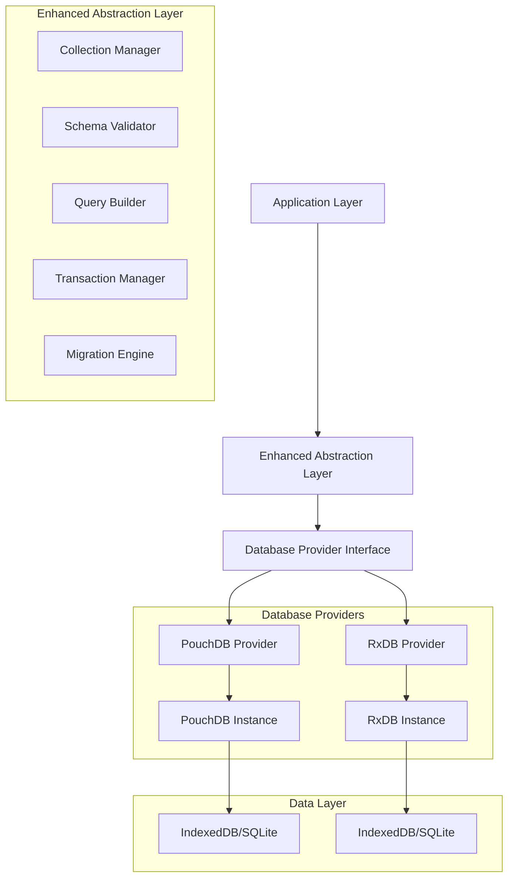

# Dual-Database Architecture Strategy: Technical Implementation Specification

## 1. Architecture Overview

The Dual-Database Architecture Strategy implements an Enhanced Abstraction layer that provides seamless support for multiple database providers while maintaining all 88 collections. This architecture enables immediate PouchDB implementation while preserving RxDB compatibility for future licensing.



## 2. Technology Stack

### 2.1 Core Technologies
- **Frontend**: React@18 + TypeScript@5 + Vite
- **Database Abstraction**: Custom Enhanced Abstraction Layer
- **Primary Database**: PouchDB@8.0+ (immediate implementation)
- **Secondary Database**: RxDB@15+ (future implementation)
- **Storage**: IndexedDB (primary), SQLite (backup)
- **Validation**: Joi@17+ for schema validation
- **Migration**: Custom migration engine

### 2.2 Dependencies
```json
{
  "pouchdb": "^8.0.1",
  "pouchdb-find": "^8.0.1",
  "pouchdb-live-find": "^0.1.3",
  "rxdb": "^15.0.0",
  "joi": "^17.9.2",
  "uuid": "^9.0.0",
  "lodash": "^4.17.21"
}
```

## 3. Enhanced Abstraction Layer Architecture

### 3.1 Core Interfaces

```typescript
// Database Provider Interface
interface IDatabaseProvider {
  name: string;
  version: string;
  initialize(config: DatabaseConfig): Promise<void>;
  createCollection<T>(name: string, schema: CollectionSchema): Promise<ICollection<T>>;
  getCollection<T>(name: string): ICollection<T> | null;
  destroy(): Promise<void>;
  isAvailable(): boolean;
}

// Collection Interface
interface ICollection<T> {
  name: string;
  insert(doc: T): Promise<T>;
  insertMany(docs: T[]): Promise<T[]>;
  findOne(query: QueryOptions): Promise<T | null>;
  find(query: QueryOptions): Promise<T[]>;
  update(id: string, update: Partial<T>): Promise<T>;
  remove(id: string): Promise<boolean>;
  count(query?: QueryOptions): Promise<number>;
  subscribe(query: QueryOptions): Observable<T[]>;
}

// Query Options
interface QueryOptions {
  selector?: Record<string, any>;
  sort?: Record<string, 1 | -1>[];
  limit?: number;
  skip?: number;
  fields?: string[];
}

// Collection Schema
interface CollectionSchema {
  version: number;
  type: 'object';
  properties: Record<string, SchemaProperty>;
  required?: string[];
  indexes?: IndexDefinition[];
}
```

### 3.2 Database Provider Factory

```typescript
class DatabaseProviderFactory {
  private static providers: Map<string, IDatabaseProvider> = new Map();
  
  static registerProvider(name: string, provider: IDatabaseProvider): void {
    this.providers.set(name, provider);
  }
  
  static createProvider(name: string, config: DatabaseConfig): IDatabaseProvider {
    const ProviderClass = this.providers.get(name);
    if (!ProviderClass) {
      throw new Error(`Database provider '${name}' not found`);
    }
    return new ProviderClass(config);
  }
  
  static getAvailableProviders(): string[] {
    return Array.from(this.providers.keys()).filter(name => {
      const provider = this.providers.get(name);
      return provider?.isAvailable() ?? false;
    });
  }
}
```

## 4. Database Provider Implementations

### 4.1 PouchDB Provider

```typescript
class PouchDBProvider implements IDatabaseProvider {
  name = 'pouchdb';
  version = '8.0.1';
  private db: PouchDB.Database | null = null;
  private collections: Map<string, PouchDBCollection> = new Map();
  
  async initialize(config: DatabaseConfig): Promise<void> {
    this.db = new PouchDB(config.name, {
      adapter: 'idb',
      auto_compaction: true,
      revs_limit: 10
    });
    
    // Initialize all 88 collections
    await this.initializeCollections(config.collections);
  }
  
  async createCollection<T>(name: string, schema: CollectionSchema): Promise<ICollection<T>> {
    if (this.collections.has(name)) {
      return this.collections.get(name) as ICollection<T>;
    }
    
    const collection = new PouchDBCollection<T>(this.db!, name, schema);
    await collection.initialize();
    this.collections.set(name, collection);
    
    return collection;
  }
  
  getCollection<T>(name: string): ICollection<T> | null {
    return this.collections.get(name) as ICollection<T> || null;
  }
  
  isAvailable(): boolean {
    return typeof window !== 'undefined' && 'indexedDB' in window;
  }
  
  async destroy(): Promise<void> {
    if (this.db) {
      await this.db.destroy();
      this.db = null;
      this.collections.clear();
    }
  }
}
```

### 4.2 RxDB Provider

```typescript
class RxDBProvider implements IDatabaseProvider {
  name = 'rxdb';
  version = '15.0.0';
  private db: RxDatabase | null = null;
  private collections: Map<string, RxDBCollection> = new Map();
  
  async initialize(config: DatabaseConfig): Promise<void> {
    this.db = await createRxDatabase({
      name: config.name,
      storage: getRxStorageDexie(),
      multiInstance: false,
      ignoreDuplicate: true
    });
    
    // Initialize all 88 collections
    await this.initializeCollections(config.collections);
  }
  
  async createCollection<T>(name: string, schema: CollectionSchema): Promise<ICollection<T>> {
    if (this.collections.has(name)) {
      return this.collections.get(name) as ICollection<T>;
    }
    
    const rxSchema = this.convertToRxSchema(schema);
    const rxCollection = await this.db!.addCollections({
      [name]: { schema: rxSchema }
    });
    
    const collection = new RxDBCollection<T>(rxCollection[name], schema);
    this.collections.set(name, collection);
    
    return collection;
  }
  
  isAvailable(): boolean {
    // Check if RxDB license is available
    return this.hasValidLicense();
  }
  
  private hasValidLicense(): boolean {
    // Implementation to check RxDB license validity
    return process.env.RXDB_LICENSE_KEY !== undefined;
  }
}
```

## 5. Collection Definitions (All 88 Collections)

### 5.1 Core Collections (16)
```typescript
const coreCollections = {
  // User Management
  users: userSchema,
  rbac_roles: rbacRoleSchema,
  permissions: permissionSchema,
  user_roles: userRoleSchema,
  
  // Academic Structure
  academic_years: academicYearSchema,
  classes: classSchema,
  students: studentSchema,
  staff: staffSchema,
  
  // Academic Operations
  subjects: subjectSchema,
  timetable_entries: timetableEntrySchema,
  student_exam_results: studentExamResultSchema,
  
  // System
  app_settings: appSettingsSchema,
  school_details: schoolDetailsSchema,
  audit_logs: auditLogSchema,
  workflows: workflowSchema
};
```

### 5.2 Extended Collections (72)
```typescript
const extendedCollections = {
  // Administration (12 collections)
  departments: departmentSchema,
  designations: designationSchema,
  dormitories: dormitorySchema,
  student_categories: studentCategorySchema,
  parent_guardians: parentGuardianSchema,
  student_guardian_relationships: studentGuardianRelationshipSchema,
  education_system_configurations: educationSystemConfigurationSchema,
  academic_period_definitions: academicPeriodDefinitionSchema,
  academic_year_structures: academicYearStructureSchema,
  workflow_states: workflowStateSchema,
  class_streams: classStreamSchema,
  student_invoice_items: studentInvoiceItemSchema,
  
  // Academics (12 collections)
  subject_papers: subjectPaperSchema,
  exam_sessions: examSessionSchema,
  exam_schedules: examScheduleSchema,
  result_approvals: resultApprovalSchema,
  grading_schemes: gradingSchemeSchema,
  class_subject_allocations: classSubjectAllocationSchema,
  teacher_subject_assignments: teacherSubjectAssignmentSchema,
  student_subject_enrollments: studentSubjectEnrollmentSchema,
  timetable_period_definitions: timetablePeriodDefinitionSchema,
  student_attendance: studentAttendanceSchema,
  teacher_attendance: teacherAttendanceSchema,
  academic_calendar_events: academicCalendarEventSchema,
  
  // Finance (12 collections)
  fee_structures: feeStructureSchema,
  fee_categories: feeCategorySchema,
  student_fees: studentFeeSchema,
  fee_payments: feePaymentSchema,
  fee_discounts: feeDiscountSchema,
  fee_waivers: feeWaiverSchema,
  payment_methods: paymentMethodSchema,
  financial_transactions: financialTransactionSchema,
  budget_allocations: budgetAllocationSchema,
  expense_categories: expenseCategorySchema,
  expenses: expenseSchema,
  financial_reports: financialReportSchema,
  
  // HR (12 collections)
  employee_profiles: employeeProfileSchema,
  employee_contracts: employeeContractSchema,
  salary_structures: salaryStructureSchema,
  payroll_records: payrollRecordSchema,
  leave_types: leaveTypeSchema,
  leave_applications: leaveApplicationSchema,
  performance_reviews: performanceReviewSchema,
  training_programs: trainingProgramSchema,
  employee_training: employeeTrainingSchema,
  disciplinary_actions: disciplinaryActionSchema,
  employee_benefits: employeeBenefitSchema,
  hr_policies: hrPolicySchema,
  
  // Inventory (12 collections)
  inventory_categories: inventoryCategorySchema,
  inventory_items: inventoryItemSchema,
  inventory_transactions: inventoryTransactionSchema,
  suppliers: supplierSchema,
  purchase_orders: purchaseOrderSchema,
  purchase_receipts: purchaseReceiptSchema,
  stock_adjustments: stockAdjustmentSchema,
  asset_registers: assetRegisterSchema,
  maintenance_schedules: maintenanceScheduleSchema,
  maintenance_records: maintenanceRecordSchema,
  inventory_audits: inventoryAuditSchema,
  inventory_reports: inventoryReportSchema,
  
  // Library (6 collections)
  library_books: libraryBookSchema,
  library_members: libraryMemberSchema,
  book_issues: bookIssueSchema,
  book_returns: bookReturnSchema,
  library_fines: libraryFineSchema,
  library_reservations: libraryReservationSchema,
  
  // Nutrition (6 collections)
  meal_plans: mealPlanSchema,
  menu_items: menuItemSchema,
  daily_menus: dailyMenuSchema,
  nutrition_records: nutritionRecordSchema,
  dietary_requirements: dietaryRequirementSchema,
  meal_attendance: mealAttendanceSchema
};
```

## 6. API Definitions

### 6.1 Database Service API

```typescript
class DatabaseService {
  private provider: IDatabaseProvider;
  private config: DatabaseConfig;
  
  constructor(providerName: string, config: DatabaseConfig) {
    this.provider = DatabaseProviderFactory.createProvider(providerName, config);
    this.config = config;
  }
  
  async initialize(): Promise<void> {
    await this.provider.initialize(this.config);
  }
  
  getCollection<T>(name: string): ICollection<T> {
    const collection = this.provider.getCollection<T>(name);
    if (!collection) {
      throw new Error(`Collection '${name}' not found`);
    }
    return collection;
  }
  
  async switchProvider(newProviderName: string): Promise<void> {
    // Implement provider switching with data migration
    const newProvider = DatabaseProviderFactory.createProvider(newProviderName, this.config);
    await this.migrateData(this.provider, newProvider);
    await this.provider.destroy();
    this.provider = newProvider;
  }
  
  private async migrateData(from: IDatabaseProvider, to: IDatabaseProvider): Promise<void> {
    // Implementation for data migration between providers
  }
}
```

### 6.2 Collection Manager API

```typescript
class CollectionManager {
  private collections: Map<string, ICollection<any>> = new Map();
  private schemas: Map<string, CollectionSchema> = new Map();
  
  registerCollection<T>(name: string, schema: CollectionSchema): void {
    this.schemas.set(name, schema);
  }
  
  async initializeCollections(provider: IDatabaseProvider): Promise<void> {
    for (const [name, schema] of this.schemas) {
      const collection = await provider.createCollection(name, schema);
      this.collections.set(name, collection);
    }
  }
  
  getCollection<T>(name: string): ICollection<T> {
    const collection = this.collections.get(name);
    if (!collection) {
      throw new Error(`Collection '${name}' not initialized`);
    }
    return collection as ICollection<T>;
  }
  
  getAllCollectionNames(): string[] {
    return Array.from(this.collections.keys());
  }
  
  getCollectionCount(): number {
    return this.collections.size;
  }
}
```

## 7. Configuration Management

### 7.1 Database Configuration

```typescript
interface DatabaseConfig {
  name: string;
  provider: 'pouchdb' | 'rxdb';
  collections: Record<string, CollectionSchema>;
  options: {
    autoCompaction?: boolean;
    revLimit?: number;
    multiInstance?: boolean;
    ignoreDuplicate?: boolean;
  };
}

class ConfigurationManager {
  private static instance: ConfigurationManager;
  private config: DatabaseConfig;
  
  static getInstance(): ConfigurationManager {
    if (!this.instance) {
      this.instance = new ConfigurationManager();
    }
    return this.instance;
  }
  
  loadConfig(): DatabaseConfig {
    const defaultConfig: DatabaseConfig = {
      name: 'schoolpilot_db',
      provider: this.getPreferredProvider(),
      collections: { ...coreCollections, ...extendedCollections },
      options: {
        autoCompaction: true,
        revLimit: 10,
        multiInstance: false,
        ignoreDuplicate: true
      }
    };
    
    this.config = { ...defaultConfig, ...this.loadUserConfig() };
    return this.config;
  }
  
  private getPreferredProvider(): 'pouchdb' | 'rxdb' {
    // Check if RxDB license is available
    if (process.env.RXDB_LICENSE_KEY) {
      return 'rxdb';
    }
    return 'pouchdb';
  }
  
  private loadUserConfig(): Partial<DatabaseConfig> {
    // Load user-specific configuration from localStorage or config file
    const userConfig = localStorage.getItem('database_config');
    return userConfig ? JSON.parse(userConfig) : {};
  }
}
```

## 8. Migration Engine

### 8.1 Schema Migration

```typescript
interface Migration {
  version: number;
  description: string;
  up: (collection: ICollection<any>) => Promise<void>;
  down: (collection: ICollection<any>) => Promise<void>;
}

class MigrationEngine {
  private migrations: Map<string, Migration[]> = new Map();
  
  registerMigration(collectionName: string, migration: Migration): void {
    if (!this.migrations.has(collectionName)) {
      this.migrations.set(collectionName, []);
    }
    this.migrations.get(collectionName)!.push(migration);
  }
  
  async runMigrations(collectionName: string, collection: ICollection<any>, targetVersion: number): Promise<void> {
    const migrations = this.migrations.get(collectionName) || [];
    const currentVersion = await this.getCurrentVersion(collection);
    
    const pendingMigrations = migrations
      .filter(m => m.version > currentVersion && m.version <= targetVersion)
      .sort((a, b) => a.version - b.version);
    
    for (const migration of pendingMigrations) {
      await migration.up(collection);
      await this.updateVersion(collection, migration.version);
    }
  }
  
  private async getCurrentVersion(collection: ICollection<any>): Promise<number> {
    // Implementation to get current schema version
    return 1;
  }
  
  private async updateVersion(collection: ICollection<any>, version: number): Promise<void> {
    // Implementation to update schema version
  }
}
```

## 9. Implementation Roadmap

### 9.1 Phase 1: Foundation (Week 1-2)
```markdown
- [ ] Implement Enhanced Abstraction Layer interfaces
- [ ] Create Database Provider Factory
- [ ] Implement PouchDB Provider
- [ ] Create Collection Manager
- [ ] Set up configuration management
- [ ] Implement basic CRUD operations
```

### 9.2 Phase 2: Core Collections (Week 3-4)
```markdown
- [ ] Implement all 16 core collections
- [ ] Add schema validation
- [ ] Implement query builder
- [ ] Add transaction support
- [ ] Create migration engine
- [ ] Add error handling and logging
```

### 9.3 Phase 3: Extended Collections (Week 5-8)
```markdown
- [ ] Implement all 72 extended collections
- [ ] Add advanced querying capabilities
- [ ] Implement real-time subscriptions
- [ ] Add data synchronization
- [ ] Performance optimization
- [ ] Comprehensive testing
```

### 9.4 Phase 4: RxDB Integration (Week 9-10)
```markdown
- [ ] Implement RxDB Provider
- [ ] Add provider switching capability
- [ ] Implement data migration between providers
- [ ] Add license validation
- [ ] Performance comparison and optimization
- [ ] Documentation and training
```

## 10. Testing Strategy

### 10.1 Unit Tests
- Database Provider implementations
- Collection operations (CRUD)
- Schema validation
- Query builder functionality
- Migration engine

### 10.2 Integration Tests
- Provider switching
- Data migration
- Real-time subscriptions
- Transaction handling
- Error scenarios

### 10.3 Performance Tests
- Large dataset operations
- Concurrent access
- Memory usage
- Query performance
- Synchronization speed

## 11. Deployment Configuration

### 11.1 Environment Variables
```bash
# Database Configuration
DATABASE_PROVIDER=pouchdb
DATABASE_NAME=schoolpilot_db
AUTO_COMPACTION=true
REV_LIMIT=10

# RxDB License (when available)
RXDB_LICENSE_KEY=your_license_key_here

# Performance Settings
MAX_CONCURRENT_OPERATIONS=10
CACHE_SIZE=100MB
SYNC_INTERVAL=30000
```

### 11.2 Build Configuration
```javascript
// vite.config.ts
export default defineConfig({
  define: {
    'process.env.DATABASE_PROVIDER': JSON.stringify(process.env.DATABASE_PROVIDER || 'pouchdb'),
    'process.env.RXDB_LICENSE_KEY': JSON.stringify(process.env.RXDB_LICENSE_KEY)
  },
  optimizeDeps: {
    include: ['pouchdb', 'pouchdb-find', 'rxdb']
  }
});
```

This technical architecture document provides the foundation for implementing the Dual-Database Architecture Strategy with full support for all 88 collections across both PouchDB and RxDB providers.