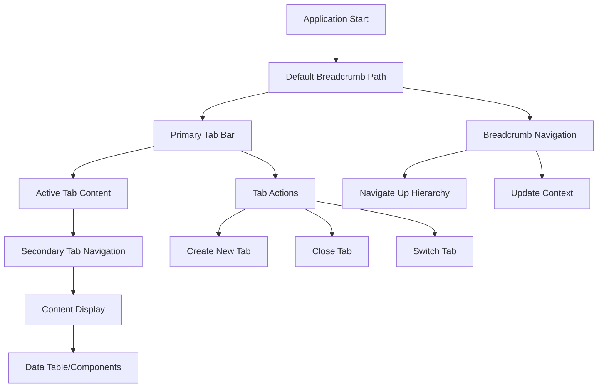

# Hierarchical Tab and Breadcrumb Structure Requirements

## 1. Product Overview
This document outlines the requirements for implementing a hierarchical tab and breadcrumb navigation system based on the provided task management interface design. The system should provide intuitive navigation through multiple levels of content organization with proper visual hierarchy and user experience patterns.

## 2. Core Features

### 2.1 User Roles
| Role | Registration Method | Core Permissions |
|------|---------------------|------------------|
| Guest User | No registration required | Can view public content and basic navigation |
| Authenticated User | Email/SSO registration | Can access all tabs, create/close tabs, navigate breadcrumbs |
| Admin User | Admin invitation | Full access including tab management and configuration |

### 2.2 Feature Module
Our hierarchical navigation system consists of the following main components:
1. **Breadcrumb Navigation**: Top-level navigation showing current path (e.g., "Product > Tasks")
2. **Primary Tab Bar**: Main content tabs with close functionality (e.g., "Welcome", "Tasks")
3. **Secondary Tab Navigation**: Sub-tabs within primary tabs (e.g., "All Tasks", "Active Tasks", "Kanban")
4. **Content Area**: Dynamic content display with data tables and interactive elements
5. **Action Controls**: Add buttons, filters, and contextual actions

### 2.3 Page Details

| Page Name | Module Name | Feature description |
|-----------|-------------|---------------------|
| Breadcrumb Navigation | Navigation Header | Display hierarchical path with clickable segments, support for dynamic path generation, error handling for invalid paths |
| Primary Tab Bar | Tab Management | Create closeable tabs with X buttons, drag-and-drop reordering, tab state persistence, maximum tab limits |
| Secondary Tab Navigation | Sub-Tab System | Nested navigation within primary tabs, active state indicators, add new sub-tab functionality |
| Content Display Area | Dynamic Content | Render different content types based on active tab/sub-tab, support for data tables, forms, and custom components |
| Data Table Interface | Table Management | Sortable columns (Name, Status, Teams, Assigned, Priority, Approved), row selection, pagination, filtering capabilities |
| Action Controls | User Actions | Add new items button (+), context menus, bulk actions, search and filter controls |

## 3. Core Process

### Primary Navigation Flow
1. User lands on application with default breadcrumb path
2. User can click breadcrumb segments to navigate up the hierarchy
3. User opens new primary tabs which update the breadcrumb context
4. User can close tabs using X button (except protected tabs)
5. User navigates between sub-tabs within active primary tab
6. Content area updates dynamically based on navigation state

### Tab Management Flow
1. User creates new tab via + button or context action
2. Tab appears in primary tab bar with close button
3. User can switch between tabs by clicking tab headers
4. User can close tabs (system prevents closing last tab)
5. Tab state and content persist during session

## 4. User Interface Design

### 4.1 Design Style
- **Primary Colors**: Blue (#3B82F6) for active states, Gray (#6B7280) for inactive
- **Secondary Colors**: Green (#10B981) for success states, Red (#EF4444) for close actions
- **Button Style**: Rounded corners (4px), subtle shadows, hover state transitions
- **Font**: System font stack, 14px base size, 12px for secondary text
- **Layout Style**: Clean card-based design with consistent spacing (8px, 16px, 24px grid)
- **Icons**: Lucide React icons for consistency, 16px standard size

### 4.2 Page Design Overview

| Page Name | Module Name | UI Elements |
|-----------|-------------|-------------|
| Breadcrumb Navigation | Navigation Header | Chevron separators, clickable segments, home icon, subtle background (#F9FAFB), 12px text |
| Primary Tab Bar | Tab Management | Tab buttons with rounded tops, close X buttons (hover: red), active tab highlighting, drag handles |
| Secondary Tab Navigation | Sub-Tab System | Underlined active states, + button for adding, horizontal scrolling for overflow |
| Content Display | Dynamic Content | White background, subtle borders, responsive grid layout, loading states |
| Data Table | Table Interface | Alternating row colors, sortable headers with arrows, checkbox selection, status badges |
| Action Controls | User Actions | Primary blue buttons, icon + text combinations, dropdown menus, search input styling |

### 4.3 Responsiveness
The system is desktop-first with mobile-adaptive design:
- **Desktop**: Full tab bar with all features visible
- **Tablet**: Collapsible secondary navigation, touch-optimized tab switching
- **Mobile**: Hamburger menu for tabs, simplified breadcrumbs, touch-friendly interactions
- **Touch Optimization**: Larger touch targets (44px minimum), swipe gestures for tab switching

## 5. Technical Implementation Notes

### 5.1 Component Architecture
- **BreadcrumbNavigation**: Dynamic path generation from route context
- **TabbedWorkspace**: Main container managing tab state and content rendering
- **TabBar**: Primary tab management with drag-and-drop support
- **SubTabNavigation**: Secondary navigation within active tabs
- **ContentRenderer**: Dynamic content display based on tab configuration

### 5.2 State Management
- Tab state persistence using localStorage/sessionStorage
- Breadcrumb context derived from routing and tab hierarchy
- Sub-tab state managed within parent tab scope
- Content state isolated per tab instance

### 5.3 Data Integration
- Support for different data sources per tab/sub-tab
- Real-time updates for collaborative features
- Caching strategy for frequently accessed content
- Error boundaries for robust content loading

## 6. Accessibility Requirements

- **Keyboard Navigation**: Tab key support, arrow key navigation within tab groups
- **Screen Reader Support**: Proper ARIA labels, role definitions, state announcements
- **Focus Management**: Visible focus indicators, logical tab order
- **Color Contrast**: WCAG AA compliance for all text and interactive elements
- **Reduced Motion**: Respect user preferences for animation reduction

## 7. Performance Considerations

- **Lazy Loading**: Content loaded only when tabs become active
- **Virtual Scrolling**: For large data tables and long lists
- **Debounced Search**: Prevent excessive API calls during user input
- **Memory Management**: Cleanup inactive tab content to prevent memory leaks
- **Bundle Splitting**: Code splitting for tab-specific functionality