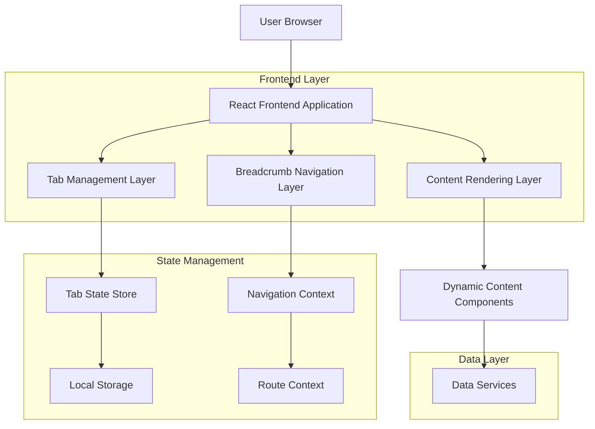
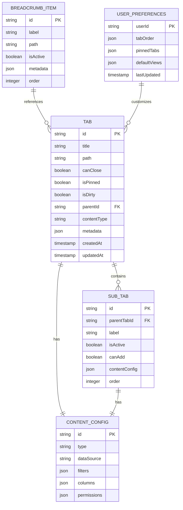

# Hierarchical Tab and Breadcrumb Technical Architecture

## 1. Architecture Design



## 2. Technology Description

* **Frontend**: React\@18 + TypeScript + TailwindCSS\@3 + Vite

* **State Management**: Zustand for tab state, React Context for navigation

* **Routing**: React Router v6 for navigation context

* **UI Components**: Lucide React for icons, Headless UI for accessibility

* **Drag & Drop**: @dnd-kit/core for tab reordering

* **Data Fetching**: React Query for content loading and caching

## 3. Route Definitions

| Route                     | Purpose                                    |
| ------------------------- | ------------------------------------------ |
| /                         | Home page with default tab configuration   |
| /product                  | Product overview with breadcrumb context   |
| /product/tasks            | Tasks section with hierarchical navigation |
| /product/tasks/:view      | Specific task views (all, active, kanban)  |
| /workspace/:tabId         | Direct tab access with preserved state     |
| /workspace/:tabId/:subTab | Sub-tab direct access                      |

## 4. Component Architecture

### 4.1 Core Components

```typescript
// Enhanced BreadcrumbNavigation Component
interface BreadcrumbItem {
  label: string;
  path: string;
  isActive: boolean;
  metadata?: Record<string, any>;
}

interface BreadcrumbNavigationProps {
  items: BreadcrumbItem[];
  onNavigate: (path: string) => void;
  maxItems?: number;
  showHome?: boolean;
}

// Enhanced Tab Interface
interface HierarchicalTab {
  id: string;
  title: string;
  path: string;
  canClose: boolean;
  isPinned: boolean;
  isDirty: boolean;
  parentId?: string;
  subTabs?: SubTab[];
  contentType: 'table' | 'form' | 'dashboard' | 'custom';
  metadata: {
    breadcrumbContext: string[];
    dataSource?: string;
    permissions?: string[];
  };
}

// Sub-tab Interface
interface SubTab {
  id: string;
  label: string;
  isActive: boolean;
  canAdd: boolean;
  contentConfig: {
    type: 'table' | 'kanban' | 'list';
    dataSource: string;
    filters?: Record<string, any>;
  };
}

// Enhanced TabBar Component
interface TabBarProps {
  tabs: HierarchicalTab[];
  activeTabId: string;
  onTabClick: (tabId: string) => void;
  onTabClose: (tabId: string) => void;
  onTabReorder: (fromIndex: number, toIndex: number) => void;
  onTabCreate: (config: Partial<HierarchicalTab>) => void;
  maxTabs?: number;
}
```

### 4.2 State Management

```typescript
// Tab Store using Zustand
interface TabStore {
  tabs: HierarchicalTab[];
  activeTabId: string;
  breadcrumbContext: string[];
  
  // Actions
  addTab: (tab: Partial<HierarchicalTab>) => void;
  removeTab: (tabId: string) => void;
  setActiveTab: (tabId: string) => void;
  updateTab: (tabId: string, updates: Partial<HierarchicalTab>) => void;
  reorderTabs: (fromIndex: number, toIndex: number) => void;
  updateBreadcrumb: (context: string[]) => void;
  
  // Sub-tab actions
  addSubTab: (parentTabId: string, subTab: SubTab) => void;
  setActiveSubTab: (parentTabId: string, subTabId: string) => void;
  removeSubTab: (parentTabId: string, subTabId: string) => void;
}

// Navigation Context
interface NavigationContextType {
  currentPath: string[];
  navigateTo: (path: string) => void;
  goBack: () => void;
  updateContext: (context: string[]) => void;
}
```

## 5. Data Model

### 5.1 Data Model Definition



### 5.2 Local Storage Schema

```typescript
// Local Storage Structure
interface TabWorkspaceStorage {
  version: string;
  tabs: {
    [tabId: string]: {
      state: HierarchicalTab;
      lastAccessed: number;
      scrollPosition?: number;
      formData?: Record<string, any>;
    };
  };
  activeTabId: string;
  tabOrder: string[];
  userPreferences: {
    maxTabs: number;
    autoSave: boolean;
    defaultView: string;
  };
}
```

## 6. Implementation Plan

### 6.1 Phase 1: Enhanced Breadcrumb Navigation

* Extend existing BreadcrumbNavigation component

* Add hierarchical context support

* Implement dynamic path generation

* Add navigation history tracking

### 6.2 Phase 2: Hierarchical Tab System

* Enhance Tab and TabBar components

* Add sub-tab navigation support

* Implement tab state persistence

* Add drag-and-drop reordering

### 6.3 Phase 3: Content Integration

* Create dynamic content rendering system

* Implement data table with sorting/filtering

* Add content-specific action controls

* Integrate with existing data services

### 6.4 Phase 4: Advanced Features

* Add keyboard navigation support

* Implement accessibility features

* Add performance optimizations

* Create comprehensive test suite

## 7. File Structure

```
src/
├── components/
│   ├── tabbedWorkspace/
│   │   ├── TabbedWorkspace.tsx (enhanced)
│   │   ├── TabBar.tsx (enhanced)
│   │   ├── Tab.tsx (enhanced)
│   │   ├── SubTabNavigation.tsx (new)
│   │   └── ContentRenderer.tsx (new)
│   ├── BreadcrumbNavigation.tsx (enhanced)
│   ├── DataTable/
│   │   ├── DataTable.tsx
│   │   ├── TableHeader.tsx
│   │   ├── TableRow.tsx
│   │   └── TableFilters.tsx
│   └── ActionControls/
│       ├── AddButton.tsx
│       ├── ContextMenu.tsx
│       └── SearchFilter.tsx
├── stores/
│   ├── tabStore.ts (enhanced)
│   └── navigationStore.ts (new)
├── hooks/
│   ├── useTabManagement.ts
│   ├── useBreadcrumbNavigation.ts
│   └── useContentLoader.ts
├── types/
│   ├── tab.types.ts (enhanced)
│   ├── navigation.types.ts
│   └── content.types.ts
└── utils/
    ├── tabPersistence.ts
    ├── navigationUtils.ts
    └── contentUtils.ts
```

## 8. Performance Optimizations

### 8.1 Lazy Loading Strategy

* Content components loaded only when tabs become active

* Sub-tab content rendered on-demand

* Large data sets virtualized in tables

### 8.2 Memory Management

* Inactive tab content cleanup after timeout

* Efficient state updates using Zustand

* Memoized components for stable renders

### 8.3 Caching Strategy

* React Query for server state management

* Local storage for tab state persistence

* Session storage for temporary navigation state

## 9. Testing Strategy

### 9.1 Unit Tests

* Component rendering and prop handling

* State management logic

* Utility function validation

### 9.2 Integration Tests

* Tab creation and management workflows

* Breadcrumb navigation flows

* Content loading and rendering

### 9.3 E2E Tests

* Complete user navigation scenarios

* Tab persistence across sessions

* Accessibility compliance validation

