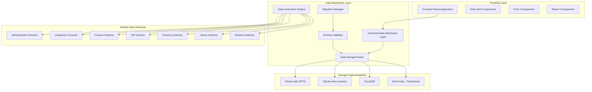

# Technical Architecture for Mock Data Expansion

## 1. Architecture Design



## 2. Technology Description

* Frontend: React\@18 + TypeScript + TailwindCSS\@3 + Vite

* State Management: React Context API + Custom Hooks

* Data Storage: Multi-model approach supporting:

  * SQLite with OPFS (Origin Private File System)

  * SQLite with Livestore

  * PouchDB with CouchDB sync

  * Mock Data (transitional, to be phased out)

* Data Generation: Faker.js for realistic data across all storage models

* Date Handling: date-fns for date manipulations

* Validation: Zod for data schema validation

* Database Libraries: sql.js, better-sqlite3, PouchDB

* Testing: Vitest + React Testing Library

## 3. Route Definitions

| Route                          | Purpose                                          |
| ------------------------------ | ------------------------------------------------ |
| /administration/students       | Student management with expanded student records |
| /administration/staff          | Staff management with comprehensive staff data   |
| /administration/partners       | Partner management with diverse partner types    |
| /administration/dormitories    | Dormitory management with occupancy tracking     |
| /administration/clubs          | Clubs and societies management                   |
| /administration/customers      | Customer relationship management                 |
| /administration/communication  | Communication templates and campaigns            |
| /academics/subjects            | Subject management with expanded subject catalog |
| /academics/grading-schemes     | Multiple grading scheme configurations           |
| /academics/results-entry       | Exam results entry with pre-populated data       |
| /academics/timetable           | Timetable management with pre-filled schedules   |
| /academics/teacher-assignments | Teacher subject assignment management            |
| /finance/chart-of-accounts     | Expanded chart of accounts management            |
| /finance/fee-templates         | Comprehensive fee template management            |
| /finance/voteheads             | Votehead definition and GL account linking       |
| /finance/payments              | Payment processing with historical data          |
| /finance/suppliers             | Supplier management with procurement lifecycle   |
| /finance/invoices              | Invoice management with various statuses         |
| /hr/payroll                    | Payroll management with multi-period data        |
| /hr/salary-settings            | Salary configuration for all staff categories    |
| /inventory/items               | Inventory item management with asset tracking    |
| /inventory/requisitions        | Requisition workflow with approval stages        |
| /inventory/purchase-orders     | Purchase order management with status tracking   |
| /library/books                 | Book catalog with comprehensive categorization   |
| /library/loans                 | Book loan management with borrowing history      |
| /library/fines                 | Fine management with fee integration             |
| /nutrition/menus               | Nutrition menu planning and management           |
| /nutrition/meal-plans          | Student meal plan assignments                    |
| /reports/academics             | Academic performance reports                     |
| /reports/finance               | Financial reports with expanded data             |
| /reports/inventory             | Inventory and procurement reports                |

## 4. Data Model Architecture

### 4.1 Core Data Model Definition

```mermaid
erDiagram
    ACADEMIC_YEAR ||--o{ SCHOOL_PERIOD : contains
    ACADEMIC_YEAR ||--o{ STUDENT_ENROLLMENT : spans
    ACADEMIC_YEAR ||--o{ FEE_STRUCTURE : applies_to
    
    DEPARTMENT ||--o{ STAFF : employs
    DEPARTMENT ||--o{ SUBJECT : offers
    
    STAFF ||--o{ TEACHER_ASSIGNMENT : has
    STAFF ||--o{ PAYROLL_RECORD : receives
    
    STUDENT ||--o{ STUDENT_ENROLLMENT : has
    STUDENT ||--o{ STUDENT_PAYMENT : makes
    STUDENT ||--o{ EXAM_RESULT : achieves
    STUDENT ||--o{ BOOK_LOAN : borrows
    STUDENT ||--o{ MEAL_ASSIGNMENT : assigned
    
    SUBJECT ||--o{ SUBJECT_PAPER : contains
    SUBJECT ||--o{ CLASS_ALLOCATION : allocated_to
    
    CHART_OF_ACCOUNT ||--o{ VOTEHEAD : links_to
    VOTEHEAD ||--o{ FEE_TEMPLATE_ITEM : defines
    
    SUPPLIER ||--o{ PURCHASE_ORDER : receives
    SUPPLIER ||--o{ SUPPLIER_INVOICE : issues
    
    INVENTORY_ITEM ||--o{ STOCK_MOVEMENT : tracks
    INVENTORY_ITEM ||--o{ REQUISITION_ITEM : requested_in
    
    BOOK ||--o{ BOOK_LOAN : loaned_as
    BOOK ||--o{ BOOK_FINE : generates
    
    ACADEMIC_YEAR {
        string id PK
        string name
        date start_date
        date end_date
        string status
        timestamp created_at
    }
    
    STUDENT {
        string id PK
        string admission_number
        string first_name
        string last_name
        string gender
        date date_of_birth
        string class_stream
        string category
        string status
        timestamp created_at
    }
    
    STAFF {
        string id PK
        string employee_number
        string first_name
        string last_name
        string department_id FK
        string designation_id FK
        string employment_type
        date hire_date
        string status
        timestamp created_at
    }
    
    SUBJECT {
        string id PK
        string name
        string code
        string department_id FK
        string category
        boolean is_compulsory
        timestamp created_at
    }
    
    CHART_OF_ACCOUNT {
        string id PK
        string account_code
        string account_name
        string account_type
        string parent_account_id FK
        boolean is_active
        timestamp created_at
    }
    
    VOTEHEAD {
        string id PK
        string name
        string description
        string expense_account_id FK
        string gl_account_id FK
        string category
        boolean is_active
        timestamp created_at
    }
    
    SUPPLIER {
        string id PK
        string name
        string contact_person
        string email
        string phone
        string address
        string status
        string procurement_status
        timestamp created_at
    }
    
    INVENTORY_ITEM {
        string id PK
        string item_code
        string name
        string category
        string unit_of_measure
        decimal unit_cost
        integer reorder_level
        string item_type
        timestamp created_at
    }
    
    BOOK {
        string id PK
        string isbn
        string title
        string author
        string category_id FK
        string book_type_id FK
        string condition
        integer borrow_count
        timestamp created_at
    }
```



### 4.2 Data Definition Language

#### Core Administration Tables

```sql
-- Academic Year Structure
CREATE TABLE academic_year_structures (
    id UUID PRIMARY KEY DEFAULT gen_random_uuid(),
    name VARCHAR(100) NOT NULL,
    description TEXT,
    period_count INTEGER NOT NULL,
    period_type VARCHAR(20) CHECK (period_type IN ('term', 'semester', 'quarter')),
    is_active BOOLEAN DEFAULT true,
    created_at TIMESTAMP WITH TIME ZONE DEFAULT NOW(),
    updated_at TIMESTAMP WITH TIME ZONE DEFAULT NOW()
);

-- Expanded Student Table
CREATE TABLE students (
    id UUID PRIMARY KEY DEFAULT gen_random_uuid(),
    admission_number VARCHAR(20) UNIQUE NOT NULL,
    first_name VARCHAR(50) NOT NULL,
    middle_name VARCHAR(50),
    last_name VARCHAR(50) NOT NULL,
    gender VARCHAR(10) CHECK (gender IN ('Male', 'Female')),
    date_of_birth DATE NOT NULL,
    class_stream VARCHAR(20) NOT NULL,
    student_category VARCHAR(20) CHECK (student_category IN ('Day Scholar', 'Boarder', 'Scholarship')),
    dormitory_id UUID REFERENCES dormitories(id),
    transport_route_id UUID REFERENCES transport_routes(id),
    parent_guardian_name VARCHAR(100),
    parent_contact VARCHAR(20),
    parent_email VARCHAR(100),
    medical_conditions TEXT,
    status VARCHAR(20) DEFAULT 'Active' CHECK (status IN ('Active', 'Inactive', 'Graduated', 'Transferred')),
    created_at TIMESTAMP WITH TIME ZONE DEFAULT NOW(),
    updated_at TIMESTAMP WITH TIME ZONE DEFAULT NOW()
);

-- Expanded Staff Table
CREATE TABLE staff (
    id UUID PRIMARY KEY DEFAULT gen_random_uuid(),
    employee_number VARCHAR(20) UNIQUE NOT NULL,
    first_name VARCHAR(50) NOT NULL,
    middle_name VARCHAR(50),
    last_name VARCHAR(50) NOT NULL,
    department_id UUID REFERENCES departments(id),
    designation_id UUID REFERENCES designations(id),
    employment_type VARCHAR(20) CHECK (employment_type IN ('Permanent', 'Contract', 'PTA', 'Volunteer')),
    hire_date DATE NOT NULL,
    salary_scale VARCHAR(20),
    bank_account VARCHAR(30),
    national_id VARCHAR(20),
    phone VARCHAR(20),
    email VARCHAR(100),
    address TEXT,
    qualifications TEXT,
    status VARCHAR(20) DEFAULT 'Active' CHECK (status IN ('Active', 'Inactive', 'Terminated', 'Retired')),
    created_at TIMESTAMP WITH TIME ZONE DEFAULT NOW(),
    updated_at TIMESTAMP WITH TIME ZONE DEFAULT NOW()
);

-- Clubs and Societies
CREATE TABLE clubs_societies (
    id UUID PRIMARY KEY DEFAULT gen_random_uuid(),
    name VARCHAR(100) NOT NULL,
    category VARCHAR(30) CHECK (category IN ('Academic', 'Sports', 'Cultural', 'Service', 'Religious')),
    patron_staff_id UUID REFERENCES staff(id),
    meeting_day VARCHAR(20),
    meeting_time TIME,
    meeting_venue VARCHAR(100),
    description TEXT,
    membership_fee DECIMAL(10,2) DEFAULT 0,
    is_active BOOLEAN DEFAULT true,
    created_at TIMESTAMP WITH TIME ZONE DEFAULT NOW(),
    updated_at TIMESTAMP WITH TIME ZONE DEFAULT NOW()
);

-- Dormitories
CREATE TABLE dormitories (
    id UUID PRIMARY KEY DEFAULT gen_random_uuid(),
    name VARCHAR(100) NOT NULL,
    gender VARCHAR(10) CHECK (gender IN ('Male', 'Female', 'Mixed')),
    capacity INTEGER NOT NULL,
    current_occupancy INTEGER DEFAULT 0,
    matron_staff_id UUID REFERENCES staff(id),
    location VARCHAR(100),
    facilities TEXT,
    monthly_fee DECIMAL(10,2),
    is_active BOOLEAN DEFAULT true,
    created_at TIMESTAMP WITH TIME ZONE DEFAULT NOW(),
    updated_at TIMESTAMP WITH TIME ZONE DEFAULT NOW()
);
```

#### Finance Module Tables

```sql
-- Voteheads Implementation
CREATE TABLE voteheads (
    id UUID PRIMARY KEY DEFAULT gen_random_uuid(),
    name VARCHAR(100) NOT NULL,
    description TEXT,
    expense_account_id UUID REFERENCES chart_of_accounts(id),
    gl_account_id UUID REFERENCES chart_of_accounts(id),
    category VARCHAR(50),
    is_active BOOLEAN DEFAULT true,
    created_at TIMESTAMP WITH TIME ZONE DEFAULT NOW(),
    updated_at TIMESTAMP WITH TIME ZONE DEFAULT NOW()
);

-- Enhanced Fee Template Items
CREATE TABLE fee_template_items (
    id UUID PRIMARY KEY DEFAULT gen_random_uuid(),
    fee_template_id UUID REFERENCES fee_templates(id),
    votehead_id UUID REFERENCES voteheads(id),
    amount DECIMAL(12,2) NOT NULL,
    is_compulsory BOOLEAN DEFAULT true,
    applies_to_category VARCHAR(50),
    created_at TIMESTAMP WITH TIME ZONE DEFAULT NOW(),
    updated_at TIMESTAMP WITH TIME ZONE DEFAULT NOW()
);

-- Student Wallet Transactions
CREATE TABLE student_wallet_transactions (
    id UUID PRIMARY KEY DEFAULT gen_random_uuid(),
    student_id UUID REFERENCES students(id),
    transaction_type VARCHAR(20) CHECK (transaction_type IN ('Credit', 'Debit')),
    amount DECIMAL(10,2) NOT NULL,
    description TEXT,
    merchant_id UUID REFERENCES merchants(id),
    reference_number VARCHAR(50),
    transaction_date TIMESTAMP WITH TIME ZONE DEFAULT NOW(),
    status VARCHAR(20) DEFAULT 'Completed' CHECK (status IN ('Pending', 'Completed', 'Failed', 'Reversed')),
    created_at TIMESTAMP WITH TIME ZONE DEFAULT NOW()
);

-- Merchants
CREATE TABLE merchants (
    id UUID PRIMARY KEY DEFAULT gen_random_uuid(),
    name VARCHAR(100) NOT NULL,
    category VARCHAR(50),
    contact_person VARCHAR(100),
    phone VARCHAR(20),
    email VARCHAR(100),
    commission_rate DECIMAL(5,2) DEFAULT 0,
    is_active BOOLEAN DEFAULT true,
    created_at TIMESTAMP WITH TIME ZONE DEFAULT NOW(),
    updated_at TIMESTAMP WITH TIME ZONE DEFAULT NOW()
);
```

#### Library Module Tables

```sql
-- Book Categories
CREATE TABLE book_categories (
    id UUID PRIMARY KEY DEFAULT gen_random_uuid(),
    name VARCHAR(100) NOT NULL,
    description TEXT,
    dewey_decimal_code VARCHAR(10),
    is_active BOOLEAN DEFAULT true,
    created_at TIMESTAMP WITH TIME ZONE DEFAULT NOW(),
    updated_at TIMESTAMP WITH TIME ZONE DEFAULT NOW()
);

-- Book Types
CREATE TABLE book_types (
    id UUID PRIMARY KEY DEFAULT gen_random_uuid(),
    name VARCHAR(50) NOT NULL,
    loan_period_days INTEGER DEFAULT 14,
    renewable BOOLEAN DEFAULT true,
    fine_per_day DECIMAL(5,2) DEFAULT 0,
    is_active BOOLEAN DEFAULT true,
    created_at TIMESTAMP WITH TIME ZONE DEFAULT NOW(),
    updated_at TIMESTAMP WITH TIME ZONE DEFAULT NOW()
);

-- Enhanced Books Table
CREATE TABLE books (
    id UUID PRIMARY KEY DEFAULT gen_random_uuid(),
    isbn VARCHAR(20),
    title VARCHAR(200) NOT NULL,
    author VARCHAR(200),
    publisher VARCHAR(100),
    publication_year INTEGER,
    category_id UUID REFERENCES book_categories(id),
    book_type_id UUID REFERENCES book_types(id),
    condition VARCHAR(20) DEFAULT 'Good' CHECK (condition IN ('Excellent', 'Good', 'Fair', 'Poor', 'Damaged')),
    location VARCHAR(50),
    purchase_price DECIMAL(10,2),
    purchase_date DATE,
    total_borrow_count INTEGER DEFAULT 0,
    current_status VARCHAR(20) DEFAULT 'Available' CHECK (current_status IN ('Available', 'Borrowed', 'Reserved', 'Damaged', 'Lost')),
    created_at TIMESTAMP WITH TIME ZONE DEFAULT NOW(),
    updated_at TIMESTAMP WITH TIME ZONE DEFAULT NOW()
);
```

#### Nutrition Module Tables

```sql
-- Meal Plans
CREATE TABLE meal_plans (
    id UUID PRIMARY KEY DEFAULT gen_random_uuid(),
    name VARCHAR(100) NOT NULL,
    description TEXT,
    daily_rate DECIMAL(8,2) NOT NULL,
    includes_breakfast BOOLEAN DEFAULT true,
    includes_lunch BOOLEAN DEFAULT true,
    includes_dinner BOOLEAN DEFAULT true,
    includes_snacks BOOLEAN DEFAULT false,
    dietary_restrictions TEXT,
    is_active BOOLEAN DEFAULT true,
    created_at TIMESTAMP WITH TIME ZONE DEFAULT NOW(),
    updated_at TIMESTAMP WITH TIME ZONE DEFAULT NOW()
);

-- Student Meal Assignments
CREATE TABLE student_meal_assignments (
    id UUID PRIMARY KEY DEFAULT gen_random_uuid(),
    student_id UUID REFERENCES students(id),
    meal_plan_id UUID REFERENCES meal_plans(id),
    academic_period_id UUID REFERENCES academic_periods(id),
    start_date DATE NOT NULL,
    end_date DATE NOT NULL,
    special_requirements TEXT,
    is_active BOOLEAN DEFAULT true,
    created_at TIMESTAMP WITH TIME ZONE DEFAULT NOW(),
    updated_at TIMESTAMP WITH TIME ZONE DEFAULT NOW()
);
```

## 5. Multi-Storage Data Generation Strategy

### 5.1 Universal Data Generation Engine

```typescript
// Universal data generation supporting all storage models
interface DataGenerationConfig {
  studentCount: number;
  staffCount: number;
  academicYears: number;
  subjectCount: number;
  storageType: 'sqlite-opfs' | 'sqlite-livestore' | 'pouchdb' | 'mock';
  migrationMode: boolean;
}

class UniversalDataGenerator {
  private faker: Faker;
  private config: DataGenerationConfig;
  private storageAdapter: IStorageAdapter;
  
  constructor(config: DataGenerationConfig, adapter: IStorageAdapter) {
    this.faker = new Faker();
    this.config = config;
    this.storageAdapter = adapter;
  }
  
  async generateAndSeed(): Promise<void> {
    const data = await this.generateAllData();
    await this.storageAdapter.seedData(data);
  }
  
  private async generateAllData(): Promise<SchoolDataSet> {
    return {
      students: await this.generateStudents(),
      staff: await this.generateStaff(),
      academics: await this.generateAcademicData(),
      finance: await this.generateFinancialData(),
      // ... other modules
    };
  }
}
```

### 5.2 Storage Adapter Interface

```typescript
interface IStorageAdapter {
  initialize(): Promise<void>;
  seedData(data: SchoolDataSet): Promise<void>;
  migrate(fromVersion: string, toVersion: string): Promise<void>;
  validateSchema(): Promise<boolean>;
  exportData(): Promise<SchoolDataSet>;
  importData(data: SchoolDataSet): Promise<void>;
}

class SQLiteOPFSAdapter implements IStorageAdapter {
  private db: Database;
  
  async initialize(): Promise<void> {
    // Initialize SQLite with OPFS
    const opfsRoot = await navigator.storage.getDirectory();
    this.db = await this.createDatabase(opfsRoot);
  }
  
  async seedData(data: SchoolDataSet): Promise<void> {
    await this.db.transaction(async (tx) => {
      // Bulk insert operations for all modules
      await this.insertStudents(tx, data.students);
      await this.insertStaff(tx, data.staff);
      // ... other data insertion
    });
  }
}

class PouchDBAdapter implements IStorageAdapter {
  private db: PouchDB.Database;
  
  async initialize(): Promise<void> {
    this.db = new PouchDB('school-management', {
      adapter: 'idb',
      auto_compaction: true
    });
  }
  
  async seedData(data: SchoolDataSet): Promise<void> {
    const docs = this.transformToDocuments(data);
    await this.db.bulkDocs(docs);
  }
}
```

### 5.3 Data Relationship Management Across Storage Types

```typescript
class UniversalRelationshipManager {
  private storageAdapter: IStorageAdapter;
  
  async validateRelationships(data: SchoolDataSet): Promise<ValidationResult> {
    const results = [];
    
    // Validate student-class relationships
    results.push(await this.validateStudentClassRelations(data));
    
    // Validate teacher-subject assignments
    results.push(await this.validateTeacherSubjectRelations(data));
    
    // Validate financial account relationships
    results.push(await this.validateFinancialRelations(data));
    
    return this.consolidateResults(results);
  }
  
  async generateDependentData(baseData: any, dependencies: string[]): Promise<any> {
    // Generate related data maintaining referential integrity
    // Works across all storage implementations
  }
}
```

## 6. Migration and Implementation Strategy

### 6.1 Migration Roadmap

```typescript
interface MigrationPlan {
  phase: 'mock' | 'sqlite-opfs' | 'sqlite-livestore' | 'pouchdb' | 'hybrid';
  timeline: string;
  dataVolume: number;
  validationCriteria: string[];
}

const migrationRoadmap: MigrationPlan[] = [
  {
    phase: 'mock',
    timeline: 'Current - Month 1',
    dataVolume: 100,
    validationCriteria: ['UI functionality', 'Report generation']
  },
  {
    phase: 'sqlite-opfs',
    timeline: 'Month 2-3',
    dataVolume: 1000,
    validationCriteria: ['OPFS persistence', 'Performance benchmarks']
  },
  {
    phase: 'sqlite-livestore',
    timeline: 'Month 3-4',
    dataVolume: 5000,
    validationCriteria: ['Real-time sync', 'Conflict resolution']
  },
  {
    phase: 'pouchdb',
    timeline: 'Month 4-5',
    dataVolume: 10000,
    validationCriteria: ['Offline capability', 'CouchDB sync']
  }
];
```

### 6.2 Storage-Specific Implementation Guidelines

#### 6.2.1 SQLite with OPFS Implementation

```typescript
class SQLiteOPFSDataSeeder {
  async seedComprehensiveData(): Promise<void> {
    // Initialize OPFS database
    const opfsRoot = await navigator.storage.getDirectory();
    const dbFile = await opfsRoot.getFileHandle('school.db', { create: true });
    
    // Create tables with proper indexing
    await this.createOptimizedSchema();
    
    // Bulk insert with transaction batching
    await this.batchInsertData({
      students: 500,
      staff: 100,
      subjects: 25,
      financialAccounts: 200
    });
  }
  
  private async createOptimizedSchema(): Promise<void> {
    const schema = `
      CREATE TABLE IF NOT EXISTS students (
        id TEXT PRIMARY KEY,
        admission_number TEXT UNIQUE,
        -- ... other fields
        created_at DATETIME DEFAULT CURRENT_TIMESTAMP
      );
      
      CREATE INDEX idx_students_class ON students(class_stream);
      CREATE INDEX idx_students_status ON students(status);
      -- ... other optimized indexes
    `;
    
    await this.db.exec(schema);
  }
}
```

#### 6.2.2 SQLite with Livestore Implementation

```typescript
class LivestoreDataManager {
  private livestore: LivestoreClient;
  
  async initializeWithComprehensiveData(): Promise<void> {
    // Configure Livestore for real-time sync
    this.livestore = new LivestoreClient({
      url: 'ws://localhost:8080',
      database: 'school_management',
      syncMode: 'realtime'
    });
    
    // Seed data with conflict resolution
    await this.seedWithConflictResolution();
  }
  
  private async seedWithConflictResolution(): Promise<void> {
    const dataGenerator = new UniversalDataGenerator({
      studentCount: 500,
      staffCount: 100,
      storageType: 'sqlite-livestore',
      migrationMode: false
    }, new LivestoreAdapter());
    
    await dataGenerator.generateAndSeed();
  }
}
```

#### 6.2.3 PouchDB Implementation

```typescript
class PouchDBDataSeeder {
  private db: PouchDB.Database;
  private remoteDB: PouchDB.Database;
  
  async setupOfflineFirstArchitecture(): Promise<void> {
    // Local PouchDB instance
    this.db = new PouchDB('school-local', {
      adapter: 'idb',
      auto_compaction: true
    });
    
    // Remote CouchDB sync
    this.remoteDB = new PouchDB('http://localhost:5984/school-remote');
    
    // Bidirectional sync
    this.db.sync(this.remoteDB, {
      live: true,
      retry: true
    });
    
    await this.seedDocumentBasedData();
  }
  
  private async seedDocumentBasedData(): Promise<void> {
    const documents = await this.generateDocuments();
    
    // Bulk insert with conflict handling
    const result = await this.db.bulkDocs(documents, {
      new_edits: false
    });
    
    console.log(`Seeded ${result.length} documents`);
  }
}
```

### 6.3 Data Migration Utilities

```typescript
class DataMigrationManager {
  async migrateFromMockToStorage(
    sourceType: 'mock',
    targetType: 'sqlite-opfs' | 'sqlite-livestore' | 'pouchdb'
  ): Promise<void> {
    // Export from mock data
    const mockData = await this.exportMockData();
    
    // Transform data format if needed
    const transformedData = await this.transformDataFormat(mockData, targetType);
    
    // Import to target storage
    const targetAdapter = this.createAdapter(targetType);
    await targetAdapter.initialize();
    await targetAdapter.importData(transformedData);
    
    // Validate migration
    await this.validateMigration(mockData, transformedData);
  }
  
  private async validateMigration(
    source: SchoolDataSet,
    target: SchoolDataSet
  ): Promise<ValidationResult> {
    return {
      recordCounts: this.compareRecordCounts(source, target),
      dataIntegrity: await this.validateDataIntegrity(target),
      relationships: await this.validateRelationships(target)
    };
  }
}
```

### 6.4 Performance Optimization Across Storage Types

#### 6.4.1 SQLite Optimizations

```sql
-- Optimized indexes for large datasets
CREATE INDEX idx_students_composite ON students(class_stream, status, created_at);
CREATE INDEX idx_payments_date_amount ON student_payments(payment_date, amount);
CREATE INDEX idx_results_student_subject ON exam_results(student_id, subject_id, exam_session_id);

-- Materialized views for complex reports
CREATE VIEW student_summary AS
SELECT 
  s.id,
  s.admission_number,
  s.first_name || ' ' || s.last_name as full_name,
  s.class_stream,
  COUNT(p.id) as payment_count,
  SUM(p.amount) as total_payments
FROM students s
LEFT JOIN student_payments p ON s.id = p.student_id
GROUP BY s.id;
```

#### 6.4.2 PouchDB Optimizations

```typescript
// Optimized document structure for PouchDB
interface StudentDocument {
  _id: string;
  type: 'student';
  admissionNumber: string;
  personalInfo: {
    firstName: string;
    lastName: string;
    dateOfBirth: string;
  };
  academic: {
    classStream: string;
    subjects: string[];
  };
  // Embedded related data for faster queries
  payments: PaymentSummary[];
  results: ResultSummary[];
}

// Optimized queries with proper indexing
const createIndexes = async (db: PouchDB.Database) => {
  await db.createIndex({
    index: {
      fields: ['type', 'academic.classStream']
    }
  });
  
  await db.createIndex({
    index: {
      fields: ['type', 'personalInfo.lastName']
    }
  });
};
```

### 6.5 Testing Strategy Across Storage Models

```typescript
class UniversalTestSuite {
  async runComprehensiveTests(storageType: StorageType): Promise<TestResults> {
    const adapter = this.createAdapter(storageType);
    
    return {
      dataGeneration: await this.testDataGeneration(adapter),
      performance: await this.testPerformance(adapter),
      dataIntegrity: await this.testDataIntegrity(adapter),
      migration: await this.testMigration(adapter),
      concurrency: await this.testConcurrency(adapter)
    };
  }
  
  private async testPerformance(adapter: IStorageAdapter): Promise<PerformanceMetrics> {
    const startTime = performance.now();
    
    // Test large dataset operations
    await adapter.seedData(this.generateLargeDataset(10000));
    
    const seedTime = performance.now() - startTime;
    
    // Test query performance
    const queryStart = performance.now();
    await adapter.query('SELECT * FROM students WHERE class_stream = ?', ['Form 1 A']);
    const queryTime = performance.now() - queryStart;
    
    return {
      seedingTime: seedTime,
      queryTime: queryTime,
      memoryUsage: this.getMemoryUsage()
    };
  }
}
```

## 7. Multi-Storage Deployment and Maintenance

### 7.1 Storage-Specific Deployment Strategies

#### 7.1.1 SQLite with OPFS Deployment

```typescript
class OPFSDeploymentManager {
  async deployToProduction(): Promise<void> {
    // Check OPFS browser support
    if (!('storage' in navigator && 'getDirectory' in navigator.storage)) {
      throw new Error('OPFS not supported in this browser');
    }
    
    // Initialize production database
    await this.initializeProductionDB();
    
    // Seed with production-ready data
    await this.seedProductionData({
      studentCount: 500,
      staffCount: 100,
      historicalYears: 3
    });
    
    // Verify deployment
    await this.verifyDeployment();
  }
  
  private async initializeProductionDB(): Promise<void> {
    const opfsRoot = await navigator.storage.getDirectory();
    const dbFile = await opfsRoot.getFileHandle('school-prod.db', { create: true });
    
    // Apply production schema with optimizations
    await this.applyProductionSchema();
  }
}
```

#### 7.1.2 PouchDB Deployment

```typescript
class PouchDBDeploymentManager {
  async deployWithCouchDBSync(): Promise<void> {
    // Setup local PouchDB
    const localDB = new PouchDB('school-production', {
      adapter: 'idb',
      auto_compaction: true,
      revs_limit: 10
    });
    
    // Configure remote CouchDB
    const remoteDB = new PouchDB(process.env.COUCHDB_URL, {
      auth: {
        username: process.env.COUCHDB_USER,
        password: process.env.COUCHDB_PASS
      }
    });
    
    // Setup bidirectional sync
    const sync = localDB.sync(remoteDB, {
      live: true,
      retry: true,
      filter: 'school/active_records'
    });
    
    // Seed initial data
    await this.seedPouchDBData(localDB);
  }
}
```

### 7.2 Data Migration and Backup Strategies

```typescript
class UniversalBackupManager {
  async createBackup(storageType: StorageType): Promise<BackupResult> {
    const adapter = this.createAdapter(storageType);
    const data = await adapter.exportData();
    
    const backup = {
      timestamp: new Date().toISOString(),
      storageType,
      dataVersion: '1.0',
      data,
      checksum: await this.calculateChecksum(data)
    };
    
    // Store backup based on storage type
    switch (storageType) {
      case 'sqlite-opfs':
        return await this.storeOPFSBackup(backup);
      case 'pouchdb':
        return await this.storePouchDBBackup(backup);
      case 'sqlite-livestore':
        return await this.storeLivestoreBackup(backup);
    }
  }
  
  async restoreFromBackup(
    backup: SchoolDataBackup,
    targetStorage: StorageType
  ): Promise<void> {
    // Validate backup integrity
    await this.validateBackup(backup);
    
    // Create target adapter
    const adapter = this.createAdapter(targetStorage);
    await adapter.initialize();
    
    // Restore data
    await adapter.importData(backup.data);
    
    // Verify restoration
    await this.verifyRestoration(backup, adapter);
  }
}
```

### 7.3 Performance Monitoring Across Storage Types

```typescript
class UniversalPerformanceMonitor {
  private metrics: Map<StorageType, PerformanceMetrics> = new Map();
  
  async monitorAllStorageTypes(): Promise<void> {
    const storageTypes: StorageType[] = ['sqlite-opfs', 'sqlite-livestore', 'pouchdb'];
    
    for (const type of storageTypes) {
      const metrics = await this.collectMetrics(type);
      this.metrics.set(type, metrics);
      
      // Alert if performance degrades
      if (metrics.queryTime > 1000) { // 1 second threshold
        await this.alertPerformanceIssue(type, metrics);
      }
    }
  }
  
  private async collectMetrics(storageType: StorageType): Promise<PerformanceMetrics> {
    const adapter = this.createAdapter(storageType);
    
    return {
      queryTime: await this.measureQueryTime(adapter),
      insertTime: await this.measureInsertTime(adapter),
      memoryUsage: await this.measureMemoryUsage(adapter),
      storageSize: await this.measureStorageSize(adapter)
    };
  }
}
```

### 7.4 Ongoing Maintenance Procedures

#### 7.4.1 Data Freshness and Updates

```typescript
class DataMaintenanceScheduler {
  async scheduleMaintenanceTasks(): Promise<void> {
    // Weekly data refresh
    this.scheduleTask('weekly', async () => {
      await this.refreshAcademicData();
      await this.updateFinancialRecords();
    });
    
    // Monthly data cleanup
    this.scheduleTask('monthly', async () => {
      await this.archiveOldRecords();
      await this.optimizeStoragePerformance();
    });
    
    // Quarterly data validation
    this.scheduleTask('quarterly', async () => {
      await this.validateDataIntegrity();
      await this.generateDataQualityReport();
    });
  }
  
  private async optimizeStoragePerformance(): Promise<void> {
    // SQLite optimization
    await this.runSQLiteVacuum();
    
    // PouchDB compaction
    await this.compactPouchDB();
    
    // Livestore optimization
    await this.optimizeLivestore();
  }
}
```

## 8. Transition Planning and Risk Mitigation

### 8.1 Phased Transition Strategy

```typescript
interface TransitionPhase {
  name: string;
  duration: string;
  objectives: string[];
  successCriteria: string[];
  rollbackPlan: string;
}

const transitionPlan: TransitionPhase[] = [
  {
    name: 'Mock Data Enhancement',
    duration: '2 weeks',
    objectives: [
      'Expand mock data to 500+ students',
      'Implement comprehensive test scenarios',
      'Validate all UI components'
    ],
    successCriteria: [
      'All dropdowns populated',
      'Reports generate successfully',
      'Performance benchmarks met'
    ],
    rollbackPlan: 'Revert to previous mock data version'
  },
  {
    name: 'SQLite OPFS Integration',
    duration: '3 weeks',
    objectives: [
      'Implement OPFS storage adapter',
      'Migrate data from mock to SQLite',
      'Validate persistence across sessions'
    ],
    successCriteria: [
      'Data persists after browser restart',
      'Query performance < 100ms',
      'No data corruption detected'
    ],
    rollbackPlan: 'Switch back to mock data with feature flag'
  },
  {
    name: 'Livestore Real-time Sync',
    duration: '4 weeks',
    objectives: [
      'Implement Livestore integration',
      'Enable real-time collaboration',
      'Handle conflict resolution'
    ],
    successCriteria: [
      'Real-time updates work across clients',
      'Conflicts resolved automatically',
      'Sync latency < 500ms'
    ],
    rollbackPlan: 'Disable real-time features, use SQLite OPFS'
  },
  {
    name: 'PouchDB Offline-First',
    duration: '3 weeks',
    objectives: [
      'Implement PouchDB with CouchDB sync',
      'Enable offline functionality',
      'Validate sync reliability'
    ],
    successCriteria: [
      'Works offline for 24+ hours',
      'Sync resumes automatically when online',
      'No data loss during sync conflicts'
    ],
    rollbackPlan: 'Use SQLite with Livestore as fallback'
  }
];
```

### 8.2 Risk Mitigation Strategies

```typescript
class RiskMitigationManager {
  private risks = [
    {
      risk: 'Browser compatibility issues with OPFS',
      probability: 'Medium',
      impact: 'High',
      mitigation: 'Implement feature detection and fallback to IndexedDB'
    },
    {
      risk: 'Performance degradation with large datasets',
      probability: 'High',
      impact: 'Medium',
      mitigation: 'Implement pagination, lazy loading, and data archiving'
    },
    {
      risk: 'Data corruption during migration',
      probability: 'Low',
      impact: 'Critical',
      mitigation: 'Comprehensive backup strategy and validation checks'
    },
    {
      risk: 'Network issues affecting PouchDB sync',
      probability: 'Medium',
      impact: 'Medium',
      mitigation: 'Robust offline mode and sync retry mechanisms'
    }
  ];
  
  async implementMitigations(): Promise<void> {
    // Feature detection for OPFS
    if (!this.isOPFSSupported()) {
      await this.enableIndexedDBFallback();
    }
    
    // Performance monitoring
    await this.setupPerformanceAlerts();
    
    // Backup automation
    await this.scheduleAutomaticBackups();
    
    // Network resilience
    await this.implementOfflineQueue();
  }
}
```

### 8.3 Success Metrics and Monitoring

```typescript
interface SuccessMetrics {
  dataIntegrity: number; // Percentage of data validation checks passed
  performance: {
    queryTime: number; // Average query response time in ms
    syncLatency: number; // Real-time sync latency in ms
    offlineCapability: number; // Hours of offline operation supported
  };
  userExperience: {
    loadTime: number; // Application load time in seconds
    errorRate: number; // Percentage of operations resulting in errors
    featureCompleteness: number; // Percentage of features working correctly
  };
}

class TransitionMonitor {
  async trackTransitionSuccess(): Promise<SuccessMetrics> {
    return {
      dataIntegrity: await this.calculateDataIntegrity(),
      performance: {
        queryTime: await this.measureAverageQueryTime(),
        syncLatency: await this.measureSyncLatency(),
        offlineCapability: await this.testOfflineCapability()
      },
      userExperience: {
        loadTime: await this.measureLoadTime(),
        errorRate: await this.calculateErrorRate(),
        featureCompleteness: await this.validateFeatureCompleteness()
      }
    };
  }
}
```

