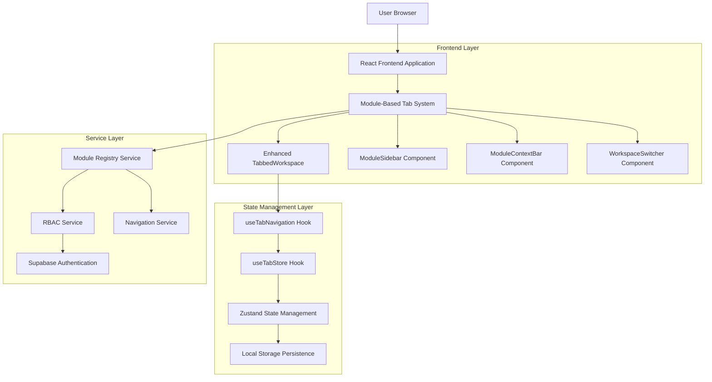
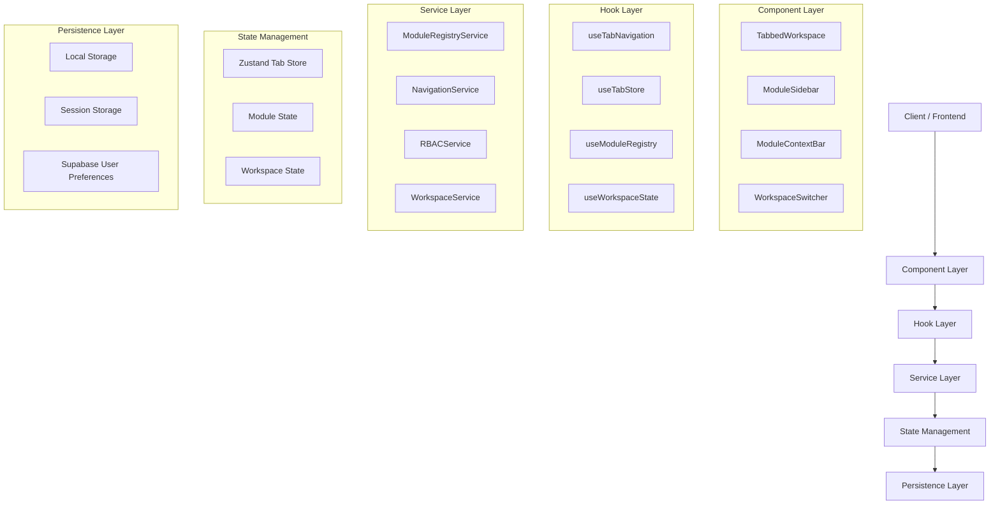
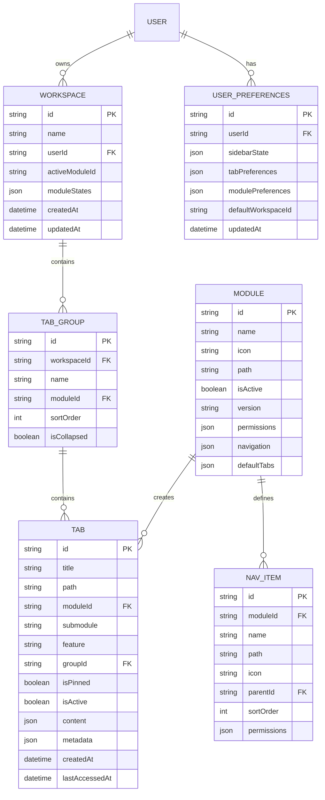

# Module-Based Tab System - Technical Architecture Document

> **⚠️ DOCUMENT STATUS: SUPERSEDED**
> 
> This document has been superseded by the [Navigation System Analysis and Recommendations](./navigation_system_analysis_and_recommendations.md) document. After comprehensive analysis, it was determined that the existing navigation system already implements the architecture patterns described in this document effectively.
> 
> **Recommendation**: Maintain the current technical architecture instead of implementing the changes described below.

## 1. Architecture Design



## 2. Technology Description

* Frontend: React\@18 + TypeScript\@5 + Tailwind CSS\@3 + Vite

* State Management: Zustand\@4 (existing tab store enhancement)

* Authentication: Supabase (existing integration)

* UI Components: Headless UI + Heroicons

* Drag & Drop: @dnd-kit/core\@6

* Animations: Framer Motion\@10

## 3. Route Definitions

| Route                       | Purpose                                     |
| --------------------------- | ------------------------------------------- |
| /workspace                  | Main workspace with module-based tab system |
| /workspace/:moduleId        | Direct module access with tab restoration   |
| /workspace/:moduleId/:tabId | Direct tab access within module context     |
| /workspace/settings         | Workspace configuration and preferences     |
| /workspace/history          | Tab history and recently closed tabs        |

## 4. API Definitions

### 4.1 Enhanced Tab Store API

**Module-aware tab creation**

```typescript
interface CreateTabOptions {
  title: string;
  content: TabContent;
  moduleId: string;
  submodule?: string;
  feature?: string;
  workspaceId?: string;
  groupId?: string;
  isPinned?: boolean;
}

function createModuleTab(options: CreateTabOptions): Tab
```

**Module navigation**

```typescript
function switchToModule(moduleId: string): void
function getTabsByModule(moduleId: string): Tab[]
function closeTabsByModule(moduleId: string): void
function pinTabsInModule(moduleId: string, tabIds: string[]): void
```

**Workspace management**

```typescript
interface WorkspaceState {
  id: string;
  name: string;
  activeModuleId: string;
  tabGroups: TabGroup[];
  moduleStates: Record<string, ModuleState>;
}

function switchWorkspace(workspaceId: string): void
function saveWorkspaceState(): void
function restoreWorkspaceState(workspaceId: string): void
```

### 4.2 Module Registry API

**Module registration and retrieval**

```typescript
interface ModuleDefinition {
  id: string;
  name: string;
  icon: string;
  path: string;
  isActive: boolean;
  permissions: string[];
  navigation: NavItem[];
  defaultTabs?: DefaultTab[];
}

function getAvailableModules(): ModuleDefinition[]
function getModuleById(moduleId: string): ModuleDefinition | null
function checkModuleAccess(moduleId: string, userRole: string): boolean
```

### 4.3 Tab Management API

**Bulk operations**

```typescript
function bulkCloseTabsByFilter(filter: TabFilter): void
function bulkPinTabs(tabIds: string[]): void
function bulkMoveTabsToGroup(tabIds: string[], groupId: string): void
function searchTabs(query: string): Tab[]
```

**Tab history**

```typescript
interface TabHistoryEntry {
  tab: Tab;
  closedAt: Date;
  moduleId: string;
  workspaceId: string;
}

function getTabHistory(limit?: number): TabHistoryEntry[]
function restoreTabFromHistory(entryId: string): void
function clearTabHistory(): void
```

## 5. Server Architecture Diagram



## 6. Data Model

### 6.1 Data Model Definition



### 6.2 Data Definition Language

**Enhanced Tab Store Schema**

```typescript
// Extended tab interface
interface Tab {
  id: string;
  title: string;
  path: string;
  moduleId: string;
  submodule?: string;
  feature?: string;
  groupId?: string;
  workspaceId: string;
  isPinned: boolean;
  isActive: boolean;
  content: TabContent;
  metadata: TabMetadata;
  createdAt: Date;
  lastAccessedAt: Date;
}

// Tab group for organization
interface TabGroup {
  id: string;
  name: string;
  moduleId: string;
  workspaceId: string;
  tabs: Tab[];
  isCollapsed: boolean;
  sortOrder: number;
}

// Module state tracking
interface ModuleState {
  moduleId: string;
  isActive: boolean;
  activeTabId?: string;
  lastAccessedAt: Date;
  tabGroups: TabGroup[];
  sidebarExpanded: boolean;
}

// Workspace configuration
interface WorkspaceConfig {
  id: string;
  name: string;
  userId: string;
  activeModuleId: string;
  moduleStates: Record<string, ModuleState>;
  preferences: WorkspacePreferences;
  createdAt: Date;
  updatedAt: Date;
}

// User preferences for workspace behavior
interface WorkspacePreferences {
  sidebarWidth: number;
  sidebarCollapsed: boolean;
  tabCloseConfirmation: boolean;
  autoGroupTabs: boolean;
  maxTabsPerGroup: number;
  tabHistoryLimit: number;
  defaultModuleId?: string;
}
```

**Local Storage Schema**

```typescript
// Workspace state persistence
const WORKSPACE_STORAGE_KEY = 'schoolpilot_workspace_state';
const TAB_HISTORY_STORAGE_KEY = 'schoolpilot_tab_history';
const USER_PREFERENCES_STORAGE_KEY = 'schoolpilot_user_preferences';

// Storage structure
interface StoredWorkspaceState {
  currentWorkspaceId: string;
  workspaces: Record<string, WorkspaceConfig>;
  tabHistory: TabHistoryEntry[];
  userPreferences: WorkspacePreferences;
  lastSavedAt: Date;
}
```

**Module Registry Schema**

```typescript
// Enhanced module definition
interface EnhancedModuleDefinition extends ModuleDefinition {
  defaultTabs?: DefaultTab[];
  tabGrouping?: TabGroupingConfig;
  contextActions?: ContextAction[];
  shortcuts?: KeyboardShortcut[];
}

interface DefaultTab {
  title: string;
  path: string;
  content: TabContent;
  isPinned?: boolean;
  autoCreate?: boolean;
}

interface TabGroupingConfig {
  autoGroup: boolean;
  groupBy: 'feature' | 'submodule' | 'custom';
  maxTabsPerGroup: number;
  groupNaming: string;
}

interface ContextAction {
  id: string;
  label: string;
  icon: string;
  action: string;
  permissions?: string[];
  shortcut?: string;
}
```

## 7. Implementation Phases

### Phase 1: Core Infrastructure

* Enhance existing tab store with module awareness

* Create base module registry service

* Implement workspace state management

### Phase 2: UI Components

* Develop ModuleSidebar component

* Create ModuleContextBar component

* Implement WorkspaceSwitcher component

### Phase 3: Advanced Features

* Add drag-and-drop functionality

* Implement tab grouping and bulk operations

* Create tab history and search features

### Phase 4: Integration & Polish

* RBAC integration for module access

* Performance optimization

* User preference persistence

* Comprehensive testing

## 8. Performance Considerations

* **Lazy Loading**: Modules and tabs loaded on-demand

* **Virtual Scrolling**: For large tab lists and history

* **Memoization**: React.memo for tab components

* **State Optimization**: Selective re-renders with Zustand

* **Persistence Throttling**: Debounced state saving

* **Memory Management**: Automatic cleanup of inactive tabs

