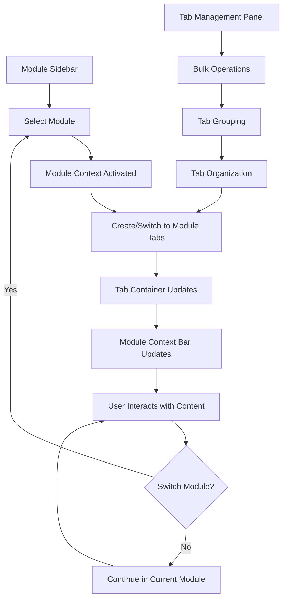

# Module-Based Tab System - Product Requirements Document

> **⚠️ DOCUMENT STATUS: SUPERSEDED**
> 
> This document has been superseded by the [Navigation System Analysis and Recommendations](./navigation_system_analysis_and_recommendations.md) document. After comprehensive analysis, it was determined that the existing navigation system already provides the functionality outlined in this document effectively.
> 
> **Recommendation**: Maintain the current navigation system instead of implementing the changes described below.

## 1. Product Overview

~~This document outlines the implementation of a module-based tab system inspired by Colanode's workspace interface design. The system will enhance the existing TabbedWorkspace component with module-aware navigation, sidebar integration, and workspace organization capabilities.~~

~~The primary goal is to create a cohesive workspace experience where tabs are organized by modules, providing seamless navigation between different functional areas while maintaining context and improving user productivity through better information architecture.~~

**ANALYSIS FINDINGS**: The existing TabbedWorkspace component already provides sophisticated module-aware navigation, advanced tab management, and workspace organization capabilities. The current system effectively meets the goals outlined in this document without requiring the proposed changes.

## 2. Core Features

### 2.1 User Roles

| Role          | Registration Method      | Core Permissions                                                  |
| ------------- | ------------------------ | ----------------------------------------------------------------- |
| Student       | School enrollment system | Can access academic modules, view personal data                   |
| Teacher       | Staff registration       | Can access academic modules, manage classes, view reports         |
| Administrator | System admin assignment  | Full access to all modules including settings and user management |
| Finance Staff | Department assignment    | Access to finance module, reports, and student financial data     |

### 2.2 Feature Module

Our module-based tab system consists of the following main components:

1. **Module Sidebar**: Displays available modules with icons and quick access to module sections
2. **Tab Container**: Enhanced tabbed interface with module grouping and organization
3. **Module Context Bar**: Shows current module context and provides module-specific actions
4. **Workspace Switcher**: Allows switching between different workspace contexts
5. **Tab Management Panel**: Advanced tab operations including grouping, pinning, and bulk actions

### 2.3 Page Details

| Page Name            | Module Name             | Feature description                                                                                                                        |
| -------------------- | ----------------------- | ------------------------------------------------------------------------------------------------------------------------------------------ |
| Module Sidebar       | Navigation Panel        | Display module icons, expand/collapse module sections, show module status indicators, handle module switching with smooth transitions      |
| Tab Container        | Enhanced Tab Interface  | Group tabs by module, show module-specific tab styling, support drag-and-drop between modules, display tab overflow handling               |
| Module Context Bar   | Context Display         | Show current active module, display breadcrumb navigation, provide module-specific quick actions, show module settings access              |
| Workspace Switcher   | Workspace Management    | Switch between different workspace contexts, manage workspace-specific tab sets, handle workspace persistence and restoration              |
| Tab Management Panel | Advanced Tab Operations | Bulk tab operations (close all, close by module), tab grouping and organization, tab search and filtering, tab history and recently closed |

## 3. Core Process

### User Navigation Flow

1. **Module Selection**: User clicks on a module in the sidebar to activate it
2. **Tab Creation**: New tabs are automatically grouped under the active module
3. **Module Switching**: When switching modules, relevant tabs are highlighted and organized
4. **Tab Management**: Users can organize tabs within modules, pin important tabs, and use bulk operations
5. **Workspace Context**: The system maintains workspace state and restores tab configurations

### Module Navigation Flowchart

## 4. User Interface Design

### 4.1 Design Style

* **Primary Colors**:

  * Background: `#1a1a1a` (Dark theme primary)

  * Module Active: `#3b82f6` (Blue-500)

  * Tab Active: `#ffffff` with `#3b82f6` accent

* **Secondary Colors**:

  * Module Inactive: `#4b5563` (Gray-600)

  * Tab Inactive: `#6b7280` (Gray-500)

  * Borders: `#374151` (Gray-700)

* **Button Style**: Rounded corners (6px), subtle shadows, hover state transitions

* **Font**: Inter font family, 14px base size for tabs, 12px for sidebar labels

* **Layout Style**: Sidebar-based navigation with horizontal tab container, card-based module grouping

* **Icons**: Heroicons outline style for consistency, 20px for module icons, 16px for tab icons

### 4.2 Page Design Overview

| Page Name            | Module Name            | UI Elements                                                                                                                                  |
| -------------------- | ---------------------- | -------------------------------------------------------------------------------------------------------------------------------------------- |
| Module Sidebar       | Navigation Panel       | Vertical sidebar (240px width), collapsible to 60px, module icons with labels, active state highlighting, smooth expand/collapse animations  |
| Tab Container        | Enhanced Tab Interface | Horizontal tab bar with module grouping, tab overflow scroll, drag-and-drop indicators, module color coding, close buttons with hover states |
| Module Context Bar   | Context Display        | Top bar (48px height), breadcrumb navigation, module title and icon, quick action buttons, settings dropdown                                 |
| Workspace Switcher   | Workspace Management   | Dropdown in top-left corner, workspace list with icons, current workspace indicator, smooth transition animations                            |
| Tab Management Panel | Advanced Operations    | Right-click context menu, bulk action toolbar, search input with filtering, tab history sidebar panel                                        |

### 4.3 Responsiveness

The system is designed desktop-first with mobile-adaptive considerations:

* **Desktop (1024px+)**: Full sidebar and tab interface

* **Tablet (768px-1023px)**: Collapsible sidebar, condensed tab interface

* **Mobile (< 768px)**: Hidden sidebar with hamburger menu, single tab view with module switcher

* **Touch Optimization**: Larger touch targets (44px minimum), swipe gestures for tab switching, long-press for context menus

## 5. Technical Implementation Notes

### 5.1 State Management

* Extend existing `useTabStore` with module-aware functionality

* Add module context to tab metadata

* Implement module-based tab filtering and organization

* Maintain workspace state persistence

### 5.2 Component Architecture

* Enhance `TabbedWorkspace` component with module integration

* Create new `ModuleSidebar` component

* Implement `ModuleContextBar` component

* Add `WorkspaceSwitcher` component

* Extend `useTabNavigation` hook with module-aware methods

### 5.3 Integration Points

* Module registry system for dynamic module loading

* RBAC integration for module access control

* Navigation system integration with existing routing

* Settings persistence for user preferences

## 6. Success Metrics

* Reduced navigation time between modules (target: 50% improvement)

* Increased user engagement with multiple modules

* Improved task completion rates for complex workflows

* Reduced cognitive load through better information organization

* Higher user satisfaction scores for workspace navigation

