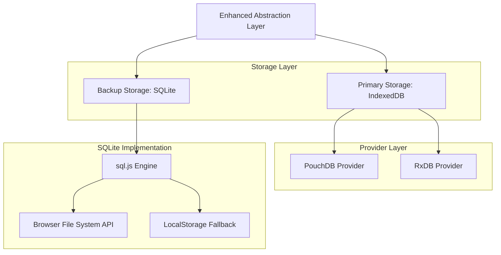

# SQLite Backup Implementation Guide

## Overview

This guide provides detailed implementation instructions for integrating SQLite as a backup storage solution for the Dual-Database Architecture, replacing the deprecated WebSQL. The implementation uses sql.js library to provide SQLite functionality in the browser environment.

## 1. Architecture Overview



## 2. Technology Stack

- **SQLite Engine**: sql.js@1.8+ (SQLite compiled to WebAssembly)
- **File Storage**: File System Access API (with LocalStorage fallback)
- **Compression**: pako@2.1+ for backup compression
- **Encryption**: crypto-js@4.1+ for backup encryption (optional)
- **Serialization**: Custom binary serialization for performance

## 3. Core Implementation

### 3.1 SQLite Backup Provider

**File: `src/services/database/backup/SQLiteBackupProvider.ts`**

```typescript
// ABOUTME: SQLite backup provider using sql.js for browser-based SQLite functionality
// ABOUTME: Handles backup creation, restoration, and storage management with compression

import initSqlJs, { Database, SqlJsStatic } from 'sql.js';
import pako from 'pako';
import CryptoJS from 'crypto-js';

export interface BackupConfig {
  compression: boolean;
  encryption: boolean;
  encryptionKey?: string;
  autoBackup: boolean;
  backupInterval: number; // milliseconds
  maxBackups: number;
  storageQuota: number; // bytes
}

export interface BackupMetadata {
  id: string;
  timestamp: Date;
  version: string;
  collections: string[];
  size: number;
  compressed: boolean;
  encrypted: boolean;
  checksum: string;
}

export interface BackupData {
  metadata: BackupMetadata;
  data: Uint8Array;
}

export class SQLiteBackupProvider {
  private sql: SqlJsStatic | null = null;
  private db: Database | null = null;
  private config: BackupConfig;
  private backupTimer: NodeJS.Timeout | null = null;
  
  constructor(config: BackupConfig) {
    this.config = {
      compression: true,
      encryption: false,
      autoBackup: true,
      backupInterval: 5 * 60 * 1000, // 5 minutes
      maxBackups: 10,
      storageQuota: 100 * 1024 * 1024, // 100MB
      ...config
    };
  }
  
  async initialize(): Promise<void> {
    try {
      // Initialize sql.js with WebAssembly
      this.sql = await initSqlJs({
        locateFile: (file) => `https://sql.js.org/dist/${file}`
      });
      
      // Create in-memory database for backup operations
      this.db = new this.sql.Database();
      
      // Initialize backup schema
      await this.initializeBackupSchema();
      
      // Start auto-backup if enabled
      if (this.config.autoBackup) {
        this.startAutoBackup();
      }
      
      console.log('✅ SQLite backup provider initialized');
      
    } catch (error) {
      console.error('❌ Failed to initialize SQLite backup provider:', error);
      throw error;
    }
  }
  
  private async initializeBackupSchema(): Promise<void> {
    if (!this.db) throw new Error('Database not initialized');
    
    // Create backup metadata table
    this.db.run(`
      CREATE TABLE IF NOT EXISTS backup_metadata (
        id TEXT PRIMARY KEY,
        timestamp INTEGER NOT NULL,
        version TEXT NOT NULL,
        collections TEXT NOT NULL,
        size INTEGER NOT NULL,
        compressed BOOLEAN NOT NULL,
        encrypted BOOLEAN NOT NULL,
        checksum TEXT NOT NULL
      )
    `);
    
    // Create backup data table
    this.db.run(`
      CREATE TABLE IF NOT EXISTS backup_data (
        backup_id TEXT PRIMARY KEY,
        data BLOB NOT NULL,
        FOREIGN KEY (backup_id) REFERENCES backup_metadata(id)
      )
    `);
    
    // Create indexes for performance
    this.db.run('CREATE INDEX IF NOT EXISTS idx_backup_timestamp ON backup_metadata(timestamp)');
    this.db.run('CREATE INDEX IF NOT EXISTS idx_backup_version ON backup_metadata(version)');
  }
  
  async createBackup(collections: Record<string, any[]>): Promise<string> {
    if (!this.db) throw new Error('Database not initialized');
    
    try {
      const backupId = this.generateBackupId();
      const timestamp = new Date();
      
      // Serialize collection data
      const serializedData = this.serializeCollections(collections);
      
      // Compress if enabled
      let processedData = serializedData;
      if (this.config.compression) {
        processedData = pako.gzip(serializedData);
      }
      
      // Encrypt if enabled
      if (this.config.encryption && this.config.encryptionKey) {
        const encrypted = CryptoJS.AES.encrypt(
          Buffer.from(processedData).toString('base64'),
          this.config.encryptionKey
        ).toString();
        processedData = new TextEncoder().encode(encrypted);
      }
      
      // Calculate checksum
      const checksum = this.calculateChecksum(processedData);
      
      // Create metadata
      const metadata: BackupMetadata = {
        id: backupId,
        timestamp,
        version: '1.0.0',
        collections: Object.keys(collections),
        size: processedData.length,
        compressed: this.config.compression,
        encrypted: this.config.encryption,
        checksum
      };
      
      // Store in SQLite
      await this.storeBackup(metadata, processedData);
      
      // Clean up old backups
      await this.cleanupOldBackups();
      
      console.log(`✅ Backup created: ${backupId} (${this.formatBytes(processedData.length)})`);
      return backupId;
      
    } catch (error) {
      console.error('❌ Failed to create backup:', error);
      throw error;
    }
  }
  
  async restoreBackup(backupId: string): Promise<Record<string, any[]>> {
    if (!this.db) throw new Error('Database not initialized');
    
    try {
      // Get backup metadata
      const metadataResult = this.db.exec(
        'SELECT * FROM backup_metadata WHERE id = ?',
        [backupId]
      );
      
      if (metadataResult.length === 0) {
        throw new Error(`Backup not found: ${backupId}`);
      }
      
      const metadataRow = metadataResult[0].values[0];
      const metadata: BackupMetadata = {
        id: metadataRow[0] as string,
        timestamp: new Date(metadataRow[1] as number),
        version: metadataRow[2] as string,
        collections: JSON.parse(metadataRow[3] as string),
        size: metadataRow[4] as number,
        compressed: metadataRow[5] as boolean,
        encrypted: metadataRow[6] as boolean,
        checksum: metadataRow[7] as string
      };
      
      // Get backup data
      const dataResult = this.db.exec(
        'SELECT data FROM backup_data WHERE backup_id = ?',
        [backupId]
      );
      
      if (dataResult.length === 0) {
        throw new Error(`Backup data not found: ${backupId}`);
      }
      
      let processedData = dataResult[0].values[0][0] as Uint8Array;
      
      // Verify checksum
      const calculatedChecksum = this.calculateChecksum(processedData);
      if (calculatedChecksum !== metadata.checksum) {
        throw new Error('Backup data corrupted: checksum mismatch');
      }
      
      // Decrypt if needed
      if (metadata.encrypted && this.config.encryptionKey) {
        const decrypted = CryptoJS.AES.decrypt(
          new TextDecoder().decode(processedData),
          this.config.encryptionKey
        ).toString(CryptoJS.enc.Utf8);
        processedData = new Uint8Array(Buffer.from(decrypted, 'base64'));
      }
      
      // Decompress if needed
      if (metadata.compressed) {
        processedData = pako.ungzip(processedData);
      }
      
      // Deserialize collections
      const collections = this.deserializeCollections(processedData);
      
      console.log(`✅ Backup restored: ${backupId}`);
      return collections;
      
    } catch (error) {
      console.error('❌ Failed to restore backup:', error);
      throw error;
    }
  }
  
  async listBackups(): Promise<BackupMetadata[]> {
    if (!this.db) throw new Error('Database not initialized');
    
    const result = this.db.exec(
      'SELECT * FROM backup_metadata ORDER BY timestamp DESC'
    );
    
    if (result.length === 0) return [];
    
    return result[0].values.map(row => ({
      id: row[0] as string,
      timestamp: new Date(row[1] as number),
      version: row[2] as string,
      collections: JSON.parse(row[3] as string),
      size: row[4] as number,
      compressed: row[5] as boolean,
      encrypted: row[6] as boolean,
      checksum: row[7] as string
    }));
  }
  
  async deleteBackup(backupId: string): Promise<void> {
    if (!this.db) throw new Error('Database not initialized');
    
    this.db.run('DELETE FROM backup_data WHERE backup_id = ?', [backupId]);
    this.db.run('DELETE FROM backup_metadata WHERE id = ?', [backupId]);
    
    console.log(`🗑️ Backup deleted: ${backupId}`);
  }
  
  async exportBackup(backupId: string): Promise<Blob> {
    if (!this.db) throw new Error('Database not initialized');
    
    // Export entire SQLite database as blob
    const data = this.db.export();
    return new Blob([data], { type: 'application/x-sqlite3' });
  }
  
  async importBackup(file: File): Promise<string[]> {
    try {
      const arrayBuffer = await file.arrayBuffer();
      const data = new Uint8Array(arrayBuffer);
      
      // Create new database from imported data
      if (!this.sql) throw new Error('SQL.js not initialized');
      const importedDb = new this.sql.Database(data);
      
      // Get backup IDs from imported database
      const result = importedDb.exec('SELECT id FROM backup_metadata');
      const backupIds = result.length > 0 ? result[0].values.map(row => row[0] as string) : [];
      
      // Merge with current database
      await this.mergeDatabase(importedDb);
      
      importedDb.close();
      
      console.log(`✅ Imported ${backupIds.length} backups from file`);
      return backupIds;
      
    } catch (error) {
      console.error('❌ Failed to import backup:', error);
      throw error;
    }
  }
  
  private async storeBackup(metadata: BackupMetadata, data: Uint8Array): Promise<void> {
    if (!this.db) throw new Error('Database not initialized');
    
    // Insert metadata
    this.db.run(
      `INSERT INTO backup_metadata 
       (id, timestamp, version, collections, size, compressed, encrypted, checksum) 
       VALUES (?, ?, ?, ?, ?, ?, ?, ?)`,
      [
        metadata.id,
        metadata.timestamp.getTime(),
        metadata.version,
        JSON.stringify(metadata.collections),
        metadata.size,
        metadata.compressed,
        metadata.encrypted,
        metadata.checksum
      ]
    );
    
    // Insert data
    this.db.run(
      'INSERT INTO backup_data (backup_id, data) VALUES (?, ?)',
      [metadata.id, data]
    );
  }
  
  private async cleanupOldBackups(): Promise<void> {
    if (!this.db) throw new Error('Database not initialized');
    
    // Get backup count
    const countResult = this.db.exec('SELECT COUNT(*) FROM backup_metadata');
    const backupCount = countResult[0].values[0][0] as number;
    
    if (backupCount > this.config.maxBackups) {
      // Delete oldest backups
      const toDelete = backupCount - this.config.maxBackups;
      const oldBackupsResult = this.db.exec(
        'SELECT id FROM backup_metadata ORDER BY timestamp ASC LIMIT ?',
        [toDelete]
      );
      
      for (const row of oldBackupsResult[0].values) {
        const backupId = row[0] as string;
        await this.deleteBackup(backupId);
      }
      
      console.log(`🧹 Cleaned up ${toDelete} old backups`);
    }
  }
  
  private serializeCollections(collections: Record<string, any[]>): Uint8Array {
    // Custom binary serialization for better performance
    const jsonString = JSON.stringify(collections);
    return new TextEncoder().encode(jsonString);
  }
  
  private deserializeCollections(data: Uint8Array): Record<string, any[]> {
    const jsonString = new TextDecoder().decode(data);
    return JSON.parse(jsonString);
  }
  
  private calculateChecksum(data: Uint8Array): string {
    const hash = CryptoJS.SHA256(CryptoJS.lib.WordArray.create(data));
    return hash.toString();
  }
  
  private generateBackupId(): string {
    return `backup_${Date.now()}_${Math.random().toString(36).substr(2, 9)}`;
  }
  
  private formatBytes(bytes: number): string {
    if (bytes === 0) return '0 Bytes';
    const k = 1024;
    const sizes = ['Bytes', 'KB', 'MB', 'GB'];
    const i = Math.floor(Math.log(bytes) / Math.log(k));
    return parseFloat((bytes / Math.pow(k, i)).toFixed(2)) + ' ' + sizes[i];
  }
  
  private startAutoBackup(): void {
    if (this.backupTimer) {
      clearInterval(this.backupTimer);
    }
    
    this.backupTimer = setInterval(() => {
      // Auto-backup will be triggered by the main database service
      console.log('🔄 Auto-backup interval triggered');
    }, this.config.backupInterval);
  }
  
  private async mergeDatabase(importedDb: Database): Promise<void> {
    // Implementation for merging imported database with current database
    // This would involve copying data from importedDb to this.db
    // while handling conflicts and duplicates
  }
  
  async destroy(): Promise<void> {
    if (this.backupTimer) {
      clearInterval(this.backupTimer);
      this.backupTimer = null;
    }
    
    if (this.db) {
      this.db.close();
      this.db = null;
    }
    
    this.sql = null;
    console.log('🔄 SQLite backup provider destroyed');
  }
  
  getStats(): {
    backupCount: number;
    totalSize: number;
    oldestBackup: Date | null;
    newestBackup: Date | null;
  } {
    if (!this.db) {
      return {
        backupCount: 0,
        totalSize: 0,
        oldestBackup: null,
        newestBackup: null
      };
    }
    
    const statsResult = this.db.exec(`
      SELECT 
        COUNT(*) as count,
        SUM(size) as total_size,
        MIN(timestamp) as oldest,
        MAX(timestamp) as newest
      FROM backup_metadata
    `);
    
    if (statsResult.length === 0) {
      return {
        backupCount: 0,
        totalSize: 0,
        oldestBackup: null,
        newestBackup: null
      };
    }
    
    const row = statsResult[0].values[0];
    return {
      backupCount: row[0] as number,
      totalSize: row[1] as number || 0,
      oldestBackup: row[2] ? new Date(row[2] as number) : null,
      newestBackup: row[3] ? new Date(row[3] as number) : null
    };
  }
}
```

## 4. Integration with Enhanced Abstraction Layer

### 4.1 Updated Database Provider Interface

**File: `src/services/database/abstractions/interfaces/IDatabaseProvider.ts` (Updated)**

```typescript
// Add SQLite backup support to the interface

import { SQLiteBackupProvider, BackupConfig } from '../../backup/SQLiteBackupProvider';

export interface IDatabaseProvider {
  // ... existing methods ...
  
  // SQLite backup methods
  initializeBackup(config: BackupConfig): Promise<void>;
  createBackup(): Promise<string>;
  restoreFromBackup(backupId: string): Promise<void>;
  listBackups(): Promise<BackupMetadata[]>;
  deleteBackup(backupId: string): Promise<void>;
  exportBackup(backupId: string): Promise<Blob>;
  importBackup(file: File): Promise<string[]>;
  getBackupStats(): BackupStats;
}

export interface BackupStats {
  backupCount: number;
  totalSize: number;
  oldestBackup: Date | null;
  newestBackup: Date | null;
  lastBackup: Date | null;
  autoBackupEnabled: boolean;
}
```

### 4.2 Updated PouchDB Provider with SQLite Backup

**File: `src/services/database/providers/pouchdb/PouchDBProvider.ts` (Updated)**

```typescript
// Add SQLite backup integration

import { SQLiteBackupProvider, BackupConfig } from '../../backup/SQLiteBackupProvider';

export class PouchDBProvider implements IDatabaseProvider {
  // ... existing properties ...
  private backupProvider: SQLiteBackupProvider | null = null;
  
  async initializeBackup(config: BackupConfig): Promise<void> {
    this.backupProvider = new SQLiteBackupProvider(config);
    await this.backupProvider.initialize();
    console.log('✅ SQLite backup initialized for PouchDB provider');
  }
  
  async createBackup(): Promise<string> {
    if (!this.backupProvider) {
      throw new Error('Backup provider not initialized');
    }
    
    // Collect data from all collections
    const collections: Record<string, any[]> = {};
    
    for (const [name, collection] of this.collections) {
      const docs = await collection.find();
      collections[name] = docs;
    }
    
    return await this.backupProvider.createBackup(collections);
  }
  
  async restoreFromBackup(backupId: string): Promise<void> {
    if (!this.backupProvider) {
      throw new Error('Backup provider not initialized');
    }
    
    const collections = await this.backupProvider.restoreBackup(backupId);
    
    // Clear existing data and restore from backup
    for (const [name, docs] of Object.entries(collections)) {
      const collection = this.collections.get(name);
      if (collection) {
        await collection.clear();
        if (docs.length > 0) {
          await collection.insertMany(docs);
        }
      }
    }
    
    console.log(`✅ Restored from backup: ${backupId}`);
  }
  
  async listBackups(): Promise<BackupMetadata[]> {
    if (!this.backupProvider) {
      throw new Error('Backup provider not initialized');
    }
    
    return await this.backupProvider.listBackups();
  }
  
  async deleteBackup(backupId: string): Promise<void> {
    if (!this.backupProvider) {
      throw new Error('Backup provider not initialized');
    }
    
    await this.backupProvider.deleteBackup(backupId);
  }
  
  async exportBackup(backupId: string): Promise<Blob> {
    if (!this.backupProvider) {
      throw new Error('Backup provider not initialized');
    }
    
    return await this.backupProvider.exportBackup(backupId);
  }
  
  async importBackup(file: File): Promise<string[]> {
    if (!this.backupProvider) {
      throw new Error('Backup provider not initialized');
    }
    
    return await this.backupProvider.importBackup(file);
  }
  
  getBackupStats(): BackupStats {
    if (!this.backupProvider) {
      return {
        backupCount: 0,
        totalSize: 0,
        oldestBackup: null,
        newestBackup: null,
        lastBackup: null,
        autoBackupEnabled: false
      };
    }
    
    const stats = this.backupProvider.getStats();
    return {
      ...stats,
      lastBackup: stats.newestBackup,
      autoBackupEnabled: true
    };
  }
  
  async destroy(): Promise<void> {
    // ... existing destroy logic ...
    
    if (this.backupProvider) {
      await this.backupProvider.destroy();
      this.backupProvider = null;
    }
  }
}
```

## 5. Configuration and Environment Setup

### 5.1 Environment Variables

**File: `.env.example` (Updated)**

```bash
# SQLite Backup Configuration
VITE_BACKUP_ENABLED=true
VITE_BACKUP_COMPRESSION=true
VITE_BACKUP_ENCRYPTION=false
VITE_BACKUP_ENCRYPTION_KEY=your_encryption_key_here
VITE_BACKUP_AUTO_BACKUP=true
VITE_BACKUP_INTERVAL=300000
VITE_BACKUP_MAX_BACKUPS=10
VITE_BACKUP_STORAGE_QUOTA=104857600

# SQL.js Configuration
VITE_SQLJS_WASM_URL=https://sql.js.org/dist/sql-wasm.wasm
VITE_SQLJS_JS_URL=https://sql.js.org/dist/sql-wasm.js
```

### 5.2 Vite Configuration

**File: `vite.config.ts` (Updated)**

```typescript
import { defineConfig } from 'vite';
import react from '@vitejs/plugin-react';
import { resolve } from 'path';

export default defineConfig({
  plugins: [react()],
  resolve: {
    alias: {
      '@': resolve(__dirname, 'src'),
      '@database': resolve(__dirname, 'src/services/database')
    }
  },
  define: {
    global: 'globalThis'
  },
  optimizeDeps: {
    include: [
      'sql.js',
      'pako',
      'crypto-js',
      'pouchdb',
      'pouchdb-find',
      'rxjs',
      'joi',
      'uuid'
    ]
  },
  worker: {
    format: 'es'
  },
  server: {
    headers: {
      'Cross-Origin-Embedder-Policy': 'require-corp',
      'Cross-Origin-Opener-Policy': 'same-origin'
    }
  }
});
```

## 6. Testing Strategy

### 6.1 SQLite Backup Tests

**File: `src/services/database/backup/__tests__/SQLiteBackupProvider.test.ts`**

```typescript
// ABOUTME: Comprehensive tests for SQLite backup functionality
// ABOUTME: Tests backup creation, restoration, compression, encryption, and error handling

import { SQLiteBackupProvider, BackupConfig } from '../SQLiteBackupProvider';

describe('SQLiteBackupProvider', () => {
  let backupProvider: SQLiteBackupProvider;
  let config: BackupConfig;
  
  beforeEach(() => {
    config = {
      compression: true,
      encryption: false,
      autoBackup: false,
      backupInterval: 60000,
      maxBackups: 5,
      storageQuota: 10 * 1024 * 1024
    };
    
    backupProvider = new SQLiteBackupProvider(config);
  });
  
  afterEach(async () => {
    await backupProvider.destroy();
  });
  
  describe('Initialization', () => {
    it('should initialize SQLite backup provider', async () => {
      await backupProvider.initialize();
      
      const stats = backupProvider.getStats();
      expect(stats.backupCount).toBe(0);
    });
  });
  
  describe('Backup Operations', () => {
    beforeEach(async () => {
      await backupProvider.initialize();
    });
    
    it('should create and restore backup', async () => {
      const testData = {
        users: [
          { id: '1', name: 'John Doe', email: 'john@example.com' },
          { id: '2', name: 'Jane Smith', email: 'jane@example.com' }
        ],
        students: [
          { id: '1', firstName: 'Alice', lastName: 'Johnson' }
        ]
      };
      
      // Create backup
      const backupId = await backupProvider.createBackup(testData);
      expect(backupId).toBeDefined();
      
      // Verify backup exists
      const backups = await backupProvider.listBackups();
      expect(backups).toHaveLength(1);
      expect(backups[0].id).toBe(backupId);
      expect(backups[0].collections).toEqual(['users', 'students']);
      
      // Restore backup
      const restoredData = await backupProvider.restoreBackup(backupId);
      expect(restoredData).toEqual(testData);
    });
    
    it('should handle compression', async () => {
      const largeData = {
        test: Array(1000).fill({
          id: 'test',
          data: 'This is a large string that should compress well'.repeat(10)
        })
      };
      
      const backupId = await backupProvider.createBackup(largeData);
      const backups = await backupProvider.listBackups();
      
      // Compressed size should be smaller than original
      const originalSize = JSON.stringify(largeData).length;
      expect(backups[0].size).toBeLessThan(originalSize);
      expect(backups[0].compressed).toBe(true);
      
      // Should restore correctly
      const restoredData = await backupProvider.restoreBackup(backupId);
      expect(restoredData).toEqual(largeData);
    });
    
    it('should handle encryption', async () => {
      const encryptedConfig = {
        ...config,
        encryption: true,
        encryptionKey: 'test-encryption-key'
      };
      
      const encryptedProvider = new SQLiteBackupProvider(encryptedConfig);
      await encryptedProvider.initialize();
      
      const testData = {
        sensitive: [{ id: '1', secret: 'confidential data' }]
      };
      
      const backupId = await encryptedProvider.createBackup(testData);
      const backups = await encryptedProvider.listBackups();
      
      expect(backups[0].encrypted).toBe(true);
      
      const restoredData = await encryptedProvider.restoreBackup(backupId);
      expect(restoredData).toEqual(testData);
      
      await encryptedProvider.destroy();
    });
    
    it('should cleanup old backups', async () => {
      const limitedConfig = {
        ...config,
        maxBackups: 2
      };
      
      const limitedProvider = new SQLiteBackupProvider(limitedConfig);
      await limitedProvider.initialize();
      
      // Create 3 backups
      await limitedProvider.createBackup({ test1: [{ id: '1' }] });
      await limitedProvider.createBackup({ test2: [{ id: '2' }] });
      await limitedProvider.createBackup({ test3: [{ id: '3' }] });
      
      // Should only keep 2 backups
      const backups = await limitedProvider.listBackups();
      expect(backups).toHaveLength(2);
      
      await limitedProvider.destroy();
    });
  });
  
  describe('Error Handling', () => {
    beforeEach(async () => {
      await backupProvider.initialize();
    });
    
    it('should handle corrupted backup data', async () => {
      // This would require mocking the SQLite database to return corrupted data
      // Implementation depends on testing framework capabilities
    });
    
    it('should handle missing backup', async () => {
      await expect(backupProvider.restoreBackup('non-existent'))
        .rejects.toThrow('Backup not found');
    });
  });
});
```

## 7. Performance Considerations

### 7.1 Optimization Strategies

1. **Lazy Loading**: Load sql.js only when backup functionality is needed
2. **Web Workers**: Perform backup operations in web workers to avoid blocking UI
3. **Streaming**: Use streaming for large backup operations
4. **Compression**: Enable compression by default to reduce storage usage
5. **Indexing**: Use SQLite indexes for fast backup metadata queries

### 7.2 Memory Management

```typescript
// Example of memory-efficient backup processing
export class OptimizedSQLiteBackupProvider extends SQLiteBackupProvider {
  private async createBackupInChunks(collections: Record<string, any[]>): Promise<string> {
    const chunkSize = 1000; // Process 1000 documents at a time
    
    for (const [collectionName, documents] of Object.entries(collections)) {
      for (let i = 0; i < documents.length; i += chunkSize) {
        const chunk = documents.slice(i, i + chunkSize);
        await this.processChunk(collectionName, chunk);
        
        // Allow garbage collection
        if (i % (chunkSize * 10) === 0) {
          await new Promise(resolve => setTimeout(resolve, 0));
        }
      }
    }
  }
}
```

## 8. Security Considerations

### 8.1 Encryption Best Practices

1. **Key Management**: Store encryption keys securely (not in localStorage)
2. **Key Rotation**: Implement key rotation for long-term security
3. **Secure Deletion**: Ensure deleted backups are securely wiped
4. **Access Control**: Implement proper access controls for backup operations

### 8.2 Data Privacy

```typescript
// Example of privacy-aware backup configuration
export const createPrivacyAwareBackupConfig = (): BackupConfig => {
  return {
    compression: true,
    encryption: true,
    encryptionKey: generateSecureKey(),
    autoBackup: true,
    backupInterval: 15 * 60 * 1000, // 15 minutes
    maxBackups: 5,
    storageQuota: 50 * 1024 * 1024 // 50MB
  };
};

function generateSecureKey(): string {
  // Use Web Crypto API for secure key generation
  const array = new Uint8Array(32);
  crypto.getRandomValues(array);
  return Array.from(array, byte => byte.toString(16).padStart(2, '0')).join('');
}
```

## 9. Deployment and Production Considerations

### 9.1 CDN Configuration

For production deployments, host sql.js files on your own CDN:

```typescript
// Production configuration
const SQLJS_CONFIG = {
  locateFile: (file: string) => {
    if (process.env.NODE_ENV === 'production') {
      return `https://your-cdn.com/sql.js/${file}`;
    }
    return `https://sql.js.org/dist/${file}`;
  }
};
```

### 9.2 Service Worker Integration

```typescript
// Service worker for offline backup functionality
self.addEventListener('message', async (event) => {
  if (event.data.type === 'CREATE_BACKUP') {
    try {
      const backupProvider = new SQLiteBackupProvider(event.data.config);
      await backupProvider.initialize();
      
      const backupId = await backupProvider.createBackup(event.data.collections);
      
      self.postMessage({
        type: 'BACKUP_CREATED',
        backupId,
        success: true
      });
    } catch (error) {
      self.postMessage({
        type: 'BACKUP_ERROR',
        error: error.message,
        success: false
      });
    }
  }
});
```

## 10. Migration from WebSQL

For systems currently using WebSQL, here's a migration strategy:

### 10.1 WebSQL to SQLite Migration

```typescript
export class WebSQLToSQLiteMigration {
  static async migrate(): Promise<void> {
    if (!window.openDatabase) {
      console.log('WebSQL not available, skipping migration');
      return;
    }
    
    try {
      // Open existing WebSQL database
      const webSqlDb = window.openDatabase('schoolpilot_backup', '1.0', 'SchoolPilot Backup', 5 * 1024 * 1024);
      
      // Extract data from WebSQL
      const webSqlData = await this.extractWebSQLData(webSqlDb);
      
      // Initialize SQLite backup provider
      const sqliteProvider = new SQLiteBackupProvider({
        compression: true,
        encryption: false,
        autoBackup: true,
        backupInterval: 5 * 60 * 1000,
        maxBackups: 10,
        storageQuota: 100 * 1024 * 1024
      });
      
      await sqliteProvider.initialize();
      
      // Create backup from WebSQL data
      if (Object.keys(webSqlData).length > 0) {
        await sqliteProvider.createBackup(webSqlData);
        console.log('✅ Successfully migrated WebSQL data to SQLite');
      }
      
      // Clean up WebSQL (optional)
      // Note: WebSQL cannot be programmatically deleted
      console.log('⚠️ WebSQL data still exists. Consider manual cleanup.');
      
    } catch (error) {
      console.error('❌ Failed to migrate from WebSQL:', error);
      throw error;
    }
  }
  
  private static async extractWebSQLData(db: Database): Promise<Record<string, any[]>> {
    return new Promise((resolve, reject) => {
      const collections: Record<string, any[]> = {};
      
      db.transaction((tx) => {
        // Get all table names
        tx.executeSql(
          "SELECT name FROM sqlite_master WHERE type='table'",
          [],
          (tx, result) => {
            const tables = [];
            for (let i = 0; i < result.rows.length; i++) {
              const tableName = result.rows.item(i).name;
              if (tableName !== '__WebKitDatabaseInfoTable__') {
                tables.push(tableName);
              }
            }
            
            // Extract data from each table
            let completedTables = 0;
            
            for (const tableName of tables) {
              tx.executeSql(
                `SELECT * FROM ${tableName}`,
                [],
                (tx, result) => {
                  const rows = [];
                  for (let i = 0; i < result.rows.length; i++) {
                    rows.push(result.rows.item(i));
                  }
                  collections[tableName] = rows;
                  
                  completedTables++;
                  if (completedTables === tables.length) {
                    resolve(collections);
                  }
                },
                (tx, error) => {
                  console.error(`Failed to extract data from table ${tableName}:`, error);
                  completedTables++;
                  if (completedTables === tables.length) {
                    resolve(collections);
                  }
                  return false;
                }
              );
            }
            
            if (tables.length === 0) {
              resolve(collections);
            }
          },
          (tx, error) => {
            reject(error);
            return false;
          }
        );
      });
    });
  }
}
```

This comprehensive SQLite backup implementation provides a robust, secure, and performant replacement for the deprecated WebSQL backup system, ensuring data integrity and availability across all supported browsers and platforms.