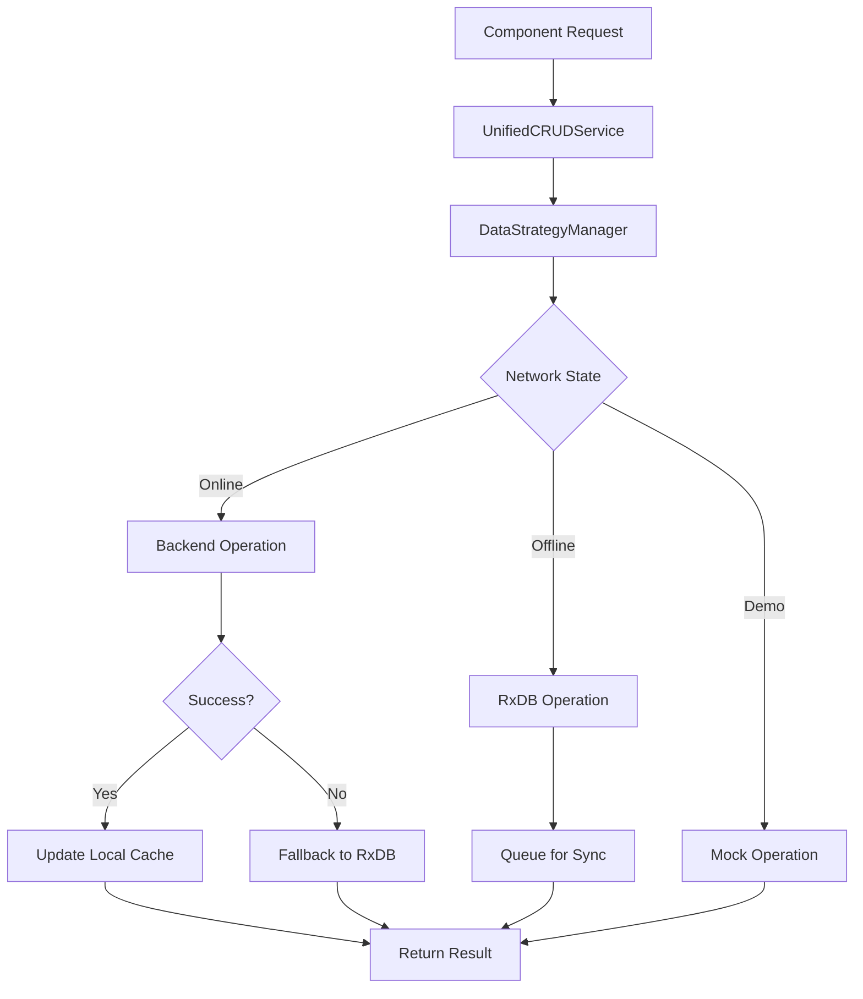
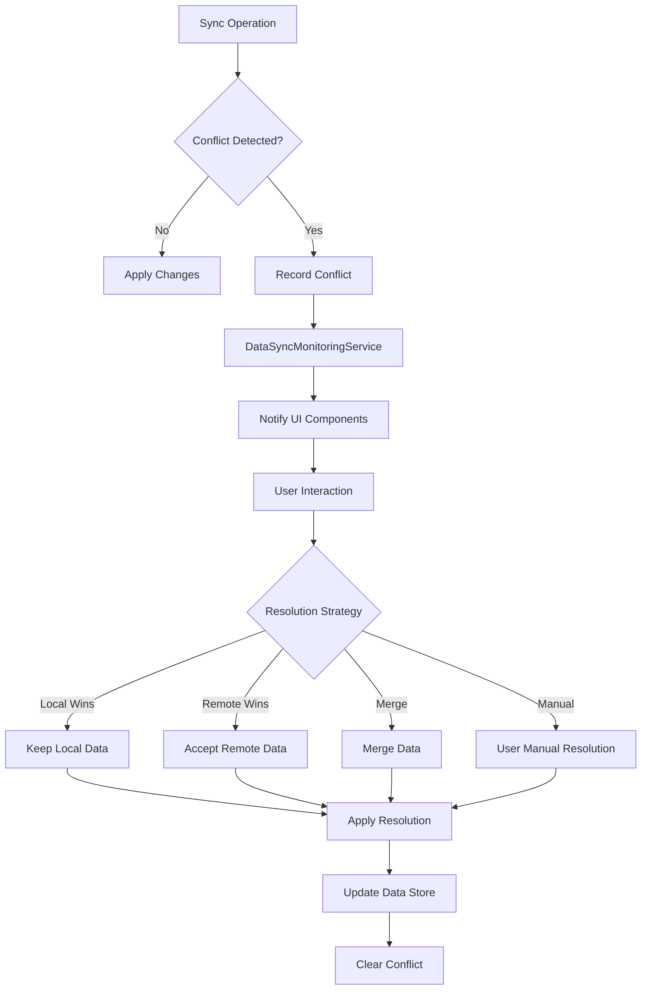
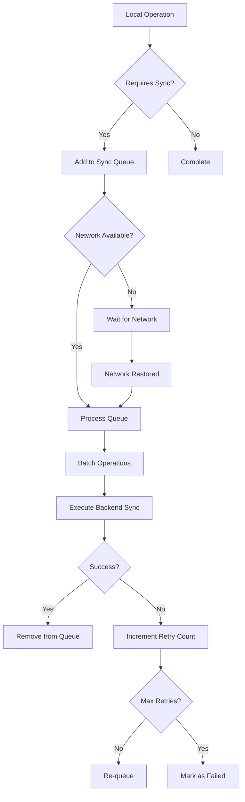

# SchoolPilot Sync System & Data Architecture Documentation

## 1. Overview

The SchoolPilot application features a sophisticated synchronization and data management system designed to provide robust offline-first capabilities with intelligent conflict resolution. This system enables seamless operation across different network conditions while maintaining data consistency and integrity.

### Key Features
- **Offline-First Architecture**: Prioritizes local data operations with background synchronization
- **Intelligent Conflict Resolution**: Automated and manual conflict resolution strategies
- **Multi-Strategy Data Operations**: Supports offline-first, online-first, and hybrid modes
- **Real-time Network Monitoring**: Continuous backend health checks and connection quality assessment
- **Performance Monitoring**: Comprehensive metrics and sync status tracking
- **Unified CRUD Interface**: Consistent API across all data sources (mock, RxDB, backend)

## 2. Core Architecture Components

### 2.1 DataSyncMonitoringService

**Location**: `src/services/DataSyncMonitoringService.ts`

**Purpose**: Central monitoring and conflict management service that tracks synchronization operations, detects conflicts, and provides resolution mechanisms.

#### Key Interfaces:

```typescript
export interface SyncConflict {
  id: string;
  entityName: string;
  entityId: string | number;
  conflictType: 'version' | 'concurrent_edit' | 'deleted_locally' | 'deleted_remotely';
  localData: any;
  remoteData: any;
  timestamp: Date;
  resolved: boolean;
  resolution?: ConflictResolution;
}

export interface SyncStatus {
  isActive: boolean;
  mode: 'idle' | 'syncing' | 'paused' | 'error';
  progress: { current: number; total: number; percentage: number };
  queue: { pending: number; processing: number; completed: number; failed: number };
  conflicts: { total: number; unresolved: number; byType: Record<string, number> };
  performance: { averageSyncTime: number; successRate: number; throughput: number };
}
```

#### Core Responsibilities:
- **Conflict Detection**: Identifies data conflicts during sync operations
- **Conflict Resolution**: Provides multiple resolution strategies (local_wins, remote_wins, merge, manual)
- **Sync Monitoring**: Tracks sync progress, performance metrics, and error rates
- **Status Broadcasting**: Notifies subscribers of sync status changes
- **Error Management**: Records and manages sync errors with retry logic

#### Key Methods:
- `recordConflict()`: Records new conflicts when detected
- `resolveConflict()`: Applies resolution strategies to conflicts
- `getSyncStatus()`: Returns comprehensive sync status information
- `subscribe()`: Allows components to listen for sync status updates

### 2.2 DataStrategyManager

**Location**: `src/services/DataStrategyManager.ts`

**Purpose**: Intelligent routing and execution engine that determines optimal data operation strategies based on network conditions and application configuration.

#### Data Strategies:

```typescript
export interface DataStrategy {
  mode: 'offline-first' | 'online-first' | 'hybrid' | 'demo';
  fallbackMode: 'offline' | 'cache' | 'error';
  syncPolicy: 'immediate' | 'batched' | 'manual';
  conflictResolution: 'server-wins' | 'client-wins' | 'merge' | 'prompt';
  batchSize?: number;
  syncInterval?: number;
}
```

#### Operation Planning:
- **Offline-First**: Prioritizes local RxDB operations with background sync
- **Online-First**: Attempts backend operations first, falls back to local storage
- **Hybrid**: Intelligent routing based on operation type and network quality
- **Demo**: Uses mock data exclusively for demonstration purposes

#### Sync Queue Management:
- **Priority-Based Queuing**: Operations queued by priority (critical, high, normal, low)
- **Batch Processing**: Configurable batch sizes for efficient sync operations
- **Retry Logic**: Automatic retry with exponential backoff for failed operations
- **Persistent Queue**: Sync queue persisted in RxDB for reliability

### 2.3 NetworkStateManager

**Location**: `src/services/NetworkStateManager.ts`

**Purpose**: Singleton service that monitors network connectivity and backend availability with real-time health checks.

#### Network State Interface:

```typescript
export interface NetworkState {
  isOnline: boolean;
  backendAvailable: boolean;
  latency: number | null;
  lastCheck: Date;
  connectionQuality: 'excellent' | 'good' | 'poor' | 'offline';
}
```

#### Monitoring Features:
- **Real-time Connectivity**: Listens to browser online/offline events
- **Backend Health Checks**: Periodic health endpoint polling (30-second intervals)
- **Latency Measurement**: Tracks response times for quality assessment
- **Connection Quality**: Categorizes connection based on latency and availability
- **Demo Mode Support**: Handles demo environments without backend dependencies

#### Quality Determination:
- **Excellent**: < 100ms latency, backend available
- **Good**: < 300ms latency, backend available
- **Poor**: > 300ms latency or backend unavailable but online
- **Offline**: No network connectivity

### 2.4 UnifiedCRUDService

**Location**: `src/services/UnifiedCRUDService.ts`

**Purpose**: Provides a consistent CRUD interface across all data sources with intelligent caching and validation.

#### Features:
- **Multi-Source Support**: Works with mock data, RxDB, and backend APIs
- **Intelligent Caching**: TTL-based caching with entity-level invalidation
- **Data Validation**: Integration with DataConsistencyService for validation
- **Batch Operations**: Support for bulk CRUD operations
- **Result Metadata**: Detailed operation results with source tracking

#### Cache Management:

```typescript
export interface CacheEntry<T> {
  data: T;
  timestamp: Date;
  ttl: number;
  source: string;
  entityName: string;
  key: string;
}
```

#### CRUD Result Interface:

```typescript
export interface CRUDResult<T> {
  success: boolean;
  data?: T;
  error?: Error;
  validation?: ValidationResult;
  cached?: boolean;
  source: 'mock' | 'rxdb' | 'backend' | 'cache' | 'validation' | 'error';
  timestamp: Date;
}
```

## 3. Data Flow Architecture

### 3.1 Operation Execution Flow



### 3.2 Conflict Resolution Workflow



### 3.3 Sync Queue Processing



## 4. Integration with AppDataContext

### 4.1 Context Enhancement

**Location**: `src/contexts/AppDataContext.tsx`

The AppDataContext has been enhanced to expose sync and conflict resolution capabilities:

```typescript
export interface EnhancedAppDataContextType extends AppDataContextType {
  // Sync Status
  syncStatus: SyncStatus;
  networkState: NetworkState;
  
  // Conflict Resolution
  conflicts: SyncConflict[];
  resolveConflict: (conflictId: string, strategy: ConflictResolutionStrategy) => Promise<boolean>;
  resolveAllConflicts: (strategy: ConflictResolutionStrategy) => Promise<void>;
  
  // Sync Control
  forceSyncAll: () => Promise<void>;
  clearSyncQueue: () => void;
  
  // Performance Metrics
  syncMetrics: SyncMetrics;
}
```

### 4.2 Integration Points

1. **Conflict Resolution UI**: `FeatureSettings.tsx` integrates with conflict resolution
2. **Network Status Display**: Real-time network state in UI components
3. **Sync Progress**: Visual indicators for sync operations
4. **Performance Monitoring**: Metrics display in admin interfaces

## 5. Conflict Resolution System

### 5.1 Conflict Types

- **Version Conflicts**: Same entity modified in multiple places
- **Concurrent Edit**: Simultaneous modifications detected
- **Deleted Locally**: Entity deleted locally but modified remotely
- **Deleted Remotely**: Entity deleted remotely but modified locally

### 5.2 Resolution Strategies

#### Local Wins Strategy
- Preserves local changes
- Discards remote modifications
- Suitable for user-centric data

#### Remote Wins Strategy
- Accepts remote changes
- Overwrites local modifications
- Suitable for authoritative server data

#### Merge Strategy
- Combines local and remote changes
- Uses intelligent merge algorithms
- Preserves creation timestamps
- Uses latest update timestamps

#### Manual Resolution
- Presents conflict to user
- Allows custom resolution
- Provides side-by-side comparison
- Supports field-level resolution

### 5.3 UI Integration

**Component**: `ConflictResolutionComponent` in `src/components/OfflineCapability.tsx`

```typescript
interface ConflictResolutionProps {
  conflicts: Array<{
    id: string;
    entityName: string;
    localData: any;
    serverData: any; // Mapped from remoteData
    conflictType: string;
  }>;
  onResolve: (conflictId: string, strategy: string) => void;
  onResolveAll: (strategy: string) => void;
}
```

## 6. Performance Monitoring

### 6.1 Metrics Collection

```typescript
export interface SyncMetrics {
  totalOperations: number;
  successfulOperations: number;
  failedOperations: number;
  averageLatency: number;
  peakLatency: number;
  throughput: number; // operations per minute
  errorRate: number;
  conflictRate: number;
  cacheHitRate: number;
}
```

### 6.2 Performance Tracking

- **Operation Latency**: Tracks time for each sync operation
- **Success Rates**: Monitors operation success/failure ratios
- **Throughput Measurement**: Operations per minute calculation
- **Cache Efficiency**: Hit/miss ratios for cache operations
- **Conflict Frequency**: Tracks conflict occurrence rates

## 7. Configuration and Usage

### 7.1 Strategy Configuration

```typescript
// Example configuration for different environments
const developmentStrategy: DataStrategy = {
  mode: 'offline-first',
  fallbackMode: 'cache',
  syncPolicy: 'immediate',
  conflictResolution: 'prompt',
  batchSize: 5,
  syncInterval: 10000
};

const productionStrategy: DataStrategy = {
  mode: 'hybrid',
  fallbackMode: 'offline',
  syncPolicy: 'batched',
  conflictResolution: 'merge',
  batchSize: 20,
  syncInterval: 30000
};
```

### 7.2 Service Initialization

```typescript
// Initialize sync system
const dataStrategyManager = new DataStrategyManager(
  strategy,
  rxdbService,
  mockDataService
);

const syncMonitoringService = new DataSyncMonitoringService(
  dataStrategyManager
);

const unifiedCRUDService = new UnifiedCRUDService(
  dataStrategyManager,
  mockDataService,
  rxdbService
);
```

### 7.3 Component Usage

```typescript
// Using sync capabilities in components
const { 
  conflicts, 
  resolveConflict, 
  syncStatus, 
  networkState 
} = useAppData();

// Handle conflict resolution
const handleResolveConflict = async (conflictId: string) => {
  await resolveConflict(conflictId, 'merge');
};

// Monitor sync status
const isSyncing = syncStatus.mode === 'syncing';
const hasConflicts = conflicts.length > 0;
```

## 8. Error Handling and Recovery

### 8.1 Error Types

- **Network Errors**: Connection timeouts, server unavailable
- **Validation Errors**: Data consistency violations
- **Conflict Errors**: Unresolvable data conflicts
- **Storage Errors**: Local database operation failures

### 8.2 Recovery Mechanisms

- **Automatic Retry**: Exponential backoff for transient errors
- **Graceful Degradation**: Fallback to offline mode
- **Error Reporting**: Comprehensive error logging and metrics
- **User Notification**: Clear error messages and recovery options

## 9. Testing and Validation

### 9.1 Test Coverage Areas

- **Conflict Resolution**: All resolution strategies
- **Network Transitions**: Online/offline state changes
- **Data Consistency**: Validation across all operations
- **Performance**: Load testing and metrics validation
- **Error Scenarios**: Failure mode testing

### 9.2 Integration Testing

- **End-to-End Sync**: Complete sync workflows
- **Multi-Device Scenarios**: Conflict generation and resolution
- **Network Simulation**: Various connection qualities
- **Data Migration**: Schema changes and data preservation

## 10. Future Enhancements

### 10.1 Planned Features

- **Advanced Merge Algorithms**: Field-level conflict resolution
- **Sync Optimization**: Delta sync and compression
- **Real-time Collaboration**: WebSocket-based live updates
- **Audit Trail**: Complete operation history tracking
- **Custom Resolution Rules**: User-defined conflict resolution

### 10.2 Scalability Considerations

- **Horizontal Scaling**: Multi-instance sync coordination
- **Data Partitioning**: Entity-based sync optimization
- **Bandwidth Optimization**: Selective sync and compression
- **Storage Management**: Automatic cleanup and archiving

This comprehensive sync system provides a robust foundation for offline-first applications with sophisticated conflict resolution and performance monitoring capabilities.