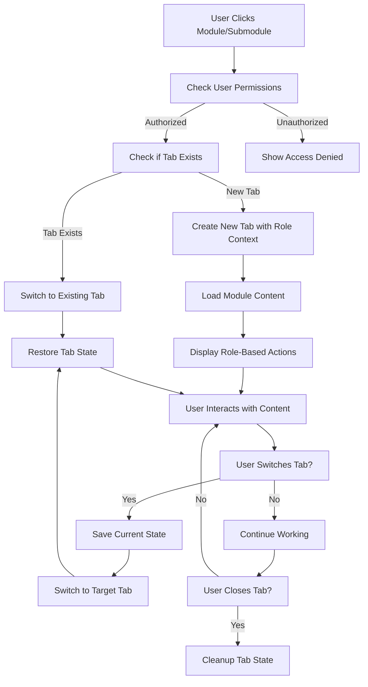

# Tabbed Workspace System - Product Requirements Document

## 1. Product Overview

The Tabbed Workspace System transforms Schoolpilot's navigation experience by implementing industry-standard tabbed interfaces with contextual action bars across all modules including academics, administration, finance, HR, inventory, library, nutrition, reports, and settings. This system enables efficient multi-tasking, reduces cognitive load, and provides contextual actions that adapt to user workflows with proper role-based access control.

The system addresses the core problem of navigation complexity in educational management software by providing intuitive tab-based workflows with module-specific action bars that surface relevant functionality at the right time based on user roles and permissions. Features include tab pinning, grouping, bulk operations, and intelligent state management across the comprehensive multi-module architecture.

## 2. Core Features

### 2.1 User Roles

| Role | Registration Method | Core Permissions | Module Access |
|------|---------------------|------------------|---------------|
| Teacher | System assignment by administrator | Can access academic modules, manage assigned classes, view student data | Academics, Reports (limited) |
| Class Teacher | Promoted from teacher role | Additional permissions for class management, parent communication, student attendance | Academics, Administration (limited), Reports |
| Department Head | Administrative assignment | Oversight of department subjects, teacher coordination, curriculum planning | Academics (full), Administration (department), Reports |
| Academic Master | Senior academic role | Full academic module access, exam creation, curriculum oversight, academic reporting | Academics (full), Reports (academic) |
| Administrator | System-level assignment | Full system access, user management, system configuration | All modules (full access) |
| Finance Officer | Department-specific assignment | Finance module access, fee management, financial reporting, expense tracking | Finance (full), Reports (financial), Administration (limited) |
| HR Manager | Department-specific assignment | HR module access, employee management, payroll processing, attendance tracking | HR (full), Administration (staff), Reports (HR) |
| Librarian | Department-specific assignment | Library module access, book management, circulation control, inventory tracking | Library (full), Inventory (books), Reports (library) |
| Inventory Manager | Department-specific assignment | Inventory module access, stock management, procurement, asset tracking | Inventory (full), Reports (inventory) |
| Nutrition Manager | Department-specific assignment | Nutrition module access, meal planning, kitchen inventory, dietary management | Nutrition (full), Inventory (food), Reports (nutrition) |
| Registrar | Administrative assignment | Student enrollment, academic records, transcript management | Administration (students), Academics (records) |
| Student | School enrollment + parent verification | Limited access to academic records, assignments, schedules, basic tab functionality | Academics (view only), Library (limited) |
| Parent | Student invitation link | View child's academic progress, communicate with teachers, limited tab access | Academics (child only), Communication |

### 2.2 Feature Module

Our comprehensive tabbed workspace system consists of the following main modules and pages:

1. **Dashboard**: Main overview with quick stats, recent activities, navigation shortcuts, and module access
2. **Academics Module**: Subject management, exam creation, grading systems, curriculum planning, class scheduling, assignment management with academic-focused action bar
3. **Administration Module**: Student profiles, enrollment management, staff management, department organization, academic records, communication tools with administrative actions
4. **Finance Module**: Fee management, expense tracking, financial reporting, budget planning, payment processing with finance-specific action bar
5. **HR Module**: Employee management, payroll processing, attendance tracking, performance evaluation, recruitment management with HR-focused actions
6. **Inventory Module**: Asset management, stock tracking, procurement, maintenance scheduling, equipment allocation with inventory-specific actions
7. **Library Module**: Book management, circulation control, digital resources, reading programs, library analytics with library-focused action bar
8. **Nutrition Module**: Meal planning, kitchen inventory, dietary management, nutrition tracking, menu creation with nutrition-specific actions
9. **Reports Module**: Academic reports, financial analytics, HR reports, inventory reports, custom report generation with reporting-specific action bar
10. **Settings Module**: System configuration, user preferences, module settings, security management, backup configuration with configuration-focused actions
11. **Advanced Tab Features**: Tab pinning, grouping, bulk operations, and intelligent state management

### 2.3 Page Details

| Page Name             | Module Name            | Feature description                                                                                              |
| --------------------- | ---------------------- | ---------------------------------------------------------------------------------------------------------------- |
| Dashboard             | Quick Stats Widget     | Display key metrics (total students, active classes, pending tasks) with real-time updates and role-based filtering |
| Dashboard             | Recent Activities Feed | Show chronological list of recent actions, notifications, and system updates with role-based filtering options |
| Dashboard             | Navigation Shortcuts   | Provide quick access buttons to frequently used modules and actions based on user role permissions              |
| Academics Module      | Subject Configuration  | Create, edit, and organize subjects with curriculum mapping (Teachers, Academic Masters, Administrators)       |
| Academics Module      | Exam Management        | Design exams, set schedules, configure grading rubrics (Academic Masters, Administrators)                      |
| Academics Module      | Grading Systems        | Define grading scales, weightings, assessment criteria (Teachers, Class Teachers, Academic Masters)            |
| Academics Module      | Class Scheduling       | Create class schedules, assign teachers, manage time slots (Academic Masters, Administrators)                  |
| Administration Module | Student Management     | Student enrollment, profile management, academic records (Administrators, Registrars)                          |
| Administration Module | Staff Management       | Employee profiles, role assignments, department organization (Administrators, HR Managers)                     |
| Administration Module | Department Management  | Create departments, assign heads, manage organizational structure (Administrators)                              |
| Administration Module | Communication Tools    | Parent communication, announcements, messaging system with role-based access                                   |
| Finance Module        | Fee Management         | Fee structure setup, payment tracking, receipt generation (Finance Officers, Administrators)                   |
| Finance Module        | Expense Tracking       | Record expenses, categorize costs, budget management (Finance Officers, Administrators)                        |
| Finance Module        | Financial Reporting    | Generate financial reports, profit/loss statements, budget analysis (Finance Officers, Administrators)         |
| Finance Module        | Payment Processing     | Process payments, manage refunds, financial transactions (Finance Officers, Administrators)                    |
| HR Module             | Employee Management    | Staff profiles, contract management, performance tracking (HR Managers, Administrators)                        |
| HR Module             | Payroll Processing     | Salary calculation, deduction management, payslip generation (HR Managers, Administrators)                     |
| HR Module             | Attendance Management  | Staff attendance tracking, leave management, overtime calculation (HR Managers, Administrators)                |
| HR Module             | Recruitment Management | Job postings, candidate tracking, interview scheduling (HR Managers, Administrators)                           |
| Inventory Module      | Asset Management       | Track school assets, equipment allocation, maintenance scheduling (Inventory Managers, Administrators)         |
| Inventory Module      | Stock Management       | Inventory tracking, procurement, supplier management (Inventory Managers, Administrators)                      |
| Inventory Module      | Request Management     | Handle inventory requests from departments, approval workflows (Inventory Managers, Staff)                     |
| Inventory Module      | Procurement System     | Purchase orders, vendor management, cost tracking (Inventory Managers, Administrators)                         |
| Library Module        | Book Management        | Catalog management, book acquisition, digital resources (Librarians, Administrators)                           |
| Library Module        | Circulation Control    | Book issuing, returns, fine management, reservation system (Librarians, Administrators)                        |
| Library Module        | Member Management      | Library member registration, reading history, membership renewal (Librarians, Administrators)                  |
| Library Module        | Digital Resources      | E-books, online databases, digital lending system (Librarians, Administrators)                                 |
| Nutrition Module      | Menu Planning          | Create meal plans, nutritional analysis, dietary requirements (Nutrition Managers, Administrators)             |
| Nutrition Module      | Kitchen Inventory      | Food stock management, supplier coordination, waste tracking (Nutrition Managers, Administrators)              |
| Nutrition Module      | Meal Service           | Daily meal tracking, portion control, special dietary needs (Nutrition Managers, Kitchen Staff)                |
| Nutrition Module      | Nutrition Analytics    | Dietary reports, consumption patterns, health metrics (Nutrition Managers, Administrators)                     |
| Reports Module        | Academic Reports       | Student performance, class analytics, curriculum effectiveness (Teachers, Academic Masters, Administrators)    |
| Reports Module        | Financial Reports      | Revenue analysis, expense tracking, budget performance (Finance Officers, Administrators)                      |
| Reports Module        | HR Reports             | Staff performance, attendance patterns, payroll summaries (HR Managers, Administrators)                        |
| Reports Module        | Custom Reports         | User-defined reports, data export, scheduled reporting (All users based on module access)                      |
| Settings Module       | System Configuration   | Global settings, security policies, backup management (Administrators only)                                    |
| Settings Module       | User Preferences       | Personal settings, notification preferences, interface customization (All users)                               |
| Settings Module       | Module Settings        | Module-specific configurations, feature toggles, integration settings (Module administrators)                  |
| Settings Module       | Security Management    | User permissions, access control, audit logs (Administrators only)                                             |
| Advanced Tab Features | Tab Pinning            | Pin frequently used tabs to prevent accidental closure with visual indicators and priority positioning         |
| Advanced Tab Features | Tab Grouping           | Organize related tabs into collapsible groups with color coding and custom naming                              |
| Advanced Tab Features | Bulk Operations        | Close multiple tabs, duplicate tabs, restore recently closed tabs with undo functionality                      |
| Advanced Tab Features | State Management       | Intelligent state preservation, memory optimization, and performance monitoring with cleanup routines          |

## 3. Core Process

The main user operation flows vary based on user roles and responsibilities across all modules:

### Teacher Workflow

1. Teacher logs in and lands on dashboard with academic-focused quick stats and recent activities
2. Opens "Academics Module" tab to access exam creation tools with contextual actions
3. Uses contextual action bar to "Create Exam" with guided workflow and template selection
4. Switches to "Class Management" tab to assign exam to specific classes using bulk operations
5. Utilizes "Grading Systems" action to configure assessment criteria with automated calculations
6. Monitors progress through "Reports Module" tab with real-time updates and drill-down capabilities (limited scope)
7. Groups related tabs for better organization and pins frequently used tabs
8. Access Library Module for book availability and student reading progress (if applicable)

### Class Teacher Workflow (Enhanced Teacher Permissions)

1. Class Teacher accesses dashboard with class-specific metrics and student overview
2. Navigate to Academics Module with full access to class academic management
3. Access Administration Module with limited student management for assigned class
4. Use Communication Hub for parent communication and class announcements
5. Generate class-specific reports across academic and administrative data
6. Manage class-related inventory requests and library activities

### Department Head Workflow

1. Department Head accesses dashboard with department-wide metrics and teacher oversight
2. Navigate to Academics Module with full access to department subjects and curriculum
3. Access Administration Module for department staff management and coordination
4. Use Reports Module for department performance analytics and teacher evaluation
5. Coordinate with other departments through communication tools
6. Manage department-specific resources and budget requests

### Administrator Workflow

1. Administrator accesses system-wide dashboard with comprehensive metrics across all modules and advanced tab management
2. Access Administration Module with complete student and staff management
3. Navigate to all modules with full permissions (Academics, Finance, HR, Inventory, Library, Nutrition)
4. Use Settings Module for system configuration, user management, and security policies
5. Generate comprehensive reports across all modules and departments through dedicated analytics tab
6. Coordinate with all department heads and specialized staff through integrated messaging system
7. Utilizes advanced tab features like bulk closing, duplication, and restoration for complex multi-module operations

### Finance Officer Workflow

1. Finance Officer accesses dashboard with financial metrics and pending transactions
2. Navigate to Finance Module for fee management, expense tracking, and financial reporting
3. Access Administration Module with limited student financial records
4. Use Reports Module for financial analytics and budget performance
5. Coordinate with administration for student fee-related issues
6. Manage financial workflows with specialized action bars

### HR Manager Workflow

1. HR Manager accesses dashboard with HR metrics and staff overview
2. Navigate to HR Module for employee management, payroll, and attendance
3. Access Administration Module for staff profiles and organizational structure
4. Use Reports Module for HR analytics and performance tracking
5. Coordinate recruitment and staff development activities
6. Manage HR-specific workflows and compliance requirements

### Specialized Staff Workflow (Librarian, Inventory Manager, Nutrition Manager)

1. Specialized staff access dashboard with module-specific metrics and activities
2. Navigate to primary module with full access to specialized functions
3. Access related modules with limited permissions for coordination
4. Use Reports Module for specialized reporting in their domain
5. Coordinate with administration and other departments as needed
6. Manage specialized workflows with module-specific action bars

### Advanced Tab Management Flow

1. **Tab Creation**: Smart tab creation with duplicate detection and automatic grouping
2. **Tab Pinning**: Pin important tabs with visual indicators and priority positioning
3. **Tab Grouping**: Organize related tabs with color coding and collapsible groups
4. **Bulk Operations**: Close multiple tabs, restore recently closed, duplicate tabs with undo
5. **State Management**: Intelligent state preservation with memory optimization and cleanup
6. **Performance Monitoring**: Track tab usage, memory consumption, and optimize accordingly

**Module Navigation Structure:**

```mermaid
graph TD
    A[Dashboard] --> B[Academics]
    A --> C[Administration]
    A --> D[Finance]
    A --> E[HR]
    A --> F[Inventory]
    A --> G[Library]
    A --> H[Nutrition]
    A --> I[Reports]
    A --> J[Settings]
    
    B --> B1[Subject Management]
    B --> B2[Exam Management]
    B --> B3[Grading Systems]
    B --> B4[Class Management]
    B --> B5[Academic Calendar]
    
    C --> C1[Student Management]
    C --> C2[Staff Management]
    C --> C3[Department Management]
    C --> C4[Communication Hub]
    C --> C5[Document Management]
    
    D --> D1[Fee Management]
    D --> D2[Expense Tracking]
    D --> D3[Budget Planning]
    D --> D4[Financial Reports]
    D --> D5[Payment Processing]
    
    E --> E1[Employee Management]
    E --> E2[Payroll Management]
    E --> E3[Attendance Tracking]
    E --> E4[Performance Management]
    E --> E5[Recruitment]
    
    F --> F1[Asset Management]
    F --> F2[Stock Control]
    F --> F3[Procurement]
    F --> F4[Maintenance]
    F --> F5[Vendor Management]
    
    G --> G1[Book Management]
    G --> G2[Member Management]
    G --> G3[Circulation]
    G --> G4[Digital Resources]
    G --> G5[Reading Programs]
    
    H --> H1[Menu Planning]
    H --> H2[Nutrition Tracking]
    H --> H3[Meal Distribution]
    H --> H4[Dietary Management]
    H --> H5[Health Monitoring]
    
    I --> I1[Academic Reports]
    I --> I2[Administrative Reports]
    I --> I3[Financial Reports]
    I --> I4[HR Reports]
    I --> I5[Custom Analytics]
    
    J --> J1[User Management]
    J --> J2[Role Configuration]
    J --> J3[System Configuration]
    J --> J4[Security Settings]
    J --> J5[Module Settings]
```

**Tab Management Flow:**

## 4. User Interface Design

### 4.1 Design Style

* **Primary Colors**: Blue (#2563eb) for active states, Gray (#6b7280) for inactive elements

* **Secondary Colors**: Green (#10b981) for success states, Red (#ef4444) for destructive actions, Orange (#f59e0b) for warnings

* **Module Colors**: Each module has a distinct accent color for visual identification and tab organization
  - Academics: Blue (#3b82f6)
  - Administration: Purple (#8b5cf6)
  - Finance: Green (#10b981)
  - HR: Teal (#14b8a6)
  - Inventory: Orange (#f59e0b)
  - Library: Indigo (#6366f1)
  - Nutrition: Lime (#84cc16)
  - Reports: Gray (#6b7280)
  - Settings: Slate (#64748b)

* **Tab Colors**: Purple (#8b5cf6) for pinned tabs, Teal (#14b8a6) for grouped tabs, module colors for identification

* **Button Style**: Rounded corners (6px), subtle shadows with depth, smooth hover/focus animations (200ms), role-based styling

* **Font**: Inter or system fonts, 14px base size, 12px for tab labels, 16px for headers

* **Layout Style**: Modern card-based design with consistent spacing (8px, 16px, 24px, 32px grid), modular navigation

* **Icons**: Lucide React icons, 16px for tab actions, 20px for primary actions, 14px for secondary

* **Animations**: Smooth transitions for tab switching, subtle micro-interactions for user feedback, permission-based state changes

### 4.2 Page Design Overview

| Module Name           | Component Name        | UI Elements                                                                         |
| --------------------- | --------------------- | ----------------------------------------------------------------------------------- |
| Dashboard             | Multi-Module Tab Bar  | Horizontal scrollable tabs with module color coding, pin indicators, role-based filtering |
| Dashboard             | Contextual Action Bar | Role-sensitive button groups with permission tooltips, keyboard shortcuts display   |
| Dashboard             | Dynamic Tab Content   | Full-height content with state preservation, loading indicators, permission boundaries |
| Academics             | Subject Management    | Data tables with role-based editing, department filtering, bulk operations         |
| Academics             | Exam Management       | Wizard-style forms with permission checks, template selection, class assignment     |
| Academics             | Grading Systems       | Interactive grade books with teacher/admin views, calculation engines              |
| Administration        | Student Management    | Comprehensive profiles with role-based field access, bulk operations, photo management |
| Administration        | Staff Management      | Employee directories with department filtering, role assignment, contact management |
| Administration        | Communication Hub     | Multi-channel messaging with role-based broadcast permissions, notification center |
| Finance               | Fee Management        | Payment tracking with role-based access, receipt generation, financial reporting   |
| Finance               | Budget Planning       | Interactive budget builders with approval workflows, expense categorization        |
| HR                    | Employee Management   | HR profiles with sensitive data protection, performance tracking, document storage |
| HR                    | Payroll Management    | Secure payroll interfaces with role-based salary access, tax calculations         |
| Inventory             | Asset Management      | Asset tracking with QR codes, maintenance schedules, role-based checkout systems  |
| Inventory             | Stock Control         | Real-time inventory with low-stock alerts, procurement workflows, vendor management |
| Library               | Book Management       | Catalog management with ISBN scanning, digital resources, reading level tracking  |
| Library               | Circulation           | Check-in/out systems with overdue tracking, fine management, reservation queues   |
| Nutrition             | Menu Planning         | Nutritional analysis tools, dietary restriction management, meal scheduling       |
| Nutrition             | Health Monitoring     | Student health tracking with allergy alerts, nutritional goal setting            |
| Reports               | Analytics Dashboard   | Role-based report access, interactive charts, scheduled exports, custom filters   |
| Reports               | Custom Reports        | Report builders with permission-based data access, template library, sharing controls |
| Settings              | User Management       | Role assignment interfaces, permission matrices, security policy configuration    |
| Settings              | System Configuration  | Module settings with admin-only access, integration management, backup controls   |
| Tab Management        | Tab Operations        | Context menus with role-based actions, bulk operations, recently closed drawer    |

### 4.3 Responsiveness

The tabbed workspace system is designed with a desktop-first approach while maintaining mobile adaptability across all modules:

* **Desktop (1024px+)**: Full tabbed interface with all advanced features, multi-column layouts, hover interactions, complete module access

* **Tablet (768px-1023px)**: Condensed tab bar with collapsible module groups, touch-optimized interactions, simplified action bars, priority module access

* **Mobile (320px-767px)**: Bottom navigation with module overflow menu, full-screen content areas, gesture-based navigation, essential module functions

* **Touch Optimization**: Larger touch targets (44px minimum), swipe gestures for tab switching, long-press context menus, role-based quick actions

* **Keyboard Navigation**: Full keyboard support with tab order, arrow key navigation, keyboard shortcuts for power users, module-specific hotkeys

* **Progressive Enhancement**: Core functionality available on all devices, advanced features enabled based on screen size and capabilities

* **Module Adaptation**: Each module adapts its interface complexity based on device capabilities while maintaining core functionality

* **Accessibility**: Compliance with WCAG 2.1 AA standards, keyboard navigation, screen reader support across all modules

## 5. Technical Considerations

### 5.1 Performance Requirements

* **Tab Limit**: Maximum 15 concurrent tabs with intelligent memory management across all modules

* **Load Time**: Initial tab load under 200ms, subsequent tabs under 100ms with module-specific optimization

* **Memory Usage**: Efficient state management with automatic cleanup of inactive tabs and module resources

* **Lazy Loading**: Components and modules loaded on-demand based on user permissions to optimize initial bundle size

* **Module Loading**: Dynamic module loading based on user roles and permissions

### 5.2 Accessibility Features

* **Keyboard Navigation**: Full keyboard support with logical tab order and module-specific shortcuts

* **Screen Reader**: Proper ARIA labels, live regions for dynamic content updates across all modules

* **High Contrast**: Support for high contrast mode and custom color schemes with module color coding

* **Focus Management**: Clear focus indicators and proper focus restoration during module navigation

* **Module Accessibility**: Each module implements domain-specific accessibility features

### 5.3 Browser Compatibility

* **Modern Browsers**: Chrome 90+, Firefox 88+, Safari 14+, Edge 90+ with full module functionality

* **Progressive Enhancement**: Core functionality works without JavaScript with essential module access

* **Polyfills**: Minimal polyfills for essential features only

* **Mobile Support**: Responsive module interfaces for tablet and mobile devices

### 5.4 Security Considerations

* **Role-Based Access Control**: Comprehensive RBAC with module-level and feature-level permissions

* **Data Isolation**: Proper data isolation between modules and user roles

* **Permission Validation**: All actions validate user permissions before execution

* **Audit Logging**: Comprehensive audit trails for all user actions across modules

* **Data Encryption**: Sensitive data encryption for HR and Finance modules

### 5.5 Internationalization

* **Multi-language Support**: RTL language support, dynamic text sizing across all modules

* **Localization**: Date/time formats, number formats, cultural adaptations for educational contexts

* **Text Expansion**: UI accommodates 30% text expansion for translations in all modules

## 6. Success Metrics

### 6.1 User Experience Metrics

* **Task Completion Rate**: >95% for core workflows across all modules

* **Time to Complete Tasks**: 30% reduction compared to current system for multi-module workflows

* **User Satisfaction**: >4.5/5 rating in usability testing across different user roles

* **Error Rate**: <2% for critical user actions and permission-based operations

* **Role-Based Efficiency**: Measure task completion time improvements for each user role (teachers, administrators, etc.)

### 6.2 Performance Metrics

* **Page Load Time**: <2 seconds for initial load, <500ms for tab switches, <1 second for module loading

* **Memory Usage**: <100MB for typical usage (5-8 tabs) with efficient module state management

* **CPU Usage**: <5% during normal operation including cross-module navigation

* **Network Efficiency**: Minimal redundant requests, effective caching, optimized module loading

* **Module Performance**: Each module meets specific performance benchmarks for its domain

### 6.3 Adoption Metrics

* **Feature Usage**: >80% of users utilize tab pinning, grouping, and module-specific features

* **Productivity Gains**: Measurable improvement in task completion times across all modules

* **Support Tickets**: 50% reduction in navigation-related issues and permission confusion

* **Cross-Module Usage**: 70% of users regularly access 3+ modules in their daily workflows

### 6.4 Module-Specific Metrics

* **Academic Module**: 90% of teachers use exam management and grading features regularly

* **Administration Module**: 85% reduction in time spent on student record management tasks

* **Finance Module**: 95% accuracy in fee tracking and financial reporting workflows

* **HR Module**: 80% improvement in staff management and payroll processing efficiency

* **Permission Effectiveness**: 99.9% accuracy in role-based access control across all modules

* **Module Adoption**: Track adoption rates for each user role and module combination

## 7. Implementation Priority

### Phase 1: Core Tab Infrastructure & RBAC (Weeks 1-6)
- Basic tab creation, switching, and closing functionality with permission validation
- Tab state persistence and restoration with user role context
- Role-based access control (RBAC) system implementation
- Simple tab bar with module color coding and role-based filtering
- Basic keyboard navigation with permission-aware shortcuts
- Core module structure (Dashboard, Settings) with user management

### Phase 2: Essential Modules (Weeks 7-12)
- **Academics Module**: Subject management, basic exam creation, grading systems
- **Administration Module**: Student management, staff profiles, basic communication
- Module-specific tab grouping and contextual action bars
- Cross-module navigation with permission checks
- Basic reporting functionality for implemented modules

### Phase 3: Extended Modules & Advanced Features (Weeks 13-20)
- **Finance Module**: Fee management, basic expense tracking
- **HR Module**: Employee management, basic payroll features
- **Library Module**: Book management, circulation system
- Advanced tab features (pinning, grouping, bulk operations)
- Enhanced search and filtering across modules
- Performance optimization and lazy loading for modules

### Phase 4: Specialized Modules & Polish (Weeks 21-28)
- **Inventory Module**: Asset management, stock control
- **Nutrition Module**: Menu planning, health monitoring
- **Reports Module**: Advanced analytics, custom report builders
- Comprehensive accessibility features across all modules
- Advanced animations and transitions
- Mobile responsiveness optimization

### Phase 5: Advanced Features & Integration (Weeks 29-32)
- Tab templates and module-specific presets
- Advanced analytics and usage tracking across modules
- Integration testing between all modules
- User customization options and preferences
- Performance optimization and security hardening
- Comprehensive testing and documentation

