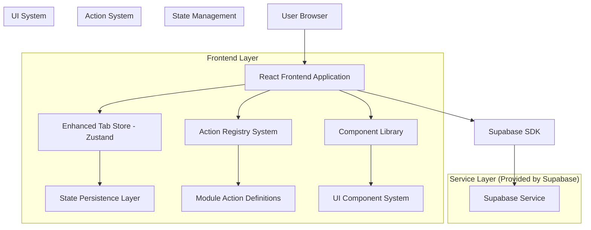
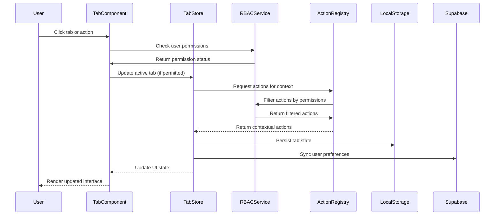
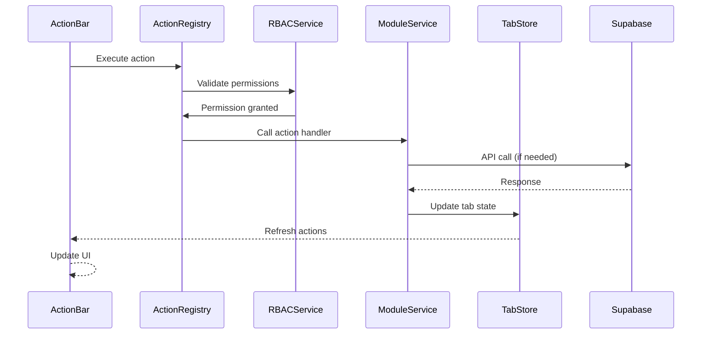
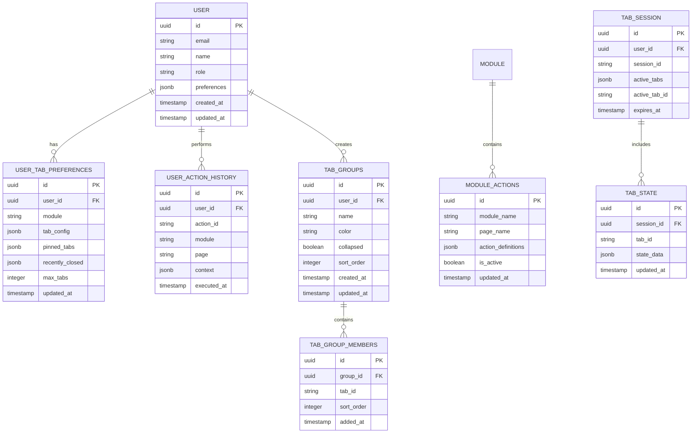

# Tabbed Workspace System - Technical Architecture Document

## 1. Architecture Design



## 2. Technology Description

* **Frontend**: React\@18 + TypeScript\@5 + Tailwind CSS\@3 + Vite\@4

* **State Management**: Zustand\@4 + React Query\@4 for server state

* **UI Components**: Headless UI\@1.7 + Heroicons\@2 + Framer Motion\@10

* **Backend**: Supabase (Authentication, Database, Real-time subscriptions)

* **Testing**: Vitest\@0.34 + React Testing Library\@13 + Playwright\@1.37

* **Build Tools**: Vite\@4 + TypeScript\@5 + ESLint\@8 + Prettier\@3

## 3. Route Definitions

| Route                | Purpose                                                |
| -------------------- | ------------------------------------------------------ |
| /dashboard           | Main dashboard with tabbed workspace interface         |
| /academics/:module   | Academic management modules (subjects, exams, grading) |
| /classes/:classId    | Class-specific management with contextual actions      |
| /students/:studentId | Individual student portal and records                  |
| /communication       | Messaging and announcements hub                        |
| /reports             | Analytics and reporting dashboard                      |
| /settings            | User preferences and system configuration              |

## 4. Core System Components

### 4.1 Tab Store Architecture

```typescript
// Tab Store with comprehensive multi-module and role-based support
export interface Tab {
  id: string;
  title: string;
  path: string;
  module: string;
  submodule?: string;
  feature?: string;
  icon?: string;
  badge?: string | number;
  pinned: boolean;
  isDirty: boolean;
  canClose: boolean;
  lastAccessed: number;
  groupId?: string;
  color?: string;
  metadata: Record<string, any>;
  state?: TabState;
  permissions?: string[]; // Required permissions to access this tab
  userRole?: string; // User role context for this tab
}

export interface TabGroup {
  id: string;
  name: string;
  color: string;
  collapsed: boolean;
  tabIds: string[];
  createdAt: number;
  module?: string;
  permissions?: string[];
}

export interface RecentlyClosedTab {
  tab: Tab;
  closedAt: number;
  position: number;
}

export interface TabState {
  scrollPosition: number;
  formData?: Record<string, any>;
  filters?: Record<string, any>;
  selectedItems?: string[];
  viewMode?: 'list' | 'grid' | 'kanban';
  moduleContext?: string;
  userPermissions?: string[];
}

export interface TabStore {
  // Core state
  tabs: Tab[];
  activeTabId: string | null;
  groups: TabGroup[];
  recentlyClosedTabs: RecentlyClosedTab[];
  searchQuery: string;
  maxTabs: number;
  currentModule: string | null;
  userRole: string | null;
  userPermissions: string[];
  
  // Tab actions
  createTab: (tab: Omit<Tab, 'id' | 'lastAccessed'>) => string;
  closeTab: (tabId: string) => void;
  activateTab: (tabId: string) => void;
  updateTab: (tabId: string, updates: Partial<Tab>) => void;
  pinTab: (tabId: string) => void;
  unpinTab: (tabId: string) => void;
  togglePinTab: (tabId: string) => void;
  duplicateTab: (tabId: string) => string;
  markTabDirty: (tabId: string, isDirty: boolean) => void;
  restoreClosedTab: () => Tab | null;
  
  // Group management
  createGroup: (name: string, color: string) => string;
  deleteGroup: (groupId: string) => void;
  updateGroup: (groupId: string, updates: Partial<TabGroup>) => void;
  addTabToGroup: (tabId: string, groupId: string) => void;
  removeTabFromGroup: (tabId: string) => void;
  toggleGroupCollapse: (groupId: string) => void;
  
  // Search and filter
  setSearchQuery: (query: string) => void;
  getFilteredTabs: () => EnhancedTab[];
  
  // State management
  saveTabState: (tabId: string, state: Partial<TabState>) => void;
  getTabState: (tabId: string) => TabState | null;
  clearTabState: (tabId: string) => void;
  
  // Bulk operations
  closeAllTabs: () => void;
  closeAllExceptPinned: () => void;
  closeTabsToRight: (tabId: string) => void;
  closeTabsToLeft: (tabId: string) => void;
  closeTabsInGroup: (groupId: string) => void;
  
  // Utility methods
  getTabsByGroup: (groupId: string) => Tab[];
  getPinnedTabs: () => Tab[];
  getUnpinnedTabs: () => Tab[];
  reorderTabs: (fromIndex: number, toIndex: number) => void;
  
  // Module and permission management
  setCurrentModule: (module: string) => void;
  setUserRole: (role: string) => void;
  setUserPermissions: (permissions: string[]) => void;
  getTabsForModule: (module: string) => Tab[];
  canAccessTab: (tabId: string) => boolean;
}
```

### 4.2 Action Registry System

```typescript
// Action Registry for contextual action bars
export interface ActionDefinition {
  id: string;
  label: string;
  icon: string;
  variant: 'primary' | 'secondary' | 'danger';
  onClick: () => void | Promise<void>;
  disabled?: boolean;
  visible?: boolean;
  tooltip?: string;
  shortcut?: string;
  badge?: string | number;
  loading?: boolean;
  group?: string;
  priority?: number;
  module: string; // Which module this action belongs to
  submodule?: string; // Specific submodule if applicable
  feature?: string; // Specific feature within the module
  requiredPermissions: string[]; // Required permissions to execute
  requiredRoles?: string[]; // Required user roles
}

export interface ActionGroup {
  id: string;
  label: string;
  actions: ActionDefinition[];
  collapsible?: boolean;
  defaultExpanded?: boolean;
  module: string;
  requiredPermissions?: string[];
}

export interface ActionContext {
  activeTab?: Tab;
  selectedTabs?: Tab[];
  module: string;
  submodule?: string;
  feature?: string;
  user: UserContext;
  userRole: string;
  userPermissions: string[];
  data?: Record<string, any>;
  moduleData?: Record<string, any>; // Module-specific context data
}

export interface UserContext {
  id: string;
  name: string;
  email: string;
  role: string;
  permissions: string[];
  moduleAccess: Record<string, string[]>; // Module -> permissions mapping
  departmentId?: string; // For department-specific permissions
  classIds?: string[]; // For class teacher permissions
}

export interface ActionRegistry {
  // Registration
  registerActions: (module: string, page: string, actions: ActionDefinition[]) => void;
  registerActionGroup: (module: string, page: string, group: ActionGroup) => void;
  registerModuleActions: (module: string, actions: ActionDefinition[]) => void;
  
  // Retrieval
  getActionsForContext: (context: ActionContext) => ActionDefinition[];
  getActionGroupsForContext: (context: ActionContext) => ActionGroup[];
  getActionsForModule: (module: string, userPermissions: string[]) => ActionGroup[];
  
  // Management
  updateAction: (actionId: string, updates: Partial<ActionDefinition>) => void;
  executeAction: (actionId: string, context: ActionContext) => Promise<void>;
  hasPermission: (action: ActionDefinition, userPermissions: string[]) => boolean;
  filterActionsByRole: (actions: ActionDefinition[], userRole: string) => ActionDefinition[];
  
  // State
  getActionState: (actionId: string) => Partial<ActionDefinition> | null;
}
```

### 4.3 Module-Specific Action Definitions

```typescript
// Academics Module Actions
export const academicsActions: ActionDefinition[] = [
  {
    id: 'academics.subject.create',
    label: 'Create Subject',
    icon: 'plus',
    variant: 'primary',
    module: 'academics',
    submodule: 'subjects',
    requiredPermissions: ['academics.subjects.create'],
    requiredRoles: ['teacher', 'administrator', 'academic_master'],
    onClick: async () => { /* Implementation */ }
  },
  {
    id: 'academics.exam.create',
    label: 'Create Exam',
    icon: 'file-text',
    variant: 'secondary',
    module: 'academics',
    submodule: 'exams',
    requiredPermissions: ['academics.exams.create'],
    requiredRoles: ['academic_master', 'administrator'],
    onClick: async () => { /* Implementation */ }
  },
  {
    id: 'academics.grade.assign',
    label: 'Assign Grades',
    icon: 'edit',
    variant: 'secondary',
    module: 'academics',
    submodule: 'grades',
    requiredPermissions: ['academics.grades.update'],
    requiredRoles: ['teacher', 'class_teacher', 'administrator'],
    onClick: async () => { /* Implementation */ }
  }
];

// Administration Module Actions
export const administrationActions: ActionDefinition[] = [
  {
    id: 'administration.student.create',
    label: 'Add Student',
    icon: 'user-plus',
    variant: 'primary',
    module: 'administration',
    submodule: 'students',
    requiredPermissions: ['administration.students.create'],
    requiredRoles: ['administrator', 'registrar'],
    onClick: async () => { /* Implementation */ }
  },
  {
    id: 'administration.staff.manage',
    label: 'Manage Staff',
    icon: 'users',
    variant: 'secondary',
    module: 'administration',
    submodule: 'staff',
    requiredPermissions: ['administration.staff.update'],
    requiredRoles: ['administrator', 'hr_manager'],
    onClick: async () => { /* Implementation */ }
  },
  {
    id: 'administration.class.create',
    label: 'Create Class',
    icon: 'plus-circle',
    variant: 'secondary',
    module: 'administration',
    submodule: 'classes',
    requiredPermissions: ['administration.classes.create'],
    requiredRoles: ['administrator', 'academic_master'],
    onClick: async () => { /* Implementation */ }
  }
];

// Finance Module Actions
export const financeActions: ActionDefinition[] = [
  {
    id: 'finance.fee.collect',
    label: 'Collect Fee',
    icon: 'dollar-sign',
    variant: 'primary',
    module: 'finance',
    submodule: 'fees',
    requiredPermissions: ['finance.fees.collect'],
    requiredRoles: ['finance_officer', 'administrator'],
    onClick: async () => { /* Implementation */ }
  },
  {
    id: 'finance.expense.create',
    label: 'Record Expense',
    icon: 'receipt',
    variant: 'secondary',
    module: 'finance',
    submodule: 'expenses',
    requiredPermissions: ['finance.expenses.create'],
    requiredRoles: ['finance_officer', 'administrator'],
    onClick: async () => { /* Implementation */ }
  },
  {
    id: 'finance.report.generate',
    label: 'Generate Report',
    icon: 'chart-bar',
    variant: 'secondary',
    module: 'finance',
    submodule: 'reports',
    requiredPermissions: ['finance.reports.view'],
    requiredRoles: ['finance_officer', 'administrator'],
    onClick: async () => { /* Implementation */ }
  }
];

// HR Module Actions
export const hrActions: ActionDefinition[] = [
  {
    id: 'hr.employee.onboard',
    label: 'Onboard Employee',
    icon: 'user-check',
    variant: 'primary',
    module: 'hr',
    submodule: 'employees',
    requiredPermissions: ['hr.employees.create'],
    requiredRoles: ['hr_manager', 'administrator'],
    onClick: async () => { /* Implementation */ }
  },
  {
    id: 'hr.payroll.process',
    label: 'Process Payroll',
    icon: 'credit-card',
    variant: 'secondary',
    module: 'hr',
    submodule: 'payroll',
    requiredPermissions: ['hr.payroll.process'],
    requiredRoles: ['hr_manager', 'administrator'],
    onClick: async () => { /* Implementation */ }
  },
  {
    id: 'hr.attendance.mark',
    label: 'Mark Attendance',
    icon: 'clock',
    variant: 'secondary',
    module: 'hr',
    submodule: 'attendance',
    requiredPermissions: ['hr.attendance.update'],
    requiredRoles: ['hr_manager', 'administrator', 'teacher'],
    onClick: async () => { /* Implementation */ }
  }
];

// Inventory Module Actions
export const inventoryActions: ActionDefinition[] = [
  {
    id: 'inventory.item.add',
    label: 'Add Item',
    icon: 'plus',
    variant: 'primary',
    module: 'inventory',
    submodule: 'items',
    requiredPermissions: ['inventory.items.create'],
    requiredRoles: ['inventory_manager', 'administrator'],
    onClick: async () => { /* Implementation */ }
  },
  {
    id: 'inventory.stock.update',
    label: 'Update Stock',
    icon: 'refresh',
    variant: 'secondary',
    module: 'inventory',
    submodule: 'stock',
    requiredPermissions: ['inventory.stock.update'],
    requiredRoles: ['inventory_manager', 'administrator'],
    onClick: async () => { /* Implementation */ }
  },
  {
    id: 'inventory.request.create',
    label: 'Create Request',
    icon: 'shopping-cart',
    variant: 'secondary',
    module: 'inventory',
    submodule: 'requests',
    requiredPermissions: ['inventory.requests.create'],
    requiredRoles: ['teacher', 'staff', 'administrator'],
    onClick: async () => { /* Implementation */ }
  }
];

// Library Module Actions
export const libraryActions: ActionDefinition[] = [
  {
    id: 'library.book.issue',
    label: 'Issue Book',
    icon: 'book-open',
    variant: 'primary',
    module: 'library',
    submodule: 'books',
    requiredPermissions: ['library.books.issue'],
    requiredRoles: ['librarian', 'administrator'],
    onClick: async () => { /* Implementation */ }
  },
  {
    id: 'library.book.return',
    label: 'Return Book',
    icon: 'book',
    variant: 'secondary',
    module: 'library',
    submodule: 'books',
    requiredPermissions: ['library.books.return'],
    requiredRoles: ['librarian', 'administrator'],
    onClick: async () => { /* Implementation */ }
  },
  {
    id: 'library.book.add',
    label: 'Add Book',
    icon: 'plus',
    variant: 'secondary',
    module: 'library',
    submodule: 'books',
    requiredPermissions: ['library.books.create'],
    requiredRoles: ['librarian', 'administrator'],
    onClick: async () => { /* Implementation */ }
  }
];

// Nutrition Module Actions
export const nutritionActions: ActionDefinition[] = [
  {
    id: 'nutrition.menu.create',
    label: 'Create Menu',
    icon: 'plus',
    variant: 'primary',
    module: 'nutrition',
    submodule: 'menus',
    requiredPermissions: ['nutrition.menus.create'],
    requiredRoles: ['nutrition_manager', 'administrator'],
    onClick: async () => { /* Implementation */ }
  },
  {
    id: 'nutrition.meal.plan',
    label: 'Plan Meals',
    icon: 'calendar',
    variant: 'secondary',
    module: 'nutrition',
    submodule: 'meals',
    requiredPermissions: ['nutrition.meals.plan'],
    requiredRoles: ['nutrition_manager', 'administrator'],
    onClick: async () => { /* Implementation */ }
  },
  {
    id: 'nutrition.inventory.check',
    label: 'Check Inventory',
    icon: 'clipboard-list',
    variant: 'secondary',
    module: 'nutrition',
    submodule: 'inventory',
    requiredPermissions: ['nutrition.inventory.view'],
    requiredRoles: ['nutrition_manager', 'administrator'],
    onClick: async () => { /* Implementation */ }
  }
];

// Reports Module Actions
export const reportsActions: ActionDefinition[] = [
  {
    id: 'reports.academic.generate',
    label: 'Academic Report',
    icon: 'chart-bar',
    variant: 'primary',
    module: 'reports',
    submodule: 'academic',
    requiredPermissions: ['reports.academic.view'],
    requiredRoles: ['teacher', 'administrator', 'academic_master'],
    onClick: async () => { /* Implementation */ }
  },
  {
    id: 'reports.financial.generate',
    label: 'Financial Report',
    icon: 'currency-dollar',
    variant: 'secondary',
    module: 'reports',
    submodule: 'financial',
    requiredPermissions: ['reports.financial.view'],
    requiredRoles: ['finance_officer', 'administrator'],
    onClick: async () => { /* Implementation */ }
  },
  {
    id: 'reports.attendance.generate',
    label: 'Attendance Report',
    icon: 'user-group',
    variant: 'secondary',
    module: 'reports',
    submodule: 'attendance',
    requiredPermissions: ['reports.attendance.view'],
    requiredRoles: ['teacher', 'administrator', 'hr_manager'],
    onClick: async () => { /* Implementation */ }
  }
];

// Settings Module Actions
export const settingsActions: ActionDefinition[] = [
  {
    id: 'settings.system.configure',
    label: 'System Settings',
    icon: 'cog',
    variant: 'primary',
    module: 'settings',
    submodule: 'system',
    requiredPermissions: ['settings.system.update'],
    requiredRoles: ['administrator'],
    onClick: async () => { /* Implementation */ }
  },
  {
    id: 'settings.user.manage',
    label: 'User Settings',
    icon: 'user-cog',
    variant: 'secondary',
    module: 'settings',
    submodule: 'users',
    requiredPermissions: ['settings.users.update'],
    requiredRoles: ['administrator'],
    onClick: async () => { /* Implementation */ }
  },
  {
    id: 'settings.backup.create',
    label: 'Create Backup',
    icon: 'download',
    variant: 'secondary',
    module: 'settings',
    submodule: 'backup',
    requiredPermissions: ['settings.backup.create'],
    requiredRoles: ['administrator'],
    onClick: async () => { /* Implementation */ }
  }
];
```

### 4.4 Component Architecture

```typescript
// Main Tabbed Workspace Component
export interface TabbedWorkspaceProps {
  defaultModule?: string;
  maxTabs?: number;
  persistState?: boolean;
  currentModule?: string;
  userRole?: string;
  userPermissions?: string[];
  onTabChange?: (tab: Tab) => void;
  onActionExecute?: (actionId: string) => void;
  onModuleChange?: (module: string) => void;
}

// Tab Component
export interface TabComponentProps {
  tab: Tab;
  isActive: boolean;
  onClose: () => void;
  onActivate: () => void;
  onPin: () => void;
  onDuplicate: () => void;
  draggable?: boolean;
  showPermissionIndicator?: boolean;
  showModuleIndicator?: boolean;
}

// Contextual Action Bar Component
export interface ActionBarProps {
  module: string;
  page: string;
  variant?: 'default' | 'compact' | 'mobile';
  showLabels?: boolean;
  maxActions?: number;
  filterByPermissions?: boolean;
  filterByRole?: boolean;
  onActionExecute?: (actionId: string) => void;
}
```

## 5. Data Flow Architecture

### 5.1 State Management Flow



### 5.2 Action Execution Flow



## 6. Performance Optimizations

### 6.1 Lazy Loading Strategy

```typescript
// Lazy loading implementation for tab content with module-specific optimization
const TabContentRenderer: React.FC<{ tab: Tab }> = ({ tab }) => {
  const [isLoaded, setIsLoaded] = useState(tab.isActive);
  const [isVisible, setIsVisible] = useState(tab.isActive);
  const [moduleLoaded, setModuleLoaded] = useState(false);
  
  // Intersection observer for performance
  const { ref, inView } = useInView({
    threshold: 0.1,
    triggerOnce: true
  });
  
  // Load content when tab becomes active or visible
  useEffect(() => {
    if ((tab.isActive || inView) && !isLoaded) {
      // Load module-specific resources first
      loadModuleResources(tab.module).then(() => {
        setModuleLoaded(true);
        setIsLoaded(true);
      });
    }
  }, [tab.isActive, inView, isLoaded, tab.module]);
  
  // Memory management for inactive tabs
  useEffect(() => {
    if (!tab.isActive && isLoaded) {
      const timer = setTimeout(() => {
        setIsVisible(false);
      }, 30000); // Keep in memory for 30 seconds
      
      return () => clearTimeout(timer);
    } else if (tab.isActive) {
      setIsVisible(true);
    }
  }, [tab.isActive, isLoaded]);
  
  if (!isVisible) {
    return <div ref={ref} className="h-full" />;
  }
  
  if (!isLoaded || !moduleLoaded) {
    return <TabLoadingSkeleton module={tab.module} />;
  }
  
  return (
    <Suspense fallback={<TabLoadingSpinner module={tab.module} />}>
      <DynamicTabContent tab={tab} />
    </Suspense>
  );
};

// Module-specific resource loading
const loadModuleResources = async (module: string) => {
  switch (module) {
    case 'academics':
      return import('../modules/academics/resources');
    case 'administration':
      return import('../modules/administration/resources');
    case 'finance':
      return import('../modules/finance/resources');
    case 'hr':
      return import('../modules/hr/resources');
    case 'inventory':
      return import('../modules/inventory/resources');
    case 'library':
      return import('../modules/library/resources');
    case 'nutrition':
      return import('../modules/nutrition/resources');
    case 'reports':
      return import('../modules/reports/resources');
    case 'settings':
      return import('../modules/settings/resources');
    default:
      return Promise.resolve();
  }
};
```

### 6.2 State Persistence Strategy

```typescript
// Optimized state persistence with debouncing
const useTabStatePersistence = (tabId: string) => {
  const { saveTabState } = useTabStore();
  
  const debouncedSave = useMemo(
    () => debounce((state: Partial<TabState>) => {
      saveTabState(tabId, state);
    }, 300),
    [tabId, saveTabState]
  );
  
  const saveState = useCallback((state: Partial<TabState>) => {
    debouncedSave(state);
  }, [debouncedSave]);
  
  return { saveState };
};
```

## 7. Data Model

### 7.1 Database Schema



### 7.2 Data Definition Language

```sql
-- User tab preferences table
CREATE TABLE user_tab_preferences (
    id UUID PRIMARY KEY DEFAULT gen_random_uuid(),
    user_id UUID NOT NULL REFERENCES auth.users(id) ON DELETE CASCADE,
    module VARCHAR(100) NOT NULL,
    tab_config JSONB DEFAULT '{}',
    pinned_tabs JSONB DEFAULT '[]',
    recently_closed JSONB DEFAULT '[]',
    max_tabs INTEGER DEFAULT 15 CHECK (max_tabs > 0 AND max_tabs <= 20),
    updated_at TIMESTAMP WITH TIME ZONE DEFAULT NOW(),
    UNIQUE(user_id, module)
);

-- Tab groups table
CREATE TABLE tab_groups (
    id UUID PRIMARY KEY DEFAULT gen_random_uuid(),
    user_id UUID NOT NULL REFERENCES auth.users(id) ON DELETE CASCADE,
    name VARCHAR(100) NOT NULL,
    color VARCHAR(20) DEFAULT '#6b7280',
    collapsed BOOLEAN DEFAULT false,
    sort_order INTEGER DEFAULT 0,
    created_at TIMESTAMP WITH TIME ZONE DEFAULT NOW(),
    updated_at TIMESTAMP WITH TIME ZONE DEFAULT NOW()
);

-- Tab group members table
CREATE TABLE tab_group_members (
    id UUID PRIMARY KEY DEFAULT gen_random_uuid(),
    group_id UUID NOT NULL REFERENCES tab_groups(id) ON DELETE CASCADE,
    tab_id VARCHAR(100) NOT NULL,
    sort_order INTEGER DEFAULT 0,
    added_at TIMESTAMP WITH TIME ZONE DEFAULT NOW(),
    UNIQUE(group_id, tab_id)
);

-- User action history table
CREATE TABLE user_action_history (
    id UUID PRIMARY KEY DEFAULT gen_random_uuid(),
    user_id UUID NOT NULL REFERENCES auth.users(id) ON DELETE CASCADE,
    action_id VARCHAR(100) NOT NULL,
    module VARCHAR(100) NOT NULL,
    page VARCHAR(100) NOT NULL,
    context JSONB DEFAULT '{}',
    executed_at TIMESTAMP WITH TIME ZONE DEFAULT NOW()
);

-- Module actions configuration
CREATE TABLE module_actions (
    id UUID PRIMARY KEY DEFAULT gen_random_uuid(),
    module_name VARCHAR(100) NOT NULL,
    page_name VARCHAR(100) NOT NULL,
    action_definitions JSONB NOT NULL DEFAULT '[]',
    is_active BOOLEAN DEFAULT true,
    updated_at TIMESTAMP WITH TIME ZONE DEFAULT NOW(),
    UNIQUE(module_name, page_name)
);

-- Tab session management
CREATE TABLE tab_sessions (
    id UUID PRIMARY KEY DEFAULT gen_random_uuid(),
    user_id UUID NOT NULL REFERENCES auth.users(id) ON DELETE CASCADE,
    session_id VARCHAR(255) NOT NULL,
    active_tabs JSONB DEFAULT '[]',
    active_tab_id VARCHAR(100),
    expires_at TIMESTAMP WITH TIME ZONE DEFAULT (NOW() + INTERVAL '24 hours'),
    UNIQUE(user_id, session_id)
);

-- Tab state storage
CREATE TABLE tab_states (
    id UUID PRIMARY KEY DEFAULT gen_random_uuid(),
    session_id UUID NOT NULL REFERENCES tab_sessions(id) ON DELETE CASCADE,
    tab_id VARCHAR(100) NOT NULL,
    state_data JSONB DEFAULT '{}',
    updated_at TIMESTAMP WITH TIME ZONE DEFAULT NOW(),
    UNIQUE(session_id, tab_id)
);

-- Indexes for performance
CREATE INDEX idx_user_tab_preferences_user_id ON user_tab_preferences(user_id);
CREATE INDEX idx_user_action_history_user_id ON user_action_history(user_id);
CREATE INDEX idx_user_action_history_executed_at ON user_action_history(executed_at DESC);
CREATE INDEX idx_module_actions_module_page ON module_actions(module_name, page_name);
CREATE INDEX idx_tab_sessions_user_id ON tab_sessions(user_id);
CREATE INDEX idx_tab_sessions_expires_at ON tab_sessions(expires_at);
CREATE INDEX idx_tab_states_session_id ON tab_states(session_id);
CREATE INDEX idx_tab_groups_user_id ON tab_groups(user_id);
CREATE INDEX idx_tab_groups_sort_order ON tab_groups(sort_order);
CREATE INDEX idx_tab_group_members_group_id ON tab_group_members(group_id);
CREATE INDEX idx_tab_group_members_sort_order ON tab_group_members(sort_order);

-- Row Level Security (RLS) policies
ALTER TABLE user_tab_preferences ENABLE ROW LEVEL SECURITY;
ALTER TABLE user_action_history ENABLE ROW LEVEL SECURITY;
ALTER TABLE tab_sessions ENABLE ROW LEVEL SECURITY;
ALTER TABLE tab_states ENABLE ROW LEVEL SECURITY;
ALTER TABLE tab_groups ENABLE ROW LEVEL SECURITY;
ALTER TABLE tab_group_members ENABLE ROW LEVEL SECURITY;

-- RLS policies for user data
CREATE POLICY "Users can manage their own tab preferences" ON user_tab_preferences
    FOR ALL USING (auth.uid() = user_id);

CREATE POLICY "Users can manage their own action history" ON user_action_history
    FOR ALL USING (auth.uid() = user_id);

CREATE POLICY "Users can manage their own tab sessions" ON tab_sessions
    FOR ALL USING (auth.uid() = user_id);

CREATE POLICY "Users can manage their own tab states" ON tab_states
    FOR ALL USING (
        session_id IN (
            SELECT id FROM tab_sessions WHERE user_id = auth.uid()
        )
    );

CREATE POLICY "Users can manage their own tab groups" ON tab_groups
    FOR ALL USING (auth.uid() = user_id);

CREATE POLICY "Users can manage their own tab group members" ON tab_group_members
    FOR ALL USING (
        group_id IN (
            SELECT id FROM tab_groups WHERE user_id = auth.uid()
        )
    );

-- Grant permissions
GRANT SELECT ON module_actions TO anon, authenticated;
GRANT ALL PRIVILEGES ON user_tab_preferences TO authenticated;
GRANT ALL PRIVILEGES ON user_action_history TO authenticated;
GRANT ALL PRIVILEGES ON tab_sessions TO authenticated;
GRANT ALL PRIVILEGES ON tab_states TO authenticated;
GRANT ALL PRIVILEGES ON tab_groups TO authenticated;
GRANT ALL PRIVILEGES ON tab_group_members TO authenticated;

-- Initial module actions data
INSERT INTO module_actions (module_name, page_name, action_definitions) VALUES
('academics', 'subjects', '[
  {
    "id": "manage-subjects",
    "label": "Manage Subjects",
    "icon": "BookOpenIcon",
    "variant": "primary",
    "tooltip": "Manage subject configurations and settings"
  },
  {
    "id": "add-subject",
    "label": "Add Subject",
    "icon": "PlusIcon",
    "variant": "secondary",
    "tooltip": "Create a new subject"
  }
]'),
('academics', 'exams', '[
  {
    "id": "my-exams",
    "label": "My Exams",
    "icon": "DocumentTextIcon",
    "variant": "primary",
    "tooltip": "View and manage your exams"
  },
  {
    "id": "manage-exams",
    "label": "Manage Exams",
    "icon": "CogIcon",
    "variant": "secondary",
    "tooltip": "Configure exam settings and schedules"
  },
  {
    "id": "create-exam",
    "label": "Create Exam",
    "icon": "PlusCircleIcon",
    "variant": "secondary",
    "tooltip": "Create a new examination"
  }
]'),
('classes', 'management', '[
  {
    "id": "my-classes",
    "label": "My Classes",
    "icon": "UserGroupIcon",
    "variant": "primary",
    "tooltip": "View your assigned classes"
  },
  {
    "id": "manage-classes",
    "label": "Manage Classes",
    "icon": "CogIcon",
    "variant": "secondary",
    "tooltip": "Configure class settings and assignments"
  }
]');
```

## 8. Security Considerations

### 8.1 Authentication & Authorization

* Supabase handles authentication with JWT tokens

* Row Level Security (RLS) policies protect user data

* Action permissions based on user roles

* Session management with automatic cleanup

### 8.2 Data Protection

* All user preferences encrypted at rest

* Tab state data sanitized before storage

* Action history limited to essential metadata

* Automatic session expiration after 24 hours

## 9. Testing Strategy

### 9.1 Unit Tests

* Tab store actions and state management

* Action registry functionality

* Component rendering and interactions

* Utility functions and helpers

### 9.2 Integration Tests

* Tab creation and navigation flows

* Action bar context switching

* State persistence and restoration

* Performance benchmarks

### 9.3 End-to-End Tests

* Complete user workflows across modules

* Multi-tab scenarios and edge cases

* Cross-browser compatibility

* Accessibility compliance (WCAG 2.1 AA)

## 10. Performance Metrics

### 10.1 Target Performance

* Initial tab load: < 200ms

* Tab switching: < 100ms

* Action execution: < 150ms

* Memory usage: < 50MB for 10 tabs

### 10.2 Monitoring

* Real-time performance tracking

* User interaction analytics

* Error reporting and debugging

* Resource usage optimization

