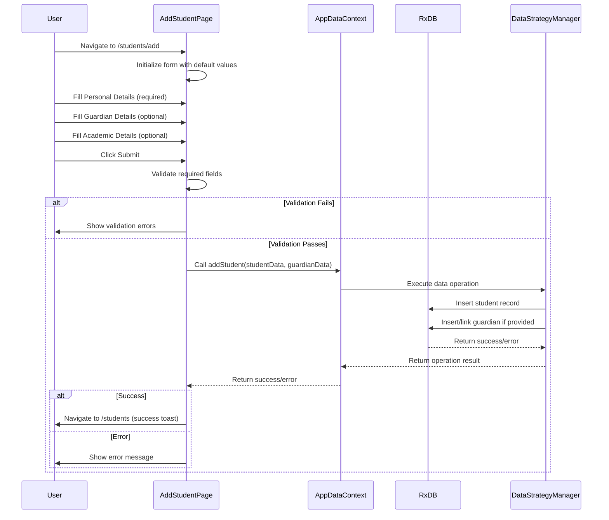
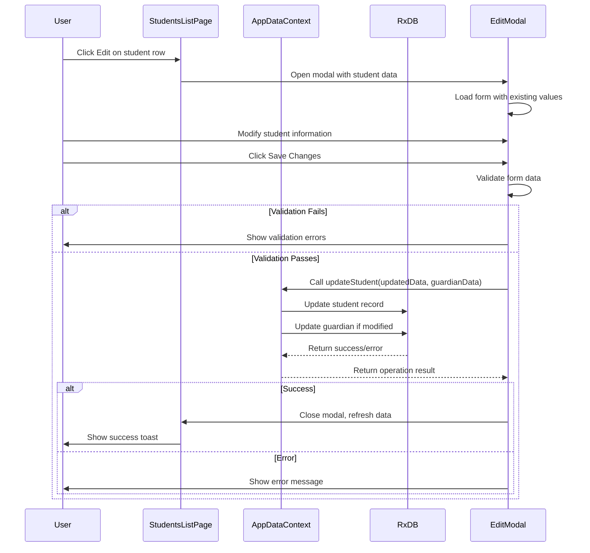
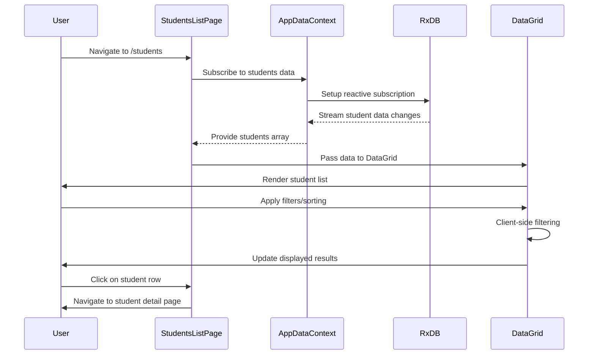
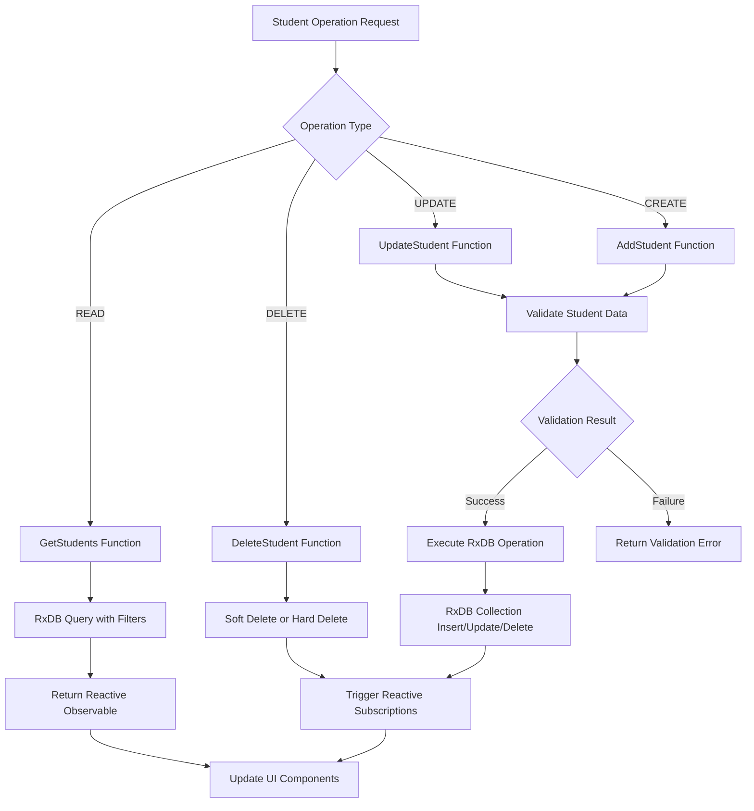

# Current Admissions Capability Report

**Date:** January 26, 2025  
**System:** SchoolPilot3 School Management System  
**Purpose:** Phase 1 - Current System Audit for Migration to EduGenOS

---

## 1. Executive Summary

This report provides a comprehensive inventory of all admissions-related functionality in the existing SchoolPilot3 system. The analysis covers pages, services, data models, APIs, and workflows to establish a baseline for migration planning to EduGenOS.

**Key Findings:**
- **4 primary admissions pages** identified
- **Comprehensive student data model** with nested relationships
- **RxDB-based offline-first architecture** with AppDataContext integration
- **Complex workflow** supporting registration, guardian linking, and class assignment
- **Full CRUD operations** with validation and error handling

---

## 2. Inventory of Admissions-Related Components

### 2.1 Primary Pages & Components

#### 2.1.1 StudentsListPage.tsx
- **Location:** `src/modules/administration/pages/StudentsListPage.tsx`
- **URL Route:** `/administration/students`
- **Primary Functions:**
  - Display paginated/filterable list of all students
  - Quick edit functionality with configurable fields
  - Full edit modal with tabbed form interface
  - Student deletion with confirmation
  - Navigation to detailed student view
- **Key Features:**
  - DataGrid with sorting, filtering, and selection
  - Status-based color coding (Active, Suspended, Alumni, etc.)
  - Quick actions (Edit, Delete, View Details)
  - Bulk operations support
  - Empty state handling

#### 2.1.2 AddStudentPage.tsx
- **Location:** `src/modules/administration/pages/AddStudentPage.tsx`
- **URL Route:** `/administration/students/add`
- **Primary Functions:**
  - Standalone page for new student registration
  - Three-tab form interface (Personal, Guardian, Academic)
  - Form validation and submission
  - Navigation back to students list
- **Key Features:**
  - Tabbed form with progress tracking
  - Field validation (required fields marked)
  - Real-time form state management
  - Cancel/submit flow control

#### 2.1.3 StudentDetailPage.tsx
- **Location:** `src/modules/administration/pages/StudentDetailPage.tsx`
- **URL Route:** `/administration/students/:studentId`
- **Primary Functions:**
  - Comprehensive student profile view
  - Tabbed interface (Bio, Subjects, Payment History)
  - Contact and guardian information display
  - Academic enrollment tracking
- **Key Features:**
  - Responsive layout with avatar/photo support
  - Contact actions (email, phone)
  - Payment history with receipt generation
  - Subject enrollment status tracking

#### 2.1.4 StudentFinancialDetailPage.tsx
- **Location:** `src/modules/administration/pages/StudentFinancialDetailPage.tsx`
- **URL Route:** `/administration/students/:studentId/financial`
- **Primary Functions:**
  - Financial summary and transaction history
  - Invoice and payment tracking
  - Balance calculations and reporting
- **Key Features:**
  - Invoice/payment reconciliation
  - Outstanding balance alerts
  - Transaction history with filtering

### 2.2 Data Services & APIs

#### 2.2.1 AppDataContext.tsx
- **Location:** `src/contexts/AppDataContext.tsx`
- **Type:** Central Data Provider
- **Functionality:**
  - Unified data access layer
  - Mock/RxDB mode switching
  - Network state management
  - Offline capability handling
- **Student Operations:**
  ```typescript
  - addStudent(student, guardian?)
  - updateStudent(student, guardian?)
  - deleteStudent(studentId)
  - getStudentDetailsById(studentId)
  ```

#### 2.2.2 Students API Module
- **Location:** `src/api/students.ts`
- **Type:** Data Access Helpers
- **Functions:**
  - `getStudentsForExamEntry(students, classStreamId)`
  - `getStudentsForClassStream(students, classStreamId)`
- **Purpose:** Filtering and business logic for student data

### 2.3 Data Models & Schemas

#### 2.3.1 Student Entity Schema
**Location:** `src/services/rxdbService.ts` (lines 68-69)

**Core Fields:**
```typescript
interface Student {
  // Identity
  id: string (UUID)
  admission_no: string (required, max 50 chars)
  upi_no?: string (max 50 chars)
  
  // Personal Information
  first_name: string (required)
  middle_name?: string
  last_name: string (required)
  gender: PersonGender (enum: MALE, FEMALE)
  date_of_birth?: string (date format)
  photo_path?: string
  
  // Academic Status
  current_class_stream_id?: number (ref: class_streams)
  student_category_id?: number (ref: student_categories)
  dormitory_id?: number (ref: dormitories)
  admission_date?: string (date format)
  status: StudentStatus (enum)
  
  // Extended Information
  email?: string
  phone?: string
  address?: string
  remarks?: string
  religion?: string
  county?: string
  district?: string
  student_type?: string
  primary_school?: string
  marks_attained_primary?: string
  class_admitted?: string
  stream_admitted?: string
  
  // Relationships
  primary_guardian?: ParentGuardian (nested object)
  exam_result_summary?: ExamResultSummary (nested object)
  user_id?: string (ref: users)
  
  // Computed Fields
  current_class_name?: string
  current_class_stream_name?: string
  student_category_name?: string
  dormitory_name?: string
  display_name?: string
  
  // Timestamps
  created_at: string (ISO datetime)
  updated_at: string (ISO datetime)
  deleted_at?: string (ISO datetime)
}
```

#### 2.3.2 Related Entity Schemas

**ParentGuardian Schema:**
```typescript
interface ParentGuardian {
  id: string
  name: string
  phone: string
  email?: string
  relationship_type?: string
  location?: string
  address?: string
  user_id?: string
  // ... timestamps
}
```

**ExamResultSummary Schema:**
```typescript
interface ExamResultSummary {
  exam_name?: string
  english?: string
  kiswahili?: string
  mathematics?: string
  science?: string
  social_studies_religious_education?: string
  total_marks?: number
}
```

#### 2.3.3 RxDB Collections Configuration
**Location:** `src/services/rxdbService.ts`

**Primary Collections:**
- `students` - Main student records
- `parents_guardians` - Guardian information
- `student_guardian_relationships` - Link table
- `class_streams` - Academic class/stream assignments
- `student_categories` - Student classification (Boarder, Day Scholar, etc.)
- `dormitories` - Accommodation assignments

### 2.4 Supporting Data Services

#### 2.4.1 Data Strategy Manager
- **Location:** `src/services/DataStrategyManager.ts`
- **Purpose:** Manages online/offline data synchronization
- **Student Operations:** Enhanced operations with conflict resolution

#### 2.4.2 Data Consistency Service
- **Location:** `src/services/DataConsistencyService.ts`
- **Purpose:** Validation and referential integrity
- **Student Validation:** Field validation, relationship integrity

---

## 3. Supported Use Cases

### 3.1 Student Registration Workflow

**Steps:**
1. **Initial Registration**
   - Navigate to Add Student page (`/administration/students/add`)
   - Complete Personal Details tab (required: admission_no, first_name, last_name, gender, status)
   - Optionally complete Guardian Details tab
   - Optionally complete Academic Details tab (class, category, dormitory)
   - Submit form triggers `addStudent()` operation

2. **Guardian Linking**
   - Guardian can be created inline during student registration
   - Relationship type specified (Father, Mother, Guardian)
   - Primary guardian designation
   - Contact information captured

3. **Class Assignment**
   - Student assigned to class stream
   - Category assignment (Boarder, Day Scholar, etc.)
   - Dormitory assignment for boarding students
   - Academic year context maintained

### 3.2 Student Management Operations

**List & Search:**
- Filterable/sortable student list
- Search by admission number, name, class
- Status-based filtering
- Bulk operations support

**Edit & Update:**
- Quick edit for common fields
- Full edit with tabbed interface
- Guardian information updates
- Academic assignment changes

**View Details:**
- Comprehensive student profile
- Academic enrollment tracking
- Financial history integration
- Contact management

### 3.3 Data Integration Points

**Academic Module Integration:**
- Subject enrollment tracking
- Exam result management
- Class/stream assignments
- Teacher-student relationships

**Finance Module Integration:**
- Fee invoicing based on student category
- Payment history tracking
- Balance calculations
- Transport fee assignments

**Nutrition Module Integration:**
- Meal plan assignments
- Wallet balance management
- Consumption tracking

---

## 4. Workflow Sequence Diagrams

### 4.1 Student Add Workflow



### 4.2 Student Edit Workflow



### 4.3 Student List & Data Flow



### 4.4 RxDB Data Persistence Flow



---

## 5. Technical Architecture Analysis

### 5.1 Data Layer Architecture

**Primary Pattern:** Repository + Context + RxDB
- **AppDataContext:** Unified data access layer
- **RxDB Collections:** Offline-first reactive database
- **Data Strategy Manager:** Online/offline sync coordination
- **Mock Data Fallback:** Development and demo support

**Key Characteristics:**
- Reactive data subscriptions using RxJS
- Automatic UI updates on data changes
- Offline capability with sync queuing
- Validation and consistency checking
- Network state awareness

### 5.2 Component Architecture

**Form Management:**
- Custom form components with validation
- Tabbed interface for complex forms
- Field-level change tracking
- Submit/cancel flow control

**Data Display:**
- DataGrid component with sorting/filtering
- Responsive layout patterns
- Empty state handling
- Loading state management

### 5.3 Integration Points

**Module Dependencies:**
- Administration (core student management)
- Academics (class/subject enrollment)
- Finance (fee management, payments)
- Nutrition (meal plans, wallet)
- HR (staff assignments as class teachers)

---

## 6. Migration Considerations

### 6.1 Strengths of Current System

1. **Comprehensive Data Model:** Rich student entity with all necessary fields
2. **Offline-First Architecture:** RxDB provides robust offline capabilities
3. **Reactive UI:** Automatic updates based on data changes
4. **Validation Framework:** Built-in data consistency and validation
5. **Modular Design:** Clear separation of concerns between modules
6. **User Experience:** Well-designed forms and interfaces

### 6.2 Potential Migration Challenges

1. **RxDB Dependency:** EduGenOS may use different data layer
2. **Component Library:** UI components may need adaptation
3. **Context Architecture:** AppDataContext pattern vs EduGenOS patterns
4. **Validation Logic:** Business rules embedded in current system
5. **Workflow Integration:** Complex inter-module dependencies

### 6.3 Data Migration Requirements

**Student Data:**
- Core student records (identity, personal info)
- Guardian relationships and contact information
- Academic assignments (class, stream, category)
- Historical data (exam results, payment history)
- File attachments (photos, documents)

**Configuration Data:**
- Student categories
- Class/stream structures
- Dormitory assignments
- Academic year definitions

---

## 7. API Endpoints Analysis

Based on the examination of `reports/schoolpilot_api_endpoints.json` and code analysis:

### 7.1 Student Management Endpoints

**Core CRUD Operations:**
- `GET /api/students` - List students with filtering
- `POST /api/students` - Create new student
- `GET /api/students/:id` - Get student details
- `PUT /api/students/:id` - Update student
- `DELETE /api/students/:id` - Delete student

**Related Operations:**
- `GET /api/students/:id/financial` - Financial summary
- `GET /api/students/:id/academic` - Academic profile
- `POST /api/students/:id/guardian` - Link guardian
- `GET /api/students/class/:classId` - Students by class

### 7.2 Supporting Endpoints

**Reference Data:**
- `GET /api/class-streams` - Available class/stream options
- `GET /api/student-categories` - Student category options
- `GET /api/dormitories` - Dormitory options
- `GET /api/guardians` - Guardian lookup

---

## 8. Recommendations for Migration

### 8.1 Immediate Actions

1. **Data Export Strategy:** Develop comprehensive export scripts for all student-related data
2. **Schema Mapping:** Create detailed mapping between SP3 and EduGenOS data models
3. **Component Inventory:** Catalog all reusable UI components for potential migration
4. **API Compatibility:** Assess EduGenOS API compatibility with current endpoints

### 8.2 Migration Phases

**Phase 1: Data Migration**
- Export student records with full relationship data
- Validate data integrity and completeness
- Import into EduGenOS with mapping transformations

**Phase 2: Functionality Migration**
- Recreate core admission workflows in EduGenOS
- Implement form validation and business rules
- Ensure feature parity with current system

**Phase 3: Integration Testing**
- Test inter-module workflows (academics, finance)
- Validate offline/online sync capabilities
- Performance and user acceptance testing

---

## 9. Conclusion

The current SchoolPilot3 admissions system is a comprehensive, well-architected solution with strong offline capabilities and user experience design. The system handles the complete student lifecycle from initial registration through ongoing management and academic tracking.

**Key Success Factors for Migration:**
- Preserve the reactive data architecture patterns
- Maintain the tabbed form interface design
- Ensure offline capability is retained
- Preserve all current integrations with other modules
- Maintain data validation and consistency features

**Total Components Identified:**
- **4 Primary Pages:** Student list, add, detail, financial detail
- **15+ Data Models:** Student, guardian, relationships, academic entities
- **50+ Fields:** Comprehensive student data model
- **Multiple Workflows:** Registration, editing, management, reporting

This system provides a solid foundation for migration to EduGenOS while maintaining all current functionality and user experience standards.

---

**Report Generated:** January 26, 2025  
**Next Phase:** API Contract Analysis & Mapping (Step 1.1)
