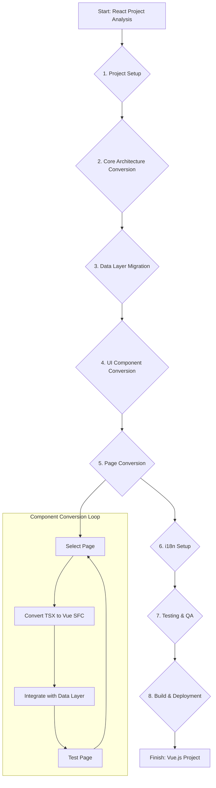

# React to Vue.js Conversion Analysis and Plan

## Analysis Summary

*   **Project Size & Complexity:** This is a large-scale application with approximately **95 page components** and **17 reusable UI components**. The application has a modular structure, which is beneficial for a phased conversion.
*   **Core Technologies:**
    *   **UI Framework:** React (to be replaced with Vue.js)
    *   **Routing:** `react-router-dom` (to be replaced with `vue-router`)
    *   **State Management/Data Layer:** `rxdb` and custom hooks. This is a significant part of the application and will require careful migration.
    *   **Styling:** Tailwind CSS. This is framework-agnostic and will be easy to integrate with Vue.
    *   **Internationalization:** `i18next` and `react-i18next` (to be replaced with a Vue-equivalent like `vue-i18next`).
    *   **Build Tool:** Vite. Vite has excellent support for both React and Vue, so the build setup will be similar.
    *   **Language:** TypeScript. Vue has first-class support for TypeScript.

## High-Level Conversion Plan & Effort Estimation

Here is a breakdown of the major tasks involved in the conversion, along with a rough estimation of the effort. The estimation is in "person-days" and assumes a developer is proficient in both React and Vue.

| Task | Description | Estimated Effort (Person-Days) |
| :--- | :--- | :--- |
| **1. Project Setup** | Initialize a new Vue.js project with Vite, TypeScript, and Tailwind CSS. Install and configure core Vue libraries (`vue-router`, `pinia` for state management if needed, `vue-i18next`). | 2 - 3 |
| **2. Core Architecture** | Recreate the main application layout (`Layout.tsx`, `Sidebar.tsx`, `Header.tsx`) in Vue. Set up the routing structure with `vue-router` to mirror the existing page structure. | 4 - 6 |
| **3. Data Layer Migration** | Convert the custom React hooks (`useRxDBData.ts`, etc.) into Vue Composables. The underlying RxDB logic should remain largely the same, but its integration with the UI will change. | 8 - 12 |
| **4. UI Component Conversion** | Convert the 17 reusable UI components from React/TSX to Vue Single File Components (`.vue`). This includes components like `Modal`, `Table`, `Select`, etc. | 10 - 15 |
| **5. Page Conversion** | This is the largest part of the effort. Convert all ~95 page components from React/TSX to Vue. This involves rewriting the template, script (logic), and styles for each page. | 40 - 55 |
| **6. Internationalization (i18n)** | Replace `react-i18next` with `vue-i18next` and update all components to use the new i18n system. The JSON translation files can be reused. | 3 - 5 |
| **7. Testing & QA** | Thoroughly test the entire application to ensure all features work as expected. This includes unit tests (if any are to be migrated/written), integration tests, and end-to-end manual testing. | 15 - 20 |
| **8. Build & Deployment** | Finalize the Vite build configuration for the Vue project and set up any necessary deployment scripts. | 1 - 2 |
| **Total Estimated Effort** | | **83 - 118 Person-Days** |

## Conversion Workflow

## Key Challenges & Considerations

*   **Data Layer (`rxdb`):** The tight coupling of `rxdb` through custom hooks is the most complex part of this migration. The new Vue composables must be robust and provide the same reactivity and data flow as the original React hooks.
*   **Third-Party Libraries:** Libraries like `recharts` are React-specific. You will need to find Vue-equivalent charting libraries (e.g., `vue-chartjs`, `echarts-for-vue`) and rewrite the chart components.
*   **Phased Migration vs. Full Rewrite:** Given the project's size, a full rewrite as planned above is a significant undertaking. A phased migration (e.g., using a micro-frontend architecture) could be considered but would add its own complexity. The current plan assumes a full rewrite.
*   **Team Expertise:** The timeline is highly dependent on the development team's familiarity with Vue.js, its ecosystem, and best practices.